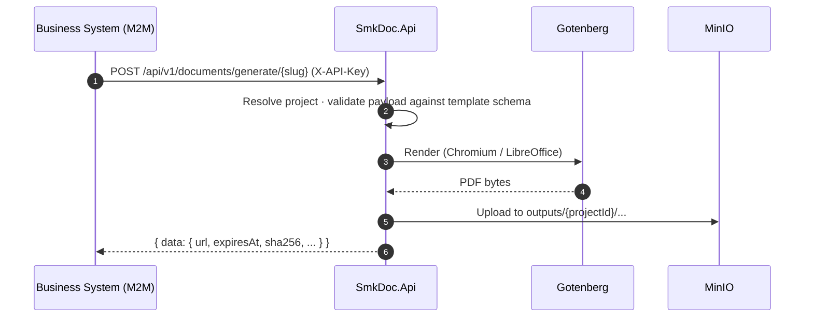
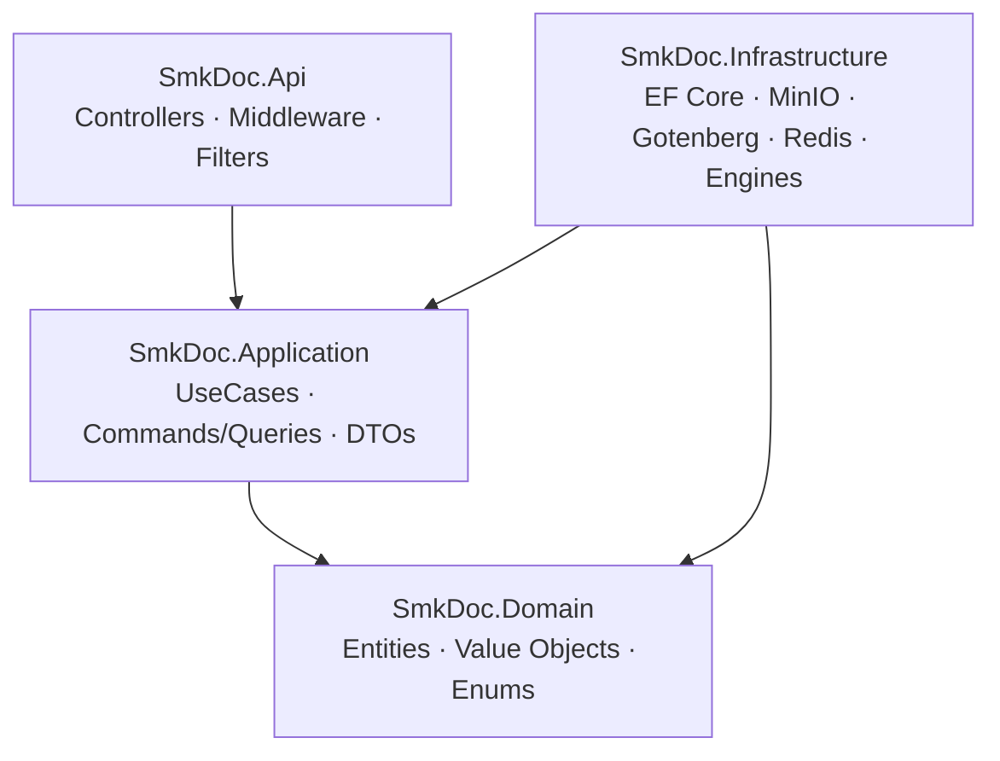

<div align="center">

# SMK Document Server

**Centralized Document Gateway — JSON in, deterministic PDF / DOCX / XLSX out**


บริการสร้างเอกสารกลางสำหรับระบบ Sammakorn — ระบบ ERP / CRM / Billing ส่ง JSON เข้ามา,
server เติมข้อมูลลง template แล้วส่ง URL ดาวน์โหลดกลับ พร้อม audit trail ครบทุกครั้งที่ generate

[Quick Start](#-quick-start) · [Architecture](#-architecture) · [API](#-api-reference) · [Deployment](#-deployment) · [Contributing](#-contributing--governance)

</div>

---

## สารบัญ

1. [ภาพรวม](#-ภาพรวม)
2. [Quick Start](#-quick-start)
3. [Services](#-services)
4. [Configuration](#-configuration)
5. [Architecture](#-architecture)
6. [Authentication & Authorization](#-authentication--authorization)
7. [API Reference](#-api-reference)
8. [Template System](#-template-system)
9. [Frontend Portal](#-frontend-portal)
10. [Deployment](#-deployment)
11. [Database Migrations](#-database-migrations)
12. [Testing](#-testing)
13. [Project Structure](#-project-structure)
14. [Operations & Troubleshooting](#-operations--troubleshooting)
15. [Contributing & Governance](#-contributing--governance)
16. [Known Limitations](#-known-limitations)

---

## 🎯 ภาพรวม

SMK Document Server เป็น **document generation engine** ที่แยกออกจาก business application —
ระบบหลักไม่ต้องรู้เรื่อง layout, ฟอนต์ไทย หรือ PDF rendering



### ความสามารถหลัก

| หมวด | รายละเอียด |
|------|-----------|
| **Multi-format** | PDF (Handlebars → Chromium), DOCX (OpenXML), XLSX (ClosedXML) — DOCX/XLSX แปลงเป็น PDF ผ่าน LibreOffice ใน Gotenberg |
| **Template lifecycle** | Draft → Commit → Version ใหม่ทุกครั้ง, rollback ได้, optimistic concurrency ด้วย `If-Match` |
| **Field Mapping** | map JSON path / SQL dataset → placeholder, รองรับ math expression |
| **Thai-first** | วันที่ พ.ศ., จำนวนเงินเป็นตัวอักษร, เบอร์โทร, เลขบัตรประชาชน, จัดการฟอนต์ต่อ project |
| **Inline media** | QR Code และ Barcode ผ่าน `{{qr:key}}` / `{{barcode:key}}` |
| **Sync + Async** | `generate` (ตอบทันที) และ `generate-async` (queue + polling สำหรับ batch) |
| **Multi-tenancy** | Company → Project → Templates / API Keys / Datasets แยกขาดต่อ project |
| **Dual-channel auth** | M2M API Key (ระบบภายนอก) + JWT (Portal) |
| **Safe retries** | `Idempotency-Key` บน endpoint ที่สร้างเอกสาร |
| **Audit trail** | log ทุก generation พร้อม SHA-256 ของไฟล์และ document versioning ผ่าน `documentRef` |
| **Studio Portal** | Monaco Editor, live PDF preview, mapping แบบ drag-and-drop |

---

## 🚀 Quick Start

### Prerequisites

- Docker Desktop (Windows/macOS) หรือ Docker Engine (Linux) พร้อม Compose v2
- Git

### Run ทั้งระบบด้วย Docker

```bash
git clone <repo-url>
cd smk-doc-server

# 1) เตรียม environment (ค่าใน .env.example เป็นค่า dev เท่านั้น)
cp .env.example .env

# 2) Build + start ทุก service
docker compose -f docker-compose.v2.yml -p smk-v2 up -d --build

# 3) ตรวจสอบสถานะ
docker compose -f docker-compose.v2.yml -p smk-v2 ps
curl http://localhost:8080/health
```

| Endpoint | URL |
|----------|-----|
| Portal | http://localhost:3001 |
| API | http://localhost:8080 |
| API Docs (Scalar) | http://localhost:8080/scalar/v1 (`/swagger` redirect มาที่นี่) |
| OpenAPI spec | http://localhost:8080/openapi/v1.json |
| MinIO Console | http://localhost:9001 |

ครั้งแรกที่ start, backend จะ **รัน migration และ seed ข้อมูลเริ่มต้นอัตโนมัติ**
(Company → Project → Admin user → Master API Key) ตามค่า `ADMIN_EMAIL`, `ADMIN_PASSWORD`, `MASTER_API_KEY`

### Native development (ไม่ build container ของ app)

**ต้องมี:** .NET 10 SDK, Node.js 20+

```bash
# 1) ยก infrastructure เท่านั้น
docker compose -f docker-compose.v2.yml -p smk-v2 up -d db minio gotenberg redis

# 2) Backend  → http://localhost:8080
dotnet run --project backend-v2/src/SmkDoc.Api/SmkDoc.Api.csproj

# 3) Frontend → http://localhost:3001
cd frontend-v2
cp .env.example .env.local      # ตั้ง AUTH_SECRET ด้วย: npx auth secret
npm install
npm run dev
```

> [!NOTE]
> ค่า default ใน `backend-v2/src/SmkDoc.Api/appsettings.json` ชี้ไปที่ `localhost` ตรงกับ port mapping ของ compose
> จึงรัน backend แบบ native ได้โดยไม่ต้องตั้ง env เพิ่ม

---

## 🧩 Services

| Service | Compose name | Host port | Image / Source | หน้าที่ |
|---------|--------------|-----------|----------------|---------|
| PostgreSQL | `db` | 5433 | `postgres:15-alpine` | ข้อมูลหลัก (EF Core) |
| MinIO | `minio` | 9000 (S3), 9001 (Console) | `minio/minio` | เก็บไฟล์ผลลัพธ์ |
| Gotenberg | `gotenberg` | 3000 | `gotenberg/gotenberg:8` | Chromium / LibreOffice renderer |
| Redis | `redis` | 6379 | `redis:7-alpine` | rate limit แบบ distributed, idempotency, draft cache, render queue |
| Backend API | `doc-server-v2` | 8080 | `./backend-v2` | REST API + background workers |
| Portal | `portal-v2` | 3001 → 3000 | `./frontend-v2` | Next.js admin / authoring console |

**Startup order:** `db`, `minio`, `gotenberg`, `redis` → `doc-server-v2` → `portal-v2`
(แต่ละตัวรอ healthcheck ของ dependency ก่อน)

---

## ⚙️ Configuration

ตั้งค่าผ่านไฟล์ `.env` ที่ root (compose อ่านอัตโนมัติ) — ทุกตัวมี default สำหรับ dev

### Ports

| Variable | Default | คำอธิบาย |
|----------|---------|---------|
| `DOC_SERVER_PORT` | `8080` | Backend API |
| `PORTAL_PORT` | `3001` | Portal |
| `POSTGRES_PORT` | `5433` | PostgreSQL |
| `MINIO_PORT` / `MINIO_CONSOLE_PORT` | `9000` / `9001` | MinIO S3 / Console |
| `GOTENBERG_PORT` | `3000` | Gotenberg |
| `REDIS_PORT` | `6379` | Redis |

### Infrastructure

| Variable | Default | คำอธิบาย |
|----------|---------|---------|
| `POSTGRES_DB` / `POSTGRES_USER` / `POSTGRES_PASSWORD` | `smkdoc` / `postgres` / `password` | PostgreSQL |
| `MINIO_ROOT_USER` / `MINIO_ROOT_PASSWORD` | `admin` / `password` | MinIO credentials |
| `MINIO_PUBLIC_ENDPOINT` | `http://localhost:9000` | URL ที่ **browser / client** ใช้ดาวน์โหลดไฟล์ (ใช้สร้าง presigned URL) |
| `ASPNETCORE_ENVIRONMENT` | `Production` | environment ของ backend ใน compose |

### Security — 🔒 ต้องเปลี่ยนทั้งหมดใน production

| Variable | ใช้ทำอะไร | ข้อกำหนด |
|----------|----------|----------|
| `MASTER_API_KEY` | Master API Key (seed ตอน startup) | สุ่มยาว ≥ 32 ตัวอักษร |
| `JWT_SECRET` | ลงนาม JWT ของ backend | ≥ 32 bytes (backend ไม่ start ถ้าสั้นกว่า) |
| `JWT_ISSUER` / `JWT_AUDIENCE` | claim ของ JWT | ตั้งให้ตรงกันทั้งระบบ |
| `ENCRYPTION_KEY` | เข้ารหัส connection string ของ Data Connection | 32 bytes |
| `AUTH_SECRET` | Auth.js (NextAuth) session ของ Portal | สร้างด้วย `npx auth secret` |
| `ADMIN_EMAIL` / `ADMIN_PASSWORD` | admin คนแรกที่ seed | เปลี่ยน password ทันทีหลัง login |

### Portal

| Variable | ชนิด | คำอธิบาย |
|----------|------|---------|
| `NEXT_PUBLIC_API_URL` | **build-time** | URL ของ backend ที่ browser เรียก — ถูก bake เข้า bundle, เปลี่ยนแล้วต้อง rebuild |
| `NEXT_PUBLIC_DEFAULT_API_KEY` | **build-time** | compose ส่งค่า `MASTER_API_KEY` เข้ามาตอน build |
| `API_INTERNAL_URL` | runtime (server) | URL ภายในที่ Next.js proxy ใช้เรียก backend (`http://doc-server-v2:8080`) |

### Backend (`appsettings.json` → override ด้วย env แบบ `Section__Key`)

| Key | ตัวอย่าง env | คำอธิบาย |
|-----|--------------|---------|
| `ConnectionStrings:DefaultConnection` | `ConnectionStrings__DefaultConnection` | PostgreSQL |
| `ConnectionStrings:Redis` / `Redis:ConnectionString` / `REDIS_URL` | `ConnectionStrings__Redis` | **ไม่ตั้ง = ทำงานโหมด in-memory** (ไม่เหมาะกับ multi-instance) |
| `Redis:InstancePrefix` | `Redis__InstancePrefix` | key prefix, default `smkdoc:` |
| `Minio:Endpoint` / `PublicEndpoint` / `AccessKey` / `SecretKey` / `Secure` | `Minio__*` | MinIO |
| `GotenbergUrl` | `GotenbergUrl` | Gotenberg base URL |
| `Cors:AllowedOrigins` | `Cors__AllowedOrigins` | array หรือ string คั่นด้วย `;` — ว่าง = ปิด CORS ใน production |

---

## 🏛 Architecture

Clean Architecture + Feature Slices ภายใต้ 4 Bounded Contexts — dependency ไหลเข้าหา Domain เสมอ



| Layer | กฎสำคัญ |
|-------|---------|
| **Domain** | POCO ล้วน ไม่พึ่ง framework — state เปลี่ยนผ่าน factory / domain verb เท่านั้น |
| **Application** | 1 UseCase ต่อ 1 `IUseCase<TReq, TRes>` (ไม่ใช้ MediatR), คืน `*ResultDto` ไม่เคยคืน Entity |
| **Infrastructure** | implement port (persistence, storage, renderer, queue) — เป็นเจ้าของ tenant query filter |
| **Api** | controller บาง ≤ 5 บรรทัด/action, error ทั้งหมดเป็น RFC 9457 `ProblemDetails` |

### Bounded Contexts

| Context | Aggregates | หน้าที่ |
|---------|-----------|---------|
| `IdentityAccess` | Company, Project, User, ApiKey | auth, tenant, API keys |
| `Authoring` | Template, TemplateVersion, FieldMapping, Font | จัดการ template และ mapping |
| `Rendering` | Document, DocumentVersion, GenerationLog | generate, preview, audit |
| `Integration` | DataConnection, Dataset | แหล่งข้อมูลภายนอก (SQL) |

### Rendering engines

| Template | Engine | Output |
|----------|--------|--------|
| HTML | Handlebars.Net → Gotenberg Chromium | PDF |
| DOCX | DocumentFormat.OpenXml (+ Gotenberg LibreOffice สำหรับ PDF) | DOCX / PDF |
| XLSX | ClosedXML (+ Gotenberg LibreOffice สำหรับ PDF) | XLSX / PDF |

### Tech stack

| Layer | Technology |
|-------|-----------|
| Runtime | ASP.NET Core on .NET 10, C# 13 |
| Persistence | EF Core 10 + Npgsql (PostgreSQL 15), Redis 7 (StackExchange.Redis) |
| Storage | MinIO (S3-compatible, presigned URL) |
| Validation | FluentValidation, JsonSchema.Net |
| Imaging | SkiaSharp, QRCoder, ZXing.Net |
| API docs | Built-in OpenAPI + Scalar |
| Frontend | Next.js 15 (App Router), React 19, Tailwind CSS 3, TanStack Query 5, Auth.js v5, Monaco Editor, dnd-kit, Zod |

> สถาปัตยกรรมละเอียด กฎ naming และ anti-pattern อยู่ใน [`specs/`](specs/) — เริ่มที่
> [`01_system_architecture.md`](specs/00_architecture_core/01_system_architecture.md)

---

## 🔐 Authentication & Authorization

ทุก request ผ่าน `ProjectContextMiddleware` ซึ่งระบุ **ตัวตน + project (tenant)** ก่อนถึง controller

| Channel | ผู้ใช้ | Credential | ขอบเขต |
|---------|-------|-----------|--------|
| **A — M2M** | ระบบภายนอก (ERP, CRM, Billing) | header `X-API-Key: <key>` | ผูกกับ 1 project, scope `ReadOnly` / `ReadWrite` |
| **B — Portal** | Template author, admin | `Authorization: Bearer <jwt>` | เลือก project ผ่านเส้นทาง `{projectId}` หรือ header `X-Project-Id` |

- ถ้ามี `X-API-Key` → ใช้ Channel A, ไม่มี → ตรวจ JWT
- API Key ถูก hash (SHA-256) ก่อนเก็บ; plaintext แสดง **ครั้งเดียว** ตอนสร้าง
- JWT: access token อายุ 24 ชั่วโมง, refresh token อายุ 7 วัน (`POST /api/v1/auth/refresh`)
- ถ้า `{projectId}` ใน route ขัดกับ `X-Project-Id` → `400` (กัน cross-tenant spoofing)
- Password ใช้ BCrypt

### Authorization policies

| Policy | ผ่านเมื่อ |
|--------|----------|
| `CanGenerateDocuments` | authenticated (API Key หรือ JWT) |
| `CanManageTemplates`, `CanManageDatasets` | role `Author` / `Developer` / `Admin` / `SuperAdmin` หรือ API Key scope `ReadWrite` |
| `CanManageDataConnections` | `Admin` / `SuperAdmin` |
| `RequireProjectAdmin` | `Admin` / `SuperAdmin` หรือ API Key scope `ReadWrite` |
| `RequireSuperAdmin` | system role `SuperAdmin` |

### Public routes (ไม่ต้อง authenticate)

`/health`, `/healthz`, `/ready`, `/scalar*`, `/openapi*`, `/swagger*`, `/docs*`,
`POST /api/v1/auth/login`, `POST /api/v1/auth/refresh`, `POST /api/v1/schemas/validate`

### Rate limiting

Fixed window ต่อนาที — ใช้ Redis เมื่อมีการตั้งค่า (ไม่งั้นนับใน memory ต่อ instance), เกินจะได้ `429`

| Policy | Limit / นาที | Partition | ใช้กับ |
|--------|:-----------:|-----------|--------|
| `auth-strict` | 5 | IP | login, refresh |
| `api` | 60 | caller (API key / user) | controller ทั้งหมด (default) |
| `rendering` | 30 | caller | generate, generate-async, preview |
| `test-conn` | 10 | caller | ทดสอบ data connection / dataset dry-run |

---

## 📡 API Reference

> **Source of truth:** [`specs/openapi.json`](specs/openapi.json) และ Scalar UI ที่ `/scalar/v1`
> ส่วนนี้สรุปเฉพาะ contract และ endpoint ที่ใช้บ่อย

### Conventions

| หัวข้อ | กติกา |
|--------|------|
| Base path | `/api/v1/{resource}` |
| Success (single) | `{ "data": { ... } }` |
| Success (list) | `{ "data": [ ... ], "pagination": { "page", "limit", "totalCount", "totalPages" } }` |
| Error | RFC 9457 `application/problem+json` (`type`, `title`, `status`, `detail`) |
| Concurrency | `PUT` / `DELETE` บน resource ที่แก้ไขได้ต้องส่ง `If-Match: "<token>"` |
| Idempotency | `Idempotency-Key: <uuid>` บน `generate` / `generate-async` (optional, cache 24 ชม.) |
| Binary | endpoint ที่คืนไฟล์ (preview, download) **ไม่ห่อ** envelope |

### Generate a document

`POST /api/v1/documents/generate/{slug}`

```bash
curl -X POST http://localhost:8080/api/v1/documents/generate/invoice \
  -H "X-API-Key: <api-key>" \
  -H "Idempotency-Key: 7b1f3c52-0c1e-4b0e-9e4a-5d8a3f2b9a10" \
  -H "Content-Type: application/json" \
  -d '{
    "payload": {
      "customerName": "บริษัท ABC จำกัด",
      "amount": 250000,
      "items": [{ "name": "สินค้า A", "qty": 2, "price": 125000 }]
    },
    "outputFormat": "pdf",
    "documentRef": "INV-2026-001",
    "changeNote": "Initial generation"
  }'
```

| Field | Type | Required | คำอธิบาย |
|-------|------|:--------:|---------|
| `payload` | object | ✓ | ข้อมูลสำหรับ placeholder |
| `outputFormat` | `pdf` \| `docx` \| `xlsx` | — | default `pdf` |
| `documentRef` | string | — | business key — ใช้ทำ document versioning / history |
| `changeNote` | string | — | หมายเหตุของ version นี้ |
| `skipValidation` | boolean | — | ข้าม JSON Schema validation (default `false`) |

```json
{
  "data": {
    "generationId": "0194f1d2-...",
    "documentRef": "INV-2026-001",
    "outputFormat": "pdf",
    "fileSizeBytes": 48213,
    "sha256": "9f86d081...",
    "url": "https://minio.example.com/outputs/...?X-Amz-...",
    "expiresAt": "2026-11-08T10:30:00Z"
  }
}
```

Presigned `url` มีอายุ **24 ชั่วโมง**; ไฟล์เก็บที่ `outputs/{projectId}/{yyyy/MM/dd}/{slug}_{generationId}.{ext}`

### Generate asynchronously (batch)

`POST /api/v1/documents/generate-async/{slug}` → `202 Accepted` + job

```
POST generate-async/{slug}  →  202  { data: { jobId, status, checkStatusUrl, ... } }
GET  jobs/{jobId}           →  200  { data: { status, downloadUrl, error, result, ... } }
```

Job สำเร็จเมื่อ `status` เปลี่ยนเป็นสถานะเสร็จสิ้น — `downloadUrl` / `result` จะถูกเติม
(คิวทำงานด้วย `DocumentRenderQueueWorker`; มี implementation ทั้ง Redis และ in-memory)

### Preview (ไม่บันทึกอะไร)

`POST /api/v1/documents/preview` (ส่ง `html` ตรง) และ `POST /api/v1/documents/preview/{slug}`

```json
{ "payload": { "customerName": "Test" }, "html": "<html>...</html>" }
```

คืน `application/pdf` (inline) — **ไม่เขียน database / MinIO / log**, ใช้กับ live preview ใน Studio
ต้อง authenticate เช่นเดียวกับ endpoint อื่น

### Endpoint map

<details open>
<summary><b>Rendering</b> — generate, download, history, audit</summary>

| Method | Path | คำอธิบาย |
|--------|------|---------|
| POST | `/documents/generate/{slug}` | generate แบบ sync |
| POST | `/documents/generate-async/{slug}` | enqueue job |
| GET | `/documents/jobs/{jobId}` | สถานะ job |
| POST | `/documents/preview`, `/documents/preview/{slug}` | live preview |
| GET | `/documents/download/{logId}` · `/download/{logId}/file` | stream ไฟล์ผลลัพธ์ (สองเส้นทางเทียบเท่ากัน) |
| GET | `/documents/download/{logId}/url` | ขอ presigned URL ใหม่ |
| GET | `/documents/{documentRef}/versions` · `/history` | version และประวัติของเอกสาร |
| GET | `/documents/{documentRef}/versions/{version}/download` | ดาวน์โหลด version ที่ระบุ |
| GET | `/logs` · `/logs/metrics` · `/logs/{id}/payload` | audit log (Admin) |

</details>

<details>
<summary><b>Authoring</b> — templates, drafts, studio, mappings, fonts</summary>

| Method | Path | คำอธิบาย |
|--------|------|---------|
| GET, POST | `/templates` | list / create |
| GET, PUT, DELETE | `/templates/{id}` | detail / update metadata / deactivate |
| GET, PUT | `/templates/{id}/html` | อ่าน / บันทึก HTML (สร้าง version ใหม่) |
| GET | `/templates/{id}/versions` | ประวัติ version |
| POST | `/templates/{id}/rollback/{version}` | rollback |
| GET | `/templates/{id}/download` | ดาวน์โหลดไฟล์ template |
| GET | `/templates/{id}/studio` · `/studio/bundle` · `/schema` | ข้อมูลสำหรับ Studio / inferred JSON Schema |
| POST | `/templates/draft/parse` | parse ไฟล์ที่อัปโหลดเป็น draft |
| POST | `/templates/draft/{draftId}/preview` · `/commit` | preview / commit draft เป็น template |
| POST | `/templates/{id}/validate` · `/templates/{slug}/validate` | validate + dry-run render |
| POST | `/templates/{slug}/validate-payload` | validate payload กับ schema ของ template |
| GET, POST | `/templates/scan-fields`, `/templates/{id}/scan-fields` | สแกน `{{placeholder}}` |
| GET, PUT | `/templates/{id}/mappings` | อ่าน / บันทึก mapping |
| POST | `/templates/{id}/mappings/preview` | preview ผล mapping |
| GET, PUT | `/templates/{id}/datasets` | ผูก dataset กับ template |
| GET, POST | `/fonts` · `/fonts/catalog` | จัดการฟอนต์ |
| POST | `/schemas/validate` | validate JSON Schema (public) |

</details>

<details>
<summary><b>Integration</b> — data connections & datasets</summary>

| Method | Path | คำอธิบาย |
|--------|------|---------|
| GET, POST | `/data-connections` | list / create |
| GET, PUT, DELETE | `/data-connections/{id}` | detail / update / delete |
| POST | `/data-connections/test` | ทดสอบ connection (ไม่บันทึก) |
| GET, POST | `/datasets` | list / create |
| GET, PUT, DELETE | `/datasets/{id}` | detail / update / delete |
| POST | `/datasets/dry-run` | รัน query ทดสอบ |

</details>

<details>
<summary><b>Identity & Access</b> — auth, users, projects, API keys</summary>

| Method | Path | คำอธิบาย |
|--------|------|---------|
| POST | `/auth/login` · `/auth/refresh` | login / rotate token |
| GET | `/auth/me` | profile + project ที่เข้าถึงได้ |
| GET, POST | `/users` | สมาชิกใน project / invite |
| PUT | `/users/{userId}/role` | เปลี่ยน role |
| PATCH | `/users/{userId}/status` | suspend / activate |
| DELETE | `/users/{userId}` | ถอดออกจาก project |
| GET, POST | `/api-keys` | list / create (plaintext แสดงครั้งเดียว) |
| DELETE | `/api-keys/{id}` | revoke |
| GET, POST | `/management/projects` | จัดการ project (SuperAdmin) |
| GET | `/management/projects/{projectId}` | รายละเอียด project |
| POST | `/management/projects/{projectId}/transfer-owner` | โอนความเป็นเจ้าของ |
| GET, POST | `/management/projects/{projectId}/api-keys` | API key ต่อ project (SuperAdmin) |
| DELETE | `/management/projects/{projectId}/api-keys/{keyId}` | revoke |

</details>

### Health

`GET /health` — คืน `status` รวม และ `checks[]` (`name`, `status`, `description`, `durationMs`) ของ dependency (database, Gotenberg, MinIO)

---

## 📝 Template System

### HTML (Handlebars)

```html
<h1>{{companyName}}</h1>
<p>วันที่: {{invoiceDate:thaidate}}</p>
<p>จำนวนเงิน: {{totalAmount:currency}} บาท ({{totalAmount:baht}})</p>


{{#each items}}
  <tr><td>{{name}}</td><td>{{qty}}</td><td>{{price:currency}}</td></tr>
{{/each}}

{{#if isPaid}}<span>ชำระแล้ว</span>{{/if}}

<template id="header"><div>{{companyName}}</div></template>
<template id="footer"><div>หน้า <span class="pageNumber"></span></div></template>
```

**Handlebars helpers ที่ลงทะเบียนไว้:** `thaitransform`, `thai_baht_text`, `thai_date`, `format_number`,
`addOne`, `inc`, `ifEquals`, `qr`, `qrcode`, `barcode`

### DOCX / XLSX

ใช้ `{{placeholder}}` ใน Word / Excel — array ขยายเป็น row ผ่าน `[]`:

```
DOCX table:  | {{items[].name}} | {{items[].qty}} | {{items[].price:currency}} |
XLSX row:    A3: {{items[].name}}   B3: {{items[].qty}}   C3: {{items[].price}}
```

### Placeholder syntax

| Syntax | ความหมาย |
|--------|---------|
| `{{key}}` | แทนค่าตรงๆ |
| `{{key:transform}}` | แทนค่าพร้อม transform |
| `{{qr:key}}` / `{{barcode:key}}` | ฝัง QR / Barcode เป็นรูป |
| `{{image:key}}` | ฝังรูป (base64) |
| `{{#each arr}}…{{/each}}` | loop (HTML) |

### Thai & formatting transforms

| Transform (alias) | Input | Output |
|-------------------|-------|--------|
| `baht` (`thaibaht`, `thai_baht`, `thai_baht_text`, `baht_text`, `bahttext`, `currency_thai`) | `250000` | `สองแสนห้าหมื่นบาทถ้วน` |
| `currency` (`money`, `number`) | `250000` | `250,000.00` |
| `currency0` | `250000` | `250,000` |
| `thaidate` (`date`, `thai_date`, `thaidate_full`) | `2024-01-15` | `15 มกราคม 2567` |
| `thaidate_short` (`thaidateshort`, `thai_date_abbr`) | `2024-01-15` | `15 ม.ค. 2567` |
| `thaidatetime` (`thai_datetime`) | `2024-01-15T14:30:00` | `15 มกราคม 2567 14:30 น.` |
| `phone` (`thaiphone`, `tel`) | `0812345678` | `081-234-5678` |
| `idcard` (`thaiid`, `citizen_id`) | `1234567890123` | `1-2345-67890-12-3` |
| `upper` / `lower` | `abc` | `ABC` / `abc` |

transform ที่ไม่รู้จักจะคืนค่าเดิมโดยไม่ error

### Field Mapping

กำหนดว่า placeholder แต่ละตัวดึงข้อมูลจากไหน

| Mode | แหล่งข้อมูล | ตัวอย่าง |
|------|------------|---------|
| **JSON** | request payload (dot-notation) | `customer.name`, `items[0].name` |
| **SQL** | Dataset ผ่าน `DatasetAlias` + `ResultPath` | alias `customer`, path `name` |
| **Math** | expression บนค่าที่ resolve แล้ว | `{totalAmount} * 1.07`, `{qty} * {unitPrice}` |

ตั้งค่า SQL mode: สร้าง **Data Connection** → สร้าง **Dataset** (SQL query) → ผูก dataset กับ template ด้วย alias → ใช้ alias ใน mapping

---

## 🖥 Frontend Portal

Next.js 15 App Router — Authoring Console สำหรับ Admin และ Template Designer (ไม่ใช่ login hub สำหรับระบบอื่น)

| Route | หน้าที่ |
|-------|--------|
| `templates` | list / สร้าง template |
| `studio` | Monaco + live PDF preview + version history |
| `upload` | wizard: upload → scan placeholder → สร้าง mapping |
| `mapping` | drag-and-drop field mapping |
| `version-history` | เปรียบเทียบ / rollback version |
| `generator` | ทดลอง generate พร้อมฟอร์ม |
| `audit` | ค้นประวัติเอกสารด้วย `documentRef` |
| `logs`, `analytics` | generation log และ metrics |
| `datasources` | Data Connections / Datasets |
| `projects`, `users` | project และสมาชิก |
| `settings` | health check และตั้งค่า API key |
| `apidocs` | คู่มือสำหรับ developer |

**กลไกสำคัญ**

- **Session:** Auth.js v5 (`/api/auth/[...nextauth]`); JWT refresh ผ่าน backend
- **Backend proxy:** `/api/proxy/[...path]` → `API_INTERNAL_URL` (server-to-server, ไม่ต้องเปิด CORS ให้ browser เรียกตรง)
- **Data layer:** TanStack Query + API client ที่ generate ด้วย Orval (`npm run codegen`) + Zod schemas
- **RBAC (UI):** `src/lib/rbac.ts` กำหนดระดับ `Viewer < Editor < Admin` ต่อเมนู — เป็นเพียง UX gating, **backend policy เป็นตัวตัดสินจริงเสมอ**

---

## 🚢 Deployment

### Docker Compose (local / single host)

```bash
# start / rebuild
docker compose -f docker-compose.v2.yml -p smk-v2 up -d --build

# rebuild เฉพาะ service
docker compose -f docker-compose.v2.yml -p smk-v2 up -d --build doc-server-v2
docker compose -f docker-compose.v2.yml -p smk-v2 up -d --build portal-v2

# logs
docker compose -f docker-compose.v2.yml -p smk-v2 logs -f doc-server-v2

# stop (เก็บ volume)  /  stop + ลบข้อมูลทั้งหมด (รัน migration + seed ใหม่)
docker compose -f docker-compose.v2.yml -p smk-v2 down
docker compose -f docker-compose.v2.yml -p smk-v2 down -v
```

### Production (Coolify + Traefik)

Backend รองรับ reverse proxy ผ่าน `ForwardedHeaders` (`X-Forwarded-For` / `X-Forwarded-Proto`)

| ต้องตั้ง | ตัวอย่าง |
|---------|---------|
| `NEXT_PUBLIC_API_URL` | `https://api.example.com` |
| `MINIO_PUBLIC_ENDPOINT` | `https://files.example.com` |
| `MASTER_API_KEY`, `JWT_SECRET`, `ENCRYPTION_KEY`, `AUTH_SECRET` | ค่าสุ่มแข็งแรง ห้ามใช้ default |
| `POSTGRES_PASSWORD`, `MINIO_ROOT_PASSWORD`, `ADMIN_PASSWORD` | ค่าที่ไม่ใช่ default |
| `Cors__AllowedOrigins` | origin ของ Portal |
| `ASPNETCORE_ENVIRONMENT` | `Production` |

> [!IMPORTANT]
> `NEXT_PUBLIC_*` ถูก bake เข้า bundle ตอน **build** — ต้องตั้งค่าก่อน build Portal และ rebuild เมื่อเปลี่ยน

> [!WARNING]
> หากรันหลาย instance ของ backend **ต้องตั้ง Redis** — ไม่เช่นนั้น rate limit, idempotency และ render queue จะแยกกันต่อ instance

---

## 🗄 Database Migrations

EF Core Code-First — backend เรียก `MigrateAsync` ตอน startup อัตโนมัติ
ไฟล์อยู่ที่ [`backend-v2/src/SmkDoc.Infrastructure/Migrations`](backend-v2/src/SmkDoc.Infrastructure/Migrations)

| Migration | สิ่งที่ทำ |
|-----------|---------|
| `AddDatasourceSupport` | schema เริ่มต้น: templates, versions, field mappings, generation logs, API keys, data connections |
| `AddDatasetLayer` | datasets และปรับ field mappings |
| `WaveTwo_FullSchemaRebuild` | template versioning, documents anchor, template datasets |
| `AddAuthAndMultiTenancy` | companies, projects, users, project roles; scope entity ตาม project |
| `AddProjectIsolationToRemainingTenantEntities` | tenant isolation ครบทุก entity |
| `AddSystemRoleToUser` | `SystemRole` (SuperAdmin / Member / Viewer) |
| `SyncMissingSchemaColumns` | sync คอลัมน์ที่ขาด |
| `OptimizeTenantIndexesAndQueryPerformance` | index ตาม tenant |
| `AddPageSettingsJsonToTemplateVersion` | page settings ต่อ template version |

```bash
# apply ด้วยมือ
dotnet ef database update \
  --project backend-v2/src/SmkDoc.Infrastructure \
  --startup-project backend-v2/src/SmkDoc.Api

# สร้าง migration ใหม่
dotnet ef migrations add <MigrationName> \
  --project backend-v2/src/SmkDoc.Infrastructure \
  --startup-project backend-v2/src/SmkDoc.Api
```

> [!IMPORTANT]
> แก้ entity / configuration แล้วต้องสร้าง migration คู่กันเสมอ

---

## 🧪 Testing

### Backend (xUnit · NSubstitute · FluentAssertions)

```bash
cd backend-v2
dotnet test SmkDocServerV2.slnx                                    # ทั้งหมด
dotnet test --filter "FullyQualifiedName~GenerateDocumentUseCase"  # เฉพาะ class
dotnet test --settings coverlet.runsettings --collect:"XPlat Code Coverage"
```

| Project | ขอบเขต | กติกา |
|---------|--------|------|
| `SmkDoc.Tests` | Domain, UseCase, Engines, API | **in-memory 100%** — mock/fake เท่านั้น ห้ามแตะ disk / binary / network |
| `SmkDoc.IntegrationTests` | Persistence, Storage, Repositories, Benchmarks | I/O จริงอยู่ที่นี่เท่านั้น |

### Frontend

```bash
cd frontend-v2
npm test                 # vitest run
npx tsc --noEmit         # type check
npm run lint
```

### Scenario & manual tests

[`tests/`](tests/) เก็บ HTTP scenarios (`tests/http`), ชุดทดสอบเอกสารจริง (`tests/scenarios`) และรายงานผล (`tests/reports`)

---

## 📁 Project Structure

```
smk-doc-server/
├── backend-v2/
│   ├── src/
│   │   ├── SmkDoc.Domain/           Entities, value objects, enums
│   │   ├── SmkDoc.Application/
│   │   │   ├── Common/              Interfaces, helpers (ThaiDataTransformer, ...)
│   │   │   └── Modules/             {IdentityAccess | Authoring | Rendering | Integration}
│   │   │                              └─ {Aggregate}/{Commands | Queries | DTOs}
│   │   ├── SmkDoc.Infrastructure/
│   │   │   ├── Persistence/         AppDbContext, repositories, configurations
│   │   │   ├── Migrations/          EF Core migrations
│   │   │   ├── Engines/             Html · Word · Excel · Fonts · Placeholders · DraftHandlers
│   │   │   ├── Storage/ Cache/ Queue/ BackgroundWorkers/
│   │   │   └── Security/ Imaging/ Pdf/ ...
│   │   └── SmkDoc.Api/
│   │       ├── Controllers/         Authoring · IdentityAccess · Integration · Rendering
│   │       ├── Contracts/ Common/Responses/   request records, ApiResponse<T>
│   │       ├── Authentication/ Middleware/ Filters/ RateLimiting/ HealthChecks/
│   │       └── Program.cs
│   └── tests/                       SmkDoc.Tests · SmkDoc.IntegrationTests
├── frontend-v2/src/
│   ├── app/                         App Router: (app)/* pages, api/auth, api/proxy
│   ├── features/                    feature modules (templates, studio, mapping, ...)
│   ├── components/ hooks/ contexts/ lib/ schemas|types/ tokens/ utils/
│   └── __tests__/                   vitest
├── specs/                           Architecture blueprints + openapi.json
├── tests/                           HTTP scenarios, fixtures, reports
├── tools/                           Test-fixture generators
├── docker-compose.v2.yml            Full stack
├── AGENTS.md                        Engineering rules for contributors / AI agents
└── README.md
```

---

## 🛠 Operations & Troubleshooting

| อาการ | สาเหตุที่พบบ่อย | วิธีแก้ |
|-------|----------------|--------|
| Portal ไม่มีข้อมูล / 401 | session หมดอายุ หรือ `AUTH_SECRET` / `API_INTERNAL_URL` ไม่ถูกต้อง | login ใหม่, ตรวจ env ของ `portal-v2` |
| ดาวน์โหลดไฟล์ไม่ได้ใน production | `MINIO_PUBLIC_ENDPOINT` ยังเป็น `localhost` | ตั้งเป็น public URL ของ MinIO แล้ว restart backend |
| Browser เรียก API ผิดที่ | `NEXT_PUBLIC_API_URL` ถูก bake ตอน build | ตั้งค่าที่ถูกแล้ว rebuild `portal-v2` |
| Backend ไม่ start: JWT Secret | `JWT_SECRET` สั้นกว่า 32 bytes | ตั้งค่าให้ยาวพอ |
| CORS error | origin ไม่อยู่ใน `Cors__AllowedOrigins` | เพิ่ม origin ของ Portal |
| generate ช้า / ล้มเหลว | Gotenberg ไม่ตอบ | `docker compose ... logs gotenberg`, `curl http://localhost:3000/health` |
| `429 Too Many Requests` | เกิน rate limit ของ policy นั้น | ดูตาราง [Rate limiting](#rate-limiting) |
| `409` จาก idempotency | request เดิมที่ใช้ `Idempotency-Key` เดียวกันยังประมวลผลอยู่ | รอแล้วเรียกซ้ำ (key จะ replay ผลเดิมพร้อม header `Idempotency-Replayed`) |
| `422` จาก idempotency | ใช้ `Idempotency-Key` เดิมกับ payload ที่ต่างกัน | ใช้ key ใหม่ต่อ payload |

```bash
# สถานะ migration
dotnet ef migrations list \
  --project backend-v2/src/SmkDoc.Infrastructure \
  --startup-project backend-v2/src/SmkDoc.Api
```

---

## 🤝 Contributing & Governance

โปรเจกต์นี้ถูกกำกับด้วย blueprint ใน [`specs/`](specs/) และกฎใน [`AGENTS.md`](AGENTS.md) — อ่านก่อนเขียนโค้ด

| หัวข้อ | Blueprint |
|--------|----------|
| Architecture / layer boundaries | [`specs/00_architecture_core/01_system_architecture.md`](specs/00_architecture_core/01_system_architecture.md) |
| Coding conventions & naming | [`02_coding_conventions.md`](specs/00_architecture_core/02_coding_conventions.md) · [`04_naming_standards.md`](specs/00_architecture_core/04_naming_standards.md) |
| Security & performance | [`03_security_and_performance.md`](specs/00_architecture_core/03_security_and_performance.md) |
| Anti-patterns | [`05_anti_pattern_firewall.md`](specs/00_architecture_core/05_anti_pattern_firewall.md) |
| API contract (envelopes, ETag, idempotency) | [`06_api_contract_standards.md`](specs/00_architecture_core/06_api_contract_standards.md) |
| Domain / Application / Infrastructure / API / Testing | [`specs/01_clean_arch_patterns/`](specs/01_clean_arch_patterns/) |
| Frontend | [`specs/02_frontend_patterns/`](specs/02_frontend_patterns/) |
| Multi-tenancy, rendering, database | [`specs/03_specialized_mechanics/`](specs/03_specialized_mechanics/) |

**กฎที่ละเมิดไม่ได้**

- Controller ≤ 5 บรรทัด/action; UseCase ทำตาม Parse → Ensure → Mutate → Return
- ทุก response ห่อด้วย `ApiResponse<T>` / `PagedApiResponse<T>`; error เป็น `ProblemDetails`
- ใช้ `TimeProvider` แทน `DateTime.UtcNow`; stream ไฟล์ด้วย buffer 81,920 bytes ห้าม `byte[]` ก้อนใหญ่
- Preview ต้อง **in-memory 100%** — ห้ามเขียน database / MinIO
- Unit test อยู่ใน `SmkDoc.Tests` แบบ in-memory; I/O จริงไปที่ `SmkDoc.IntegrationTests`
- Git (`add` / `commit` / `push`) เป็นหน้าที่ของคนเท่านั้น

---

## ⚠️ Known Limitations

รายการ technical debt ที่ทราบ — ควรจัดการก่อนขึ้น production จริง

| # | เรื่อง | ผลกระทบ / ข้อเสนอ |
|---|--------|------------------|
| 1 | `/scalar`, `/openapi`, `/swagger` ถูก map ทุก environment | เปิดเผย API surface ใน production → จำกัดที่ reverse proxy หรือ gate ด้วย environment |
| 2 | `EncryptionKey` มี fallback key ใน source ถ้าไม่ตั้งค่า | connection string ใน DB เข้ารหัสด้วยกุญแจที่รู้กัน → ต้องตั้ง `ENCRYPTION_KEY` เสมอ |
| 3 | compose มี default secret ของทุกตัว | ลืมตั้งค่า = ระบบทำงานด้วย secret สาธารณะ |
| 4 | ไม่มี Redis = in-memory ต่อ instance | scale แนวนอนแล้ว rate limit / idempotency / queue ไม่ทำงานร่วมกัน |
| 5 | ชื่อ role ไม่ตรงกัน: UI ใช้ `Editor`, backend ใช้ `Developer` / `Author` | ควร unify ชุด role ระหว่าง `rbac.ts` กับ policy |
| 6 | `.env.example` ที่ root ยังมี `ONLYOFFICE_*` และไม่มี Redis / JWT / `ENCRYPTION_KEY` / `AUTH_SECRET` | ใช้ตารางใน [Configuration](#-configuration) เป็นหลักจนกว่าจะอัปเดต |
| 7 | `package.json` ที่ root ยังมี script ของ v1 (`dev:v1`, `docker:up:v1`, ...) | ชี้ไปยัง path ที่ไม่มีแล้ว — ใช้คำสั่งใน README แทน |

---

<div align="center">
<sub>SMK Document Server v2 · Sammakorn · Internal platform</sub>
</div>
