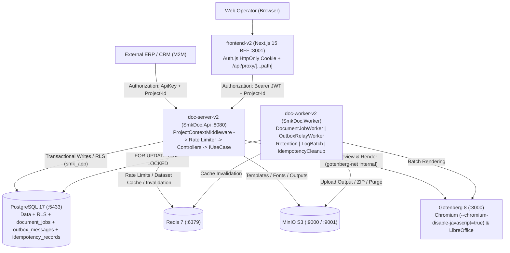

# SMK Document Platform (`smk-doc-server`)

แพลตฟอร์มสร้างและจัดการเอกสารระดับองค์กรแบบ Multi-Tenant (**PDF / DOCX / XLSX**) สำหรับสถาปัตยกรรม **Backend v2 (.NET 10 / C# 14 Clean Architecture + Vertical Slices)**, **Background Worker (`SmkDoc.Worker`)** และ **Frontend Portal v2 (Next.js 15 App Router)**

รองรับการออกแบบเทมเพลตด้วย Monaco HTML/Handlebars Editor, Word (`.docx` OpenXML), Excel (`.xlsx` ClosedXML), Data Binding จาก PostgreSQL/MySQL/SQL Server พร้อม SSRF IP Pinning, การสร้างเอกสารทั้งแบบ Synchronous, Live Preview และ Asynchronous Batch Queue (`PostgreSQL FOR UPDATE SKIP LOCKED`) รวมถึงระบบ Zero Standing Access (Break-Glass) และ PostgreSQL Row-Level Security (`FORCE ROW LEVEL SECURITY`)

---

## สารบัญ

- [ความสามารถหลัก](#ความสามารถหลัก)
- [สถาปัตยกรรมระบบ](#สถาปัตยกรรมระบบ)
- [Tech Stack](#tech-stack)
- [โครงสร้างโปรเจกต์](#โครงสร้างโปรเจกต์)
- [การเริ่มต้นใช้งาน (Quick Start)](#การเริ่มต้นใช้งาน-quick-start)
- [การยืนยันตัวตนและ Multi-Tenancy](#การยืนยันตัวตนและ-multi-tenancy)
- [API Endpoints หลัก](#api-endpoints-หลัก)
- [Frontend Portal Routes](#frontend-portal-routes)
- [การทดสอบ, Quality Gates และ CI/CD](#การทดสอบ-quality-gates-และ-cicd)
- [เอกสาร Engineering Specifications](#เอกสาร-engineering-specifications)
- [หมายเหตุเชิงปฏิบัติการและสถานะความเข้ากันได้ (Operational Notes)](#หมายเหตุเชิงปฏิบัติการและสถานะความเข้ากันได้-operational-notes)

---

## ความสามารถหลัก

- **3-Pipeline Document Rendering**
  - **Pipeline A (Synchronous Single Document):** `POST /api/v1/documents` รองรับ `Idempotency-Key`, JSON Schema Draft-07 validation, Thai Localization (`ILocalizedDataFormatter` / พ.ศ. +543 / บาทไทย), และบันทึก Audit Trail (`GenerationLog`) พร้อม Document Version Ledger
  - **Pipeline B (Stateless Live Preview):** `POST /api/v1/documents/preview`, `/preview/{slug}`, `/template-drafts/{draftId}/preview`, และ `/templates/{id}/mappings/preview` ส่งคืน `application/pdf` แบบ `inline` โดยไม่เขียน MinIO และไม่สร้างประวัติย้อนหลัง (อนุญาตคีย์ `ReadOnly`)
  - **Pipeline C (Asynchronous Batch & Job Queue):** `POST /api/v1/document-jobs` คืน `202 Accepted` พร้อม `Location` และ `Retry-After` บันทึกลงตาราง PostgreSQL (`document_jobs` / `document_job_items`) ให้ `DocumentJobWorker` ดึงงานด้วย `FOR UPDATE SKIP LOCKED`, รองรับ Keyset Cursor Pagination, Cancel/Retry ด้วย Optimistic Concurrency (`If-Match`) และดาวน์โหลดผลลัพธ์เดียวหรือ Batch ZIP
- **Multi-Engine Synthesis & Thai Typography**
  - **HTML -> PDF:** `Handlebars.Net` + `HtmlLayoutProcessor` (ฝังฟอนต์ Sarabun และ Header/Footer extraction) ส่งต่อให้ **Gotenberg 8 (Chromium)** บน isolated network (`gotenberg-net`)
  - **Word -> DOCX / PDF:** `DocumentFormat.OpenXml` ป้องกัน XXE (`DtdProcessing.Prohibit`), จัดลำดับ Graphic Frame ID (`DrawingML`), และแปลงเป็น PDF ผ่าน Gotenberg LibreOffice เมื่อร้องขอ
  - **Excel -> XLSX / PDF:** `ClosedXML` ตั้งค่าหน้ากระดาษ Fit-to-Page (`FitToPages(1, 0)`) และสร้าง Barcode/QR Code ผ่าน `QRCoder`, `SkiaSharp`, `ZXing.Net`
- **Multi-Tenant Security & 5-Layer Isolation**
  - แยก **Control Plane** (`/api/v1/management/**` เฉพาะ `SuperAdmin`) ออกจาก **Data Plane** (`/api/v1/**` ต้องระบุ `Project-Id`)
  - **Zero Standing Access (ZSA):** `SuperAdmin` ไม่สามารถเข้าถึง Data Plane ของ Tenant ได้โดยอัตโนมัติ ต้องมีสิทธิ์สมาชิก (`UserProjectRole`) หรือคำขอ `BreakGlassGrant` ที่ยังมีผลและถูกบันทึก Audit
  - ป้องกัน 5 ชั้น: `ProjectContextMiddleware` -> `ICurrentProjectContext` -> EF Core Global Query Filters (`IMustHaveProject` + Child Filters) -> `TenantSecuritySaveChangesInterceptor` / Connection & Transaction Interceptors (`set_config('app.current_project_id', ...)`) -> PostgreSQL `FORCE ROW LEVEL SECURITY` (Runtime Role `smk_app`)
- **SSRF Defense & Database Connectors:** ตรวจสอบโฮสต์ฐานข้อมูลภายนอกและ Webhook callback ผ่าน `IConnectionHostValidator` (`ConnectionHostValidator`) ก่อนเชื่อมต่อจริง พร้อมเข้ารหัส Connection String ด้วย AES-256-GCM (`DataProtectionService`)
- **Transactional Outbox & Concurrency Control:** เก็บ Domain Events ลง `outbox_messages` ใน Transaction เดียวกับข้อมูลธุรกิจแล้วส่งต่อด้วย `OutboxRelayWorker` (`fn_claim_outbox_messages`), พร้อม Two-Phase Optimistic Concurrency (`ETag: "v{version}"` / `If-Match`)
- **Interactive Portal & BFF Proxy (`frontend-v2`):** Auth.js v5 เก็บ JWT ใน HttpOnly Cookie และส่งคำขอผ่าน `/api/proxy/[...path]` พร้อม Silent Refresh Rotation และ TypeScript client types ที่สร้างอัตโนมัติจาก `specs/openapi.json`

---

## สถาปัตยกรรมระบบ



### Bounded Contexts ใน Backend v2

`SmkDoc.Application/Modules/` จัดโครงสร้างตาม Vertical Slices ออกเป็น **6 Bounded Contexts**:
1. `Authoring` — Template lifecycle, Monaco Studio HTML, Draft parsing/caching (`HybridTemplateDraftCache`), Versions/Rollback, Fonts, Schemas, Field mappings
2. `DataBinding` — `DataBindingEngine`, JSONPath evaluator, Batch dataset execution (`DatasetBatchExecutor`)
3. `Integration` — `DataConnection` (PostgreSQL/MySQL/SQL Server + Connectivity checks), `Dataset` + Dry-run SQL
4. `Rendering` — Pipeline A (`POST /documents`), Pipeline B (`preview`), Pipeline C (`POST /document-jobs`), Document versions, Artifacts, Audit logs
5. `IdentityAccess` — Auth (JWT Login/Refresh/Profile), Users, Project memberships, Portal workspace switching, Project API keys
6. `TenantManagement` — Platform tenants lifecycle (activate/deactivate/egress CIDRs), Project quotas, Platform fonts, Audited `BreakGlassGrant`

*(หมายเหตุ: ในระดับ `SmkDoc.Domain` โครงสร้างปัจจุบันยังเก็บ Core entities ไว้ที่ `Entities/` ร่วมกับโฟลเดอร์ย่อย `TenantManagement/`)*

---

## Tech Stack

| ส่วนระบบ | เทคโนโลยีหลัก (เวอร์ชันที่ใช้งานจริง) | รายละเอียดเพิ่มเติม |
|---|---|---|
| **Backend API (`SmkDoc.Api`)** | `.NET 10` (`net10.0`), `C# 14` | Clean Architecture, Vertical Slice `IUseCase<,>`, `ValidatingUseCaseDecorator`, `IdempotencyDecorator`, `LoggingUseCaseDecorator`, `ETagResponseFilter`, `Scalar.AspNetCore` `2.17.14` |
| **Background Worker (`SmkDoc.Worker`)** | `.NET 10` Host (`BackgroundService`) | `DocumentJobWorker`, `OutboxRelayWorker`, `DocumentRetentionWorker`, `GenerationLogBatchWorker`, `IdempotencyCleanupWorker` |
| **ORM & Database** | PostgreSQL `17-alpine`, EF Core `10.0.4`, Npgsql `10.0.3`, Dapper `2.1.86` | `FORCE ROW LEVEL SECURITY`, pure lowercase `snake_case` schema (2 re-baselined EF Core migrations ใน `SmkDoc.Infrastructure/Migrations/`) |
| **Document Engines & Validation** | `Handlebars.Net` `2.4.3`, `DocumentFormat.OpenXml` `3.2.0`, `ClosedXML` `0.104.2`, `JsonSchema.Net` `7.3.3`, `FluentValidation` `11.11.0`, `Gotenberg 8` | `QRCoder` `1.8.0`, `SkiaSharp` `3.119.1`, `ZXing.Net.Bindings.SkiaSharp` `0.16.22`, `RecyclableMemoryStream` `3.0.1`, `HybridSpoolStream` (`65,536` bytes/chunk) |
| **Cache, Storage & Security** | `StackExchange.Redis` `2.8.24`, `Minio` `6.0.3`, `BCrypt.Net-Next` `4.2.0`, AES-256-GCM | OpenAPI auto-gen (`Microsoft.AspNetCore.OpenApi` `10.0.12` + `Microsoft.Extensions.ApiDescription.Server` `10.0.12` -> `specs/openapi.json`) |
| **Frontend Portal (`frontend-v2`)** | Next.js `15.2.0`, React `19.0.0`, TypeScript `5.7.3`, Tailwind CSS `3.4.17` | `@tanstack/react-query` `5.105.0`, `next-auth` `5.0.0-beta.29`, `@monaco-editor/react` `4.7.0`, `@dnd-kit/*`, `zod` `3.24.2`, `lucide-react` `0.475.0`, `openapi-typescript` `7.13.0` |
| **Testing & Static Analysis** | `xUnit` `2.9.3`, `NSubstitute` `5.3.0`, `FluentAssertions` `7.0.0`, `NetArchTest.Rules` `1.3.2`, `Testcontainers.PostgreSql` `4.16.0`, `Vitest` `5.0.1` | `TreatWarningsAsErrors`, Roslyn `latest-all`, `SonarAnalyzer.CSharp`, `Microsoft.VisualStudio.Threading.Analyzers`, `BannedApiAnalyzers` (`BannedSymbols.txt`), Semgrep, `@redocly/cli`, `oasdiff` |

---

## โครงสร้างโปรเจกต์

```text
smk-doc-server/
├── .github/workflows/ci.yml            # CI 6 jobs (specs, backend, openapi+codegen, frontend, semgrep, integration)
├── .githooks/                          # Opt-in pre-commit & pre-push git hooks
├── .semgrep/smk-rules.yml              # Custom SAST rules สำหรับ C# และ TypeScript/Frontend
├── AGENTS.md                           # Master architecture & guardrails guide สำหรับ coding agents
├── docker-compose.v2.yml               # Production-like non-root stack (db, minio, gotenberg, redis, doc-server-v2, doc-worker-v2, portal-v2)
├── package.json                        # Root monorepo convenience scripts (v2)
├── redocly.yaml                        # Redocly OpenAPI lint ruleset
├── backend-v2/
│   ├── SmkDocServerV2.slnx
│   ├── Directory.Build.props           # net10.0, C# 14, Analyzers, TreatWarningsAsErrors
│   ├── Directory.Packages.props        # Central Package Management (CPM)
│   ├── BannedSymbols.txt               # BannedApiAnalyzers (DateTime.Now, Guid.NewGuid, IgnoreQueryFilters, ToArray, ฯลฯ)
│   ├── src/
│   │   ├── SmkDoc.Domain/              # Entities, TenantManagement, ValueObjects, Smart Enums, Events, ErrorCodes
│   │   ├── SmkDoc.Application/         # Modules (6 contexts), UseCase decorators, HybridSpoolStream, Validation
│   │   ├── SmkDoc.Infrastructure/      # AppDbContext, Migrations (2 pure snake_case), RLS Interceptors, Outbox, Engines, Gotenberg, MinIO, Redis
│   │   ├── SmkDoc.Api/                 # Controllers (29), ProjectContextMiddleware, Modular DI Extensions, OpenAPI transformers, Filters, Rate limiting
│   │   └── SmkDoc.Worker/              # Standalone Worker host สำหรับ BackgroundServices
│   └── tests/
│       ├── SmkDoc.Tests/               # Unit tests, NetArchTest policies, OpenAPI contract parity tests
│       └── SmkDoc.IntegrationTests/    # Testcontainers PostgreSQL, RLS, ZSA, Optimistic concurrency, Pipeline C, Benchmarks
├── frontend-v2/
│   ├── package.json
│   ├── next.config.ts
│   ├── .env.example
│   └── src/
│       ├── app/
│       │   ├── (app)/                  # 16 workspace pages (analytics, api-keys, apidocs, audit, datasources, generator, jobs, logs, mapping, projects, settings, studio/[templateId], templates, upload, users, version-history)
│       │   ├── api/                    # Auth.js routes + /api/proxy/[...path] + /api/health
│       │   └── (boundaries)            # App Router loading.tsx, error.tsx, global-error.tsx, not-found.tsx
│       ├── components/                 # layout/* (AppShell, Topbar, Sidebar, WorkspaceSwitcher, CommandPalette) & ui/*
│       ├── features/                   # Feature modules (api, components, hooks, schemas, domain)
│       ├── hooks/                      # Shared hooks (useAutoSelectFirst, useConflictRecovery, useIdempotencyKey)
│       └── lib/                        # api/client.ts, api/schema.d.ts (generated), api/types.ts, auth/*, proxy/*, rbac.ts
├── specs/
│   ├── openapi.json                    # Build-generated OpenAPI 3.x specification
│   ├── 00_architecture_core/           # Core architecture, conventions, security, naming, firewall, API contract
│   ├── 01_clean_arch_patterns/         # Domain, Application, Infrastructure, Api Presentation, Testing archetypes
│   ├── 02_frontend_patterns/           # App Router & data fetching, UI component conventions
│   └── 03_specialized_mechanics/       # Tenancy/Security pipeline, Document rendering mechanics, DB & Schema mechanics
├── tests/                              # E2E sample templates, tests/http/v2-api-smoke.http และ benchmark reports
└── tools/
    ├── ci/                             # check-specs.ps1, run-ps.mjs
    ├── openapi/                        # check-openapi.ps1 (rebuild + drift + redocly + oasdiff)
    └── GenerateTestFixtures/           # Tool สร้างไฟล์ทดสอบเอกสาร
```

---

## การเริ่มต้นใช้งาน (Quick Start)

### ข้อกำหนดพื้นฐาน (Prerequisites)

- **Docker Engine / Docker Desktop** (สำหรับ Compose stack และ Integration tests ผ่าน Testcontainers)
- **.NET 10 SDK** (สำหรับพัฒนา Backend/Worker และรัน `dotnet test` / `dotnet format`)
- **Node.js 24+** และ npm (สำหรับ Frontend `frontend-v2` และเครื่องมือ OpenAPI codegen/lint)
- **PowerShell (`pwsh`)** (สำหรับสคริปต์ตรวจ specs และ OpenAPI contract gates)

### วิธีที่ 1: รันทั้ง Stack ด้วย Docker Compose (`docker-compose.v2.yml`)

```bash
# 1. สั่ง build และรันบริการทั้งหมด (Postgres 17, MinIO, Gotenberg 8, Redis 7, doc-server-v2, doc-worker-v2, portal-v2)
docker compose -f docker-compose.v2.yml -p smk-v2 up -d --build

# 2. ดู logs ของ API และ Worker
docker compose -f docker-compose.v2.yml -p smk-v2 logs -f doc-server-v2 doc-worker-v2
```

บริการที่จะเปิดใช้งานบน Host:
- **Web Portal (`portal-v2`):** [http://localhost:3001](http://localhost:3001)
- **Backend API (`doc-server-v2`):** [http://localhost:8080](http://localhost:8080)
- **Scalar API Reference:** [http://localhost:8080/scalar/v1](http://localhost:8080/scalar/v1)
- **OpenAPI JSON Spec:** [http://localhost:8080/openapi/v1.json](http://localhost:8080/openapi/v1.json)
- **Health Check:** [http://localhost:8080/health](http://localhost:8080/health)
- **PostgreSQL 17:** `localhost:5433` (Database: `smkdoc`, Runtime RLS user: `smk_app`, Migrator user: `postgres`)
- **MinIO S3 / Console:** API `http://localhost:9000` / Console `http://localhost:9001`
- **Redis 7:** `localhost:6379`
- **Gotenberg 8:** รันอยู่ภายใน isolated network `gotenberg-net` (`http://gotenberg:3000`, ไม่ expose ออกนอก Docker network)

<details>
<summary>ตัวแปร Environment หลักที่ docker-compose.v2.yml และ frontend-v2 ใช้</summary>

| ตัวแปร | หน้าที่ | Default ใน `docker-compose.v2.yml` (สำหรับ Dev) |
|---|---|---|
| `POSTGRES_DB`, `POSTGRES_USER`, `POSTGRES_PASSWORD` | ฐานข้อมูลและสิทธิ์ Migrator | `smkdoc` / `postgres` / `password` |
| `SMK_APP_DB_USER`, `SMK_APP_DB_PASSWORD` | Runtime non-superuser สำหรับบังคับ PostgreSQL RLS | `smk_app` / dev password |
| `JWT_SECRET`, `JWT_ISSUER`, `JWT_AUDIENCE` | ลงนามและตรวจสอบ Portal JWT (`>= 32` chars, TTL `<= 15m`) | dev fallback / `SmkDoc` / `SmkDoc.Portal` |
| `ENCRYPTION_KEY` | กุญแจเข้ารหัส AES-256-GCM สำหรับ DataConnection (`>= 32` bytes) | dev fallback |
| `API_KEY_PEPPER`, `ALLOW_LEGACY_SHA256_KEYS` | HMAC-SHA256 Pepper ของ API Key และโหมดรองรับ SHA-256 เดิม | dev pepper / `false` |
| `WEBHOOK_SIGNING_SECRET`, `MASTER_API_KEY` | คีย์ Webhook และ Bootstrap Master Key (`smk_live_{12-char-id}_{secret}`) | dev fallbacks (`smk_live_DevMaster01_...`) |
| `ADMIN_EMAIL`, `ADMIN_PASSWORD` | บัญชี SuperAdmin เริ่มต้นตอน seed | `admin@sammakorn.co.th` / `Admin@2026!` |
| `AUTH_SECRET`, `API_INTERNAL_URL`, `NEXT_PUBLIC_API_URL` | ตั้งค่า Auth.js session secret และ URL ฝั่ง BFF/Browser (ดู `frontend-v2/.env.example`) | internal URL `http://doc-server-v2:8080` |

> **คำเตือนสำหรับ Production:** ต้องเปลี่ยน Secrets ทั้งหมด (`JWT_SECRET`, `ENCRYPTION_KEY`, `API_KEY_PEPPER`, `WEBHOOK_SIGNING_SECRET`, `AUTH_SECRET`, `MASTER_API_KEY` รูปแบบ `smk_live_...`, รหัสผ่าน DB/MinIO) และเปิด `ASPNETCORE_ENVIRONMENT=Production` (ระบบจะ Fail-Fast หากคีย์หลักไม่เป็นรูปแบบ `smk_live_` เมื่อ `ALLOW_LEGACY_SHA256_KEYS=false`)

</details>

### วิธีที่ 2: รันเฉพาะ Dependency Containers แล้วพัฒนา Backend/Frontend บนเครื่อง

```bash
# 1. รันเฉพาะ PostgreSQL, MinIO, Gotenberg, Redis
docker compose -f docker-compose.v2.yml -p smk-v2 up -d db minio gotenberg redis

# 2. ตั้งค่า Git hooks (ทำครั้งเดียวหลัง clone)
npm run prepare:hooks

# 3. รัน Backend API (Terminal 1)
dotnet run --project backend-v2/src/SmkDoc.Api/SmkDoc.Api.csproj

# 4. รัน Background Worker แยก Process (Terminal 2)
dotnet run --project backend-v2/src/SmkDoc.Worker/SmkDoc.Worker.csproj

# 5. ติดตั้ง Dependencies และรัน Frontend Portal v2 ที่พอร์ต 3001 (Terminal 3)
#    ตั้งค่า frontend-v2/.env.local ตามตัวอย่างใน frontend-v2/.env.example
npm --prefix frontend-v2 ci
npm --prefix frontend-v2 run dev
```

---

## การยืนยันตัวตนและ Multi-Tenancy

ระบบแบ่งเส้นทาง HTTP ออกเป็น **3 โซน** โดยตรวจสอบที่ `ProjectContextMiddleware`:

| โซน / Plane | ตัวอย่าง Route | ช่องทางการยืนยันตัวตน | กฎ Tenant & Isolation |
|---|---|---|---|
| **Public / Auth** | `/health`, `/scalar/**`, `/openapi/**`, `/api/v1/auth/login`, `/api/v1/auth/refresh`, `/api/v1/schemas/validate` | ไม่ต้องใช้ Token (เฉพาะ Auth endpoints ใช้ `auth-strict` rate limit) | ไม่ผูก Tenant |
| **Control Plane & Self-Service** | `/api/v1/management/**` (ยกเว้น `/management/settings/fonts` legacy), `/api/v1/portal/projects`, `/api/v1/auth/me` | JWT (`SystemRole: SuperAdmin` สำหรับ `/management/**`; Portal User สำหรับ `/portal/projects` และ `/auth/me`) | Operate ข้าม Tenant ได้ (ZSA exemption เฉพาะ Control Plane) |
| **Data Plane** | `/api/v1/templates/**`, `/api/v1/documents/**`, `/api/v1/document-jobs/**`, `/api/v1/data-connections/**`, `/api/v1/datasets/**`, `/api/v1/api-keys/**`, `/api/v1/users/**`, `/api/v1/fonts/**`, `/api/v1/logs/**` | **Channel A (M2M):** Header `Authorization: ApiKey smk_live_{keyId}_{secret}`<br>**Channel B (Portal):** `Authorization: Bearer <JWT>` (ผ่าน BFF `/api/proxy/**`) | ทั้ง **Channel A** และ **Channel B** ต้องส่ง Header `Project-Id: <uuid>` (หากไม่มีคืน `400 PROJECT_CONTEXT_REQUIRED`; Non-member / unknown project คืน `404 NOT_FOUND` แบบ anti-enumeration; `SuperAdmin` ที่ไม่มี membership หรือ `BreakGlassGrant` ถูกปฏิเสธด้วย `403 CROSS_TENANT_ACCESS_DENIED`)<br>**Channel A** ผูกกับ `ProjectId` ของคีย์ (หาก `Project-Id` ไม่ตรงกับคีย์คืน `400 PROJECT_CONTEXT_MISMATCH`; คีย์ `ReadOnly` ห้ามยิง `POST`/`PUT`/`PATCH`/`DELETE` ยกเว้น `/preview`, `/validate`, `/validate-payload`) |

### บทบาทและ Authorization Policies (`AuthorizationPolicies`)

| Policy | สิทธิ์ที่รองรับ (Portal Role / M2M Scope) |
|---|---|
| `RequireSuperAdmin` | Platform `SuperAdmin` |
| `RequireProjectAdmin` | Tenant `Admin` หรือ M2M Scope `ReadWrite` |
| `CanManageTemplates` | Tenant `Developer`, `Admin` หรือ M2M Scope `ReadWrite` |
| `CanManageDatasets` | Tenant `Developer`, `Admin` หรือ M2M Scope `ReadWrite` |
| `CanManageDataConnections` | Tenant `Admin` เท่านั้น |
| `CanGenerateDocuments` | ผู้ใช้ที่ยืนยันตัวตนแล้วทุกบทบาท หรือ M2M Key (`ReadOnly` / `ReadWrite` ตามขอบเขต verb guard) |

---

## API Endpoints หลัก

รายการ endpoints จริงที่เปิดให้บริการใน `backend-v2/src/SmkDoc.Api/Controllers` (ดูสเปกฉบับเต็มใน [specs/openapi.json](specs/openapi.json) หรือ `GET /scalar/v1`):

### Authentication & Self-Service
- `POST /api/v1/auth/login` — เข้าสู่ระบบรับ Access Token (JWT) และ Refresh Token
- `POST /api/v1/auth/refresh` — ต่ออายุ Access Token ด้วย Refresh Token Rotation
- `GET /api/v1/auth/me` — ข้อมูลผู้ใช้ปัจจุบันและโปรเจกต์ที่กำลังใช้งาน
- `GET /api/v1/portal/projects` — รายชื่อโปรเจกต์ที่ผู้ใช้มีสิทธิ์เข้าถึง (Self-service)

### Rendering, Jobs, History & Audit (`Rendering`)
- `POST /api/v1/documents` — สร้างเอกสารแบบ Synchronous (`[Idempotent]`, Rate limit `rendering`)
- `POST /api/v1/documents/preview` — Preview PDF จาก HTML ดิบแบบ stateless
- `POST /api/v1/documents/preview/{slug}` — Preview PDF จากเทมเพลตที่ publish แล้ว
- `POST /api/v1/document-jobs` — สร้าง Job แบบ Asynchronous Pipeline C (`202 Accepted` + `Location` + `Retry-After` + `[Idempotent]`)
- `GET /api/v1/document-jobs` — ดูรายการ Job (Keyset cursor pagination: `cursor`, `limit`, `status`)
- `GET /api/v1/document-jobs/{jobId}` — ตรวจสอบสถานะ Job (`ETag` returned)
- `GET /api/v1/document-jobs/{jobId}/result` — ดาวน์โหลดเอกสารหรือ ZIP bundle ของ Job ที่สำเร็จ
- `GET /api/v1/document-jobs/{jobId}/items` — ดูสถานะราย item ใน Batch Job
- `POST /api/v1/document-jobs/{jobId}:cancel` — ยกเลิก Job (ต้องส่ง `If-Match`)
- `POST /api/v1/document-jobs/{jobId}:retry` — สั่งทำ Job ใหม่จากสถานะ `failed`/`canceled` (ต้องส่ง `If-Match`)
- `GET /api/v1/document-versions/{documentRef}/versions` (และ `/history`), `GET /api/v1/document-versions/{documentRef}/versions/{version}/download` — ประวัติและดาวน์โหลด Document Version
- `GET /api/v1/generation-logs/{logId}/artifact`, `/artifact/file`, `/artifact/url` — ดาวน์โหลดไฟล์ผลลัพธ์ผ่าน Gateway Stream หรือ URL
- `GET /api/v1/logs`, `GET /api/v1/logs/metrics`, `GET /api/v1/logs/{id}/payload` — ดู Audit Logs, สถิติการใช้งาน และ Request Payload (`RequireProjectAdmin`)
- *Legacy Deprecated Routes (`[DeprecatedEndpoint]`):* `POST /api/v1/documents/generate/{slug}`, `POST /api/v1/documents/generate-async/{slug}`, `GET /api/v1/documents/jobs/{jobId}`

### Templates, Studio, Drafts, Fonts & Schemas (`Authoring`)
- `GET/POST /api/v1/templates`, `GET/PUT/DELETE /api/v1/templates/{id}` (`PUT`/`DELETE` ต้องส่ง `If-Match`)
- `GET /api/v1/templates/{id}/download`, `GET /api/v1/templates/{id}/scan-fields`, `POST /api/v1/templates/{slug}/validate-payload`
- `GET/PUT /api/v1/templates/{id}/html`, `GET /api/v1/templates/{id}/studio`, `/studio/bundle`, `/schema`, `POST /api/v1/templates/{id}/validate`
- `GET /api/v1/templates/{id}/versions`, `POST /api/v1/templates/{id}/rollback/{version}` (`If-Match`)
- `GET/PUT /api/v1/templates/{id}/mappings`, `POST /api/v1/templates/{id}/mappings/preview` (`PUT` ต้องส่ง `If-Match`)
- `GET/PUT /api/v1/templates/{id}/datasets` (`PUT` ต้องส่ง `If-Match`)
- `POST /api/v1/template-drafts/parse`, `POST /api/v1/template-drafts/{draftId}/preview`, `POST /api/v1/template-drafts/{draftId}/commit`
- `GET/POST /api/v1/fonts`, `GET /api/v1/fonts/catalog` *(Legacy alias: `/api/v1/management/settings/fonts` `[DeprecatedEndpoint]`)*
- `POST /api/v1/schemas/validate` — ตรวจสอบ JSON Payload เทียบ JSON Schema Draft-07

### External Data Connections & Datasets (`Integration`)
- `GET/POST /api/v1/data-connections`, `GET/PUT/DELETE /api/v1/data-connections/{id}` (`PUT`/`DELETE` ต้องส่ง `If-Match`)
- `POST /api/v1/data-connections/{id}/connectivity-checks`, `POST /api/v1/data-connections/connectivity-checks` *(Legacy alias: `POST /api/v1/data-connections/test` `[DeprecatedEndpoint]`)*
- `GET/POST /api/v1/datasets`, `GET/PUT/DELETE /api/v1/datasets/{id}`, `POST /api/v1/datasets/dry-run` (`PUT`/`DELETE` ต้องส่ง `If-Match`)

### Tenant API Keys & Project Users (`IdentityAccess` Data Plane)
- `GET/POST /api/v1/api-keys`, `GET/DELETE /api/v1/api-keys/{id}` (`DELETE` ต้องส่ง `If-Match`)
- `GET/POST /api/v1/users`, `GET/PUT/DELETE /api/v1/users/{userId}` (`/role` และ `DELETE` ต้องส่ง `If-Match`)

### Control Plane Governance (`/api/v1/management/**`, `RequireSuperAdmin`)
- `GET /api/v1/management/tenants`, `POST /api/v1/management/projects/{projectId}/activate`, `/deactivate`, `PUT /api/v1/management/projects/{projectId}/egress-cidrs` (`If-Match`)
- `POST /api/v1/management/projects`, `GET /api/v1/management/projects/{projectId}`, `POST /api/v1/management/projects/{projectId}/transfer-owner` (`If-Match`) *(Legacy `GET /api/v1/management/projects` `[DeprecatedEndpoint]`)*
- `GET/POST /api/v1/management/projects/{projectId}/api-keys`, `GET/DELETE /api/v1/management/projects/{projectId}/api-keys/{keyId}` (`DELETE` `If-Match`)
- `GET/PUT /api/v1/management/projects/{projectId}/quota` (`PUT` `If-Match`)
- `GET/POST /api/v1/management/break-glass-grants`, `GET/DELETE /api/v1/management/break-glass-grants/{grantId}` (`DELETE` `If-Match`)
- `GET /api/v1/management/users/{userId}`, `PATCH /api/v1/management/users/{userId}/status` (`If-Match`) *(Legacy alias `PATCH /api/v1/users/{userId}/status` `[DeprecatedEndpoint]`)*
- `GET/POST /api/v1/management/fonts`

---

## Frontend Portal Routes

แอปพลิเคชัน Next.js 15 ใน `frontend-v2/src/app/(app)/` เปิดเส้นทางดังนี้:

- **Template Authoring:** `/templates`, `/upload`, `/studio/[templateId]`, `/mapping`, `/version-history`, `/settings`
- **Generation & Jobs:** `/generator`, `/jobs`
- **Data & Audit:** `/datasources`, `/logs`, `/analytics`, `/audit`
- **Access & Governance:** `/api-keys`, `/users`, `/projects`, `/apidocs`
- **BFF Routes:** `/api/auth/[...nextauth]`, `/api/auth/active-project`, `/api/auth/refresh`, `/api/proxy/[...path]`, `/api/health`

การสร้าง TypeScript types จาก OpenAPI spec:

```bash
npm --prefix frontend-v2 run codegen        # สร้าง src/lib/api/schema.d.ts จาก ../specs/openapi.json
npm --prefix frontend-v2 run codegen:check  # ตรวจสอบว่า schema.d.ts ตรงกับ specs/openapi.json
```

---

## การทดสอบ, Quality Gates และ CI/CD

### CI Workflow (`.github/workflows/ci.yml`)

ทุก Pull Request และ Push เข้า `main` จะรัน 6 CI Jobs อัตโนมัติ:
1. **`specs-integrity`** — รัน `./tools/ci/check-specs.ps1` ตรวจลิงก์ภายใน `specs/` และ `AGENTS.md` พร้อมตรวจจับสัญลักษณ์ที่ปลดระวางแล้ว
2. **`backend-build-test`** — รัน `dotnet format --verify-no-changes`, `dotnet build` (`TreatWarningsAsErrors` + Roslyn/Sonar/VSTHRD/BannedApi), `SmkDoc.Tests` (Unit + `CleanArchitectureTests` + `NetArchPolicyTests` + `OpenApiContractParityTests`), และ `dotnet list package --vulnerable`
3. **`openapi-and-codegen`** — รัน `./tools/openapi/check-openapi.ps1 -RequireOasdiff` (rebuild + check `specs/openapi.json` drift + `redocly lint` + `oasdiff breaking`) และ `npm --prefix frontend-v2 run codegen:check`
4. **`frontend-quality`** — รัน `typecheck`, `eslint --max-warnings=0`, และ `vitest run`
5. **`semgrep-sast`** — สแกน `.semgrep/smk-rules.yml` บน `backend-v2/src` และ `frontend-v2/src`
6. **`integration-tests`** — รัน `SmkDoc.IntegrationTests` ด้วย Testcontainers PostgreSQL 17 (RLS, Zero Standing Access, Optimistic Concurrency, Pipeline C jobs, Outbox & Idempotency, Performance benchmarks)

### คำสั่งรันทดสอบบนเครื่อง

```bash
# Specs & OpenAPI checks
npm run specs:check
npm run openapi:check

# Backend Format, Build, Architecture & Unit tests
npm run format:check
npm run build:backend
npm run test:backend
npm run test:arch

# Backend Integration tests (ต้องมี Docker running สำหรับ Testcontainers)
dotnet test backend-v2/tests/SmkDoc.IntegrationTests/SmkDoc.IntegrationTests.csproj

# Frontend Quality checks & Production Build
npm run typecheck:frontend
npm run lint
npm run test:frontend
npm run build:frontend
npm run codegen:check

# Container Compose validation
npm run docker:config

# Semgrep (ถ้าติดตั้ง semgrep CLI)
semgrep scan --config .semgrep/smk-rules.yml --error backend-v2/src frontend-v2/src
```

---

## เอกสาร Engineering Specifications

มาตรฐานการออกแบบทั้งหมดอยู่ที่ `specs/` และ [AGENTS.md](AGENTS.md):

- **00 Core Architecture & Contracts:**
  - [01_system_architecture.md](specs/00_architecture_core/01_system_architecture.md)
  - [02_coding_conventions.md](specs/00_architecture_core/02_coding_conventions.md)
  - [03_security_and_performance.md](specs/00_architecture_core/03_security_and_performance.md)
  - [04_naming_standards.md](specs/00_architecture_core/04_naming_standards.md)
  - [05_anti_pattern_firewall.md](specs/00_architecture_core/05_anti_pattern_firewall.md)
  - [06_api_contract_standards.md](specs/00_architecture_core/06_api_contract_standards.md)
  - [openapi.json](specs/openapi.json) และ [redocly.yaml](redocly.yaml)
- **01 Clean Architecture Patterns:**
  - [01_domain_layer.md](specs/01_clean_arch_patterns/01_domain_layer.md) · [02_application_layer.md](specs/01_clean_arch_patterns/02_application_layer.md) · [03_infrastructure_layer.md](specs/01_clean_arch_patterns/03_infrastructure_layer.md) · [04_api_presentation_layer.md](specs/01_clean_arch_patterns/04_api_presentation_layer.md) · [05_testing_archetypes.md](specs/01_clean_arch_patterns/05_testing_archetypes.md)
- **02 Frontend Patterns:**
  - [01_app_router_and_data_fetching.md](specs/02_frontend_patterns/01_app_router_and_data_fetching.md) · [02_ui_component_conventions.md](specs/02_frontend_patterns/02_ui_component_conventions.md)
- **03 Specialized Mechanics:**
  - [multi_tenant_security_pipeline.md](specs/03_specialized_mechanics/multi_tenant_security_pipeline.md) · [document_rendering_mechanics.md](specs/03_specialized_mechanics/document_rendering_mechanics.md) · [database_persistence_and_schema_mechanics.md](specs/03_specialized_mechanics/database_persistence_and_schema_mechanics.md)

---

## หมายเหตุเชิงปฏิบัติการและสถานะความเข้ากันได้ (Operational Notes)

สถานะสถาปัตยกรรมปัจจุบันได้ผสานข้อกำหนดจาก `specs/` ครบถ้วน โดยมีประเด็นเชิงปฏิบัติการที่ควรทราบดังนี้:

1. **Authentication & Key Transition Policy:** ระบบตัดผ่านไปใช้ `Authorization: ApiKey smk_live_...` + `Project-Id` เป็น SSoT เดียว พร้อม Access JWT อายุไม่เกิน 15 นาที (HS256 Single-Service) และปิด `AllowLegacySha256Keys=false` โดยค่าเริ่มต้น (หากจำเป็นต้องรองรับคีย์ SHA-256 เดิมชั่วคราว สามารถตั้ง `Security__AllowLegacySha256Keys=true`)
2. **Zero-Trust Gateway Streaming:** `POST /api/v1/documents` คืน `201 Created` JSON Metadata พร้อม Gateway URL (`/api/v1/generation-logs/{id}/artifact/file`) และใช้ `HybridSpoolStream` threshold `65,536` bytes โดย `frontend-v2` สตรีมไฟล์ผ่าน `/api/proxy/v1/...` เท่านั้น (ไม่มี MinIO presigned redirect)
3. **Deprecated Compatibility Endpoints (RFC 8594):** เส้นทาง v1 ที่ติด `[DeprecatedEndpoint]` (เช่น `/api/v1/documents/generate/{slug}`, `/api/v1/documents/jobs/{jobId}`, `/api/v1/management/projects`, `/api/v1/management/settings/fonts`) ยังคงเปิดชั่วคราวพร้อม Header `Deprecation: @1782863999`, `Sunset` (`30 Jun 2026`), และ `Link` (`rel="successor-version"`/`"sunset"`)
4. **Frontend UI & Data Stack:** `frontend-v2` ใช้ Custom Ice-White Tailwind UI + `@tanstack/react-query` + `zod` + App Router `loading.tsx`/`error.tsx`/`not-found.tsx` boundaries ตามมาตรฐานใน [`specs/02_frontend_patterns/`](specs/02_frontend_patterns/01_app_router_and_data_fetching.md)
5. **Container Security:** ทั้ง `doc-server-v2`, `doc-worker-v2` (`.NET 10 USER app`) และ `portal-v2` (`node:24-alpine USER nextjs`) รันแบบ non-root container บน Compose v2 (`docker-compose.v2.yml`) และทดสอบ HTTP smoke scenarios ได้ผ่าน [`tests/http/v2-api-smoke.http`](tests/http/v2-api-smoke.http)
