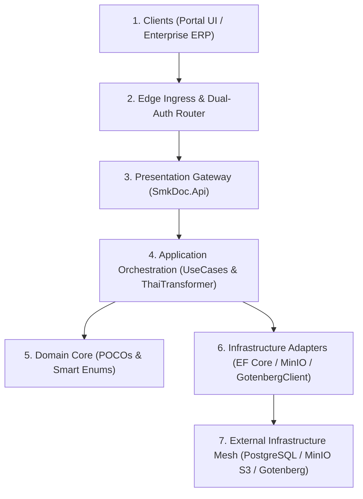

# [BLUEPRINT-001]: 00_system_blueprint_and_data_flow.md — Master System Architecture & Data Flow SSoT

<context>
Scope: Supreme System Architecture Blueprint, Macroscopic Container Topology, End-to-End Data Pipelines & 4 Bounded Contexts Matrix
Target: Full-Stack (`backend-v2/` & `frontend-v2/`)
Authority: Supreme Architectural Blueprint & North Star SSoT for all Agents and Developers
Invariants: 100% Stateless Preview, Stream-over-RAM Direct Egress, Ambient Multi-Tenancy, Centralized Thai Formatting
Format: 100% English AST, Positive-First Archetypes (80/20 Rule), Canonical ASCII Symbols
TriggerSignals: [SIGNAL_TOPOLOGY_MUTATION], [SIGNAL_STRUCTURE_MUTATION]
UpstreamKernel: AGENTS.md
</context>

---

## 1. System Identity, Mission & Architectural North Star

### 1.1 Core Mission
`smk-doc-server` is an enterprise-grade, high-throughput centralized document gateway ingesting structured JSON payloads and external database queries to produce deterministic outputs across three target formats: **PDF**, **DOCX**, and **XLSX**.

### 1.2 Benchmark Architecture & Competitive Parity
| Dimension | Legacy / Standard SaaS (SSRS, Jasper, Carbone) | SMK Document Server Canonical Target | Architectural Superiority |
|---|---|---|---|
| **Process Model** | Embedded heavyweight runtime / LibreOffice child processes | 100% Stateless container pods (.NET 10 + Gotenberg 8 Chromium cluster) | Zero host crashes, deterministic CSS rendering |
| **Thai Localization**| Text overlapping, broken tone marks, missing Buddhist Era | Centralized `ThaiDataTransformer` SSoT + Google Fonts Sarabun CSS | Zero inline template hacks, perfect typography |
| **Memory Architecture**| Multi-MB `byte[]` buffering causing Gen 2 LOH stalls | Stream-over-RAM direct pipe (`Stream.CopyToAsync`) into HTTP `Response.Body` | Bounded <= 81,920 buffer, constant memory footprint |
| **Multi-Tenancy** | Single database per tenant or manual fragile `WHERE` clauses | Single-database schema with automated EF Core Global Query Filter on `ProjectId` | Compile-time IDOR prevention, zero query leaks |
| **Authentication** | Basic Auth or complex proprietary tokens | Dual-Channel: Channel A (M2M SHA-256 API Keys) & Channel B (Portal JWT) | Granular scoping, uniform verification latency |

---

## 2. Macroscopic System Architecture & Tier Topology

### High-Level Architectural Inward Flow


### The 7 Operational Tiers Matrix
| Tier | Component Scope | Primary Responsibility | Isolation Invariant |
|---|---|---|---|
| **Tier 1** | Next.js 15 UI / Enterprise ERP | User template authoring & enterprise generation requests | Consumes standard HTTP REST endpoints |
| **Tier 2** | Reverse Proxy / Dual-Auth | TLS termination, rate limiting, SHA-256 API key & JWT routing | Dispatches authenticated context headers |
| **Tier 3** | `SmkDoc.Api` (.NET 10) | RFC 9457 exceptions, security headers, thin controllers (<= 5 LOC) | Zero business logic in presentation |
| **Tier 4** | `SmkDoc.Application` | Single-responsibility UseCases, `ThaiDataTransformer` SSoT, ports | Pure orchestrator, returns Application DTOs only |
| **Tier 5** | `SmkDoc.Domain` | Pure C# 13 POCOs, Rich Entities, Smart Enums, Domain Events | Zero third-party dependencies, encapsulated state |
| **Tier 6** | `SmkDoc.Infrastructure` | EF Core Npgsql repositories, Gotenberg client, MinIO S3 adapter | Implements Application ports, hides I/O details |
| **Tier 7** | External Mesh | PostgreSQL 16+, MinIO S3, Gotenberg 8 Chromium cluster, OTel | Isolated scalable network services |

---

## 3. The 2 Macroscopic Execution Pipelines

### Pipeline A: Ephemeral Live Preview Pipeline (Stateless, 100% In-Memory)
Used by the Template Studio (`frontend-v2`) for instant visual feedback during template authoring.

* **Linear Execution Pipeline:**
```
Studio (Monaco Editor) => Next.js Proxy (/api/proxy) => SmkDoc.Api (DocumentController) => RenderPreviewUseCase => HtmlTemplateEngine => Gotenberg 8 (Chromium) => Response.Body Stream => Studio (Blob URL)
```

* **Stateless Preview Invariants:**
| Dimension | Canonical Constraint | Rationale |
|---|---|---|
| **Database Persistence** | Zero PostgreSQL mutations (No `documents` or `generation_logs` rows created) | Prevents test artifact pollution in production DB |
| **Storage Persistence** | Zero MinIO S3 uploads | Avoids accumulation of transient preview files in storage buckets |
| **Memory Architecture**| Stream directly through .NET network buffer (<=81,920 bytes) to HTTP response | Eliminates LOH allocation during frequent typing debounces |

---

### Pipeline B: High-Throughput Production Generation & Storage Delivery
Used by enterprise callers (ERP, Core Banking) to produce legally binding documents and audit trails.

* **Linear Execution Pipeline:**
```
Caller (ERP) => Edge Ingress (Dual-Auth SHA-256) => SmkDoc.Api (DocumentController) => GenerateDocumentUseCase => [Step 1: Parse & Validate] => [Step 2: Dataset Extraction] => [Step 3: ThaiDataTransformer] => [Step 4: Polymorphic Engine Render] => [Step 5: MinIO S3 Stream Upload] => [Step 6: PostgreSQL Commit] => [Step 7: Post-Commit Domain Events] => Caller (HTTP 201 + Stream URL)
```

* **Production Generation Invariants:**
| Dimension | Canonical Constraint | Rationale |
|---|---|---|
| **Idempotency** | Mandatory `Idempotency-Key` header with IETF 6-state tracking | Prevents duplicate document generation on network retry |
| **Localization** | Centralized `ThaiDataTransformer` formatting (Buddhist Era + BahtText) | Enforces regulatory consistency across financial records |
| **Event Consistency**| Post-commit dispatching strictly after `unitOfWork.CommitAsync(ct)` | Prevents external phantom notifications if DB transaction aborts |

---

## 4. The 4 Bounded Context Collaboration Matrix

### Bounded Context Taxonomy
```
SmkDoc Bounded Contexts
  Authoring Context # Template lifecycle, versioning, field mapping, fonts
  Rendering Context # Document production, polymorphic engines, audit logs
  Integration Context # External databases, queries, datasets
  IdentityAccess Context # Tenants, projects, users, API keys, RBAC
```

### Collaboration & Interaction Matrix
| Bounded Context | Core Entities (Domain) | Upstream Dependencies | Downstream Consumers | Shared Boundary Contracts |
|---|---|---|---|---|
| **`Authoring`** | `Template`, `TemplateVersion`, `FieldMapping`, `Font` | `IdentityAccess` (Project scoping) | `Rendering` (Template resolution) | `TemplateId`, `TemplateSlug`, `TemplateVersionId`, `TemplatePublishedDomainEvent` |
| **`Rendering`** | `Document`, `DocumentVersion`, `GenerationLog` | `Authoring` (Templates), `Integration` (Datasets) | External Callers, Portal UI | `DocumentId`, `RenderEngineType`, `OutputFormat`, `Stream` |
| **`Integration`**| `DataConnection`, `Dataset` | `IdentityAccess` (Project scoping) | `Rendering` (Data extraction) | `DataConnectionId`, `DatasetId`, `ExtractionStrategy` |
| **`IdentityAccess`**| `Company`, `Project`, `User`, `ApiKey` | Edge Authentication Middleware | All other Contexts (Tenant filtering) | `ProjectId`, `CompanyId`, `UserId`, `ApiKeyId`, `ICurrentProjectContext` |

---

## 5. Strategic Architectural Decisions (ADRs) & Cognitive Guard Engine

### Engineering Rationale & Causal Decisions
* **ADR-01 (Gotenberg Chromium vs LibreOffice):** LibreOffice is prone to memory leaks, process crashes, and font shifting across OS environments. Decoupling PDF generation to Gotenberg 8 ensures 100% deterministic CSS-based rendering matching browser preview.
* **ADR-02 (Stream-over-RAM Direct Egress):** Buffering multi-MB PDFs into RAM `byte[]` arrays causes Gen 2 GC pauses and LOH fragmentation. Piping streams with bounded 81,920 buffers ensures constant memory usage.
* **ADR-03 (Ambient Multi-Tenancy via Global Query Filters):** Manual `WHERE project_id = @id` leads to IDOR data leaks. Automated EF Core `HasQueryFilter` isolates tenant data at SQL compilation time.
* **ADR-04 (Direct Single-Responsibility `IUseCase` vs MediatR):** MediatR adds reflection and allocation overhead. Direct `IUseCase` provides compile-time verification, clear call stacks, and straightforward testing.
* **ADR-05 (Centralized ThaiDataTransformer):** Inline Handlebars logic produces inconsistent Thai dates and numbers. Centralizing logic guarantees compliant Buddhist Era dates and Baht currency text.

### Cognitive System Strategy & Guard Engine
```yaml
OptimizationObjectives:
  PrimaryObjective: Deterministic Document Output at High Concurrent Throughput
  TradeOffPriority: StatelessScalability > MemorySafety (Zero-LOH) > DataConsistency > RawLatency

ProactiveSystemGuards:
  - Scope: Document Preview Operations
    Trigger: Any database write or MinIO upload executed during preview
    CanonicalAction: Terminate operation; enforce 100% stateless in-memory execution

  - Scope: PDF Rendering Architecture
    Trigger: Proposal to introduce LibreOffice, wkhtmltopdf, or embedded headless process
    CanonicalAction: Reject; route exclusively through external Gotenberg Chromium cluster

  - Scope: Thai Localization
    Trigger: Custom inline Handlebars date or currency formatting script
    CanonicalAction: Route formatting through ThaiDataTransformer SSoT

CoreExtensionSlots:
  RenderingEngineSlot: IRenderEngine (Gotenberg Chromium / OpenXML Word / ClosedXML Excel)
  DataExtractionSlot: IDatasetExtractor (PostgreSQL / SQL Server / REST Api data source)
  StorageProviderSlot: IBucketStorageService (MinIO S3 / AWS S3 / Azure Blob Storage)
```
