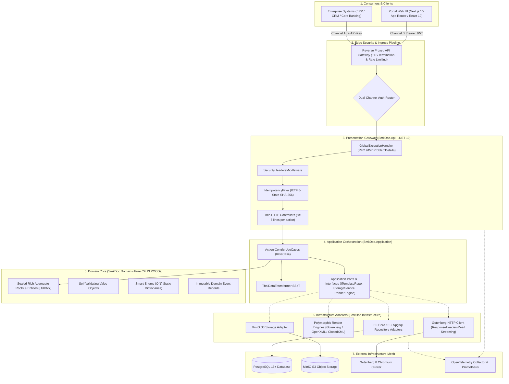
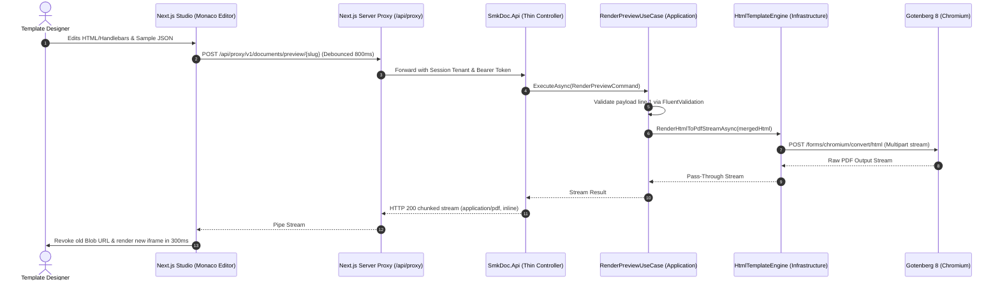
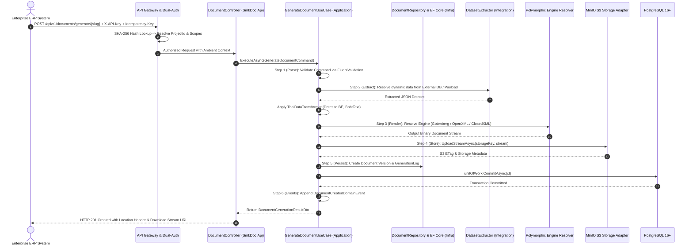

# [BLUEPRINT-001]: 00_system_blueprint_and_data_flow.md — Master System Architecture & Data Flow SSoT

<context>
Scope: Supreme System Architecture Blueprint, C4 Container Topology, End-to-End Macroscopic Data Pipelines & 4 Bounded Contexts Collaboration Matrix
Target: Full-Stack (`backend-v2/` & `frontend-v2/`)
Authority: Supreme Architectural Blueprint & North Star SSoT for all Agents and Developers
Boundary: High-level system strategy, end-to-end data flows, container mesh, and architectural boundaries.
TriggerSignals: [SIGNAL_TOPOLOGY_MUTATION], [SIGNAL_STRUCTURE_MUTATION]
UpstreamKernel: AGENTS.md
</context>

---

## 1. System Identity, Mission & Architectural North Star

### 1.1 Core Mission
`smk-doc-server` is an enterprise-grade, high-throughput centralized document gateway ingesting structured JSON payloads and external database queries to produce deterministic outputs across three target formats: **PDF**, **DOCX**, and **XLSX**.

### 1.2 Benchmark Architecture & Competitive Parity
| Dimension | Legacy / Standard SaaS (SSRS, Jasper, Carbone) | SMK Document Server Canonical Target |
|---|---|---|
| **Process Model** | Embedded heavyweight runtime / LibreOffice child processes | 100% Stateless container pods (.NET 10 + Gotenberg 8 Chromium cluster) |
| **Thai Localization**| Text overlapping, broken tone marks, missing Buddhist Era | Centralized `ThaiDataTransformer` SSoT + Google Fonts Sarabun CSS injection |
| **Memory Architecture**| Multi-MB `byte[]` buffering causing Gen 2 Large Object Heap stalls | Stream-over-RAM direct pipe (`Stream.CopyToAsync`) into HTTP `Response.Body` |
| **Multi-Tenancy** | Single database per tenant or manual fragile `WHERE` clauses | Single-database schema with automated EF Core Global Query Filter on `ProjectId` |
| **Authentication** | Basic Auth or complex proprietary tokens | Dual-Channel: Channel A (M2M SHA-256 API Keys) & Channel B (Portal JWT) |

---

## 2. Enterprise C4 Container Architecture

The diagram below illustrates the macroscopic system topology and inward dependency boundaries across all 7 operational tiers:



---

## 3. The 2 Macroscopic Execution Pipelines

### Pipeline A: Ephemeral Live Preview Pipeline (Stateless, 100% In-Memory)
Used by the Template Studio (`frontend-v2`) for instant visual feedback during template authoring.



* **Stateless Preview Invariants:**
  1. **Zero Database Mutations:** Preview never writes to PostgreSQL `documents` or `generation_logs`.
  2. **Zero Storage Persistence:** Preview never uploads bytes to MinIO S3.
  3. **Stream-over-RAM:** Payload flows directly from Gotenberg through .NET network buffers to the browser Blob URL without intermediate disk or `byte[]` RAM buffering.

---

### Pipeline B: High-Throughput Production Generation & Storage Delivery
Used by enterprise callers (ERP, Core Banking) to produce legally binding documents and audit trails.



---

## 4. The 4 Bounded Context Collaboration Matrix

The system is partitioned into 4 distinct Bounded Contexts under `backend-v2/src/SmkDoc.Application/Modules/`:

```
SmkDoc Bounded Contexts
├── Authoring Context         # Template lifecycle, versioning, field mapping, fonts
├── Rendering Context         # Document production, polymorphic engines, audit logs
├── Integration Context       # External databases, queries, datasets
└── IdentityAccess Context    # Tenants, projects, users, API keys, RBAC
```

### Collaboration & Interaction Matrix
| Bounded Context | Core Entities (Domain) | Upstream Dependencies | Downstream Consumers | Shared Boundary Contracts |
|---|---|---|---|---|
| **`Authoring`** | `Template`, `TemplateVersion`, `FieldMapping`, `Font` | `IdentityAccess` (Project scoping) | `Rendering` (Template resolution) | `TemplateId`, `TemplateSlug`, `TemplateVersionId`, `TemplatePublishedDomainEvent` |
| **`Rendering`** | `Document`, `DocumentVersion`, `GenerationLog` | `Authoring` (Templates), `Integration` (Datasets) | External Callers, Portal UI | `DocumentId`, `RenderEngineType`, `OutputFormat`, `Stream` |
| **`Integration`**| `DataConnection`, `Dataset` | `IdentityAccess` (Project scoping) | `Rendering` (Data extraction) | `DataConnectionId`, `DatasetId`, `ExtractionStrategy` |
| **`IdentityAccess`**| `Company`, `Project`, `User`, `ApiKey` | Edge Authentication Middleware | All other Contexts (Tenant filtering) | `ProjectId`, `CompanyId`, `UserId`, `ApiKeyId`, `ICurrentProjectContext` |

---

## 5. Strategic Architectural Decisions (ADRs)

### ADR-01: Gotenberg Chromium Cluster over Embedded LibreOffice
* **Context:** Document servers often rely on headless LibreOffice (`soffice`) for PDF conversion, which is prone to memory leaks, process crashes, and font shifting between OS environments.
* **Decision:** Decouple PDF generation to an external Gotenberg 8 microservice running headless Chromium. HTML/CSS is treated as the first-class print medium (`@page { size: A4 portrait; margin: 15mm; }`).
* **Consequence:** 100% deterministic layout matching the browser preview, zero host process crashes, independent horizontal auto-scaling of rendering workers.

### ADR-02: Stream-over-RAM Direct Egress (Zero-LOH Paradigm)
* **Context:** Any memory allocation $\ge 85,000$ bytes lands on the .NET Large Object Heap (LOH). Buffering multi-MB PDFs into `byte[]` arrays causes Gen 2 GC stalls under heavy load.
* **Decision:** Gotenberg HTTP responses and MinIO S3 streams MUST pipe directly into `HttpResponse.Body` using bounded buffers ($81,920$ bytes). Prohibit `MemoryStream.ToArray()` across all production paths.
* **Consequence:** Constant memory footprint regardless of whether generating a 100KB receipt or a 50MB report.

### ADR-03: Ambient Multi-Tenancy via EF Core Global Query Filter
* **Context:** Relying on developers to manually remember `WHERE project_id = @id` on every query inevitably leads to catastrophic IDOR data leakage across tenants.
* **Decision:** All tenant-scoped entities implement `IMustHaveProject`. `AppDbContext.OnModelCreating` applies an automated `HasQueryFilter` bound to `ICurrentProjectContext`.
* **Consequence:** Cross-tenant queries are blocked at the SQL compilation level. Standard repository queries (`db.Templates.ToListAsync()`) automatically isolate data to the active project context.

### ADR-04: Direct Action-Centric `IUseCase` over MediatR Indirection
* **Context:** MediatR introduces runtime reflection, object allocation for pipeline behaviors, and hides call stacks, making navigation and debugging cumbersome.
* **Decision:** Every business action is a single-responsibility class implementing `IUseCase<TCommand, TResultDto>`. Controllers inject use cases directly via C# 13 Primary Constructors.
* **Consequence:** Explicit compile-time type verification, zero-allocation handler resolution, transparent call stacks, and straightforward unit testing via class-scoped `CreateSut()`.

### ADR-05: Centralized ThaiDataTransformer & Standardized Thai Typography
* **Context:** Thai typography requires proper handling of floating vowels, tone mark rendering, Buddhist Era year offsets (+543), and Thai Baht currency text (`BahtText`). Inline Handlebars logic leads to inconsistent document outputs.
* **Decision:** All localized data formatting is centralized in `ThaiDataTransformer`. All HTML templates inject Google Fonts Sarabun and standard CSS rules for Thai word breaking (`word-break: break-word; line-break: loose;`).
* **Consequence:** 100% consistent, legally compliant Thai enterprise documents across all output channels.
