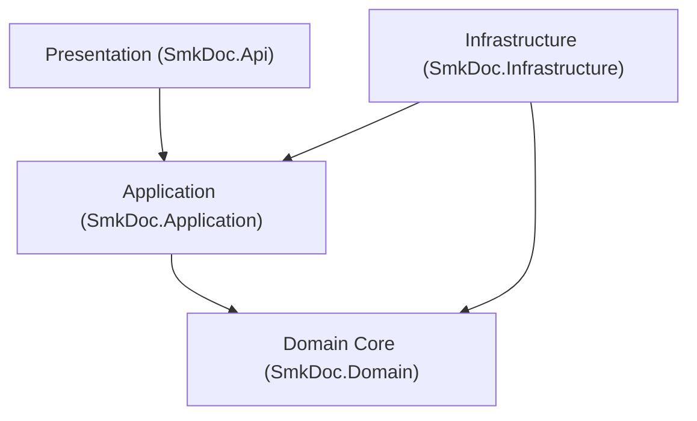

# [CORE-001]: 01_system_architecture.md — Master System Architecture, Tier Topology & Layer Boundaries

<context>
Scope: Macro Container Topology, 4 Bounded Contexts Collaboration, Tier Matrix, 2 Execution Pipelines, Clean Architecture Layer Boundaries, and System Structural Interceptors.
SSoT_For: Overall System Architecture, Layer Dependency Invariants, Container Topology, and Execution Pipeline Lifecycles.
Out_Of_Scope: C# 13 syntax and coding idioms (see: 02_coding_conventions.md), M2M auth and performance buffers (see: 03_security_and_performance.md), Lexical naming (see: 04_naming_standards.md).
Target: `backend-v2/` (`SmkDoc.Domain`, `SmkDoc.Application`, `SmkDoc.Infrastructure`, `SmkDoc.Api`) and `frontend-v2/`.
TriggerSignals: [SIGNAL_TOPOLOGY_MUTATION], [SIGNAL_STRUCTURE_MUTATION], [SIGNAL_DOMAIN_MUTATION]
</context>

---

## 1. Level 1: System Topology & Layer Invariants Matrix

### 1.1 Core Mission: M2M-First Enterprise Document Gateway
`smk-doc-server` is an enterprise-grade, high-throughput centralized document gateway ingesting structured JSON payloads and external database queries to produce deterministic outputs across three target formats: **PDF**, **DOCX**, and **XLSX**.
* **Primary Persona**: Automated Machine-to-Machine (M2M) callers (Enterprise ERPs, Core Banking, Billing Engines) communicating via SHA-256 API Keys.
* **Secondary Persona**: Template Authors and Administrators interacting with the Web Studio Portal (`frontend-v2`) via JWT Bearer sessions.
* **Non-Persona**: End-users of client systems (e.g., banking customers receiving invoices) never exist as accounts in this system.

### 1.2 Clean Architecture Layer Invariants Matrix


| Layer Project | Inbound Allowed | Prohibited Patterns (! BANNED) | Canonical Mandates (>> MANDATORY) | Boundary Vector |
|---|---|---|---|---|
| **`SmkDoc.Domain`** | `Application`, `Infrastructure`, `Api` | ! EF Core / ASP.NET / MinIO references<br/>! Public property setters (`set;`)<br/>! Direct system clock queries (`DateTime.UtcNow`) | >> Pure C# 13 POCOs<br/>>> Encapsulated state (`private set`)<br/>>> Canonical factory method (`Create`)<br/>>> Parameterized `TimeProvider` or explicit `DateTimeOffset now` | Core Center |
| **`SmkDoc.Application`** | `Infrastructure`, `Api` | ! Leaking Domain Entities across boundaries<br/>! Direct EF Core `DbContext` references<br/>! Synchronous blocking (`.Result`, `.Wait()`)<br/>! Multi-type `*UseCase.cs` declarations | >> Positional immutable `record` for contracts<br/>>> 1-Type-Per-File co-located per CQRS slice<br/>>> Orchestrate workflows via `IUseCase<TReq, TRes>`<br/>>> Transaction boundary via `IUnitOfWork` | Inward => Domain |
| **`SmkDoc.Infrastructure`**| `Api` (DI composition root only) | ! Exposing EF `DbContext` outside<br/>! Bypassing ambient tenant query filters<br/>! Multi-MB in-memory buffering (`byte[]`) | >> Implement Application ports/interfaces<br/>>> Zero-LOH streaming for Gotenberg/MinIO<br/>>> `IEntityTypeConfiguration<T>` + `xmin` concurrency | Inward => Domain & Application |
| **`SmkDoc.Api`** | None (Entry Point) | ! Business logic inside controllers<br/>! Actions exceeding 5 lines of code<br/>! Direct Entity consumption or return | >> Thin orchestrators with Primary Constructors<br/>>> Centralized RFC 9457 `ProblemDetails`<br/>>> `ApiResponse<T>` / `PagedApiResponse<T>` | Inward => Application |

### 1.3 The 4 Bounded Context Collaboration Matrix
| Bounded Context | Core Entities (Domain) | Upstream Dependencies | Downstream Consumers | Shared Boundary Contracts |
|---|---|---|---|---|
| **`Authoring`** | `Template`, `TemplateVersion`, `FieldMapping`, `Font` | `IdentityAccess` (Project scoping) | `Rendering` (Template resolution) | `TemplateId`, `TemplateSlug`, `TemplateVersionId`, `TemplatePublishedDomainEvent` |
| **`Rendering`** | `Document`, `DocumentVersion`, `GenerationLog` | `Authoring` (Templates), `Integration` (Datasets) | External Callers, Portal UI | `DocumentId`, `RenderEngineType`, `OutputFormat`, `Stream` |
| **`Integration`**| `DataConnection`, `Dataset` | `IdentityAccess` (Project scoping) | `Rendering` (Data extraction) | `DataConnectionId`, `DatasetId`, `ExtractionStrategy` |
| **`IdentityAccess`**| `Company`, `Project`, `User`, `ApiKey` | Edge Authentication Middleware | All other Contexts (Tenant filtering) | `ProjectId`, `CompanyId`, `UserId`, `ApiKeyId`, `ICurrentProjectContext` |

### 1.4 Application Module Taxonomy Tree
```
backend-v2/src/SmkDoc.Application/Modules/
  Authoring/
    Commands/ # CreateTemplate, UpdateTemplate, PublishVersion, MapFields
    Queries/  # GetTemplateById, ListTemplates, GetTemplateVersion
    DTOs/     # TemplateResultDto, TemplateVersionResultDto, FieldMappingDto
  Rendering/
    Commands/ # RenderDocument, RenderPreview, CancelGeneration
    Queries/  # GetDocumentById, GetGenerationLog, StreamDocument
    DTOs/     # RenderDocumentResultDto, PreviewResultDto, GenerationLogDto
  Integration/
    Commands/ # CreateDataConnection, TestConnection, SaveDataset
    Queries/  # GetDataConnectionById, ExecuteDatasetQuery, ListDatasets
    DTOs/     # DataConnectionResultDto, DatasetResultDto, QueryPreviewDto
  IdentityAccess/
    Commands/ # LoginUser, RefreshToken, CreateApiKey, RevokeApiKey, TransferProjectOwner, SwitchProject
    Queries/  # GetCurrentUser, ListProjects, ValidateApiKey, ListApiKeys
    DTOs/     # AuthTokenResultDto, UserProfileResultDto, ApiKeyResultDto
```

---

## 2. Level 2: Core Architecture AST & Structural Interceptor Engine

### 2.1 Engineering Rationale & Causal Decisions
* **Why Inward-Only Dependency Flow**: Prevents database schema changes and third-party library churn from forcing breaking changes onto core business invariants.
* **Why Single-Responsibility `IUseCase` over MediatR**: Eliminates runtime reflection, assembly scanning allocations, and opaque call stacks. Direct `IUseCase<TRequest, TResponse>` gives compile-time verification, clean stack traces, and straightforward unit testing via `CreateSut()`.
* **Why Decoupled Gotenberg Chromium Cluster**: Embedded headless browser processes are prone to memory leaks, font shifting across OS platforms, and sudden SIGSEGV process crashes. External Gotenberg pods isolate rendering compute from the core API gateway.

### 2.2 Cognitive Layer Governance & Structural Interceptors
```yaml
OptimizationObjectives:
  PrimaryObjective: Architectural Boundary Integrity & M2M-First System Topology
  TradeOffPriority: StatelessScalability > MemorySafety (Zero-LOH) > DomainPurity > CompileTimeVerifiability > RawLatency

ProactiveStructuralGuards:
  - Scope: SmkDoc.Domain
    Trigger: NuGet package addition of EF Core, ASP.NET Core, or AWS/MinIO SDK
    CanonicalAction: Reject immediately; Domain must remain 100% pure C# POCOs >> Ref: [RULE-STRUCT-001]

  - Scope: SmkDoc.Application
    Trigger: Reference to Microsoft.EntityFrameworkCore or DbContext in UseCase
    CanonicalAction: Reject; abstract persistence operations behind Repository and IUnitOfWork ports >> Ref: [RULE-STRUCT-002]

  - Scope: SmkDoc.Api
    Trigger: Controller action consuming Domain Entity directly or exceeding 5 lines
    CanonicalAction: Delegate immediately to IUseCase<TReq, TRes> and wrap result in ApiResponse<T> >> Ref: [RULE-STRUCT-003]

  - Scope: SmkDoc.Application
    Trigger: Declaring multiple primary public types in a slice file (*UseCase.cs)
    CanonicalAction: Enforce 1-Primary-Type-Per-File ({TypeName}.cs) co-located inside slice folder >> Ref: [RULE-STRUCT-004]

CoreExtensionSlots:
  RenderingEngineSlot: IRenderEngine (Gotenberg Chromium / OpenXML Word / ClosedXML Excel)
  DataExtractionSlot: IDatasetExtractor (PostgreSQL / SQL Server / REST API data sources)
  StorageProviderSlot: IBucketStorageService (MinIO S3 / AWS S3 / Azure Blob Storage)
```

---

## 3. Level 3: Canonical Working Archetypes (100% Fully-Hydrated Recipes)

### 3.1 The 5-File Co-Located CQRS Vertical Slice Topology
>> MANDATORY CANONICAL TEMPLATE [RULE-STRUCT-004]:
* [MUST] Isolate every `*Command`, `*Query`, `*Validator`, and `*UseCase` into its own dedicated `.cs` file (`{TypeName}.cs`) co-located inside `Modules/{Context}/{Aggregate}/{Commands|Queries}/{SliceName}/`.
* [MUST NOT] Bundle `*Command`, `*Query`, or `*Validator` declarations inside `*UseCase.cs`.

```
Modules/Authoring/Templates/Commands/CreateTemplate/
  CreateTemplateCommand.cs          # 1. Positional input record
  CreateTemplateCommandValidator.cs # 2. FluentValidation rules
  CreateTemplateUseCase.cs          # 3. Single-responsibility orchestrator
  TemplateResultDto.cs              # 4. Immutable output record
  CreateTemplateErrors.cs           # 5. Strongly-typed slice domain errors
```

```csharp
// 1. CreateTemplateCommand.cs
namespace SmkDoc.Application.Modules.Authoring.Templates.Commands.CreateTemplate;

public sealed record CreateTemplateCommand(
    string Name,
    string Slug,
    string? Category = null);

// 2. CreateTemplateUseCase.cs
namespace SmkDoc.Application.Modules.Authoring.Templates.Commands.CreateTemplate;

public sealed class CreateTemplateUseCase(
    ITemplateRepository templateRepository,
    ICurrentProjectContext projectContext,
    IUnitOfWork unitOfWork,
    TimeProvider timeProvider) : IUseCase<CreateTemplateCommand, TemplateResultDto>
{
    public async Task<TemplateResultDto> ExecuteAsync(CreateTemplateCommand command, CancellationToken ct = default)
    {
        if (!projectContext.IsResolved)
        {
            throw new ForbiddenException("Project context is required to create a template.");
        }

        var now = timeProvider.GetUtcNow();
        var template = Template.Create(
            projectContext.ProjectId,
            TemplateName.Create(command.Name),
            TemplateSlug.Create(command.Slug),
            command.Category,
            now);

        await templateRepository.AddAsync(template, ct);
        await unitOfWork.CommitAsync(ct);

        return new TemplateResultDto(template.Id.Value, template.Name.Value, template.Slug.Value, template.Category);
    }
}
```

### 3.2 Strongly-Typed ID Explicit Operator Standard
>> MANDATORY CANONICAL TEMPLATE [RULE-STRUCT-003]:
* [MUST] Declare strongly-typed ID struct as `public readonly record struct Name(Guid Value) : IComparable<Name>`.
* [MUST] Implement explicit cast operators to/from `Guid` to prevent accidental cross-domain ID pollution.
* [MUST] Implement cross-type equality operators (`==`, `!=`) for seamless evaluation.

```csharp
// Stack-allocated (16-byte) strongly-typed identifier
public readonly record struct TemplateId(Guid Value) : IComparable<TemplateId>
{
    public static TemplateId New() => new(Guid.CreateVersion7());
    public static TemplateId Empty => new(Guid.Empty);
    public bool IsEmpty => Value == Guid.Empty;
    public int CompareTo(TemplateId other) => Value.CompareTo(other.Value);
    public override string ToString() => Value.ToString();

    public static explicit operator Guid(TemplateId id) => id.Value;
    public static explicit operator TemplateId(Guid value) => new(value);

    public static bool operator ==(TemplateId left, Guid right) => left.Value == right;
    public static bool operator !=(TemplateId left, Guid right) => left.Value != right;
    public static bool operator ==(Guid left, TemplateId right) => left == right.Value;
    public static bool operator !=(Guid left, TemplateId right) => left != right.Value;
}
```

---

## 4. Level 4: Anti-Patterns & Unified Micro-Diffs

### [TRAP-ARCH-001]: Direct DbContext or Entity Leakage in Application Layer
```diff
- public sealed class GetTemplateUseCase(AppDbContext dbContext) {
-     public async Task<Template> ExecuteAsync(Guid id) => await dbContext.Templates.FindAsync(id);
- }
+ public sealed class GetTemplateUseCase(ITemplateRepository templateRepository) : IUseCase<GetTemplateQuery, TemplateResultDto> {
+     public async Task<TemplateResultDto> ExecuteAsync(GetTemplateQuery query, CancellationToken ct) {
+         var template = await templateRepository.GetByIdAsync(query.Id, ct) ?? throw new NotFoundException("Template not found.");
+         return new TemplateResultDto(template.Id.Value, template.Name, template.Slug);
+     }
+ }
```
*Rationale: Direct `DbContext` usage in Application leaks persistence infrastructure; returning Domain Entities exposes internal domain models and navigation proxies across boundaries.*

### [TRAP-ARCH-002]: Bundling Multiple Primary Types Inside UseCase File
```diff
- // Inside CreateTemplateUseCase.cs:
- public sealed record CreateTemplateCommand(...);
- public sealed class CreateTemplateValidator : AbstractValidator<CreateTemplateCommand> { ... }
- public sealed class CreateTemplateUseCase(...) { ... }
+ // Split into separate 1-Primary-Type-Per-File co-located records:
+ // CreateTemplateCommand.cs -> contains CreateTemplateCommand
+ // CreateTemplateCommandValidator.cs -> contains CreateTemplateCommandValidator
+ // CreateTemplateUseCase.cs -> contains CreateTemplateUseCase
```
*Rationale: Bundling hides type contracts from Solution Explorer and git diffs, degrading team readability and cognitive clarity.*

### [TRAP-ARCH-003]: Structured Logging vs String Interpolation
```diff
- logger.LogInformation($"Processing {templateId} for project {projectId}");
+ logger.LogInformation("Processing template render {TemplateId} for tenant {ProjectId}", templateId, projectId);
```
*Rationale: String interpolation allocates formatting strings on every call and breaks semantic message indexing.*
