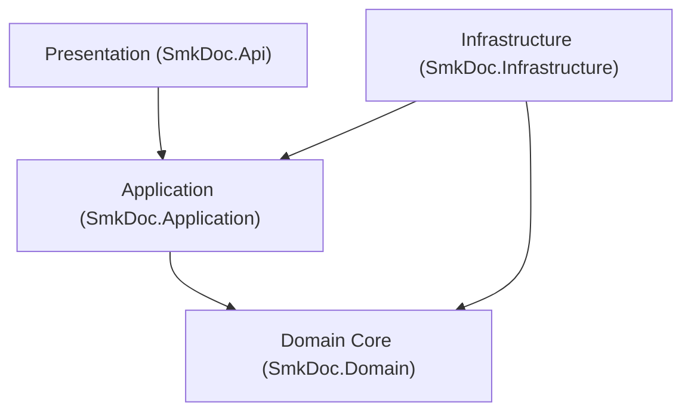

# [CORE-001]: dependency_and_folder_rules.md — Clean Architecture Boundaries & Project Taxonomy

<context>
Scope: Clean Architecture Boundaries, Directional Dependencies, Bounded Context Folder Taxonomy & C# 13 System Invariants
Target: `backend-v2/` (`SmkDoc.Domain`, `SmkDoc.Application`, `SmkDoc.Infrastructure`, `SmkDoc.Api`)
Authority: Absolute SSoT Invariant (Zero architectural regression permitted)
Invariants: Inward-Only Dependency Flow, Single-Responsibility UseCases, Positional Record Contracts
Format: 100% English AST, Positive-First Archetypes (80/20 Rule), Canonical ASCII Symbols
TriggerSignals: [SIGNAL_STRUCTURE_MUTATION]
UpstreamKernel: AGENTS.md
</context>

---

## 1. Level 1: Layer Responsibilities & Isolation Invariants Matrix

| Layer Project | Allowed Inbound References | Prohibited Patterns (! BANNED) | Canonical Mandates (>> MANDATORY) | Boundary Vector |
|---|---|---|---|---|
| **`SmkDoc.Domain`** | `Application`, `Infrastructure`, `Api` | ! EF Core / ASP.NET / MinIO references<br/>! Public property setters (`set;`)<br/>! Direct system clock queries (`DateTime.UtcNow`) | >> Pure C# 13 POCOs<br/>>> Encapsulated state (`private/protected set`)<br/>>> Exactly 1 canonical factory method (`Create`)<br/>>> Parameterized `TimeProvider` or explicit `DateTimeOffset now` | Core Center |
| **`SmkDoc.Application`** | `Infrastructure`, `Api` | ! Leaking Domain Entities across boundaries<br/>! Direct EF Core `DbContext` references<br/>! Synchronous blocking (`.Result`, `.Wait()`) | >> Positional `record` for Commands/Queries/DTOs<br/>>> Orchestrate workflows via `IUseCase<TReq, TRes>`<br/>>> Transaction boundary via `IUnitOfWork.CommitAsync(ct)` | Inward => Domain |
| **`SmkDoc.Infrastructure`**| `Api` (DI composition root only) | ! Exposing EF `DbContext` outside<br/>! Bypassing ambient tenant query filters<br/>! Multi-MB in-memory buffering (`byte[]`) | >> Implement Application ports/interfaces<br/>>> Zero-LOH streaming for Gotenberg/MinIO<br/>>> `IEntityTypeConfiguration<T>` + `xmin` concurrency | Inward => Domain & Application |
| **`SmkDoc.Api`** | None (Entry Point) | ! Business logic inside controllers<br/>! Actions exceeding 5 lines of code<br/>! Direct Entity consumption or return | >> Thin orchestrators with Primary Constructors<br/>>> Centralized RFC 9457 `ProblemDetails`<br/>>> `ApiResponse<T>` / `PagedApiResponse<T>` | Inward => Application |

---

## 2. Level 2: Core Architecture AST & Topology

### Engineering Rationale & Causal Decisions
* **Why Inward-Only Dependencies:** Isolates business logic and domain invariants from database schemas, network protocols, and third-party libraries, ensuring domain rules remain stable when infrastructure changes.
* **Why Positional Records for Application Contracts:** C# `record` types provide immutable value semantics, built-in non-destructive mutation (`with`), clean deconstruction, and zero unintended property mutations across thread boundaries.
* **Why Primary Constructors with Pure camelCase:** Aligns with modern C# 13 syntax standards, eliminates boilerplate field assignments (`this._repo = repo`), and prevents variable shadowing without relying on legacy symbol prefixes.
* **Why Single-Responsibility `IUseCase` over MediatR:** Eliminates runtime assembly scanning, avoids pipeline reflection allocations, ensures transparent compiler-verified call stacks, and simplifies unit test construction via class-scoped `CreateSut()`.

### Cognitive Layer Governance & Structural Interceptors
```yaml
OptimizationObjectives:
  PrimaryObjective: Architectural Boundary Integrity & Zero-Leakage Modularity
  TradeOffPriority: DomainPurity > StrictLayerIsolation > Testability > RawBoilerplateReduction

ProactiveStructuralGuards:
  - Scope: SmkDoc.Domain
    Trigger: NuGet package addition of EF Core, ASP.NET Core, or AWS/MinIO SDK
    CanonicalAction: Reject immediately; Domain must remain 100% pure C# POCOs

  - Scope: SmkDoc.Application
    Trigger: Reference to Microsoft.EntityFrameworkCore or DbContext in UseCase
    CanonicalAction: Reject; abstract persistence operations behind Repository and IUnitOfWork ports

  - Scope: SmkDoc.Api
    Trigger: Controller action consuming Domain Entity directly or exceeding 5 lines
    CanonicalAction: Delegate immediately to IUseCase<TReq, TRes> and wrap result in ApiResponse<T>

  - Scope: Cross-Layer Contracts
    Trigger: Class-based mutable DTO with public setters
    CanonicalAction: Refactor to positional sealed record with immutable properties

CoreExtensionSlots:
  UseCasePortSlot: IUseCase<TRequest, TResponse> (Action-centric application entry point)
  RepositoryPortSlot: IRepository<TAggregate, TId> (Persistence abstraction port)
  UnitOfWorkSlot: IUnitOfWork (Atomic transaction orchestration port)
```

### Layer Boundary Topology


### Bounded Context Taxonomy
```
backend-v2/src/SmkDoc.Application/Modules/
  Authoring/
    Commands/ # CreateTemplate, UpdateTemplate, PublishVersion, MapFields
    Queries/ # GetTemplateById, ListTemplates, GetTemplateVersion
    DTOs/ # TemplateResultDto, TemplateVersionResultDto, FieldMappingDto
  Rendering/
    Commands/ # RenderDocument, RenderPreview, CancelGeneration
    Queries/ # GetDocumentById, GetGenerationLog, StreamDocument, GetLogPayload
    DTOs/ # RenderDocumentResultDto, PreviewResultDto, GenerationLogDto, LogPayloadResultDto
  Integration/
    Commands/ # CreateDataConnection, TestConnection, SaveDataset
    Queries/ # GetDataConnectionById, ExecuteDatasetQuery, ListDatasets
    DTOs/ # DataConnectionResultDto, DatasetResultDto, QueryPreviewDto
  IdentityAccess/
    Commands/ # LoginUser, RefreshToken, CreateApiKey, SwitchProject
    Queries/ # GetCurrentUser, ListProjects, ValidateApiKey
    DTOs/ # AuthTokenResultDto, UserProfileResultDto, ApiKeyResultDto
```

### The 5-File CQRS Slice Pattern
```
Modules/{Context}/
  Commands/{Action}{Entity}Command.cs # 1. Positional record request
  Commands/{Action}{Entity}UseCase.cs # 2. Single-responsibility orchestrator
  Commands/{Action}{Entity}Validator.cs # 3. FluentValidation / Guard rules
  DTOs/{Entity}ResultDto.cs # 4. Immutable positional record DTO
  (In SmkDoc.Api) Controllers/V1/ # 5. Thin presentation action
```

---

## 3. Level 3: Canonical Implementation Archetypes

### Positional Records for Requests & Responses
>> MANDATORY CANONICAL TEMPLATE [RULE-STRUCT-001]:
* [MUST] Use C# `sealed record` with positional parameters for all Commands, Queries, and DTOs.
* [MUST NOT] Leak domain entities directly into DTOs or public contracts.
* [MUST NOT] Include caller-supplied `ProjectId` overrides on tenant-scoped Command or Query records >> Ref: [RULE-SEC-003].
* [MUST] Enforce immutability across layer boundaries.
```csharp
// >> CANONICAL: Immutable positional records (Zero framework/MediatR coupling, zero tenant spoofing parameter)
public sealed record CreateTemplateCommand(
    string Name,
    string Slug,
    string? Category);

public sealed record TemplateResultDto(
    Guid Id,
    Guid ProjectId,
    string Name,
    string Slug,
    string? Category,
    bool IsActive,
    Guid? CurrentVersionId,
    string? FileFormat,
    DateTimeOffset CreatedAt,
    DateTimeOffset? UpdatedAt);
```

### Primary Constructor UseCase Orchestrator
>> MANDATORY CANONICAL TEMPLATE [RULE-STRUCT-002]:
* [MUST] Declare dependencies via C# 13 Primary Constructor with pure camelCase parameter names (e.g. `templateRepository`, `unitOfWork`, `projectContext`).
* [MUST NOT] Use symbol prefixes (`_templateRepository`, `m_templateRepository`).
* [MUST] Implement `IUseCase<TCommand, TResponse>` or `IUseCase<TQuery, TResponse>` with single-responsibility method `ExecuteAsync(TCommand command, CancellationToken ct)` or `ExecuteAsync(TQuery query, CancellationToken ct)`.
```csharp
// >> CANONICAL: Pure camelCase, zero prefix, mandatory ambient ICurrentProjectContext
public sealed class CreateTemplateUseCase(
    ITemplateRepository templateRepository,
    ICurrentProjectContext projectContext,
    IUnitOfWork unitOfWork,
    TimeProvider timeProvider,
    ILogger<CreateTemplateUseCase> logger) : IUseCase<CreateTemplateCommand, TemplateResultDto>
{
    public async Task<TemplateResultDto> ExecuteAsync(CreateTemplateCommand command, CancellationToken ct)
    {
        if (!projectContext.IsResolved)
            throw new ForbiddenException("Active project context is required.");

        var now = timeProvider.GetUtcNow();
        var template = Template.Create(
            projectContext.ProjectId,
            TemplateName.Create(command.Name),
            new TemplateSlug(command.Slug),
            command.Category,
            now);
        logger.LogInformation("Creating template {Slug} for project {ProjectId}", command.Slug, projectContext.ProjectId);
        await templateRepository.AddAsync(template, ct);
        await unitOfWork.CommitAsync(ct);
        return template.ToResultDto();
    }
}
```

### Strongly-Typed ID Explicit Operator Standard
>> MANDATORY CANONICAL TEMPLATE [RULE-STRUCT-003]:
* [MUST] Declare strongly-typed ID struct as `public readonly record struct Name(Guid Value) : IComparable<Name>`.
* [MUST] Implement explicit cast operators to/from `Guid` to prevent accidental cross-domain ID pollution.
* [MUST] Implement cross-type equality operators (`==`, `!=`) for seamless evaluation.
```csharp
// >> CANONICAL: Stack-allocated (16-byte) strongly-typed identifier
public readonly record struct TemplateId(Guid Value) : IComparable<TemplateId>
{
    public static TemplateId New() => new(Guid.CreateVersion7());
    public static TemplateId Empty => new(Guid.Empty);
    public bool IsEmpty => Value == Guid.Empty;
    public int CompareTo(TemplateId other) => Value.CompareTo(other.Value);
    public override string ToString() => Value.ToString();

    public static explicit operator Guid(TemplateId id) => id.Value;
    public static explicit operator TemplateId(Guid value) => new(value);

    public static bool operator ==(TemplateId left, Guid right) => left.Value == right;
    public static bool operator !=(TemplateId left, Guid right) => left.Value != right;
    public static bool operator ==(Guid left, TemplateId right) => left == right.Value;
    public static bool operator !=(Guid left, TemplateId right) => left != right.Value;
}
```

---

## 4. Level 4: Anti-Pattern Interceptors & Micro-Diffs

### [TRAP-STRUCT-001]: Primary Constructor Parameter Naming
```diff
- public sealed class BadUseCase(ITemplateRepository _templateRepository) { }
+ public sealed class GoodUseCase(ITemplateRepository templateRepository) { }
```
*Rationale: Symbol prefixes violate C# 13 primary constructor naming standards and create redundant AST tokens.*

### [TRAP-STRUCT-002]: Structured Logging vs String Interpolation
```diff
- logger.LogInformation($"Processing {templateId}");
+ logger.LogInformation("Processing template render {TemplateId} for tenant {ProjectId}", templateId, projectId);
```
*Rationale: String interpolation allocates formatting strings on every call and breaks semantic message indexing.*

### [TRAP-STRUCT-003]: Verbose Instantiations vs Collection Expressions
```diff
- private readonly List<FieldMapping> _fieldMappings = new List<FieldMapping>();
+ private readonly List<FieldMapping> fieldMappings = [];
```
*Rationale: C# 13 collection expressions (`[]`) are concise, compiler-optimized, and reduce AST noise.*

### [TRAP-STRUCT-004]: Inlined Execution vs Intermediate Variable Instantiation
```diff
- var result = await useCase.ExecuteAsync(new CreateTemplateCommand(request.Name, request.Slug), ct);
+ var command = new CreateTemplateCommand(request.Name, request.Slug); var result = await useCase.ExecuteAsync(command, ct);
```
*Rationale: Explicit intermediate variable instantiation improves breakpoint inspection and stack trace readability.*
