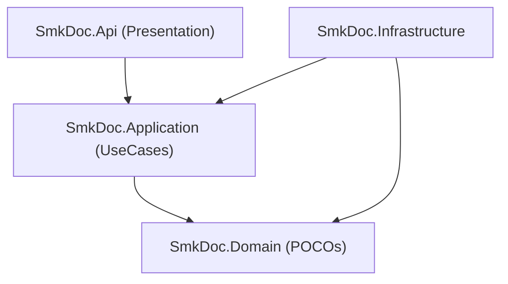

# [CORE-001]: dependency_and_folder_rules.md — Clean Architecture Boundaries & Project Taxonomy

<context>
Scope: Clean Architecture Boundaries, Directional Dependencies, Bounded Context Folder Taxonomy & C# 13 System Invariants
Target: `backend-v2/` (`SmkDoc.Domain`, `SmkDoc.Application`, `SmkDoc.Infrastructure`, `SmkDoc.Api`)
Authority: Absolute SSoT Invariant (Zero architectural regression permitted)
Boundary: Architectural dependency rules & folder taxonomy. Prohibit implementation details, task roadmaps, or runtime logic.
</context>

---

## 1. Clean Architecture Concentric Layers & Dependency Inversion



### Layer Responsibilities & Isolation Rules

| Layer Project | Allowed Inbound References | Prohibited Patterns (! BANNED) | Canonical Mandates (>> MANDATORY) |
|---|---|---|---|
| **`SmkDoc.Domain`** | `SmkDoc.Application`, `SmkDoc.Infrastructure`, `SmkDoc.Api` | ! EF Core / ASP.NET / MinIO references<br/>! Public property setters (`set;`)<br/>! Direct system clock queries (`DateTime.UtcNow`) | >> Pure C# 13 POCOs<br/>>> Encapsulated state (`private/protected set`)<br/>>> Exactly 1 canonical factory method per aggregate (`Create`)<br/>>> TimeProvider injected as parameter |
| **`SmkDoc.Application`** | `SmkDoc.Infrastructure`, `SmkDoc.Api` | ! Returning Domain Entities across layer boundary<br/>! Direct SQL or EF Core `DbContext` references<br/>! Synchronous blocking (`.Result`, `.Wait()`) | >> Positional `record` for all Commands/Queries/DTOs<br/>>> Orchestrate domain via `IUseCase<TReq, TRes>`<br/>>> Return Application DTO records (exceptions bubble to RFC 9457 GlobalExceptionHandler)<br/>>> Transaction boundary via `IUnitOfWork.CommitAsync(ct)` |
| **`SmkDoc.Infrastructure`** | `SmkDoc.Api` (DI composition root only) | ! Exposing EF `DbContext` or raw entities outside<br/>! Bypassing ambient tenant global query filters<br/>! Unbounded in-memory buffering (`byte[]`) | >> Hide all persistence/IO behind interfaces<br/>>> Stream Gotenberg/MinIO directly to consumer<br/>>> Implement EF Core `IEntityTypeConfiguration<T>`<br/>>> Enforce `xmin` optimistic concurrency |
| **`SmkDoc.Api`** | None (Entry Point) | ! Business logic or validation inside controllers<br/>! Controller actions exceeding 5 lines of code<br/>! Direct Entity consumption or return | >> Thin orchestrators with C# 13 Primary Constructors<br/>>> Route: `api/v1/{resource}`<br/>>> RFC 9457 ProblemDetails via `IExceptionHandler`<br/>>> `ApiResponse<T>` / `PagedApiResponse<T>` envelopes |

---

## 2. Bounded Context Taxonomy & Feature Slices

The Application layer is strictly partitioned into 4 Bounded Contexts matching system capabilities:

```
backend-v2/src/SmkDoc.Application/Modules/
├── Authoring/                  # Template lifecycle & design assets
│   ├── Commands/               # CreateTemplate, UpdateTemplate, PublishVersion, MapFields
│   ├── Queries/                # GetTemplateById, ListTemplates, GetTemplateVersion
│   └── DTOs/                   # TemplateResultDto, TemplateVersionResultDto, FieldMappingDto
│
├── Rendering/                  # Document production & output pipelines
│   ├── Commands/               # RenderDocument, RenderPreview, CancelGeneration
│   ├── Queries/                # GetDocumentById, GetGenerationLog, StreamDocument
│   └── DTOs/                   # RenderDocumentResultDto, PreviewResultDto, GenerationLogDto
│
├── Integration/                # External data connections & query datasets
│   ├── Commands/               # CreateDataConnection, TestConnection, SaveDataset
│   ├── Queries/                # GetDataConnectionById, ExecuteDatasetQuery, ListDatasets
│   └── DTOs/                   # DataConnectionResultDto, DatasetResultDto, QueryPreviewDto
│
└── IdentityAccess/             # Multi-tenancy, authentication & authorization
    ├── Commands/               # LoginUser, RefreshToken, CreateApiKey, SwitchProject
    ├── Queries/                # GetCurrentUser, ListProjects, ValidateApiKey
    └── DTOs/                   # AuthTokenResultDto, UserProfileResultDto, ApiKeyResultDto
```

### The 5-File CQRS Slice Pattern

Every Application capability follows the 5-File Slice pattern for maximum testability and decoupling:

```
Modules/{Context}/
├── Commands/{Action}{Entity}Command.cs      # 1. Positional record request
├── Commands/{Action}{Entity}UseCase.cs      # 2. Single-responsibility orchestrator
├── Commands/{Action}{Entity}Validator.cs    # 3. FluentValidation / Guard rules
├── DTOs/{Entity}ResultDto.cs                # 4. Immutable positional record DTO
└── (In SmkDoc.Api) Controllers/V1/          # 5. Thin presentation action
```

---

## 3. C# 13 Coding Conventions & AST Invariants

### Primary Constructor Naming Standard
All Primary Constructor parameters MUST use `pureCamelCase` (Regex: `^[a-z][a-zA-Z0-9]+$`):
```csharp
// >> CANONICAL: Pure camelCase, zero prefix, directly captured by members
public sealed class CreateTemplateUseCase(
    ITemplateRepository templateRepository,
    IUnitOfWork unitOfWork,
    TimeProvider timeProvider,
    ILogger<CreateTemplateUseCase> logger) : IUseCase<CreateTemplateCommand, TemplateResultDto>
{
    // Parameters consumed directly without private readonly field assignments
}

// ! BANNED: Underscore or symbol prefix
public sealed class BadUseCase(ITemplateRepository _templateRepository) { } // REJECTED
```

### Positional Records for Requests & Responses
```csharp
// >> CANONICAL: Immutable positional records (Zero framework/MediatR coupling)
public sealed record CreateTemplateCommand(
    Guid ProjectId,
    string Name,
    string Slug,
    string? Category);

public sealed record TemplateResultDto(
    Guid Id,
    Guid ProjectId,
    string Name,
    string Slug,
    string? Category,
    bool IsActive,
    Guid? CurrentVersionId,
    string? FileFormat,
    DateTimeOffset CreatedAt,
    DateTimeOffset? UpdatedAt);
```

### Structured Logging Standard
```csharp
// >> CANONICAL: Semantic structured logging tokens (No string interpolation)
logger.LogInformation("Processing template render {TemplateId} for tenant {ProjectId}", templateId, projectId);

// ! BANNED: String interpolation creates memory pressure and breaks log aggregation
logger.LogInformation($"Processing {templateId}"); // REJECTED
```

### Modern C# 13 & .NET 10 Language Primitives
* **Collection Expressions `[]`**: MUST use `[]` instead of `new List<T>()` or `new T[] { }`.
  ```csharp
  // >> CANONICAL
  private readonly List<FieldMapping> _fieldMappings = [];
  IReadOnlyList<string> tags = ["invoice", "finance"];

  // ! BANNED
  private readonly List<FieldMapping> _fieldMappings = new List<FieldMapping>();
  ```
* **High-Performance Lock (`System.Threading.Lock`)**: Use C# 13 `Lock` object instead of untyped `object`.
  ```csharp
  // >> CANONICAL
  private readonly Lock _gate = new();
  lock (_gate) { /* thread-safe operation */ }
  ```
* **ReDoS Defense with `[GeneratedRegex]`**: Always use source-generated regex with `RegexOptions.NonBacktracking`.
  ```csharp
  [GeneratedRegex("^[a-z0-9-]+$", RegexOptions.NonBacktracking | RegexOptions.IgnoreCase)]
  private static partial Regex SlugRegex();
  ```
* **Explicit Intermediate Variable Instantiation**: Never inline complex constructor instantiations inside method calls.
  ```csharp
  // >> CANONICAL: Clear, inspectable, readable in stack traces
  var command = new CreateTemplateCommand(request.Name, request.Slug);
  var result = await useCase.ExecuteAsync(command, ct);

  // ! BANNED: Inlined instantiation obscures debugging
  var result = await useCase.ExecuteAsync(new CreateTemplateCommand(request.Name, request.Slug), ct);
  ```

---

## 4. Strongly-Typed ID Zero-Cast Policy

Every strongly-typed ID struct MUST be declared as `public readonly record struct Name(Guid Value) : IComparable<Name>` ($\le 16$ bytes, stack-allocated). It MUST supply bidirectional implicit conversions and cross-type equality operators so developers never need manual casts like `(TemplateId)guid`:

```csharp
public readonly record struct TemplateId(Guid Value) : IComparable<TemplateId>
{
    public static TemplateId New() => new(Guid.CreateVersion7());
    public static TemplateId Empty => new(Guid.Empty);
    public bool IsEmpty => Value == Guid.Empty;
    public int CompareTo(TemplateId other) => Value.CompareTo(other.Value);
    public override string ToString() => Value.ToString();

    // Bidirectional implicit conversions (Zero-Cast policy at CQRS/DTO boundaries)
    public static implicit operator Guid(TemplateId id) => id.Value;
    public static implicit operator TemplateId(Guid value) => new(value);

    // Cross-type equality operators for direct comparison with Guid
    public static bool operator ==(TemplateId left, Guid right) => left.Value == right;
    public static bool operator !=(TemplateId left, Guid right) => left.Value != right;
    public static bool operator ==(Guid left, TemplateId right) => left == right.Value;
    public static bool operator !=(Guid left, TemplateId right) => left != right.Value;
}
```

---

## 5. Zero Decorative Emojis
Zero decorative emojis permitted in source code, comments, test assertions, or documentation.
Canonical symbolic dictionary: `=>`, `!`, `::`, `>>`, `&`, `|`, `>`, `<`.

