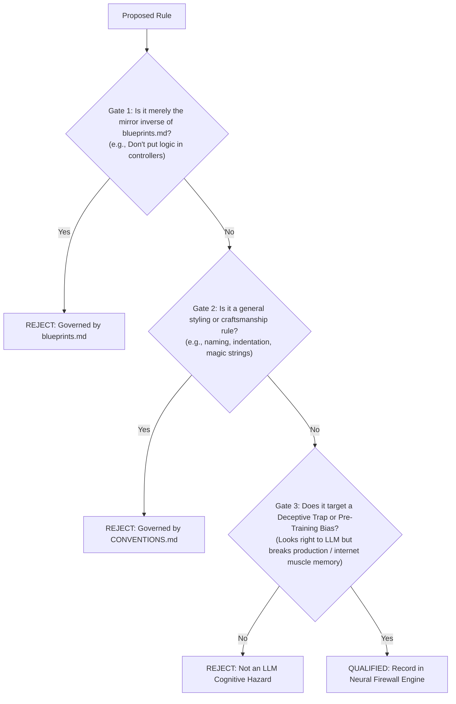

# [GUARD-001]: FIREWALL.md - Neural Interceptor Engine & Production Safety Firewall SSoT

<!-- SLOT 1: COGNITIVE PRIMING & IDENTITY (Primacy Weight: First 10% Context) -->
<cognitive_priming>
> **[SSOT_PURPOSE]:** Authoritative Cognitive Firewall and Deceptive Trap Interceptor for the SMK Document Server (`backend-v2/`). Exclusively intercepts deceptive illusions and deep pre-training gravitational biases where LLMs mistakenly assume code is idiomatic or performant, but triggers runtime crashes, memory fragmentation, or security vulnerabilities in production.
> **[ORTHOGONAL_BOUNDARY]:** This file houses ALL negative anti-patterns, fatal production traps, and structured `<firewall_rule>` blocks. Positive micro-syntax conventions belong in `docs/AI/00_guardrails/CONVENTIONS.md`. Positive generative macro-assembly blueprints belong in `docs/AI/01_backend/blueprints.md`. System topology belongs in `docs/AI/01_backend/system_topology.md`.
> **[NEGATIVE_ROUTING]:** DO NOT load or consult this file when seeking positive implementation templates, feature assembly code, or UI design tokens. Consult `docs/AI/00_guardrails/CONVENTIONS.md` or `docs/AI/01_backend/blueprints.md` instead.
> **[OPERATIONAL_MODES]:** `[MODE: PRE_FLIGHT_INTERCEPT]` (intercepting defective AST tokens before code emission) vs `[MODE: PR_AUDIT]` (evaluating existing code for deceptive traps).
</cognitive_priming>

---

<!-- SLOT 2: PRE-TRAINING PRIOR INVERSION MAP (Subword-Level Bias Override) -->
<prior_inversion_map>
## High-Salience Token Inversion Map (Pre-Training Override)

| Intent / Context | Defective Internet Prior (! BANNED) | Canonical SSoT Target (>> MANDATORY) | Rule ID |
|---|---|---|---|
| **Binary/PDF Output** | `new MemoryStream()`, `.ToArray()`, `byte[]` | Direct stream piping: `Stream.CopyToAsync(response.Body, ct)` | `FIREWALL-MEM-001` |
| **Concurrent DB Access** | `Task.WhenAll` on scoped `DbContext` | Sequential `await` or `IDbContextFactory<T>` | `FIREWALL-CONC-001` |
| **Async Invocation** | `.Result`, `.Wait()`, `.GetAwaiter().GetResult()` | Pure asynchronous pipeline: `await useCase.ExecuteAsync(...)` | `FIREWALL-ASYNC-001` |
| **Tenant Entity Lookup** | Bypassing filter via `.IgnoreQueryFilters()` | Active Global Query Filter on `IMustHaveProject` (e.g. `repo.GetByIdAsync(id, ct)`) | `FIREWALL-SEC-001` |
| **Manual Tenant Scoping** | Passing `Guid projectId` to repo queries | Ambient scoping via `ICurrentProjectContext` & `repo.GetBySlugAsync(slug)` | `FIREWALL-SEC-001` |
| **Controller Binding** | `[FromBody] Template entity` | Transport DTO: `[FromBody] CreateTemplateRequest request` | `FIREWALL-SEC-002` |
| **Regex Compilation** | `new Regex(pattern)`, `Regex.Match(...)` | `[GeneratedRegex(..., RegexOptions.NonBacktracking)]` | `FIREWALL-SEC-003` |
| **Timing Attack Defense** | Early return on missing/inactive user | Constant-time dummy verification: `passwordHasher.VerifyPassword(...)` | `FIREWALL-SEC-004` |
| **Service Granularity** | God class `TemplateService` with CRUD methods | Action-Centric UseCase: `IUseCase<TCommand, TResult>` | `FIREWALL-ARCH-001` |
| **Entity DTO Egress** | Returning Domain Entity outside UseCase | Mapping to immutable Result DTO: `TemplateResultDto` | `FIREWALL-ARCH-002` |
| **Transaction Boundary** | Multiple `CommitAsync()` in a single UseCase | Exactly 1 atomic commit: `await unitOfWork.CommitAsync(ct);` | `FIREWALL-ARCH-003` |
| **Repo Return Type** | Returning `IQueryable<T>` outside Infrastructure | Evaluated immutable collection: `Task<IReadOnlyList<T>>` | `FIREWALL-ARCH-004` |
| **Core Dependencies** | `using SmkDoc.Infrastructure;`, `IFormFile` in Core | Pure C# streaming primitives in Application commands | `FIREWALL-ARCH-005` |
| **UseCase Dependencies** | Optional constructor parameters `= null` | Mandatory non-null dependencies in primary constructor | `FIREWALL-ARCH-006` |
| **String Value Object** | `struct EmailAddress`, `record struct Slug` | `public sealed record class` (guards against default-null) | `FIREWALL-DOM-001` |
| **Entity Declaration** | `public struct Template : BaseEntity` | `public sealed class Template : BaseEntity<TemplateId>` | `FIREWALL-DOM-002` |
| **Struct Footprint** | Mutable struct or record struct > 16 bytes | `public readonly record struct` (<= 16B) or `sealed record class` | `FIREWALL-DOM-003` |
| **Identity Types** | Raw primitive `Guid ProjectId` | Strongly-Typed ID: `readonly record struct ProjectId(Guid Value)` | `FIREWALL-DOM-004` |
| **Render Engine Selection**| `switch (format)`, `if (type == "Gotenberg")` | Polymorphic Strategy: `renderEngines.FirstOrDefault(...)` | `FIREWALL-OPS-001` |
| **Time Querying** | Inlining `DateTime.UtcNow`, `DateTime.Now` | Injected `TimeProvider` or explicit `DateTimeOffset now` | `FIREWALL-OPS-002` |
| **Controller Error Flow** | Inlined `try-catch` / `return BadRequest(...)` | Centralized RFC 9457 `GlobalExceptionHandler` | `FIREWALL-OPS-003` |
| **State Mutations** | `[HttpPost]`, `[HttpPut]` without idempotency | `[HttpPost, Idempotent]` with `Idempotency-Key` header | `FIREWALL-OPS-004` |
| **Workspace Target** | Editing legacy `src/SmkDocServer/` | Editing active modern `backend-v2/src/SmkDoc.*/` | `FIREWALL-OPS-005` |
| **Test Assertions** | Cast assertions `.Should().Be((TemplateId)guid)` | Zero-cast assertion: `var id = TemplateId.New(); ...Be(id)` | `FIREWALL-TEST-001` |
| **Test Assertions (UoW / Mocks)** | `Times.Exactly(N)` where `N > 1` | `Times.Once` on atomic unit of work commits | `FIREWALL-TEST-002` |
</prior_inversion_map>

---

<!-- SLOT 3: CONSTRAINT SEVERITY HIERARCHY (Conflict Resolution Tiers) -->
<severity_hierarchy>
## Constraint Resolution Hierarchy
1. `[TIER-1-FATAL]`: Host process safety, LOH preservation, DbContext thread safety, async non-blocking, zero IDOR, ReDoS defense (`FIREWALL-MEM-001`, `FIREWALL-CONC-001`, `FIREWALL-ASYNC-001`, `FIREWALL-SEC-001`, `FIREWALL-SEC-002`, `FIREWALL-SEC-003`).
2. `[TIER-2-ARCH]`: Clean Architecture boundaries, DTO layer isolation, single atomic UoW commit, entity struct identity preservation (`FIREWALL-ARCH-001` to `FIREWALL-ARCH-005`, `FIREWALL-DOM-001` to `FIREWALL-DOM-003`).
3. `[TIER-3-CRAFT]`: Strongly typed IDs, polymorphic strategy dispatch, RFC 9457 centralized handling, zero-cast test assertions (`FIREWALL-DOM-004`, `FIREWALL-OPS-001` to `FIREWALL-OPS-005`, `FIREWALL-TEST-001`, `FIREWALL-TEST-002`).
</severity_hierarchy>

---

<!-- SLOT 4: CORE GENERATIVE BLUEPRINTS (High-Density Minimal Complete AST) -->
<firewall_scope>
## 1. Document Admission & Update Governance (`RULE-DOC-AP`)

An anti-pattern is PERMITTED into this document ONLY if it satisfies all 3 qualification gates:



### Mandatory Invariants:
1. **`[RULE-DOC-AP-001] [GATE_1_MIRROR_REJECTION] [MUST NOT]`**: Do NOT add negative rules that merely restate the absence of a positive pattern in `blueprints.md`.
2. **`[RULE-DOC-AP-002] [GATE_2_STYLE_REJECTION] [MUST NOT]`**: Do NOT add styling, naming, or nesting rules. Those belong strictly in `CONVENTIONS.md`.
3. **`[RULE-DOC-AP-003] [GATE_3_COGNITIVE_BIAS_QUALIFICATION] [MUST]`**: Every entry MUST intercept either:
   - **Deceptive Production Trap:** Code that appears clean and idiomatic on the surface, but triggers silent memory fragmentation (LOH), DbContext concurrency races, or multi-tenant IDOR leaks.
   - **Pre-Training Gravitational Bias:** Pervasive internet habits (>90% GitHub prevalence) that LLMs instinctively reproduce despite seeing positive blueprints (e.g., God `*Service`, exposing Entities directly, inlining `DateTime.UtcNow`).
4. **`[RULE-DOC-AP-004] [STRUCTURED_NEURAL_SCHEMA] [MUST]`**: Entries MUST use structured `<firewall_rule>` XML blocks containing: `trigger_ast`, `thinking_guard`, `mandatory_substitution`, `fatal_blast_radius`, `exemptions`, and `ssot_ref`. Zero multi-line defective code snippets permitted (to prevent negative token leakage into KV-cache).
5. **`[RULE-DOC-AP-005] [ACTIVE_SSOT_LINK] [MUST]`**: Every entry MUST provide an active, clickable Markdown link redirecting to the exact canonical archetype in `blueprints.md` or `CONVENTIONS.md`.

---

## 2. The Neural Firewall & Interception Engine

The rules are organized sequentially by runtime evaluation priority: **Host Safety => Data Isolation => Architecture Boundaries => Operational Resilience => Automated Testing**.

### Phase 1: Host Process, Memory & Thread Safety (Fatal Production Killers)

<firewall_rule id="FIREWALL-MEM-001" name="RAM_BUFFERING_LOH_ALLOCATION">
<trigger_ast>
["new MemoryStream()", ".ToArray()", "byte[]", "File.ReadAllBytes", "File.ReadAllBytesAsync"]
</trigger_ast>
<thinking_guard>
IF output_type IN [Stream, Document, Pdf, Binary, File] AND payload_size_unknown_or_exceeds(85000) THEN
    ASSERT_FORBIDDEN("RAM Buffering triggers Gen-2 Large Object Heap (LOH) freeze");
    ENFORCE_SUBSTITUTION("Direct Stream Pipeline");
END IF
</thinking_guard>
<mandatory_substitution>
// Stream Gotenberg/MinIO directly to HTTP response stream without intermediate byte[] buffers
await sourceStream.CopyToAsync(response.Body, ct);
</mandatory_substitution>
<fatal_blast_radius>
Buffers > 85KB enter Large Object Heap (LOH) permanently, causing severe memory fragmentation and blocking Gen-2 GCs that freeze all worker threads.
</fatal_blast_radius>
<exemptions>
Payloads mathematically guaranteed < 85KB (e.g., 2D QR barcode generation, SHA-256 hash digests, or Unit Test in-memory mocks).
</exemptions>
<ssot_ref>
[`blueprints.md#archetype-8`](file:///c:/Users/jossl.000/Downloads/Compressed/smk-doc-server/smk-doc-server/docs/AI/01_backend/blueprints.md#archetype-8-zero-loh-stream-over-ram-direct-pipeline)
</ssot_ref>
</firewall_rule>

<firewall_rule id="FIREWALL-CONC-001" name="THREAD_HOSTILE_DBCONTEXT_CONCURRENCY">
<trigger_ast>
["Task.WhenAll", "Parallel.ForEachAsync", "Task.Run"]
</trigger_ast>
<thinking_guard>
IF concurrent_tasks_share(scoped_instance_of: [DbContext, IRepository, IUnitOfWork]) THEN
    ASSERT_FORBIDDEN("EF Core DbContext is not thread-safe; concurrent access corrupts change tracking");
    ENFORCE_SUBSTITUTION("Sequential Await OR IDbContextFactory");
END IF
</thinking_guard>
<mandatory_substitution>
// Sequential execution preserves scoped DbContext single-threaded safety
var resultA = await repo.GetAsync(idA, ct);
var resultB = await repo.GetAsync(idB, ct);
// OR use IDbContextFactory<T> if parallel execution is strictly required
</mandatory_substitution>
<fatal_blast_radius>
Throws `InvalidOperationException: A second operation started on this context instance before a previous operation completed`, corrupting ChangeTracker and crashing worker requests.
</fatal_blast_radius>
<exemptions>
Tasks executing purely CPU-bound mathematics without shared scoped database resources, or distinct independent context instances instantiated via `IDbContextFactory<T>`.
</exemptions>
<ssot_ref>
[`CONVENTIONS.md §3.7`](file:///c:/Users/jossl.000/Downloads/Compressed/smk-doc-server/smk-doc-server/docs/AI/00_guardrails/CONVENTIONS.md#37-concurrency--dbcontext-thread-safety-rule-conc)
</ssot_ref>
</firewall_rule>

<firewall_rule id="FIREWALL-ASYNC-001" name="SYNC_OVER_ASYNC_BLOCKING">
<trigger_ast>
[".Result", ".Wait()", ".GetAwaiter().GetResult()"]
</trigger_ast>
<thinking_guard>
IF method_returns([Task, Task<T>, ValueTask<T>]) AND callers_wait_synchronously() THEN
    ASSERT_FORBIDDEN("Sync-over-async causes ThreadPool starvation and deadlocks");
    ENFORCE_SUBSTITUTION("Pure async/await pipeline");
END IF
</thinking_guard>
<mandatory_substitution>
// Always propagate async/await through entire call stack
var result = await useCase.ExecuteAsync(command, ct);
</mandatory_substitution>
<fatal_blast_radius>
Locks CLR ThreadPool worker threads waiting on asynchronous I/O completion ports, leading to exponential ThreadPool starvation, request queue pileup, and complete server hang.
</fatal_blast_radius>
<exemptions>
Console CLI application entry point `static async Task Main` or synchronous test runner adapters where async harness is unavailable.
</exemptions>
<ssot_ref>
[`CONVENTIONS.md §1`](file:///c:/Users/jossl.000/Downloads/Compressed/smk-doc-server/smk-doc-server/docs/AI/00_guardrails/CONVENTIONS.md#1-runtime--compiler-capabilities-ground-truth)
</ssot_ref>
</firewall_rule>

---

### Phase 2: Security & Tenant Isolation (Data Invariants)

<firewall_rule id="FIREWALL-SEC-001" name="UNSCOPED_TENANT_BYPASS_IDOR">
<trigger_ast>
[".IgnoreQueryFilters()", "AsNoTrackingWithIdentityResolution() without tenant check"]
</trigger_ast>
<thinking_guard>
IF query_invokes([IgnoreQueryFilters]) AND lacks_explicit_tenant_authorization() THEN
    ASSERT_FORBIDDEN("Bypassing EF Core Global Query Filter on IMustHaveProject entities exposes cross-tenant data");
    ENFORCE_SUBSTITUTION("Preserve Global Query Filter or Explicit Tenant Authorization");
END IF
</thinking_guard>
<mandatory_substitution>
// Global Query Filter (HasQueryFilter) automatically encloses queries within the tenant boundary.
// For standard aggregate lookup, invoke canonical repository method directly:
var entity = await repo.GetByIdAsync(id, ct)
    ?? throw new NotFoundException($"Template with ID '{id}' was not found.");
</mandatory_substitution>
<fatal_blast_radius>
Bypassing Global Query Filter leaks confidential cross-tenant templates and documents to unauthorized callers.
</fatal_blast_radius>
<exemptions>
Global platform maintenance background jobs or database seeders executed under Root/Admin context with verified tenant isolation.
</exemptions>
<ssot_ref>
[`blueprints.md#archetype-5`](file:///c:/Users/jossl.000/Downloads/Compressed/smk-doc-server/smk-doc-server/docs/AI/01_backend/blueprints.md#archetype-5-atomic-unit-of-work--transaction-boundary)
</ssot_ref>
</firewall_rule>

<firewall_rule id="FIREWALL-SEC-002" name="MASS_ASSIGNMENT_MODEL_BINDING">
<trigger_ast>
["[FromBody] Template", "[FromBody] Project", "action([FromBody] Document", "action([FromBody] User"]
</trigger_ast>
<thinking_guard>
IF controller_action_parameter_type IS_DOMAIN_ENTITY THEN
    ASSERT_FORBIDDEN("Binding domain entities directly from HTTP payloads exposes internal state to mass assignment");
    ENFORCE_SUBSTITUTION("Explicit Transport DTO");
END IF
</thinking_guard>
<mandatory_substitution>
// Bind exclusively to dedicated request DTOs; never bind to domain entities
public async Task<IResult> Create(
    [FromBody] CreateTemplateRequest request,
    [FromServices] IUseCase<CreateTemplateCommand, TemplateResultDto> useCase,
    CancellationToken ct)
</mandatory_substitution>
<fatal_blast_radius>
Mass-Assignment vulnerability: Untrusted external JSON bodies overwrite critical internal entity state properties (`Id`, `xmin`, `TenantId`, `CreatedBy`, `ProjectId`, `IsSystemProtected`).
</fatal_blast_radius>
<exemptions>
None in HTTP presentation ingress. Domain models must NEVER bind to transport endpoints under any circumstances.
</exemptions>
<ssot_ref>
[`blueprints.md#archetype-1`](file:///c:/Users/jossl.000/Downloads/Compressed/smk-doc-server/smk-doc-server/docs/AI/01_backend/blueprints.md#archetype-1-thin-controller--api-envelope-pattern)
</ssot_ref>
</firewall_rule>

<firewall_rule id="FIREWALL-SEC-003" name="CATASTROPHIC_REDOS">
<trigger_ast>
["new Regex(", "Regex.Match(", "Regex.Replace("]
</trigger_ast>
<thinking_guard>
IF regex_instantiation LACKS([GeneratedRegex, NonBacktracking]) THEN
    ASSERT_FORBIDDEN("Dynamic unconstrained regex causes exponential backtracking Denial of Service (ReDoS)");
    ENFORCE_SUBSTITUTION("Compiled NonBacktracking Regex");
END IF
</thinking_guard>
<mandatory_substitution>
// Pre-compiled source-generated static regex with explicit timeout and NonBacktracking
[GeneratedRegex(@"\{\{(.+?)\}\}", RegexOptions.NonBacktracking, matchTimeoutMilliseconds: 100)]
private static partial Regex PlaceholderRegex();
</mandatory_substitution>
<fatal_blast_radius>
Catastrophic exponential backtracking $O(2^n)$ on crafted input payloads consumes 100% CPU on all worker cores permanently, causing complete denial of service.
</fatal_blast_radius>
<exemptions>
None for user-supplied string parsing. Static fixed string lookups should use `string.Contains` or `IndexOf` without regular expressions.
</exemptions>
<ssot_ref>
[`CONVENTIONS.md §3.9`](file:///c:/Users/jossl.000/Downloads/Compressed/smk-doc-server/smk-doc-server/docs/AI/00_guardrails/CONVENTIONS.md#39-code-level-security--redos-defense-rule-sec)
</ssot_ref>
</firewall_rule>

<firewall_rule id="FIREWALL-SEC-004" name="AUTH_TIMING_ATTACK_EARLY_RETURN">
<trigger_ast>
["if (user == null) return", "if (user == null) throw new InvalidCredentialsException", "if (!user.IsActive) throw"]
</trigger_ast>
<thinking_guard>
IF method_verifies_credentials AND branches_early_on_user_null_without_dummy_hash THEN
    ASSERT_FORBIDDEN("Early return on missing user creates timing discrepancy allowing username enumeration");
    ENFORCE_SUBSTITUTION("Constant-Time Dummy Password Verification");
END IF
</thinking_guard>
<mandatory_substitution>
// Execute constant-time dummy verification when user is not found or inactive
if (user == null || !user.IsActive)
{
    passwordHasher.VerifyPassword(command.Password, SecurityConstants.DummyPasswordHash);
    securityAudit.LogLoginFailure(command.Email, "Invalid credentials", ct);
    throw new InvalidCredentialsException();
}
</mandatory_substitution>
<fatal_blast_radius>
Side-channel response time variations allow external attackers to enumerate valid user accounts via statistical timing analysis.
</fatal_blast_radius>
<exemptions>
None. All authentication and credential verification pipelines MUST execute in constant time.
</exemptions>
<ssot_ref>
[`CONVENTIONS.md §3.9`](file:///c:/Users/jossl.000/Downloads/Compressed/smk-doc-server/smk-doc-server/docs/AI/00_guardrails/CONVENTIONS.md#39-code-level-security--redos-defense-rule-sec)
</ssot_ref>
</firewall_rule>

---

### Phase 3: Clean Architecture & Boundaries (CQRS & Transaction Invariants)

<firewall_rule id="FIREWALL-ARCH-001" name="GOD_SERVICE_CLASS">
<trigger_ast>
["public class TemplateService", "public class DocumentService", "public class ProjectService", "ITemplateService", "IDocumentService"]
</trigger_ast>
<thinking_guard>
IF class_name_ends_with("Service") AND contains_multiple_crud_actions([Create, Update, Delete, Get]) THEN
    ASSERT_FORBIDDEN("God Service violates Single Responsibility Principle and causes high DI coupling");
    ENFORCE_SUBSTITUTION("Single-Action CQRS UseCase Slice");
END IF
</thinking_guard>
<mandatory_substitution>
// Action-Centric CQRS UseCase implementing single focused workflow
public sealed class CreateTemplateUseCase(
    ITemplateRepository templateRepo,
    IUnitOfWork unitOfWork,
    ILogger<CreateTemplateUseCase> logger)
    : IUseCase<CreateTemplateCommand, TemplateResultDto>
</mandatory_substitution>
<fatal_blast_radius>
Violates Single Responsibility Principle, creates massive dependency injection graphs with 10+ dependencies, causes git merge conflicts, and blocks Clean Architecture cross-cutting pipelines.
</fatal_blast_radius>
<exemptions>
Pure stateless mathematical or localization utilities (e.g. `ThaiDataTransformer`).
</exemptions>
<ssot_ref>
[`blueprints.md#archetype-6`](file:///c:/Users/jossl.000/Downloads/Compressed/smk-doc-server/smk-doc-server/docs/AI/01_backend/blueprints.md#archetype-6-action-centric-cqrs-usecase-pattern)
</ssot_ref>
</firewall_rule>

<firewall_rule id="FIREWALL-ARCH-002" name="DOMAIN_ENTITY_BOUNDARY_LEAKAGE">
<trigger_ast>
["IUseCase<*, Template>", "ApiResponse<Template>", "Task<Template>", "Task<Project>", "Task<Document>"]
</trigger_ast>
<thinking_guard>
IF method_or_api_envelope_returns_type([Template, Project, Document, ApiKey, User]) THEN
    ASSERT_FORBIDDEN("Returning Domain Entities outside Application boundary leaks domain model");
    ENFORCE_SUBSTITUTION("Explicit Result DTO");
END IF
</thinking_guard>
<mandatory_substitution>
// Map entity state strictly to immutable Result DTO before exiting UseCase boundary
var resultDto = new TemplateResultDto(entity.Id, entity.Name.Value, entity.Slug.Value, entity.CreatedAt);
return new ApiResponse<TemplateResultDto>(resultDto);
</mandatory_substitution>
<fatal_blast_radius>
Leaks internal entity state and navigation properties across architecture boundaries; triggers JSON serializer circular reference loops and runtime EF Core lazy-loading exceptions.
</fatal_blast_radius>
<exemptions>
Internal domain services operating strictly within `SmkDoc.Domain.dll`.
</exemptions>
<ssot_ref>
[`CONVENTIONS.md §2.2`](file:///c:/Users/jossl.000/Downloads/Compressed/smk-doc-server/smk-doc-server/docs/AI/00_guardrails/CONVENTIONS.md#22-dto-layering--ownership-matrix-rule-dto)
</ssot_ref>
</firewall_rule>

<firewall_rule id="FIREWALL-ARCH-003" name="BROKEN_ACID_TRANSACTION_BOUNDARIES">
<trigger_ast>
["CommitAsync", "SaveChangesAsync"]
</trigger_ast>
<thinking_guard>
IF usecase_invokes_commit_count > 1 THEN
    ASSERT_FORBIDDEN("Multiple CommitAsync calls in a single UseCase violate atomic ACID transaction boundaries");
    ENFORCE_SUBSTITUTION("Single Atomic UoW Commit");
END IF
</thinking_guard>
<mandatory_substitution>
// Queue all aggregate mutations into ChangeTracker; execute exactly ONE commit at end of workflow
await templateRepo.AddAsync(template, ct);
await auditRepo.AddAsync(auditLog, ct);
await unitOfWork.CommitAsync(ct);
</mandatory_substitution>
<fatal_blast_radius>
Intermediate failure after the first commit leaves partially persisted orphaned records in the database, permanently corrupting relational state integrity.
</fatal_blast_radius>
<exemptions>
Long-running Outbox / Saga orchestrators explicitly managed by distributed background workers.
</exemptions>
<ssot_ref>
[`blueprints.md#archetype-5`](file:///c:/Users/jossl.000/Downloads/Compressed/smk-doc-server/smk-doc-server/docs/AI/01_backend/blueprints.md#archetype-5-atomic-unit-of-work--transaction-boundary)
</ssot_ref>
</firewall_rule>

<firewall_rule id="FIREWALL-ARCH-004" name="LEAKING_IQUERYABLE_AND_DEFERRED_EXECUTION">
<trigger_ast>
["IQueryable<", "public IQueryable"]
</trigger_ast>
<thinking_guard>
IF repository_or_usecase_interface_exposes([IQueryable<T>]) THEN
    ASSERT_FORBIDDEN("Exposing IQueryable leaks database provider details and triggers deferred execution leaks");
    ENFORCE_SUBSTITUTION("Materialized Collection Task");
END IF
</thinking_guard>
<mandatory_substitution>
// Repository encapsulates query execution and returns materialized immutable collections
public async Task<IReadOnlyList<Template>> ListAsync(ProjectId projectId, CancellationToken ct)
{
    return await dbContext.Templates
        .AsNoTracking()
        .Where(x => x.ProjectId == projectId)
        .ToListAsync(ct);
}
</mandatory_substitution>
<fatal_blast_radius>
Leaky abstraction causes SQL queries to execute outside repository boundaries, leading to unmanaged open database connections, N+1 query explosions, and threading conflicts.
</fatal_blast_radius>
<exemptions>
Specification Pattern queries executed strictly inside `SmkDoc.Infrastructure`.
</exemptions>
<ssot_ref>
[`CONVENTIONS.md §3.3`](file:///c:/Users/jossl.000/Downloads/Compressed/smk-doc-server/smk-doc-server/docs/AI/00_guardrails/CONVENTIONS.md#33-infrastructure-layer-rule-infra)
</ssot_ref>
</firewall_rule>

<firewall_rule id="FIREWALL-ARCH-005" name="INFRASTRUCTURE_COUPLING_IN_CORE">
<trigger_ast>
["using SmkDoc.Infrastructure", "AppDbContext", "IFormFile", "HttpContext"]
</trigger_ast>
<thinking_guard>
IF file_in_layer([Domain, Application]) AND references_namespace_or_type([SmkDoc.Infrastructure, Microsoft.AspNetCore.Http, AppDbContext]) THEN
    ASSERT_FORBIDDEN("Application and Domain layers must never reference Infrastructure or ASP.NET hosting types");
    ENFORCE_SUBSTITUTION("Inward Pure C# Abstraction");
END IF
</thinking_guard>
<mandatory_substitution>
// Decouple from ASP.NET IFormFile using pure C# streaming primitives in Application commands
public sealed record UploadTemplateCommand(
    ProjectId ProjectId,
    string TemplateName,
    Stream ContentStream,
    string ContentType,
    long SizeInBytes) : ICommand<TemplateResultDto>;
</mandatory_substitution>
<fatal_blast_radius>
Dependency Inversion violation tightly couples application core to relational databases or HTTP web hosting, completely breaking headless CLI tools and in-memory unit testing.
</fatal_blast_radius>
<exemptions>
None. Dependency flow is strictly inward: `Presentation => Application => Domain` and `Infrastructure => Application => Domain`.
</exemptions>
<ssot_ref>
[`CONVENTIONS.md §3.2`](file:///c:/Users/jossl.000/Downloads/Compressed/smk-doc-server/smk-doc-server/docs/AI/00_guardrails/CONVENTIONS.md#32-application-layer-rule-app)
</ssot_ref>
</firewall_rule>

<firewall_rule id="FIREWALL-ARCH-006" name="OPTIONAL_USECASE_DEPENDENCIES_NULL_DEFAULT">
<trigger_ast>
["= null)", "= default)"]
</trigger_ast>
<thinking_guard>
IF constructor_parameter_in_usecase HAS_DEFAULT_VALUE([null, default]) THEN
    ASSERT_FORBIDDEN("Optional dependencies in UseCase constructors create hidden null reference traps and bypass IoC container invariants");
    ENFORCE_SUBSTITUTION("Mandatory Constructor Injection");
END IF
</thinking_guard>
<mandatory_substitution>
// All UseCase dependencies MUST be mandatory and explicitly injected via primary constructors
public sealed class LoginUseCase(
    IUserRepository userRepo,
    IPasswordHasher passwordHasher,
    ITokenService tokenService,
    IUserWorkspaceQueryService workspaceQueryService,
    ISecurityAuditService securityAudit) : IUseCase<LoginCommand, LoginResultDto>
</mandatory_substitution>
<fatal_blast_radius>
Default null dependencies mask missing DI service registrations during startup, deferring crashes to runtime and creating backdoor test configurations.
</fatal_blast_radius>
<exemptions>
Optional CancellationToken parameters in method signatures `(CancellationToken ct = default)`.
</exemptions>
<ssot_ref>
[`CONVENTIONS.md §3.2`](file:///c:/Users/jossl.000/Downloads/Compressed/smk-doc-server/smk-doc-server/docs/AI/00_guardrails/CONVENTIONS.md#32-application-layer-rule-app)
</ssot_ref>
</firewall_rule>

<firewall_rule id="FIREWALL-DOM-001" name="DEFAULT_STRUCT_INVARIANT_BYPASS">
<trigger_ast>
["struct EmailAddress", "record struct EmailAddress", "record struct *Name", "record struct *Slug", "record struct *Hash"]
</trigger_ast>
<thinking_guard>
IF type_wraps_string_or_has_validation_invariants AND declared_as([struct, readonly_record_struct]) THEN
    ASSERT_FORBIDDEN("C# struct default parameterless ctor (default(T)) bypasses factory validation and injects null domain state");
    ENFORCE_SUBSTITUTION("Sealed Record Class Value Object");
END IF
</thinking_guard>
<mandatory_substitution>
// Class-based record protects invariants: private constructor forces execution through canonical Create(...) factory
public sealed record class EmailAddress
{
    public string Value { get; }
    private EmailAddress(string value) => Value = value;
    public static EmailAddress Create(string? value) =>
        new(Guard.ValidEmail(value, "Email address"));
    public static implicit operator string(EmailAddress email) => email.Value;
}
</mandatory_substitution>
<fatal_blast_radius>
Default-null invariant breach: `default(T)` or uninitialized array allocations bypass Guard clauses, injecting corrupt null or unvalidated strings into the domain core without throwing exceptions.
</fatal_blast_radius>
<exemptions>
Strongly-typed IDs (`ProjectId(Guid Value)`) and numeric/range measurements (`DateRange`, `PageMargin`) <= 16 bytes where zero/empty is an explicitly handled valid state.
</exemptions>
<ssot_ref>
[`CONVENTIONS.md §4.1`](file:///c:/Users/jossl.000/Downloads/Compressed/smk-doc-server/smk-doc-server/docs/AI/00_guardrails/CONVENTIONS.md#41-domain-layer-rule-dom)
</ssot_ref>
</firewall_rule>

<firewall_rule id="FIREWALL-DOM-002" name="ENTITY_STRUCT_IDENTITY_COLLAPSE">
<trigger_ast>
["public struct Template : BaseEntity", "public record struct Template", "public struct Project", "public record struct Document"]
</trigger_ast>
<thinking_guard>
IF type_is_domain_entity_or_aggregate_root AND declared_as([struct, record_struct]) THEN
    ASSERT_FORBIDDEN("Entity declared as struct collapses EF Core change tracking and causes massive stack copy bloat");
    ENFORCE_SUBSTITUTION("Sealed Class BaseEntity");
END IF
</thinking_guard>
<mandatory_substitution>
// Entities must always be sealed classes inheriting BaseEntity<TId> to preserve reference identity and EF Core ChangeTracker snapshots
public sealed class Template : BaseEntity<TemplateId>
{
    public ProjectId ProjectId { get; private set; }
    public TemplateName Name { get; private set; } = null!;
    public bool IsActive { get; private set; }
}
</mandatory_substitution>
<fatal_blast_radius>
EF Core change tracking collapse: Mutations to a struct entity mutate a stack copy rather than the tracked instance in DbContext, causing silent data persistence failure.
</fatal_blast_radius>
<exemptions>
None. Domain entities and aggregate roots MUST strictly remain reference types (`class`).
</exemptions>
<ssot_ref>
[`CONVENTIONS.md §4.1`](file:///c:/Users/jossl.000/Downloads/Compressed/smk-doc-server/smk-doc-server/docs/AI/00_guardrails/CONVENTIONS.md#41-domain-layer-rule-dom)
</ssot_ref>
</firewall_rule>

<firewall_rule id="FIREWALL-DOM-003" name="MUTABLE_OR_OVERSIZED_STRUCT">
<trigger_ast>
["public struct " without readonly, "record struct" with size > 16 bytes, "struct" with > 3 reference fields]
</trigger_ast>
<thinking_guard>
IF struct_declaration_is_mutable OR struct_memory_footprint > 16 THEN
    ASSERT_FORBIDDEN("Mutable or oversized struct causes defensive copy memory thrashing and ghost mutations");
    ENFORCE_SUBSTITUTION("Readonly Record Struct (<= 16B) or Sealed Record Class (> 16B)");
END IF
</thinking_guard>
<mandatory_substitution>
// Structs must be strictly immutable (readonly) and <= 16 bytes (e.g. 1 Guid or 2 ints/floats)
public readonly record struct ProjectId(Guid Value);
</mandatory_substitution>
<fatal_blast_radius>
Non-readonly structs cause the C# compiler to emit hidden defensive copies on every method or property invocation, destroying CPU cache locality and throughput. Mutable structs cause silent ghost mutations on copies.
</fatal_blast_radius>
<exemptions>
Specialized low-level high-performance SIMD vectors or `ref struct` Spans in zero-allocation image parsing.
</exemptions>
<ssot_ref>
[`CONVENTIONS.md §4.1`](file:///c:/Users/jossl.000/Downloads/Compressed/smk-doc-server/smk-doc-server/docs/AI/00_guardrails/CONVENTIONS.md#41-domain-layer-rule-dom)
</ssot_ref>
</firewall_rule>

<firewall_rule id="FIREWALL-DOM-004" name="PRIMITIVE_OBSESSION_AGGREGATE_IDENTIFIERS">
<trigger_ast>
["Guid ProjectId", "Guid TemplateId", "Guid UserId", "Guid CompanyId", "Guid DocumentId", "Guid ApiKeyId", "Guid DatasetId"]
</trigger_ast>
<thinking_guard>
IF entity_or_aggregate_property_declares_primitive_guid_identifier THEN
    ASSERT_FORBIDDEN("Raw Guid identity leads to primitive obsession and cross-aggregate argument transposition bugs");
    ENFORCE_SUBSTITUTION("Strongly-Typed ID Readonly Record Struct");
END IF
</thinking_guard>
<mandatory_substitution>
// Aggregate identity and cross-aggregate references must be strongly typed
public sealed class Template : BaseEntity<TemplateId>
{
    public ProjectId ProjectId { get; private set; }
}
</mandatory_substitution>
<fatal_blast_radius>
Primitive obsession leads to silent argument transposition bugs (e.g. passing a CompanyId into a ProjectId parameter, or TemplateId into DocumentId) that compile without errors and corrupt production multi-tenant data.
</fatal_blast_radius>
<exemptions>
Non-aggregate secondary identifiers (e.g. correlation tokens, transient session IDs, or OAuth state nonces).
</exemptions>
<ssot_ref>
[`CONVENTIONS.md §4.1`](file:///c:/Users/jossl.000/Downloads/Compressed/smk-doc-server/smk-doc-server/docs/AI/00_guardrails/CONVENTIONS.md#41-domain-layer-rule-dom)
</ssot_ref>
</firewall_rule>

---

### Phase 4: Operational Resilience & Systemic Governance

<firewall_rule id="FIREWALL-OPS-001" name="HARDCODED_ENGINE_BRANCHING">
<trigger_ast>
["switch (format)", "switch (engine)", "if (type == \"Gotenberg\")", "if (type == \"OpenXml\")"]
</trigger_ast>
<thinking_guard>
IF pipeline_dispatches_render_engine_via([switch, if_else]) THEN
    ASSERT_FORBIDDEN("Hardcoded engine dispatch violates Open-Closed Principle (OCP)");
    ENFORCE_SUBSTITUTION("Polymorphic Strategy Resolver");
END IF
</thinking_guard>
<mandatory_substitution>
// Resolve engine dynamically via Polymorphic Strategy Pattern
var engine = renderEngines.FirstOrDefault(e => e.CanRender(format))
    ?? throw new UnsupportedRenderFormatException(format);
return await engine.RenderAsync(context, ct);
</mandatory_substitution>
<fatal_blast_radius>
Violates Open-Closed Principle (OCP): Adding or upgrading a render engine requires editing core rendering pipelines, risking regressions across existing engines.
</fatal_blast_radius>
<exemptions>
Binary boolean checks strictly isolated within a single strategy engine's internal implementation.
</exemptions>
<ssot_ref>
[`blueprints.md#archetype-9`](file:///c:/Users/jossl.000/Downloads/Compressed/smk-doc-server/smk-doc-server/docs/AI/01_backend/blueprints.md#archetype-9-polymorphic-render-strategy-engine)
</ssot_ref>
</firewall_rule>

<firewall_rule id="FIREWALL-OPS-002" name="SYSTEM_CLOCK_DIRECT_INLINING">
<trigger_ast>
["DateTime.UtcNow", "DateTimeOffset.UtcNow", "DateTime.Now", "DateTime.Today"]
</trigger_ast>
<thinking_guard>
IF code_queries_time_via([DateTime.UtcNow, DateTimeOffset.UtcNow]) THEN
    ASSERT_FORBIDDEN("Direct clock query breaks determinism and testability");
    ENFORCE_SUBSTITUTION("TimeProvider DI or Explicit Parameter");
END IF
</thinking_guard>
<mandatory_substitution>
// Inject TimeProvider in services or pass explicit DateTimeOffset now into domain methods
var now = timeProvider.GetUtcNow();
var entity = Template.Create(projectId, TemplateName.Create(name), TemplateSlug.Create(slug), category: null, now);
</mandatory_substitution>
<fatal_blast_radius>
Non-deterministic code: Business logic verifying token expiration, TTLs, and audit timestamps cannot be simulated or tested deterministically in unit tests.
</fatal_blast_radius>
<exemptions>
Low-level performance benchmarking using `Stopwatch.GetTimestamp()` where elapsed duration only is measured.
</exemptions>
<ssot_ref>
[`CONVENTIONS.md §3.1`](file:///c:/Users/jossl.000/Downloads/Compressed/smk-doc-server/smk-doc-server/docs/AI/00_guardrails/CONVENTIONS.md#31-domain-layer-rule-dom)
</ssot_ref>
</firewall_rule>

<firewall_rule id="FIREWALL-OPS-003" name="AD_HOC_CONTROLLER_ERROR_HANDLING">
<trigger_ast>
["try {", "catch (Exception", "return BadRequest(", "return StatusCode(500", "return NotFound("]
</trigger_ast>
<thinking_guard>
IF controller_action_contains([try_catch, manual_status_code_return]) THEN
    ASSERT_FORBIDDEN("Ad-hoc error handling bypasses centralized RFC 9457 pipeline");
    ENFORCE_SUBSTITUTION("GlobalExceptionHandler RFC 9457");
END IF
</thinking_guard>
<mandatory_substitution>
// Thin controller allows domain exceptions to propagate directly to GlobalExceptionHandler
var result = await useCase.ExecuteAsync(command, ct);
var response = new ApiResponse<TemplateResultDto>(result);
return TypedResults.Ok(response);
</mandatory_substitution>
<fatal_blast_radius>
Bypasses centralized RFC 9457 `ProblemDetails` pipeline, leading to inconsistent error payload schemas, unindexed telemetry, and potential internal stack trace leakage.
</fatal_blast_radius>
<exemptions>
Global Exception Middleware and Controller Action Filters explicitly engineered for telemetry capture.
</exemptions>
<ssot_ref>
[`blueprints.md#archetype-2`](file:///c:/Users/jossl.000/Downloads/Compressed/smk-doc-server/smk-doc-server/docs/AI/01_backend/blueprints.md#archetype-2-rfc-9457-global-exception-pipeline-iexceptionhandler-ssot)
</ssot_ref>
</firewall_rule>

<firewall_rule id="FIREWALL-OPS-004" name="MUTATING_ACTIONS_OMITTING_IDEMPOTENCY">
<trigger_ast>
["[HttpPost]", "[HttpPut]", "[HttpDelete]"]
</trigger_ast>
<thinking_guard>
IF action_attribute IN [HttpPost, HttpPut, HttpDelete] AND lacks_filter([Idempotent]) THEN
    ASSERT_FORBIDDEN("State-mutating HTTP endpoint requires Idempotency protection");
    ENFORCE_SUBSTITUTION("[HttpPost, Idempotent]");
END IF
</thinking_guard>
<mandatory_substitution>
// Protect state mutations with RFC Idempotency-Key filter
[HttpPost, Idempotent]
public async Task<IResult> Create(...)
</mandatory_substitution>
<fatal_blast_radius>
Network glitches and automatic client retries trigger duplicated state mutations, duplicated database rows, double billings, or corrupted documents.
</fatal_blast_radius>
<exemptions>
Safe read-only HTTP queries (`[HttpGet]`, `[HttpHead]`, `[HttpOptions]`) where repetitive calls produce zero side-effects.
</exemptions>
<ssot_ref>
[`blueprints.md#archetype-3`](file:///c:/Users/jossl.000/Downloads/Compressed/smk-doc-server/smk-doc-server/docs/AI/01_backend/blueprints.md#archetype-3-ietf-idempotency-key-pipeline-pattern-safe-mutations)
</ssot_ref>
</firewall_rule>

<firewall_rule id="FIREWALL-OPS-005" name="MODIFYING_LEGACY_V1_CODEBASE">
<trigger_ast>
["src/SmkDocServer/", "src/SmkDocServer.Core/", "src/SmkDocServer.Infrastructure/"]
</trigger_ast>
<thinking_guard>
IF target_file_path_starts_with("src/") AND NOT target_file_path_starts_with("backend-v2/") THEN
    ASSERT_FORBIDDEN("Modifying legacy v1 codebase produces phantom edits");
    ENFORCE_SUBSTITUTION("Target backend-v2/ feature slices");
END IF
</thinking_guard>
<mandatory_substitution>
// All active engineering targets backend-v2/ exclusively:
// Target: backend-v2/src/SmkDoc.Application/Features/...
</mandatory_substitution>
<fatal_blast_radius>
Phantom edits: Root `src/` codebase is legacy v1 disconnected from active runtime pipelines; changes produce zero effect and waste compute budget.
</fatal_blast_radius>
<exemptions>
Historical reference reading, legacy schema inspection, and migration comparison tasks only.
</exemptions>
<ssot_ref>
[`CONVENTIONS.md §2.1`](file:///c:/Users/jossl.000/Downloads/Compressed/smk-doc-server/smk-doc-server/docs/AI/00_guardrails/CONVENTIONS.md#21-boundary-invariants-rule-arch)
</ssot_ref>
</firewall_rule>

---

### Phase 5: Automated Testing & Assertion Craftsmanship

<firewall_rule id="FIREWALL-TEST-001" name="BOXED_FLUENT_ASSERTIONS_ID_EQUALITY">
<trigger_ast>
[".Should().Be((TemplateId)", ".Should().Be((ProjectId)", ".Should().Be((UserId)", ".Should().Be((ApiKeyId)", ".Should().Be((DocumentId)"]
</trigger_ast>
<thinking_guard>
IF assertion_performs_explicit_cast_to_strongly_typed_id THEN
    ASSERT_FORBIDDEN("Explicit (TId) cast in test assertions indicates test fixture primitive obsession and triggers FluentAssertions boxing traps");
    ENFORCE_SUBSTITUTION("TId.New() Test Fixture Pattern");
END IF
</thinking_guard>
<mandatory_substitution>
// Declare test fixture IDs directly using strongly-typed ID constructors:
var templateId = TemplateId.New();
log.TemplateId.Should().Be(templateId); // Zero-cast assertion
</mandatory_substitution>
<fatal_blast_radius>
FluentAssertions' `Be(object expected)` boxes both sides. When `Guid` is compared with `TemplateId`, `object.Equals` evaluates different CLR types and fails silently or forces anti-pattern duct-tape casts (`(TemplateId)guid`).
</fatal_blast_radius>
<exemptions>
None. Unit and integration tests must always instantiate strongly-typed IDs via `TId.New()` for zero-cast assertions.
</exemptions>
<ssot_ref>
[`CONVENTIONS.md §4.11`](file:///c:/Users/jossl.000/Downloads/Compressed/smk-doc-server/smk-doc-server/docs/AI/00_guardrails/CONVENTIONS.md#411-unit-testing-craftsmanship-rule-test)
</ssot_ref>
</firewall_rule>

<firewall_rule id="FIREWALL-TEST-002" name="TAUTOLOGICAL_AND_OVERSPECIFIED_TESTS">
<trigger_ast>
["Times.Exactly(", "new Mock<TimeProvider>()", ".Reset()", "const get* = (*) =>"]
</trigger_ast>
<thinking_guard>
IF test_asserts_local_helper_without_production_import OR verifies_multiple_uow_commits_in_single_usecase THEN
    ASSERT_FORBIDDEN("Tautological tests provide zero regression safety; verifying multiple UoW commits masks FIREWALL-ARCH-003 violations");
    ENFORCE_SUBSTITUTION("Black-Box SUT Behavioral Assertion & Single Atomic Commit");
END IF
</thinking_guard>
<mandatory_substitution>
// Always invoke the real production SUT and verify atomic boundary side-effects once:
var result = await CreateSut().ExecuteAsync(command, CancellationToken.None);
result.Slug.Should().Be("invoice-standard");
unitOfWorkMock.Verify(u => u.CommitAsync(It.IsAny<CancellationToken>()), Times.Once);
</mandatory_substitution>
<fatal_blast_radius>
False-positive test suite: Tautological tests stay green when production code breaks, while overspecified mock verifications break on every valid internal refactoring.
</fatal_blast_radius>
<exemptions>
Verifying retry count on external HTTP resilience pipelines (e.g. Polly retry tests in Infrastructure).
</exemptions>
<ssot_ref>
[`CONVENTIONS.md §3.11`](file:///c:/Users/jossl.000/Downloads/Compressed/smk-doc-server/smk-doc-server/docs/AI/00_guardrails/CONVENTIONS.md#311-unit-testing-craftsmanship-rule-test)
</ssot_ref>
</firewall_rule>

---

## 3. Document Maintenance & Rule Ingestion Protocol

### Ingestion Triggers (Conditions when the LLM MUST Halt & Propose a New Rule):
- **`[EVENT_USER_CORRECTION]`**: The user corrects the LLM for generating code that violates project architecture, indicating a persistent pre-training gravitational bias.
- **`[EVENT_DECEPTIVE_BUG]`**: Root cause analysis (RCA) or runtime testing reveals a bug caused by code that compiled successfully but failed during execution, concurrency, or memory profiling (LOH/leaks).
- **`[EVENT_UNINTERCEPTED_CODE]`**: During code review or PR audit, the LLM discovers code that passes compilation but breaks architectural boundaries, not yet intercepted by Phase 1–5 rules.
- **`[EVENT_RUNTIME_UPGRADE_GOTCHA]`**: Upgrading dependencies (.NET 10, EF Core 10, Gotenberg 8, Npgsql) introduces a silent breaking trap or non-obvious pitfall.

### 1-Shot Ingestion Template:
When proposing a new rule, format it strictly using this `<firewall_rule>` XML structure:

```xml
<firewall_rule id="FIREWALL-[CATEGORY]-[ID]" name="UPPER_SNAKE_CASE_NAME">
<trigger_ast>
["exact_token_1", "exact_token_2"]
</trigger_ast>
<thinking_guard>
IF condition THEN
    ASSERT_FORBIDDEN("Reason why this breaks production");
    ENFORCE_SUBSTITUTION("Canonical pattern name");
END IF
</thinking_guard>
<mandatory_substitution>
// Canonical replacement code (pure C# / SSoT pattern)
</mandatory_substitution>
<fatal_blast_radius>
One-sentence description of production blast radius (e.g. LOH freeze, IDOR breach, thread starvation).
</fatal_blast_radius>
<exemptions>
Strictly bounded exceptions (e.g. Unit tests, console CLI entry point) or None.
</exemptions>
<ssot_ref>
[`blueprints.md#archetype-X` or `CONVENTIONS.md §X`](file:///c:/Users/jossl.000/Downloads/Compressed/smk-doc-server/smk-doc-server/docs/AI/...)
</ssot_ref>
</firewall_rule>
```

### Mutation & Approval Gates:
1. **APPROVAL GATE (MUST ASK FIRST):** The LLM MUST NEVER modify `FIREWALL.md` autonomously. It must output the proposed `<firewall_rule>` block in chat and obtain explicit user approval.
2. **GATE 1-3 QUALIFICATION:** The proposed rule MUST pass all 3 qualification gates in Section 1 (not a mirror of blueprints, not micro-styling from CONVENTIONS, and must target a deceptive trap or pre-training bias).
3. **ZERO DEFECTIVE CODE:** The proposal MUST NOT include multi-line defective code snippets (`- bad code`) to prevent negative token contamination into the model's KV-cache.
4. **4-POINT RIPPLE SYNC (TIER-0 COMPLIANCE):** Upon approval, immediately execute the Universal 4-Point Synchronization Protocol from `AGENTS.md` (Upstream Phase Breadcrumb Sync, `CONVENTIONS.md` substitution matrix sync, bidirectional SSoT links, and contradiction sweep).
</firewall_scope>

---

<!-- SLOT 5: DETERMINISTIC VERIFICATION GATEWAY (Recency Weight: Final 10%) -->
<verification_gateway>
## Deterministic Pre-Emission Checklist (Self-Audit Gate)
- [ ] 1. Prior Inversion Map compliance checked against all 22 `<firewall_rule>` blocks?
- [ ] 2. All [TIER-1-FATAL] constraints preserved (Zero LOH buffers, single-thread DbContext, pure async, tenant isolation)?
- [ ] 3. Layer boundaries conform to [ORTHOGONAL_BOUNDARY] (Clean Architecture dependency flow inward)?
- [ ] 4. Code emitted represents Minimal Complete AST without placeholders or `// TODO` blocks?
- [ ] 5. Zero HTML parser collisions (all `<token>`, `<T>`, `<Feature>` tags wrapped in inline backticks)?
- [ ] 6. Zero defective multi-line code blocks emitted in documentation?
</verification_gateway>
