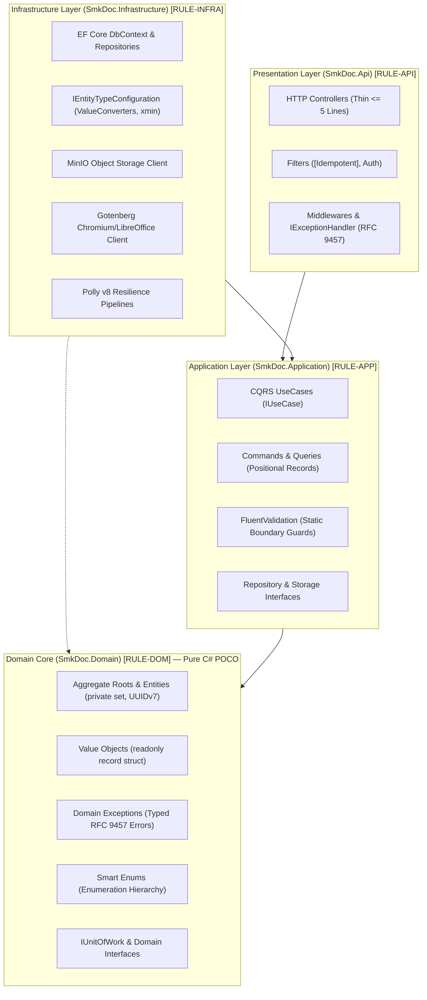
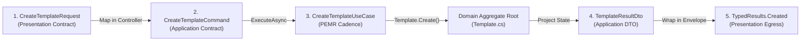
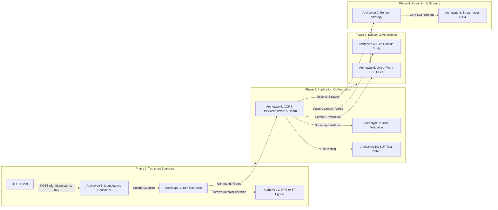

# [BACK-002]: blueprints.md - Canonical Architectural Patterns & Generative Implementation Archetypes SSoT

<!-- SLOT 1: COGNITIVE PRIMING & IDENTITY (Primacy Weight: First 10% Context) -->
<cognitive_priming>
> **[SSOT_PURPOSE]:** Authoritative Pure Backend Architectural Cookbook and Master Generative Blueprint for the SMK Document Server (`backend-v2/`). All frontend Next.js 15 / React 19 UI archetypes reside exclusively in `docs/AI/02_frontend/`.
> **[ORTHOGONAL_BOUNDARY]:** This document functions as the **Macro-Assembler & Generative Feature-Slice Factory** (multi-file slice assembly, layer contracts, and testing blueprints). Single-line micro-AST syntax tokens belong in `docs/AI/00_guardrails/CONVENTIONS.md`. Deceptive traps belong in `docs/AI/00_guardrails/FIREWALL.md`. Wire HTTP contracts belong in `docs/AI/01_backend/api_contract.md`. Frontend specifications belong in `docs/AI/02_frontend/`.
> **[NEGATIVE_ROUTING]:** DO NOT load this file for frontend Next.js/Tailwind UI code, negative firewall rules, or raw DB schema migrations.
> **[OPERATIONAL_MODES]:** `[MODE: GENERATION]` (assembling new feature slices, UseCases, entities, or test fixtures) vs `[MODE: AUDIT]` (verifying feature slices conform to the 10 Golden Archetypes).
</cognitive_priming>

---

<!-- SLOT 2: PRE-TRAINING PRIOR INVERSION MAP (Subword-Level Bias Override) -->
<prior_inversion_map>
## High-Salience Token Inversion Map (Pre-Training Override)

| Intent / Context | Defective Internet Prior (! BANNED) | Canonical SSoT Target (>> MANDATORY) | Rule ID / Archetype |
|---|---|---|---|
| **Slice Assembly** | Monolithic God `*Service` with CRUD methods | Master 5-File Feature Slice (`Request => Command => UseCase => Entity => ResultDto`) | Level 2 Slice Pipeline |
| **Controller Design** | Fat controller with business logic | Thin controller ($\le 5$ lines) delegating to `IUseCase<TCommand, TResult>` | Archetype 1 |
| **Error Responses** | Ad-hoc `try-catch` / `return BadRequest(...)` | RFC 9457 `ProblemDetails` via `GlobalExceptionHandler` | Archetype 2 |
| **Mutation Safety** | Unprotected `[HttpPost]` without key | `[HttpPost, Idempotent]` with `Idempotency-Key` header | Archetype 3 |
| **Entity Modeling** | Anemic POCO with public setters | Rich Domain Entity with `private set` and canonical factory `Create(...)` | Archetype 4 |
| **Primary Key** | Random UUIDv4 (`Guid.NewGuid()`) | Sequential UUIDv7 (`Guid.CreateVersion7()`) | Archetype 4 |
| **UoW Commits** | Multiple `SaveChangesAsync` in loop | Exactly ONE atomic commit: `await unitOfWork.CommitAsync(ct);` | Archetype 5 |
| **Validation Gate** | Controller manual property checks | Dual-Engine: `FluentValidation` (Command) + `JsonSchema.Net` (Payload) | Archetype 7 |
| **Streaming Output** | Buffering document in `byte[]` | Zero-LOH Stream-over-RAM direct piping via `Stream.CopyToAsync` | Archetype 8 |
| **Engine Selection** | Hardcoded `switch(format)` or `if-else` | Polymorphic Strategy via `IEnumerable<IRenderEngine>` | Archetype 9 |
| **Unit Testing** | Real I/O / database in unit test | In-memory CQRS unit test with `CreateSut()` and `TestConstants.BaselineTime` | Archetype 10 |
</prior_inversion_map>

---

<!-- SLOT 3: CONSTRAINT SEVERITY HIERARCHY (Conflict Resolution Tiers) -->
<severity_hierarchy>
## Constraint Resolution Hierarchy
1. `[TIER-1-FATAL]`: Memory & process safety (Zero LOH memory buffering `RULE-MEM-001`, atomic Unit of Work commit `RULE-UOW-002`, rich domain encapsulation `RULE-DOM-002`, compile-time typed API responses `RULE-API-002`).
2. `[TIER-2-ARCH]`: Layer boundary integrity (Strict 5-file slice separation `Presentation => Application => Domain => Infrastructure`, inward dependency flow, polymorphic strategy resolution).
3. `[TIER-3-WIRING]`: Syntactic & property symmetry (1:1 property names across layer boundaries, C# 13 primary constructor formatting with pure `camelCase`, explicit local variable instantiation).
</severity_hierarchy>

---

<!-- SLOT 4: CORE GENERATIVE BLUEPRINTS (High-Density Minimal Complete AST) -->
<blueprints_scope>
## 1. Level 1: System Topology & Inward Dependency Flow

### Clean Architecture Inward Flow Invariant
The SMK Document Server implements Clean Architecture with Dependency Inversion. Domain Core remains isolated framework-free POCOs:



### Architectural Invariants Checklist
1. **Inward Dependency Invariant:** Dependencies flow strictly inward. `SmkDoc.Domain` references zero external assemblies, NuGet packages, or infrastructure libraries.
2. **Stateless Rendering:** Execute preview workflows (`PreviewDocumentUseCase`) 100% in-memory without persisting to PostgreSQL or MinIO.
3. **Centralized Localization:** Route all Thai formatting (Buddhist Era dates, Baht text, phone formatting) through `ThaiDataTransformer`.
4. **Engine Extensibility (OCP):** Resolve engine selection dynamically via `IEnumerable<IRenderEngine>`.
5. **Stream over RAM:** Stream Gotenberg and MinIO payloads directly to HTTP responses via `Stream.CopyToAsync(response.Body, ct)`.
6. **Non-Blocking Asynchronous I/O:** Execute all network and disk operations asynchronously accepting `CancellationToken ct = default`.

---

## 2. Level 2: Master 5-File Feature Slice Pipeline

A standard business feature slice in `smk-doc-server` consists of exactly 5 interconnected files across Clean Architecture layers. Preserve 1:1 property symmetry without inventing intermediary translation glue:



### PEMR Orchestration Lifecycle Formula
Every UseCase in `SmkDoc.Application` executes business logic in strict **PEMR** sequence:
1. **P (Preconditions):** Fail-fast parameter inspection, tenant boundary verification, existence checks.
2. **E (External Retrieval):** Fetch required aggregates via repositories using `.AsNoTracking()` (or tracked only if intended for mutation). Query `timeProvider`.
3. **M (Domain Mutation):** Instantiate or mutate Domain Aggregates via canonical factory methods (`Create(...)`) or domain verbs (`Publish(...)`).
4. **R (Result & Persistence):** Persist mutations via `await unitOfWork.CommitAsync(ct);` and project domain state into an immutable `ResultDto`.

### Contract Property Symmetry Matrix
| Business Field Concept | 1. Presentation Request | 2. Application Command | 3. Domain Entity / Value Object | 4. Application ResultDto | 5. Presentation Envelope |
|---|---|---|---|---|---|
| **Project Identifier** | `request.ProjectId` | `command.ProjectId` | `projectId: command.ProjectId` | *(Scoped to Route)* | `/api/v1/projects/{projectId}` |
| **Template Name** | `request.Name` | `command.Name` | `name: TemplateName.Create(command.Name)` | `result.Name` | `response.Data.Name` |
| **Semantic Slug** | `request.Slug` | `command.Slug` | `slug: TemplateSlug.Create(command.Slug)` | `result.Slug` | `response.Data.Slug` |
| **Business Payload** | `request.Payload` | `command.Payload` | `payload: command.Payload` | `result.Payload` | `response.Data.Payload` |
| **Document Format** | `request.OutputFormat` | `command.OutputFormat` | `outputFormat: command.OutputFormat` | `result.OutputFormat` | `response.Data.OutputFormat` |
| **Audit Timestamp** | *(Client omits)* | *(System stamps)* | `now: timeProvider.GetUtcNow()` | `result.CreatedAt` | `response.Data.CreatedAt` |

---

## 3. Level 3: The 10 Canonical Backend Generative Archetypes



---

### Phase 1: Transport Boundary (HTTP Ingress, Idempotency & Error Egress)

#### Archetype 1: Thin Controller & API Envelope Pattern
* **Intent & Scope:** Acts exclusively as the HTTP entry point. Validates routing, maps request DTOs to Commands/Queries, invokes the target UseCase, and wraps successful outputs in `ApiResponse<T>` using compile-time strongly-typed `TypedResults`.
* **Formula:** `public sealed class {Entity}Controller : ControllerBase` with actions delegating to `IUseCase<TCommand, TResult>`. Controller action bodies MUST be $\le 5$ lines.

```csharp
// [GENERATIVE_SLOT_FORMULA: ARCHETYPE-1-CONTROLLER]
namespace SmkDoc.Api.Controllers;

[ApiController]
[Route("api/v1/templates")]
[Produces("application/json")]
public sealed class TemplateController(
    IUseCase<CreateTemplateCommand, TemplateResultDto> createUseCase,
    IUseCase<GetTemplateByIdQuery, TemplateResultDto> getByIdUseCase,
    IUseCase<ListTemplatesQuery, PagedResultDto<TemplateResultDto>> listUseCase) : ControllerBase
{
    [HttpPost]
    [Idempotent]
    [ProducesResponseType(typeof(ApiResponse<TemplateResultDto>), StatusCodes.Status201Created)]
    [ProducesResponseType(typeof(ProblemDetails), StatusCodes.Status400BadRequest)]
    [ProducesResponseType(typeof(ProblemDetails), StatusCodes.Status409Conflict)]
    public async Task<Created<ApiResponse<TemplateResultDto>>> Create(
        [FromBody] CreateTemplateRequest request,
        CancellationToken ct = default)
    {
        var command = new CreateTemplateCommand(request.ProjectId, request.Name, request.Slug);
        var result = await createUseCase.ExecuteAsync(command, ct);
        var response = new ApiResponse<TemplateResultDto>(result);
        
        return TypedResults.Created($"/api/v1/templates/{result.Id}", response);
    }

    [HttpGet("{id:guid}")]
    [ProducesResponseType(typeof(ApiResponse<TemplateResultDto>), StatusCodes.Status200OK)]
    [ProducesResponseType(typeof(ProblemDetails), StatusCodes.Status404NotFound)]
    public async Task<Ok<ApiResponse<TemplateResultDto>>> GetById(
        Guid id,
        CancellationToken ct = default)
    {
        var query = new GetTemplateByIdQuery(id);
        var result = await getByIdUseCase.ExecuteAsync(query, ct);
        var response = new ApiResponse<TemplateResultDto>(result);

        return TypedResults.Ok(response);
    }

    [HttpGet]
    [ProducesResponseType(typeof(PagedApiResponse<TemplateResultDto>), StatusCodes.Status200OK)]
    public async Task<Ok<PagedApiResponse<TemplateResultDto>>> List(
        [FromQuery] int page = 1,
        [FromQuery] int pageSize = 20,
        CancellationToken ct = default)
    {
        var query = new ListTemplatesQuery(page, pageSize);
        var result = await listUseCase.ExecuteAsync(query, ct);
        var response = new PagedApiResponse<TemplateResultDto>(
            data: result.Items,
            totalCount: result.TotalCount,
            page: result.Page,
            limit: result.PageSize);

        return TypedResults.Ok(response);
    }
}
```

---

#### Archetype 2: RFC 9457 Global Exception Pipeline (`IExceptionHandler` SSoT)
* **Intent & Scope:** Centralized exception egress translating strongly-typed Domain Exceptions directly into RFC 9457 `ProblemDetails`. Dispatched automatically by `GlobalExceptionHandler`.
* **Formula:** Throw strongly-typed Domain Exceptions from Domain or Application layers.

##### SSoT Domain Exception Taxonomy & HTTP Mapping:
| Domain Exception Class | Target HTTP Status | Canonical `errorCode` Token | Trigger Scenario |
|---|---|---|---|
| `DomainValidationException` | `400 Bad Request` | `VALIDATION_FAILED` | Entity factory or invariant validation failure |
| `UnauthorizedException` | `401 Unauthorized` | `AUTHENTICATION_REQUIRED` | Missing or invalid API key / JWT bearer |
| `ForbiddenException` | `403 Forbidden` | `ACCESS_DENIED` | Tenant isolation boundary cross violation |
| `NotFoundException` | `404 Not Found` | `RESOURCE_NOT_FOUND` | Target entity does not exist for specified ID |
| `ConflictException` | `409 Conflict` | `CONFLICT` | Unique key or slug collision |
| `ConcurrencyConflictException` | `409 Conflict` | `CONCURRENCY_CONFLICT` | PostgreSQL `xmin` concurrency token collision |
| `SchemaValidationException` | `422 Unprocessable` | `SCHEMA_VALIDATION_FAILED` | Dynamic JSON payload schema violation |
| `RateLimitExceededException` | `429 Too Many Requests`| `RATE_LIMIT_EXCEEDED` | Request rate bucket exhausted |

##### Consumer Usage Example (Application Layer):
```csharp
// Application Layer UseCase: Throw strongly-typed Domain Exceptions exclusively
if (await templateRepo.SlugExistsAsync(command.Slug, ct))
{
    throw ConflictException.DuplicateSlug(command.Slug);
}

var template = await templateRepo.GetByIdAsync(query.Id, ct)
    ?? throw new NotFoundException($"Template with ID '{query.Id}' was not found.");
```

---

#### Archetype 3: IETF Idempotency-Key Pipeline Pattern (Safe Mutations)
* **Intent & Scope:** Guarantees safe retries on state-mutating endpoints (`POST`, `PUT`, `DELETE`). The `[Idempotent]` filter intercepts requests bearing the `Idempotency-Key` header, caches successful responses for 24 hours, and rejects concurrent duplicate requests with HTTP 409.
* **Formula:** Decorate controller action with `[Idempotent]`.

##### Consumer Usage Example (Controller Layer):
```csharp
// Presentation Layer Controller: Apply [Idempotent] attribute on mutating endpoints
[HttpPost]
[Idempotent]
public async Task<Created<ApiResponse<TemplateResultDto>>> Create(
    [FromBody] CreateTemplateRequest request,
    CancellationToken ct = default)
{
    var command = new CreateTemplateCommand(request.ProjectId, request.Name, request.Slug);
    var result = await createUseCase.ExecuteAsync(command, ct);
    return TypedResults.Created($"/api/v1/templates/{result.Id}", new ApiResponse<TemplateResultDto>(result));
}
```

##### Idempotency Key Semantics:
1. **Header Name:** `Idempotency-Key` (UUIDv4 or client string, max 128 chars).
2. **In-Flight Lease (TTL 30s):** Returns `409 Conflict` (`errorCode: "IDEMPOTENCY_IN_FLIGHT"`) if an identical key is currently executing.
3. **Completed Lease (TTL 24h):** Returns cached status code and payload directly without re-executing the UseCase.

---

### Phase 2: Domain Boundary (Core Business Invariants & Persistence)

#### Archetype 4: Pure Rich Domain Entity & Value Object Pattern
* **Intent & Scope:** Pure C# POCO with zero external dependencies. State is strictly encapsulated (`private set;`). State creation occurs exclusively through exactly ONE canonical `Create(...)` factory method; state mutation occurs exclusively through expressive domain verbs receiving explicit dependencies (`DateTimeOffset now`).
* **Formula:**
  * **Entity / Aggregate Root:** `public sealed class {Entity} : BaseEntity` preserving EF Core Change Tracking and identity equality.
  * **Strongly-Typed ID:** `public readonly record struct {Entity}Id(Guid Value)` ($\le 16$ bytes, stack-allocated, zero GC pressure).
  * **Validated String Value Object:** `public sealed record class {Concept}` with private constructor and `Create(...)` SSoT to eliminate the `default(T)` zero-initialization trap (=> [`FIREWALL-DOM-001`](file:///c:/Users/jossl.000/Downloads/Compressed/smk-doc-server/smk-doc-server/docs/AI/00_guardrails/FIREWALL.md#firewall-dom-001)).

```csharp
// [GENERATIVE_SLOT_FORMULA: ARCHETYPE-4-DOMAIN-ENTITY]
namespace SmkDoc.Domain.ValueObjects;

// 1. Strongly-Typed ID: Stack-allocated readonly record struct (16 bytes, Zero Heap Alloc, Zero-Cast)
public readonly record struct ProjectId(Guid Value) : IComparable<ProjectId>
{
    public static ProjectId New() => new(Guid.CreateVersion7());
    public static ProjectId Empty => new(Guid.Empty);
    public bool IsEmpty => Value == Guid.Empty;
    public int CompareTo(ProjectId other) => Value.CompareTo(other.Value);
    public override string ToString() => Value.ToString();

    // Bidirectional implicit conversions for zero-cast ergonomics at DTO/CQRS boundaries
    public static implicit operator Guid(ProjectId id) => id.Value;
    public static implicit operator ProjectId(Guid value) => new(value);

    // Cross-type equality operators for direct Guid comparison without casting
    public static bool operator ==(ProjectId left, Guid right) => left.Value == right;
    public static bool operator !=(ProjectId left, Guid right) => left.Value != right;
    public static bool operator ==(Guid left, ProjectId right) => left == right.Value;
    public static bool operator !=(Guid left, ProjectId right) => left != right.Value;
}

// 2. Validated String Value Object: Class-based record to prevent default(T) null bypass
public sealed record class TemplateSlug
{
    public string Value { get; }

    private TemplateSlug(string value) => Value = value;

    public static TemplateSlug Create(string? value)
    {
        if (string.IsNullOrWhiteSpace(value))
        {
            throw new DomainValidationException("Template slug cannot be null or empty.");
        }

        var normalized = value.Trim().ToLowerInvariant();
        if (normalized.Length > 100)
        {
            throw new DomainValidationException("Template slug cannot exceed 100 characters.");
        }

        return new TemplateSlug(normalized);
    }

    public override string ToString() => Value;
    public static implicit operator string(TemplateSlug slug) => slug.Value;
}

namespace SmkDoc.Domain.ValueObjects.Layout;

// 3. High-Throughput Layout Struct: 8-16 bytes stack-allocated struct (Zero Heap Allocation)
public readonly record struct PageDimension(float WidthMm, float HeightMm)
{
    public static PageDimension A4 => new(210f, 297f);
    public bool IsPortrait => HeightMm >= WidthMm;
}

namespace SmkDoc.Domain.Entities;

// 4. Aggregate Root: Sealed class inheriting BaseEntity<TId> with strongly-typed Identity
public sealed class Template : BaseEntity<TemplateId>
{
    public ProjectId ProjectId { get; private set; }
    public TemplateName Name { get; private set; } = null!;
    public TemplateSlug Slug { get; private set; } = null!;
    public string? Category { get; private set; }
    public bool IsActive { get; private set; }

    // Required by EF Core Change Tracking materialization
    private Template() { }

    // SSoT Canonical Factory Method
    public static Template Create(
        ProjectId projectId,
        TemplateName name,
        TemplateSlug slug,
        string? category,
        DateTimeOffset now)
    {
        if (projectId.IsEmpty)
        {
            throw new DomainValidationException("ProjectId cannot be empty.");
        }

        return new Template
        {
            Id = TemplateId.New(),
            ProjectId = projectId,
            Name = name,
            Slug = slug,
            Category = category,
            IsActive = true,
            CreatedAt = now,
            UpdatedAt = null
        };
    }

    // Expressive Business Domain Verbs
    public void UpdateMetadata(TemplateName name, TemplateSlug slug, string? category, DateTimeOffset now)
    {
        Name = name;
        Slug = slug;
        Category = category;
        SetUpdated(now);
    }

    public void Archive(DateTimeOffset now)
    {
        if (!IsActive) return;
        IsActive = false;
        SetUpdated(now);
    }
}
```

---

#### Archetype 5: Atomic Unit of Work & Transaction Boundary
* **Intent & Scope:** Manages persistence boundaries. Repositories track changes; `IUnitOfWork.CommitAsync(ct)` executes atomic commits. Entities are configured via Fluent API (`IEntityTypeConfiguration<T>`) incorporating PostgreSQL `xmin` concurrency tokens and Value Converters.
* **Formula:** `IUnitOfWork` interface in Domain, `SmkDocDbContext` in Infrastructure, plus explicit aggregate repository.

##### Repository & Unit of Work Interfaces (Domain):
```csharp
namespace SmkDoc.Domain.Interfaces;

public interface IUnitOfWork
{
    Task<int> CommitAsync(CancellationToken ct = default);
}

public interface ITemplateRepository
{
    // Strongly-Typed ID SSoT (TemplateId and ProjectId support implicit conversion to/from Guid)
    // Ambient Multi-Tenancy: Scoped automatically by EF Core Global Query Filter on IMustHaveProject (ADR-SEC-05)
    Task<Template?> GetByIdAsync(TemplateId id, CancellationToken ct = default);
    Task<Template?> GetBySlugAsync(TemplateSlug slug, CancellationToken ct = default);
    Task<bool> SlugExistsAsync(TemplateSlug slug, CancellationToken ct = default);
    Task<int> CountAsync(CancellationToken ct = default);
    Task<IReadOnlyList<Template>> ListAsync(int page, int pageSize, CancellationToken ct = default);
    Task AddAsync(Template template, CancellationToken ct = default);
}
```

##### EF Core Fluent Configuration & Repository Implementation (Infrastructure):
```csharp
namespace SmkDoc.Infrastructure.Persistence.Configurations;

public sealed class TemplateConfiguration : IEntityTypeConfiguration<Template>
{
    public void Configure(EntityTypeBuilder<Template> builder)
    {
        builder.ToTable("templates");

        builder.HasKey(t => t.Id);
        builder.Property(t => t.Id).ValueGeneratedNever();

        builder.Property(t => t.ProjectId).IsRequired();

        builder.Property(t => t.Name)
            .HasConversion(name => name.Value, val => TemplateName.Create(val))
            .HasMaxLength(200)
            .IsRequired();

        builder.Property(t => t.Slug)
            .HasConversion(slug => slug.Value, val => TemplateSlug.Create(val))
            .HasMaxLength(100)
            .IsRequired();

        builder.Property(t => t.Category).HasMaxLength(50);
        builder.Property(t => t.IsActive).IsRequired();
        builder.Property(t => t.CreatedAt).IsRequired();
        builder.Property(t => t.UpdatedAt);

        // Optimistic Concurrency Token via PostgreSQL xmin
        builder.UseXminAsConcurrencyToken();

        builder.HasIndex(t => new { t.ProjectId, t.Slug }).IsUnique();
    }
}
```

---

### Phase 3: Application & Payload Boundary (CQRS Orchestration)

#### Archetype 6: Action-Centric CQRS UseCase Pattern
* **Intent & Scope:** Orchestrates business execution using 1 Intent = 1 Class. Implements `IUseCase<TCommand, TResult>` with C# 13 Primary Constructor (pure `camelCase` parameters).
* **Formula:**
  1. **Write Command UseCase:** Executes strict PEMR sequence and commits atomically.
  2. **Read / Paged Query UseCase:** Read-only execution with `.AsNoTracking()`, pagination calculation, and projection into `PagedApiResponse<T>`.

##### 6.1 Write Command UseCase (PEMR Cadence):
```csharp
// [GENERATIVE_SLOT_FORMULA: ARCHETYPE-6-WRITE-USECASE]
namespace SmkDoc.Application.Features.Templates.Commands.CreateTemplate;

public sealed class CreateTemplateUseCase(
    ITemplateRepository templateRepo,
    IUnitOfWork unitOfWork,
    TimeProvider timeProvider) : IUseCase<CreateTemplateCommand, TemplateResultDto>
{
    public async Task<TemplateResultDto> ExecuteAsync(CreateTemplateCommand command, CancellationToken ct = default)
    {
        // 1. P: Preconditions (Fail-fast validation)
        var slug = TemplateSlug.Create(command.Slug);
        var templateName = TemplateName.Create(command.Name);

        if (await templateRepo.SlugExistsAsync(command.Slug, ct))
        {
            throw ConflictException.DuplicateSlug(command.Slug);
        }

        // 2. E: External Retrieval & Deterministic Clock
        var now = timeProvider.GetUtcNow();

        // 3. M: Domain Mutation (Canonical Factory SSoT)
        var template = Template.Create(
            projectId: command.ProjectId,
            name: templateName,
            slug: slug,
            category: command.Category,
            now: now);

        await templateRepo.AddAsync(template, ct);

        // 4. R: Result & Single Atomic Transaction Boundary
        await unitOfWork.CommitAsync(ct);

        return new TemplateResultDto(
            Id: template.Id,
            Name: template.Name.Value,
            Slug: template.Slug.Value,
            CreatedAt: template.CreatedAt);
    }
}
```

##### 6.2 Read / Paged Query UseCase (Projection & AsNoTracking):
```csharp
// [GENERATIVE_SLOT_FORMULA: ARCHETYPE-6-READ-USECASE]
namespace SmkDoc.Application.Features.Templates.Queries.ListTemplates;

public sealed record PagedResultDto<T>(
    IReadOnlyList<T> Items,
    int TotalCount,
    int Page,
    int PageSize);

public sealed class ListTemplatesUseCase(
    ITemplateRepository templateRepo) : IUseCase<ListTemplatesQuery, PagedResultDto<TemplateResultDto>>
{
    public async Task<PagedResultDto<TemplateResultDto>> ExecuteAsync(
        ListTemplatesQuery query,
        CancellationToken ct = default)
    {
        // 1. P: Guard Query Limits
        var page = Math.Max(1, query.Page);
        var pageSize = Math.Clamp(query.PageSize, 1, 100);

        // 2. E: Read-Only Evaluation via Repository with .AsNoTracking() and Database-Side Pagination
        // NOTE: ITemplateRepository.ListAsync MUST execute .Skip((page - 1) * pageSize).Take(pageSize) at the Database Level
        var totalCount = await templateRepo.CountAsync(ct);
        var templates = await templateRepo.ListAsync(page, pageSize, ct);

        // 3. R: Project Domain State directly into Immutable Positional Records
        var dtos = templates.Select(t => new TemplateResultDto(
            Id: t.Id,
            Name: t.Name.Value,
            Slug: t.Slug.Value,
            CreatedAt: t.CreatedAt)).ToList();

        return new PagedResultDto<TemplateResultDto>(
            Items: dtos,
            TotalCount: totalCount,
            Page: page,
            PageSize: pageSize);
    }
}
```

---

#### Archetype 7: Dual-Engine Validation Pipeline (Static Command + Dynamic Schema)
* **Intent & Scope:** Boundary gate keeping invalid payloads out of Application and Domain. Static DTO structure is checked via `FluentValidation`; dynamic document payload JSON is verified against cached JSON Schema Draft-07.
* **Formula:** `public sealed class {Action}{Entity}Validator : AbstractValidator<{Action}{Entity}Command>`.

```csharp
// [GENERATIVE_SLOT_FORMULA: ARCHETYPE-7-VALIDATOR]
namespace SmkDoc.Application.Features.Templates.Commands.CreateTemplate;

public sealed class CreateTemplateValidator : AbstractValidator<CreateTemplateCommand>
{
    public CreateTemplateValidator()
    {
        RuleFor(c => c.ProjectId)
            .NotEmpty()
            .WithMessage("ProjectId is required.");

        RuleFor(c => c.Name)
            .NotEmpty()
            .MaximumLength(200)
            .WithMessage("Template name must not exceed 200 characters.");

        RuleFor(c => c.Slug)
            .NotEmpty()
            .MaximumLength(100)
            .Matches("^[a-z0-9-]+$")
            .WithMessage("Slug must contain only lowercase letters, numbers, and hyphens.");
    }
}
```

---

### Phase 4: Binary & Stream Boundary (High-Throughput Rendering)

#### Archetype 8: Zero-LOH Stream-over-RAM Direct Pipeline
* **Intent & Scope:** High-throughput document streaming. Stream payloads directly to HTTP responses to preserve Large Object Heap (LOH) health without buffering in memory.
* **Formula:** Gotenberg / MinIO => `Stream` => `Stream.CopyToAsync(response.Body, ct)`.

```csharp
// [GENERATIVE_SLOT_FORMULA: ARCHETYPE-8-STREAMING]
namespace SmkDoc.Infrastructure.Rendering;

public sealed class GotenbergPdfRenderEngine(
    HttpClient httpClient,
    IOptions<GotenbergOptions> options) : IRenderEngine
{
    public RenderEngineType EngineType => RenderEngineType.ChromiumHtml;

    public async Task RenderAsync(
        Stream htmlStream,
        Stream destinationStream,
        CancellationToken ct = default)
    {
        using var content = new MultipartFormDataContent();
        content.Add(new StreamContent(htmlStream), "files", "index.html");

        using var request = new HttpRequestMessage(HttpMethod.Post, "/forms/chromium/convert/html")
        {
            Content = content
        };

        // Stream direct from network socket without buffering in memory
        using var response = await httpClient.SendAsync(
            request,
            HttpCompletionOption.ResponseHeadersRead,
            ct);

        response.EnsureSuccessStatusCode();

        await using var responseStream = await response.Content.ReadAsStreamAsync(ct);
        await responseStream.CopyToAsync(destinationStream, ct);
    }
}
```

---

#### Archetype 9: Polymorphic Render Strategy Engine
* **Intent & Scope:** Adheres to Open/Closed Principle (OCP). Registers rendering engines (`ChromiumHtml`, `OpenXmlDocx`, `FastExcelXlsx`) into DI as `IEnumerable<IRenderEngine>`. Dispatches active engine polymorphically via Smart Enum without `switch` or `if-else` branching.
* **Formula:** `IEnumerable<IRenderEngine>` resolved by `RenderEngineType`.

```csharp
// [GENERATIVE_SLOT_FORMULA: ARCHETYPE-9-STRATEGY]
namespace SmkDoc.Application.Services;

public sealed class DocumentRenderDispatcher(
    IEnumerable<IRenderEngine> engines) : IDocumentRenderDispatcher
{
    public async Task RenderDocumentAsync(
        RenderEngineType engineType,
        Stream sourceStream,
        Stream targetStream,
        CancellationToken ct = default)
    {
        var engine = engines.FirstOrDefault(e => e.EngineType == engineType)
            ?? throw new ConflictException($"Render engine '{engineType.Name}' is not registered.");

        await engine.RenderAsync(sourceStream, targetStream, ct);
    }
}
```

---

### Phase 5: Automated Testing Boundary

#### Archetype 10: Gold-Standard CQRS Unit Testing Pattern
* **Intent & Scope:** Unit test architecture adhering to 1:1 CQRS Folder Parity (`Commands/` vs `Queries/`), direct Moq mocks, `TestConstants.BaselineTime`, and SSoT `CreateSut()`. Zero disk or network I/O in unit tests.
* **Formula:** `public sealed class {Action}{Entity}UseCaseTests` using `FluentAssertions`.

```csharp
// [GENERATIVE_SLOT_FORMULA: ARCHETYPE-10-UNIT-TEST]
namespace SmkDoc.Tests.Features.Templates.Commands;

public sealed class CreateTemplateUseCaseTests
{
    private readonly Mock<ITemplateRepository> templateRepoMock = new();
    private readonly Mock<IUnitOfWork> unitOfWorkMock = new();
    private readonly Mock<TimeProvider> timeProviderMock = new();

    private CreateTemplateUseCase CreateSut()
    {
        timeProviderMock.Setup(t => t.GetUtcNow()).Returns(TestConstants.BaselineTime);
        return new CreateTemplateUseCase(
            templateRepo: templateRepoMock.Object,
            unitOfWork: unitOfWorkMock.Object,
            timeProvider: timeProviderMock.Object);
    }

    [Fact]
    public async Task ExecuteAsync_WhenSlugDoesNotExist_ShouldCreateTemplateAndCommit()
    {
        // Arrange
        var command = new CreateTemplateCommand(
            ProjectId: Guid.CreateVersion7(),
            Name: "Invoice Template",
            Slug: "invoice-standard");

        templateRepoMock
            .Setup(r => r.SlugExistsAsync(command.Slug, It.IsAny<CancellationToken>()))
            .ReturnsAsync(false);

        var sut = CreateSut();

        // Act
        var result = await sut.ExecuteAsync(command, CancellationToken.None);

        // Assert
        result.Should().NotBeNull();
        result.Name.Should().Be("Invoice Template");
        result.Slug.Should().Be("invoice-standard");

        templateRepoMock.Verify(r => r.AddAsync(It.IsAny<Template>(), It.IsAny<CancellationToken>()), Times.Once);
        unitOfWorkMock.Verify(u => u.CommitAsync(It.IsAny<CancellationToken>()), Times.Once);
    }

    [Fact]
    public async Task ExecuteAsync_WhenSlugAlreadyExists_ShouldThrowConflictException()
    {
        // Arrange
        var command = new CreateTemplateCommand(
            ProjectId: Guid.CreateVersion7(),
            Name: "Invoice Template",
            Slug: "invoice-duplicate");

        templateRepoMock
            .Setup(r => r.SlugExistsAsync(command.Slug, It.IsAny<CancellationToken>()))
            .ReturnsAsync(true);

        var sut = CreateSut();

        // Act
        var act = () => sut.ExecuteAsync(command, CancellationToken.None);

        // Assert
        await act.Should().ThrowAsync<ConflictException>()
            .WithMessage("*already exists*");

        unitOfWorkMock.Verify(u => u.CommitAsync(It.IsAny<CancellationToken>()), Times.Never);
    }
}
```

---

## 4. Level 4: Specialized Production Recipes

### Recipe 1: Type-Safe Smart Enums & Polymorphic Dispatch
```csharp
namespace SmkDoc.Domain.Enums;

public abstract class RenderEngineType : SmartEnum<RenderEngineType>
{
    public static readonly RenderEngineType ChromiumHtml = new ChromiumHtmlEngine();
    public static readonly RenderEngineType OpenXmlDocx = new OpenXmlDocxEngine();
    public static readonly RenderEngineType FastExcelXlsx = new FastExcelXlsxEngine();

    private RenderEngineType(string name, int value, string mimeType) : base(name, value) => MimeType = mimeType;

    public string MimeType { get; }

    private sealed class ChromiumHtmlEngine() : RenderEngineType("ChromiumHtml", 1, "application/pdf");
    private sealed class OpenXmlDocxEngine() : RenderEngineType("OpenXmlDocx", 2, "application/vnd.openxmlformats-officedocument.wordprocessingml.document");
    private sealed class FastExcelXlsxEngine() : RenderEngineType("FastExcelXlsx", 3, "application/vnd.openxmlformats-officedocument.spreadsheetml.sheet");
}
```

---

### Recipe 2: Centralized Localization & Thai Data Transformer
```csharp
namespace SmkDoc.Infrastructure.Localization;

public static class ThaiDataTransformer
{
    public const string ThaiDateBe = "thai_date_be";
    public const string ThaiBahtText = "thai_baht_text";
    public const string ThaiPhone = "thai_phone";

    public static string Transform(object? value, string transformType) => transformType switch
    {
        ThaiDateBe => FormatBuddhistEra(value),
        ThaiBahtText => ConvertToBahtText(Convert.ToDecimal(value)),
        ThaiPhone => FormatPhoneNumber(value?.ToString()),
        _ => value?.ToString() ?? string.Empty
    };

    private static string FormatBuddhistEra(object? value)
    {
        if (value is not DateTime dt && !DateTime.TryParse(value?.ToString(), out dt)) return string.Empty;
        var culture = new CultureInfo("th-TH");
        return dt.ToString("d MMMM yyyy", culture);
    }

    private static string ConvertToBahtText(decimal amount) => ThaiBahtConverter.ToBahtText(amount);

    private static string FormatPhoneNumber(string? raw)
    {
        if (string.IsNullOrWhiteSpace(raw)) return string.Empty;
        var digits = new string(raw.Where(char.IsDigit).ToArray());
        return digits.Length == 10 ? $"{digits[..3]}-{digits[3..6]}-{digits[6..]}" : raw;
    }
}
```

---

### Recipe 3: High-Throughput Handlebars AST Compilation Cache
```csharp
namespace SmkDoc.Infrastructure.Templating;

public sealed class HandlebarsCompilationCache(
    IMemoryCache cache,
    IOptions<CacheOptions> options) : ITemplateCompiler
{
    public HandlebarsTemplate<object, object> GetOrCompile(string templateKey, string rawContent)
    {
        return cache.GetOrCreate($"hbs_ast_{templateKey}", entry =>
        {
            entry.SetSlidingExpiration(TimeSpan.FromMinutes(options.Value.AstSlidingMinutes));
            return Handlebars.Compile(rawContent);
        })!;
    }
}
```

---

### Recipe 4: Polly v8 Enterprise HTTP Resilience Pipeline
```csharp
namespace SmkDoc.Infrastructure.Resilience;

public static class ResilienceConfiguration
{
    public static IHttpClientBuilder AddGotenbergResilience(this IHttpClientBuilder builder)
    {
        return builder.AddResilienceHandler("gotenberg_pipeline", pipeline =>
        {
            pipeline.AddTimeout(TimeSpan.FromSeconds(30));
            pipeline.AddRetry(new HttpRetryStrategyOptions
            {
                MaxRetryAttempts = 3,
                Delay = TimeSpan.FromMilliseconds(200),
                BackoffType = DelayBackoffType.Exponential
            });
            pipeline.AddCircuitBreaker(new HttpCircuitBreakerStrategyOptions
            {
                SamplingDuration = TimeSpan.FromSeconds(60),
                FailureRatio = 0.5,
                MinimumThroughput = 10
            });
        });
    }
}
```

---

## 5. Level 5: Cross-Document Integration Matrix

| Document Path | Governed SSoT Layer | Synchronization Trigger |
|---|---|---|
| [`00_guardrails/CONVENTIONS.md`](file:///c:/Users/jossl.000/Downloads/Compressed/smk-doc-server/smk-doc-server/docs/AI/00_guardrails/CONVENTIONS.md) | Micro-AST Grammar, Syntax Substitution, Naming SSOT | Any C# language version bump or micro syntax change |
| [`01_backend/api_contract.md`](file:///c:/Users/jossl.000/Downloads/Compressed/smk-doc-server/smk-doc-server/docs/AI/01_backend/api_contract.md) | Wire HTTP Endpoints, DTO Schemas, RFC 9457 Codes | Adding or mutating Controller actions or Request DTOs |
| [`01_backend/persistence.md`](file:///c:/Users/jossl.000/Downloads/Compressed/smk-doc-server/smk-doc-server/docs/AI/01_backend/persistence.md) | Relational Tables, Indexes, Migrations, Postgres Types | Adding or mutating Entity fields or EF Core Configurations |
| [`00_guardrails/FIREWALL.md`](file:///c:/Users/jossl.000/Downloads/Compressed/smk-doc-server/smk-doc-server/docs/AI/00_guardrails/FIREWALL.md) | Negative Quality Guardrails (PR Review Shield) | Identifying recurring defects or anti-patterns |
</blueprints_scope>

---

<!-- SLOT 5: DETERMINISTIC VERIFICATION GATEWAY (Recency Weight: Final 10%) -->
<verification_gateway>
## Deterministic Pre-Emission Checklist (Self-Audit Gate)
- [ ] 1. Prior Inversion Map compliance checked against the 10 Golden Archetypes?
- [ ] 2. All [TIER-1-FATAL] constraints preserved (Stream-over-RAM, single atomic UoW commit, rich domain encapsulation)?
- [ ] 3. Layer boundaries conform to [ORTHOGONAL_BOUNDARY] (Dependencies flow inwards: Presentation >> Application >> Domain << Infrastructure)?
- [ ] 4. Code emitted represents Minimal Complete AST without placeholders or `// TODO` blocks?
- [ ] 5. Zero HTML parser collisions (all `<token>`, `<T>`, `<Feature>` tags wrapped in inline backticks)?
- [ ] 6. Zero defective multi-line code blocks emitted in documentation?
</verification_gateway>
