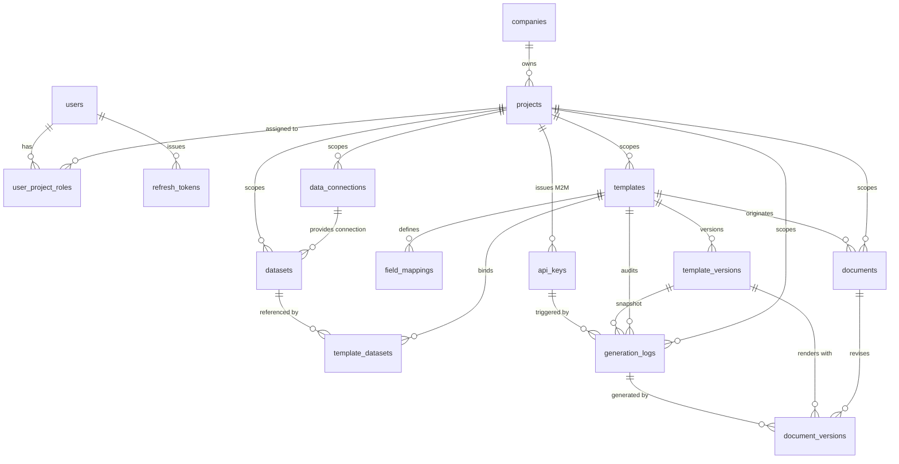

# persistence.md — PostgreSQL Relational Schema & Persistence Specifications

<cognitive_priming>
> [PURPOSE_SSOT]: Authoritative Single Source of Truth (SSoT) for PostgreSQL relational persistence, UUIDv7 monotonic primary keys, explicit foreign key index coverage, Domain Value Object mappings, and JSONB contracts for `smk-doc-server`.
> [OPERATIONAL_MODES]:
> - `[MODE: SCHEMA_DESIGN_CODEGEN]`: Focus on `<prior_inversion_map>`, `<authoritative_table_catalog>`, `<domain_persistence_matrix>`, and `<authoritative_ddl_spec>`.
> - `[MODE: MIGRATION_AUDIT]`: Focus on `<indexing_and_concurrency_strategy>`, `<authoritative_ddl_spec>`, and migration governance.
> [BEACONS: PostgreSQL 16+, UUIDv7, EF Core 10, ValueConverter, xmin, Partial Index, JSONB Draft-07, DDL]
</cognitive_priming>

<prior_inversion_map>
| Persistence Context | Defective Prior (Banned) | Canonical Standard (Mandatory Substitution) | Invariant Logic |
|---|---|---|---|
| **PK Generation** | `id UUID DEFAULT gen_random_uuid()` | `id UUID PRIMARY KEY` (Application `Guid.CreateVersion7()`) | Monotonic B-Tree append locality & zero index fragmentation |
| **FK Indexing** | Omitting index on FK column | Explicit `CREATE INDEX idx_{table}_{fk}` on every FK column | Zero sequential table scans on `JOIN` or cascading deletes |
| **Soft Delete** | `deleted_at TIMESTAMPTZ` | `is_active BOOLEAN NOT NULL DEFAULT true` | SSoT EF Core Global Query Filter parity |
| **Audit FK Action** | `template_id REFERENCES ... ON DELETE CASCADE` | `ON DELETE SET NULL` or `RESTRICT` | Non-destructive immutable legal audit trail |
| **Session Token Index** | Full index on `refresh_tokens(user_id)` | Partial index `WHERE revoked_at IS NULL` | RAM-efficient filtered indexing |
| **Smart Enum Storage** | Native int enum or raw C# integer | String via `.FromDisplayName<T>()` (`TemplateVersionStatus` stored as `INTEGER`) | Schema resilience & human-readable storage |
| **Value Object POCO** | Exposing primitive strings on Domain POCO | `.HasConversion(vo => vo.Value, v => VO.Create(v))` | Clean Architecture POCO isolation |
| **Concurrency Defense** | Client locks or unversioned updates | `builder.UseXminAsConcurrencyToken()` in EF Core | PostgreSQL system-level optimistic lock defense |
| **String Constraints** | Unbounded `TEXT` for all text columns | Bounded `VARCHAR(N)` matching domain value object invariants | Storage efficiency & schema documentation |
</prior_inversion_map>

<severity_hierarchy>
- `[TIER-1-FATAL]`: Application-generated UUIDv7 PKs, mandatory indexes on ALL Foreign Keys, non-destructive referential actions on audit records (`RESTRICT` / `SET NULL`), Clean Architecture domain isolation (`.HasConversion()`).
- `[TIER-2-INTEGRITY]`: Soft-delete convention (`is_active`), PostgreSQL `xmin` optimistic concurrency tokens, strict unique constraints (`slug`, `document_ref`).
- `[TIER-3-PERF]`: Partial/filtered indexes (`WHERE revoked_at IS NULL`), chronological log sorting indexes (`created_at DESC`), JSONB Draft-07 schema validation.
</severity_hierarchy>

<persistence_scope>

## 1. Enterprise Database Design Invariants

```
Identity Locality  >> UUIDv7 App-Generated (Guid.CreateVersion7())
Relationship Safety >> Index All FKs & RESTRICT/SET NULL on Audit Logs
State Management   >> is_active Boolean + Global Query Filters
RAM Optimization   >> Filtered Indexes (WHERE revoked_at IS NULL)
Concurrency Lock   >> PostgreSQL xmin System Column Token
Audit Immutability >> Point-in-Time JSONB Snapshots over Mutable Joins
```

1. **Monotonic Primary Key Locality (UUIDv7 Invariant):**
   - Primary keys generated in C# Application/Domain layer via `BaseEntity<TId>` / `TId.New()` (`Guid.CreateVersion7()`).
   - DB columns use standard `UUID` without DB-side `gen_random_uuid()` to prevent B-Tree index fragmentation. UUIDv7 provides 48-bit millisecond unix timestamp prefix.
   - Aggregate Root primary keys and foreign keys use 16-byte stack-allocated Strongly-Typed IDs (`readonly record struct`), mapped transparently to PostgreSQL `uuid` via EF Core Value Converters (`.HasConversion()`).
2. **Defensive Referential Integrity (Non-Destructive Audit Trails):**
   - Master entity hierarchies (`companies` >> `projects` >> `templates`) use `ON DELETE CASCADE` for parent lifecycle cleanup.
   - Financial, operational, and regulatory audit tables (`generation_logs`, `document_versions`, `datasets`) **MUST use `ON DELETE SET NULL` or `RESTRICT`**.
3. **Mandatory Foreign Key Indexing (Zero Sequential Scans):**
   - Every foreign key column MUST have an explicit `CREATE INDEX` to eliminate full table sequential scans on `JOIN` queries and cascading deletes.
4. **High-Performance Partial (Filtered) Indexes:**
   - Use partial indexes with `WHERE` clauses for hot-path queries over filtered subsets of rows (e.g. `WHERE revoked_at IS NULL` on `refresh_tokens`).
5. **Optimistic Concurrency via PostgreSQL `xmin`:**
   - Entities subject to concurrent multi-user editing (`templates`, `template_versions`) configure PostgreSQL `xmin` system column tokens via `builder.UseXminAsConcurrencyToken()`.
6. **Audit Trail Immutability (Snapshot Pattern):**
   - Generated document records (`generation_logs.input_data`, `template_versions.mappings_snapshot`) store complete structured snapshots at execution time rather than mutable relational joins.

---

## 2. Entity-Relationship Topology



---

## 3. Authoritative 15-Table Catalog (SSoT)

| # | Table Name | Entity Class | Primary Key | Foreign Keys & Targets | Soft Delete | Performance Indexes & Constraints |
|---|---|---|---|---|---|---|
| 1 | `companies` | `Company` | UUIDv7 | None | `is_active` | PK |
| 2 | `projects` | `Project` | UUIDv7 | `company_id` >> `companies(id)` [CASCADE] | `is_active` | `(slug)` UNIQUE, `(company_id)` FK |
| 3 | `users` | `User` | UUIDv7 | None | `is_active` | `(email)` UNIQUE |
| 4 | `user_project_roles` (project memberships) | `UserProjectRole` | `(user_id, project_id)` | `user_id` >> `users(id)` [CASCADE]<br>`project_id` >> `projects(id)` [CASCADE] | None | PK composite, `(project_id)` FK (Authorizes Portal Channel B user access) |
| 5 | `refresh_tokens` | `RefreshToken` | UUIDv7 | `user_id` >> `users(id)` [CASCADE] | None | `(token_hash)` UNIQUE, `(user_id, expires_at)` PARTIAL INDEX `WHERE revoked_at IS NULL` |
| 6 | `templates` | `Template` | UUIDv7 | `project_id` >> `projects(id)` [CASCADE]<br>`current_version_id` >> `template_versions(id)` [SET NULL] | `is_active` | `(project_id, slug)` UNIQUE, `(project_id)` FK |
| 7 | `template_versions` | `TemplateVersion` | UUIDv7 | `template_id` >> `templates(id)` [CASCADE] | None | `(template_id, version)` UNIQUE, `(template_id)` FK |
| 8 | `field_mappings` | `FieldMapping` | UUIDv7 | `template_id` >> `templates(id)` [CASCADE] | None | `(template_id, placeholder)` UNIQUE, `(template_id)` FK |
| 9 | `data_connections` | `DataConnection` | UUIDv7 | `project_id` >> `projects(id)` [RESTRICT] | None | PK, `(project_id)` FK |
| 10 | `datasets` | `Dataset` | UUIDv7 | `project_id` >> `projects(id)` [RESTRICT]<br>`data_connection_id` >> `data_connections(id)` [RESTRICT] | None | `(project_id)` FK, `(data_connection_id)` FK |
| 11 | `template_datasets` | `TemplateDataset` | UUIDv7 | `template_id` >> `templates(id)` [CASCADE]<br>`dataset_id` >> `datasets(id)` [RESTRICT] | None | `(template_id, alias)` UNIQUE, `(template_id)` FK, `(dataset_id)` FK |
| 12 | `api_keys` | `ApiKey` | UUIDv7 | `project_id` >> `projects(id)` [CASCADE] | `is_active` | `(project_id)` FK, `(key_hash)` INDEX |
| 13 | `generation_logs` | `GenerationLog` | UUIDv7 | `project_id` >> `projects(id)` [RESTRICT]<br>`template_id` >> `templates(id)` [SET NULL]<br>`template_version_id` >> `template_versions(id)` [SET NULL]<br>`api_key_id` >> `api_keys(id)` [SET NULL] | None | `(project_id)` FK, `(created_at DESC)` INDEX, FK indexes |
| 14 | `documents` | `Document` | UUIDv7 | `project_id` >> `projects(id)` [RESTRICT]<br>`template_id` >> `templates(id)` [SET NULL] | None | `(project_id, document_ref)` UNIQUE, `(project_id)` FK, `(template_id)` FK |
| 15 | `document_versions` | `DocumentVersion` | UUIDv7 | `document_id` >> `documents(id)` [CASCADE]<br>`template_version_id` >> `template_versions(id)` [SET NULL]<br>`generation_log_id` >> `generation_logs(id)` [SET NULL] | None | `(document_id, version)` UNIQUE, FK indexes |

---

## 4. Clean Architecture Persistence Matrix

### 4.1 Strongly-Typed Identifier Mappings

| Domain Identifier | Target Table & Columns | SQL Column Type | EF Core Conversion (`.HasConversion()`) |
|---|---|---|---|
| `CompanyId` | `companies.id`, `projects.company_id` | `UUID` | `id => id.Value, v => new CompanyId(v)` |
| `ProjectId` | `projects.id`, `templates.project_id`, `api_keys.project_id`, `user_project_roles.project_id`, `data_connections.project_id`, `datasets.project_id`, `generation_logs.project_id`, `documents.project_id` | `UUID` | `id => id.Value, v => new ProjectId(v)` |
| `TemplateId` | `templates.id`, `documents.template_id`, `generation_logs.template_id`, `template_datasets.template_id` | `UUID` | `id => id.Value, v => new TemplateId(v)` |
| `UserId` | `users.id`, `refresh_tokens.user_id`, `user_project_roles.user_id` | `UUID` | `id => id.Value, v => new UserId(v)` |
| `DocumentId` | `documents.id`, `document_versions.document_id` | `UUID` | `id => id.Value, v => new DocumentId(v)` |
| `ApiKeyId` | `api_keys.id`, `generation_logs.api_key_id` | `UUID` | `id => id.Value, v => new ApiKeyId(v)` |
| `DatasetId` | `datasets.id`, `template_datasets.dataset_id` | `UUID` | `id => id.Value, v => new DatasetId(v)` |
| `DataConnectionId` | `data_connections.id`, `datasets.data_connection_id` | `UUID` | `id => id.Value, v => new DataConnectionId(v)` |

### 4.2 Domain Value Object Mappings

| Domain Value Object | Target Table & Column | SQL Column Type | EF Core Conversion (`.HasConversion()`) |
|---|---|---|---|
| `CompanyName` | `companies.name` | `VARCHAR(200)` | `n => n.Value, v => CompanyName.Create(v)` |
| `ProjectName` | `projects.name` | `VARCHAR(200)` | `n => n.Value, v => ProjectName.Create(v)` |
| `TemplateName` | `templates.name` | `VARCHAR(100)` | `v => v.Value, v => TemplateName.Create(v)` |
| `TemplateSlug` | `projects.slug`, `templates.slug` | `VARCHAR(100)` | `s => s.Value, v => TemplateSlug.Create(v)` |
| `EmailAddress` | `users.email` | `VARCHAR(255)` | `m => m.Value, v => EmailAddress.Create(v)` |
| `Sha256Hash` | `refresh_tokens.token_hash`<br>`api_keys.key_hash`<br>`generation_logs.payload_hash_sha256` | `VARCHAR(64)`<br>`VARCHAR(255)`<br>`VARCHAR(64)` | `h => h.Value, v => Sha256Hash.Create(v)` |
| `ApiKeyName` | `api_keys.name` | `VARCHAR(100)` | `v => v.Value, v => ApiKeyName.Create(v)` |
| `ExpirationPolicy` | `api_keys.expires_at` | `TIMESTAMPTZ` | `v => v.ExpiresAt, v => ExpirationPolicy.FromExisting(v)` |
| `DocumentReference` | `documents.document_ref` | `VARCHAR(100)` | `d => d.Value, v => DocumentReference.Create(v)` |
| `ConnectionName` | `data_connections.name` | `VARCHAR(100)` | `v => v.Value, v => ConnectionName.Create(v)` |
| `DatasetName` | `datasets.name` | `VARCHAR(200)` | `v => v.Value, v => DatasetName.Create(v)` |
| `DatasetAlias` | `field_mappings.dataset_alias`<br>`template_datasets.alias` | `VARCHAR(50)` | `a => a.Value, v => DatasetAlias.Create(v)` |

### 4.3 Smart Enum Persistence Mappings

| Smart Enum | Target Table & Column | Storage Type | EF Core Conversion | Default Value |
|---|---|---|---|---|
| `SystemRole` | `users.system_role` | `VARCHAR(30)` | `r => r.Name, v => SystemRole.FromDisplayName<SystemRole>(v)` | `'Member'` |
| `RoleType` | `user_project_roles.role` | `VARCHAR(20)` | `r => r.Name, v => RoleType.FromDisplayName<RoleType>(v)` | Required |
| `ApiKeyScope` | `api_keys.scope` | `VARCHAR(20)` | `s => s.Name, v => ApiKeyScope.FromDisplayName<ApiKeyScope>(v)` | `'ReadWrite'` |
| `TemplateVersionStatus` | `template_versions.status` | `INTEGER` | `s => s.Id, v => TemplateVersionStatus.FromValue<TemplateVersionStatus>(v)` | `0` (`Draft`) |
| `TemplateFormat` | `template_versions.file_format` | `VARCHAR(10)` | `f => f.Name, v => TemplateFormat.FromDisplayName<TemplateFormat>(v)` | `NULL` |
| `OutputFormat` | `generation_logs.output_format` | `VARCHAR(10)` | `f => f.Name, v => OutputFormat.FromDisplayName<OutputFormat>(v)` | `NULL` |
| `GenerationStatus` | `generation_logs.status` | `VARCHAR(20)` | `s => s.Name, v => GenerationStatus.FromName(v)` | `'Success'` |
| `DataSourceType` | `field_mappings.data_source_type` | `VARCHAR(20)` | `d => d.Value, v => DataSourceType.FromString(v)` | `'json'` |
| `DatabaseProvider` | `data_connections.provider` | `VARCHAR(50)` | `p => p.Name, v => Enumeration.FromDisplayName<DatabaseProvider>(v)` | Required |

> [INVARIANT]: `TemplateVersionStatus` is stored as `INTEGER` (`0=Draft`, `1=Published`, `2=Archived`). Other Smart Enums persist as human-readable strings (`VARCHAR`).

---

## 5. Authoritative PostgreSQL 16+ DDL Specification

```sql
-- ============================================================================
-- 0. MULTI-TENANCY & AUTHENTICATION CLUSTER
-- ============================================================================

CREATE TABLE companies (
    id         UUID PRIMARY KEY,
    name       VARCHAR(200) NOT NULL,
    is_active  BOOLEAN NOT NULL DEFAULT true,
    created_at TIMESTAMPTZ NOT NULL DEFAULT NOW(),
    updated_at TIMESTAMPTZ
);

CREATE TABLE projects (
    id         UUID PRIMARY KEY,
    company_id UUID NOT NULL REFERENCES companies(id) ON DELETE CASCADE,
    name       VARCHAR(200) NOT NULL,
    slug       VARCHAR(100) UNIQUE NOT NULL,
    is_active  BOOLEAN NOT NULL DEFAULT true,
    created_at TIMESTAMPTZ NOT NULL DEFAULT NOW(),
    updated_at TIMESTAMPTZ
);
CREATE INDEX idx_projects_company_id ON projects(company_id);

CREATE TABLE users (
    id            UUID PRIMARY KEY,
    email         VARCHAR(255) UNIQUE NOT NULL,
    password_hash VARCHAR(255) NOT NULL,
    first_name    VARCHAR(100) NOT NULL,
    last_name     VARCHAR(100) NOT NULL,
    system_role   VARCHAR(30) NOT NULL DEFAULT 'Member',
    is_active     BOOLEAN NOT NULL DEFAULT true,
    created_at    TIMESTAMPTZ NOT NULL DEFAULT NOW(),
    updated_at    TIMESTAMPTZ
);

CREATE TABLE refresh_tokens (
    id                     UUID PRIMARY KEY,
    user_id                UUID NOT NULL REFERENCES users(id) ON DELETE CASCADE,
    token_hash             VARCHAR(64) UNIQUE NOT NULL,
    expires_at             TIMESTAMPTZ NOT NULL,
    created_at             TIMESTAMPTZ NOT NULL DEFAULT NOW(),
    revoked_at             TIMESTAMPTZ,
    replaced_by_token_hash VARCHAR(64)
);
CREATE INDEX idx_refresh_tokens_user_id ON refresh_tokens(user_id);
CREATE INDEX idx_refresh_tokens_user_expires ON refresh_tokens(user_id, expires_at) WHERE revoked_at IS NULL;

-- project_memberships for Channel B Portal user workspace authorization
CREATE TABLE user_project_roles (
    user_id    UUID NOT NULL REFERENCES users(id) ON DELETE CASCADE,
    project_id UUID NOT NULL REFERENCES projects(id) ON DELETE CASCADE,
    role       VARCHAR(20) NOT NULL,
    created_at TIMESTAMPTZ NOT NULL DEFAULT NOW(),
    PRIMARY KEY (user_id, project_id)
);
CREATE INDEX idx_user_project_roles_project_id ON user_project_roles(project_id);


-- ============================================================================
-- 1. TEMPLATE CATALOG & MAPPING CLUSTER
-- ============================================================================

CREATE TABLE templates (
    id                 UUID PRIMARY KEY,
    project_id         UUID NOT NULL REFERENCES projects(id) ON DELETE CASCADE,
    name               VARCHAR(100) NOT NULL,
    slug               VARCHAR(100) NOT NULL,
    category           VARCHAR(50),
    is_active          BOOLEAN NOT NULL DEFAULT true,
    current_version_id UUID,
    created_at         TIMESTAMPTZ NOT NULL DEFAULT NOW(),
    updated_at         TIMESTAMPTZ NOT NULL DEFAULT NOW(),
    CONSTRAINT uq_templates_project_id_slug UNIQUE (project_id, slug)
);
CREATE INDEX idx_templates_project_id ON templates(project_id);

CREATE TABLE template_versions (
    id                UUID PRIMARY KEY,
    template_id       UUID NOT NULL REFERENCES templates(id) ON DELETE CASCADE,
    version           INTEGER NOT NULL,
    storage_key       VARCHAR(500) NOT NULL,
    status            INTEGER NOT NULL DEFAULT 0,
    file_format       VARCHAR(10),
    data_schema       JSONB,
    sample_payload    JSONB,
    mappings_snapshot TEXT,
    commit_message    VARCHAR(500),
    created_by        VARCHAR(100),
    created_at        TIMESTAMPTZ NOT NULL DEFAULT NOW(),
    UNIQUE(template_id, version)
);
CREATE INDEX idx_template_versions_template_id ON template_versions(template_id);

ALTER TABLE templates 
    ADD CONSTRAINT fk_templates_current_version_id 
    FOREIGN KEY (current_version_id) 
    REFERENCES template_versions(id) 
    ON DELETE SET NULL;

CREATE TABLE field_mappings (
    id               UUID PRIMARY KEY,
    template_id      UUID NOT NULL REFERENCES templates(id) ON DELETE CASCADE,
    placeholder      VARCHAR(100) NOT NULL,
    data_source_type VARCHAR(20) NOT NULL DEFAULT 'json',
    source_path      VARCHAR(200) NOT NULL,
    dataset_alias    VARCHAR(50),
    result_path      VARCHAR(300),
    math_expression  VARCHAR(500),
    label            VARCHAR(200) NOT NULL,
    required         BOOLEAN NOT NULL DEFAULT false,
    default_value    TEXT,
    transform        VARCHAR(50),
    sort_order       INTEGER NOT NULL DEFAULT 0,
    UNIQUE(template_id, placeholder)
);
CREATE INDEX idx_field_mappings_template_id ON field_mappings(template_id);


-- ============================================================================
-- 2. EXTERNAL DATASOURCES & SQL DATASETS CLUSTER
-- ============================================================================

CREATE TABLE data_connections (
    id                          UUID PRIMARY KEY,
    project_id                  UUID NOT NULL REFERENCES projects(id) ON DELETE RESTRICT,
    name                        VARCHAR(100) NOT NULL,
    provider                    VARCHAR(50) NOT NULL,
    encrypted_connection_string TEXT NOT NULL,
    created_at                  TIMESTAMPTZ NOT NULL DEFAULT NOW(),
    updated_at                  TIMESTAMPTZ
);
CREATE INDEX idx_data_connections_project_id ON data_connections(project_id);

CREATE TABLE datasets (
    id                 UUID PRIMARY KEY,
    project_id         UUID NOT NULL REFERENCES projects(id) ON DELETE RESTRICT,
    name               VARCHAR(200) NOT NULL,
    description        VARCHAR(500),
    data_connection_id UUID NOT NULL REFERENCES data_connections(id) ON DELETE RESTRICT,
    sql_query          TEXT NOT NULL,
    cache_seconds      INTEGER NOT NULL DEFAULT 0,
    created_at         TIMESTAMPTZ NOT NULL DEFAULT NOW(),
    updated_at         TIMESTAMPTZ
);
CREATE INDEX idx_datasets_project_id ON datasets(project_id);
CREATE INDEX idx_datasets_data_connection_id ON datasets(data_connection_id);

CREATE TABLE template_datasets (
    id          UUID PRIMARY KEY,
    template_id UUID NOT NULL REFERENCES templates(id) ON DELETE CASCADE,
    dataset_id  UUID NOT NULL REFERENCES datasets(id) ON DELETE RESTRICT,
    alias       VARCHAR(50) NOT NULL,
    sort_order  INTEGER NOT NULL DEFAULT 0,
    UNIQUE(template_id, alias)
);
CREATE INDEX idx_template_datasets_template_id ON template_datasets(template_id);
CREATE INDEX idx_template_datasets_dataset_id ON template_datasets(dataset_id);


-- ============================================================================
-- 3. SECURITY & AUDIT TRAIL CLUSTER
-- ============================================================================

CREATE TABLE api_keys (
    id           UUID PRIMARY KEY,
    project_id   UUID NOT NULL REFERENCES projects(id) ON DELETE CASCADE,
    name         VARCHAR(100) NOT NULL,
    caller_app   VARCHAR(50) NOT NULL,
    key_hash     VARCHAR(255) NOT NULL,
    expires_at   TIMESTAMPTZ,
    scope        VARCHAR(20) NOT NULL DEFAULT 'ReadWrite',
    is_active    BOOLEAN NOT NULL DEFAULT true,
    last_used_at TIMESTAMPTZ,
    created_at   TIMESTAMPTZ NOT NULL DEFAULT NOW()
);
CREATE INDEX idx_api_keys_project_id ON api_keys(project_id);
CREATE INDEX idx_api_keys_key_hash ON api_keys(key_hash);

CREATE TABLE generation_logs (
    id                  UUID PRIMARY KEY,
    project_id          UUID NOT NULL REFERENCES projects(id) ON DELETE RESTRICT,
    template_id         UUID REFERENCES templates(id) ON DELETE SET NULL,
    template_version_id UUID REFERENCES template_versions(id) ON DELETE SET NULL,
    api_key_id          UUID REFERENCES api_keys(id) ON DELETE SET NULL,
    caller_app          VARCHAR(50),
    trigger_source      VARCHAR(20),
    input_data          JSONB,
    payload_hash_sha256 VARCHAR(64),
    output_key          VARCHAR(500),
    output_format       VARCHAR(10),
    file_size_bytes     BIGINT,
    page_count          INTEGER,
    duration_ms         INTEGER NOT NULL,
    status              VARCHAR(20) NOT NULL,
    error_msg           TEXT,
    created_at          TIMESTAMPTZ NOT NULL DEFAULT NOW()
);
CREATE INDEX idx_generation_logs_project_id ON generation_logs(project_id);
CREATE INDEX idx_generation_logs_template_id ON generation_logs(template_id);
CREATE INDEX idx_generation_logs_template_version_id ON generation_logs(template_version_id);
CREATE INDEX idx_generation_logs_api_key_id ON generation_logs(api_key_id);
CREATE INDEX idx_generation_logs_created_at_desc ON generation_logs(created_at DESC);


-- ============================================================================
-- 4. LEGAL AUDIT TRAIL & DOCUMENT ARCHIVE CLUSTER
-- ============================================================================

CREATE TABLE documents (
    id           UUID PRIMARY KEY,
    project_id   UUID NOT NULL REFERENCES projects(id) ON DELETE RESTRICT,
    document_ref VARCHAR(100) NOT NULL,
    template_id  UUID REFERENCES templates(id) ON DELETE SET NULL,
    created_at   TIMESTAMPTZ NOT NULL DEFAULT NOW(),
    CONSTRAINT uq_documents_project_id_ref UNIQUE (project_id, document_ref)
);
CREATE INDEX idx_documents_project_id ON documents(project_id);
CREATE INDEX idx_documents_template_id ON documents(template_id);

CREATE TABLE document_versions (
    id                  UUID PRIMARY KEY,
    document_id         UUID NOT NULL REFERENCES documents(id) ON DELETE CASCADE,
    version             INTEGER NOT NULL,
    template_version_id UUID REFERENCES template_versions(id) ON DELETE SET NULL,
    generation_log_id   UUID REFERENCES generation_logs(id) ON DELETE SET NULL,
    change_note         VARCHAR(500),
    created_by          VARCHAR(100),
    created_at          TIMESTAMPTZ NOT NULL DEFAULT NOW(),
    UNIQUE(document_id, version)
);
CREATE INDEX idx_document_versions_document_id ON document_versions(document_id);
CREATE INDEX idx_document_versions_template_version_id ON document_versions(template_version_id);
CREATE INDEX idx_document_versions_generation_log_id ON document_versions(generation_log_id);
```

---

## 6. JSONB Schema Contracts

### 6.1 `template_versions.data_schema` (JSON Schema Draft-07)

```json
{
  "$schema": "http://json-schema.org/draft-07/schema#",
  "title": "InvoicePayload",
  "type": "object",
  "required": ["invoiceNumber", "issueDate", "customer", "items"],
  "properties": {
    "invoiceNumber": { "type": "string", "minLength": 1 },
    "issueDate": { "type": "string", "format": "date-time" },
    "customer": {
      "type": "object",
      "required": ["name", "taxId"],
      "properties": {
        "name": { "type": "string" },
        "taxId": { "type": "string" }
      }
    },
    "items": {
      "type": "array",
      "minItems": 1,
      "items": {
        "type": "object",
        "required": ["description", "quantity", "unitPrice"],
        "properties": {
          "description": { "type": "string" },
          "quantity": { "type": "number", "minimum": 1 },
          "unitPrice": { "type": "number", "minimum": 0 }
        }
      }
    }
  }
}
```

### 6.2 `generation_logs.input_data` (Sanitized Request Payload Snapshot)

```json
{
  "invoiceNumber": "INV-2026-0091",
  "issueDate": "2026-10-10T02:00:00Z",
  "customer": {
    "name": "Acme Corporation",
    "taxId": "0105558123456"
  },
  "items": [
    { "description": "Cloud Document Server License", "quantity": 1, "unitPrice": 45000.00 }
  ],
  "_metadata": {
    "callerApp": "ERP-Billing",
    "ipAddress": "192.168.1.50"
  }
}
```

---

## 7. Database Migration Governance

1. **Code-First SSoT:** All schema alterations originate in `SmkDoc.Domain` entities and `SmkDoc.Infrastructure` Fluent API configurations (`IEntityTypeConfiguration<T>` under `Persistence/Configurations/`).
2. **Migration Generation:**
   ```bash
   dotnet ef migrations add <DescriptiveMigrationName> --project backend-v2/src/SmkDoc.Infrastructure --startup-project backend-v2/src/SmkDoc.Api
   ```
3. **Non-Destructive Migrations:** Never execute destructive table drops in active production branches. Deprecated columns staged via soft-retire cycles.
4. **Synchronize Documentation:** Whenever an entity or relation is added or mutated, update Section 3 Table Catalog, Section 4 Value Object Matrix, and Section 5 DDL.

</persistence_scope>

<verification_gateway>
- [ ] Primary keys strictly configured as UUIDv7 without DB-side `gen_random_uuid()`
- [ ] All Foreign Key columns have explicit `CREATE INDEX`
- [ ] Audit trail foreign keys (`generation_logs`, `document_versions`) use `ON DELETE SET NULL` or `RESTRICT`
- [ ] `template_versions.status` mapped to `INTEGER` (`0=Draft`, `1=Published`, `2=Archived`); other Smart Enums mapped to string
- [ ] Optimistic concurrency using `builder.UseXminAsConcurrencyToken()` on mutable aggregates
- [ ] Partial index configured on `refresh_tokens(user_id, expires_at) WHERE revoked_at IS NULL`
</verification_gateway>
