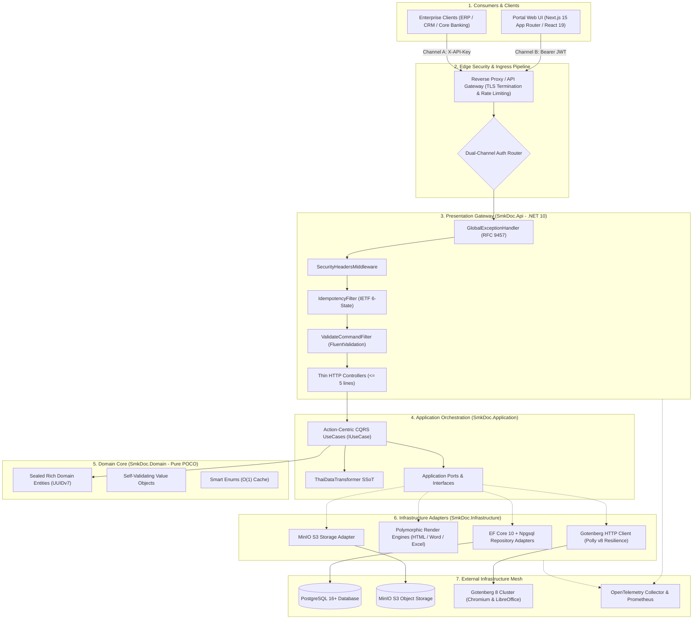
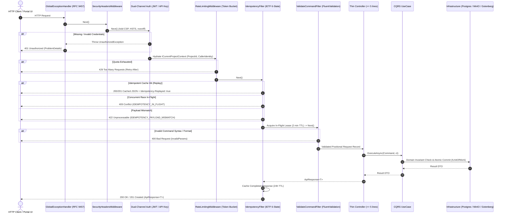
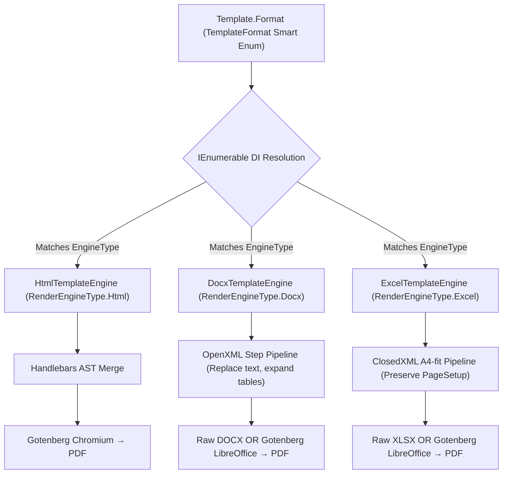
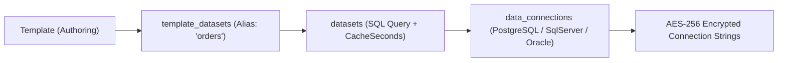
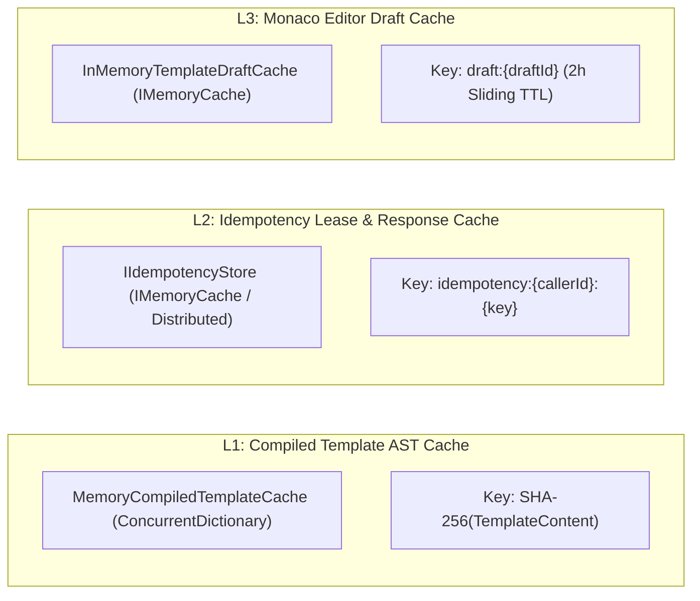

# [BACK-001]: system_topology.md - System Topology, C4 Architecture & Layer Boundaries SSoT

<!-- SLOT 1: COGNITIVE PRIMING & IDENTITY (Primacy Weight: First 10% Context) -->
<cognitive_priming>
> **[SSOT_PURPOSE]:** Authoritative System Topology, C4 Container Architecture, Modular Monolith Layer Boundaries, Zero-LOH Stream Pipeline, and Enterprise Reliability Blueprint for `smk-doc-server` (`backend-v2/`).
> **[ORTHOGONAL_BOUNDARY]:** Governs high-level system layout, solution directory tree, C4 container mesh, middleware sequence, multi-tenant security boundaries, and external dependencies (Gotenberg, MinIO, PostgreSQL, Polly v8). Implementation feature slices and code archetypes belong in `docs/AI/01_backend/blueprints.md`. Wire HTTP contracts belong in `docs/AI/01_backend/api_contract.md`. Micro-syntax rules belong in `docs/AI/00_guardrails/CONVENTIONS.md`. Anti-patterns belong in `docs/AI/00_guardrails/FIREWALL.md`.
> **[NEGATIVE_ROUTING]:** DO NOT load this file for single-class micro-syntax rules, method step-down order, individual API endpoint schemas, or frontend UI layout.
> **[OPERATIONAL_MODES]:** `[MODE: ARCHITECTURAL_DESIGN]` (evaluating layer boundaries, dependencies, and external topology) vs `[MODE: TOPOLOGY_AUDIT]` (verifying Clean Architecture dependency flow and middleware ordering).
</cognitive_priming>

---

<!-- SLOT 2: PRE-TRAINING PRIOR INVERSION MAP (Subword-Level Bias Override) -->
<prior_inversion_map>
## High-Salience Token Inversion Map (Pre-Training Override)

| Intent / Context | Defective Internet Prior (! BANNED) | Canonical SSoT Target (>> MANDATORY) | Rule ID / ADR |
|---|---|---|---|
| **PDF/Office Rendering** | Embedded LibreOffice process (`soffice --headless`) | Gotenberg 8 Chromium Microservice HTTP | `ADR-ENG-01` |
| **Dependency Direction** | Outer layer referenced by Core (`Domain -> EF`) | Dependencies point INWARDS exclusively (`Api >> App >> Domain`) | `RULE-ARCH-001` |
| **Preview Persistence** | Saving preview to DB or MinIO | 100% in-memory ephemeral RAM stream | `RULE-INVAR-001` |
| **Memory Management** | Buffering document in `byte[]` / `MemoryStream` | Zero-LOH Stream-over-RAM via `Stream.CopyToAsync` | `FIREWALL-MEM-001` |
| **Engine Selection** | Hardcoded `switch(format)` or `if-else` | Polymorphic Strategy via `IEnumerable<IRenderEngine>` | `FIREWALL-OPS-001` |
| **Tenant Access** | Bypassing filter via `.IgnoreQueryFilters()` | EF Core Global Query Filter on `IMustHaveProject` (e.g. `repo.GetByIdAsync(id, ct)`) | `FIREWALL-SEC-001` |
| **External Resilience** | Raw unconstrained `HttpClient` | Polly v8 resilience pipelines (Retry, Circuit Breaker, Timeout) | `ADR-RES-04` |
| **Concurrency Token** | Unhandled 409 / manual timestamp | PostgreSQL `xmin` concurrency token (`builder.UseXminAsConcurrencyToken()`) | `RULE-INFRA-007` |
| **Target Codebase** | Modifying root `src/SmkDocServer/` (legacy v1) | Target active modern `backend-v2/src/SmkDoc.*/` | `FIREWALL-OPS-005` |
</prior_inversion_map>

---

<!-- SLOT 3: CONSTRAINT SEVERITY HIERARCHY (Conflict Resolution Tiers) -->
<severity_hierarchy>
## Constraint Resolution Hierarchy
1. `[TIER-1-FATAL]`: LOH memory safety (Stream-over-RAM), stateless ephemeral preview, tenant isolation boundary (IDOR defense), thread-safe DbContext.
2. `[TIER-2-ARCH]`: Clean Architecture inward dependency rule, Open-Closed Principle for render engines, single atomic UoW commit, Polly v8 resilience wrapping.
3. `[TIER-3-CRAFT]`: Modular Monolith vertical slicing, folder parity, deterministic time testing.
</severity_hierarchy>

---

<!-- SLOT 4: CORE GENERATIVE BLUEPRINTS (High-Density Minimal Complete AST) -->
<system_topology_scope>
## 1. Enterprise System Topology & C4 Container Architecture

The SMK Document Server operates as a high-throughput enterprise document generation gateway ingesting structured JSON payloads to produce deterministic outputs (PDF, DOCX, XLSX).



---

## 2. Clean Architecture & Modular Monolith Layering Rules

The system strictly enforces the **Clean Architecture Dependency Rule** via project references in `SmkDocServerV2.slnx`:

```text
SmkDoc.Domain ← SmkDoc.Application ← SmkDoc.Infrastructure ← SmkDoc.Api
```

### Layer Responsibilities, Reference Rules & Contracts

| Layer | Project | Allowed References | Prohibited Elements | Output / Return Contract |
|---|---|---|---|---|
| **Domain** | `SmkDoc.Domain` | None (BCL only) | No EF Core, OpenXml, ASP.NET Core, **No DTOs** | Pure Entities, ValueObjects, Smart Enums |
| **Application** | `SmkDoc.Application` | `SmkDoc.Domain` | No `AppDbContext`, MinIO SDK, Gotenberg, **No API models** | Application DTO records only |
| **Infrastructure** | `SmkDoc.Infrastructure` | `SmkDoc.Application`, `SmkDoc.Domain` | No Controllers, No HTTP presentation logic | Internal adapter implementations |
| **Api** | `SmkDoc.Api` | `SmkDoc.Application` (via DIP) | **No direct Domain Entity leaks**, No direct DB calls | `ApiResponse<T>`, `PagedApiResponse<T>`, Raw Streams |

### 2.1 Layer 1 — `SmkDoc.Domain` (The Core)
* **Zero Dependencies:** 100% pure C# POCOs. Prohibits all NuGet packages, EF Core references, and ASP.NET Core dependencies.
* **Sealed Rich Domain Entities (`ADR-DOM-06` & `ADR-DOM-07`):**
  * State encapsulation: Properties are strictly `{ get; private set; }` or `{ get; protected set; }`.
  * No public setters; no external object initializers (`new Template { ... }`).
  * Single Canonical Factory Method (`Create`) as Single Source of Truth (SSoT), receiving strongly-typed Value Objects and mandatory `DateTimeOffset now`.
  * Zero primitive convenience overloads inside the Domain.
 * Zero test backdoors in production DLL (test fixtures use fluent `*Builder` classes in `SmkDoc.Tests/Common/Builders/` exclusively; parallel static `*TestFactory` classes are prohibited).
* **Sequential UUIDv7 Identity:** All entities derive from `BaseEntity`, generating chronological UUIDv7 primary keys to prevent PostgreSQL B-Tree index fragmentation.
* **Immutable Value Objects:** Structural equality via `GetEqualityComponents()`. Mapped transparently to native database columns via EF Core Fluent `HasConversion` (Zero Database Migration).
* **Smart Enums:** Derived from `Enumeration` with O(1) static dictionary lookup and behavior encapsulation.

### 2.2 Layer 2 — `SmkDoc.Application` (Orchestration & Ports)
* **Action-Centric CQRS:** 1 Business Intent = 1 Action-Centric UseCase Class implementing `IUseCase<TCommand, TResult>`.
* **Strict Output Contract:** UseCases must return **Application DTO records only**. Domain Entities MUST NEVER cross the boundary to the presentation layer.
* **Centralized Thai Localization (SSoT):** All Thai date conversions (Buddhist Era `dd/MM/yyyy BE`), Thai Baht text (`BahtText`), and localized numeric formatting must route exclusively through `ThaiDataTransformer`.
* **Ports (Inversion of Control):** Declares repository interfaces (`ITemplateRepository`), storage contracts (`IStorageService`), and engine abstractions (`IRenderEngine`).

### 2.3 Layer 3 — `SmkDoc.Infrastructure` (Adapters)
* **Persistence:** EF Core 10, `AppDbContext`, and Npgsql provider. Implements Repository interfaces and `IUnitOfWork`.
* **Document Engines:** Implements polymorphic rendering pipelines:
  * `HtmlTemplateEngine`: Handlebars AST merge with compiled AST caching.
  * `DocxTemplateEngine`: OpenXML composable multi-step DOM manipulator.
  * `ExcelTemplateEngine`: ClosedXML A4-fit calculation and formatting engine.
* **External Gateways:** Gotenberg Chromium/LibreOffice REST client, MinIO S3 client, and BCrypt/JWT security adapters.

### 2.4 Layer 4 — `SmkDoc.Api` (Presentation & Transport)
* **Thin Controllers:** Controller action bodies must remain extremely thin ($\le 5$ lines of executable code), delegating execution immediately to UseCases.
* **Envelope Invariant:** All successful JSON responses are wrapped in strongly-typed `ApiResponse<T>` or `PagedApiResponse<T>`. Anonymous objects (`new { }`) are prohibited.
* **RFC 9457 Global Exception Pipeline:** Intercepts all unhandled exceptions pipeline-wide via `GlobalExceptionHandler` (`IExceptionHandler`), returning `application/problem+json`.

---

## 3. Zero-LOH High-Throughput Stream Pipeline (Core Engine Invariant)

To achieve high-throughput scaling without Garbage Collection pauses, the rendering engine strictly enforces the **Stream-over-RAM Architectural Paradigm**:

```mermaid
graph TD
    subgraph Preview["A. Ephemeral Live Preview Pipeline (Stateless, 100% In-Memory)"]
        ReqA["HTTP Request: POST /api/v1/documents/preview/{slug}"]
        EngineA["HtmlTemplateEngine (Handlebars Merge)"]
        GotenbergA["Gotenberg 8 (Chromium Headless)"]
        HttpStream["Direct HTTP Chunked Stream (Content-Disposition: inline)"]

        ReqA --> EngineA
        EngineA -->|"Piped Stream"| GotenbergA
        GotenbergA -->|"Piped Stream (Zero byte[] Allocation)"| HttpStream
    end

    subgraph Generation["B. Persistent Generation Pipeline (Storage Delivery)"]
        ReqB["HTTP Request: POST /api/v1/documents/generate/{slug}"]
        EngineB["Docx / Html / Excel Engine"]
        GotenbergB["Gotenberg 8 (Render Engine)"]
        MinioUpload["MinIO S3 (PutObjectAsync Stream)"]
        Presigned["Presigned URL / Download Stream (Content-Disposition: attachment)"]

        ReqB --> EngineB
        EngineB --> GotenbergB
        GotenbergB -->|"Direct Stream Pipe"| MinioUpload
        MinioUpload --> Presigned
    end
```



### 3.1 The Large Object Heap (LOH) Invariant
* **The GC Problem:** In .NET, objects larger than 85,000 bytes ($> 85\text{ KB}$) are allocated directly on the Large Object Heap (LOH). The LOH is rarely compacted, leading to severe memory fragmentation and Out-Of-Memory (OOM) crashes under high document generation load.
* **The Invariant:** Documents (which frequently range between $500\text{ KB}$ and $50\text{ MB}$) MUST NEVER be buffered into memory as `byte[]` arrays. Payloads MUST be streamed directly from Gotenberg's network socket into MinIO's S3 stream or ASP.NET Core's `HttpResponse.Body`.
* **Preview Guarantee:** Preview endpoints (`POST /api/v1/documents/preview/{slug}`) are **100% stateless**. They generate zero database audit logs, trigger zero MinIO uploads, and leave zero disk traces.

---

## 4. End-to-End Request Pipeline & Middleware Topology

Every HTTP request traverses a strictly ordered middleware pipeline designed for early-exit and fail-fast processing:



---

## 5. Multi-Tenant Scoping & Zero-Trust Security Architecture

The SMK Document Server implements strict tenant isolation to comply with enterprise data governance and mitigate the **OWASP API Security Top 10 (2023)**:

### 5.1 BOLA & IDOR Mitigation (Tenant Boundaries)
* **`ICurrentProjectContext` (Scoped SSoT):** Every request automatically resolves its tenant context at the perimeter gate via `ProjectContextMiddleware` into an immutable scoped interface (`ICurrentProjectContext`):
  * **Channel A (M2M API Key):** Computes SHA-256 hash of `X-API-Key` and resolves `ProjectId` from active `ApiKeys` records. Strictly rejects requests containing `X-Project-Id` headers to prevent cross-tenant spoofing.
  * **Channel B (Management Portal JWT):** Decodes JWT claims (`UserId`, `SystemRole`) and reads `X-Project-Id` workspace header. Grants immediate access to `SuperAdmin` callers; validates normal users via `user.CanAccessProject(requestedProjectId)` against `user_project_roles`. Dispatches RFC 9457 `403 Forbidden` (`FORBIDDEN_PROJECT_ACCESS`) on unauthorized tenant access.
* **EF Core Global Query Filter Isolation (Fail-Closed):** All Domain entities implementing `IMustHaveProject` are automatically scoped at the database engine level via Fail-Closed predicate: `builder.Entity<T>().HasQueryFilter(e => _projectContext != null && _projectContext.IsResolved && e.ProjectId == _projectContext.ProjectId)`. System Background Jobs or Global Admin queries requiring cross-tenant data access MUST explicitly invoke `.IgnoreQueryFilters()`. Manual tenant predicate propagation is eliminated, guaranteeing zero cross-tenant data leaks.
* **Auto-Assign on Mutation:** `TenantSecuritySaveChangesInterceptor` intercepts `SavingChanges`/`SavingChangesAsync` to automatically assign `entity.ProjectId = _projectContext.ProjectId` for newly added `IMustHaveProject` entities when empty, and strictly rejects cross-tenant write operations.
* **Storage & Cache Partitioning:** MinIO object paths (`outputs/{projectId:N}/...`) and Redis/Memory cache keys (`idemp:{projectId:N}:...`) enforce strict tenant partitioning at the infrastructure boundary.

### 5.2 Server-Side Request Forgery (SSRF) & Code Injection Defense
* **Chromium Sandbox:** Gotenberg Chromium runs in a restricted container sandbox with dangerous Web APIs disabled.
* **Network Isolation:** Gotenberg render requests are barred from accessing internal metadata endpoints (`169.254.169.254`) or local loopback interfaces.
* **Handlebars Script Isolation:** Template variables are compiled into ASTs without `eval()` or arbitrary JavaScript execution capabilities. External script injection attempts are blocked at template compile time.

---

## 6. Polymorphic Engine Strategy & Rendering Architecture

Document rendering delegates dynamically to dedicated engine adapters using the **Strategy Pattern**, completely eliminating hardcoded conditional branches:



> **The OCP Invariant:** Adding a new template engine requires creating a new `IRenderEngine` implementation and registering it in DI. The core orchestration pipeline remains completely untouched (Open-Closed Principle). `switch` and `if-else` branching on engine types is strictly prohibited.

---

## 7. External Datasources & Dynamic Datasets Subsystem

To support automated batch document generation without requiring external callers to pre-fetch large datasets, the platform provides an integrated data ingestion subsystem:



1. **Data Connections (`data_connections`):** Multi-provider database gateway supporting PostgreSQL, Microsoft SQL Server, and Oracle. All connection strings are strictly encrypted at rest via AES-256 (`EncryptedConnectionString`).
2. **Datasets (`datasets`):** Encapsulates parameterized SQL queries with configurable TTL caching (`CacheSeconds`) to prevent database thrashing on high-throughput generation bursts.
3. **Template Datasets (`template_datasets`):** Binds external query results into specific template contexts using isolated aliases (e.g., `orders`, `line_items`), making external datasets seamlessly accessible inside Handlebars loops (`{{#each orders}}`).

---

## 8. Fault Tolerance & Resilience Engineering (Polly v8)

Interactions with external I/O dependencies are encapsulated within resilient **Polly v8 Resilience Pipelines** to absorb transient network failures and prevent cascading system outages:

### 8.1 Gotenberg HTTP Resilience Pipeline
* **Total Timeout:** Configured at 60 seconds (`TotalTimeout = 60s`).
* **Transient Retry with Exponential Backoff & Jitter:**
  * Retries on HTTP `503 Service Unavailable`, `504 Gateway Timeout`, and network socket drops.
  * Max retry attempts: 3.
  * Backoff schedule: $2^n \times 500\text{ ms} + \text{Random Jitter}$ (prevents thundering herd on Gotenberg cluster).
* **Circuit Breaker:** Opens circuit after 5 consecutive failures within a 30-second window, failing fast for 15 seconds to allow the Gotenberg Chromium runtime to restart.

### 8.2 MinIO Storage Resilience Pipeline
* **Network Resiliency:** Automatic retry on transient S3 connection drops with an exponential backoff schedule ($100\text{ ms}, 200\text{ ms}, 400\text{ ms}$).

---

## 9. Caching Topology & Memory Management

The document server employs a tiered caching strategy optimized for low CPU overhead and high read throughput:



1. **L1 Compiled Handlebars AST Cache (`MemoryCompiledTemplateCache`):**
   * Pre-compiles and caches Handlebars Abstract Syntax Trees in memory.
   * Keyed by deterministic SHA-256 hash of template HTML content. Avoids re-parsing template syntax on consecutive generation requests, achieving sub-millisecond AST hydration.
2. **L2 Idempotency Store (`IIdempotencyStore`):**
   * In-Flight Locks: 2-minute TTL preventing concurrent race conditions.
   * Completed Responses: 24-hour TTL caching completed HTTP responses with preserved `Location` and `Idempotency-Replayed` headers.
3. **L3 Ephemeral Draft Cache (`InMemoryTemplateDraftCache`):**
   * Stores in-memory template drafts during active editing sessions in the Monaco Studio.
   * Enforces a 2-hour sliding window, automatically evicting abandoned drafts to prevent memory leaks.

---

## 10. Canonical Solution Layout & Directory Map

```text
backend-v2/
├── Directory.Build.props           # .NET 10, C# 13, Nullable enable, ImplicitUsings
├── Directory.Packages.props        # Central Package Management (no duplicate versions)
├── SmkDocServerV2.slnx
├── src/
│   ├── SmkDoc.Domain/              # Core — Zero external dependencies
│   │   ├── Common/                 # BaseEntity (UUIDv7), Enumeration, Guard
│   │   ├── Constants/              # Technical Constants SSoT (SecurityConstants)
│   │   ├── Entities/               # 15 Rich Domain Models (private set + business verbs)
│   │   ├── Enums/                  # Smart Enums (TemplateFormat, OutputFormat, RenderEngineType)
│   │   ├── ValueObjects/           # Strongly-typed IDs (16B), Layout structs, Validated VO classes
│   │   ├── Exceptions/             # DomainException, DomainValidationException
│   │   └── Interfaces/             # IMustHaveProject, IUnitOfWork, ITemplateRepository
│   ├── SmkDoc.Application/         # CQRS Orchestration & Ports — Depends on Domain only
│   │   ├── Common/                 # IUseCase, IRepository, IStorageService, ThaiDataTransformer, ICurrentProjectContext
│   │   └── Modules/                # 4 Bounded Contexts: Rendering, Authoring, Integration, IdentityAccess
│   ├── SmkDoc.Infrastructure/      # Adapters — Implements Application Ports
│   │   ├── Persistence/            # AppDbContext, Interceptors, EF Repositories, Migrations, xmin Concurrency
│   │   ├── Contexts/               # CurrentProjectContext (Scoped ambient SSoT)
│   │   ├── Storage/                # MinioStorageService
│   │   ├── Pdf/                    # GotenbergPdfRenderer (Chromium & LibreOffice endpoints)
│   │   ├── Engines/                # HtmlTemplateEngine, DocxTemplateEngine, ExcelTemplateEngine
│   │   └── Cache/                  # InMemoryTemplateDraftCache, MemoryCompiledTemplateCache
│   └── SmkDoc.Api/                 # Presentation — Thin HTTP Controllers
│       ├── Controllers/            # Thin HTTP Controllers (<= 5 lines per action)
│       ├── Contracts/              # Request / Response records organized by module
│       ├── Middleware/             # ProjectContextMiddleware, SecurityHeadersMiddleware
│       ├── ExceptionHandlers/      # GlobalExceptionHandler (RFC 9457 ProblemDetails SSoT)
│       └── Filters/                # ValidateCommandFilter, IdempotencyFilter ([Idempotent])
└── tests/
    ├── SmkDoc.Tests/               # Pure In-Memory Unit Test Suite (Zero I/O, ~1s execution)
    └── SmkDoc.IntegrationTests/    # Heavy I/O, OpenXML, ClosedXML, and Gotenberg Integration Tests
```

---

## 11. Testing Architecture & Quality Guarantees

**Quality Baseline: 100% Pass Rate on All Test Suites (Zero Tolerated Failures)**

| Test Suite | Architectural Layer Tested | Primary Verification Responsibility |
|---|---|---|
| **`SmkDoc.Tests/Domain`** | Domain Core | Rich Domain Entities, Smart Enums O(1) Cache, Sequential UUIDv7 generation, Value Object structural equality, Fail-Fast Invariant Guards. |
| **`SmkDoc.Tests/Application`** | Application Layer | CQRS UseCases, Action Filters, Dual-Engine Validation, Thai formatting SSoT (`ThaiDataTransformer`), Tenant scoping logic. |
| **`SmkDoc.Tests/Infrastructure`** | Infrastructure Adapters | JSON Schema Draft-07 cache validation, Handlebars AST compilation, Security hashing (BCrypt, AES-256). |
| **`SmkDoc.IntegrationTests`** | Presentation & Engines | End-to-end rendering pipeline, OpenXML DOM manipulation, ClosedXML A4 layout preservation, MinIO upload contracts. |

### Architectural Guarantees Verified by Test Suite:
* **Word Desktop Compatibility:** Guarantees `DrawingML Id > 0` on all generated DOCX files to prevent Microsoft Word desktop application crashes.
* **Stateless Preview Safety:** Guarantees zero side-effects during live preview (no database mutation, no MinIO upload).
* **Deterministic Time:** All domain unit tests execute with explicit baseline timestamps (`TestConstants.BaselineTime`), eliminating non-deterministic test flakiness.
* **Zero-LOH Streaming:** Verifies non-buffering stream delivery from Gotenberg to HTTP clients.
</system_topology_scope>

---

<!-- SLOT 5: DETERMINISTIC VERIFICATION GATEWAY (Recency Weight: Final 10%) -->
<verification_gateway>
## Deterministic Pre-Emission Checklist (Self-Audit Gate)
- [ ] 1. Prior Inversion Map compliance checked against system topology rules?
- [ ] 2. All [TIER-1-FATAL] constraints preserved (Stream-over-RAM, stateless preview, tenant scoping)?
- [ ] 3. Layer boundaries conform to [ORTHOGONAL_BOUNDARY] (Dependencies flow inwards: Api >> Application >> Domain << Infrastructure)?
- [ ] 4. All C4 diagrams, sequence flows, and caching topology fully preserved without placeholders?
- [ ] 5. Zero HTML parser collisions (all `<token>`, `<T>`, `<Feature>` tags wrapped in inline backticks)?
- [ ] 6. Zero mojibake or corrupt unicode artifacts present in document?
</verification_gateway>
