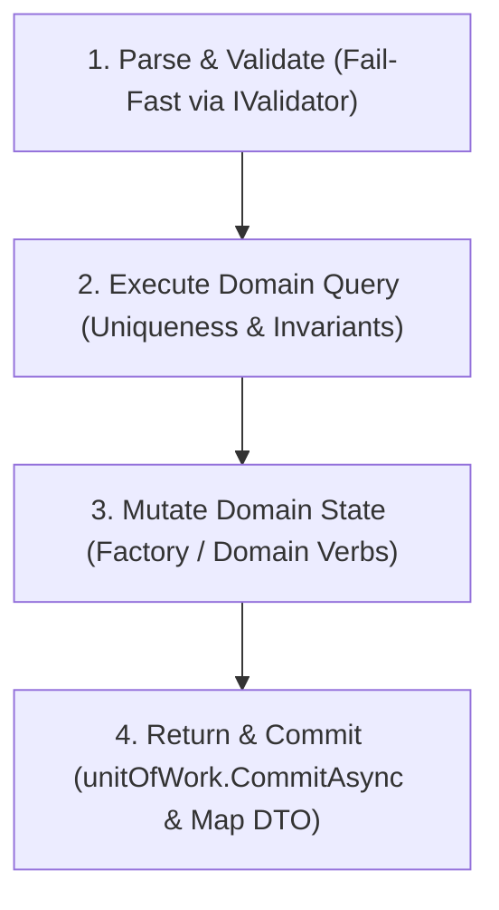

# [PATTERN-002]: 02_application_layer.md — Application Layer Design Patterns & PEMR Pipeline

<context>
Scope: Application Layer Patterns, CQRS UseCases, PEMR Pipeline, Commands, Queries, DTOs & Validation
Target: `SmkDoc.Application/` (`Modules/{Context}/Commands/`, `Queries/`, `DTOs/`, `Common/`)
Authority: Absolute SSoT Invariant (Orchestrates domain & infrastructure ports, zero direct SQL/framework leak)
</context>

---

## 1. Application Layer Invariants & Boundaries

| Architectural Concern | Prohibited Pattern (! BANNED) | Canonical SSoT Pattern (>> MANDATORY) |
|---|---|---|
| **Class Responsibility** | Generic multi-method "Service" classes | Single-responsibility UseCase implementing `IUseCase<TReq, TRes>` |
| **Request Model** | Mutable classes with get/set properties | Immutable positional `record` Command / Query |
| **Response Model** | Leaking Domain Entities to callers | Immutable Application `record` DTO |
| **Transaction Scope** | Manual SQL transactions inside UseCase | Atomic Unit of Work via `IUnitOfWork.CommitAsync(ct)` |
| **Validation Timing** | Validating inputs halfway through execution | Fail-fast validation at line 1 via `IValidator<TRequest>` |
| **Clock Resolution** | Calling `DateTime.UtcNow` in UseCase | Consuming injected `TimeProvider.GetUtcNow()` |

---

## 2. The 4-Step PEMR Execution Pipeline

Every mutating UseCase MUST strictly follow the 4-step **PEMR Pipeline**:



---

## 3. Complete UseCase Feature Slice Archetype

### 1. Command Definition (`CreateTemplateCommand.cs`)
```csharp
namespace SmkDoc.Application.Modules.Authoring.Templates.Commands.CreateTemplate;

public sealed record CreateTemplateCommand(
    Guid ProjectId,
    string Name,
    string Slug,
    string? Category,
    Stream? FileStream = null,
    string? FileName = null
);
```

### 2. Validator Definition (`CreateTemplateCommandValidator.cs`)
```csharp
using FluentValidation;

namespace SmkDoc.Application.Modules.Authoring.Templates.Commands.CreateTemplate;

public sealed class CreateTemplateCommandValidator : AbstractValidator<CreateTemplateCommand>
{
    public CreateTemplateCommandValidator()
    {
        RuleFor(x => x.Name)
            .NotEmpty().WithMessage("Template name is required.")
            .MaximumLength(100).WithMessage("Template name cannot exceed 100 characters.");

        RuleFor(x => x.Slug)
            .NotEmpty().WithMessage("Template slug is required.")
            .MaximumLength(100).WithMessage("Template slug cannot exceed 100 characters.")
            .Matches("^[a-z0-9-]+$").WithMessage("Slug must contain only lowercase alphanumeric characters and hyphens.");
    }
}
```

### 3. UseCase Orchestrator (`CreateTemplateUseCase.cs`)
```csharp
using FluentValidation;
using SmkDoc.Application.Common.Interfaces;
using SmkDoc.Application.Modules.Authoring.Templates.DTOs;
using SmkDoc.Domain.Entities;
using SmkDoc.Domain.Exceptions;
using SmkDoc.Domain.Interfaces;
using SmkDoc.Domain.ValueObjects;
using SmkDoc.Domain.ValueObjects.Ids;

namespace SmkDoc.Application.Modules.Authoring.Templates.Commands.CreateTemplate;

/// <summary>
/// Single-responsibility Use Case for creating a new document template.
/// </summary>
public sealed class CreateTemplateUseCase(
    ITemplateRepository templateRepo,
    IExecutionContext executionContext,
    IUnitOfWork unitOfWork,
    IValidator<CreateTemplateCommand> validator,
    TimeProvider timeProvider,
    ICurrentProjectContext? projectContext = null) : IUseCase<CreateTemplateCommand, TemplateResultDto>
{
    public async Task<TemplateResultDto> ExecuteAsync(CreateTemplateCommand command, CancellationToken ct = default)
    {
        // 1. Parse & Validate (Fail-Fast)
        var validationResult = await validator.ValidateAsync(command, ct);
        if (!validationResult.IsValid)
        {
            throw new ValidationException(validationResult.ToDictionary());
        }

        var effectiveProjectId = command.ProjectId != Guid.Empty
            ? command.ProjectId
            : (projectContext?.IsResolved == true ? projectContext.ProjectId.Value : executionContext.ProjectId ?? Guid.Empty);

        if (effectiveProjectId == Guid.Empty)
        {
            throw new DomainValidationException("ProjectId cannot be empty.");
        }

        // 2. Execute Domain Query & Pre-conditions
        var slugExists = await templateRepo.SlugExistsAsync(command.Slug, ct);
        if (slugExists)
        {
            throw ConflictException.DuplicateSlug(command.Slug);
        }

        var now = timeProvider.GetUtcNow();

        // 3. Mutate Domain State
        var template = Template.Create(
            new ProjectId(effectiveProjectId),
            TemplateName.Create(command.Name),
            new TemplateSlug(command.Slug),
            command.Category,
            now);

        await templateRepo.AddAsync(template, ct);

        // 4. Return & Commit
        await unitOfWork.CommitAsync(ct);

        return new TemplateResultDto(
            template.Id.Value,
            template.ProjectId.Value,
            template.Name.Value,
            template.Slug.Value,
            template.Category,
            template.IsActive,
            template.CurrentVersionId,
            template.CreatedAt,
            template.UpdatedAt);
    }
}
```

### 4. Response DTO Definition (`TemplateResultDto.cs`)
```csharp
namespace SmkDoc.Application.Modules.Authoring.Templates.DTOs;

public sealed record TemplateResultDto(
    Guid Id,
    Guid ProjectId,
    string Name,
    string Slug,
    string? Category,
    bool IsActive,
    Guid? CurrentVersionId,
    DateTimeOffset CreatedAt,
    DateTimeOffset? UpdatedAt
);
```

---

## 4. Read / Paged Query UseCase Archetype (Database-Side Projection)

Read queries must execute read-only queries with `.AsNoTracking()`, database-side pagination, and project directly into immutable DTO records:

### 1. Query Definition (`ListTemplatesQuery.cs`)
```csharp
namespace SmkDoc.Application.Modules.Authoring.Templates.Queries.ListTemplates;

public sealed record ListTemplatesQuery(
    Guid ProjectId,
    int Page = 1,
    int PageSize = 20
);
```

### 2. Paged Result DTO (`PagedResultDto<T>.cs`)
```csharp
namespace SmkDoc.Application.Common.DTOs;

public sealed record PagedResultDto<T>(
    IReadOnlyList<T> Items,
    int TotalCount,
    int Page,
    int PageSize);
```

### 3. Read UseCase Implementation (`ListTemplatesUseCase.cs`)
```csharp
using SmkDoc.Application.Common.DTOs;
using SmkDoc.Application.Common.Interfaces;
using SmkDoc.Application.Modules.Authoring.Templates.DTOs;
using SmkDoc.Domain.Interfaces;
using SmkDoc.Domain.ValueObjects.Ids;

namespace SmkDoc.Application.Modules.Authoring.Templates.Queries.ListTemplates;

public sealed class ListTemplatesUseCase(
    ITemplateRepository templateRepo) : IUseCase<ListTemplatesQuery, PagedResultDto<TemplateResultDto>>
{
    public async Task<PagedResultDto<TemplateResultDto>> ExecuteAsync(
        ListTemplatesQuery query,
        CancellationToken ct = default)
    {
        // 1. Guard & Normalize Pagination Limits
        var page = Math.Max(1, query.Page);
        var pageSize = Math.Clamp(query.PageSize, 1, 100);

        // 2. Query Repository with database-level .Skip().Take() and AsNoTracking()
        var totalCount = await templateRepo.CountAsync(new ProjectId(query.ProjectId), ct);
        var templates = await templateRepo.ListAsync(new ProjectId(query.ProjectId), page, pageSize, ct);

        // 3. Project to Immutable Application DTOs
        var dtos = templates.Select(t => new TemplateResultDto(
            t.Id.Value,
            t.ProjectId.Value,
            t.Name.Value,
            t.Slug.Value,
            t.Category,
            t.IsActive,
            t.CurrentVersionId,
            t.CreatedAt,
            t.UpdatedAt)).ToList();

        return new PagedResultDto<TemplateResultDto>(
            Items: dtos,
            TotalCount: totalCount,
            Page: page,
            PageSize: pageSize);
    }
}
```

---

## 5. Standard Application Exceptions


Throw strongly-typed application exceptions; presentation layers map them directly to RFC 9457 HTTP ProblemDetails:

| Exception Class | HTTP Status | Use Case Scenario |
|---|---|---|
| `ValidationException` | `400 Bad Request` | Command input fail-fast validation failures |
| `NotFoundException` | `404 Not Found` | Requested aggregate ID does not exist |
| `ConflictException` | `409 Conflict` | Unique constraint violation (e.g. Duplicate slug, duplicate code) |
| `ForbiddenException` | `403 Forbidden` | Access to resource denied across tenant boundaries |
| `DomainValidationException`| `422 Unprocessable` | Business invariant check failed inside Domain Entity / Value Object |
