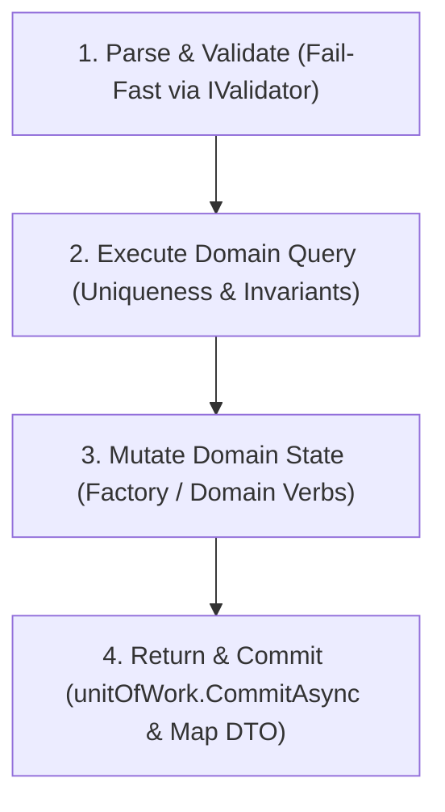

# [PATTERN-002]: 02_application_layer.md — Application Layer Design Patterns & PEMR Pipeline

<context>
Scope: Application Layer Patterns, CQRS UseCases, PEMR Pipeline, Commands, Queries, DTOs & Validation
Target: `SmkDoc.Application/` (`Modules/{Context}/Commands/`, `Queries/`, `DTOs/`, `Common/`)
Authority: Absolute SSoT Invariant (Orchestrates domain & infrastructure ports, zero direct SQL/framework leak)
Boundary: Pure Architectural AST only. Prohibit task roadmaps, execution checklists, and conversational prose.
TriggerSignals: [SIGNAL_API_MUTATION]
UpstreamKernel: AGENTS.md
</context>

---

## 1. Level 1: Application Invariants & Boundaries Matrix

| Architectural Concern | Prohibited Pattern (! BANNED) | Canonical SSoT Pattern (>> MANDATORY) |
|---|---|---|
| **Class Responsibility** | Generic multi-method "Service" classes | Single-responsibility UseCase implementing `IUseCase<TReq, TRes>` |
| **Request Model** | Mutable classes with get/set properties | Immutable positional `record` Command / Query |
| **Response Model** | Leaking Domain Entities to callers | Immutable Application `record` DTO |
| **Transaction Scope** | Manual SQL transactions inside UseCase | Atomic Unit of Work via `IUnitOfWork.CommitAsync(ct)` |
| **Validation Timing** | Validating inputs halfway through execution | Fail-fast validation at line 1 via `IValidator<TRequest>` |
| **Clock Resolution** | Calling `DateTime.UtcNow` in UseCase | Consuming injected `TimeProvider.GetUtcNow()` |

---

## 2. Level 2: Core Application SSoT ASTs & Pipeline

### Standard Application Exceptions Matrix
Throw strongly-typed exceptions; presentation layer dispatches directly to RFC 9457 HTTP ProblemDetails:
| Exception Class | HTTP Status | Use Case Scenario |
|---|---|---|
| `ValidationException` | `400 Bad Request` | Command input fail-fast validation failures |
| `NotFoundException` | `404 Not Found` | Requested aggregate ID does not exist |
| `ConflictException` | `409 Conflict` | Unique constraint violation (e.g. Duplicate slug, duplicate code) |
| `ForbiddenException` | `403 Forbidden` | Access to resource denied across tenant boundaries |
| `DomainValidationException`| `422 Unprocessable` | Business invariant check failed inside Domain Entity / Value Object |

### The 4-Step PEMR Execution Pipeline
Every mutating UseCase MUST strictly follow the 4-step **PEMR Pipeline**:


### CQRS UseCase Contracts
```csharp
namespace SmkDoc.Application.Common.Interfaces;

public interface IUseCase<in TRequest, TResponse>
{
    Task<TResponse> ExecuteAsync(TRequest request, CancellationToken ct = default);
}
```

---

## 3. Level 3: Canonical Application Archetypes

### Mutating Command Slice (`CreateTemplate`)
>> MANDATORY CANONICAL TEMPLATE [RULE-APP-001]:
* [MUST] Implement `IUseCase<TCommand, TResultDto>`.
* [MUST] Group Command, Validator, UseCase, and DTO in a co-located folder slice under `Modules/{BoundedContext}/{Aggregate}/Commands/{CommandName}/`.
* [MUST] Declare Command request as immutable positional `sealed record` with pure C# primitive or stream properties.
* [MUST] Follow strictly the 4-step PEMR execution pipeline (Parse & Validate => Execute Query => Mutate Domain => Return & Commit).
* [MUST] Validate line 1 via injected `IValidator<TCommand>` and throw strongly-typed `ValidationException` on failure.
* [MUST] Inject and query system time strictly via `TimeProvider.GetUtcNow()` (prohibit `DateTime.UtcNow`).
* [MUST] Call `await unitOfWork.CommitAsync(ct)` exactly once before mapping and returning the response DTO.
```csharp
namespace SmkDoc.Application.Modules.Authoring.Templates.Commands.CreateTemplate;

// 1. Immutable Request Command
public sealed record CreateTemplateCommand(
    Guid ProjectId,
    string Name,
    string Slug,
    string? Category,
    Stream? FileStream = null,
    string? FileName = null);

// 2. Fail-Fast Validator
public sealed class CreateTemplateCommandValidator : AbstractValidator<CreateTemplateCommand>
{
    public CreateTemplateCommandValidator()
    {
        RuleFor(x => x.Name).NotEmpty().MaximumLength(100);
        RuleFor(x => x.Slug).NotEmpty().MaximumLength(100).Matches("^[a-z0-9-]+$");
    }
}

// 3. Single-Responsibility UseCase Orchestrator
public sealed class CreateTemplateUseCase(
    ITemplateRepository templateRepo,
    IExecutionContext executionContext,
    IUnitOfWork unitOfWork,
    IValidator<CreateTemplateCommand> validator,
    TimeProvider timeProvider,
    ICurrentProjectContext? projectContext = null) : IUseCase<CreateTemplateCommand, TemplateResultDto>
{
    public async Task<TemplateResultDto> ExecuteAsync(CreateTemplateCommand command, CancellationToken ct = default)
    {
        // 1. Parse & Validate (Fail-Fast)
        var validationResult = await validator.ValidateAsync(command, ct);
        if (!validationResult.IsValid) throw new ValidationException(validationResult.ToDictionary());

        var effectiveProjectId = command.ProjectId != Guid.Empty
            ? command.ProjectId
            : (projectContext?.IsResolved == true ? projectContext.ProjectId.Value : executionContext.ProjectId ?? Guid.Empty);

        if (effectiveProjectId == Guid.Empty) throw new DomainValidationException("ProjectId cannot be empty.");

        // 2. Execute Domain Query & Pre-conditions
        if (await templateRepo.SlugExistsAsync(command.Slug, ct)) throw ConflictException.DuplicateSlug(command.Slug);

        // 3. Mutate Domain State
        var now = timeProvider.GetUtcNow();
        var template = Template.Create(
            new ProjectId(effectiveProjectId),
            TemplateName.Create(command.Name),
            new TemplateSlug(command.Slug),
            command.Category,
            now);

        await templateRepo.AddAsync(template, ct);

        // 4. Return & Commit
        await unitOfWork.CommitAsync(ct);

        return new TemplateResultDto(
            template.Id.Value,
            template.ProjectId.Value,
            template.Name.Value,
            template.Slug.Value,
            template.Category,
            template.IsActive,
            template.CurrentVersionId,
            template.CreatedAt,
            template.UpdatedAt);
    }
}

// 4. Response DTO
public sealed record TemplateResultDto(
    Guid Id,
    Guid ProjectId,
    string Name,
    string Slug,
    string? Category,
    bool IsActive,
    Guid? CurrentVersionId,
    DateTimeOffset CreatedAt,
    DateTimeOffset? UpdatedAt);
```

### Read / Paged Query Slice (`ListTemplates`)
>> MANDATORY CANONICAL TEMPLATE [RULE-APP-002]:
* [MUST] Implement `IUseCase<TQuery, PagedResultDto<TResultDto>>` or `IUseCase<TQuery, TResultDto>`.
* [MUST] Clamp page bounds (`page >= 1`, `1 <= pageSize <= 100`) to prevent denial-of-service query exhaustion.
* [MUST] Query repositories via domain methods returning read-only materialized collections (prohibit leaking `IQueryable<T>`).
* [MUST NOT] Mutate database state or call `unitOfWork.CommitAsync(ct)` inside query use cases.
* [MUST] Map domain entities directly to immutable Application DTOs before returning.
```csharp
namespace SmkDoc.Application.Modules.Authoring.Templates.Queries.ListTemplates;

public sealed record ListTemplatesQuery(Guid ProjectId, int Page = 1, int PageSize = 20);

public sealed record PagedResultDto<T>(IReadOnlyList<T> Items, int TotalCount, int Page, int PageSize);

public sealed class ListTemplatesUseCase(
    ITemplateRepository templateRepo) : IUseCase<ListTemplatesQuery, PagedResultDto<TemplateResultDto>>
{
    public async Task<PagedResultDto<TemplateResultDto>> ExecuteAsync(ListTemplatesQuery query, CancellationToken ct = default)
    {
        var page = Math.Max(1, query.Page);
        var pageSize = Math.Clamp(query.PageSize, 1, 100);

        var totalCount = await templateRepo.CountAsync(new ProjectId(query.ProjectId), ct);
        var templates = await templateRepo.ListAsync(new ProjectId(query.ProjectId), page, pageSize, ct);

        var dtos = templates.Select(t => new TemplateResultDto(
            t.Id.Value,
            t.ProjectId.Value,
            t.Name.Value,
            t.Slug.Value,
            t.Category,
            t.IsActive,
            t.CurrentVersionId,
            t.CreatedAt,
            t.UpdatedAt)).ToList();

        return new PagedResultDto<TemplateResultDto>(dtos, totalCount, page, pageSize);
    }
}
```

---

## 4. Level 4: Anti-Patterns & Micro-Diffs

### [TRAP-APP-001]: Domain Entity Leakage vs Application DTO
```csharp
// ! BANNED: Returning Domain Entity leaks internal structure and navigation properties
public async Task<Template> ExecuteAsync(GetTemplateQuery query, CancellationToken ct) { ... }

// >> CANONICAL: Return immutable Application DTO record
public async Task<TemplateResultDto> ExecuteAsync(GetTemplateQuery query, CancellationToken ct) { ... }
```

### [TRAP-APP-002]: MediatR Overhead vs Direct IUseCase Dispatch
```csharp
// ! BANNED: MediatR runtime reflection allocations and hidden handler indirection
public sealed class CreateTemplateHandler : IRequestHandler<CreateTemplateRequest, TemplateResult> { }

// >> CANONICAL: Explicit, compile-time verified IUseCase<TRequest, TResponse>
public sealed class CreateTemplateUseCase : IUseCase<CreateTemplateCommand, TemplateResultDto> { }
```

### [TRAP-APP-003]: Transaction Boundary: Uncommitted Mutations
```csharp
// ! BANNED: Adding entity to repository without committing unit of work
await templateRepo.AddAsync(template, ct);
return template.ToDto(); // REJECTED: Changes lost if transaction not committed!

// >> CANONICAL: Explicit UnitOfWork commit before returning
await templateRepo.AddAsync(template, ct);
await unitOfWork.CommitAsync(ct);
return template.ToDto();
```
