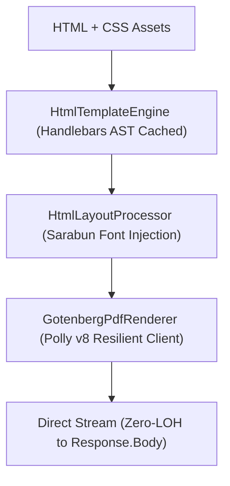

# [MECH-002]: document_rendering_mechanics.md — Rendering Engines, OpenXML & Thai Formatting SSoT

<context>
Scope: Polymorphic Rendering Engines, Gotenberg Chromium Microservice, OpenXML DrawingML Fix, ClosedXML A4 Fit & ThaiDataTransformer SSoT
Target: `SmkDoc.Infrastructure/Engines/` (`Gotenberg/`, `Word/`, `Excel/`, `Html/`) & `SmkDoc.Application/Common/Helpers/`
Authority: Absolute SSoT Invariant (100% deterministic output, zero LibreOffice shift, zero multi-MB buffering)
</context>

---

## 1. Polymorphic Rendering Engine Strategy

Rendering engines are decoupled from application workflows via the Strategy Pattern:

```csharp
namespace SmkDoc.Infrastructure.Engines;

public interface IRenderingEngine
{
    EngineType SupportedEngine { get; }
    Task<Stream> RenderAsync(RenderContext context, CancellationToken ct);
}
```

Engines are resolved dynamically via polymorphic dispatch:
```csharp
public sealed class RenderingEngineResolver(IEnumerable<IRenderingEngine> engines)
{
    public IRenderingEngine Resolve(EngineType engineType) =>
        engines.FirstOrDefault(e => e.SupportedEngine == engineType)
        ?? throw new NotSupportedException($"Rendering engine '{engineType.Name}' is not registered.");
}
```

---

## 2. Gotenberg 8 Dockerized Microservice Pipeline

SmkDoc Server replaces legacy embedded LibreOffice with **Gotenberg 8 (Dockerized Chromium microservice)** for deterministic HTML-to-PDF rendering:



### 2.1 Direct Response Streaming Archetype
```csharp
public async Task<Stream> RenderHtmlToPdfStreamAsync(
    string html,
    string? headerHtml = null,
    string? footerHtml = null,
    CancellationToken ct = default)
{
    using var content = new MultipartFormDataContent();
    var htmlContent = new ByteArrayContent(Encoding.UTF8.GetBytes(html));
    htmlContent.Headers.ContentType = new MediaTypeHeaderValue("text/html");
    content.Add(htmlContent, "files", "index.html");

    if (!string.IsNullOrWhiteSpace(headerHtml))
    {
        var hContent = new ByteArrayContent(Encoding.UTF8.GetBytes(headerHtml));
        hContent.Headers.ContentType = new MediaTypeHeaderValue("text/html");
        content.Add(hContent, "files", "header.html");
    }

    if (!string.IsNullOrWhiteSpace(footerHtml))
    {
        var fContent = new ByteArrayContent(Encoding.UTF8.GetBytes(footerHtml));
        fContent.Headers.ContentType = new MediaTypeHeaderValue("text/html");
        content.Add(fContent, "files", "footer.html");
    }

    using var request = new HttpRequestMessage(HttpMethod.Post, "/forms/chromium/convert/html") { Content = content };
    var response = await _httpClient.SendAsync(request, HttpCompletionOption.ResponseHeadersRead, ct);
    response.EnsureSuccessStatusCode();

    return await response.Content.ReadAsStreamAsync(ct);
}
```

### 2.2 Polly v8 Enterprise HTTP Resilience Pipeline
Configured on `HttpClient` in `SmkDoc.Infrastructure/DependencyInjection.cs` to shield document generation against network jitter and transient Gotenberg container reboots:

```csharp
services.AddHttpClient<IPdfRenderer, GotenbergPdfRenderer>(client =>
{
    if (!string.IsNullOrEmpty(gotenbergSettings.Url))
        client.BaseAddress = new Uri(gotenbergSettings.Url);
})
.AddResilienceHandler("gotenberg-resilience", builder =>
{
    // 1. Total request timeout (inclusive of all attempts)
    builder.AddTimeout(TimeSpan.FromSeconds(60));

    // 2. Adaptive Retry with Exponential Backoff + Jitter for transient errors (503, 504)
    builder.AddRetry(new HttpRetryStrategyOptions
    {
        MaxRetryAttempts = 3,
        Delay = TimeSpan.FromSeconds(1),
        BackoffType = DelayBackoffType.Exponential,
        UseJitter = true,
        ShouldHandle = args =>
        {
            if (args.Outcome.Result is HttpResponseMessage response)
            {
                int statusCode = (int)response.StatusCode;
                return ValueTask.FromResult(statusCode == 503 || statusCode == 504);
            }
            return ValueTask.FromResult(args.Outcome.Exception is HttpRequestException or TimeoutRejectedException);
        }
    });

    // 3. Circuit Breaker: Trip on 50% failure rate over 30s window (min 5 calls); 15s break duration
    builder.AddCircuitBreaker(new HttpCircuitBreakerStrategyOptions
    {
        FailureRatio = 0.5,
        SamplingDuration = TimeSpan.FromSeconds(30),
        MinimumThroughput = 5,
        BreakDuration = TimeSpan.FromSeconds(15),
        ShouldHandle = args =>
        {
            if (args.Outcome.Result is HttpResponseMessage response)
            {
                int statusCode = (int)response.StatusCode;
                return ValueTask.FromResult(statusCode == 503 || statusCode == 504);
            }
            return ValueTask.FromResult(args.Outcome.Exception is HttpRequestException or TimeoutRejectedException);
        }
    });

    // 4. Per-attempt timeout (safeguards against hanging Chromium/Gotenberg worker)
    builder.AddTimeout(TimeSpan.FromSeconds(30));
});
```

### 2.3 Thai Typography & Sarabun Web Font Auto-Injection
[RULE-RENDER-001]: Headless Chromium PDF rendering clips Thai floating vowels (สระบน/สระล่าง เช่น อิ, อี, อุ, อู) and tone marks (ไม้เอก, ไม้โท, ไม้ตรี, ไม้จัตวา) when standard fonts are undeclared. The `HtmlLayoutProcessor` automatically injects Google Fonts Sarabun into `<head>` if no font is specified:

```csharp
public class HtmlLayoutProcessor
{
    private const string FontHead = "<link rel=\"stylesheet\" href=\"https://fonts.googleapis.com/css2?family=Sarabun:wght@300;400;600;700&display=swap\"><style>body { font-family: 'Sarabun', sans-serif; }</style>";

    public HtmlLayoutResult Process(string html)
    {
        if (string.IsNullOrWhiteSpace(html))
            return new HtmlLayoutResult(string.Empty, null, null);

        string processedHtml = html;

        // Auto-inject Sarabun font if font-family or Google Fonts link is absent
        if (!processedHtml.Contains("fonts.googleapis.com", StringComparison.OrdinalIgnoreCase) &&
            !processedHtml.Contains("font-family", StringComparison.OrdinalIgnoreCase))
        {
            processedHtml = processedHtml.Contains("<head>", StringComparison.OrdinalIgnoreCase)
                ? processedHtml.Replace("<head>", $"<head>\n{FontHead}", StringComparison.OrdinalIgnoreCase)
                : $"{FontHead}\n{processedHtml}";
        }

        return new HtmlLayoutResult(processedHtml, headerHtml, footerHtml);
    }
}
```

---

## 3. OpenXML Word Processing & DrawingML Non-Zero ID Fix

When injecting images or shapes into Microsoft Word (`.docx`) documents via OpenXML:
* **The Fatal Bug**: OpenXML defaults graphic frame IDs to `0`. Microsoft Word treats `id="0"` as a corrupted XML element, throwing: `"Word found unreadable content in document.docx. Do you want to recover the contents?"`
* **The Canonical Invariant**: All DrawingML graphic frame IDs MUST be assigned unique, positive, non-zero integers ($\ge 1$).

```csharp
using DocumentFormat.OpenXml.Drawing;

namespace SmkDoc.Infrastructure.Engines.Word;

public static class DrawingMlIdFixer
{
    private static uint _nextId = 1;

    public static uint GenerateNonZeroId()
    {
        return Interlocked.Increment(ref _nextId);
    }

    public static void EnsureNonZeroGraphicFrameId(NonVisualDrawingProperties nvPr)
    {
        if (nvPr.Id == null || nvPr.Id.Value == 0)
        {
            nvPr.Id = GenerateNonZeroId(); // Enforce non-zero positive integer
        }
    }
}
```

---

## 4. ClosedXML Excel Processing & A4 Page Fit Calculation

When producing Excel (`.xlsx`) documents for business reports:
* **Page Fit Invariant**: Spreadsheets must automatically fit the printed page width to A4 without clipping columns.
* **Cell Formatting Preservation**: Numeric and date values must retain native Excel types and number formatting (never converted to plain text).

```csharp
using ClosedXML.Excel;

namespace SmkDoc.Infrastructure.Engines.Excel;

public static class ExcelPageSetupExtensions
{
    public static void ApplyA4FitToWidth(IXLWorksheet worksheet)
    {
        worksheet.PageSetup.PaperSize = XLPaperSize.A4Paper;
        worksheet.PageSetup.PageOrientation = XLPageOrientation.Portrait;
        
        // Fit to 1 page wide, automatic pages tall
        worksheet.PageSetup.FitToPages(1, 0);

        // Adjust column widths to fit content with padding
        worksheet.Columns().AdjustToContents();
    }
}
```

---

## 5. Handlebars Helpers & Template AST Caching

SmkDoc Server caches compiled Handlebars ASTs keyed by the SHA-256 hash of the template text:

```csharp
public static class HandlebarsCache
{
    private static readonly ConcurrentDictionary<string, HandlebarsTemplate<object, object>> Cache = new();

    public static HandlebarsTemplate<object, object> GetOrCompile(string templateText)
    {
        var hash = Convert.ToHexString(SHA256.HashData(Encoding.UTF8.GetBytes(templateText)));
        return Cache.GetOrAdd(hash, _ => Handlebars.Compile(templateText));
    }
}
```

### 8 Authoritative Helpers
| Helper Name | Usage in Template | Output Description |
|---|---|---|
| `thai_date` | `{{thai_date date_field}}` | Formats date into Buddhist Era (e.g. `21 ตุลาคม 2569`) |
| `thai_baht_text` | `{{thai_baht_text amount}}` | Converts decimal to Thai Baht text (e.g. `หนึ่งพันสองร้อยบาทถ้วน`) |
| `format_number` | `{{format_number amount 2}}` | Formats number with commas and decimal places (`1,200.00`) |
| `format_phone` | `{{format_phone phone}}` | Formats 10-digit phone number (`081-234-5678`) |
| `format_id_card` | `{{format_id_card id_card}}` | Formats 13-digit Thai National ID (`1-2345-67890-12-3`) |
| `eq` | `{{#if (eq status "Published")}}` | Equality comparator helper |
| `neq` | `{{#if (neq status "Draft")}}` | Inequality comparator helper |
| `lookup` | `{{lookup items @index}}` | Dynamic dictionary or array lookup helper |

---

## 6. ThaiDataTransformer SSoT (`SmkDoc.Application/Common/Helpers/`)

All Thai-specific localized transformations MUST route through `ThaiDataTransformer`. Zero inline conversions in templates:

```csharp
namespace SmkDoc.Application.Common.Helpers;

public static class ThaiDataTransformer
{
    private static readonly string[] ThaiMonths =
    [
        "มกราคม", "กุมภาพันธ์", "มีนาคม", "เมษายน", "พฤษภาคม", "มิถุนายน",
        "กรกฎาคม", "สิงหาคม", "กันยายน", "ตุลาคม", "พฤศจิกายน", "ธันวาคม"
    ];

    /// <summary>Converts Gregorian date to Thai Buddhist Era date string.</summary>
    public static string FormatThaiDate(DateTimeOffset date)
    {
        int thaiYear = date.Year + 543;
        string month = ThaiMonths[date.Month - 1];
        return $"{date.Day} {month} {thaiYear}";
    }

    /// <summary>Converts numeric decimal amount to Thai Baht text string.</summary>
    public static string ToThaiBahtText(decimal amount)
    {
        // Canonical Baht Text conversion algorithm
        if (amount == 0) return "ศูนย์บาทถ้วน";
        // Detailed implementation handles Baht, Satang, and "ถ้วน" suffix
        return ThaiBahtConverter.Convert(amount);
    }

    /// <summary>Formats 10-digit phone number into standard 0xx-xxx-xxxx format.</summary>
    public static string FormatPhone(string? phone)
    {
        if (string.IsNullOrWhiteSpace(phone)) return string.Empty;
        var digits = new string(phone.Where(char.IsDigit).ToArray());
        return digits.Length == 10
            ? $"{digits[..3]}-{digits[3..6]}-{digits[6..]}"
            : phone;
    }

    /// <summary>Formats 13-digit Thai National ID card number.</summary>
    public static string FormatThaiIdCard(string? idCard)
    {
        if (string.IsNullOrWhiteSpace(idCard)) return string.Empty;
        var digits = new string(idCard.Where(char.IsDigit).ToArray());
        return digits.Length == 13
            ? $"{digits[0]}-{digits[1..5]}-{digits[5..10]}-{digits[10..12]}-{digits[12]}"
            : idCard;
    }
}
```
