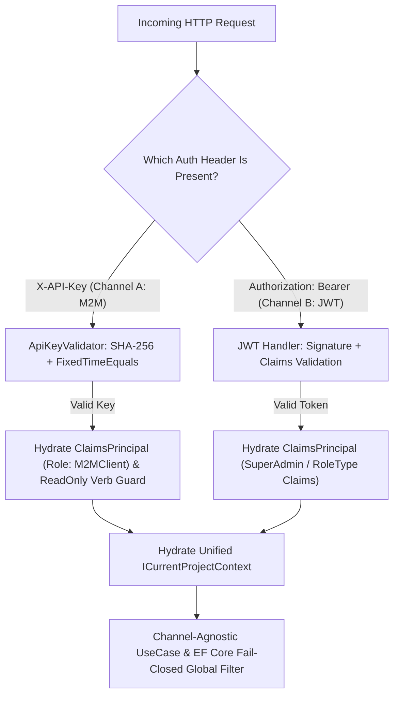

# [MECH-001]: multi_tenant_security_pipeline.md — Multi-Tenant Security & Dual-Auth Pipeline SSoT

<context>
Scope: Multi-Tenant Architecture, Dual-Channel Authentication (M2M API-Key & Web JWT), Ambient Project Context & EF Core Global Query Filters.
SSoT_For: Dual-Authentication Pipeline, M2M ClaimsPrincipal Hydration, ProjectContextMiddleware, Ambient Tenancy Resolution, and API Key Governance.
Out_Of_Scope: Presentation layer routing and RFC 9457 exceptions (see: ../01_clean_arch_patterns/04_api_presentation_layer.md), General Security and Performance bounds (see: ../00_architecture_core/03_security_and_performance.md).
Target: `backend-v2/` (`SmkDoc.Api/Middleware/`, `SmkDoc.Infrastructure/Security/`, `SmkDoc.Application/Common/Interfaces/`).
TriggerSignals: [SIGNAL_SECURITY_MUTATION], [SIGNAL_API_MUTATION]
</context>

---

## 1. Level 1: Multi-Tenant & Dual-Auth Invariants Matrix

### Architectural Wiring & Security Contracts
| Direction | Upstream Origin | Current Role (Tenancy & Security Engine) | Downstream Destination |
|---|---|---|---|
| **Incoming HTTP** | M2M Client or Web Studio | Inspects auth headers (`X-API-Key` vs `Authorization: Bearer`) | Authentication Handler Dispatch |
| **Channel A (M2M)** | External Integration Client | SHA-256 hash lookup, verifies `FixedTimeEquals`, extracts `project_id`, enforces `ApiKeyScope` | Hydrates `ClaimsPrincipal` (`Role: M2MClient`) & `ICurrentProjectContext` |
| **Channel B (JWT)** | Web Studio User Session | Verifies JWT signature, user membership, role claims & reads `X-Project-Id` / `{projectId}` | Hydrates `ClaimsPrincipal` (`Role: SuperAdmin/RoleType`) & `ICurrentProjectContext` |
| **Ambient Context** | Authenticated Channel | Exposes channel-agnostic `ICurrentProjectContext` (zero `IExecutionContext`) | EF Core `AppDbContext` & Inner Business Logic |
| **Persistence Query**| UseCase / Repository Query | Enforces fail-closed global tenancy SQL partition | PostgreSQL Engine (`WHERE @IsResolved AND project_id = @Id`) |

### Multi-Tenant & Dual-Auth Invariants Matrix
| Security Concern | Prohibited Pattern (! BANNED) | Canonical SSoT Pattern (>> MANDATORY) |
|---|---|---|
| **Raw Key Storage** | ! Storing plaintext API keys in database | >> SHA-256 cryptographic hash lookup (`KeyHash`) |
| **Client Token Exposure** | ! Storing JWT in browser localStorage | >> httpOnly cookies translated via Next.js Proxy (`/api/proxy/[...path]`) |
| **Dual Ambient Contexts** | ! Maintaining a separate `IExecutionContext` alongside `ICurrentProjectContext` | >> Retire `IExecutionContext`; inject unified channel-agnostic `ICurrentProjectContext` everywhere |
| **Cross-Tenant Queries** | ! Manual `WHERE project_id = @id` clauses in repositories | >> EF Core fail-closed Global Query Filter (`IsResolved && e.ProjectId == CurrentTenantId`) |
| **Tenant Filter Bypass** | ! Invoking `.IgnoreQueryFilters()` in standard tenant routes | >> Strictly prohibited; ambient context scopes all queries automatically |
| **Key Validation** | ! Variable-time string comparison (`key == storedHash` or `rawKey == masterKey`) | >> Constant-time comparison: `CryptographicOperations.FixedTimeEquals` across all key checks |
| **M2M Principal Hydration** | ! Setting ambient context without hydrating `ClaimsPrincipal` on `HttpContext.User` | >> Hydrate `ClaimsPrincipal` (`AuthenticationScheme: ApiKeyScheme`, `Role: M2MClient`, `ProjectId`, `Scope`, `ApiKeyId`) so `[Authorize]` treats M2M as first-class citizen |
| **Parameter Spoofing** | ! Accepting caller `ProjectId` overrides in tenant Commands/Queries | >> Omit `ProjectId` from tenant payloads and Command records; resolve ambient `ICurrentProjectContext` directly inside UseCases |
| **User Tenancy Scoping** | ! Adding `ProjectId` column to global `User` entity | >> `User` is a Global Identity (zero `ProjectId` column); multi-project access is mapped strictly through `UserProjectRole` |
| **API Key Issuance** | ! Permitting tenant members or portal users to self-issue API keys | >> Centralized SuperAdmin issuance strictly via `POST /api/v1/management/projects/{projectId}/api-keys` |
| **API Key Quota & Sprawl** | ! Unbounded key creation per project or duplicate scope allocation | >> Strict budget: max 2 active keys per tenant (1 `ReadOnly` + 1 `ReadWrite`), returning `409 Conflict` on duplicate |
| **Key Exposure Wire Contract** | ! Returning `keyHash` or plaintext secret in `GET` responses | >> Return masked key (`smk_crm_****abcd`); emit raw secret once upon `POST` creation exclusively |
| **User Management Routes** | ! Maintaining duplicate nested routes (`/management/projects/{projectId}/users`) alongside flat resource routes | >> Enforce canonical flat RESTful endpoints (`/api/v1/users`, `/api/v1/users/{userId}/role`); eliminate redundant Controller duplicates |
| **Route Precedence** | ! Extracting tenant identifier strictly from headers or ignoring route mismatches | >> Precedence: Route (`{projectId}`) => Header (`X-Project-Id`) => JWT Claim (`ProjectId`), rejecting Route vs Header conflicts (`400 Bad Request`) |
| **Role Claim Hydration** | ! Ad-hoc controller role queries or skipping global SuperAdmin claims | >> Hydrate `SuperAdmin` + `Admin` claims unconditionally for SuperAdmins; hydrate project `RoleType` claim on tenant routes |
| **M2M Scope Enforcement** | ! Allowing `ApiKeyScope.ReadOnly` keys to execute mutating HTTP verbs | >> Reject `POST`/`PUT`/`PATCH`/`DELETE` with `403 Forbidden` at perimeter except zero-side-effect stateless `/preview` and `/validate` routes |
| **Preview Route Protection** | ! Whitelisting `/preview` endpoints as unauthenticated public paths | >> Require authenticated tenant context on all preview routes to resolve templates and protect Gotenberg |
| **Idempotency Partition** | ! Keying idempotency store by shared `CallerApp` (`idempotency:portal:{key}`) | >> Partition strictly by resolved tenant: `idempotency:{ProjectId:N}:{IdempotencyKey}` |
| **Route Sunset Strategy** | ! Hard-deleting legacy `/api/*` endpoints causing external ERP outages | >> Annotate with `[DeprecatedRoute]` emitting RFC 8594 `Sunset`, `Deprecation`, and `Link` headers before decommissioning |

---

## 2. Level 2: Dual-Channel Topology & Cognitive Tenancy Engine

### Engineering Rationale & Causal Decisions
* **Why Constant-Time Hash Comparison (`FixedTimeEquals`):** Standard string equality (`==`) terminates on the first mismatched character, creating timing side-channel vulnerabilities that allow attackers to deduce hashes through network latency jitter.
* **Why `ClaimsPrincipal` Hydration for M2M:** ASP.NET Core `[Authorize]` attributes evaluate `HttpContext.User.Identity.IsAuthenticated`. Validating an API key into ambient context without updating `HttpContext.User` causes downstream middleware to treat M2M requests as unauthenticated (`401 Unauthorized`).
* **Why Unified `ICurrentProjectContext` (Retiring `IExecutionContext`):** Maintaining both `ICurrentProjectContext` and `IExecutionContext` causes split-brain bugs and leaks transport authentication mechanics into UseCases. Both `X-API-Key` (M2M) and `Authorization: Bearer` (JWT) converge at the perimeter into `ICurrentProjectContext` so inner business logic executes completely agnostically of transport origin.
* **Why Global `User` vs `UserProjectRole`:** Modeling `User` with a `ProjectId` column forces duplicate user accounts across projects, breaks single-sign-on (SSO), and makes enterprise user management impossible. `User` is a Global Identity; multi-tenancy is scoped strictly via the `UserProjectRole` join entity.
* **Why Omitting `ProjectId` from Tenant Payloads:** Eliminating `Guid ProjectId` from tenant-scoped Commands and Queries removes confused-deputy attack vectors by construction rather than relying on repetitive per-handler checks.
* **Why Route Precedence with Conflict Rejection:** Administrative endpoints define resource hierarchy in the URI (`/api/v1/projects/{projectId}/...`). Parsing `{projectId}` from route values and rejecting mismatches against `X-Project-Id` prevents cross-project header bleed attacks.
* **Why Unconditional SuperAdmin Claim Hydration:** Global endpoints such as `POST /api/v1/management/projects` execute before a target project exists. Hydrating `SuperAdmin` and `Admin` role claims prior to tenant resolution allows `[Authorize(Roles = RoleConstants.AdminOrSuperAdmin)]` to succeed without weakening tenant checks on project-scoped routes.
* **Why Perimeter Enforcement of `ApiKeyScope.ReadOnly`:** Blocking state-mutating HTTP methods at `ProjectContextMiddleware` prevents read-only integration keys from creating templates, uploading fonts, or mutating documents while still permitting stateless POST `preview` and `validate` calls.
* **Why Centralized SuperAdmin Key Issuance & 2-Key Quota:** Delegating API key creation to tenant members causes uncontrolled key sprawl and shadow credentials. Restricting issuance exclusively to `SuperAdmin` with a hard limit of 2 keys (`ReadOnly` and `ReadWrite`) bounds attack surface and enforces strict enterprise governance.

### Cognitive Tenancy Optimization & Guard Engine
```yaml
OptimizationObjectives:
  PrimaryObjective: Zero-Leakage Channel-Agnostic Tenancy Isolation & Cryptographic Side-Channel Immunity
  TradeOffPriority: ZeroCrossTenantLeakage > TimingSideChannelImmunity > M2MFirstIntegrity > ChannelAgnosticSimplicity

ProactiveTenancyGuards:
  - Scope: SmkDoc.Infrastructure.Persistence
    Trigger: Call to .IgnoreQueryFilters() in production tenant repository or query
    CanonicalAction: Reject immediately; ambient tenancy filter must remain enforced >> Ref: [TRAP-SEC-002]

  - Scope: SmkDoc.Api.Middleware
    Trigger: String equality check (== or .Equals()) on API key hashes
    CanonicalAction: Enforce CryptographicOperations.FixedTimeEquals on byte arrays >> Ref: [RULE-SEC-001]

  - Scope: SmkDoc.Api.Middleware
    Trigger: Validation of X-API-Key without hydrating ClaimsPrincipal on HttpContext.User
    CanonicalAction: Hydrate ClaimsIdentity with Role=M2MClient, Scope, ProjectId, and ApiKeyId >> Ref: [RULE-SEC-002]

  - Scope: SmkDoc.Application
    Trigger: Declaration of IExecutionContext or caller ProjectId on tenant-scoped Command/Query record
    CanonicalAction: Retire IExecutionContext; omit caller ProjectId and inject mandatory ICurrentProjectContext >> Ref: [RULE-SEC-003]

  - Scope: SmkDoc.Api.Middleware
    Trigger: Whitelisting /preview routes as anonymous or allowing ApiKeyScope.ReadOnly on mutating routes
    CanonicalAction: Require authenticated context on /preview and enforce ReadOnly mutation block >> Ref: [RULE-SEC-002]

CoreExtensionSlots:
  ApiKeyValidatorSlot: ApiKeyValidator (Cryptographic hash generator and verification)
  ProjectContextSlot: ICurrentProjectContext / ICurrentProjectContextSetter (Single unified channel-agnostic ambient context)
  ContextMiddlewareSlot: ProjectContextMiddleware (Dual-auth perimeter gateway converging M2M and JWT into ICurrentProjectContext)
```

### Dual-Channel Authentication Topology


### Unified Ambient Context Interfaces
```csharp
namespace SmkDoc.Application.Common.Interfaces;

using SmkDoc.Domain.Enums;
using SmkDoc.Domain.ValueObjects.Ids;

public interface ICurrentProjectContext
{
    ProjectId ProjectId { get; }
    bool IsResolved { get; }
    string? CallerIdentity { get; }
    UserId? UserId { get; }
    SystemRole? SystemRole { get; }
    ApiKeyId? ApiKeyId { get; }
}

public interface ICurrentProjectContextSetter
{
    void SetProject(ProjectId projectId, string? callerIdentity = null);

    void SetActor(
        UserId? userId = null,
        SystemRole? systemRole = null,
        ApiKeyId? apiKeyId = null,
        string? callerIdentity = null);
}
```

---

## 3. Level 3: Canonical Security Archetypes

### Channel A: M2M API Key Validator (`ApiKeyValidator`)
>> MANDATORY CANONICAL TEMPLATE [RULE-SEC-001]:
* [MUST] Hash all incoming M2M API keys using SHA-256 before database lookup.
* [MUST] Compare hash bytes using `CryptographicOperations.FixedTimeEquals` to prevent timing attacks.
* [MUST NOT] Store or query raw API keys in plaintext in PostgreSQL.
* [MUST] Compare expiration against `timeProvider.GetUtcNow()`.
```csharp
using System.Security.Cryptography;
using System.Text;
using Microsoft.EntityFrameworkCore;
using SmkDoc.Domain.Entities;
using SmkDoc.Infrastructure.Persistence;

namespace SmkDoc.Infrastructure.Security;

public static class ApiKeyValidator
{
    public static string HashApiKey(string rawApiKey)
    {
        var bytes = Encoding.UTF8.GetBytes(rawApiKey);
        var hash = SHA256.HashData(bytes);
        return Convert.ToHexString(hash).ToLowerInvariant();
    }

    public static async Task<ApiKey?> AuthenticateAsync(
        string rawApiKey,
        AppDbContext dbContext,
        TimeProvider timeProvider,
        CancellationToken ct)
    {
        var keyHash = HashApiKey(rawApiKey);
        var expectedBytes = Encoding.UTF8.GetBytes(keyHash);

        var apiKey = await dbContext.ApiKeys
            .AsNoTracking()
            .FirstOrDefaultAsync(k => k.KeyHash == keyHash && k.IsActive, ct);

        if (apiKey == null) return null;

        var actualBytes = Encoding.UTF8.GetBytes(apiKey.KeyHash);
        if (!CryptographicOperations.FixedTimeEquals(expectedBytes, actualBytes))
        {
            return null;
        }

        var now = timeProvider.GetUtcNow();
        if (apiKey.ExpiresAt.HasValue && apiKey.ExpiresAt.Value < now)
        {
            return null;
        }

        return apiKey;
    }
}
```

### Ambient Project Context Middleware Archetype (`ProjectContextMiddleware`)
>> MANDATORY CANONICAL TEMPLATE [RULE-SEC-002]:
* [MUST] Complete fully-hydrated implementations for both Channel A (`X-API-Key`) and Channel B (`Authorization: Bearer`).
* [MUST] Hydrate `ClaimsPrincipal` onto `HttpContext.User` on Channel A (`Role: M2MClient`, `ProjectId`, `Scope`, `ApiKeyId`, `CallerApp`) to ensure `[Authorize]` passes.
* [MUST] Enforce `ApiKeyScope.ReadOnly` on Channel A at perimeter: reject `POST`/`PUT`/`PATCH`/`DELETE` with RFC 9457 `403 Forbidden` except stateless `/preview` and `/validate`.
* [MUST] Extract Channel B tenant identifier following precedence: Route `{projectId}` => Header `X-Project-Id` => JWT Claim `ProjectId`, rejecting Route vs Header conflicts with RFC 9457 `400 Bad Request`.
* [MUST] Hydrate `SuperAdmin` and `Admin` role claims unconditionally for authenticated `SystemRole.SuperAdmin` users before project checks.
```csharp
using System.Security.Claims;
using Microsoft.AspNetCore.Http;
using Microsoft.AspNetCore.Mvc;
using SmkDoc.Api.Constants;
using SmkDoc.Application.Common.Interfaces;
using SmkDoc.Domain.Entities;
using SmkDoc.Domain.Enums;
using SmkDoc.Domain.ValueObjects.Ids;
using SmkDoc.Infrastructure.Persistence;
using SmkDoc.Infrastructure.Security;

namespace SmkDoc.Api.Middleware;

public sealed class ProjectContextMiddleware(RequestDelegate next)
{
    public async Task InvokeAsync(
        HttpContext context,
        ICurrentProjectContextSetter projectContextSetter,
        AppDbContext dbContext,
        TimeProvider timeProvider)
    {
        // 1. Channel A: M2M X-API-Key Authentication & Claims Hydration
        if (context.Request.Headers.TryGetValue("X-API-Key", out var apiKeyValues) &&
            !string.IsNullOrWhiteSpace(apiKeyValues))
        {
            var rawApiKey = apiKeyValues.ToString().Trim();
            var apiKey = await ApiKeyValidator.AuthenticateAsync(rawApiKey, dbContext, timeProvider, context.RequestAborted);

            if (apiKey == null)
            {
                await WriteProblemAsync(context, StatusCodes.Status401Unauthorized, "Invalid API Key",
                    "The provided API key is invalid, inactive, or expired.");
                return;
            }

            // Enforce ReadOnly scope: block mutating HTTP verbs except stateless preview/validate
            if (apiKey.Scope == ApiKeyScope.ReadOnly && IsMutatingNonStatelessRequest(context.Request))
            {
                await WriteProblemAsync(context, StatusCodes.Status403Forbidden, "Insufficient Key Scope",
                    "API key with ReadOnly scope is not permitted to execute state-mutating operations.");
                return;
            }

            // Hydrate ambient project context
            var projectId = new ProjectId(apiKey.ProjectId);
            var apiKeyId = new ApiKeyId(apiKey.Id);
            projectContextSetter.SetProject(projectId, apiKey.CallerApp);
            projectContextSetter.SetActor(apiKeyId: apiKeyId, callerIdentity: apiKey.CallerApp);

            // Hydrate ClaimsPrincipal onto HttpContext.User for ASP.NET Core [Authorize] authorization
            var claims = new[]
            {
                new Claim(ClaimTypes.NameIdentifier, apiKey.Id.ToString()),
                new Claim(ClaimTypes.Role, "M2MClient"),
                new Claim("Scope", apiKey.Scope.ToString()),
                new Claim("ProjectId", apiKey.ProjectId.ToString()),
                new Claim("CallerApp", apiKey.CallerApp)
            };
            var identity = new ClaimsIdentity(claims, "ApiKeyScheme");
            context.User = new ClaimsPrincipal(identity);

            await next(context);
            return;
        }

        // 2. Channel B: JWT User Session Authentication & Tenant Scoping
        if (context.User.Identity?.IsAuthenticated == true)
        {
            var routeProjectId = ExtractRouteProjectId(context);
            var headerProjectId = ExtractHeaderProjectId(context);

            if (routeProjectId.HasValue && headerProjectId.HasValue && routeProjectId.Value != headerProjectId.Value)
            {
                await WriteProblemAsync(context, StatusCodes.Status400BadRequest, "Tenant Identification Conflict",
                    $"Route ProjectId '{routeProjectId}' conflicts with Header X-Project-Id '{headerProjectId}'.");
                return;
            }

            var userId = ExtractUserId(context.User);
            var isSuperAdmin = IsSuperAdminPrincipal(context.User);
            var systemRole = isSuperAdmin ? SystemRole.SuperAdmin : SystemRole.Member;

            projectContextSetter.SetActor(
                userId: userId,
                systemRole: systemRole,
                callerIdentity: userId is { } uid ? $"User:{uid.Value:N}" : "portal");

            if (isSuperAdmin && context.User.Identity is ClaimsIdentity superIdentity)
            {
                EnsureRoleClaim(superIdentity, RoleConstants.SuperAdmin);
                EnsureRoleClaim(superIdentity, RoleConstants.Admin);
            }

            var effectiveProjectId = routeProjectId ?? headerProjectId ?? ExtractClaimProjectId(context);
            if (effectiveProjectId.HasValue)
            {
                projectContextSetter.SetProject(new ProjectId(effectiveProjectId.Value));
            }

            await next(context);
            return;
        }

        // 3. Unauthenticated / Public Paths
        await next(context);
    }

    private static bool IsMutatingNonStatelessRequest(HttpRequest request)
    {
        if (HttpMethods.IsGet(request.Method) || HttpMethods.IsHead(request.Method) || HttpMethods.IsOptions(request.Method))
            return false;

        var path = request.Path.Value ?? string.Empty;
        return !path.Contains("/preview", StringComparison.OrdinalIgnoreCase)
            && !path.Contains("/validate", StringComparison.OrdinalIgnoreCase);
    }

    private static UserId? ExtractUserId(ClaimsPrincipal principal)
    {
        var raw = principal.FindFirst(ClaimTypes.NameIdentifier)?.Value ?? principal.FindFirst("sub")?.Value;
        return Guid.TryParse(raw, out var guid) && guid != Guid.Empty ? new UserId(guid) : null;
    }

    private static bool IsSuperAdminPrincipal(ClaimsPrincipal principal) =>
        string.Equals(principal.FindFirst("SystemRole")?.Value, RoleConstants.SuperAdmin, StringComparison.OrdinalIgnoreCase);

    private static void EnsureRoleClaim(ClaimsIdentity identity, string role)
    {
        if (!identity.HasClaim(ClaimTypes.Role, role))
            identity.AddClaim(new Claim(ClaimTypes.Role, role));
    }

    private static Guid? ExtractRouteProjectId(HttpContext context) =>
        Guid.TryParse(context.Request.RouteValues["projectId"]?.ToString(), out var id) && id != Guid.Empty ? id : null;

    private static Guid? ExtractHeaderProjectId(HttpContext context) =>
        Guid.TryParse(context.Request.Headers[HttpHeaderConstants.ProjectIdHeader], out var id) && id != Guid.Empty ? id : null;

    private static Guid? ExtractClaimProjectId(HttpContext context) =>
        Guid.TryParse(context.User.FindFirst("ProjectId")?.Value, out var id) && id != Guid.Empty ? id : null;

    private static Task WriteProblemAsync(HttpContext context, int status, string title, string detail)
    {
        context.Response.StatusCode = status;
        context.Response.ContentType = "application/problem+json";
        return context.Response.WriteAsJsonAsync(new ProblemDetails
        {
            Status = status,
            Title = title,
            Detail = detail,
            Instance = context.Request.Path
        });
    }
}
```

### Mandatory Ambient Tenant Resolution & Anti-Spoofing Guard
>> MANDATORY CANONICAL TEMPLATE [RULE-SEC-003]:
* [MUST] Consume `ICurrentProjectContext` as the single mandatory ambient context in all tenant-scoped UseCases.
* [MUST NOT] Declare `Guid ProjectId` on tenant-scoped Command or Query records (`CreateTemplateCommand`, `ListTemplatesQuery`, `CreateApiKeyCommand`).
* [MUST] Partition `IdempotencyFilter` cache keys by `projectContext.ProjectId.Value` (`idempotency:{ProjectId:N}:{IdempotencyKey}`).
* [MUST] Throw `ForbiddenException` (RFC 9457 `403 Forbidden`) if ambient context is unresolved for tenant operations.
```csharp
// >> CANONICAL: Fail-closed mandatory ambient tenant resolution inside UseCase
if (!projectContext.IsResolved)
{
    throw new ForbiddenException("Active project context is required for this tenant operation.");
}

var activeProjectId = projectContext.ProjectId;
```

### Compile-Time EF Core Global Tenancy Filter Archetype
>> MANDATORY CANONICAL TEMPLATE [RULE-SEC-004]:
* [MUST] Configure `HasQueryFilter` in `AppDbContext.OnModelCreating` checking `IsResolved` and matching `ProjectId`.
* [MUST] Ensure entities implementing `IMustHaveProject` are automatically scoped to the active tenant.
```csharp
// Inside AppDbContext.cs
protected override void OnModelCreating(ModelBuilder modelBuilder)
{
    base.OnModelCreating(modelBuilder);

    foreach (var entityType in modelBuilder.Model.GetEntityTypes())
    {
        if (typeof(IMustHaveProject).IsAssignableFrom(entityType.ClrType))
        {
            var parameter = Expression.Parameter(entityType.ClrType, "e");
            var projectProperty = Expression.Property(parameter, nameof(IMustHaveProject.ProjectId));
            var currentTenantProperty = Expression.Property(Expression.Constant(_projectContext), nameof(ICurrentProjectContext.ProjectId));
            var isResolvedProperty = Expression.Property(Expression.Constant(_projectContext), nameof(ICurrentProjectContext.IsResolved));

            var equalExpression = Expression.Equal(projectProperty, currentTenantProperty);
            var combinedFilter = Expression.AndAlso(isResolvedProperty, equalExpression);

            var lambda = Expression.Lambda(combinedFilter, parameter);
            modelBuilder.Entity(entityType.ClrType).HasQueryFilter(lambda);
        }
    }
}
```

---

## 4. Level 4: High-Salience Fatal Traps & Unified Micro-Diffs

### [TRAP-SEC-001]: Plaintext API Key Database Lookup
```diff
- var key = await dbContext.ApiKeys.FirstOrDefaultAsync(k => k.RawKey == rawKey);
+ var keyHash = ApiKeyValidator.HashApiKey(rawKey);
+ var key = await dbContext.ApiKeys.FirstOrDefaultAsync(k => k.KeyHash == keyHash);
```
*Rationale: Querying or storing raw keys in database records leaves credentials vulnerable to leaks via SQL injection, audit logs, and DB backups.*

### [TRAP-SEC-002]: Multi-Tenant Filter Bypass
```diff
- var docs = await dbContext.Documents.IgnoreQueryFilters().ToListAsync(ct);
+ var docs = await dbContext.Documents.ToListAsync(ct);
```
*Rationale: Disabling global query filters creates catastrophic IDOR cross-tenant data leaks in production endpoints.*

### [TRAP-SEC-003]: Variable-Time Hash Comparison
```diff
- if (keyHash == apiKey.KeyHash) return apiKey;
+ if (!CryptographicOperations.FixedTimeEquals(expectedBytes, actualBytes)) return null;
```
*Rationale: Standard string equality short-circuits on mismatch, leaking character-by-character timing signals to network attackers.*

### [TRAP-SEC-004]: Dual Ambient Context & Caller ProjectId Override
```diff
- var targetProject = command.ProjectId != Guid.Empty ? command.ProjectId : legacyContext.ProjectId!.Value;
+ if (!projectContext.IsResolved) throw new ForbiddenException("Tenant context required.");
+ var targetProject = projectContext.ProjectId;
```
*Rationale: Maintaining a parallel execution context or accepting caller-supplied `ProjectId` overrides creates split-brain cross-tenant writes bypassing EF Core query filters.*

### [TRAP-SEC-005]: M2M Missing ClaimsPrincipal (Dropping to 401 Unauthorized under `[Authorize]`)
```diff
- projectContextSetter.SetProject(new ProjectId(apiKey.ProjectId));
- // HttpContext.User left unauthenticated
+ projectContextSetter.SetProject(new ProjectId(apiKey.ProjectId), apiKey.CallerApp);
+ var identity = new ClaimsIdentity(
+     new[] { new Claim(ClaimTypes.Role, "M2MClient"), new Claim("ProjectId", apiKey.ProjectId.ToString()) },
+     "ApiKeyScheme");
+ context.User = new ClaimsPrincipal(identity);
```
*Rationale: ASP.NET Core `[Authorize]` attributes evaluate `HttpContext.User.Identity.IsAuthenticated`. Leaving `context.User` unhydrated causes M2M clients to fail authorization even with a valid API key.*
