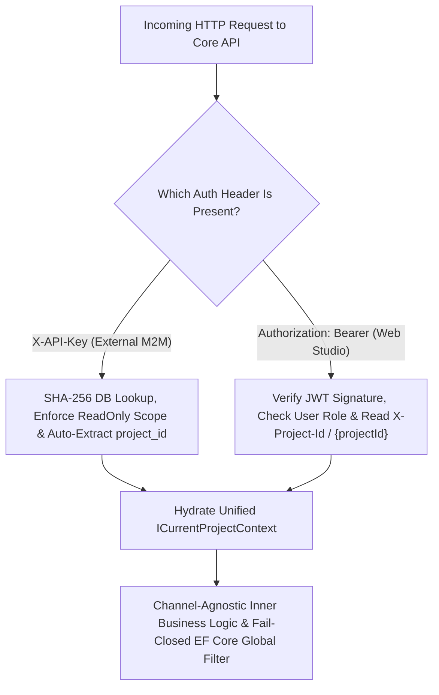

# [MECH-001]: multi_tenant_security_pipeline.md — Multi-Tenant Security & Dual-Auth Pipeline

<context>
Scope: Multi-Tenant Architecture, Dual-Channel Authentication, Ambient Project Context & EF Core Global Filters
Target: Full Stack (`backend-v2/` & `frontend-v2/`)
Authority: Absolute SSoT Invariant (Zero cross-tenant data leakage, strict constant-time hash verification)
Format: 100% English AST, Positive-First Archetypes (80/20 Rule), Canonical Keyboard Operators
TriggerSignals: [SIGNAL_API_MUTATION, SIGNAL_SCHEMA_MIGRATION, SIGNAL_SECURITY_MUTATION]
UpstreamKernel: AGENTS.md
</context>

---

## 1. Level 1: Multi-Tenant & Dual-Auth Invariants Matrix

### Architectural Wiring & Security Contracts
| Direction | Upstream Origin | Current Role (Tenancy & Security Engine) | Downstream Destination |
|---|---|---|---|
| **Incoming HTTP** | M2M Client or Web Studio | Inspects auth headers (`X-API-Key` vs `Authorization: Bearer`) | Authentication Handler Dispatch |
| **Channel A (M2M)** | External Integration Client | SHA-256 hash DB lookup, extracts `project_id` from key & enforces `ApiKeyScope` | Hydrates unified `ICurrentProjectContext` |
| **Channel B (JWT)** | Web Studio User Session | Verifies JWT signature, user membership, role claims & reads `X-Project-Id` / `{projectId}` | Hydrates unified `ICurrentProjectContext` |
| **Ambient Context** | Authenticated Channel | Exposes channel-agnostic `ICurrentProjectContext` (zero `IExecutionContext`) | EF Core `AppDbContext` & Inner Business Logic |
| **Persistence Query**| UseCase / Repository Query | Enforces fail-closed global tenancy SQL partition | PostgreSQL Engine (`WHERE @IsResolved AND project_id = @Id`) |

### Multi-Tenant & Dual-Auth Invariants Matrix
| Security Concern | Prohibited Pattern (! BANNED) | Canonical SSoT Pattern (>> MANDATORY) |
|---|---|---|
| **Raw Key Storage** | Storing plaintext API keys in database | SHA-256 cryptographic hash lookup (`KeyHash`) |
| **Client Token Exposure** | Storing JWT in browser localStorage | httpOnly cookies translated via Next.js Proxy (`/api/proxy/[...path]`) |
| **Dual Ambient Contexts** | Maintaining a separate `IExecutionContext` alongside `ICurrentProjectContext` | Retire `IExecutionContext`; inject unified channel-agnostic `ICurrentProjectContext` everywhere |
| **Cross-Tenant Queries** | Manual `WHERE project_id = @id` clauses in repositories | EF Core fail-closed Global Query Filter (`IsTenantResolved && e.ProjectId == CurrentTenantId`) |
| **Tenant Filter Bypass** | Invoking `.IgnoreQueryFilters()` in standard user routes | Strictly prohibited; ambient context scopes all queries automatically |
| **Key Validation** | Variable-time string comparison (`key == storedHash`) | Constant-time comparison: `CryptographicOperations.FixedTimeEquals` |
| **Parameter Spoofing** | Accepting caller `ProjectId` overrides in tenant Commands/Queries | Omit `ProjectId` from tenant payloads; reject conflicting legacy route/query params with `ForbiddenException` (403) |
| **Route Precedence** | Extracting tenant identifier strictly from headers | Route (`{projectId}`) => Header (`X-Project-Id`) => JWT Claim (`ProjectId`), rejecting Route vs Header conflicts (400) |
| **Role Claim Hydration** | Ad-hoc controller role queries or skipping global SuperAdmin claims | Hydrate `SuperAdmin` + `Admin` claims unconditionally for SuperAdmins; hydrate project `RoleType` claim on tenant routes |
| **M2M Scope Enforcement** | Allowing `ApiKeyScope.ReadOnly` keys to execute mutating HTTP verbs | Reject `POST`/`PUT`/`PATCH`/`DELETE` with `403 Forbidden` except zero-side-effect stateless `preview`/`validate` routes |
| **Preview Bypass** | Whitelisting `/preview` endpoints as unauthenticated public paths | Require authenticated tenant context on all preview routes to resolve templates and protect Gotenberg |
| **Idempotency Partition** | Keying idempotency store by shared `CallerApp` (`idempotency:portal:{key}`) | Partition strictly by resolved tenant: `idempotency:{ProjectId:N}:{IdempotencyKey}` |

---

## 2. Level 2: Dual-Channel Topology & Cognitive Tenancy Engine

### Engineering Rationale & Architectural Decisions
* **Why SHA-256 Hash Lookup:** Plaintext API keys stored in the database create massive exposure risks during database dumps or unauthorized log reads; hashing guarantees keys cannot be recovered.
* **Why `CryptographicOperations.FixedTimeEquals`:** Standard string equality (`==`) terminates on the first mismatched character, creating timing side-channel vulnerabilities that allow attackers to deduce hashes.
* **Why Unified `ICurrentProjectContext` (Retiring `IExecutionContext`):** Maintaining both `ICurrentProjectContext` and `IExecutionContext` causes split-brain bugs and leaks HTTP authentication mechanics into UseCases. Both `X-API-Key` (M2M, extracting `project_id` from the validated key) and `Authorization: Bearer` (Web Studio, verifying JWT + membership and reading `X-Project-Id` / `{projectId}`) converge at the perimeter into `ICurrentProjectContext` so inner Business Logic executes completely agnostically of who called it.
* **Why Omitting `ProjectId` from Tenant Payloads:** Eliminating `Guid ProjectId` from tenant-scoped Commands and Queries removes confused-deputy attack vectors by construction rather than relying on repetitive per-handler checks.
* **Why Route Precedence with Conflict Rejection:** Administrative endpoints like `/api/v1/management/projects/{projectId}/users` define resource hierarchy in the URI; parsing `{projectId}` from route values and rejecting mismatches against `X-Project-Id` prevents cross-project header bleed.
* **Why Unconditional SuperAdmin Claim Hydration:** Global endpoints such as `POST /api/v1/management/projects` execute before a target project exists; hydrating `SuperAdmin` and `Admin` role claims prior to tenant resolution allows `[Authorize(Roles = RoleConstants.AdminOrSuperAdmin)]` to succeed without weakening tenant checks on project-scoped routes.
* **Why Perimeter Enforcement of `ApiKeyScope.ReadOnly`:** Blocking state-mutating HTTP methods at `ProjectContextMiddleware` prevents read-only integration keys from creating templates, uploading fonts, or persisting documents while still permitting stateless POST `preview` and `validate` calls without leaking M2M scope checks into UseCases.

### Cognitive Tenancy Optimization & Guard Engine
```yaml
OptimizationObjectives:
  PrimaryObjective: Zero-Leakage Channel-Agnostic Tenancy Isolation & Cryptographic Side-Channel Immunity
  TradeOffPriority: SecurityBoundary > TimingSideChannelImmunity > ChannelAgnosticSimplicity > CustomQueryFlexibility

ProactiveTenancyGuards:
  - Scope: SmkDoc.Infrastructure.Persistence
    Trigger: Call to .IgnoreQueryFilters() in production repository or query
    CanonicalAction: Reject immediately; ambient tenancy filter must remain enforced >> Ref: [TRAP-SEC-002]

  - Scope: SmkDoc.Api.Middleware
    Trigger: String equality check (== or .Equals()) on API key hashes
    CanonicalAction: Enforce CryptographicOperations.FixedTimeEquals on byte arrays >> Ref: [RULE-SEC-001]

  - Scope: SmkDoc.Application
    Trigger: Declaration of IExecutionContext or caller ProjectId on tenant-scoped Command/Query record
    CanonicalAction: Retire IExecutionContext; omit caller ProjectId and inject mandatory ICurrentProjectContext >> Ref: [RULE-SEC-003]

  - Scope: SmkDoc.Api.Middleware
    Trigger: Whitelisting /preview routes or allowing ApiKeyScope.ReadOnly on mutating routes
    CanonicalAction: Require auth on preview routes and enforce ReadOnly mutation block >> Ref: [RULE-SEC-002]

CoreExtensionSlots:
  ApiKeyValidatorSlot: ApiKeyValidator (Cryptographic hash generator and verification)
  ProjectContextSlot: ICurrentProjectContext / ICurrentProjectContextSetter (Single unified channel-agnostic ambient context)
  ContextMiddlewareSlot: ProjectContextMiddleware (Dual-auth perimeter gateway converging M2M and JWT into ICurrentProjectContext)
```

### Dual-Channel Authentication Topology


### Unified Ambient Context Interfaces
```csharp
namespace SmkDoc.Application.Common.Interfaces;

using SmkDoc.Domain.Enums;
using SmkDoc.Domain.ValueObjects.Ids;

public interface ICurrentProjectContext
{
    ProjectId ProjectId { get; }
    bool IsResolved { get; }
    string? CallerIdentity { get; }
    UserId? UserId { get; }
    SystemRole? SystemRole { get; }
    ApiKeyId? ApiKeyId { get; }
}

public interface ICurrentProjectContextSetter
{
    void SetProject(ProjectId projectId, string? callerIdentity = null);

    void SetActor(
        UserId? userId = null,
        SystemRole? systemRole = null,
        ApiKeyId? apiKeyId = null,
        string? callerIdentity = null);
}
```

---

## 3. Level 3: Canonical Security Archetypes

### Channel A: M2M API Key Validator (`ApiKeyValidator`)
>> MANDATORY CANONICAL TEMPLATE [RULE-SEC-001]:
* [MUST] Hash all incoming M2M API keys using SHA-256 before database lookup.
* [MUST] Compare hash bytes using `CryptographicOperations.FixedTimeEquals` to prevent timing attacks.
* [MUST NOT] Store or query raw API keys in plaintext in PostgreSQL.
* [MUST] Compare expiration against `timeProvider.GetUtcNow()`.
```csharp
using System.Security.Cryptography;
using System.Text;
using Microsoft.EntityFrameworkCore;
using SmkDoc.Domain.Entities;
using SmkDoc.Infrastructure.Persistence;

namespace SmkDoc.Api.Middleware;

public static class ApiKeyValidator
{
    public static string HashApiKey(string rawApiKey)
    {
        var bytes = Encoding.UTF8.GetBytes(rawApiKey);
        var hash = SHA256.HashData(bytes);
        return Convert.ToHexString(hash).ToLowerInvariant();
    }

    public static async Task<ApiKey?> AuthenticateAsync(
        string rawApiKey,
        AppDbContext dbContext,
        TimeProvider timeProvider,
        CancellationToken ct)
    {
        var keyHash = HashApiKey(rawApiKey);
        var expectedBytes = Encoding.UTF8.GetBytes(keyHash);

        var apiKey = await dbContext.ApiKeys
            .AsNoTracking()
            .FirstOrDefaultAsync(k => k.KeyHash == keyHash && k.IsActive, ct);

        if (apiKey == null) return null;

        var actualBytes = Encoding.UTF8.GetBytes(apiKey.KeyHash);
        if (!CryptographicOperations.FixedTimeEquals(expectedBytes, actualBytes))
        {
            return null;
        }

        var now = timeProvider.GetUtcNow();
        if (apiKey.ExpiresAt.HasValue && apiKey.ExpiresAt.Value < now)
        {
            return null;
        }

        return apiKey;
    }
}
```

### Ambient Project Context Middleware Archetype (`ProjectContextMiddleware`)
>> MANDATORY CANONICAL TEMPLATE [RULE-SEC-002]:
* [MUST] Converge both Channel A (`X-API-Key`) and Channel B (`Authorization: Bearer`) exclusively into `ICurrentProjectContextSetter` (zero `IExecutionContext`).
* [MUST] Extract Channel B tenant identifier following precedence: Route `{projectId}` => Header `X-Project-Id` => JWT Claim `ProjectId`, rejecting Route vs Header conflicts with RFC 9457 `400 Bad Request`.
* [MUST] Hydrate `SuperAdmin` and `Admin` role claims unconditionally for authenticated `SystemRole.SuperAdmin` users before project checks, and hydrate resolved project `RoleType` (`Admin`, `Developer`, `Viewer`) into `ClaimTypes.Role`.
* [MUST] Enforce `ApiKeyScope.ReadOnly` on Channel A at the HTTP perimeter by rejecting `POST`, `PUT`, `PATCH`, and `DELETE` requests with `403 Forbidden`, allowing only stateless `preview` and `validate` endpoints.
* [MUST NOT] Whitelist `/preview` endpoints as unauthenticated routes.
```csharp
using System.Security.Claims;
using Microsoft.AspNetCore.Http;
using Microsoft.AspNetCore.Mvc;
using SmkDoc.Api.Constants;
using SmkDoc.Application.Common.Interfaces;
using SmkDoc.Domain.Enums;
using SmkDoc.Domain.ValueObjects.Ids;

namespace SmkDoc.Api.Middleware;

public sealed class ProjectContextMiddleware(RequestDelegate next)
{
    public async Task InvokeAsync(
        HttpContext context,
        ICurrentProjectContextSetter projectContextSetter)
    {
        if (context.User.Identity?.IsAuthenticated == true)
        {
            Guid? routeProjectId = ExtractRouteProjectId(context);
            Guid? headerProjectId = ExtractHeaderProjectId(context);

            if (routeProjectId.HasValue && headerProjectId.HasValue && routeProjectId.Value != headerProjectId.Value)
            {
                await WriteProblemAsync(context, StatusCodes.Status400BadRequest, "Tenant Identification Conflict",
                    $"Route ProjectId '{routeProjectId}' conflicts with Header X-Project-Id '{headerProjectId}'.");
                return;
            }

            var userId = ExtractUserId(context.User);
            var isSuperAdmin = IsSuperAdminPrincipal(context.User);
            var systemRole = isSuperAdmin ? SystemRole.SuperAdmin : SystemRole.Member;

            projectContextSetter.SetActor(
                userId: userId,
                systemRole: systemRole,
                callerIdentity: userId is { } uid ? $"User:{uid.Value:N}" : "portal");

            if (isSuperAdmin && context.User.Identity is ClaimsIdentity superIdentity)
            {
                EnsureRoleClaim(superIdentity, RoleConstants.SuperAdmin);
                EnsureRoleClaim(superIdentity, RoleConstants.Admin);
            }

            var effectiveProjectId = routeProjectId ?? headerProjectId ?? ExtractClaimProjectId(context);
            if (effectiveProjectId.HasValue)
            {
                projectContextSetter.SetProject(new ProjectId(effectiveProjectId.Value));
            }

            await next(context);
            return;
        }

        // Channel A (X-API-Key): validate SHA-256 hash, block ReadOnly mutations, and bind key.ProjectId
        // if (scope == ApiKeyScope.ReadOnly && IsMutatingNonStatelessRequest(context.Request)) => 403 Forbidden
        // projectContextSetter.SetActor(apiKeyId: new ApiKeyId(key.Id), callerIdentity: key.CallerApp);
        // projectContextSetter.SetProject(new ProjectId(key.ProjectId), key.CallerApp);

        await next(context);
    }

    private static bool IsMutatingNonStatelessRequest(HttpRequest request)
    {
        if (HttpMethods.IsGet(request.Method) || HttpMethods.IsHead(request.Method) || HttpMethods.IsOptions(request.Method))
            return false;

        var path = request.Path.Value ?? string.Empty;
        return !path.Contains("/preview", StringComparison.OrdinalIgnoreCase)
            && !path.Contains("/validate", StringComparison.OrdinalIgnoreCase);
    }

    private static UserId? ExtractUserId(ClaimsPrincipal principal)
    {
        var raw = principal.FindFirst(ClaimTypes.NameIdentifier)?.Value ?? principal.FindFirst("sub")?.Value;
        return Guid.TryParse(raw, out var guid) && guid != Guid.Empty ? new UserId(guid) : null;
    }

    private static bool IsSuperAdminPrincipal(ClaimsPrincipal principal) =>
        string.Equals(principal.FindFirst("SystemRole")?.Value, RoleConstants.SuperAdmin, StringComparison.OrdinalIgnoreCase);

    private static void EnsureRoleClaim(ClaimsIdentity identity, string role)
    {
        if (!identity.HasClaim(ClaimTypes.Role, role))
            identity.AddClaim(new Claim(ClaimTypes.Role, role));
    }

    private static Guid? ExtractRouteProjectId(HttpContext context) =>
        Guid.TryParse(context.Request.RouteValues["projectId"]?.ToString(), out var id) && id != Guid.Empty ? id : null;

    private static Guid? ExtractHeaderProjectId(HttpContext context) =>
        Guid.TryParse(context.Request.Headers[HttpHeaderConstants.ProjectIdHeader], out var id) && id != Guid.Empty ? id : null;

    private static Guid? ExtractClaimProjectId(HttpContext context) =>
        Guid.TryParse(context.User.FindFirst("ProjectId")?.Value, out var id) && id != Guid.Empty ? id : null;

    private static Task WriteProblemAsync(HttpContext context, int status, string title, string detail)
    {
        context.Response.StatusCode = status;
        context.Response.ContentType = "application/problem+json";
        return context.Response.WriteAsJsonAsync(new ProblemDetails
        {
            Status = status,
            Title = title,
            Detail = detail,
            Instance = context.Request.Path
        });
    }
}
```

### Mandatory Ambient Tenant Resolution & Anti-Spoofing Guard
>> MANDATORY CANONICAL TEMPLATE [RULE-SEC-003]:
* [MUST] Consume `ICurrentProjectContext` as the single mandatory ambient context in all tenant-scoped UseCases (prohibit optional `ICurrentProjectContext? = null` and prohibit reintroducing `IExecutionContext`).
* [MUST NOT] Declare `Guid ProjectId` on tenant-scoped Command or Query records (`CreateTemplateCommand`, `ListTemplatesQuery`, `CreateApiKeyCommand`).
* [MUST] Partition `IdempotencyFilter` cache keys by `projectContext.ProjectId.Value` (`idempotency:{ProjectId:N}:{IdempotencyKey}`).
* [MUST] Throw `ForbiddenException` (RFC 9457 `403 Forbidden`) at Presentation boundary if a legacy query string supplies a `projectId` conflicting with `projectContext.ProjectId.Value`.
```csharp
// >> CANONICAL: Fail-closed mandatory ambient tenant resolution inside UseCase
if (!projectContext.IsResolved)
{
    throw new ForbiddenException("Active project context is required for this tenant operation.");
}

var activeProjectId = projectContext.ProjectId;
```

---

## 4. Level 4: High-Salience Fatal Traps & Unified Micro-Diffs

### [TRAP-SEC-001]: Plaintext API Key Database Lookup
```diff
- var key = await dbContext.ApiKeys.FirstOrDefaultAsync(k => k.RawKey == rawKey);
+ var keyHash = ApiKeyValidator.HashApiKey(rawKey); var key = await dbContext.ApiKeys.FirstOrDefaultAsync(k => k.KeyHash == keyHash);
```
*Rationale: Querying or storing raw keys in database records leaves credentials vulnerable to leaks via SQL injection, audit logs, and DB backups.*

### [TRAP-SEC-002]: Multi-Tenant Filter Bypass
```diff
- var docs = await dbContext.Documents.IgnoreQueryFilters().ToListAsync(ct);
+ var docs = await dbContext.Documents.ToListAsync(ct);
```
*Rationale: Disabling global query filters creates catastrophic IDOR cross-tenant data leaks in production endpoints.*

### [TRAP-SEC-003]: Variable-Time Hash Comparison
```diff
- if (keyHash == apiKey.KeyHash) return apiKey;
+ if (!CryptographicOperations.FixedTimeEquals(expectedBytes, actualBytes)) return null;
```
*Rationale: Standard string equality short-circuits on mismatch, leaking character-by-character timing signals to network attackers.*

### [TRAP-SEC-004]: Dual Ambient Context & Caller ProjectId Override
```diff
- var targetProject = command.ProjectId != Guid.Empty ? command.ProjectId : legacyContext.ProjectId!.Value;
+ if (!projectContext.IsResolved) throw new ForbiddenException("Tenant context required."); var targetProject = projectContext.ProjectId;
```
*Rationale: Maintaining a parallel execution context or accepting caller-supplied `ProjectId` overrides creates split-brain cross-tenant writes bypassing EF Core query filters.*
