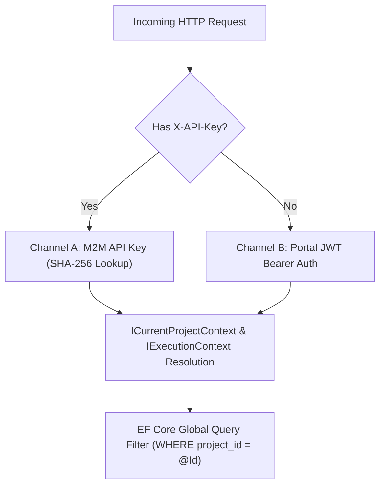

# [MECH-001]: multi_tenant_security_pipeline.md — Multi-Tenant Security & Dual-Auth Pipeline

<context>
Scope: Multi-Tenant Architecture, Dual-Channel Authentication, Ambient Project Context & EF Core Global Filters
Target: Full Stack (`backend-v2/` & `frontend-v2/`)
Authority: Absolute SSoT Invariant (Zero cross-tenant data leakage, strict constant-time hash verification)
</context>

---

## 1. Dual-Channel Authentication Topology

SmkDoc Server exposes a zero-trust dual-channel authentication pipeline:



---

## 2. Channel A: Machine-to-Machine (M2M) API Key Authentication

M2M clients provide their API key via the `X-API-Key` HTTP header. Raw API keys are never stored in the database:

```csharp
using System.Security.Cryptography;
using System.Text;
using Microsoft.EntityFrameworkCore;
using SmkDoc.Infrastructure.Persistence;

namespace SmkDoc.Api.Middleware;

public static class ApiKeyValidator
{
    public static string HashApiKey(string rawApiKey)
    {
        var bytes = Encoding.UTF8.GetBytes(rawApiKey);
        var hash = SHA256.HashData(bytes);
        return Convert.ToHexString(hash).ToLowerInvariant();
    }

    public static async Task<ApiKey?> AuthenticateAsync(
        string rawApiKey,
        AppDbContext dbContext,
        CancellationToken ct)
    {
        var keyHash = HashApiKey(rawApiKey);

        // Constant-time hash comparison in database
        var apiKey = await dbContext.ApiKeys
            .AsNoTracking()
            .FirstOrDefaultAsync(k => k.KeyHash == keyHash && k.IsActive, ct);

        if (apiKey == null) return null;

        // Check expiration
        if (apiKey.ExpiresAt.HasValue && apiKey.ExpiresAt.Value < DateTimeOffset.UtcNow)
        {
            return null;
        }

        return apiKey;
    }
}
```

---

## 3. Tenancy Context Interfaces

### `ICurrentProjectContext` (Infrastructure & Persistence)
Scoped interface consumed by `AppDbContext` to filter database rows dynamically:
```csharp
namespace SmkDoc.Application.Common.Interfaces;

public interface ICurrentProjectContext
{
    ProjectId ProjectId { get; }
    bool IsResolved { get; }
    void SetProject(ProjectId projectId);
}
```

### `IExecutionContext` (Application & Presentation)
Scoped interface consumed by UseCases and Controllers to inspect caller identity:
```csharp
namespace SmkDoc.Application.Common.Interfaces;

public interface IExecutionContext
{
    Guid? UserId { get; }
    Guid? ProjectId { get; }
    Guid? CompanyId { get; }
    string CallerApp { get; }
    IReadOnlyCollection<string> Scopes { get; }
}
```

---

## 4. Multi-Tenant Query Filter Invariants

1. **Automatic Scoping**: Every Entity implementing `IMustHaveProject` is partitioned by `project_id`.
2. **Cross-Tenant Prevention**:
   ```csharp
   // If a client manually provides a projectId query parameter that does not match their token:
   if (projectId.HasValue && context.ProjectId.HasValue && projectId.Value != context.ProjectId.Value)
   {
       throw new BadHttpRequestException("Access denied: requested projectId does not match active project context.");
   }
   ```
3. **Prohibition of `.IgnoreQueryFilters()`**:
   Never use `.IgnoreQueryFilters()` in production API queries. It is strictly reserved for administrative background maintenance jobs.
