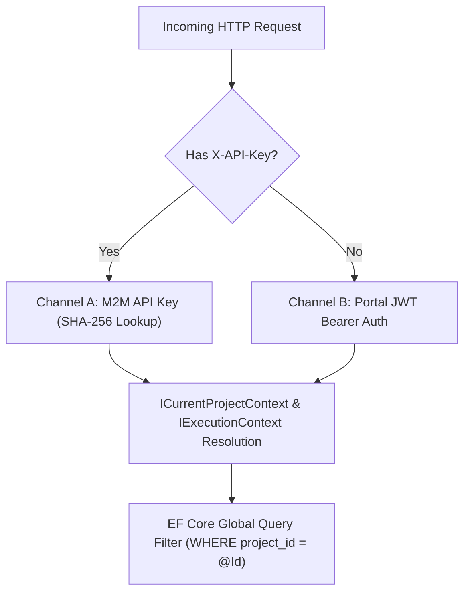

# [MECH-001]: multi_tenant_security_pipeline.md — Multi-Tenant Security & Dual-Auth Pipeline

<context>
Scope: Multi-Tenant Architecture, Dual-Channel Authentication, Ambient Project Context & EF Core Global Filters
Target: Full Stack (`backend-v2/` & `frontend-v2/`)
Authority: Absolute SSoT Invariant (Zero cross-tenant data leakage, strict constant-time hash verification)
Boundary: Pure Architectural AST only. Prohibit task roadmaps, execution checklists, and conversational prose.
TriggerSignals: [SIGNAL_API_MUTATION, SIGNAL_SCHEMA_MIGRATION]
UpstreamKernel: AGENTS.md
</context>

---

## 1. Level 1: Multi-Tenant & Dual-Auth Invariants Matrix

| Security Concern | Prohibited Pattern (! BANNED) | Canonical SSoT Pattern (>> MANDATORY) |
|---|---|---|
| **Raw Key Storage** | Storing plaintext API keys in database | SHA-256 cryptographic hash lookup (`KeyHash`) |
| **Client Token Exposure** | Storing JWT in browser localStorage | httpOnly cookies translated via Next.js Proxy (`/api/proxy/[...path]`) |
| **Cross-Tenant Queries** | Manual `WHERE project_id = @id` clauses in repositories | EF Core ambient Global Query Filter (`HasQueryFilter`) |
| **Tenant Filter Bypass**| Invoking `.IgnoreQueryFilters()` in standard user routes | Strictly prohibited; ambient context scopes all queries automatically |
| **Key Validation** | Variable-time string comparison | Constant-time cryptographic hash verification |

---

## 2. Level 2: Dual-Channel Authentication Topology & AST Signatures

### Dual-Channel Authentication Topology


### Tenancy Context Interfaces
```csharp
namespace SmkDoc.Application.Common.Interfaces;

public interface ICurrentProjectContext
{
    ProjectId ProjectId { get; }
    bool IsResolved { get; }
    void SetProject(ProjectId projectId);
}

public interface IExecutionContext
{
    Guid? UserId { get; }
    Guid? ProjectId { get; }
    Guid? CompanyId { get; }
    string CallerApp { get; }
    IReadOnlyCollection<string> Scopes { get; }
}
```

---

## 3. Level 3: Canonical Security Archetypes

### Channel A: M2M API Key Validator (`ApiKeyValidator`)
>> MANDATORY CANONICAL TEMPLATE [RULE-SEC-001]:
* [MUST] Hash all incoming M2M API keys using SHA-256 before database lookup.
* [MUST NOT] Store or query raw API keys in plaintext in PostgreSQL.
* [MUST] Compare expiration against `timeProvider.GetUtcNow()`.
* [MUST] Resolve and inject authenticated `ProjectId` into `ICurrentProjectContext` and `IExecutionContext`.
```csharp
using System.Security.Cryptography;
using System.Text;
using Microsoft.EntityFrameworkCore;
using SmkDoc.Infrastructure.Persistence;

namespace SmkDoc.Api.Middleware;

public static class ApiKeyValidator
{
    public static string HashApiKey(string rawApiKey)
    {
        var bytes = Encoding.UTF8.GetBytes(rawApiKey);
        var hash = SHA256.HashData(bytes);
        return Convert.ToHexString(hash).ToLowerInvariant();
    }

    public static async Task<ApiKey?> AuthenticateAsync(
        string rawApiKey,
        AppDbContext dbContext,
        TimeProvider timeProvider,
        CancellationToken ct)
    {
        var keyHash = HashApiKey(rawApiKey);

        var apiKey = await dbContext.ApiKeys
            .AsNoTracking()
            .FirstOrDefaultAsync(k => k.KeyHash == keyHash && k.IsActive, ct);

        if (apiKey == null) return null;

        var now = timeProvider.GetUtcNow();
        if (apiKey.ExpiresAt.HasValue && apiKey.ExpiresAt.Value < now)
        {
            return null;
        }

        return apiKey;
    }
}
```

### Cross-Tenant Parameter Spoofing Defense
>> MANDATORY CANONICAL TEMPLATE [RULE-SEC-002]:
* [MUST] Reject any request where caller-supplied `projectId` conflicts with ambient authenticated `context.ProjectId`.
* [MUST] Throw RFC 9457 compliant `BadHttpRequestException` or `ForbiddenException`.
```csharp
// >> CANONICAL: Reject explicit parameter mismatches against ambient resolved context
if (requestedProjectId.HasValue && context.ProjectId.HasValue && requestedProjectId.Value != context.ProjectId.Value)
{
    throw new BadHttpRequestException("Access denied: requested projectId does not match active project context.");
}
```

---

## 4. Level 4: Anti-Patterns & Micro-Diffs

### [TRAP-SEC-001]: Plaintext API Key Storage
```csharp
// ! BANNED: Storing or looking up plaintext API key in database
var key = await dbContext.ApiKeys.FirstOrDefaultAsync(k => k.RawKey == rawKey); // FATAL: Plaintext credential leak!

// >> CANONICAL: Cryptographic SHA-256 hash lookup
var keyHash = ApiKeyValidator.HashApiKey(rawKey);
var key = await dbContext.ApiKeys.FirstOrDefaultAsync(k => k.KeyHash == keyHash);
```

### [TRAP-SEC-002]: Manual Tenancy Filtering vs Global Filter
```csharp
// ! BANNED: Manually appending where clause on every query (Fragile / Leak prone)
var docs = await dbContext.Documents.Where(d => d.ProjectId == currentProjectId).ToListAsync(ct);

// >> CANONICAL: Ambient query evaluated automatically with EF Core Global Query Filter
var docs = await dbContext.Documents.ToListAsync(ct);
```
