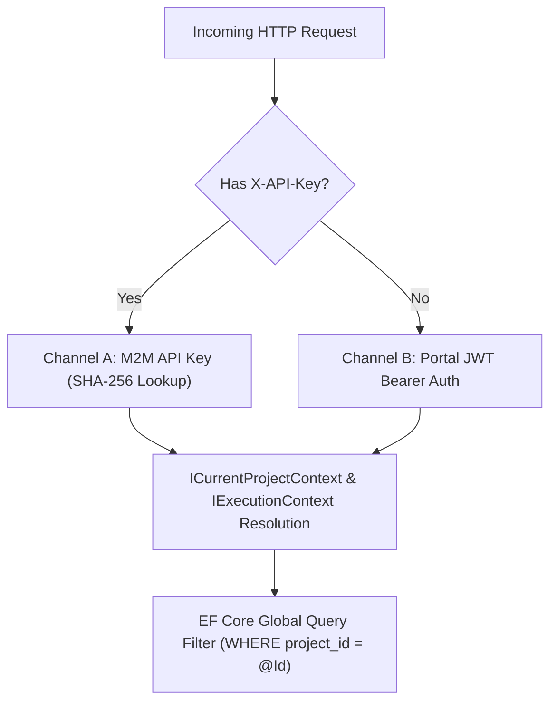

# [MECH-001]: multi_tenant_security_pipeline.md — Multi-Tenant Security & Dual-Auth Pipeline

<context>
Scope: Multi-Tenant Architecture, Dual-Channel Authentication, Ambient Project Context & EF Core Global Filters
Target: Full Stack (`backend-v2/` & `frontend-v2/`)
Authority: Absolute SSoT Invariant (Zero cross-tenant data leakage, strict constant-time hash verification)
Format: 100% English AST, Positive-First Archetypes (80/20 Rule), Canonical Keyboard Operators
TriggerSignals: [SIGNAL_API_MUTATION, SIGNAL_SCHEMA_MIGRATION]
UpstreamKernel: AGENTS.md
</context>

---

## 1. Level 1: Multi-Tenant & Dual-Auth Invariants Matrix

### Architectural Wiring & Security Contracts
| Direction | Upstream Origin | Current Role (Tenancy & Security Engine) | Downstream Destination |
|---|---|---|---|
| **Incoming HTTP** | M2M Client or Next.js Proxy | Inspects auth headers (`X-API-Key` vs `Bearer`) | Authentication Handler Dispatch |
| **Channel A (M2M)** | External Integration Client | Validates SHA-256 hash in constant-time | Resolves `ApiKeyId` & `ProjectId` |
| **Channel B (JWT)** | User Session via Next.js Proxy| Resolves User claims and Active Project | Resolves `UserId` & `ProjectId` |
| **Ambient Context** | Authenticated Channel | Hydrates scoped `ICurrentProjectContext` | EF Core `AppDbContext` Instance |
| **Persistence Query**| UseCase / Repository Query | Enforces global tenancy SQL partition | PostgreSQL Engine (`WHERE project_id = @Id`) |

### Multi-Tenant & Dual-Auth Invariants Matrix
| Security Concern | Prohibited Pattern (! BANNED) | Canonical SSoT Pattern (>> MANDATORY) |
|---|---|---|
| **Raw Key Storage** | Storing plaintext API keys in database | SHA-256 cryptographic hash lookup (`KeyHash`) |
| **Client Token Exposure** | Storing JWT in browser localStorage | httpOnly cookies translated via Next.js Proxy (`/api/proxy/[...path]`) |
| **Cross-Tenant Queries** | Manual `WHERE project_id = @id` clauses in repositories | EF Core ambient Global Query Filter (`HasQueryFilter`) |
| **Tenant Filter Bypass** | Invoking `.IgnoreQueryFilters()` in standard user routes | Strictly prohibited; ambient context scopes all queries automatically |
| **Key Validation** | Variable-time string comparison (`key == storedHash`) | Constant-time comparison: `CryptographicOperations.FixedTimeEquals` |
| **Parameter Spoofing** | Accepting caller `projectId` parameter differing from token | Fail-fast assertion: throw `BadHttpRequestException` on mismatch |

---

## 2. Level 2: Dual-Channel Topology & Cognitive Tenancy Engine

### Engineering Rationale & Architectural Decisions
* **Why SHA-256 Hash Lookup:** Plaintext API keys stored in the database create massive exposure risks during database dumps or unauthorized log reads; hashing guarantees keys cannot be recovered.
* **Why `CryptographicOperations.FixedTimeEquals`:** Standard string equality (`==`) terminates on the first mismatched character, creating timing side-channel vulnerabilities that allow attackers to deduce hashes.
* **Why Ambient `ICurrentProjectContext` over Parameter Passing:** Manual parameter passing allows developers to accidentally query data without tenancy filters; ambient resolution ensures all queries within a request scope are automatically constrained.
* **Why Fail-Fast on Parameter vs Token Mismatches:** If an authenticated caller provides an explicit `projectId` in the URL or payload that differs from their authenticated token, silently ignoring it or switching projects leads to confused-deputy bugs.

### Cognitive Tenancy Optimization & Guard Engine
```yaml
OptimizationObjectives:
  PrimaryObjective: Zero-Leakage Tenancy Isolation & Cryptographic Side-Channel Immunity
  TradeOffPriority: SecurityBoundary > TimingSideChannelImmunity > QuerySimplicity > CustomQueryFlexibility

ProactiveTenancyGuards:
  - Scope: SmkDoc.Infrastructure.Persistence
    Trigger: Call to .IgnoreQueryFilters() in production repository or query
    CanonicalAction: Reject immediately; ambient tenancy filter must remain enforced >> Ref: [TRAP-SEC-002]

  - Scope: SmkDoc.Api.Middleware
    Trigger: String equality check (== or .Equals()) on API key hashes
    CanonicalAction: Enforce CryptographicOperations.FixedTimeEquals on byte arrays >> Ref: [RULE-SEC-001]

  - Scope: SmkDoc.Domain.Entities
    Trigger: Entity implementing IMustHaveProject without ProjectId guard
    CanonicalAction: Add Guard.NotEmpty(projectId, nameof(ProjectId)) in factory

CoreExtensionSlots:
  ApiKeyValidatorSlot: ApiKeyValidator (Cryptographic hash generator and verification)
  AuthHandlerSlot: ApiKeyAuthenticationHandler (ASP.NET Core authentication scheme)
  ProjectContextSlot: ICurrentProjectContext (Scoped tenant identity container)
  ContextMiddlewareSlot: CurrentProjectContextMiddleware (Ambient HTTP header/claim extractor)
```

### Dual-Channel Authentication Topology


### Tenancy Context Interfaces
```csharp
namespace SmkDoc.Application.Common.Interfaces;

using SmkDoc.Domain.ValueObjects.Ids;

public interface ICurrentProjectContext
{
    ProjectId ProjectId { get; }
    bool IsResolved { get; }
    void SetProject(ProjectId projectId);
}

public interface IExecutionContext
{
    Guid? UserId { get; }
    Guid? ProjectId { get; }
    Guid? CompanyId { get; }
    string CallerApp { get; }
    IReadOnlyCollection<string> Scopes { get; }
}
```

---

## 3. Level 3: Canonical Security Archetypes

### Channel A: M2M API Key Validator (`ApiKeyValidator`)
>> MANDATORY CANONICAL TEMPLATE [RULE-SEC-001]:
* [MUST] Hash all incoming M2M API keys using SHA-256 before database lookup.
* [MUST] Compare hash bytes using `CryptographicOperations.FixedTimeEquals` to prevent timing attacks.
* [MUST NOT] Store or query raw API keys in plaintext in PostgreSQL.
* [MUST] Compare expiration against `timeProvider.GetUtcNow()`.
```csharp
using System.Security.Cryptography;
using System.Text;
using Microsoft.EntityFrameworkCore;
using SmkDoc.Domain.Entities;
using SmkDoc.Infrastructure.Persistence;

namespace SmkDoc.Api.Middleware;

public static class ApiKeyValidator
{
    public static string HashApiKey(string rawApiKey)
    {
        var bytes = Encoding.UTF8.GetBytes(rawApiKey);
        var hash = SHA256.HashData(bytes);
        return Convert.ToHexString(hash).ToLowerInvariant();
    }

    public static async Task<ApiKey?> AuthenticateAsync(
        string rawApiKey,
        AppDbContext dbContext,
        TimeProvider timeProvider,
        CancellationToken ct)
    {
        var keyHash = HashApiKey(rawApiKey);
        var expectedBytes = Encoding.UTF8.GetBytes(keyHash);

        var apiKey = await dbContext.ApiKeys
            .AsNoTracking()
            .FirstOrDefaultAsync(k => k.KeyHash == keyHash && k.IsActive, ct);

        if (apiKey == null) return null;

        var actualBytes = Encoding.UTF8.GetBytes(apiKey.KeyHash);
        if (!CryptographicOperations.FixedTimeEquals(expectedBytes, actualBytes))
        {
            return null;
        }

        var now = timeProvider.GetUtcNow();
        if (apiKey.ExpiresAt.HasValue && apiKey.ExpiresAt.Value < now)
        {
            return null;
        }

        return apiKey;
    }
}
```

### Ambient Project Context Middleware Archetype (`CurrentProjectContextMiddleware`)
>> MANDATORY CANONICAL TEMPLATE [RULE-SEC-002]:
* [MUST] Extract tenant identifier from authenticated Claims or `X-Project-Id` request header.
* [MUST] Populate scoped `ICurrentProjectContext` before controller action execution.
* [MUST] Validate that the caller possesses access rights to the target project.
```csharp
using System.Security.Claims;
using Microsoft.AspNetCore.Http;
using SmkDoc.Application.Common.Interfaces;
using SmkDoc.Domain.ValueObjects.Ids;

namespace SmkDoc.Api.Middleware;

public sealed class CurrentProjectContextMiddleware(RequestDelegate next)
{
    public async Task InvokeAsync(
        HttpContext context,
        ICurrentProjectContext projectContext,
        IExecutionContext executionContext)
    {
        Guid? resolvedProjectId = null;

        // 1. Resolve from Authenticated User Claims (Bearer Auth)
        var projectClaim = context.User.FindFirst("project_id")?.Value;
        if (!string.IsNullOrWhiteSpace(projectClaim) && Guid.TryParse(projectClaim, out var claimId))
        {
            resolvedProjectId = claimId;
        }

        // 2. Resolve or Override from X-Project-Id Header (if permitted by scope)
        if (context.Request.Headers.TryGetValue("X-Project-Id", out var headerVal) &&
            Guid.TryParse(headerVal.FirstOrDefault(), out var headerProjectId))
        {
            if (resolvedProjectId.HasValue && resolvedProjectId.Value != headerProjectId)
            {
                // Cross-tenant spoofing guard
                context.Response.StatusCode = StatusCodes.Status403Forbidden;
                await context.Response.WriteAsync("Forbidden: Project ID header conflicts with authenticated session token.");
                return;
            }

            resolvedProjectId = headerProjectId;
        }

        // 3. Fallback to API Key Execution Context
        if (!resolvedProjectId.HasValue && executionContext.ProjectId.HasValue)
        {
            resolvedProjectId = executionContext.ProjectId.Value;
        }

        if (resolvedProjectId.HasValue && resolvedProjectId.Value != Guid.Empty)
        {
            projectContext.SetProject(new ProjectId(resolvedProjectId.Value));
        }

        await next(context);
    }
}
```

### Cross-Tenant Parameter Spoofing Defense
>> MANDATORY CANONICAL TEMPLATE [RULE-SEC-003]:
* [MUST] Reject any request where caller-supplied `projectId` conflicts with ambient authenticated `context.ProjectId`.
* [MUST] Throw RFC 9457 compliant `BadHttpRequestException` or `ForbiddenException`.
```csharp
// >> CANONICAL: Reject explicit parameter mismatches against ambient resolved context
if (requestedProjectId.HasValue && context.ProjectId.HasValue && requestedProjectId.Value != context.ProjectId.Value)
{
    throw new BadHttpRequestException("Access denied: requested projectId does not match active project context.");
}
```

---

## 4. Level 4: High-Salience Fatal Traps & Unified Micro-Diffs

### [TRAP-SEC-001]: Plaintext API Key Database Lookup
```diff
- var key = await dbContext.ApiKeys.FirstOrDefaultAsync(k => k.RawKey == rawKey);
+ var keyHash = ApiKeyValidator.HashApiKey(rawKey); var key = await dbContext.ApiKeys.FirstOrDefaultAsync(k => k.KeyHash == keyHash);
```
*Rationale: Querying or storing raw keys in database records leaves credentials vulnerable to leaks via SQL injection, audit logs, and DB backups.*

### [TRAP-SEC-002]: Multi-Tenant Filter Bypass
```diff
- var docs = await dbContext.Documents.IgnoreQueryFilters().ToListAsync(ct);
+ var docs = await dbContext.Documents.ToListAsync(ct);
```
*Rationale: Disabling global query filters creates catastrophic IDOR cross-tenant data leaks in production endpoints.*

### [TRAP-SEC-003]: Variable-Time Hash Comparison
```diff
- if (keyHash == apiKey.KeyHash) return apiKey;
+ if (!CryptographicOperations.FixedTimeEquals(expectedBytes, actualBytes)) return null;
```
*Rationale: Standard string equality short-circuits on mismatch, leaking character-by-character timing signals to network attackers.*

### [TRAP-SEC-004]: Confused Deputy Cross-Tenant Parameter Spoofing
```diff
- var targetProject = query.ProjectId ?? context.ProjectId.Value;
+ if (query.ProjectId.HasValue && context.ProjectId.HasValue && query.ProjectId.Value != context.ProjectId.Value) throw new BadHttpRequestException("Forbidden: Project mismatch.");
```
*Rationale: Allowing callers to override their authenticated token's project without boundary checks enables unauthorized cross-tenant data access.*
