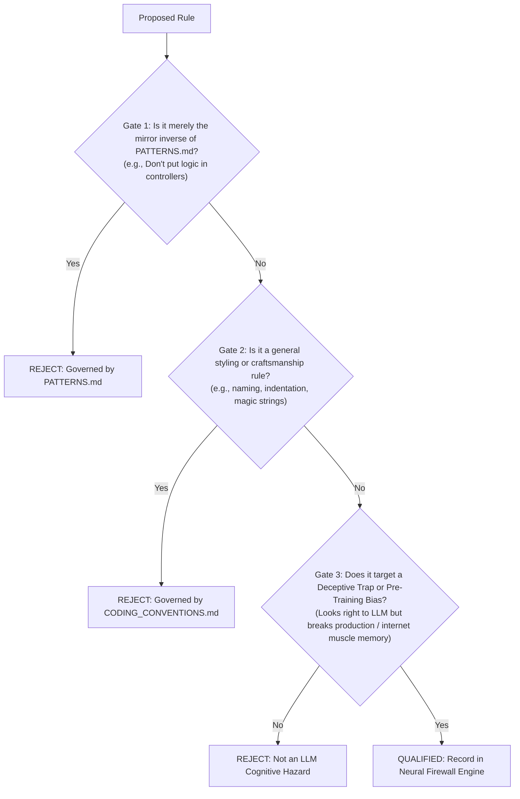

# ANTI-PATTERNS.md — Neural Interceptor Engine & Pre-Training Bias Firewall

> **[PURPOSE_SSOT]:** Authoritative Cognitive Firewall for `backend-v2/`. Exclusively intercepts deceptive illusions and deep pre-training gravitational biases where LLMs mistakenly assume code is idiomatic or performant, but triggers runtime crashes, memory fragmentation, or security vulnerabilities in production.
> **[TRIAD_ORTHOGONAL_ROLE]:**
> - [`CODING_CONVENTIONS.md`](file:///c:/Users/jossl.000/Downloads/Compressed/smk-doc-server/smk-doc-server/docs/AI/CODING_CONVENTIONS.md) ➔ Micro-AST Grammar, Syntax Substitution & Token Naming.
> - [`PATTERNS.md`](file:///c:/Users/jossl.000/Downloads/Compressed/smk-doc-server/smk-doc-server/docs/AI/PATTERNS.md) ➔ Generative Macro-Factory (Positive Feature-Slice Assembly Blueprints).
> - [`ANTI-PATTERNS.md`](file:///c:/Users/jossl.000/Downloads/Compressed/smk-doc-server/smk-doc-server/docs/AI/ANTI-PATTERNS.md) ➔ Cognitive Firewall (Deceptive Traps & Pre-Training Gravitational Biases).

---

<anti_patterns_scope>

<admission_and_update_governance>
## 1. ⚖️ Document Admission & Update Governance (`RULE-DOC-AP`)

An anti-pattern is PERMITTED into this document ONLY if it satisfies all 3 qualification gates:



### Mandatory Invariants:
1. **`[RULE-DOC-AP-001] [GATE_1_MIRROR_REJECTION] [MUST NOT]`**: Do NOT add negative rules that merely restate the absence of a positive pattern in `PATTERNS.md`.
2. **`[RULE-DOC-AP-002] [GATE_2_STYLE_REJECTION] [MUST NOT]`**: Do NOT add styling, naming, or nesting rules (e.g. arrow anti-pattern, underscore prefixes). Those belong strictly in `CODING_CONVENTIONS.md`.
3. **`[RULE-DOC-AP-003] [GATE_3_COGNITIVE_BIAS_QUALIFICATION] [MUST]`**: Every entry MUST intercept either:
   - **Deceptive Production Trap:** Code that appears clean and idiomatic on the surface, but triggers silent memory fragmentation (LOH), DbContext concurrency races, or multi-tenant IDOR leaks.
   - **Pre-Training Gravitational Bias:** Pervasive internet habits (>90% GitHub prevalence) that LLMs instinctively reproduce despite seeing positive blueprints (e.g., God `*Service`, exposing Entities directly, inlining `DateTime.UtcNow`).
4. **`[RULE-DOC-AP-004] [STRUCTURED_NEURAL_SCHEMA] [MUST]`**: Entries MUST use structured `<firewall_rule>` XML blocks containing: `trigger_ast`, `thinking_guard`, `mandatory_substitution`, `fatal_blast_radius`, `exemptions`, and `ssot_ref`. Zero multi-line defective code snippets permitted (to prevent negative token leakage into KV-cache).
5. **`[RULE-DOC-AP-005] [ACTIVE_SSOT_LINK] [MUST]`**: Every entry MUST provide an active, clickable Markdown link redirecting to the exact canonical archetype in `PATTERNS.md` or `CODING_CONVENTIONS.md`.

</admission_and_update_governance>

---

<neural_firewall_matrix>
## 2. 🛡️ The Neural Firewall & Interception Engine

The rules are organized sequentially by runtime evaluation priority: **Host Safety ➔ Data Isolation ➔ Architecture Boundaries ➔ Operational Resilience**.

### Phase 1: Host Process, Memory & Thread Safety (Fatal Production Killers)

<firewall_rule id="FIREWALL-MEM-001" name="RAM_BUFFERING_LOH_ALLOCATION">
<trigger_ast>
["new MemoryStream()", ".ToArray()", "byte[]", "File.ReadAllBytes", "File.ReadAllBytesAsync"]
</trigger_ast>
<thinking_guard>
IF output_type IN [Stream, Document, Pdf, Binary, File] AND payload_size_unknown_or_exceeds(85000) THEN
    ASSERT_FORBIDDEN("RAM Buffering triggers Gen-2 Large Object Heap (LOH) freeze");
    ENFORCE_SUBSTITUTION("Direct Stream Pipeline");
END IF
</thinking_guard>
<mandatory_substitution>
// Stream Gotenberg/MinIO directly to HTTP response stream without intermediate byte[] buffers
await sourceStream.CopyToAsync(response.Body, ct);
</mandatory_substitution>
<fatal_blast_radius>
Buffers > 85KB enter Large Object Heap (LOH) permanently, causing severe memory fragmentation and blocking Gen-2 GCs that freeze all worker threads.
</fatal_blast_radius>
<exemptions>
Payloads mathematically guaranteed < 85KB (e.g., 2D QR barcode generation, SHA-256 hash digests, or Unit Test in-memory mocks).
</exemptions>
<ssot_ref>
[`Patterns Arch 8`](file:///c:/Users/jossl.000/Downloads/Compressed/smk-doc-server/smk-doc-server/docs/AI/PATTERNS.md#archetype-8-zero-loh-stream-over-ram-direct-pipeline)
</ssot_ref>
</firewall_rule>

<firewall_rule id="FIREWALL-CONC-001" name="THREAD_HOSTILE_DBCONTEXT_CONCURRENCY">
<trigger_ast>
["Task.WhenAll", "Parallel.ForEachAsync", "Task.Run"]
</trigger_ast>
<thinking_guard>
IF concurrent_tasks_share(scoped_instance_of: [DbContext, IRepository, IUnitOfWork]) THEN
    ASSERT_FORBIDDEN("EF Core DbContext is not thread-safe; concurrent access corrupts change tracking");
    ENFORCE_SUBSTITUTION("Sequential Await OR IDbContextFactory");
END IF
</thinking_guard>
<mandatory_substitution>
// Sequential execution preserves scoped DbContext single-threaded safety
var resultA = await repo.GetAsync(idA, ct);
var resultB = await repo.GetAsync(idB, ct);
// OR use IDbContextFactory<T> if parallel execution is strictly required
</mandatory_substitution>
<fatal_blast_radius>
Throws `InvalidOperationException: A second operation started on this context instance before a previous operation completed`, corrupting ChangeTracker and crashing worker requests.
</fatal_blast_radius>
<exemptions>
Tasks executing purely CPU-bound mathematics without shared scoped database resources, or distinct independent context instances instantiated via `IDbContextFactory<T>`.
</exemptions>
<ssot_ref>
[`Conventions §3.7`](file:///c:/Users/jossl.000/Downloads/Compressed/smk-doc-server/smk-doc-server/docs/AI/CODING_CONVENTIONS.md#37-concurrency--dbcontext-thread-safety-rule-conc)
</ssot_ref>
</firewall_rule>

<firewall_rule id="FIREWALL-ASYNC-001" name="SYNC_OVER_ASYNC_BLOCKING">
<trigger_ast>
[".Result", ".Wait()", ".GetAwaiter().GetResult()"]
</trigger_ast>
<thinking_guard>
IF method_returns([Task, Task<T>, ValueTask<T>]) AND callers_wait_synchronously() THEN
    ASSERT_FORBIDDEN("Sync-over-async causes ThreadPool starvation and deadlocks");
    ENFORCE_SUBSTITUTION("Pure async/await pipeline");
END IF
</thinking_guard>
<mandatory_substitution>
// Always propagate async/await through entire call stack
var result = await useCase.ExecuteAsync(command, ct);
</mandatory_substitution>
<fatal_blast_radius>
Locks CLR ThreadPool worker threads waiting on asynchronous I/O completion ports, leading to exponential ThreadPool starvation, request queue pileup, and complete server hang.
</fatal_blast_radius>
<exemptions>
Console CLI application entry point `static async Task Main` or synchronous test runner adapters where async harness is unavailable.
</exemptions>
<ssot_ref>
[`Conventions §1`](file:///c:/Users/jossl.000/Downloads/Compressed/smk-doc-server/smk-doc-server/docs/AI/CODING_CONVENTIONS.md#1-runtime--compiler-capabilities-ground-truth)
</ssot_ref>
</firewall_rule>

---

### Phase 2: Security & Tenant Isolation (Data Invariants)

<firewall_rule id="FIREWALL-SEC-001" name="UNSCOPED_TENANT_MUTATION_IDOR">
<trigger_ast>
["GetByIdAsync(id)", "Find(id)", "repo.Update(entity)", "FirstOrDefaultAsync(x => x.Id == id)"]
</trigger_ast>
<thinking_guard>
IF query_or_mutation_targets_entity_with(ProjectId) AND query_lacks(projectId_filter) THEN
    ASSERT_FORBIDDEN("Missing ProjectId tenant boundary enables Insecure Direct Object Reference (IDOR)");
    ENFORCE_SUBSTITUTION("Scoped Tenant Key Query");
END IF
</thinking_guard>
<mandatory_substitution>
// Always pair Aggregate Id with ProjectId in every query and mutation
var entity = await repo.GetByIdAndProjectIdAsync(id, projectId, ct)
    ?? throw new EntityNotFoundException(nameof(Template), id);
</mandatory_substitution>
<fatal_blast_radius>
Critical IDOR security vulnerability: Malicious or compromised tenants can guess, brute-force, or leverage UUIDs to view, mutate, or delete templates belonging to other corporate accounts.
</fatal_blast_radius>
<exemptions>
Global platform maintenance background jobs, database root seeders, or globally unique lookups explicitly scoped across system accounts (e.g. `GetUserByEmailAsync`).
</exemptions>
<ssot_ref>
[`Patterns Arch 6`](file:///c:/Users/jossl.000/Downloads/Compressed/smk-doc-server/smk-doc-server/docs/AI/PATTERNS.md#archetype-6-action-centric-cqrs-usecase-pattern)
</ssot_ref>
</firewall_rule>

<firewall_rule id="FIREWALL-SEC-002" name="MASS_ASSIGNMENT_MODEL_BINDING">
<trigger_ast>
["[FromBody] Template", "[FromBody] Project", "action([FromBody] Document", "action([FromBody] User"]
</trigger_ast>
<thinking_guard>
IF controller_action_parameter_type IS_DOMAIN_ENTITY THEN
    ASSERT_FORBIDDEN("Binding domain entities directly from HTTP payloads exposes internal state to mass assignment");
    ENFORCE_SUBSTITUTION("Explicit Transport DTO");
END IF
</thinking_guard>
<mandatory_substitution>
// Bind exclusively to dedicated request DTOs; never bind to domain entities
public async Task<IResult> Create(
    [FromBody] CreateTemplateRequest request,
    [FromServices] IUseCase<CreateTemplateCommand, TemplateResultDto> useCase,
    CancellationToken ct)
</mandatory_substitution>
<fatal_blast_radius>
Mass-Assignment vulnerability: Untrusted external JSON bodies overwrite critical internal entity state properties (`Id`, `xmin`, `TenantId`, `CreatedBy`, `ProjectId`, `IsSystemProtected`).
</fatal_blast_radius>
<exemptions>
None in HTTP presentation ingress. Domain models must NEVER bind to transport endpoints under any circumstances.
</exemptions>
<ssot_ref>
[`Patterns Arch 1`](file:///c:/Users/jossl.000/Downloads/Compressed/smk-doc-server/smk-doc-server/docs/AI/PATTERNS.md#archetype-1-thin-controller--api-envelope-pattern)
</ssot_ref>
</firewall_rule>

<firewall_rule id="FIREWALL-SEC-003" name="CATASTROPHIC_REDOS">
<trigger_ast>
["new Regex(", "Regex.Match(", "Regex.Replace("]
</trigger_ast>
<thinking_guard>
IF regex_instantiation LACKS([GeneratedRegex, NonBacktracking]) THEN
    ASSERT_FORBIDDEN("Dynamic unconstrained regex causes exponential backtracking Denial of Service (ReDoS)");
    ENFORCE_SUBSTITUTION("Compiled NonBacktracking Regex");
END IF
</thinking_guard>
<mandatory_substitution>
// Pre-compiled source-generated static regex with explicit timeout and NonBacktracking
[GeneratedRegex(@"\{\{(.+?)\}\}", RegexOptions.NonBacktracking, matchTimeoutMilliseconds: 100)]
private static partial Regex PlaceholderRegex();
</mandatory_substitution>
<fatal_blast_radius>
Catastrophic exponential backtracking $O(2^n)$ on crafted input payloads consumes 100% CPU on all worker cores permanently, causing complete denial of service.
</fatal_blast_radius>
<exemptions>
None for user-supplied string parsing. Static fixed string lookups should use `string.Contains` or `IndexOf` without regular expressions.
</exemptions>
<ssot_ref>
[`Conventions §3.9`](file:///c:/Users/jossl.000/Downloads/Compressed/smk-doc-server/smk-doc-server/docs/AI/CODING_CONVENTIONS.md#39-code-level-security--redos-defense-rule-sec)
</ssot_ref>
</firewall_rule>

---

### Phase 3: Clean Architecture & Boundaries (CQRS & Transaction Invariants)

<firewall_rule id="FIREWALL-ARCH-001" name="GOD_SERVICE_CLASS">
<trigger_ast>
["public class TemplateService", "public class DocumentService", "public class ProjectService", "ITemplateService", "IDocumentService"]
</trigger_ast>
<thinking_guard>
IF class_name_ends_with("Service") AND contains_multiple_crud_actions([Create, Update, Delete, Get]) THEN
    ASSERT_FORBIDDEN("God Service violates Single Responsibility Principle and causes high DI coupling");
    ENFORCE_SUBSTITUTION("Single-Action CQRS UseCase Slice");
END IF
</thinking_guard>
<mandatory_substitution>
// Action-Centric CQRS UseCase implementing single focused workflow
public sealed class CreateTemplateUseCase(
    ITemplateRepository templateRepo,
    IUnitOfWork unitOfWork,
    ILogger<CreateTemplateUseCase> logger)
    : IUseCase<CreateTemplateCommand, TemplateResultDto>
</mandatory_substitution>
<fatal_blast_radius>
Violates Single Responsibility Principle, creates massive dependency injection graphs with 10+ dependencies, causes git merge conflicts, and blocks Clean Architecture cross-cutting pipelines.
</fatal_blast_radius>
<exemptions>
Pure stateless mathematical or localization utilities (e.g. `ThaiDataTransformer`).
</exemptions>
<ssot_ref>
[`Patterns Arch 6`](file:///c:/Users/jossl.000/Downloads/Compressed/smk-doc-server/smk-doc-server/docs/AI/PATTERNS.md#archetype-6-action-centric-cqRS-usecase-pattern)
</ssot_ref>
</firewall_rule>

<firewall_rule id="FIREWALL-ARCH-002" name="DOMAIN_ENTITY_BOUNDARY_LEAKAGE">
<trigger_ast>
["IUseCase<*, Template>", "ApiResponse<Template>", "Task<Template>", "Task<Project>", "Task<Document>"]
</trigger_ast>
<thinking_guard>
IF method_or_api_envelope_returns_type([Template, Project, Document, ApiKey, User]) THEN
    ASSERT_FORBIDDEN("Returning Domain Entities outside Application boundary leaks domain model");
    ENFORCE_SUBSTITUTION("Explicit Result DTO");
END IF
</thinking_guard>
<mandatory_substitution>
// Map entity state strictly to immutable Result DTO before exiting UseCase boundary
var resultDto = TemplateResultDto.FromEntity(entity);
return ApiResponse<TemplateResultDto>.Success(resultDto);
</mandatory_substitution>
<fatal_blast_radius>
Leaks internal entity state and navigation properties across architecture boundaries; triggers JSON serializer circular reference loops and runtime EF Core lazy-loading exceptions.
</fatal_blast_radius>
<exemptions>
Internal domain services operating strictly within `SmkDoc.Domain.dll`.
</exemptions>
<ssot_ref>
[`Conventions §2.2`](file:///c:/Users/jossl.000/Downloads/Compressed/smk-doc-server/smk-doc-server/docs/AI/CODING_CONVENTIONS.md#22-dto-layering--ownership-matrix-rule-dto)
</ssot_ref>
</firewall_rule>

<firewall_rule id="FIREWALL-ARCH-003" name="BROKEN_ACID_TRANSACTION_BOUNDARIES">
<trigger_ast>
["CommitAsync", "SaveChangesAsync"]
</trigger_ast>
<thinking_guard>
IF usecase_invokes_commit_count > 1 THEN
    ASSERT_FORBIDDEN("Multiple CommitAsync calls in a single UseCase violate atomic ACID transaction boundaries");
    ENFORCE_SUBSTITUTION("Single Atomic UoW Commit");
END IF
</thinking_guard>
<mandatory_substitution>
// Queue all aggregate mutations into ChangeTracker; execute exactly ONE commit at end of workflow
await templateRepo.AddAsync(template, ct);
await auditRepo.AddAsync(auditLog, ct);
await unitOfWork.CommitAsync(ct);
</mandatory_substitution>
<fatal_blast_radius>
Intermediate failure after the first commit leaves partially persisted orphaned records in the database, permanently corrupting relational state integrity.
</fatal_blast_radius>
<exemptions>
Long-running Outbox / Saga orchestrators explicitly managed by distributed background workers.
</exemptions>
<ssot_ref>
[`Patterns Arch 5`](file:///c:/Users/jossl.000/Downloads/Compressed/smk-doc-server/smk-doc-server/docs/AI/PATTERNS.md#archetype-5-atomic-unit-of-work--transaction-boundary)
</ssot_ref>
</firewall_rule>

<firewall_rule id="FIREWALL-ARCH-004" name="LEAKING_IQUERYABLE_AND_DEFERRED_EXECUTION">
<trigger_ast>
["IQueryable<", "public IQueryable"]
</trigger_ast>
<thinking_guard>
IF repository_or_usecase_interface_exposes([IQueryable<T>]) THEN
    ASSERT_FORBIDDEN("Exposing IQueryable leaks database provider details and triggers deferred execution leaks");
    ENFORCE_SUBSTITUTION("Materialized Collection Task");
END IF
</thinking_guard>
<mandatory_substitution>
// Repository encapsulates query execution and returns materialized immutable collections
public async Task<IReadOnlyList<Template>> ListAsync(ProjectId projectId, CancellationToken ct)
{
    return await dbContext.Templates
        .AsNoTracking()
        .Where(x => x.ProjectId == projectId)
        .ToListAsync(ct);
}
</mandatory_substitution>
<fatal_blast_radius>
Leaky abstraction causes SQL queries to execute outside repository boundaries, leading to unmanaged open database connections, N+1 query explosions, and threading conflicts.
</fatal_blast_radius>
<exemptions>
Specification Pattern queries executed strictly inside `SmkDoc.Infrastructure`.
</exemptions>
<ssot_ref>
[`Conventions §3.3`](file:///c:/Users/jossl.000/Downloads/Compressed/smk-doc-server/smk-doc-server/docs/AI/CODING_CONVENTIONS.md#33-infrastructure-layer-rule-infra)
</ssot_ref>
</firewall_rule>

<firewall_rule id="FIREWALL-ARCH-005" name="INFRASTRUCTURE_COUPLING_IN_CORE">
<trigger_ast>
["using SmkDoc.Infrastructure", "AppDbContext", "IFormFile", "HttpContext"]
</trigger_ast>
<thinking_guard>
IF file_in_layer([Domain, Application]) AND references_namespace_or_type([SmkDoc.Infrastructure, Microsoft.AspNetCore.Http, AppDbContext]) THEN
    ASSERT_FORBIDDEN("Application and Domain layers must never reference Infrastructure or ASP.NET hosting types");
    ENFORCE_SUBSTITUTION("Inward Pure C# Abstraction");
END IF
</thinking_guard>
<mandatory_substitution>
// Decouple from ASP.NET IFormFile using pure C# streaming primitives in Application commands
public sealed record UploadTemplateCommand(
    ProjectId ProjectId,
    string TemplateName,
    Stream ContentStream,
    string ContentType,
    long SizeInBytes) : ICommand<TemplateResultDto>;
</mandatory_substitution>
<fatal_blast_radius>
Dependency Inversion violation tightly couples application core to relational databases or HTTP web hosting, completely breaking headless CLI tools and in-memory unit testing.
</fatal_blast_radius>
<exemptions>
None. Dependency flow is strictly inward: `Presentation ➔ Application ➔ Domain` and `Infrastructure ➔ Application ➔ Domain`.
</exemptions>
<ssot_ref>
[`Conventions §3.2`](file:///c:/Users/jossl.000/Downloads/Compressed/smk-doc-server/smk-doc-server/docs/AI/CODING_CONVENTIONS.md#32-application-layer-rule-app)
</ssot_ref>
</firewall_rule>

---

### Phase 4: Operational Resilience & Systemic Governance

<firewall_rule id="FIREWALL-OPS-001" name="HARDCODED_ENGINE_BRANCHING">
<trigger_ast>
["switch (format)", "switch (engine)", "if (type == \"Gotenberg\")", "if (type == \"OpenXml\")"]
</trigger_ast>
<thinking_guard>
IF pipeline_dispatches_render_engine_via([switch, if_else]) THEN
    ASSERT_FORBIDDEN("Hardcoded engine dispatch violates Open-Closed Principle (OCP)");
    ENFORCE_SUBSTITUTION("Polymorphic Strategy Resolver");
END IF
</thinking_guard>
<mandatory_substitution>
// Resolve engine dynamically via Polymorphic Strategy Pattern
var engine = renderEngines.FirstOrDefault(e => e.CanRender(format))
    ?? throw new UnsupportedRenderFormatException(format);
return await engine.RenderAsync(context, ct);
</mandatory_substitution>
<fatal_blast_radius>
Violates Open-Closed Principle (OCP): Adding or upgrading a render engine requires editing core rendering pipelines, risking regressions across existing engines.
</fatal_blast_radius>
<exemptions>
Binary boolean checks strictly isolated within a single strategy engine's internal implementation.
</exemptions>
<ssot_ref>
[`Patterns Arch 9`](file:///c:/Users/jossl.000/Downloads/Compressed/smk-doc-server/smk-doc-server/docs/AI/PATTERNS.md#archetype-9-polymorphic-render-strategy-engine)
</ssot_ref>
</firewall_rule>

<firewall_rule id="FIREWALL-OPS-002" name="SYSTEM_CLOCK_DIRECT_INLINING">
<trigger_ast>
["DateTime.UtcNow", "DateTimeOffset.UtcNow", "DateTime.Now", "DateTime.Today"]
</trigger_ast>
<thinking_guard>
IF code_queries_time_via([DateTime.UtcNow, DateTimeOffset.UtcNow]) THEN
    ASSERT_FORBIDDEN("Direct clock query breaks determinism and testability");
    ENFORCE_SUBSTITUTION("TimeProvider DI or Explicit Parameter");
END IF
</thinking_guard>
<mandatory_substitution>
// Inject TimeProvider in services or pass explicit DateTimeOffset now into domain methods
var now = timeProvider.GetUtcNow();
var entity = Template.Create(id, projectId, name, now);
</mandatory_substitution>
<fatal_blast_radius>
Non-deterministic code: Business logic verifying token expiration, TTLs, and audit timestamps cannot be simulated or tested deterministically in unit tests.
</fatal_blast_radius>
<exemptions>
Low-level performance benchmarking using `Stopwatch.GetTimestamp()` where elapsed duration only is measured.
</exemptions>
<ssot_ref>
[`Conventions §3.1`](file:///c:/Users/jossl.000/Downloads/Compressed/smk-doc-server/smk-doc-server/docs/AI/CODING_CONVENTIONS.md#31-domain-layer-rule-dom)
</ssot_ref>
</firewall_rule>

<firewall_rule id="FIREWALL-OPS-003" name="AD_HOC_CONTROLLER_ERROR_HANDLING">
<trigger_ast>
["try {", "catch (Exception", "return BadRequest(", "return StatusCode(500", "return NotFound("]
</trigger_ast>
<thinking_guard>
IF controller_action_contains([try_catch, manual_status_code_return]) THEN
    ASSERT_FORBIDDEN("Ad-hoc error handling bypasses centralized RFC 9457 pipeline");
    ENFORCE_SUBSTITUTION("GlobalExceptionHandler RFC 9457");
END IF
</thinking_guard>
<mandatory_substitution>
// Thin controller allows domain exceptions to propagate directly to GlobalExceptionHandler
var result = await useCase.ExecuteAsync(command, ct);
var response = ApiResponse<TemplateResultDto>.Success(result);
return TypedResults.Ok(response);
</mandatory_substitution>
<fatal_blast_radius>
Bypasses centralized RFC 9457 `ProblemDetails` pipeline, leading to inconsistent error payload schemas, unindexed telemetry, and potential internal stack trace leakage.
</fatal_blast_radius>
<exemptions>
Global Exception Middleware and Controller Action Filters explicitly engineered for telemetry capture.
</exemptions>
<ssot_ref>
[`Patterns Arch 2`](file:///c:/Users/jossl.000/Downloads/Compressed/smk-doc-server/smk-doc-server/docs/AI/PATTERNS.md#archetype-2-rfc-9457-global-exception-pipeline-iexceptionhandler-ssot)
</ssot_ref>
</firewall_rule>

<firewall_rule id="FIREWALL-OPS-004" name="MUTATING_ACTIONS_OMITTING_IDEMPOTENCY">
<trigger_ast>
["[HttpPost]", "[HttpPut]", "[HttpDelete]"]
</trigger_ast>
<thinking_guard>
IF action_attribute IN [HttpPost, HttpPut, HttpDelete] AND lacks_filter([Idempotent]) THEN
    ASSERT_FORBIDDEN("State-mutating HTTP endpoint requires Idempotency protection");
    ENFORCE_SUBSTITUTION("[HttpPost, Idempotent]");
END IF
</thinking_guard>
<mandatory_substitution>
// Protect state mutations with RFC Idempotency-Key filter
[HttpPost, Idempotent]
public async Task<IResult> Create(...)
</mandatory_substitution>
<fatal_blast_radius>
Network glitches and automatic client retries trigger duplicated state mutations, duplicated database rows, double billings, or corrupted documents.
</fatal_blast_radius>
<exemptions>
Safe read-only HTTP queries (`[HttpGet]`, `[HttpHead]`, `[HttpOptions]`) where repetitive calls produce zero side-effects.
</exemptions>
<ssot_ref>
[`Patterns Arch 3`](file:///c:/Users/jossl.000/Downloads/Compressed/smk-doc-server/smk-doc-server/docs/AI/PATTERNS.md#archetype-3-ietf-idempotency-key-pipeline-pattern-safe-mutations)
</ssot_ref>
</firewall_rule>

<firewall_rule id="FIREWALL-OPS-005" name="MODIFYING_LEGACY_V1_CODEBASE">
<trigger_ast>
["src/SmkDocServer/", "src/SmkDocServer.Core/", "src/SmkDocServer.Infrastructure/"]
</trigger_ast>
<thinking_guard>
IF target_file_path_starts_with("src/") AND NOT target_file_path_starts_with("backend-v2/") THEN
    ASSERT_FORBIDDEN("Modifying legacy v1 codebase produces phantom edits");
    ENFORCE_SUBSTITUTION("Target backend-v2/ feature slices");
END IF
</thinking_guard>
<mandatory_substitution>
// All active engineering targets backend-v2/ exclusively:
// Target: backend-v2/src/SmkDoc.Application/Features/...
</mandatory_substitution>
<fatal_blast_radius>
Phantom edits: Root `src/` codebase is legacy v1 disconnected from active runtime pipelines; changes produce zero effect and waste compute budget.
</fatal_blast_radius>
<exemptions>
Historical reference reading, legacy schema inspection, and migration comparison tasks only.
</exemptions>
<ssot_ref>
[`Conventions §2.1`](file:///c:/Users/jossl.000/Downloads/Compressed/smk-doc-server/smk-doc-server/docs/AI/CODING_CONVENTIONS.md#21-boundary-invariants-rule-arch)
</ssot_ref>
</firewall_rule>

</neural_firewall_matrix>

---

<doc_maintenance_rules>
## 3. 🔄 Document Maintenance & Rule Ingestion Protocol

### Ingestion Triggers (Conditions when the LLM MUST Halt & Propose a New Rule):
- **`[EVENT_USER_CORRECTION]`**: The user corrects the LLM for generating code that violates project architecture, indicating a persistent pre-training gravitational bias.
- **`[EVENT_DECEPTIVE_BUG]`**: Root cause analysis (RCA) or runtime testing reveals a bug caused by code that compiled successfully but failed during execution, concurrency, or memory profiling (LOH/leaks).
- **`[EVENT_UNINTERCEPTED_CODE]`**: During code review or PR audit, the LLM discovers code that passes compilation but breaks architectural boundaries, not yet intercepted by Phase 1–4 rules.
- **`[EVENT_RUNTIME_UPGRADE_GOTCHA]`**: Upgrading dependencies (.NET 10, EF Core 10, Gotenberg 8, Npgsql) introduces a silent breaking trap or non-obvious pitfall.

### 1-Shot Ingestion Template:
When proposing a new rule, format it strictly using this `<firewall_rule>` XML structure:

```xml
<firewall_rule id="FIREWALL-[CATEGORY]-[ID]" name="UPPER_SNAKE_CASE_NAME">
<trigger_ast>
["exact_token_1", "exact_token_2"]
</trigger_ast>
<thinking_guard>
IF condition THEN
    ASSERT_FORBIDDEN("Reason why this breaks production");
    ENFORCE_SUBSTITUTION("Canonical pattern name");
END IF
</thinking_guard>
<mandatory_substitution>
// Canonical replacement code (pure C# / SSoT pattern)
</mandatory_substitution>
<fatal_blast_radius>
One-sentence description of production blast radius (e.g. LOH freeze, IDOR breach, thread starvation).
</fatal_blast_radius>
<exemptions>
Strictly bounded exceptions (e.g. Unit tests, console CLI entry point) or None.
</exemptions>
<ssot_ref>
[`Patterns Arch X` or `Conventions §X`](file:///c:/Users/jossl.000/Downloads/Compressed/smk-doc-server/smk-doc-server/docs/AI/...)
</ssot_ref>
</firewall_rule>
```

### Mutation & Approval Gates:
1. **APPROVAL GATE (MUST ASK FIRST):** The LLM MUST NEVER modify `ANTI-PATTERNS.md` autonomously. It must output the proposed `<firewall_rule>` block in chat and obtain explicit user approval.
2. **GATE 1-3 QUALIFICATION:** The proposed rule MUST pass all 3 qualification gates in Section 1 (not a mirror of PATTERNS.md, not micro-styling from CODING_CONVENTIONS.md, and must target a deceptive trap or pre-training bias).
3. **ZERO DEFECTIVE CODE:** The proposal MUST NOT include multi-line defective code snippets (`- bad code`) to prevent negative token contamination into the model's KV-cache.
</doc_maintenance_rules>

</anti_patterns_scope>
