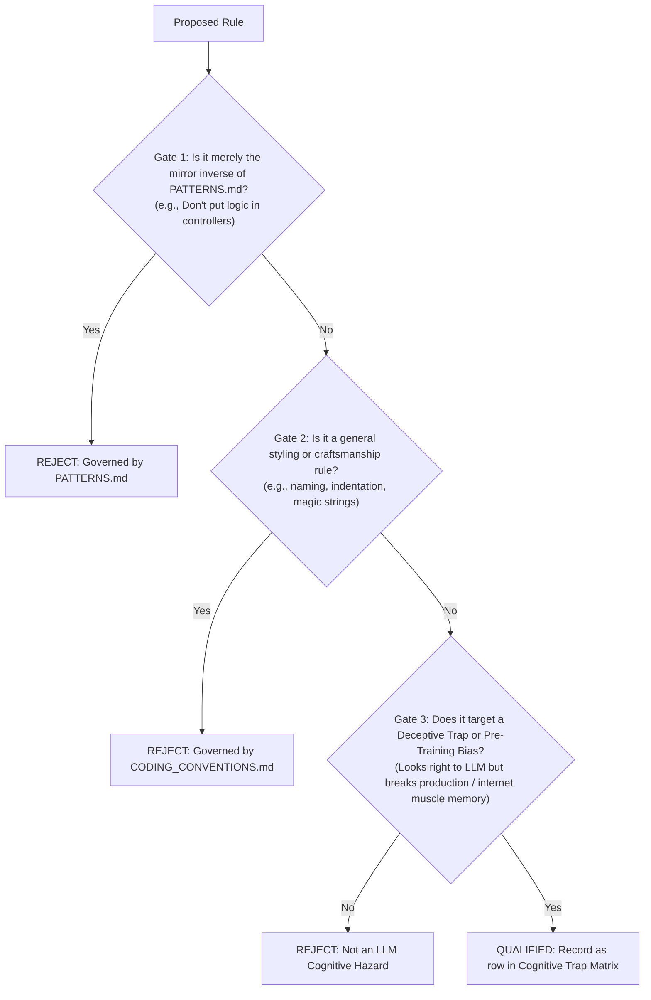

# ANTI-PATTERNS.md — Cognitive Firewall & Pre-Training Bias Interceptor

> **[PURPOSE_SSOT]:** Authoritative Cognitive Firewall for `backend-v2/`. Exclusively intercepts deceptive illusions and deep pre-training gravitational biases where LLMs mistakenly assume code is idiomatic or performant, but triggers runtime crashes, memory fragmentation, or security vulnerabilities in production.
> **[TRIAD_ORTHOGONAL_ROLE]:**
> - [`CODING_CONVENTIONS.md`](file:///c:/Users/jossl.000/Downloads/Compressed/smk-doc-server/smk-doc-server/docs/AI/CODING_CONVENTIONS.md) ➔ Micro-AST Grammar, Syntax Substitution & Token Naming.
> - [`PATTERNS.md`](file:///c:/Users/jossl.000/Downloads/Compressed/smk-doc-server/smk-doc-server/docs/AI/PATTERNS.md) ➔ Generative Macro-Factory (Positive Feature-Slice Assembly Blueprints).
> - [`ANTI-PATTERNS.md`](file:///c:/Users/jossl.000/Downloads/Compressed/smk-doc-server/smk-doc-server/docs/AI/ANTI-PATTERNS.md) ➔ Cognitive Firewall (Deceptive Traps & Pre-Training Gravitational Biases).

---

<anti_patterns_scope>

<admission_and_update_governance>
## 1. ⚖️ Document Admission & Update Governance (`RULE-DOC-AP`)

An anti-pattern is PERMITTED into this document ONLY if it satisfies all 3 qualification gates:

### Mandatory Invariants:
1. **`[RULE-DOC-AP-001] [GATE_1_MIRROR_REJECTION] [MUST NOT]`**: Do NOT add negative rules that merely restate the absence of a positive pattern in `PATTERNS.md`.
2. **`[RULE-DOC-AP-002] [GATE_2_STYLE_REJECTION] [MUST NOT]`**: Do NOT add styling, naming, or nesting rules (e.g. arrow anti-pattern, underscore prefixes). Those belong strictly in `CODING_CONVENTIONS.md`.
3. **`[RULE-DOC-AP-003] [GATE_3_COGNITIVE_BIAS_QUALIFICATION] [MUST]`**: Every entry MUST intercept either:
   - **Deceptive Production Trap:** Code that appears clean and idiomatic on the surface, but triggers silent memory fragmentation (LOH), DbContext concurrency races, or multi-tenant IDOR leaks.
   - **Pre-Training Gravitational Bias:** Pervasive internet habits (>90% GitHub prevalence) that LLMs instinctively reproduce despite seeing positive blueprints (e.g., God `*Service`, exposing Entities directly, inlining `DateTime.UtcNow`).
4. **`[RULE-DOC-AP-004] [FORMAT_INVARIANT] [MUST]`**: Entries MUST be registered strictly as rows in the `<cognitive_trap_matrix>` table. Zero narrative prose padding and zero multi-line runnable defective code blocks permitted.
5. **`[RULE-DOC-AP-005] [ACTIVE_SSOT_LINK] [MUST]`**: Every entry MUST provide an active, clickable Markdown link redirecting to the exact canonical archetype in `PATTERNS.md` or `CODING_CONVENTIONS.md`.

</admission_and_update_governance>

---

<cognitive_trap_matrix>
## 2. 🛡️ The Cognitive Trap & Pre-Training Bias Interception Matrix

| AST Trigger Signature | The LLM Illusion (จุดที่โมเดลมักหลงกล) | Fatal Production Reality (หายนะจริง) | Mandatory SSoT Bypass |
|---|---|---|---|
| `Task.WhenAll` on scoped `DbContext` | *"Optimizing performance with parallel asynchronous database queries."* | **DbContext Concurrency Crash:** EF Core instance is thread-hostile; corrupts tracker state and throws `InvalidOperationException`. | Never parallelize on scoped context. Execute sequential `await` or inject `IDbContextFactory<T>`. 👉 [`Conventions §3.7`](file:///c:/Users/jossl.000/Downloads/Compressed/smk-doc-server/smk-doc-server/docs/AI/CODING_CONVENTIONS.md#37-concurrency--dbcontext-thread-safety-rule-conc) |
| `MemoryStream`, `.ToArray()`, `byte[]` | *"Buffering payload bytes in memory is standard and safe before returning."* | **LOH Fragmentation & Gen-2 Freeze:** Buffers > 85KB enter Large Object Heap permanently, triggering blocking Gen-2 GCs that freeze request workers. | Never buffer document streams in RAM. Pipe directly: `await sourceStream.CopyToAsync(response.Body, ct)`. 👉 [`Patterns Arch 8`](file:///c:/Users/jossl.000/Downloads/Compressed/smk-doc-server/smk-doc-server/docs/AI/PATTERNS.md#archetype-8-zero-loh-stream-over-ram-direct-pipeline) |
| `GetByIdAsync(id)` (missing tenant) | *"Standard Repository query retrieving an Aggregate Root by its primary key."* | **Critical IDOR Breach:** Malicious tenants guess or brute-force UUIDs to read or mutate documents across projects. | Mandatory tenant boundary scoping: `repo.GetByIdAndProjectIdAsync(id, projectId, ct)`. 👉 [`Patterns Arch 6`](file:///c:/Users/jossl.000/Downloads/Compressed/smk-doc-server/smk-doc-server/docs/AI/PATTERNS.md#archetype-6-action-centric-cqrs-usecase-pattern) |
| `.Result`, `.Wait()`, `.GetAwaiter()` | *"Synchronously resolving a completed task to simplify the method signature."* | **CLR Thread Pool Starvation:** Synchronous block locks ThreadPool thread awaiting I/O, causing cascade request queuing and server hang. | 100% Non-blocking async pipeline: `await useCase.ExecuteAsync(command, ct)`. 👉 [`Conventions §1`](file:///c:/Users/jossl.000/Downloads/Compressed/smk-doc-server/smk-doc-server/docs/AI/CODING_CONVENTIONS.md#1-runtime--compiler-capabilities-ground-truth) |
| `class *Service` (multiple CRUD methods) | *"Standard .NET Service class grouping all entity operations in one place."* | **God Service & Merge Conflicts:** Violates SRP, balloons dependency graph, prevents clean pipeline middleware, and degrades maintainability. | 1 Intent = 1 Class implementing `IUseCase<TCommand, TResult>`. 👉 [`Patterns Arch 6`](file:///c:/Users/jossl.000/Downloads/Compressed/smk-doc-server/smk-doc-server/docs/AI/PATTERNS.md#archetype-6-action-centric-cqrs-usecase-pattern) |
| `[FromBody] {Entity}` in Controller | *"ASP.NET Core Model Binder seamlessly deserializes JSON directly into Entity."* | **Mass-Assignment Vulnerability:** Callers overwrite sensitive internal entity fields (`Id`, `xmin`, `CreatedBy`, `TenantId`). | Never bind entities in controllers. Bind strictly to immutable record `*Request` DTOs. 👉 [`Patterns Arch 1`](file:///c:/Users/jossl.000/Downloads/Compressed/smk-doc-server/smk-doc-server/docs/AI/PATTERNS.md#archetype-1-thin-controller--api-envelope-pattern) |
| Returning `Entity` from UseCase / API | *"Returning the entity is convenient and avoids redundant DTO mapping code."* | **Domain Leakage & Circular Crash:** Leaks domain model across boundary; triggers lazy-load crashes or serialization loops. | Never expose domain entities. Map explicitly to immutable `*ResultDto` record. 👉 [`Conventions §2.2`](file:///c:/Users/jossl.000/Downloads/Compressed/smk-doc-server/smk-doc-server/docs/AI/CODING_CONVENTIONS.md#22-dto-layering--ownership-matrix-rule-dto) |
| Multiple `CommitAsync()` in single UseCase | *"Committing intermediate steps ensures data is persisted before proceeding."* | **Broken ACID Transaction:** Failures during subsequent steps leave half-persisted orphaned records in database. | Single atomic unit of work: Call `unitOfWork.CommitAsync(ct)` exactly once at end of UseCase. 👉 [`Patterns Arch 5`](file:///c:/Users/jossl.000/Downloads/Compressed/smk-doc-server/smk-doc-server/docs/AI/PATTERNS.md#archetype-5-atomic-unit-of-work--transaction-boundary) |
| Dynamic `new Regex(` without timeout/flag | *"Standard regular expression parsing text placeholders or template tokens."* | **ReDoS Vulnerability:** Catastrophic backtracking on user-crafted input causes $O(2^n)$ complexity, locking CPU core at 100%. | Mandatory `RegexOptions.NonBacktracking` or compile-time `[GeneratedRegex]`. 👉 [`Conventions §3.9`](file:///c:/Users/jossl.000/Downloads/Compressed/smk-doc-server/smk-doc-server/docs/AI/CODING_CONVENTIONS.md#39-code-level-security--redos-defense-rule-sec) |
| `switch (engineType)` branching | *"Straightforward switch statement selecting Gotenberg vs OpenXml."* | **Open-Closed Violation (OCP):** Adding new render engines requires modifying core orchestration, risking cross-engine regressions. | Polymorphic Strategy dispatch via DI: Inject `IEnumerable<IRenderEngine>`. 👉 [`Patterns Arch 9`](file:///c:/Users/jossl.000/Downloads/Compressed/smk-doc-server/smk-doc-server/docs/AI/PATTERNS.md#archetype-9-polymorphic-render-strategy-engine) |
| Returning `IQueryable<T>` from Repo | *"Returning IQueryable gives callers full flexibility to filter or paginate."* | **Leaky Abstraction & N+1 Queries:** Database query executes outside repository boundary; unclosed connections and lazy-loads leak. | Execute queries inside repository; return `IReadOnlyList<T>` or `PagedResultDto<T>`. 👉 [`Conventions §3.3`](file:///c:/Users/jossl.000/Downloads/Compressed/smk-doc-server/smk-doc-server/docs/AI/CODING_CONVENTIONS.md#33-infrastructure-layer-rule-infra) |
| Calling `DateTime.UtcNow` directly | *"Fetching the current system time using standard .NET BCL properties."* | **Non-Deterministic Untestable Code:** Business rules involving expiration or audit timestamps cannot be simulated or tested deterministically. | Route all clock queries via injected `TimeProvider.GetUtcNow()`. 👉 [`Conventions §3.1`](file:///c:/Users/jossl.000/Downloads/Compressed/smk-doc-server/smk-doc-server/docs/AI/CODING_CONVENTIONS.md#31-domain-layer-rule-dom) |
| `try-catch` in Controller action | *"Catching exceptions locally to return custom StatusCodes or problem strings."* | **Bypasses Centralized RFC 9457:** Inconsistent error responses, unindexed telemetry, and potential stack trace leakage. | Throw typed Domain Exceptions; let `GlobalExceptionHandler` dispatch RFC 9457 `ProblemDetails`. 👉 [`Patterns Arch 2`](file:///c:/Users/jossl.000/Downloads/Compressed/smk-doc-server/smk-doc-server/docs/AI/PATTERNS.md#archetype-2-rfc-9457-global-exception-pipeline-iexceptionhandler-ssot) |
| Mutating endpoint missing `[Idempotent]` | *"Standard POST/PUT action that does not require additional filtering overhead."* | **Duplicate State Mutations:** Network timeouts and client retries trigger duplicate billing, duplicated rows, or corrupted documents. | Decorate all state-mutating actions (`POST/PUT/DELETE`) with `[Idempotent]` filter. 👉 [`Patterns Arch 3`](file:///c:/Users/jossl.000/Downloads/Compressed/smk-doc-server/smk-doc-server/docs/AI/PATTERNS.md#archetype-3-ietf-idempotency-key-pipeline-pattern-safe-mutations) |
| `using SmkDoc.Infrastructure;` in Domain/App | *"Directly referencing DbContext or storage SDKs to speed up implementation."* | **Dependency Inversion Violation:** Couples domain logic to relational databases or cloud SDKs, breaking in-memory unit testability. | Domain Core depends strictly on domain abstractions (`IRepository`, `IUnitOfWork`). 👉 [`Patterns Clean Architecture`](file:///c:/Users/jossl.000/Downloads/Compressed/smk-doc-server/smk-doc-server/docs/AI/PATTERNS.md#clean-architecture-inward-flow-invariant) |
| `IFormFile`, `HttpContext` in UseCase | *"Passing ASP.NET Core types directly into Command/UseCase parameters."* | **Web Framework Coupling:** Prevents UseCases from being executed via CLI, background queue workers, or integration test harnesses. | Accept pure C# abstractions (`Stream Content, string FileName, long Length`). 👉 [`Conventions §3.2`](file:///c:/Users/jossl.000/Downloads/Compressed/smk-doc-server/smk-doc-server/docs/AI/CODING_CONVENTIONS.md#32-application-layer-rule-app) |
| Modifying legacy `src/` codebase | *"Editing existing files found in root src/ directory."* | **Phantom Edits:** Legacy v1 files are disconnected from active runtime architecture and produce zero effect. | Target `backend-v2/` exclusively for all backend modifications. 👉 [`Conventions §2.1`](file:///c:/Users/jossl.000/Downloads/Compressed/smk-doc-server/smk-doc-server/docs/AI/CODING_CONVENTIONS.md#21-boundary-invariants-rule-arch) |

</cognitive_trap_matrix>

</anti_patterns_scope>
