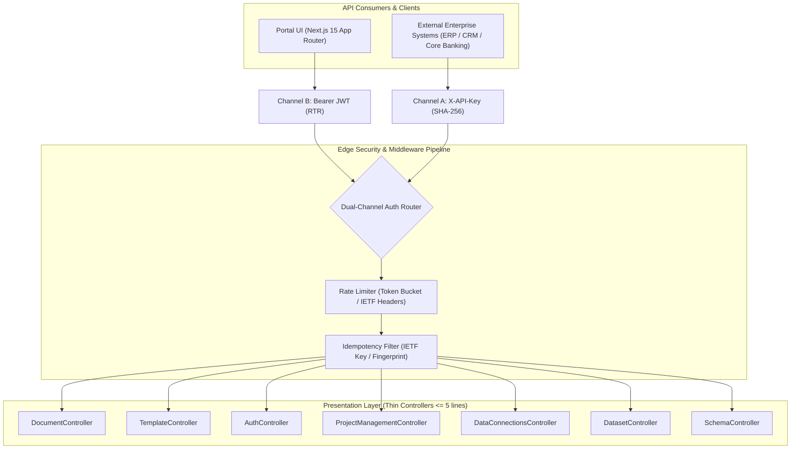

<ai_directive>
CRITICAL IMPLEMENTATION RULES (SSoT):
This document is the authoritative Single Source of Truth (SSoT) for all REST wire contracts, DTO payloads, and HTTP protocols across `smk-doc-server`.
1. WIRE FORMAT: All JSON keys MUST be strictly `camelCase`. Dates MUST be ISO-8601 UTC.
2. ENVELOPES: Wrap single responses in `ApiResponse<T>`, list responses in `PagedApiResponse<T>`. Binary outputs MUST stream raw bytes with `Content-Disposition`.
3. ERRORS: Errors MUST return `application/problem+json` conforming to RFC 9457 with a strongly-typed `errorCode`.
4. STRICT NEGATIVE RULES: NEVER return anonymous objects (`new { }`). NEVER return `{ "success": true }`. NEVER return HTTP 200 on errors. NEVER leak stack traces or SQL in `detail`.
5. HUMAN-ONLY SECTIONS: Content enclosed in `<human_only>` tags is intended exclusively for human visual understanding and architectural reference. AI agents MUST deprioritize/ignore these blocks during code synthesis and DTO validation.
</ai_directive>

<doc_maintenance_rules>
MANDATORY AUTHORING SPECIFICATION (Zero-Drift Invariant):
When ADDING, MODIFYING, or EXTENDING endpoints in this document, you MUST strictly adhere to:
1. CANONICAL SKELETON (Slot-filling template):
   #### `[HTTP_VERB] /api/v1/[resource]/[sub-path]`
   Short 1-line business description.
   * **Auth:** Channel A (`X-API-Key`) | Channel B (`Bearer JWT`)
   * **Headers:** Edge headers (e.g. `Idempotency-Key`) or *None*
   * **Params:** Route/Query params with type and constraints
   * **Request Body (`application/json`):** TypeScript interface + concrete full JSON payload
   * **Response ([STATUS] [PHRASE]):** Envelope + concrete JSON payload
   * **Errors:** Explicit status code and domain `errorCode` mapping (e.g. `404 (RESOURCE_NOT_FOUND)`)
2. PROHIBITIONS:
   - ZERO ELLIPSIS: NEVER use ellipses `...` in JSON payloads.
   - SINGLE VERB: NEVER group verbs (e.g. `GET|POST`). Each route/verb must have its own dedicated block.
   - ZERO PROSE: NEVER add HTTP 101 tutorials, marketing words, or abstract flowcharts.
3. ERROR TAXONOMY: Every new `errorCode` MUST be registered in Section 3 Taxonomy table.
</doc_maintenance_rules>

<api_contract_scope>

# 📡 API Contract Specification (SSoT)

---

## 1. 📦 Global Wire Protocols & Response Envelopes

Every JSON API response emitted by `smk-doc-server` conforms to one of the canonical envelopes below.

### 1.1 Single Resource Envelope (`ApiResponse<T>`)
Used for single entity reads, mutations, and status responses (`200 OK`, `201 Created`).
```typescript
interface ApiResponse<T> {
  data: T;
}
```
```json
{
  "data": {
    "id": "01926b42-7c3a-7000-8000-123456789abc",
    "projectId": "01926b40-1111-7000-8000-000000000001",
    "name": "Commercial Tax Invoice",
    "slug": "tax-invoice-th",
    "category": "Finance",
    "isActive": true,
    "createdAt": "2026-10-10T12:00:00.000Z",
    "updatedAt": null
  }
}
```

### 1.2 Paged Collection Envelope (`PagedApiResponse<T>`)
Used for paginated queries. Query params default to `?page=1&limit=20` (capped at `maxLimit=100`).
```typescript
interface PaginationMetadata {
  page: number;
  limit: number;
  totalCount: number;
  totalPages: number;
}

interface PagedApiResponse<T> {
  data: T[];
  pagination: PaginationMetadata;
}
```
```json
{
  "data": [
    {
      "id": "01926b42-7c3a-7000-8000-123456789abc",
      "name": "Commercial Tax Invoice",
      "slug": "tax-invoice-th",
      "category": "Finance",
      "isActive": true
    }
  ],
  "pagination": {
    "page": 1,
    "limit": 20,
    "totalCount": 42,
    "totalPages": 3
  }
}
```

### 1.3 Raw Binary Media Streams (Zero Envelope)
Endpoints returning rendered documents (`application/pdf`, `.docx`, `.xlsx`) bypass JSON wrappers and stream bytes directly:
* **In-Memory Preview:** `Content-Type: application/pdf`, `Content-Disposition: inline`
* **File Download:** `Content-Type: application/pdf`, `Content-Disposition: attachment; filename="{filename}"`

### 1.4 RFC 9457 Problem Details Schema (Error Envelope)
All error responses return `Content-Type: application/problem+json`.
```typescript
interface InvalidParam {
  name: string;    // JSON path in camelCase, e.g. "customer.taxId"
  reason: string;  // Explicit "Expected vs Actual" message
}

interface ProblemDetails {
  type: string;                  // e.g. "https://api.sammakorn.co.th/errors/slug-already-exists"
  title: string;                 // HTTP Status phrase, e.g. "Conflict"
  status: number;                // HTTP Status Code, e.g. 409
  detail: string;                // Specific instance explanation (zero internal leaks)
  instance: string;              // Request path, e.g. "/api/v1/templates"
  errorCode: string;             // SCREAMING_SNAKE_CASE domain token
  traceId: string;               // Distributed W3C trace ID
  invalidParams?: InvalidParam[]; // Validation failures
}
```
```json
{
  "type": "https://api.sammakorn.co.th/errors/slug-already-exists",
  "title": "Conflict",
  "status": 409,
  "detail": "Template with slug 'tax-invoice-th' already exists in Project '01926b40-1111-7000-8000-000000000001'.",
  "instance": "/api/v1/templates",
  "errorCode": "SLUG_ALREADY_EXISTS",
  "traceId": "00-4bf92f3577b34da6a3ce929d0e0e4736-00f067aa0ba902b7-01",
  "invalidParams": [
    {
      "name": "slug",
      "reason": "Slug 'tax-invoice-th' is already registered within Project '01926b40-1111-7000-8000-000000000001'."
    }
  ]
}
```

---

## 2. 🔐 Authentication & Edge Headers Matrix

<human_only>
### 🗺️ Visual Architecture & Edge Security Pipeline (For Human Reference)


</human_only>

| Channel | Auth Header | Intended Consumer | Scope & Behavior |
|---|---|---|---|
| **Channel A** | `X-API-Key: <key>` | M2M (ERP / CRM / Billing) | Validated via SHA-256 hash in DB. Hydrates `ProjectId` and `CallerApp`. |
| **Channel B** | `Authorization: Bearer <jwt>` | Portal UI (Next.js) | HMAC-SHA256 JWT (15-min TTL) with RTR refresh token (7-day TTL). |
| **Channel A Gated** | `X-API-Key: <key>` | Portal Login Gateway | `/api/v1/auth/login` and `/api/v1/auth/refresh` require API key header. |
| **Public** | *None* | Health & Monitoring | `/health`, `/swagger` |

### Edge Protocols
* **Idempotency Header:** `Idempotency-Key: <uuid>` on state-mutating endpoints (`POST`, `PUT`).
  * Request Fingerprint: deterministic SHA-256 hash of `Method + NormalizedPath + SerializedPayloadJson`.
  * Response Header on replay: `Idempotency-Replayed: true`.
  * Status: `409 Conflict` (`IDEMPOTENCY_IN_FLIGHT`) on concurrent duplicate; `422 Unprocessable Entity` (`IDEMPOTENCY_PAYLOAD_MISMATCH`) on payload tampering.
* **Rate Limiting Headers:** `RateLimit-Limit`, `RateLimit-Remaining`, `RateLimit-Reset`. Status `429 Too Many Requests` (`Retry-After: <sec>`).

---

## 3. 🛑 Global Domain Error Code Taxonomy

| HTTP Status | Error Code (`errorCode`) | Trigger Cause |
|---|---|---|
| **400** | `VALIDATION_FAILED` | FluentValidation input validation failed; fields listed in `invalidParams`. |
| **400** | `MISSING_IDEMPOTENCY_KEY` | Endpoint requires `Idempotency-Key` header (`Mandatory = true`). |
| **400** | `INVALID_PAYLOAD_STRUCTURE` | Request JSON payload is null, malformed, or missing required root object. |
| **401** | `INVALID_CREDENTIALS` | Incorrect username/password or invalid/revoked API key. |
| **401** | `TOKEN_EXPIRED` | Bearer JWT access token expired. Refresh required via `/api/v1/auth/refresh`. |
| **403** | `FORBIDDEN_TENANT_ACCESS` | Caller attempted cross-tenant access outside its `ProjectId` scope. |
| **403** | `INSUFFICIENT_ROLE` | Caller lacks requisite `SystemRole` (e.g. Member attempting Admin operation). |
| **404** | `RESOURCE_NOT_FOUND` | Target entity does not exist within the caller tenant scope. |
| **404** | `TEMPLATE_NOT_FOUND` | Specified template slug or ID does not exist in the active project. |
| **409** | `SLUG_ALREADY_EXISTS` | Unique constraint collision on template or project slug. |
| **409** | `IDEMPOTENCY_IN_FLIGHT` | An identical request is currently executing; lock is active. |
| **410** | `DRAFT_EXPIRED` | RAM template draft has expired beyond its TTL (2 hours) and was evicted. |
| **422** | `IDEMPOTENCY_PAYLOAD_MISMATCH` | Reused `Idempotency-Key` with a different request payload body. |
| **422** | `SCHEMA_VALIDATION_FAILED` | Business data payload violates template's compiled Draft-07 JSON Schema. |
| **429** | `RATE_LIMIT_EXCEEDED` | Request quota exhausted; backoff indicated by `Retry-After` header. |
| **500** | `RENDER_FAILED` | Gotenberg Chromium or OpenXml engine crashed or timed out. |
| **502** | `STORAGE_SERVICE_UNAVAILABLE` | MinIO S3 object storage connection failed during upload/download. |

---

## 4. 📡 Exhaustive Endpoint Catalog

### 4.1 Document Operations & Rendering (`/api/v1/documents`)

#### `POST /api/v1/documents/generate/{slug}`
Merges JSON payload into template, stores binary in MinIO, records audit log, and returns pre-signed URL.
* **Auth:** Channel A (`X-API-Key`) or Channel B (`Bearer JWT`)
* **Headers:** `Idempotency-Key: <uuid>` (Optional, 24h cache TTL)
* **Route Param:** `slug: string` (e.g. `"commercial-invoice"`)
* **Request Body (`application/json`):**
```typescript
interface GenerateDocumentRequest {
  payload: Record<string, unknown>; // Business JSON data
  outputFormat?: "pdf" | "docx" | "xlsx"; // Default: "pdf"
  documentRef?: string;             // External reference, e.g. "INV-2026-0001"
  changeNote?: string;              // Optional audit trail note
  skipValidation?: boolean;         // Default: false
}
```
```json
{
  "payload": {
    "invoiceNo": "INV-2026-001",
    "customer": { "name": "Acme Corp", "taxId": "0105558000000" },
    "totalAmount": 50000
  },
  "outputFormat": "pdf",
  "documentRef": "INV-2026-0001",
  "changeNote": "Initial billing",
  "skipValidation": false
}
```
* **Response (200 OK):** `ApiResponse<GenerateDocumentResultDto>`
```json
{
  "data": {
    "generationId": "019275a2-3b0c-7839-a9a8-e4b2d8ff98a1",
    "documentRef": "INV-2026-0001",
    "outputFormat": "pdf",
    "fileSizeBytes": 245100,
    "sha256": "e3b0c44298fc1c149afbf4c8996fb92427ae41e4649b934ca495991b7852b855",
    "url": "https://storage.sammakorn.co.th/outputs/inv.pdf?token=...",
    "expiresAt": "2026-10-11T15:40:00.000Z"
  }
}
```
* **Errors:** `400 (VALIDATION_FAILED)`, `404 (TEMPLATE_NOT_FOUND)`, `422 (SCHEMA_VALIDATION_FAILED)`

---

#### `POST /api/v1/documents/preview` or `POST /api/v1/documents/preview/{slug}`
100% in-memory rendering preview. Zero DB writes, zero MinIO uploads.
* **Auth:** Channel A or Channel B
* **Route Param:** `slug?: string` (Optional)
* **Request Body (`application/json`):**
```typescript
interface PreviewDocumentRequest {
  payload: Record<string, unknown>; // Sample JSON data
  html?: string;                    // Raw HTML template if slug is not provided
}
```
```json
{
  "payload": { "customer": { "name": "Acme Corp" } },
  "html": "<html><body><h1>Hello {{customer.name}}</h1></body></html>"
}
```
* **Response (200 OK):** Raw Binary Stream (`application/pdf`)
  * `Content-Disposition: inline`
* **Errors:** `400 (VALIDATION_FAILED)`, `500 (RENDER_FAILED)`

---

#### `POST /api/v1/documents/validate/{slug}`
Pre-flight JSON payload validation against template's compiled Draft-07 JSON Schema. Pure inspection probe; always returns `200 OK`.
* **Auth:** Channel A or Channel B
* **Request Body (`application/json`):** Any JSON payload object.
* **Response (200 OK):** `ApiResponse<ValidateTemplatePayloadResult>`
```json
{
  "data": {
    "valid": false,
    "templateSlug": "commercial-invoice",
    "version": 1,
    "message": "Validation failed: 1 schema error(s) found.",
    "errors": [
      {
        "field": "/customer/taxId",
        "rule": "minLength",
        "message": "Expected string of length 13."
      }
    ]
  }
}
```

---

#### `POST /api/v1/documents/render` or `POST /api/v1/documents/render/stateless`
Stateless document rendering from ad-hoc uploaded template file stream and JSON payload.
* **Auth:** Channel A (`X-API-Key`)
* **Content-Type:** `multipart/form-data`
* **Form Fields:**
  * `file`: Binary file (`.html`, `.docx`, `.xlsx`) — Required
  * `jsonData`: JSON string payload — Optional
* **Response (200 OK):** Raw Binary Stream (`application/pdf`)
  * `Content-Disposition: inline`

---

#### `GET /api/v1/documents/download/{logId}`
Downloads document by Generation Log ID.
* **Auth:** Channel A or Channel B
* **Route Param:** `logId: uuid`
* **Content Negotiation:**
  * `Accept: application/json` ➔ **200 OK** returning `ApiResponse<{ url: string; expiresInSeconds: number }>`
  * Default / Browser ➔ **307 Temporary Redirect** directly to pre-signed MinIO URL.
* **Errors:** `404 (RESOURCE_NOT_FOUND)`

---

#### `GET /api/v1/documents/{documentRef}/versions`
Retrieves legal audit history of generated versions for a document reference.
* **Auth:** Channel A or Channel B
* **Route Param:** `documentRef: string`
* **Response (200 OK):** `ApiResponse<DocumentVersionDto[]>`
```json
{
  "data": [
    {
      "id": "019275a2-1111-7000-8000-123456789abc",
      "documentId": "019275a2-0000-7000-8000-123456789abc",
      "documentRef": "INV-2026-0001",
      "version": 1,
      "templateVersionId": "01926b40-2222-7000-8000-000000000002",
      "generationLogId": "019275a2-3b0c-7839-a9a8-e4b2d8ff98a1",
      "changeNote": "Initial generation",
      "createdBy": "crm-service",
      "createdAt": "2026-10-10T12:00:00.000Z"
    }
  ]
}
```

---

#### `GET /api/v1/documents/{documentRef}/versions/{version}/download`
Downloads specific historical version of a document.
* **Auth:** Channel A or Channel B
* **Route Params:** `documentRef: string`, `version: int`
* **Response (200 OK):** Raw Binary Stream (`application/pdf`, `.docx`, `.xlsx`)
  * `Content-Disposition: attachment; filename="{filename}"`

---

### 4.2 Template Lifecycle & Studio Operations (`/api/v1/templates`)

#### `GET /api/v1/templates`
Lists all templates belonging to the scoped project.
* **Auth:** Channel A or Channel B
* **Query Params:** `?projectId={uuid}` (Optional, defaults to caller context)
* **Response (200 OK):** `ApiResponse<TemplateResultDto[]>`
```json
{
  "data": [
    {
      "id": "01926b42-7c3a-7000-8000-123456789abc",
      "projectId": "01926b40-1111-7000-8000-000000000001",
      "name": "Tax Invoice",
      "slug": "tax-invoice-th",
      "category": "Finance",
      "isActive": true,
      "currentVersionId": "01926b42-8888-7000-8000-123456789abc",
      "fileFormat": "Html",
      "createdAt": "2026-10-10T12:00:00.000Z",
      "updatedAt": null
    }
  ]
}
```

---

#### `GET /api/v1/templates/{id}`
Retrieves template metadata by ID.
* **Auth:** Channel A or Channel B
* **Route Param:** `id: uuid`
* **Response (200 OK):** `ApiResponse<TemplateResultDto>`

---

#### `POST /api/v1/templates`
Creates a new template with optional initial file upload.
* **Auth:** Channel A or Channel B
* **Headers:** `Idempotency-Key: <uuid>` (Optional)
* **Content-Type:** `multipart/form-data`
* **Form Fields:**
  * `name: string` (2..100 chars) — Required
  * `slug: string` (pattern: `^[a-z0-9-]+$`) — Required
  * `category?: string` — Optional
  * `file?: binary` (`.html`, `.docx`, `.xlsx`, max 10MB) — Optional
* **Response (201 Created):** `ApiResponse<TemplateResultDto>`
  * Header: `Location: /api/v1/templates/{id}`
* **Errors:** `400 (VALIDATION_FAILED)`, `409 (SLUG_ALREADY_EXISTS)`

---

#### `PUT /api/v1/templates/{id}`
Updates template name and category.
* **Auth:** Channel A or Channel B
* **Route Param:** `id: uuid`
* **Request Body (`application/json`):**
```json
{
  "name": "Updated Tax Invoice",
  "category": "Billing"
}
```
* **Response (200 OK):** `ApiResponse<TemplateResultDto>`

---

#### `DELETE /api/v1/templates/{id}`
Deactivates (soft deletes) a template.
* **Auth:** Channel A or Channel B
* **Route Param:** `id: uuid`
* **Response (204 NoContent):** Zero response body.

---

#### `GET /api/v1/templates/{id}/download`
Downloads the published template source file.
* **Auth:** Channel A or Channel B
* **Route Param:** `id: uuid`
* **Response (200 OK):** Raw Binary Stream (`application/octet-stream` or MIME type).

---

#### `GET /api/v1/templates/{id}/html`
Streams raw HTML template source markup directly for Monaco Editor (RFC 9110 media stream).
* **Auth:** Channel A or Channel B
* **Headers:** *None*
* **Route Param:** `id: uuid`
* **Response (200 OK):** Raw Text Stream (`Content-Type: text/html; charset=utf-8`)
```html
<!DOCTYPE html><html><head><meta charset="utf-8"><title>Tax Invoice</title></head><body><h1>Tax Invoice</h1><p>{{customer.name}}</p></body></html>
```
* **Errors:** `404 (TEMPLATE_NOT_FOUND)`

---

#### `PUT /api/v1/templates/{id}/html`
Saves modified HTML source markup from the Monaco Editor and creates an incremental version revision.
* **Auth:** Channel A or Channel B
* **Headers:** *None*
* **Route Param:** `id: uuid`
* **Request Body (`application/json`):**
```typescript
interface SaveHtmlRequest {
  html: string;
  samplePayload?: string;
  changeNote?: string;
}
```
```json
{
  "html": "<!DOCTYPE html><html><head><meta charset=\"utf-8\"><title>Tax Invoice</title></head><body><h1>Tax Invoice</h1><p>{{customer.name}}</p></body></html>",
  "samplePayload": "{\"customer\":{\"name\":\"Acme Corp\"}}",
  "changeNote": "Updated company header"
}
```
* **Response (200 OK):** `ApiResponse<SaveHtmlResponse>`
```json
{
  "data": {
    "newVersion": 3
  }
}
```
* **Errors:** `400 (VALIDATION_FAILED)`, `404 (TEMPLATE_NOT_FOUND)`

---

#### `GET /api/v1/templates/{id}/studio`
Retrieves the complete Studio bundle including HTML source, sample JSON payload, inferred JSON schema, and version number.
* **Auth:** Channel A or Channel B
* **Headers:** *None*
* **Route Param:** `id: uuid`
* **Response (200 OK):** `ApiResponse<TemplateStudioDto>`
```json
{
  "data": {
    "html": "<!DOCTYPE html><html><head><meta charset=\"utf-8\"><title>Tax Invoice</title></head><body><h1>Tax Invoice</h1><p>{{customer.name}}</p></body></html>",
    "samplePayload": "{\"customer\":{\"name\":\"Acme Corp\"}}",
    "dataSchema": "{\"$schema\":\"http://json-schema.org/draft-07/schema#\",\"type\":\"object\",\"properties\":{\"customer\":{\"type\":\"object\"}}}",
    "version": 2
  }
}
```
* **Errors:** `404 (TEMPLATE_NOT_FOUND)`

---

#### `GET /api/v1/templates/{id}/schema`
Retrieves compiled JSON Schema Draft-07 for a template.
* **Auth:** Channel A or Channel B
* **Headers:** *None*
* **Route Param:** `id: uuid`
* **Response (200 OK):** `ApiResponse<TemplateSchemaDto>`
```json
{
  "data": {
    "templateId": "01926b42-7c3a-7000-8000-123456789abc",
    "schemaContent": "{\"$schema\":\"http://json-schema.org/draft-07/schema#\",\"type\":\"object\",\"properties\":{\"invoiceNo\":{\"type\":\"string\"}}}",
    "version": 2
  }
}
```
* **Errors:** `404 (TEMPLATE_NOT_FOUND)`

---

#### `POST /api/v1/templates/{id}/validate`
Validates HTML template markup syntax and extracts detected placeholders.
* **Auth:** Channel A or Channel B
* **Headers:** *None*
* **Route Param:** `id: uuid`
* **Request Body (`application/json`):**
```typescript
interface ValidateHtmlRequest {
  html: string;
}
```
```json
{
  "html": "<html><body><h1>{{invoiceNo}}</h1><p>{{customer.name}}</p></body></html>"
}
```
* **Response (200 OK):** `ApiResponse<TemplateValidationResultDto>`
```json
{
  "data": {
    "isValid": true,
    "placeholders": [
      "invoiceNo",
      "customer.name"
    ],
    "errors": []
  }
}
```
* **Errors:** `400 (VALIDATION_FAILED)`

---

#### `GET /api/v1/templates/{id}/versions`
Lists all historical version revisions for a template.
* **Auth:** Channel A or Channel B
* **Headers:** *None*
* **Route Param:** `id: uuid`
* **Response (200 OK):** `ApiResponse<TemplateVersionDto[]>`
```json
{
  "data": [
    {
      "id": "01926b42-8888-7000-8000-123456789abc",
      "templateId": "01926b42-7c3a-7000-8000-123456789abc",
      "versionNumber": 2,
      "changeNote": "Updated footer layout",
      "createdAt": "2026-10-10T14:30:00.000Z"
    },
    {
      "id": "01926b40-2222-7000-8000-000000000002",
      "templateId": "01926b42-7c3a-7000-8000-123456789abc",
      "versionNumber": 1,
      "changeNote": "Initial version",
      "createdAt": "2026-10-10T12:00:00.000Z"
    }
  ]
}
```
* **Errors:** `404 (TEMPLATE_NOT_FOUND)`

---

#### `POST /api/v1/templates/{id}/rollback/{version}`
Reverts template source content to a historical version and increments new revision.
* **Auth:** Channel A or Channel B
* **Headers:** *None*
* **Route Params:** `id: uuid`, `version: int`
* **Response (200 OK):** `ApiResponse<RollbackVersionResponse>`
```json
{
  "data": {
    "version": 3
  }
}
```
* **Errors:** `400 (VALIDATION_FAILED)`, `404 (RESOURCE_NOT_FOUND)`

---

#### `GET /api/v1/templates/{id}/datasets`
Lists external SQL datasets currently bound to a template.
* **Auth:** Channel A or Channel B
* **Headers:** *None*
* **Route Param:** `id: uuid`
* **Response (200 OK):** `ApiResponse<TemplateDatasetDto[]>`
```json
{
  "data": [
    {
      "id": "01926b42-aaaa-7000-8000-123456789abc",
      "templateId": "01926b42-7c3a-7000-8000-123456789abc",
      "datasetId": "01926b40-1111-7000-8000-000000000001",
      "datasetName": "InvoiceLineItems",
      "alias": "items",
      "sortOrder": 1
    }
  ]
}
```
* **Errors:** `404 (TEMPLATE_NOT_FOUND)`

---

#### `PUT /api/v1/templates/{id}/datasets`
Atomically replaces all external dataset bindings for a template (wrapped in `{ datasets }` root object).
* **Auth:** Channel A or Channel B
* **Headers:** *None*
* **Route Param:** `id: uuid`
* **Request Body (`application/json`):**
```typescript
interface SaveTemplateDatasetsRequest {
  datasets: SaveTemplateDatasetItemRequest[];
}

interface SaveTemplateDatasetItemRequest {
  datasetId: string;
  alias: string;
  sortOrder?: number;
}
```
```json
{
  "datasets": [
    {
      "datasetId": "01926b40-1111-7000-8000-000000000001",
      "alias": "items",
      "sortOrder": 1
    }
  ]
}
```
* **Response (200 OK):** `ApiResponse<TemplateDatasetDto[]>`
```json
{
  "data": [
    {
      "id": "01926b42-aaaa-7000-8000-123456789abc",
      "templateId": "01926b42-7c3a-7000-8000-123456789abc",
      "datasetId": "01926b40-1111-7000-8000-000000000001",
      "datasetName": "InvoiceLineItems",
      "alias": "items",
      "sortOrder": 1
    }
  ]
}
```
* **Errors:** `400 (VALIDATION_FAILED)`, `404 (TEMPLATE_NOT_FOUND)`

---

#### `GET /api/v1/templates/{id}/mappings`
Lists all field mappings and Thai transformer configurations for a template.
* **Auth:** Channel A or Channel B
* **Headers:** *None*
* **Route Param:** `id: uuid`
* **Response (200 OK):** `ApiResponse<FieldMappingDto[]>`
```json
{
  "data": [
    {
      "id": "01926b42-cccc-7000-8000-123456789abc",
      "templateId": "01926b42-7c3a-7000-8000-123456789abc",
      "placeholder": "totalAmount",
      "sourcePath": "invoice.total",
      "label": "Total Billing Amount",
      "required": true,
      "defaultValue": "0.00",
      "transform": "thai_baht_text",
      "sortOrder": 1,
      "dataSourceType": "json",
      "datasetAlias": null,
      "resultPath": null,
      "mathExpression": null
    }
  ]
}
```
* **Errors:** `404 (TEMPLATE_NOT_FOUND)`

---

#### `PUT /api/v1/templates/{id}/mappings`
Atomically replaces all field mappings for a template (wrapped in `{ mappings }` root object).
* **Auth:** Channel A or Channel B
* **Headers:** *None*
* **Route Param:** `id: uuid`
* **Request Body (`application/json`):**
```typescript
interface SaveTemplateMappingsRequest {
  mappings: SaveFieldMappingItemRequest[];
}

interface SaveFieldMappingItemRequest {
  placeholder: string;
  sourcePath: string;
  label: string;
  required?: boolean;
  defaultValue?: string | null;
  transform?: string | null;
  sortOrder?: number;
  dataSourceType?: "json" | "sql";
  datasetAlias?: string | null;
  resultPath?: string | null;
  mathExpression?: string | null;
}
```
```json
{
  "mappings": [
    {
      "placeholder": "totalAmount",
      "sourcePath": "invoice.total",
      "label": "Total Billing Amount",
      "required": true,
      "defaultValue": "0.00",
      "transform": "thai_baht_text",
      "sortOrder": 1,
      "dataSourceType": "json",
      "datasetAlias": null,
      "resultPath": null,
      "mathExpression": null
    }
  ]
}
```
* **Response (200 OK):** `ApiResponse<FieldMappingDto[]>`
```json
{
  "data": [
    {
      "id": "01926b42-cccc-7000-8000-123456789abc",
      "templateId": "01926b42-7c3a-7000-8000-123456789abc",
      "placeholder": "totalAmount",
      "sourcePath": "invoice.total",
      "label": "Total Billing Amount",
      "required": true,
      "defaultValue": "0.00",
      "transform": "thai_baht_text",
      "sortOrder": 1,
      "dataSourceType": "json",
      "datasetAlias": null,
      "resultPath": null,
      "mathExpression": null
    }
  ]
}
```
* **Errors:** `400 (VALIDATION_FAILED)`, `404 (TEMPLATE_NOT_FOUND)`

---

#### `POST /api/v1/templates/{id}/mappings/preview`
Merges provided sample data with current field mappings and returns in-memory rendered PDF preview stream.
* **Auth:** Channel A or Channel B
* **Headers:** *None*
* **Route Param:** `id: uuid`
* **Request Body (`application/json`):**
```typescript
interface PreviewMappingRequest {
  sampleData: Record<string, unknown>;
}
```
```json
{
  "sampleData": {
    "invoice": {
      "total": 500000
    }
  }
}
```
* **Response (200 OK):** Raw Binary Stream (`application/pdf`)
  * `Content-Disposition: inline`
* **Errors:** `400 (VALIDATION_FAILED)`, `404 (TEMPLATE_NOT_FOUND)`, `500 (RENDER_FAILED)`

---

#### RAM Draft Upload Pipeline (`/api/v1/templates/draft`)
Three-step RAM-only upload workflow. Steps 1 & 2 are side-effect free. Step 3 atomically persists to MinIO and DB.

1. **`POST /api/v1/templates/draft/parse`**
   * **Content-Type:** `multipart/form-data` (`file: binary`)
   * **Response (200 OK):** `ApiResponse<{ draftId: string, placeholders: string[] }>`
2. **`POST /api/v1/templates/draft/{draftId}/preview`**
   * **Request Body:** `{ "dataJson": "{\"amount\": 100}" }`
   * **Response (200 OK):** Raw Binary Stream (`application/pdf`, `Content-Disposition: inline`)
   * **Errors:** `410 (DRAFT_EXPIRED)`
3. **`POST /api/v1/templates/draft/{draftId}/commit`**
   * **Headers:** `Idempotency-Key: <uuid>` (Optional)
   * **Request Body:**
   ```json
   {
     "name": "Invoice 2026",
     "slug": "invoice-2026",
     "category": "Finance",
     "projectId": "01926b40-1111-7000-8000-000000000001",
     "mappings": []
   }
   ```
   * **Response (201 Created):** `ApiResponse<{ templateId: string }>`
   * **Errors:** `409 (SLUG_ALREADY_EXISTS)`, `410 (DRAFT_EXPIRED)`

---

### 4.3 Schemas & Field Scanning

#### `POST /api/v1/schemas/validate`
Stateless JSON Schema Draft-07 engine. Zero DB queries, zero disk I/O.
* **Auth:** Channel A or Public
* **Request Body (`application/json`):**
```json
{
  "schema": {
    "$schema": "http://json-schema.org/draft-07/schema#",
    "type": "object",
    "required": ["amount"],
    "properties": {
      "amount": { "type": "number", "minimum": 0 }
    }
  },
  "payload": { "amount": -50 }
}
```
* **Response (200 OK):** `ApiResponse<{ isValid: boolean, errors: string[] }>`
```json
{
  "data": {
    "isValid": false,
    "errors": ["Value -50 is less than minimum 0."]
  }
}
```

---

#### `POST /api/v1/templates/scan-fields`
Stateless scanning: extracts placeholders from uploaded file stream without creating a template.
* **Content-Type:** `multipart/form-data` (`file: binary`)
* **Response (200 OK):** `ApiResponse<{ placeholders: string[] }>`

#### `GET /api/v1/templates/{id}/scan-fields`
Extracts placeholders from an existing template stored in MinIO.
* **Response (200 OK):** `ApiResponse<{ placeholders: string[] }>`

---

### 4.4 Identity & Authentication (`/api/v1/auth`)

#### `POST /api/v1/auth/login`
Authenticates portal user and issues access/refresh tokens.
* **Auth:** Channel A Gated (`X-API-Key: <key>`)
* **Request Body (`application/json`):**
```json
{
  "email": "architect@sammakorn.co.th",
  "password": "Password123!"
}
```
* **Response (200 OK):** `ApiResponse<LoginResultDto>`
```json
{
  "data": {
    "accessToken": "eyJhbGciOiJIUzI1NiIsIn...",
    "refreshToken": "7c3a70008000123456789abc...",
    "tokenType": "Bearer",
    "expiresIn": 86400,
    "defaultProjectId": "01926b40-1111-7000-8000-000000000001",
    "user": {
      "id": "01926b42-1111-7000-8000-123456789abc",
      "email": "architect@sammakorn.co.th",
      "firstName": "Senior",
      "lastName": "Architect",
      "systemRole": "SuperAdmin"
    },
    "accessibleProjects": [
      {
        "id": "01926b40-1111-7000-8000-000000000001",
        "name": "Finance",
        "role": "Admin"
      }
    ],
    "activeApiKeys": []
  }
}
```
* **Errors:** `401 (INVALID_CREDENTIALS)`

---

#### `POST /api/v1/auth/refresh`
Performs Refresh Token Rotation (RTR). Invalidates old token and returns fresh pair.
* **Auth:** Channel A Gated (`X-API-Key: <key>`)
* **Request Body:** `{ "refreshToken": "7c3a70008000123456789abc..." }`
* **Response (200 OK):** `ApiResponse<TokenResultDto>`
```json
{
  "data": {
    "accessToken": "eyJhbGciOiJIUzI1NiIsIn...",
    "refreshToken": "fresh_token_here...",
    "expiresIn": 86400,
    "tokenType": "Bearer"
  }
}
```

---

#### `GET /api/v1/auth/me`
Retrieves claims and profile information of the authenticated user.
* **Auth:** Channel B (`Authorization: Bearer <jwt>`)
* **Response (200 OK):** `ApiResponse<CurrentUserProfileResultDto>`

---

### 4.5 Project & User Administration (`/api/v1/management`)

*(Restricted to Channel B users with `SuperAdmin` or `Admin` role)*

#### Projects (`/api/v1/management/projects`)
* **`GET /api/v1/management/projects`**
  * **Query Params:** `?page=1&pageSize=20&search=Finance`
  * **Response (200 OK):** `ApiResponse<ProjectPagedResultDto>`
* **`GET /api/v1/management/projects/{projectId}`**
  * **Response (200 OK):** `ApiResponse<ProjectResultDto>`
* **`POST /api/v1/management/projects`**
  * **Request Body:** `{ "name": "Marketing", "slug": "marketing" }`
  * **Response (201 Created):** `ApiResponse<ProjectResultDto>`

#### `GET /api/v1/management/projects/{projectId}/users`
Lists all project member user accounts and their assigned project roles.
* **Auth:** Channel B (`Bearer JWT`) with Admin or SuperAdmin role
* **Headers:** *None*
* **Route Param:** `projectId: uuid`
* **Response (200 OK):** `ApiResponse<UserResultDto[]>`
```json
{
  "data": [
    {
      "id": "01926b42-1111-7000-8000-123456789abc",
      "email": "architect@sammakorn.co.th",
      "firstName": "Senior",
      "lastName": "Architect",
      "role": "Admin",
      "isActive": true,
      "createdAt": "2026-10-10T12:00:00.000Z"
    }
  ]
}
```
* **Errors:** `401 (INVALID_CREDENTIALS)`, `403 (INSUFFICIENT_ROLE)`

---

#### `POST /api/v1/management/projects/{projectId}/users`
Invites a new or existing user into the project membership with an assigned role.
* **Auth:** Channel B (`Bearer JWT`) with Admin role
* **Headers:** *None*
* **Route Param:** `projectId: uuid`
* **Request Body (`application/json`):**
```typescript
interface InviteUserRequest {
  email: string;
  password: string;
  firstName: string;
  lastName: string;
  role?: string;
}
```
```json
{
  "email": "user@sammakorn.co.th",
  "password": "Password123!",
  "firstName": "Somsak",
  "lastName": "Rattanakul",
  "role": "Viewer"
}
```
* **Response (201 Created):** `ApiResponse<UserResultDto>`
  * Header: `Location: /api/v1/management/projects/{projectId}/users/{id}`
```json
{
  "data": {
    "id": "01926b42-5555-7000-8000-123456789abc",
    "email": "user@sammakorn.co.th",
    "firstName": "Somsak",
    "lastName": "Rattanakul",
    "role": "Viewer",
    "isActive": true,
    "createdAt": "2026-10-11T18:00:00.000Z"
  }
}
```
* **Errors:** `400 (VALIDATION_FAILED)`, `403 (INSUFFICIENT_ROLE)`, `409 (CONFLICT)`

---

#### `PUT /api/v1/management/projects/{projectId}/users/{userId}/role`
Updates a member's role assignment within the project. Returns the updated user membership resource (RFC 9110 representation).
* **Auth:** Channel B (`Bearer JWT`) with Admin role
* **Headers:** *None*
* **Route Params:** `projectId: uuid`, `userId: uuid`
* **Request Body (`application/json`):**
```typescript
interface UpdateUserRoleRequest {
  role: "Admin" | "Developer" | "Viewer";
}
```
```json
{
  "role": "Developer"
}
```
* **Response (200 OK):** `ApiResponse<UserResultDto>`
```json
{
  "data": {
    "id": "01926b42-5555-7000-8000-123456789abc",
    "email": "user@sammakorn.co.th",
    "firstName": "Somsak",
    "lastName": "Rattanakul",
    "role": "Developer",
    "isActive": true,
    "createdAt": "2026-10-11T18:00:00.000Z"
  }
}
```
* **Errors:** `400 (VALIDATION_FAILED)`, `403 (INSUFFICIENT_ROLE)`, `404 (RESOURCE_NOT_FOUND)`, `409 (CONFLICT)`

---

#### `PATCH /api/v1/management/projects/{projectId}/users/{userId}/status`
Activates or deactivates a member user account. Returns the updated user membership resource (RFC 9110 representation).
* **Auth:** Channel B (`Bearer JWT`) with Admin role
* **Headers:** *None*
* **Route Params:** `projectId: uuid`, `userId: uuid`
* **Request Body (`application/json`):**
```typescript
interface SetUserStatusRequest {
  isActive: boolean;
}
```
```json
{
  "isActive": false
}
```
* **Response (200 OK):** `ApiResponse<UserResultDto>`
```json
{
  "data": {
    "id": "01926b42-5555-7000-8000-123456789abc",
    "email": "user@sammakorn.co.th",
    "firstName": "Somsak",
    "lastName": "Rattanakul",
    "role": "Developer",
    "isActive": false,
    "createdAt": "2026-10-11T18:00:00.000Z"
  }
}
```
* **Errors:** `400 (VALIDATION_FAILED)`, `403 (INSUFFICIENT_ROLE)`, `404 (RESOURCE_NOT_FOUND)`

---

#### `DELETE /api/v1/management/projects/{projectId}/users/{userId}`
Removes a user from the project membership.
* **Auth:** Channel B (`Bearer JWT`) with Admin role
* **Headers:** *None*
* **Route Params:** `projectId: uuid`, `userId: uuid`
* **Response (204 NoContent):** Zero response body.
* **Errors:** `400 (VALIDATION_FAILED)`, `403 (INSUFFICIENT_ROLE)`, `404 (RESOURCE_NOT_FOUND)`, `409 (CONFLICT)`

---

### 4.6 API Key Provisioning

#### M2M Self-Service API Keys (`/api/api-keys`)
* **`GET /api/api-keys`**
  * **Response (200 OK):** `ApiResponse<ApiKeyDto[]>`
* **`POST /api/api-keys`**
  * **Request Body:** `{ "name": "ERP-Integration", "callerApp": "SAP" }`
  * **Response (201 Created):** `ApiResponse<CreateApiKeyResultDto>`
  ```json
  {
    "data": {
      "id": "01926b42-9999-7000-8000-123456789abc",
      "name": "ERP-Integration",
      "callerApp": "SAP",
      "plainTextKey": "smk_live_xxxxxxxxxxxxxxxxxxxxxxxx"
    }
  }
  ```
* **`DELETE /api/api-keys/{id}`**
  * **Response (204 NoContent):** Zero response body.

#### Project-Scoped API Keys (`/api/v1/management/projects/{projectId}/api-keys`)
* **`GET /api/v1/management/projects/{projectId}/api-keys`**
  * **Response (200 OK):** `ApiResponse<ApiKeyDto[]>`
* **`POST /api/v1/management/projects/{projectId}/api-keys`**
  * **Request Body:** `{ "name": "Billing-Key", "callerApp": "BillingEngine" }`
  * **Response (201 Created):** `ApiResponse<CreateApiKeyResultDto>`
* **`DELETE /api/v1/management/projects/{projectId}/api-keys/{keyId}`**
  * **Response (204 NoContent):** Zero response body.

---

### 4.7 Integration: Data Connections & Datasets

#### Data Connections (`/api/v1/data-connections`)
Configures external databases (PostgreSQL, MSSQL).
* **`GET /api/v1/data-connections`** ➔ `200 OK` `ApiResponse<DataConnectionDto[]>`
* **`GET /api/v1/data-connections/{id}`** ➔ `200 OK` `ApiResponse<DataConnectionDto>`
* **`POST /api/v1/data-connections`**
  * **Request Body:**
  ```json
  {
    "name": "AccountingDB",
    "provider": "PostgreSQL",
    "connectionString": "Host=db.internal;Database=acc;Username=app;Password=secret"
  }
  ```
  * **Response (201 Created):** `ApiResponse<DataConnectionDto>`
* **`PUT /api/v1/data-connections/{id}`** ➔ `200 OK` `ApiResponse<DataConnectionDto>`
* **`DELETE /api/v1/data-connections/{id}`** ➔ `204 NoContent`
* **`POST /api/v1/data-connections/test`**
  * **Request Body:** `{ "provider": "PostgreSQL", "connectionString": "..." }`
  * **Response (200 OK):** `ApiResponse<{ isReachable: boolean, latencyMs: number, serverVersion: string }>`

#### Datasets (`/api/v1/datasets`)
SQL extraction queries linked to templates.
* **`GET /api/v1/datasets`** ➔ `200 OK` `ApiResponse<DatasetDto[]>`
* **`GET /api/v1/datasets/{id}`** ➔ `200 OK` `ApiResponse<DatasetDto>`
* **`POST /api/v1/datasets`**
  * **Request Body:**
  ```json
  {
    "name": "InvoiceLineItems",
    "description": "Extracts billable items for invoice",
    "dataConnectionId": "01926b40-1111-7000-8000-000000000001",
    "sqlQuery": "SELECT * FROM items WHERE invoice_id = @invoiceId",
    "cacheSeconds": 300
  }
  ```
  * **Response (201 Created):** `ApiResponse<DatasetDto>`
* **`PUT /api/v1/datasets/{id}`** ➔ `200 OK` `ApiResponse<DatasetDto>`
* **`DELETE /api/v1/datasets/{id}`** ➔ `204 NoContent`

---

### 4.8 Font Assets Management (`/api/v1/management/settings/fonts`)

Manages custom TrueType/OpenType Thai fonts loaded into Chromium Gotenberg rendering engine.

#### `GET /api/v1/management/settings/fonts`
Lists all uploaded custom font filenames available for document styling.
* **Auth:** Channel B (`Bearer JWT`)
* **Headers:** *None*
* **Response (200 OK):** `ApiResponse<string[]>`
```json
{
  "data": [
    "THSarabunNew-Regular.ttf",
    "THSarabunNew-Bold.ttf",
    "AngsanaNew.ttf"
  ]
}
```
* **Errors:** `401 (INVALID_CREDENTIALS)`

---

#### `POST /api/v1/management/settings/fonts`
Uploads a new TrueType or OpenType font file (.ttf, .otf) into the shared font storage. Max 10 MB.
* **Auth:** Channel B (`Bearer JWT`)
* **Headers:** *None*
* **Content-Type:** `multipart/form-data`
* **Form Fields:**
  * `file`: Binary font file (`.ttf`, `.otf`) — Required
* **Response (201 Created):** `ApiResponse<UploadFontResponse>`
```json
{
  "data": {
    "message": "Font uploaded successfully.",
    "fontName": "THSarabunNew-Regular.ttf"
  }
}
```
* **Errors:** `400 (VALIDATION_FAILED)`, `401 (INVALID_CREDENTIALS)`

---

### 4.9 Audit Logs & Metrics (`/api/v1/logs`)

#### `GET /api/v1/logs`
Lists paginated document generation audit entries.
* **Auth:** Channel B (`Bearer JWT`)
* **Query Params:** `?page=1&limit=50&app=crm`
* **Response (200 OK):** `PagedApiResponse<GenerationLogDto>`
```json
{
  "data": [
    {
      "id": "01926b42-7c3a-7000-8000-123456789abc",
      "templateId": "01926b40-1111-7000-8000-000000000001",
      "templateVersionId": "01926b40-2222-7000-8000-000000000002",
      "apiKeyId": "01926b40-3333-7000-8000-000000000003",
      "callerApp": "crm",
      "triggerSource": "Api",
      "outputFormat": "Pdf",
      "fileSizeBytes": 45120,
      "pageCount": 1,
      "durationMs": 350,
      "status": "Success",
      "errorMsg": null,
      "createdAt": "2026-10-10T12:00:00.000Z"
    }
  ],
  "pagination": {
    "page": 1,
    "limit": 50,
    "totalCount": 128,
    "totalPages": 3
  }
}
```

---

#### `GET /api/v1/logs/metrics`
Retrieves aggregated throughput and duration telemetry.
* **Auth:** Channel B (`Bearer JWT`)
* **Query Params:** `?startDate=2026-10-01T00:00:00Z&endDate=2026-10-10T23:59:59Z`
* **Response (200 OK):** `ApiResponse<LogMetricsDto>`
```json
{
  "data": {
    "totalGenerations": 14200,
    "successfulGenerations": 14185,
    "failedGenerations": 15,
    "averageDurationMs": 284.5,
    "totalFileSizeBytes": 640825344,
    "topCallerApps": [
      { "callerApp": "crm", "generationCount": 8500 },
      { "callerApp": "billing-service", "generationCount": 5700 }
    ]
  }
}
```

---

</api_contract_scope>
