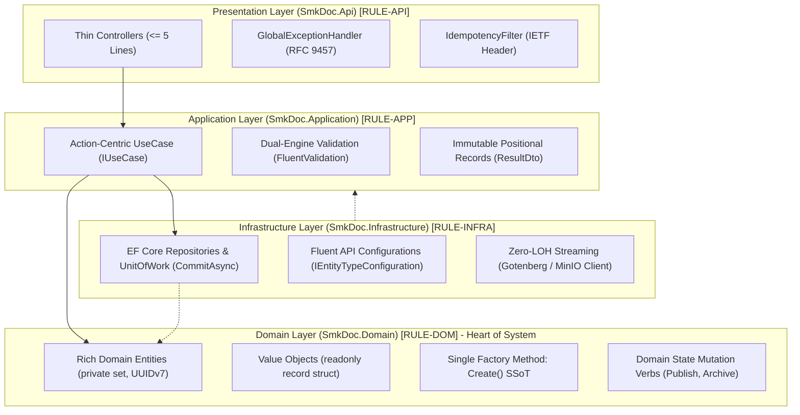

# CODING_CONVENTIONS.md — SMK Document Server

> **[PURPOSE_SCOPE_SSOT]:** Authoritative Single Source of Truth for Backend C# 13 / .NET 10 Clean Architecture, CQRS, and cross-layer naming invariants (`backend-v2/`).
> **[CORE_MISSION]:** Eliminate LLM code generation inconsistency, suppress hallucinated legacy anti-patterns, and enforce deterministic Clean Architecture best practices across all model invocations.
> **[EXCLUSION]:** Frontend conventions (Next.js 15, TypeScript 5.7, Zod schemas) are strictly isolated in `docs/AI/FRONTEND_SPEC.md`. Do NOT consult this file for frontend UI code.
> **[ENFORCEMENT]:** LLMs and engineers MUST obey all RFC 2119 keywords (`[MUST]`, `[MUST NOT]`). Every rule carries a machine-traceable token `RULE-[CATEGORY]-[ID]`.

---

<ai_cognitive_framing>
## 🧠 AI Cognitive Framing & Attention Routing

### Operational Modes & Attention Budget
When processing this specification, the LLM MUST determine its active operational mode:
1. **`[MODE: CODE_GENERATION]`**: Focus attention strictly on `<tech_stack_invariants>`, `<syntax_substitution_map>`, `<clean_architecture_invariants>`, `<backend_engineering_rules>`, `<naming_and_identifier_ssot>`, and `<golden_spec>`. Suppress auditor output templates.
2. **`[MODE: CODE_AUDIT_LINT]`**: Activate `<llm_auditor_protocol>` to halt, intercept, and emit structured `🚨 [ARCHITECTURAL_VIOLATION_DETECTED]` remediation blocks.

### Rule Severity Tiers (Cognitive Constraint Hierarchy)
To prevent constraint collapse during complex generation tasks, resolve priority collisions using this hierarchy:
* **`[TIER-1-FATAL]` (Process & Memory Integrity):** Zero LOH allocations (`RULE-MEM`), DbContext thread isolation (`RULE-CONC-001`), non-blocking async (`RULE-CRAFT-005`), rich domain encapsulation (`RULE-DOM-002`), single atomic commit (`RULE-UOW-002`).
* **`[TIER-2-ARCH]` (Clean Architecture Boundaries):** Inward dependency flow (`RULE-ARCH`), DTO layer isolation (`RULE-DTO`), action-centric UseCases (`RULE-SOLID-001`), strategy rendering (`RULE-PAT-001`).
* **`[TIER-3-CRAFT]` (Syntactic & AI Ergonomics):** Named arguments on primitives (`RULE-CRAFT-012`), Stepdown method order (`RULE-CRAFT-001`), trailing commas & curly braces (`RULE-CRAFT-014`), pure `camelCase` DI parameters (`RULE-APP-002`).
</ai_cognitive_framing>

---

<tech_stack_invariants>
## 1. 🏗️ System Tech Stack & Language Capabilities (Ground Truth)

All C# code generated by LLMs MUST strictly adhere to the following target runtimes and compiler capabilities.

| Layer / Concern | Technology | Target Version | Active Language Capabilities & Invariants |
|---|---|---|---|
| **Backend Runtime** | .NET | 10 (`net10.0`) | `TimeProvider`, `Guid.CreateVersion7()`, RFC 9457 `ProblemDetails` |
| **Language** | C# | 13 (`<LangVersion>13.0</LangVersion>`) | Primary Constructors, Collection Expressions `[]`, `System.Threading.Lock` |
| **ORM / Data** | EF Core + Npgsql | 10.x | Code-First, Fluent API Mapping, PostgreSQL Provider |
| **Database** | PostgreSQL | 15-alpine | Relational storage, UTF-8 Thai Collation, `smkdoc` database |
| **Rendering Gateway**| Gotenberg | 8.x | Chromium headless (HTML to PDF) and LibreOffice engine |
| **Object Storage** | MinIO | S3-Compatible | Multi-bucket asset & output storage (`templates/`, `outputs/`) |

* `[RULE-TECH-001] [MUST]`: Use C# 13 language features: Collection expressions `[]`, Primary Constructors on classes, `Lock` object for synchronization.
* `[RULE-TECH-002] [MUST]`: Use .NET 10 APIs: `TimeProvider` for time queries, `Guid.CreateVersion7()` for UUIDv7 sequential entity keys.
* `[RULE-TECH-003] [MUST NOT]`: NEVER use deprecated syntax: `new List<T>()`, `new T[] { }`, `DateTime.UtcNow`, `lock (new object())`.
</tech_stack_invariants>

---

<syntax_substitution_map>
## ⚡ High-Salience AST Syntax Substitution Map (Pre-Training Override)

> **[COGNITIVE_PURPOSE]:** Direct hash-lookup table designed to immediately override pre-training priors across all Transformer attention heads. Whenever the model contemplates generating a token from the left column, it MUST instantly substitute it with the canonical token from the right column.

| AST Node / Concern | Defective Prior (❌ Trigger Drop) | Canonical Token (✅ Mandatory Target) | Governing Invariant |
|---|---|---|---|
| **Primary Ctor DI** | `_repo`, `_logger`, `_unitOfWork` | `templateRepo`, `logger`, `unitOfWork` | Pure `camelCase` parameters. Zero `_` prefix (`RULE-APP-002`) |
| **Time Query** | `DateTime.UtcNow`, `DateTimeOffset.UtcNow` | `timeProvider.GetUtcNow()`, `DateTimeOffset now` | Zero direct system clock queries (`RULE-APP-005`, `RULE-DOM-005`) |
| **Collection Init** | `new List<T>()`, `new T[] { }` | `[]` | C# 13 Collection Expressions (`RULE-TECH-001`) |
| **Memory Buffers** | `new MemoryStream()`, `stream.ToArray()`, `byte[]` | `Stream.CopyToAsync(response.Body, ct)`, `ArrayPool<byte>` | Zero LOH buffer allocations (`RULE-MEM-001`, `RULE-MEM-002`) |
| **Threading** | `.Result`, `.Wait()`, `.GetAwaiter().GetResult()` | `await` | Non-blocking async execution exclusively (`RULE-CRAFT-005`) |
| **Cancellation** | `cancellationToken`, `cancelToken`, `None` | `CancellationToken ct` | Mandatory downstream propagation (`RULE-CONC-003`) |
| **Entity Key** | `Guid.NewGuid()`, auto-increment `int` | `Guid.CreateVersion7()` | Sequential B-tree indexing UUIDv7 (`RULE-DOM-007`) |
| **Domain State** | `public string Name { get; set; }` | `public TemplateName Name { get; private set; }` | Encapsulated Rich Domain Model (`RULE-DOM-002`) |
| **Domain Factory** | `new Template(...)` (caller instantiation) | `Template.Create(...)` | Single canonical factory method SSoT (`RULE-DOM-003`) |
| **Domain Mutation** | Direct property setter outside entity | `template.Archive(now)`, `template.Publish(now)` | Expressive business domain verbs (`RULE-DOM-005`) |
| **Aggregate Ref** | Navigation property `public Project Project { get; set; }` | Foreign key identifier `public Guid ProjectId { get; private set; }` | Cross-aggregate boundary isolation (`RULE-DOM-009`) |
| **Read Queries** | `dbContext.Templates.ToList()` | `templateRepo.ListAsync(ct)` with `.AsNoTracking()` | Zero untracked or client-eval LINQ (`RULE-INFRA-005`) |
| **Transaction** | Multiple `CommitAsync()` in one UseCase | Exactly 1 `await unitOfWork.CommitAsync(ct);` | Single atomic transaction boundary (`RULE-UOW-002`) |
| **Inlined Calls** | `ExecuteAsync(new CreateTemplateCommand(...))` | `var command = new CreateTemplateCommand(...);` | Explicit local variable instantiation (`RULE-CRAFT-007`) |
| **Positional Args**| `Method(id1, id2, str1, str2)` | `Method(sourceId: id1, targetId: id2)` | Mandatory Named Arguments on same types (`RULE-CRAFT-012`) |
| **Regex Parsing** | `new Regex(pattern)` in execution path | `[GeneratedRegex]` with `RegexOptions.NonBacktracking` | ReDoS defense and source-generation (`RULE-SEC-001`) |
| **Error Egress** | `new { error = "Not found" }`, empty `catch {}` | RFC 9457 `ProblemDetails` via `GlobalExceptionHandler` | Strongly-typed error responses (`RULE-API-003`) |
| **HTTP Result** | `return Ok(dto);`, empty `204 NoContent` on PUT | `TypedResults.Ok(new ApiResponse<T>(result))` | Strongly-typed RFC 9110 responses (`RULE-API-002`) |
</syntax_substitution_map>

---

<clean_architecture_invariants>
## 2. 🏛️ Clean Architecture Boundary & DTO Taxonomy

### 2.1 Boundary Invariants (`RULE-ARCH`)

Dependencies flow inwards exclusively.



* `[RULE-ARCH-001] [MUST]`: Dependencies flow INWARDS ONLY (`Api` ➔ `Application` ➔ `Domain` 🠔 `Infrastructure`). Inner layers MUST NOT reference outer layers.
* `[RULE-ARCH-002] [MUST]`: Domain is pure C# POCOs. Zero dependencies on EF Core, ASP.NET Core, or 3rd-party libraries.
* `[RULE-ARCH-003] [MUST]`: Application orchestrates workflows via CQRS UseCases. Never expose Domain Entities outside the Application boundary; return Application DTOs only.
* `[RULE-ARCH-004] [MUST]`: Infrastructure implements interfaces declared by Application or Domain (Dependency Inversion Principle).
* `[RULE-ARCH-005] [MUST]`: Presentation is a thin HTTP transport boundary. All business logic MUST be delegated to UseCases.

---

### 2.2 DTO Layering & Ownership Matrix (`RULE-DTO`)

To eliminate "Mapping Mania" while preventing leaky boundaries, every DTO MUST belong strictly to its designated layer:

| DTO Type | Owner Layer | Target C# Construct | Purpose | Forbidden Leakage ❌ |
|---|---|---|---|---|
| **`*Request`** | **Presentation** (`SmkDoc.Api`) | `public sealed record` | Represents incoming HTTP payload (JSON body / Form data) | MUST NOT enter Application or Domain |
| **`*Command`** | **Application** (`SmkDoc.Application`) | `public sealed record` | Represents business intent to mutate state (CQRS Write) | No HTTP attributes (`[FromBody]`) |
| **`*Query`** | **Application** (`SmkDoc.Application`) | `public sealed record` | Represents criteria to query data (CQRS Read) | No business logic or state mutations |
| **`*ResultDto`** | **Application** (`SmkDoc.Application`) | `public sealed record` | Immutable data carrier snapshot returned by UseCase | MUST NOT expose Entity instances |
| **`ApiResponse<T>`** | **Presentation** (`SmkDoc.Api`) | Generic record envelope | Standardized REST JSON wrapper for wire transport | MUST NOT be referenced by Application |
| **Domain Entity** | **Domain** (`SmkDoc.Domain`) | `public sealed class` | Core business model encapsulating state and rules | **NEVER expose as Request or Response** |

* `[RULE-DTO-001] [MUST]`: All DTOs (`*Request`, `*Command`, `*Query`, `*ResultDto`) MUST be immutable positional records (`public sealed record`).
* `[RULE-DTO-002] [MUST NOT]`: Domain Entities MUST NEVER cross the Application boundary into Presentation. UseCases MUST project entities into `*ResultDto` before returning.
* `[RULE-DTO-003] [MUST]`: Presentation maps `Request` to `Command` using explicit constructor instantiation or `.ToCommand()` extension method. Zero intermediary boilerplate mapping classes.

---

### 2.3 SOLID Principles & Defensive Invariants (`RULE-SOLID`)

| Principle | Forbidden Anti-Pattern ❌ | Mandatory Clean Standard ✅ | Rule ID |
|---|---|---|---|
| **SRP**<br>*(Single Responsibility)* | **Mega-Service Anti-Pattern:** Creating monolithic `TemplateService` containing 20+ methods handling CRUD, Gotenberg rendering, email, and logging. | **Action-Centric UseCases:** 1 Business Action = 1 UseCase class (`CreateTemplateUseCase`, `PublishTemplateUseCase`). Implements `IUseCase<TCommand, TResult>` with single focused responsibility. | `[RULE-SOLID-001] [MUST]` |
| **OCP**<br>*(Open/Closed)* | **Hardcoded Engine Switch:** Using `switch(type)` or `if-else` ladders inside Controllers/UseCases to branch between Gotenberg, OpenXml, or FastExcel. | **Polymorphic Strategy Pattern:** Inject `IEnumerable<IRenderEngine>` via DI container; resolve active engine polymorphically via Smart Enum without mutating caller code. | `[RULE-SOLID-002] [MUST]` |
| **LSP**<br>*(Liskov Substitution)* | **Unsupported Subtype Mutation:** Interface implementation throwing `NotImplementedException` or `NotSupportedException` for certain subtypes, breaking caller guarantees. | **Strict Behavioral Substitutability:** Every subtype MUST fulfill 100% of the interface contract without unexpected exceptions or behavioral contract deviations. | `[RULE-SOLID-003] [MUST]` |
| **ISP**<br>*(Interface Segregation)* | **Fat Repository & Leaking IQueryable:** Exposing bloated `IRepository<T>` with 30 methods, or leaking `IQueryable<T>` outside Infrastructure (coupling Application to EF Core). | **Cohesive Aggregate Interfaces:** Specific interfaces (`ITemplateRepository`). Return strictly evaluated types (`Task<IReadOnlyList<T>>` or `Task<T?>`), never uncommitted `IQueryable`. | `[RULE-SOLID-004] [MUST]` |
| **DIP**<br>*(Dependency Inversion)* | **Direct Concrete Coupling:** UseCase directly instantiating `MinioClient`, invoking `HttpClient`, or injecting EF Core `SmkDocDbContext`. | **Abstraction Inversion:** High-level UseCases depend strictly on Domain/Application abstractions (`IStorageService`, `ITemplateRepository`, `IUnitOfWork`). Implementations reside in Infrastructure. | `[RULE-SOLID-005] [MUST]` |

---

### 2.4 KISS & Pragmatic Simplicity Invariants (`RULE-KISS`)

| Area | Forbidden Over-Engineering ❌ | Mandatory KISS Standard ✅ | Rule ID |
|---|---|---|---|
| **Pipeline Abstraction** | Introducing MediatR with 5 nested pipeline behaviors for simple synchronous CRUD operations, obfuscating stack traces. | Use explicit, flat `IUseCase<TCommand, TResult>` calls. 1 Controller action calls 1 UseCase directly. Clear stack traces and zero reflection overhead. | `[RULE-KISS-001] [MUST]` |
| **Nesting Depth** | Arrow Anti-Pattern: Nesting `if`, `foreach`, and callbacks $\ge 3$ levels deep, burying the happy path inside brackets. | Maximum cyclomatic nesting depth MUST NOT exceed 2 (`Depth <= 2`). Use top-level fail-fast Guard Clauses to keep execution linear and left-aligned. | `[RULE-KISS-002] [MUST]` |
| **Dynamic Query Builders** | Generating complex dynamic Expression Trees or generic Specification Builders for standard queries. | Write explicit, readable repository methods (e.g. `GetByIdWithMappingsAsync`) using standard EF Core LINQ. Readable, testable, and maintainable. | `[RULE-KISS-003] [MUST]` |

---

### 2.5 DRY & Single Source of Truth Invariants (`RULE-DRY`)

| Concern | Forbidden Duplication ❌ | Mandatory SSoT Standard ✅ | Rule ID |
|---|---|---|---|
| **Validation Redundancy** | Triple validation: Validating payload format in Controller, checking again in FluentValidation, and re-checking regex in Entity. | **Dual Validation Gate:** External transport shape validated via `FluentValidation` (Boundary); domain state invariants validated in Entity (Core). Zero duplicated rules. | `[RULE-DRY-001] [MUST]` |
| **Contract Types** | Duplicating identical DTO structures across layers (`CreateTemplateApiRequest` mirroring `CreateTemplateAppDto`). | Use single `CreateTemplateRequest` at HTTP boundary, mapped directly into `CreateTemplateCommand` positional record. Zero intermediary boilerplate classes. | `[RULE-DRY-002] [MUST]` |
| **Clock Queries** | Calling `DateTime.UtcNow` or `DateTimeOffset.UtcNow` directly across random classes, causing nondeterministic unit tests. | Centralize clock queries via .NET standard `TimeProvider` (`timeProvider.GetUtcNow()`) or pass explicit `DateTimeOffset now` down from UseCase. | `[RULE-DRY-003] [MUST]` |

---

### 2.6 Approved Design Patterns Catalog (`RULE-PAT`)

All implementations within `smk-doc-server` MUST align with these 5 canonical Design Patterns:

* `[RULE-PAT-001] [MUST]`: **Strategy Pattern:** Used for document rendering engines (`IRenderEngine` for Gotenberg Chromium, OpenXml DOCX, and FastExcel XLSX) registered into DI as `IEnumerable<IRenderEngine>`.
* `[RULE-PAT-002] [MUST]`: **Factory Method Pattern:** Used for Domain Aggregate creation (`Template.Create(...)`) acting as the immutable SSoT for invariant validation and entity lifecycle.
* `[RULE-PAT-003] [MUST]`: **Unit of Work Pattern:** Used for database transaction boundaries (`IUnitOfWork.CommitAsync(ct)`). Repositories track changes; UnitOfWork commits atomically.
* `[RULE-PAT-004] [MUST]`: **Smart Enum Pattern:** Used instead of native C# enums when types possess metadata, behavioral logic, or MIME mappings (e.g. `RenderEngineType`, `TemplateCategory`).
* `[RULE-PAT-005] [MUST]`: **Result & Envelope Pattern:** Used for all HTTP egress responses (`TypedResults` wrapping `ApiResponse<T>` for success representations; RFC 9457 `ProblemDetails` for errors).
</clean_architecture_invariants>

---

<backend_engineering_rules>
## 3. 🔵 Backend Engineering Rules by Layer (C# 13 / .NET 10)

### 3.1 Domain Layer (`RULE-DOM`)
* `[RULE-DOM-001] [MUST]`: Entities MUST be implemented as `public sealed class`. NEVER use `record` for EF Core entities (preserves Change Tracker reference identity).
* `[RULE-DOM-002] [MUST]`: Encapsulate state strictly. All entity properties MUST have `private set;` or `protected set;`. Public property setters are STRICTLY PROHIBITED.
* `[RULE-DOM-003] [MUST]`: Expose exactly 1 canonical factory method (`Create`) as the SSoT for entity instantiation. Constructors MUST be `private` or `internal`.
* `[RULE-DOM-004] [MUST]`: Validate business state invariants fail-fast inside the factory method (e.g. `ArgumentException.ThrowIfNullOrWhiteSpace(name)`).
* `[RULE-DOM-005] [MUST]`: State mutations MUST be executed via expressive domain verbs (e.g., `Publish`, `Archive`, `Deactivate`) receiving explicit dependencies (e.g., `DateTimeOffset now`).
* `[RULE-DOM-006] [MUST]`: Value Objects MUST be implemented as `readonly record struct` or `record` with invariant validation on instantiation.
* `[RULE-DOM-007] [MUST]`: Primary keys MUST use UUIDv7 (`Guid.CreateVersion7()`) for sequential, high-performance B-tree indexing.
* `[RULE-DOM-008] [MUST NOT]`: NEVER import `Microsoft.AspNetCore.Http` into Domain or Application layers. NEVER throw raw `Exception` or HTTP exceptions (`BadHttpRequestException`). Throw strongly-typed domain exceptions exclusively (`DomainValidationException`, `NotFoundException`, `ConflictException`).
* `[RULE-DOM-009] [MUST]`: Cross-aggregate relationships MUST use foreign key identifiers exclusively (`Guid ProjectId`), never navigation properties (`Project Project`). Child entities (e.g. `TemplateMapping`) exist strictly within aggregate boundary; mutate them through the Aggregate Root (`template.AddMapping(...)`). Repositories for child entities are STRICTLY FORBIDDEN.

```csharp
// ✅ Good: Rich Domain Entity conforming to RULE-DOM-001 through RULE-DOM-007
public sealed class Template
{
    public Guid Id { get; private set; }
    public Guid ProjectId { get; private set; }
    public TemplateName Name { get; private set; }
    public TemplateSlug Slug { get; private set; }
    public bool IsActive { get; private set; }
    public DateTimeOffset CreatedAt { get; private set; }
    public DateTimeOffset? UpdatedAt { get; private set; }

    private Template() { } // EF Core constructor

    public static Template Create(Guid projectId, TemplateName name, TemplateSlug slug, DateTimeOffset now)
    {
        if (projectId == Guid.Empty) throw new DomainValidationException("ProjectId cannot be empty.");
        
        return new Template
        {
            Id = Guid.CreateVersion7(),
            ProjectId = projectId,
            Name = name,
            Slug = slug,
            IsActive = true,
            CreatedAt = now
        };
    }

    public void Archive(DateTimeOffset now)
    {
        if (!IsActive) return;
        IsActive = false;
        UpdatedAt = now;
    }
}
```

---

### 3.2 Application Layer (`RULE-APP`)
* `[RULE-APP-001] [MUST]`: Every UseCase MUST be a `public sealed class` implementing `IUseCase<TCommand, TResult>`.
* `[RULE-APP-002] [MUST]`: UseCases MUST use C# 13 Primary Constructors with pure `camelCase` parameters. Backing fields and underscore prefixes (`_`) are STRICTLY FORBIDDEN.
* `[RULE-APP-003] [MUST]`: Commands, Queries, and Output DTOs MUST be implemented as positional records (`public sealed record`).
* `[RULE-APP-004] [MUST]`: Enforce Dual Validation Boundary:
  - Input structural/format validation belongs to `FluentValidation` (runs automatically at Presentation/Application boundary).
  - Business state invariants belong inside Domain Entities.
  - NEVER validate the same rule twice across both layers.
* `[RULE-APP-005] [MUST]`: Time queries MUST use .NET standard `TimeProvider` (`timeProvider.GetUtcNow()`). Direct calls to `DateTime.UtcNow` or `DateTimeOffset.UtcNow` are STRICTLY FORBIDDEN.
* `[RULE-APP-006] [MUST]`: Every asynchronous method MUST accept `CancellationToken ct = default` as its final parameter and propagate it to all downstream calls.
* `[RULE-FLOW-001] [MUST]`: External side-effects (MinIO storage, Gotenberg rendering) MUST follow the **DB Intent ➔ Storage Upload ➔ DB Finalize** execution order:
  1. Record creation in DB with `Pending` status and a pre-computed deterministic storage path.
  2. Commit initial state (`await unitOfWork.CommitAsync(ct)`).
  3. Upload binary stream to MinIO (`await storageService.UploadAsync(..., ct)`).
  4. Update entity status to `Completed` (or `Failed`) and commit finalized state (`await unitOfWork.CommitAsync(ct)`).

```csharp
// ✅ Good: Application UseCase conforming to RULE-APP-001 through RULE-APP-006
public sealed class CreateTemplateUseCase(
    ITemplateRepository templateRepo,
    IUnitOfWork unitOfWork,
    TimeProvider timeProvider) : IUseCase<CreateTemplateCommand, TemplateResultDto>
{
    public async Task<TemplateResultDto> ExecuteAsync(CreateTemplateCommand command, CancellationToken ct)
    {
        var slug = TemplateSlug.Create(command.Slug);
        if (await templateRepo.ExistsBySlugAsync(command.ProjectId, slug, ct))
        {
            throw new ConflictException($"Template with slug '{command.Slug}' already exists.");
        }

        var now = timeProvider.GetUtcNow();
        var templateName = TemplateName.Create(command.Name);
        var template = Template.Create(
            projectId: command.ProjectId,
            name: templateName,
            slug: slug,
            now: now);

        await templateRepo.AddAsync(template, ct);
        await unitOfWork.CommitAsync(ct);

        return new TemplateResultDto(template.Id, template.Name.Value, template.CreatedAt);
    }
}
```

---

### 3.3 Infrastructure Layer (`RULE-INFRA`)
* `[RULE-INFRA-001] [MUST]`: Infrastructure services MUST implement interfaces defined by Domain or Application (Repository, UnitOfWork, RenderEngine, StorageService).
* `[RULE-INFRA-002] [MUST]`: Map EF Core entities exclusively using `IEntityTypeConfiguration<T>` via the Fluent API. Data annotations (`[Table]`, `[Key]`, `[Column]`) on Domain Entities are STRICTLY FORBIDDEN.
* `[RULE-INFRA-003] [MUST]`: Persistence transaction boundaries MUST be committed via `IUnitOfWork.CommitAsync(ct)`. Repositories MUST NOT call `SaveChangesAsync()` independently.
* `[RULE-INFRA-004] [MUST]`: Rendering engines and storage adapters MUST stream payloads directly (`Stream over RAM`). Buffering multi-MB documents into memory (`byte[]`) is STRICTLY FORBIDDEN.
* `[RULE-INFRA-005] [MUST]`: All read queries MUST append `.AsNoTracking()`. Non-translatable C# methods, in-memory delegates, or dynamic RegEx inside LINQ expressions that force client-side memory evaluation are STRICTLY FORBIDDEN.
* `[RULE-INFRA-006] [MUST]`: Domain Value Objects MUST be mapped via strongly-typed EF Core Value Converters (`builder.Property(t => t.Slug).HasConversion(slug => slug.Value, val => TemplateSlug.Create(val))`) in `IEntityTypeConfiguration<T>`. Primitive obsession in domain entities or arbitrary `.OwnsOne()` table splitting is STRICTLY FORBIDDEN.
* `[RULE-INFRA-007] [MUST]`: Entities subject to concurrent mutations MUST configure the PostgreSQL `xmin` concurrency token (`builder.UseXminAsConcurrencyToken()`). Catch `DbUpdateConcurrencyException` and translate to HTTP 409 Conflict (`CONCURRENCY_CONFLICT`).
* `[RULE-UOW-002] [MUST]`: A standard UseCase execution MUST contain at most ONE single invocation of `await unitOfWork.CommitAsync(ct);` at the end of the transaction boundary. Multiple intermediate commits within a single business transaction are STRICTLY FORBIDDEN (except when orchestrating two-phase external storage workflows under `RULE-FLOW-001`).

---

### 3.4 Presentation Layer (`RULE-API`)
* `[RULE-API-001] [MUST]`: Controllers MUST remain ultra-thin ($\le 5$ lines per action body). All workflow logic MUST be delegated to UseCases.
* `[RULE-API-002] [MUST]`: RFC 9110 HTTP Status & Representation Semantics using `TypedResults`:
  - `GET`: Return `Task<Ok<ApiResponse<T>>>` or `Task<Ok<PagedApiResponse<T>>>` via `TypedResults.Ok(...)`.
  - `POST` (Creation): Return `Task<Created<ApiResponse<T>>>` via `TypedResults.Created($"/api/v1/{resource}/{id}", ...)`.
  - `PUT` / `PATCH` (State Mutation): Return `Task<Ok<ApiResponse<T>>>` via `TypedResults.Ok(...)`. Returning empty `204 NoContent` for state mutations is STRICTLY FORBIDDEN.
  - `DELETE`: Return `Task<NoContent>` via `TypedResults.NoContent()`.
* `[RULE-API-003] [MUST]`: Centralized RFC 9457 `ProblemDetails` via `IExceptionHandler` (`GlobalExceptionHandler`). Catching exceptions inside controllers to return anonymous JSON (`new { error = ... }`) is STRICTLY FORBIDDEN.
* `[RULE-API-004] [MUST NOT]`: Controllers MUST NOT accept raw top-level JSON arrays (`[FromBody] List<T>`). All collections MUST be wrapped inside a top-level request record (OWASP array injection defense).
* `[RULE-API-005] [MUST]`: State-mutating endpoints (`POST`, `PUT`, `DELETE`) MUST support the `Idempotency-Key` header via the `[Idempotent]` action filter.
* `[RULE-API-006] [MUST]`: Canonical REST URL routing MUST use `api/v1/{resource}` with lowercase plural `kebab-case` resource names.

```csharp
// ✅ Good: Thin Controller conforming to RULE-API-001 through RULE-API-006
[ApiController]
[Route("api/v1/templates")]
public sealed class TemplateController(
    IUseCase<CreateTemplateCommand, TemplateResultDto> createTemplateUseCase) : ControllerBase
{
    [HttpPost]
    [Idempotent]
    public async Task<Created<ApiResponse<TemplateResultDto>>> Create(
        [FromBody] CreateTemplateRequest request,
        CancellationToken ct)
    {
        var command = new CreateTemplateCommand(request.ProjectId, request.Name, request.Slug);
        var result = await createTemplateUseCase.ExecuteAsync(command, ct);
        
        return TypedResults.Created($"/api/v1/templates/{result.Id}", new ApiResponse<TemplateResultDto>(result));
    }
}
```

---

### 3.5 3-Tier Validation Hierarchy & Thai Compliance (`RULE-VAL`)

* `[RULE-VAL-001] [MUST]`: Enforce 3-Tier Validation Pipeline:
  - **Tier 1 (Syntax & Shape):** `FluentValidation` at Presentation boundary (null checks, string lengths, ranges, regex). Failures return HTTP 400 with `errorCode: "VALIDATION_FAILED"`.
  - **Tier 2 (Dynamic Payload):** Validated against JSON Schema Draft-07 via `JsonSchema.Net` (cached in L1 AST cache). Failures return HTTP 422 with `errorCode: "SCHEMA_VALIDATION_FAILED"`.
  - **Tier 3 (Domain Invariants):** Enforced inside Domain Entity Factory Method and domain verbs. Failures throw `DomainValidationException` (RFC 9457).
* `[RULE-VAL-002] [MUST]`: Thai Localization formatting (Buddhist Era years, Thai Baht text, phone numbers) MUST be routed through centralized `ThaiDataTransformer`. Inlined or ad-hoc `+ 543` calculations in templates or controllers are STRICTLY FORBIDDEN.
* `[RULE-VAL-003] [MUST]`: Thai 13-digit National ID and Tax ID validation MUST implement the official Modulo 11 checksum algorithm.

---

### 3.6 High-Performance Memory & LOH Hygiene (`RULE-MEM`)

Document payloads routinely exceed the 85,000-byte threshold, placing them on the Large Object Heap (LOH). Memory leaks here cause process-freezing Gen 2 GC pauses.

* `[RULE-MEM-001] [MUST NOT]`: NEVER allocate large byte arrays (`byte[]`, `new MemoryStream()`, `stream.ToArray()`) for document rendering streams. Banned on LOH.
* `[RULE-MEM-002] [MUST]`: Stream Gotenberg and MinIO payloads directly to HTTP responses via `Stream.CopyToAsync(response.Body, ct)` or `PipeWriter`.
* `[RULE-MEM-003] [MUST]`: When an in-memory buffer is technically unavoidable, use `ArrayPool<byte>.Shared` or `RecyclableMemoryStreamManager` (Microsoft). Always return rented buffers in a `finally` block.

---

### 3.7 Concurrency & DbContext Thread-Safety (`RULE-CONC`)

* `[RULE-CONC-001] [MUST NOT]`: EF Core `DbContext` is NOT thread-safe. Concurrent asynchronous execution using the same scoped `DbContext` instance (e.g. `Task.WhenAll` with repository calls) is STRICTLY PROHIBITED.
* `[RULE-CONC-002] [MUST]`: Execute queries on a scoped `DbContext` sequentially, OR inject `IDbContextFactory<SmkDocDbContext>` to spawn isolated short-lived contexts for concurrent workers.
* `[RULE-CONC-003] [MUST]`: Pass `CancellationToken ct` down continuously to every terminal async operation (`ToListAsync(ct)`, `FirstOrDefaultAsync(ct)`, `CopyToAsync(..., ct)`). Calling overloads that omit `ct` or passing `CancellationToken.None` in production code is STRICTLY FORBIDDEN.
* `[RULE-CONC-004] [MUST NOT]`: NEVER invoke `_ = Task.Run(...)` or unawaited background tasks that capture scoped DI dependencies (`DbContext`, UseCases, Repositories). When background execution is required, dispatch tasks through `Channel<T>` to a `BackgroundService` or instantiate a dedicated scope via `IServiceScopeFactory.CreateAsyncScope()`.

---

### 3.8 Structured Logging & Observability (`RULE-LOG`)

* `[RULE-LOG-001] [MUST]`: All logging MUST use semantic structured message templates with named property tokens (e.g., `logger.LogInformation("Rendered template {TemplateId} in {ElapsedMs}ms", templateId, sw.ElapsedMilliseconds)`).
* `[RULE-LOG-002] [MUST NOT]`: String interpolation (`$"..."`) inside `ILogger` calls is STRICTLY PROHIBITED (destroys telemetry indexability).
* `[RULE-LOG-003] [MUST NOT]`: NEVER log Personally Identifiable Information (PII: National IDs, passwords, API keys, raw financial payloads).

---

### 3.9 Code-Level Security & ReDoS Defense (`RULE-SEC`)

* `[RULE-SEC-001] [MUST]`: All regular expressions for slug, token, or template parsing MUST use .NET Source Generators (`[GeneratedRegex]`) with `RegexOptions.NonBacktracking` to eliminate ReDoS vulnerabilities.
* `[RULE-SEC-002] [MUST NOT]`: Production error responses MUST NEVER leak CLR stack traces, database connection strings, or SQL queries inside RFC 9457 `detail`. Dispatched exclusively via `IExceptionHandler` (`GlobalExceptionHandler`).
* `[RULE-SEC-003] [MUST NOT]`: Mass assignment and over-posting are STRICTLY FORBIDDEN. Incoming request/command DTOs MUST NEVER be assigned wholesale onto domain entities. Entity state changes MUST occur through explicit domain methods with explicitly typed parameters (e.g., `template.UpdateMetadata(name, slug, now)`).

---

### 3.10 The 15 Invariants of Code Craftsmanship & AI-Native Ergonomics (`RULE-CRAFT`)

Every LLM-generated method and class MUST conform to all 15 craftsmanship and AI-native ergonomics invariants without exception:

* `[RULE-CRAFT-001] [MUST]`: **Stepdown Rule:** Public entry points (`ExecuteAsync`) MUST appear first in class body. Private helper methods MUST follow immediately beneath their caller in top-down invocation order. Never group private helpers at file bottom.
* `[RULE-CRAFT-002] [MUST]`: **Vertical Proximity & Visual Formatting:** Declare local variables immediately before their first usage. Never declare variables at top of method if consumed lines later. Separate distinct logical steps using exactly 1 blank line.
* `[RULE-CRAFT-003] [MUST]`: **Linear Guard Clauses:** Inspect preconditions and fail-fast at method start. Cyclomatic indentation depth MUST NOT exceed 2 levels (`Depth <= 2`). Extract nested logic into private helper methods or domain verbs.
* `[RULE-CRAFT-004] [MUST NOT]`: **Zero Cryptic Abbreviations:** Banned identifiers: `t`, `p`, `temp`, `data`, `obj`, `item`, `val`, `dt`. Identifiers MUST reveal intent without requiring mental translation.
* `[RULE-CRAFT-005] [MUST]`: **Route Token & Concept Invariance:** Root resources MUST use `{id:guid}` (matching action parameter `Guid id` and `CreatedAtAction(..., new { id = result.Id })`). Nested resources MUST use disambiguated `{entityId:guid}` (e.g. `{projectId}`, `{userId}`). Application Commands/Queries MUST always use full self-describing `{Entity}Id` (e.g. `TemplateId`).
* `[RULE-CRAFT-006] [MUST NOT]`: **Zero Echo/Robot Comments:** Banned: Comments merely rephrasing code syntax (e.g. `// Add template to database`). Comments are STRICTLY RESERVED for non-obvious business domain rules, Thai legal/tax mandates, or RFC citations.
* `[RULE-CRAFT-007] [MUST]`: **Explicit Intermediate Variables & Chain Limits:** Fluent and LINQ transformation chains MUST NOT exceed 3 consecutive operations without breaking into named local variables. NEVER nest object creation inside method arguments (e.g., `ExecuteAsync(new Command())` is BANNED; instantiate local variable first).
* `[RULE-CRAFT-008] [MUST]`: **Trust Nullable Reference Types:** Validate inputs exhaustively at the Presentation and Application boundaries. Do NOT scatter redundant defensive `if (arg is null)` checks across protected internal private methods.
* `[RULE-CRAFT-009] [MUST]`: **Expressive Domain Verbs:** Mutate entity state exclusively via expressive business verbs (`Publish`, `Archive`, `Deactivate`). Individual public property assignments outside the entity are STRICTLY PROHIBITED.
* `[RULE-CRAFT-010] [MUST NOT]`: **Zero Magic Numbers:** Operational and environmental parameters MUST use `IOptions<TOptions>` (`appsettings.json` / env); technical constants MUST be in `*Constants.cs`; clock queries MUST route through `TimeProvider`.
* `[RULE-CRAFT-011] [MUST]`: **The P-E-M-R Method Execution Cadence:** Every UseCase `ExecuteAsync` MUST strictly sequence logic in 4 distinct chronological steps:
  1. **P (Preconditions):** Fail-fast guard clauses, argument verification.
  2. **E (External Retrieval):** Retrieve required external state with `.AsNoTracking()`, query `timeProvider`.
  3. **M (Mutation):** Mutate state exclusively through Domain Factory or Domain Verbs.
  4. **R (Result & Persistence):** Execute single `unitOfWork.CommitAsync(ct)` and return immutable `*ResultDto`.
* `[RULE-CRAFT-012] [MUST]`: **Named Arguments Defense against Parameter Swapping:** When calling any method or constructor with 2 or more parameters of the same primitive type (e.g. multiple `Guid` or `string`), you MUST use explicit C# named arguments (`projectId: command.ProjectId, name: templateName, slug: slug`).
* `[RULE-CRAFT-013] [MUST NOT]`: **No Ghost Utilities / Phantom Extensions:** NEVER invent or invoke non-existent extension methods, static helpers, or phantom utility classes. Use only verified framework APIs or utilities explicitly declared in the codebase.
* `[RULE-CRAFT-014] [MUST]`: **Diff-Friendly & Patch-Safe Syntax:**
  - Trailing commas are MANDATORY on the final element of multi-line lists, arguments, collections, and anonymous objects.
  - Exactly 1 Parameter or Property per line when $\ge 3$ items.
  - Mandatory curly braces `{ }` on ALL control flow statements, including single-line `if`.
* `[RULE-CRAFT-015] [MUST]`: **Single Responsibility per File (1 Type = 1 File):** Exactly ONE top-level C# type (class, record, interface, enum) per source file. The file name MUST match the type name 1:1. Bundling enums, DTOs, or child classes in the same file as an aggregate is STRICTLY FORBIDDEN.

---

### 3.11 Unit Testing Craftsmanship (`RULE-TEST`)
* `[RULE-TEST-001] [MUST]`: Test names MUST follow the 3-part structure: `MethodUnderTest_StateUnderTest_ExpectedBehavior`.
* `[RULE-TEST-002] [MUST]`: Visually divide every test using explicit AAA comments (`// Arrange`, `// Act`, `// Assert`) separated by blank lines.
* `[RULE-TEST-003] [MUST]`: Assertions MUST use `FluentAssertions` exclusively (e.g. `result.Should().NotBeNull()`). Legacy `Assert.Equal()` is BANNED.
* `[RULE-TEST-004] [MUST NOT]`: Zero I/O in unit tests. Mock all infrastructure interfaces; instantiate Domain Entities and DTOs directly.
</backend_engineering_rules>

---

<naming_and_identifier_ssot>
## 4. 🏷️ Unified Anti-Hallucination Naming Matrix (SSoT)

### 4.1 The 6 Pillars Naming Matrix
| Element / Artifact | Layer / Scope | Convention | Canonical Example |
|---|---|---|---|
| **Domain Entities** | Domain | Singular `PascalCase` | `Template`, `DocumentLog` |
| **Value Objects** | Domain | Descriptive `PascalCase` | `TemplateSlug`, `Sha256Checksum` |
| **Domain Factory** | Domain | Canonical Verb | `Create()` |
| **Domain Mutations** | Domain | Ubiquitous Business Verb | `Publish()`, `Archive()`, `Deactivate()` |
| **Primary Ctor Parameters** | All Classes | Pure `camelCase` (Zero `_`) | `templateRepo`, `unitOfWork`, `timeProvider` |
| **CQRS Commands** | Application | `[Action][Entity]Command` | `CreateTemplateCommand`, `ArchiveTemplateCommand` |
| **CQRS Queries** | Application | `[Get/List][Entity]Query` | `GetTemplateByIdQuery`, `ListTemplatesQuery` |
| **Output DTOs** | Application | `[Context]ResultDto` | `TemplateResultDto`, `RenderResultDto` |
| **HTTP Request Payloads** | Presentation | `[Action][Entity]Request` | `CreateTemplateRequest`, `RenderDocumentRequest` |
| **Controllers** | Presentation | `[Entity]Controller` | `TemplateController`, `DocumentController` |
| **Test Classes** | Tests | `[TargetClass]Tests` | `CreateTemplateUseCaseTests`, `TemplateTests` |
| **Database Tables** | Infrastructure | `plural_snake_case` | `templates`, `document_generation_logs` |
| **Database Columns** | Infrastructure | `snake_case` / `is_*` | `project_id`, `created_at`, `is_active` |

---

### 4.2 Canonical Operations & Verbs Dictionary
| Operation Intent | STRICT Canonical Verb | Forbidden Synonyms ❌ | Scope |
|---|---|---|---|
| Retrieve single entity by ID | **`GetByIdAsync`** | `Fetch`, `Retrieve`, `FindById`, `Load`, `GetSingle` | Repositories, Queries |
| Query entity by condition (nullable) | **`FindAsync`** | `Search`, `Lookup`, `Detect`, `Check` | Repositories, UseCases |
| Retrieve collection of entities | **`ListAsync`** | `GetAll`, `FetchMany`, `GetMultiple`, `SelectAll` | Repositories, Queries |
| Verify existence of record | **`ExistsAsync`** | `CheckExists`, `IsExisting`, `HasEntity`, `Contains` | Repositories, UseCases |
| Persist transaction changes | **`CommitAsync`** | `Save`, `SaveChanges`, `Flush`, `Complete` | UnitOfWork |
| Instantiate domain entity | **`Create`** | `Build`, `New`, `Init`, `Make`, `Construct` | Domain Factory |
| Soft delete / retire record | **`Archive`** | `Delete`, `Remove`, `Kill`, `Trash` | Domain Entities |

---

### 4.3 Strict Variable Identifier Dictionary
| Type / Context | STRICT Variable Name | Forbidden / Banned Names ❌ | Rationale |
|---|---|---|---|
| **CQRS Command** (`*Command`) | `command` | `cmd`, `req`, `request`, `payload`, `c` | Disambiguates Command from HTTP Request |
| **CQRS Query** (`*Query`) | `query` | `qry`, `req`, `request`, `q` | Identifies read operations |
| **HTTP Request** (`*Request`) | `request` | `req`, `body`, `payload`, `dto`, `r` | Standardizes Controller signatures |
| **Domain Entity** (`Template`) | The entity noun (`template`) | `entity`, `model`, `data`, `obj`, `t` | Ubiquitous domain noun |
| **UseCase Output** (`*ResultDto`) | `result` | `res`, `response`, `dto`, `output` | Standard UseCase output container |
| **Cancellation Token** | `ct` | `cancellationToken`, `cancelToken`, `token` | Ubiquitous modern .NET convention |
| **Deterministic Time** (`DateTimeOffset`) | `now` | `date`, `dt`, `currentTime`, `timestamp` | Universal stamp for auditing |
| **Entity Primary Key** (`Guid`) | `id` or `{entity}Id` | `guid`, `uuid`, `key`, `identifier` | Standard identifier naming |

---

### 4.4 Contract Property Symmetry (Zero Translation Glue)
Concept names MUST retain identical identifiers across every layer boundary:
$$\text{HTTP Request: } \texttt{payload} \longrightarrow \text{Command: } \texttt{Payload} \longrightarrow \text{Domain: } \texttt{Payload} \longrightarrow \text{Result: } \texttt{Payload}$$
$$\text{HTTP Request: } \texttt{outputFormat} \longrightarrow \text{Command: } \texttt{OutputFormat} \longrightarrow \text{Domain: } \texttt{OutputFormat} \longrightarrow \text{Result: } \texttt{OutputFormat}$$

| Forbidden Identifier ❌ | Mandatory Identifier ✅ | Scope | Semantic Invariant |
|---|---|---|---|
| `data`, `info`, `obj`, `stuff` | `payload` | All Layers | Business domain JSON payload interpolated into template |
| `output`, `type`, `format` | `outputFormat` | All Layers | Target document format specifier (`pdf`, `docx`, `xlsx`) |
| `ref`, `docNumber`, `doc_id` | `documentRef` / `correlationId` | All Layers | Idempotent generation tracking reference |
</naming_and_identifier_ssot>

---

<golden_spec>
## 5. 💎 Canonical End-to-End Implementation Spec

This end-to-end trace illustrates how an operation satisfies all Clean Architecture invariants and naming rules from HTTP ingress down to persistence:

```csharp
// 1. PRESENTATION: TemplateController.cs
[ApiController]
[Route("api/v1/templates")]
public sealed class TemplateController(
    IUseCase<CreateTemplateCommand, TemplateResultDto> createTemplateUseCase) : ControllerBase
{
    [HttpPost]
    [Idempotent]
    public async Task<Created<ApiResponse<TemplateResultDto>>> Create(
        [FromBody] CreateTemplateRequest request,
        CancellationToken ct)
    {
        var command = new CreateTemplateCommand(request.ProjectId, request.Name, request.Slug);
        var result = await createTemplateUseCase.ExecuteAsync(command, ct);

        return TypedResults.Created($"/api/v1/templates/{result.Id}", new ApiResponse<TemplateResultDto>(result));
    }
}

// 2. APPLICATION: CreateTemplateUseCase.cs
public sealed class CreateTemplateUseCase(
    ITemplateRepository templateRepo,
    IUnitOfWork unitOfWork,
    TimeProvider timeProvider) : IUseCase<CreateTemplateCommand, TemplateResultDto>
{
    public async Task<TemplateResultDto> ExecuteAsync(CreateTemplateCommand command, CancellationToken ct)
    {
        // Step 1: P - Preconditions (Fail-fast guards)
        var slug = TemplateSlug.Create(command.Slug);
        if (await templateRepo.ExistsBySlugAsync(command.ProjectId, slug, ct))
        {
            throw new ConflictException($"Template with slug '{command.Slug}' already exists.");
        }

        // Step 2: E - External Retrieval (Deterministic clock & state)
        var now = timeProvider.GetUtcNow();

        // Step 3: M - Mutation (Domain Factory with Named Arguments)
        var templateName = TemplateName.Create(command.Name);
        var template = Template.Create(
            projectId: command.ProjectId,
            name: templateName,
            slug: slug,
            now: now);

        // Step 4: R - Result & Persistence (Single Atomic CommitAsync)
        await templateRepo.AddAsync(template, ct);
        await unitOfWork.CommitAsync(ct);

        return new TemplateResultDto(template.Id, template.Name.Value, template.CreatedAt);
    }
}

// 3. DOMAIN: Template.cs
public sealed class Template
{
    public Guid Id { get; private set; }
    public Guid ProjectId { get; private set; }
    public TemplateName Name { get; private set; }
    public TemplateSlug Slug { get; private set; }
    public bool IsActive { get; private set; }
    public DateTimeOffset CreatedAt { get; private set; }

    private Template() { }

    public static Template Create(Guid projectId, TemplateName name, TemplateSlug slug, DateTimeOffset now)
    {
        if (projectId == Guid.Empty) throw new DomainValidationException("ProjectId cannot be empty.");
        return new Template
        {
            Id = Guid.CreateVersion7(),
            ProjectId = projectId,
            Name = name,
            Slug = slug,
            IsActive = true,
            CreatedAt = now
        };
    }
}
```
</golden_spec>

---

<llm_auditor_protocol>
## 6. 🛡️ LLM Gatekeeper & Interception Protocol (Zero-Tolerance Architectural Linter)

> **[ACTIVATION_TRIGGER]:** This section applies when the LLM operates under `[MODE: CODE_AUDIT_LINT]` or when evaluating legacy codebase files.

### 6.1 Anti-Conformity Invariant & Proactive Elevation (`RULE-GATE`)
When inspecting, reviewing, or refactoring code, the LLM MUST act as the Senior Architect and strictly obey these operational rules:

* `[RULE-GATE-001] [ANTI_CONFORMITY] [MUST NOT]`: NEVER conform to defective legacy patterns. NEVER ask or suggest: *"Should I keep this consistent with the existing code?"*. Existing code that violates this document MUST be treated as an architectural violation.
* `[RULE-GATE-002] [PROACTIVE_ELEVATION] [MUST]`: ALWAYS proactively advocate for and recommend elevating non-compliant code to adhere to this SSoT or an objectively superior modern architectural standard.
* `[RULE-GATE-003] [INTERCEPTION_SEQUENCE] [MUST]`: Upon detecting any architectural defect, execute this deterministic 4-step sequence:
  1. **Halt & Flag:** Stop immediate execution. State exact file, line number, and rule violation ID (`[RULE-...]`).
  2. **Technical Impact Explanation:** Explain root-cause architectural hazards (e.g. LOH fragmentation, thread pool starvation, leaky abstraction, broken testability).
  3. **Elevated Remediation:** Provide complete compilable code comparing `❌ Defective Legacy Pattern (Forbidden)` against `✅ SSoT Canonical Standard (Mandatory)`.
  4. **Architectural Rationale:** Articulate why the elevated approach is superior to conforming to legacy code.
* `[RULE-GATE-004] [FEARLESS_REFACTORING] [MUST]`: Boldly propose refactoring or rewriting fundamentally flawed structures (e.g. Anemic Domain Models, God classes, public setters) instead of applying band-aid patches.

---

### 6.2 High-Priority Interception Trigger Matrix
The LLM MUST intercept and flag execution immediately upon detecting any of the following anti-patterns:

| Architectural Concern | Defective Pattern (❌ Forbidden) | SSoT Canonical Standard (✅ Mandatory) | Rule ID |
|---|---|---|---|
| **Domain State** | Entity with `public set;` or parameterless constructor (Anemic Model) | Rich Domain Model, `private/protected set`, factory method `Create(...)` | `[RULE-DOM-001]` |
| **Layer Boundary** | Exposing Domain Entity to Presentation or returning from UseCase | Return immutable Application DTO (`TemplateResultDto`) exclusively | `[RULE-ARCH-002]` |
| **Constructor DI** | Prefixing parameters with underscore `_` (e.g. `_repo`, `_logger`) | Pure `camelCase` parameters (e.g. `templateRepo`, `logger`) | `[RULE-NAME-003]` |
| **Clock Queries** | Direct calls to `DateTime.UtcNow` or `DateTimeOffset.UtcNow` | Inject `TimeProvider` or pass explicit `DateTimeOffset now` dependency | `[RULE-DOM-003]` |
| **Thread Blocking** | Synchronous blocking via `.Result`, `.Wait()`, `.GetAwaiter().GetResult()` | Asynchronous non-blocking `await` across all I/O boundaries | `[RULE-CRAFT-005]` |
| **Memory / LOH** | In-memory document buffering via `new MemoryStream()`, `byte[]` | Direct stream piping from Gotenberg/MinIO via `Stream` or `ArrayPool` | `[RULE-MEM-001]` |
| **DbContext Concurrency**| Concurrent tasks (`Task.WhenAll`) executed on single `DbContext` instance | Sequential execution or independent DI scopes per concurrent worker | `[RULE-CONC-001]` |
| **Token Dropping** | Omitting `ct` in downstream LINQ (`ToListAsync()`) or nested async calls | Propagate `CancellationToken ct` to all terminal async operations | `[RULE-CONC-003]` |
| **Fire-and-Forget Scope**| `_ = Task.Run(...)` capturing Scoped DI dependencies (`DbContext`) | Dispatch via `Channel<T>` to `BackgroundService` or create explicit scope | `[RULE-CONC-004]` |
| **Query Tracking / Eval**| Querying without `.AsNoTracking()` or client-side LINQ evaluation | Mandatory `.AsNoTracking()` and SQL-translatable expressions | `[RULE-INFRA-005]` |
| **Transaction Boundary** | Invoking `unitOfWork.CommitAsync()` multiple times in one UseCase | Exactly 1 atomic `CommitAsync(ct)` per UseCase execution | `[RULE-UOW-002]` |
| **Mass Assignment** | Binding request/command DTOs directly to mutate entity properties | Expressive domain verbs with explicit permitted parameters | `[RULE-SEC-003]` |
| **Aggregate Boundary** | Cross-aggregate navigation properties or child entity repositories | ID-only references (`Guid ProjectId`) and aggregate root mediation | `[RULE-DOM-009]` |
| **Parameter Swapping** | Passing positional parameters of identical primitive type out-of-order | Mandatory C# Named Arguments (`projectId: command.ProjectId`) | `[RULE-CRAFT-012]` |
| **Ghost Utilities** | Invoking hallucinated extension methods or static helpers | Use verified framework APIs or declared codebase utilities exclusively | `[RULE-CRAFT-013]` |
| **Variable Identifiers** | Truncated abbreviations (`req`, `dto`, `res`, `cancellationToken`) | Standard identifiers: `request`, `result`, `CancellationToken ct` | `[RULE-NAME-002]` |
| **Object Instantiation** | Inlined nested object instantiation inside method call invocations | Instantiate into explicit, strongly-typed local variables first | `[RULE-CRAFT-002]` |
| **Error Contracts** | Empty `catch { }` blocks or anonymous JSON error payloads | Throw Domain Exceptions; map to RFC 9457 `ProblemDetails` | `[RULE-API-002]` |
| **Regex Safety (ReDoS)** | Dynamic `new Regex(pattern)` in hot paths or omitting timeouts | Source-generated `[GeneratedRegex]` with explicit evaluation timeout | `[RULE-SEC-002]` |

---

### 6.3 Standardized Remediation Response Template
When intercepting non-compliant code under `[MODE: CODE_AUDIT_LINT]`, the LLM MUST use this exact output structure:

```markdown
🚨 **[ARCHITECTURAL_VIOLATION_DETECTED]:** Defect identified in `{FilePath}:{LineNumber}`
- **Violated Rule:** `[RULE-CATEGORY-ID]` ({Rule Title})
- **Technical Impact:** {Detailed explanation: e.g. LOH allocation, thread starvation, leaky abstraction}
- **Elevated Remediation:**
  ❌ **Before (Defective Legacy Pattern - Do Not Conform):**
  ```csharp
  // Non-compliant code
  ```
  ✅ **After (SSoT Canonical Standard):**
  ```csharp
  // Elevated compliant code
  ```
- **Rationale for Elevation:** {Why conforming to existing code is rejected and how this standard improves system metrics}
- **Proactive Refactoring Proposal:** {Slice-level refactoring advice if structural rewrites are warranted}
```
</llm_auditor_protocol>

---

<doc_maintenance_rules>
## 7. 🔄 Living SSoT Protocol & AI Document Maintenance Rules (`RULE-DOC`)

> **[LIVING_SSOT_MANDATE]:** This document enforces architectural determinism across AI agents. All updates MUST preserve high token density, machine-actionable precision, and cross-document symmetry.

---

### 7.1 AI Context-Engineering Invariants (`RULE-DOC-ENG`)
When modifying or adding rules to `docs/AI/`, all agents MUST adhere to these 6 structural invariants:

* `[RULE-DOC-001] [SEMANTIC_XML_BOUNDS] [MUST]`: Preserve all semantic XML tags (`<ai_cognitive_framing>`, `<tech_stack_invariants>`, `<syntax_substitution_map>`, `<clean_architecture_invariants>`, `<backend_engineering_rules>`, `<naming_and_identifier_ssot>`, `<golden_spec>`, `<llm_auditor_protocol>`, `<doc_maintenance_rules>`). These tags establish explicit attention boundaries in the model's context window.
* `[RULE-DOC-002] [RFC_MACHINE_TOKENS] [MUST]`: Every rule statement MUST carry an atomic RFC 2119 token in the format `[RULE-[CATEGORY]-[ID]] [MUST / MUST NOT]`.
* `[RULE-DOC-003] [NEGATIVE_DUALITY] [MUST]`: Every technical constraint MUST provide contrastive examples: explicitly declare the forbidden defect (❌ Forbidden) alongside the mandatory canonical pattern (✅ Mandatory).
* `[RULE-DOC-004] [ZERO_TOKEN_NOISE] [MUST NOT]`: NEVER introduce metaphors, pedagogical tutorials, conversational prose, or ASCII flowchart art. All content MUST be concise technical directives.
* `[RULE-DOC-005] [COMPILABLE_EXAMPLES] [MUST]`: All C# code snippets MUST be fully-typed, syntactically valid C# 13, and compile with 0 errors against `dotnet build backend-v2/SmkDocServerV2.slnx`.
* `[RULE-DOC-006] [CROSS_DOC_SYMMETRY] [MUST]`: Maintain strict boundary isolation across `docs/AI/`:
  - Wire Protocols & REST DTOs ➔ Refer exclusively to `docs/AI/API_CONTRACT.md`.
  - Database Tables & Migrations ➔ Refer exclusively to `docs/AI/DB_SCHEMA.md`.
  - Multi-File Pipeline Wiring ➔ Refer exclusively to `docs/AI/PATTERNS.md`.
  - Frontend UI & TypeScript ➔ Refer exclusively to `docs/AI/FRONTEND_SPEC.md` (Strictly banned in this file).

---

### 7.2 Standard Operating Procedure for Document Updates (`RULE-DOC-SOP`)
When updating `CODING_CONVENTIONS.md`, follow this 5-step sequence:

1. **Scope Routing:** Verify the concept pertains strictly to backend C# 13 / .NET 10 code standards. Route wire/DB/pipeline concerns to their respective SSoT files.
2. **First-Principles Elevation Benchmark:** Ensure the proposed standard equals or exceeds current standards in safety, throughput, and simplicity. Never dilute architectural standards.
3. **Format Specification:** Draft rules using the canonical `[RULE-CAT-ID] [MUST/MUST NOT]` token with explicit `❌ Forbidden vs ✅ Mandatory` code blocks.
4. **Active Compilation Verification:** Execute `dotnet build backend-v2/SmkDocServerV2.slnx` to verify that any code changes compile cleanly with `0 Warning(s)` and `0 Error(s)`.
5. **Change Proposal Gate:** Present a structured diff and architectural rationale for user confirmation before overwriting the file.

---

### 7.3 Bi-Directional Drift Detection & Alerting Trigger (`RULE-DOC-DRIFT`)
The LLM MUST trigger an immediate drift notification whenever encountering:
1. **New Dependency / Library:** Inclusion of a NuGet package or runtime tool not registered in `<tech_stack_invariants>`.
2. **New Architectural Pattern:** Introduction of a pipeline or design pattern not documented in SSoT (e.g. `Channel<T>`, `HybridCache`, Outbox Pattern).
3. **Missing Invariant:** An unhandled edge case or technical decision lacking an established rule in this document.
4. **Superior Language Idiom:** A newly released or superior .NET 10 / C# 13 capability that improves upon an existing rule.

**Mandatory Drift Notification Format:**
```markdown
> ⚠️ **[SSOT_DRIFT_DETECTED]:** Unregistered architectural pattern or capability detected: `{TopicName}`
> - **Technical Context:** `{Rationale and target integration layer}`
> - **Architectural Evaluation:** `{Why this pattern is necessary or superior to current rules}`
> - **Action Required:** Should `docs/AI/CODING_CONVENTIONS.md` be updated with new rule `{RULE-NEW-ID}`?
```

* `[RULE-DOC-007] [MUST NOT]`: NEVER silently integrate new architectural patterns or idioms into code without firing this drift notification.
</doc_maintenance_rules>
