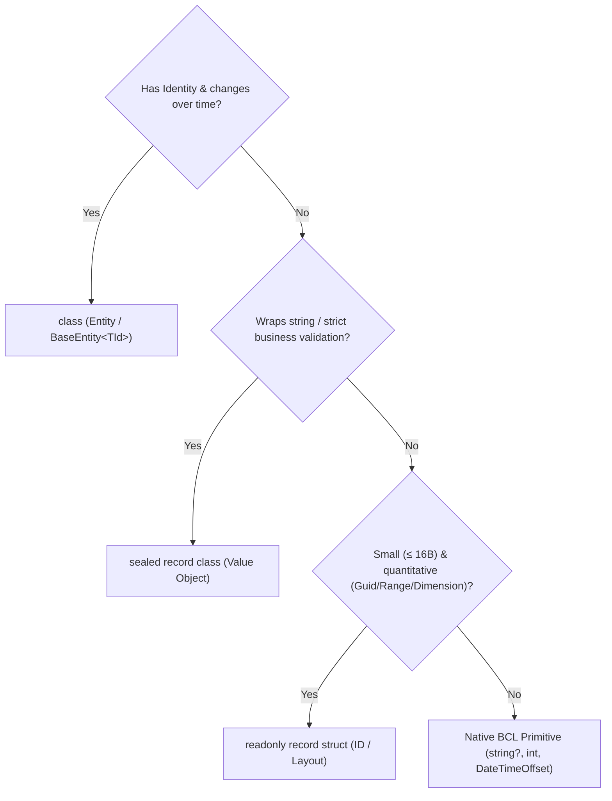

# CODING_CONVENTIONS.md — SMK Document Server

> **[PURPOSE_SCOPE_SSOT]:** Authoritative Single Source of Truth for Backend C# 13 / .NET 10 Clean Architecture Micro-AST Invariants, Syntax Token Substitutions, and Layer Boundary Grammar (`backend-v2/`).
> **[CORE_MISSION]:** Eliminate LLM code generation inconsistency, suppress pre-training legacy prior collisions, and enforce deterministic Clean Architecture AST invariants across all model invocations.
> **[ORTHOGONAL_ROLE]:** This document functions strictly as the **Micro-Linter & Neural AST Constraint Engine** (enforcing single-line and single-file AST syntax invariants). For complete multi-file feature slice wiring and generative recipes, consult [`docs/AI/PATTERNS.md`](file:///c:/Users/jossl.000/Downloads/Compressed/smk-doc-server/smk-doc-server/docs/AI/PATTERNS.md). For fatal production traps and pre-training interceptors, consult [`docs/AI/ANTI-PATTERNS.md`](file:///c:/Users/jossl.000/Downloads/Compressed/smk-doc-server/smk-doc-server/docs/AI/ANTI-PATTERNS.md).
> **[EXCLUSION]:** Frontend conventions (Next.js 15, TypeScript 5.7, Zod schemas) reside exclusively in [`docs/AI/FRONTEND_SPEC.md`](file:///c:/Users/jossl.000/Downloads/Compressed/smk-doc-server/smk-doc-server/docs/AI/FRONTEND_SPEC.md). Do NOT consult this file for UI code.
> **[ENFORCEMENT]:** LLMs and engineers MUST obey all RFC 2119 keywords (`[MUST]`). Every rule carries a machine-traceable token `RULE-[CATEGORY]-[ID]`.

---

<cognitive_mode_and_severity>
## 🧠 Cognitive Mode & Severity Hierarchy

### Operational Modes & Attention Budget
When processing this specification, the LLM MUST determine its active operational mode:
1. **`[MODE: CODE_GENERATION]`**: Focus attention strictly on `<runtime_and_compiler_baseline>`, `<ast_token_substitution_matrix>`, `<clean_architecture_layer_matrix>`, `<layer_architectural_contracts>`, `<canonical_naming_and_identity_map>`, and `<macro_assembler_routing>`. Suppress auditor output templates.
2. **`[MODE: CODE_AUDIT_LINT]`**: Activate `<architectural_linter_protocol>` to intercept non-compliant patterns and emit structured `🚨 [ARCHITECTURAL_VIOLATION_DETECTED]` remediation blocks.

### Rule Severity Tiers (Cognitive Constraint Hierarchy)
To prevent constraint collapse during complex generation tasks, resolve priority collisions using this hierarchy:
* **`[TIER-1-FATAL]` (Process & Memory Integrity):** Governed by [`ANTI-PATTERNS.md`](file:///c:/Users/jossl.000/Downloads/Compressed/smk-doc-server/smk-doc-server/docs/AI/ANTI-PATTERNS.md): Zero LOH allocations (`FIREWALL-MEM-001`), DbContext thread isolation (`FIREWALL-CONC-001`), non-blocking async (`FIREWALL-ASYNC-001`), single atomic commit (`FIREWALL-ARCH-003`).
* **`[TIER-2-ARCH]` (Clean Architecture Boundaries):** Inward dependency flow (`RULE-ARCH-001`), DTO layer isolation (`RULE-DTO-001`), action-centric UseCases (`RULE-SOLID-001`), strategy rendering (`RULE-PAT-001`).
* **`[TIER-3-CRAFT]` (Syntactic & Micro-Ergonomics):** Named arguments on same primitives (`RULE-CRAFT-012`), Stepdown method order (`RULE-CRAFT-001`), trailing commas & curly braces (`RULE-CRAFT-014`), pure `camelCase` DI parameters (`RULE-APP-002`).
</cognitive_mode_and_severity>

---

<runtime_and_compiler_baseline>
## 1. 🏗️ Runtime & Compiler Capabilities (Ground Truth)

All C# code generated by LLMs MUST strictly adhere to the following target runtimes and compiler capabilities.

| Layer / Concern | Technology | Target Version | Active Language Capabilities & Invariants |
|---|---|---|---|
| **Backend Runtime** | .NET | 10 (`net10.0`) | `TimeProvider`, `Guid.CreateVersion7()`, RFC 9457 `ProblemDetails` |
| **Language** | C# | 13 (`<LangVersion>13.0</LangVersion>`) | Primary Constructors, Collection Expressions `[]`, `System.Threading.Lock` |
| **ORM / Data** | EF Core + Npgsql | 10.x | Code-First, Fluent API Mapping, PostgreSQL Provider, `builder.UseXminAsConcurrencyToken()` |
| **Database** | PostgreSQL | 15-alpine | Relational storage, UTF-8 Thai Collation, `smkdoc` database |
| **Rendering Gateway**| Gotenberg | 8.x | Chromium headless (HTML to PDF) and LibreOffice engine |
| **Object Storage** | MinIO | S3-Compatible | Multi-bucket asset & output storage (`templates/`, `outputs/`) |

* `[RULE-TECH-001] [MUST]`: Use C# 13 language features: Collection expressions `[]`, Primary Constructors on classes, `Lock` object for synchronization.
* `[RULE-TECH-002] [MUST]`: Use .NET 10 APIs: `TimeProvider` for time queries, `Guid.CreateVersion7()` for UUIDv7 sequential entity keys.
* `[RULE-TECH-003] [MUST]`: Exclusively use modern language targets: collection expressions `[]` for initializations, `timeProvider.GetUtcNow()` for clocks, and `Lock` object for synchronization.
</runtime_and_compiler_baseline>

---

<ast_token_substitution_matrix>
## 2. ⚡ High-Salience AST Token Substitution Matrix (Categorized Pre-Training Override)

> **[COGNITIVE_PURPOSE]:** Direct hash-lookup engine organized by semantic category to maximize Attention Density and eliminate search-space entropy. Whenever the model contemplates generating a token from the left column, it MUST instantly substitute it with the canonical token from the right column.

### Category A: Language & Modern C# 13 / .NET 10 Primitives
| AST Node / Concern | Defective Prior (❌ Trigger Drop) | Canonical Target Token (✅ Mandatory Target) | Governing Invariant |
|---|---|---|---|
| **Collection Init** | `new List<T>()`, `new T[] { }` | `[]` | C# 13 Collection Expressions (`RULE-TECH-001`) |
| **Time Query** | `DateTime.UtcNow`, `DateTime.Now` | `timeProvider.GetUtcNow()`, `DateTimeOffset now` | Testable deterministic time (`RULE-APP-005`, `RULE-DOM-005`) |
| **Entity Key** | `Guid.NewGuid()`, auto-increment `int` | `Guid.CreateVersion7()` | Sequential B-tree indexing UUIDv7 (`RULE-DOM-007`) |
| **Concurrency Lock** | `lock (new object())`, `Monitor.Enter` | `System.Threading.Lock _gate = new(); lock (_gate)` | C# 13 High-Performance Lock (`RULE-TECH-001`) |
| **Memory Buffers** | `new MemoryStream()`, `byte[] buffer` | `Stream.CopyToAsync(response.Body, ct)`, `ArrayPool<byte>` | Zero LOH allocation 👉 [`FIREWALL-MEM-001`](file:///c:/Users/jossl.000/Downloads/Compressed/smk-doc-server/smk-doc-server/docs/AI/ANTI-PATTERNS.md#firewall-mem-001) |
| **Async Blocking** | `.Result`, `.Wait()`, `.GetAwaiter()` | `await` | Non-blocking execution 👉 [`FIREWALL-ASYNC-001`](file:///c:/Users/jossl.000/Downloads/Compressed/smk-doc-server/smk-doc-server/docs/AI/ANTI-PATTERNS.md#firewall-async-001) |
| **Regex Parsing** | `new Regex(pattern)` in execution path | `[GeneratedRegex]` with `RegexOptions.NonBacktracking` | ReDoS defense 👉 [`FIREWALL-SEC-003`](file:///c:/Users/jossl.000/Downloads/Compressed/smk-doc-server/smk-doc-server/docs/AI/ANTI-PATTERNS.md#firewall-sec-003) |

### Category B: Dependency Injection, Parameters & Identifier Naming
| AST Node / Concern | Defective Prior (❌ Trigger Drop) | Canonical Target Token (✅ Mandatory Target) | Governing Invariant |
|---|---|---|---|
| **Primary Ctor DI** | `_repo`, `_logger`, `_unitOfWork` | `templateRepo`, `logger`, `unitOfWork` | Pure `camelCase` parameters (`RULE-APP-002`) |
| **Cancellation Token**| `cancellationToken`, `cancelToken`, `None` | `CancellationToken ct = default` | Downstream token propagation (`RULE-CONC-002`) |
| **Command Variable** | `cmd`, `c` | `command` | Strict variable dictionary (`RULE-NAME-002`) |
| **Request Variable** | `req`, `r` | `request` | Strict variable dictionary (`RULE-NAME-002`) |
| **Result DTO Variable**| `dto`, `d`, `res` | `result` | Strict variable dictionary (`RULE-NAME-002`) |
| **Query Variable** | `qry`, `q` | `query` | Strict variable dictionary (`RULE-NAME-002`) |
| **Positional Inlined** | `ExecuteAsync(new CreateCommand(...))` | `var command = new CreateCommand(...); await ...` | Explicit intermediate instantiation (`RULE-CRAFT-007`) |
| **Homogeneous Args** | `Method(id1, id2, str1, str2)` | `Method(sourceId: id1, targetId: id2)` | Mandatory named arguments on same types (`RULE-CRAFT-012`) |

### Category C: Domain Modeling & Layer Boundary Grammar
| AST Node / Concern | Defective Prior (❌ Trigger Drop) | Canonical Target Token (✅ Mandatory Target) | Governing Invariant |
|---|---|---|---|
| **Domain State** | `public string Name { get; set; }` | `public TemplateName Name { get; private set; }` | Encapsulated Rich Domain Model (`RULE-DOM-002`) |
| **Domain Factory** | `new Template(...)` (caller instantiation) | `Template.Create(...)` | Single canonical factory method SSoT (`RULE-DOM-003`) |
| **Domain Mutation** | Direct property setter outside entity | `template.Archive(now)`, `template.Publish(now)` | Expressive business domain verbs (`RULE-DOM-005`) |
| **Entity Declaration**| `public struct Entity`, `record struct Entity` | `public sealed class Entity : BaseEntity<TId>` | EF Core change tracking & identity equality 👉 [`FIREWALL-DOM-002`](file:///c:/Users/jossl.000/Downloads/Compressed/smk-doc-server/smk-doc-server/docs/AI/ANTI-PATTERNS.md#firewall-dom-002) |
| **String Value Object**| `public class Name : ValueObject` (boilerplate) | `public sealed record class Name` | Modern C# 13 structural equality (`RULE-DOM-006`) |
| **String Struct Trap** | `public readonly record struct Name(string Value)`| `public sealed record class Name` | Zero default-null bypass defense 👉 [`FIREWALL-DOM-001`](file:///c:/Users/jossl.000/Downloads/Compressed/smk-doc-server/smk-doc-server/docs/AI/ANTI-PATTERNS.md#firewall-dom-001) |
| **Strongly-Typed ID** | Raw primitive `Guid ProjectId` | `public readonly record struct ProjectId(Guid Value)` | 16-byte stack allocated type-safety 👉 [`FIREWALL-DOM-004`](file:///c:/Users/jossl.000/Downloads/Compressed/smk-doc-server/smk-doc-server/docs/AI/ANTI-PATTERNS.md#firewall-dom-004) |
| **Numeric/Range Struct**| `public class PageMargin`, `public class DateRange` | `public readonly record struct PageMargin(...)` | Stack-allocated lightweight dimensions (`RULE-DOM-006`) |
| **Cross-Aggregate Ref**| Navigation property `public Project Project`| Foreign key identifier `public ProjectId ProjectId` | Aggregate boundary isolation (`RULE-DOM-009`) |
| **Entity DTO Egress**| Returning `Template` outside UseCase | Returning immutable `TemplateResultDto` | Zero entity boundary leakage 👉 [`FIREWALL-ARCH-002`](file:///c:/Users/jossl.000/Downloads/Compressed/smk-doc-server/smk-doc-server/docs/AI/ANTI-PATTERNS.md#firewall-arch-002) |
| **Transaction Boundary**| Multiple `CommitAsync()` in UseCase | Exactly 1 `await unitOfWork.CommitAsync(ct);` | Atomic ACID transaction 👉 [`FIREWALL-ARCH-003`](file:///c:/Users/jossl.000/Downloads/Compressed/smk-doc-server/smk-doc-server/docs/AI/ANTI-PATTERNS.md#firewall-arch-003) |
| **Read Queries** | `dbContext.Templates.ToList()` | `templateRepo.ListAsync(ct)` with `.AsNoTracking()` | Zero untracked queries (`RULE-INFRA-005`) |
| **Query Projection** | Loading full entity then mapping in memory | Project via LINQ `.Select(t => new ResultDto(...))` | High-throughput query performance (`RULE-INFRA-005`) |
| **Repo Return** | Returning `IQueryable<T>` outside Infra | Return `Task<IReadOnlyList<T>>` or `Task<T?>` | Evaluated collection contracts 👉 [`FIREWALL-ARCH-004`](file:///c:/Users/jossl.000/Downloads/Compressed/smk-doc-server/smk-doc-server/docs/AI/ANTI-PATTERNS.md#firewall-arch-004) |
| **Entity Config** | Data annotations (`[Table]`, `[Key]`) | `IEntityTypeConfiguration<T>` in Infrastructure | Clean Architecture boundary (`RULE-INFRA-002`) |
| **Concurrency Token**| Timestamp property or unhandled 409 | `builder.UseXminAsConcurrencyToken()` | Optimistic locking via PostgreSQL xmin (`RULE-INFRA-007`) |
| **Service Size** | God class `TemplateService` with CRUD methods | 1 Intent = 1 Class implementing `IUseCase<TCommand, TResult>` | SRP CQRS UseCase 👉 [`FIREWALL-ARCH-001`](file:///c:/Users/jossl.000/Downloads/Compressed/smk-doc-server/smk-doc-server/docs/AI/ANTI-PATTERNS.md#firewall-arch-001) |

### Category D: Presentation, Wire Envelopes & REST Protocol
| AST Node / Concern | Defective Prior (❌ Trigger Drop) | Canonical Target Token (✅ Mandatory Target) | Governing Invariant |
|---|---|---|---|
| **HTTP Result** | `return Ok(dto);`, empty `204 NoContent` | `TypedResults.Ok(ApiResponse<T>.Success(result))` | Strongly-typed RFC 9110 responses (`RULE-API-002`) |
| **HTTP Created** | `return StatusCode(201, ...)` | `TypedResults.Created($"/api/v1/{res}/{id}", envelope)` | Strongly-typed RFC 9110 responses (`RULE-API-002`) |
| **Model Binding** | `[FromBody] Template entity` | `[FromBody] CreateTemplateRequest request` | Mass-assignment defense 👉 [`FIREWALL-SEC-002`](file:///c:/Users/jossl.000/Downloads/Compressed/smk-doc-server/smk-doc-server/docs/AI/ANTI-PATTERNS.md#firewall-sec-002) |
| **Error Egress** | `new { error = "msg" }`, `try-catch` in action | RFC 9457 `ProblemDetails` via `GlobalExceptionHandler` | Centralized error pipeline 👉 [`FIREWALL-OPS-003`](file:///c:/Users/jossl.000/Downloads/Compressed/smk-doc-server/smk-doc-server/docs/AI/ANTI-PATTERNS.md#firewall-ops-003) |
| **Safe Mutations** | `[HttpPost]` without idempotency filter | `[HttpPost, Idempotent]` | Safe retry semantics 👉 [`FIREWALL-OPS-004`](file:///c:/Users/jossl.000/Downloads/Compressed/smk-doc-server/smk-doc-server/docs/AI/ANTI-PATTERNS.md#firewall-ops-004) |
| **Thai Localization**| Inlined `+ 543` or ad-hoc BahtText regex | `ThaiDataTransformer.Transform(val, TransformerType)` | Centralized Thai compliance (`RULE-VAL-002`) |
| **Test Setup** | `var sut = new UseCase(mock1, mock2)` | SSoT `CreateSut().ExecuteAsync(...)` in test class | Single Source of Truth SUT pattern (`RULE-TEST-005`) |
| **Test Clocks** | Calling `DateTime.UtcNow` inside tests | `timeProviderMock.Setup(t => t.GetUtcNow()).Returns(...)` | Deterministic time testing (`RULE-TEST-006`) |
| **Test Assertions** | `.Should().Be((TemplateId)guid)` | `var id = TemplateId.New(); ... .Should().Be(id)` | Zero-cast assertion 👉 [`FIREWALL-TEST-001`](file:///c:/Users/jossl.000/Downloads/Compressed/smk-doc-server/smk-doc-server/docs/AI/ANTI-PATTERNS.md#firewall-test-001) |
</ast_token_substitution_matrix>

---

<clean_architecture_layer_matrix>
## 3. 🏛️ Clean Architecture Layer & DTO Matrix

### 3.1 Boundary Invariants (`RULE-ARCH`)

Dependencies flow inwards exclusively: `Presentation (Api)` ➔ `Application` ➔ `Domain` 🠔 `Infrastructure`.

* `[RULE-ARCH-001] [MUST]`: Dependencies flow INWARDS ONLY. Domain Core references zero external assemblies or NuGet packages.
* `[RULE-ARCH-002] [MUST]`: Domain represents pure business logic. Implement core entities and domain logic as framework-free C# POCOs.
* `[RULE-ARCH-003] [MUST]`: Application orchestrates workflows via CQRS UseCases. Protect Domain Entities inside Application boundary by returning immutable Application DTO records exclusively.
* `[RULE-ARCH-004] [MUST]`: Infrastructure implements interfaces declared by Application or Domain (Dependency Inversion Principle).
* `[RULE-ARCH-005] [MUST]`: Presentation serves as a thin HTTP transport boundary. Delegate all workflow orchestration directly to single-responsibility UseCases.

---

### 3.2 DTO Layering & Ownership Matrix (`RULE-DTO`)

Every DTO belongs strictly to its designated architectural layer:

| DTO Type | Owner Layer | Target C# Construct | Purpose | Layer Scope Boundary |
|---|---|---|---|---|
| **`*Request`** | **Presentation** (`SmkDoc.Api`) | `public sealed record` | Represents incoming HTTP payload (JSON body / Form data) | Isolated strictly within Presentation |
| **`*Command`** | **Application** (`SmkDoc.Application`) | `public sealed record` | Represents business intent to mutate state (CQRS Write) | Pure business model, zero HTTP attributes |
| **`*Query`** | **Application** (`SmkDoc.Application`) | `public sealed record` | Represents criteria to query data (CQRS Read) | Pure query criteria, zero mutation logic |
| **`*ResultDto`** | **Application** (`SmkDoc.Application`) | `public sealed record` | Immutable data carrier snapshot returned by UseCase | Application egress, zero entity leaks |
| **`ApiResponse<T>`** | **Presentation** (`SmkDoc.Api`) | Generic record envelope | Standardized REST JSON wrapper for wire transport | HTTP transport egress exclusively |
| **Domain Entity** | **Domain** (`SmkDoc.Domain`) | `public sealed class` | Core business aggregate encapsulating state and invariants | Internal domain core, never exposed on wire |

* `[RULE-DTO-001] [MUST]`: Implement all DTOs (`*Request`, `*Command`, `*Query`, `*ResultDto`) as immutable positional records (`public sealed record`).
* `[RULE-DTO-002] [MUST]`: Project Domain Entities into immutable `*ResultDto` records before leaving the Application boundary.
* `[RULE-DTO-003] [MUST]`: Map Presentation `Request` to Application `Command` using direct constructor instantiation or explicit `.ToCommand()` extension methods.

---

### 3.3 SOLID Principles & Defensive Invariants (`RULE-SOLID`)

* `[RULE-SOLID-001] [MUST]`: **Single Responsibility Principle (SRP):** Structure logic as 1 Business Intent = 1 UseCase class (`CreateTemplateUseCase`, `PublishTemplateUseCase`) implementing `IUseCase<TCommand, TResult>`.
* `[RULE-SOLID-002] [MUST]`: **Open/Closed Principle (OCP):** Resolve render engines polymorphically by injecting `IEnumerable<IRenderEngine>` into DI and dispatching via Smart Enum.
* `[RULE-SOLID-003] [MUST]`: **Liskov Substitution Principle (LSP):** Ensure every interface implementation fulfills 100% of the interface contract across all registered subtypes.
* `[RULE-SOLID-004] [MUST]`: **Interface Segregation Principle (ISP):** Expose focused aggregate repository interfaces (`ITemplateRepository`) returning evaluated types (`Task<IReadOnlyList<T>>` or `Task<T?>`).
* `[RULE-SOLID-005] [MUST]`: **Dependency Inversion Principle (DIP):** Depend strictly on Domain/Application abstractions (`IStorageService`, `ITemplateRepository`, `IUnitOfWork`). Place concrete implementations in Infrastructure.

---

### 3.4 KISS & Pragmatic Simplicity Invariants (`RULE-KISS`)

* `[RULE-KISS-001] [MUST]`: Use direct, flat `IUseCase<TCommand, TResult>` calls. 1 Controller action invokes 1 UseCase directly for transparent execution flow and clear stack traces.
* `[RULE-KISS-002] [MUST]`: Maintain cyclomatic indentation depth at 2 or fewer (`Depth <= 2`). Use top-level fail-fast Guard Clauses to keep execution linear and left-aligned.
* `[RULE-KISS-003] [MUST]`: Formulate clear, readable repository queries using standard EF Core LINQ.

---

### 3.5 DRY & Single Source of Truth Invariants (`RULE-DRY`)

* `[RULE-DRY-001] [MUST]`: **Dual Validation Gate:** Validate external transport shape via `FluentValidation` at the boundary; validate domain state invariants inside Domain Entities.
* `[RULE-DRY-002] [MUST]`: Map `CreateTemplateRequest` directly into `CreateTemplateCommand` positional record without intermediary mapping boilerplate classes.
* `[RULE-DRY-003] [MUST]`: Centralize clock queries via .NET standard `TimeProvider` (`timeProvider.GetUtcNow()`) or pass explicit `DateTimeOffset now` down from UseCase.

---

### 3.6 Approved Design Patterns Catalog (`RULE-PAT`)

All implementations within `smk-doc-server` align with these canonical patterns:
* `[RULE-PAT-001] [MUST]`: **Strategy Pattern:** Used for document rendering engines (`IRenderEngine` for Chromium HTML, OpenXml DOCX, FastExcel XLSX).
* `[RULE-PAT-002] [MUST]`: **Factory Method Pattern:** Used for Domain Aggregate creation (`Template.Create(...)`) acting as the immutable SSoT.
* `[RULE-PAT-003] [MUST]`: **Unit of Work Pattern:** Used for atomic database transaction boundaries (`IUnitOfWork.CommitAsync(ct)`).
* `[RULE-PAT-004] [MUST]`: **Smart Enum Pattern:** Used when types possess metadata, behavioral logic, or MIME mappings.
* `[RULE-PAT-005] [MUST]`: **Result & Envelope Pattern:** Used for HTTP responses (`TypedResults` wrapping `ApiResponse<T>` or raw binary streams).
</clean_architecture_layer_matrix>

---

<layer_architectural_contracts>
## 4. 🔵 Layer Architectural Contracts (C# 13 / .NET 10)

### 4.1 Domain Layer (`RULE-DOM`)
* `[RULE-DOM-001] [MUST]`: Implement entities and aggregate roots exclusively as `public sealed class` inheriting `BaseEntity` to preserve EF Core Change Tracker reference identity. Prohibited from being a `struct` or `record struct` (👉 [`FIREWALL-DOM-002`](file:///c:/Users/jossl.000/Downloads/Compressed/smk-doc-server/smk-doc-server/docs/AI/ANTI-PATTERNS.md#firewall-dom-002)).
* `[RULE-DOM-002] [MUST]`: Encapsulate state strictly. Declare all entity properties with `private set;` or `protected set;`. Mutate state through expressive domain verbs.
* `[RULE-DOM-003] [MUST]`: Expose exactly 1 canonical factory method (`Create`) as the SSoT for entity instantiation, keeping constructors `private` or `internal`.
* `[RULE-DOM-004] [MUST]`: Validate business state invariants fail-fast inside the factory method (e.g. `ArgumentException.ThrowIfNullOrWhiteSpace(name)`).
* `[RULE-DOM-005] [MUST]`: Mutate state exclusively via expressive domain verbs (e.g., `Publish`, `Archive`, `Deactivate`) receiving explicit dependencies (e.g., `DateTimeOffset now`).
* `[RULE-DOM-006] [MUST]`: **Value Object Bifurcation Invariant:**
  - **Class-based (`public sealed record class`):** MUST be used for Value Objects wrapping `string`, enforcing business validations (Regex, NotBlank), or where `default(T)` would represent an invalid state (e.g. `ProjectName`, `EmailAddress`). Constructors MUST be private, instantiated via canonical `Create(...)` factory method (👉 [`FIREWALL-DOM-001`](file:///c:/Users/jossl.000/Downloads/Compressed/smk-doc-server/smk-doc-server/docs/AI/ANTI-PATTERNS.md#firewall-dom-001)).
  - **Struct-based (`public readonly record struct`):** MUST be used for Strongly-Typed IDs, numerical dimensions (Measurements), and date/time ranges with total size <= 16 bytes (e.g. `PageDimension` 8B, `PageMargin` 16B, `DateRange` 8B).
  


* `[RULE-DOM-007] [MUST]`: Generate primary keys using sequential UUIDv7 (`Guid.CreateVersion7()`) for high-performance B-tree indexing.
* `[RULE-DOM-008] [MUST]`: Throw strongly-typed Domain Exceptions exclusively (`DomainValidationException`, `NotFoundException`, `ConflictException`) to represent business errors.
* `[RULE-DOM-009] [MUST]`: Model cross-aggregate relationships using foreign key identifiers exclusively (`Guid ProjectId` or `ProjectId ProjectId`).
* `[RULE-DOM-010] [MUST]`: **Strongly-Typed ID Invariant & Zero-Cast Policy:** Strongly-Typed IDs wrapping `Guid` MUST be declared as `public readonly record struct Name(Guid Value) : IComparable<Name>`. Prohibited from being classes to eliminate 24-byte heap header overhead. Each ID struct MUST provide:
  - Canonical factory methods: `New()` (`Guid.CreateVersion7()`), `Empty` (`Guid.Empty`), and `bool IsEmpty`.
  - Bidirectional implicit operators: `implicit operator Guid(Name id)` and `implicit operator Name(Guid value)` ensuring zero-cast conversions across DTO/CQRS boundaries.
  - Cross-type equality operators: `operator ==(Name, Guid)`, `operator !=(Name, Guid)`, `operator ==(Guid, Name)`, and `operator !=(Guid, Name)`.
  - **Zero-Cast Rule:** Explicit casting like `(TId)guid` or `(Guid)id` is strictly prohibited in business logic.
* `[RULE-DOM-011] [MUST]`: **Zero-Default State Invariant:** NEVER declare a Value Object as a `struct` if `default(T)` represents an illegal or corrupted domain state that bypasses factory validation invariants.
* `[RULE-DOM-012] [MUST]`: **Non-Critical Property Boundary Invariant:** General descriptive fields (`FirstName`, `LastName`, `Description`, `CommitMessage`, `ChangeNote`) MUST remain native `string?` paired with EF Core `HasMaxLength(...)`. Wrapping non-critical text into dedicated Value Objects is strictly prohibited to prevent boilerplate bloat.

##### Domain Type Taxonomy & Memory Model Matrix:
| Category | Target C# Construct | Memory Target | Invariant & Core Purpose | Concrete Examples in SmkDoc |
|---|---|---|---|---|
| **Entities / Aggregates** | `public sealed class : BaseEntity<TId>` | Heap | Reference identity, EF Core Change Tracking (`RULE-DOM-001`) | `Company`, `Project`, `User`, `Template`, `Document` |
| **Strongly-Typed IDs** | `public readonly record struct` | Stack (16B) | Zero heap allocation, compile-time type safety, zero manual casts (`RULE-DOM-010`) | `ProjectId`, `TemplateId`, `UserId`, `CompanyId` |
| **Layout / Dimensions** | `public readonly record struct` | Stack (≤16B)| Zero-allocation math for PDF/Excel printing (`RULE-DOM-006`) | `PageDimension` (8B), `DateRange` (8B), `PageMargin` (16B) |
| **Validated Text VOs** | `public sealed record class` | Heap | Private ctor + `Create(...)` prevents `default(T)` bypass (`RULE-DOM-006`) | `ProjectName`, `EmailAddress`, `TemplateSlug`, `Sha256Hash` |
| **Smart Enums** | `public class : Enumeration` | Heap | Static singletons, O(1) cache lookup, rich metadata (`RULE-PAT-004`) | `TemplateFormat`, `SystemRole`, `GenerationStatus` |
| **General Text Fields** | `string?` (Native BCL) | Inline/Heap | Pragmatic simplicity, zero unnecessary wrappers (`RULE-DOM-012`) | `FirstName`, `LastName`, `Description`, `CommitMessage` |

```csharp
// ✅ Compliant Domain Micro-Snippet (RULE-DOM-001 through RULE-DOM-012)
public readonly record struct TemplateId(Guid Value) : IComparable<TemplateId>
{
    public static TemplateId New() => new(Guid.CreateVersion7());
    public static TemplateId Empty => new(Guid.Empty);
    public bool IsEmpty => Value == Guid.Empty;
    public int CompareTo(TemplateId other) => Value.CompareTo(other.Value);
    public static implicit operator Guid(TemplateId id) => id.Value;
    public static implicit operator TemplateId(Guid value) => new(value);
    public static bool operator ==(TemplateId left, Guid right) => left.Value == right;
    public static bool operator !=(TemplateId left, Guid right) => left.Value != right;
    public static bool operator ==(Guid left, TemplateId right) => left == right.Value;
    public static bool operator !=(Guid left, TemplateId right) => left != right.Value;
}

public readonly record struct PageDimension(float WidthMm, float HeightMm); // <= 16B Stack-allocated Layout Struct

public sealed record class TemplateName // Validated String Value Object (Class-based to avoid default null trap)
{
    public string Value { get; }
    private TemplateName(string value) => Value = value;
    public static TemplateName Create(string? value) =>
        new(Guard.NotBlank(value, "Template name", 100));
    public static implicit operator string(TemplateName name) => name.Value;
}

public sealed class Template : BaseEntity<TemplateId> // Class-based Entity inheriting generic BaseEntity<TId>
{
    public ProjectId ProjectId { get; private set; }
    public TemplateName Name { get; private set; } = null!;
    public bool IsActive { get; private set; }

    private Template() { }

    public static Template Create(ProjectId projectId, TemplateName name, DateTimeOffset now) =>
        new() { Id = TemplateId.New(), ProjectId = projectId, Name = name, IsActive = true, CreatedAt = now };

    public void Archive(DateTimeOffset now) { IsActive = false; SetUpdated(now); }
}
```

---

### 4.2 Application Layer (`RULE-APP`)
* `[RULE-APP-001] [MUST]`: Implement every UseCase as a `public sealed class` implementing `IUseCase<TCommand, TResult>`.
* `[RULE-APP-002] [MUST]`: Use C# 13 Primary Constructors with pure `camelCase` parameters directly (e.g. `(ITemplateRepository templateRepo, IUnitOfWork unitOfWork)`).
* `[RULE-APP-003] [MUST]`: Implement Commands, Queries, and Output DTOs as positional records (`public sealed record`).
* `[RULE-APP-004] [MUST]`: Verify transport/structural constraints using `FluentValidation`; enforce business invariants inside Domain Entities.
* `[RULE-APP-005] [MUST]`: Query current time via .NET standard `TimeProvider` (`timeProvider.GetUtcNow()`).
* `[RULE-APP-006] [MUST]`: Accept `CancellationToken ct = default` as the final parameter on all asynchronous methods and propagate it to downstream calls.
* `[RULE-FLOW-001] [MUST]`: Sequence external side-effects in the **DB Intent ➔ Storage Upload ➔ DB Finalize** execution order.

```csharp
// ✅ Compliant Application Micro-Snippet (RULE-APP-001 through RULE-APP-006)
public sealed class CreateTemplateUseCase(
    ITemplateRepository templateRepo,
    IUnitOfWork unitOfWork,
    TimeProvider timeProvider) : IUseCase<CreateTemplateCommand, TemplateResultDto>
{
    public async Task<TemplateResultDto> ExecuteAsync(CreateTemplateCommand command, CancellationToken ct = default)
    {
        var now = timeProvider.GetUtcNow();
        var template = Template.Create(command.ProjectId, TemplateName.Create(command.Name), TemplateSlug.Create(command.Slug), now);
        await templateRepo.AddAsync(template, ct);
        await unitOfWork.CommitAsync(ct);
        return new TemplateResultDto(template.Id, template.Name.Value, template.CreatedAt);
    }
}
```

---

### 4.3 Infrastructure Layer (`RULE-INFRA`)
* `[RULE-INFRA-001] [MUST]`: Implement Domain and Application interfaces (`IRepository`, `IUnitOfWork`, `IRenderEngine`, `IStorageService`) in Infrastructure adapters.
* `[RULE-INFRA-002] [MUST]`: Map EF Core entities exclusively using `IEntityTypeConfiguration<T>` via the Fluent API.
* `[RULE-INFRA-003] [MUST]`: Coordinate persistence commits through `IUnitOfWork.CommitAsync(ct)`.
* `[RULE-INFRA-004] [MUST]`: Stream Gotenberg and MinIO payloads directly to destination streams via `Stream.CopyToAsync` (`Stream over RAM`).
* `[RULE-INFRA-005] [MUST]`: Append `.AsNoTracking()` to read queries and use database-translatable LINQ expressions.
* `[RULE-INFRA-006] [MUST]`: Map Domain Value Objects using strongly-typed EF Core Value Converters in `IEntityTypeConfiguration<T>`.
* `[RULE-INFRA-007] [MUST]`: Configure optimistic locking using the PostgreSQL `xmin` concurrency token (`builder.UseXminAsConcurrencyToken()`). Translate `DbUpdateConcurrencyException` to HTTP 409 Conflict.
* `[RULE-UOW-002] [MUST]`: Execute at most ONE single invocation of `await unitOfWork.CommitAsync(ct);` at the end of the transaction boundary.

```csharp
// ✅ Compliant Infrastructure Micro-Snippet (RULE-INFRA-002, RULE-INFRA-006, RULE-INFRA-007)
public sealed class TemplateConfiguration : IEntityTypeConfiguration<Template>
{
    public void Configure(EntityTypeBuilder<Template> builder)
    {
        builder.ToTable("templates");
        builder.HasKey(t => t.Id);
        builder.Property(t => t.Slug).HasConversion(slug => slug.Value, val => TemplateSlug.Create(val)).HasMaxLength(100).IsRequired();
        builder.UseXminAsConcurrencyToken();
    }
}
```

---

### 4.4 Presentation Layer (`RULE-API`)
* `[RULE-API-001] [MUST]`: Maintain controllers as thin coordinators ($\le 5$ lines per action body), delegating business workflows to UseCases.
* `[RULE-API-002] [MUST]`: Return compile-time typed responses via `TypedResults`:
  - `GET`: Return `Task<Ok<ApiResponse<T>>>` or `Task<Ok<PagedApiResponse<T>>>` via `TypedResults.Ok(...)`.
  - `POST` (Creation): Return `Task<Created<ApiResponse<T>>>` via `TypedResults.Created($"/api/v1/{resource}/{id}", ...)`.
  - `PUT` / `PATCH` (State Mutation): Return `Task<Ok<ApiResponse<T>>>` via `TypedResults.Ok(...)`.
  - `DELETE`: Return `Task<NoContent>` via `TypedResults.NoContent()`.
* `[RULE-API-003] [MUST]`: Format error responses as RFC 9457 `ProblemDetails` dispatched by `IExceptionHandler` (`GlobalExceptionHandler`).
* `[RULE-API-004] [MUST]`: Wrap collection inputs in a dedicated top-level request record (e.g., `BatchImportRequest(IReadOnlyList<T> Items)`).
* `[RULE-API-005] [MUST]`: Support the `Idempotency-Key` header on state-mutating endpoints (`POST`, `PUT`, `DELETE`) via the `[Idempotent]` action filter.
* `[RULE-API-006] [MUST]`: Configure canonical REST routes using `api/v1/{resource}` with lowercase plural `kebab-case` resource names.

```csharp
// ✅ Compliant Presentation Micro-Snippet (RULE-API-001 through RULE-API-006)
[ApiController]
[Route("api/v1/templates")]
public sealed class TemplateController(
    IUseCase<CreateTemplateCommand, TemplateResultDto> createUseCase) : ControllerBase
{
    [HttpPost]
    [Idempotent]
    public async Task<Created<ApiResponse<TemplateResultDto>>> Create([FromBody] CreateTemplateRequest request, CancellationToken ct)
    {
        var command = new CreateTemplateCommand(request.ProjectId, request.Name, request.Slug);
        var result = await createUseCase.ExecuteAsync(command, ct);
        return TypedResults.Created($"/api/v1/templates/{result.Id}", ApiResponse<TemplateResultDto>.Success(result));
    }
}
```

---

### 4.5 3-Tier Validation Hierarchy & Thai Compliance (`RULE-VAL`)
* `[RULE-VAL-001] [MUST]`: Structure validation across 3 progressive tiers:
  - **Tier 1 (Syntax & Shape):** `FluentValidation` at Presentation boundary (HTTP 400, `VALIDATION_FAILED`).
  - **Tier 2 (Dynamic Payload):** Validated against JSON Schema Draft-07 via `JsonSchema.Net` (HTTP 422, `SCHEMA_VALIDATION_FAILED`).
  - **Tier 3 (Domain Invariants):** Validated in Domain Entity factory and verbs (`DomainValidationException`).
* `[RULE-VAL-002] [MUST]`: Format Thai Localization values (Buddhist Era years, Thai Baht text, phone numbers) through centralized `ThaiDataTransformer`.
* `[RULE-VAL-003] [MUST]`: Validate Thai 13-digit National ID and Tax ID using the official Modulo 11 checksum algorithm.

---

### 4.6 High-Performance Memory & LOH Hygiene (`RULE-MEM`)
* `[RULE-MEM-001] [MUST]`: Stream document payloads directly to HTTP responses via `Stream.CopyToAsync(response.Body, ct)` or `PipeWriter` to preserve Large Object Heap (LOH) health 👉 [`FIREWALL-MEM-001`](file:///c:/Users/jossl.000/Downloads/Compressed/smk-doc-server/smk-doc-server/docs/AI/ANTI-PATTERNS.md#firewall-mem-001).
* `[RULE-MEM-002] [MUST]`: When intermediate buffering is unavoidable, rent buffers from `ArrayPool<byte>.Shared` or `RecyclableMemoryStreamManager`, returning them in a `finally` block.

---

### 4.7 Concurrency & DbContext Thread-Safety (`RULE-CONC`)
* `[RULE-CONC-001] [MUST]`: Execute scoped DbContext operations sequentially, or spawn isolated short-lived contexts using `IDbContextFactory<SmkDocDbContext>` for concurrent tasks 👉 [`FIREWALL-CONC-001`](file:///c:/Users/jossl.000/Downloads/Compressed/smk-doc-server/smk-doc-server/docs/AI/ANTI-PATTERNS.md#firewall-conc-001).
* `[RULE-CONC-002] [MUST]`: Propagate `CancellationToken ct = default` to every terminal async operation (`ToListAsync(ct)`, `CopyToAsync(..., ct)`).
* `[RULE-CONC-003] [MUST]`: Dispatch background tasks through `Channel<T>` to a `BackgroundService`, or create an explicit scope using `IServiceScopeFactory.CreateAsyncScope()`.

---

### 4.8 Structured Logging & Observability (`RULE-LOG`)
* `[RULE-LOG-001] [MUST]`: Structure all log messages using named semantic templates (e.g., `logger.LogInformation("Rendered {TemplateId} in {ElapsedMs}ms", templateId, elapsed)`). Never use string interpolation inside log methods.
* `[RULE-LOG-002] [MUST]`: Mask Personally Identifiable Information (PII) before logging.

---

### 4.9 Code-Level Security & ReDoS Defense (`RULE-SEC`)
* `[RULE-SEC-001] [MUST]`: Declare regular expressions using source generators (`[GeneratedRegex]`) with `RegexOptions.NonBacktracking` to eliminate ReDoS vulnerabilities 👉 [`FIREWALL-SEC-003`](file:///c:/Users/jossl.000/Downloads/Compressed/smk-doc-server/smk-doc-server/docs/AI/ANTI-PATTERNS.md#firewall-sec-003).
* `[RULE-SEC-002] [MUST]`: Filter internal stack traces and database connection details from production RFC 9457 responses.
* `[RULE-SEC-003] [MUST]`: Mutate entity state exclusively through explicit domain methods with strongly-typed parameters.

---

### 4.10 The 15 Invariants of Code Craftsmanship (`RULE-CRAFT`) — 3 Cognitive Clusters

<craft_cluster name="TOPOLOGY_AND_LAYOUT">
#### Cluster 1: Topology, Ordering & Physical File Layout
* `[RULE-CRAFT-001] [MUST]`: **Stepdown Rule:** Position public entry points (`ExecuteAsync`) at the top of the class body. Place private helper methods immediately beneath their caller in top-down invocation order.
* `[RULE-CRAFT-002] [MUST]`: **Vertical Proximity & Visual Formatting:** Declare local variables immediately before their first usage. Separate distinct logical blocks using exactly 1 blank line.
* `[RULE-CRAFT-015] [MUST]`: **Single Responsibility per File:** Place exactly ONE top-level C# type per file with matching file name.
</craft_cluster>

<craft_cluster name="LOGIC_FLOW_AND_CADENCE">
#### Cluster 2: Logic Flow, Invariant Guards & Method Cadence
* `[RULE-CRAFT-003] [MUST]`: **Linear Guard Clauses:** Inspect preconditions and fail-fast at method start. Keep cyclomatic indentation depth at 2 or fewer (`Depth <= 2`).
* `[RULE-CRAFT-008] [MUST]`: **Trust Nullable Reference Types:** Validate inputs thoroughly at Presentation and Application boundaries, trusting compiler null-state analysis within internal methods.
* `[RULE-CRAFT-011] [MUST]`: **The P-E-M-R Method Execution Cadence:** Sequence UseCase `ExecuteAsync` logic in 4 distinct chronological steps:
  1. **P (Preconditions):** Fail-fast guard clauses, argument verification.
  2. **E (External Retrieval):** Retrieve required external state with `.AsNoTracking()`, query `timeProvider`.
  3. **M (Mutation):** Mutate state through Domain Factory or Domain Verbs.
  4. **R (Result & Persistence):** Execute single `unitOfWork.CommitAsync(ct)` and return immutable `*ResultDto`.
</craft_cluster>

<craft_cluster name="SYNTAX_AND_MICRO_ERGONOMICS">
#### Cluster 3: Syntax, Micro-Ergonomics & API Safety
* `[RULE-CRAFT-004] [MUST]`: **Intent-Revealing Identifiers:** Name identifiers using self-explanatory terms (`template`, `project`, `result`, `command`) that convey business and technical intent clearly.
* `[RULE-CRAFT-005] [MUST]`: **Route Token & Concept Invariance:** Use `{id:guid}` for root resources, disambiguated `{entityId:guid}` for nested resources, and `{Entity}Id` in Application Commands/Queries.
* `[RULE-CRAFT-006] [MUST]`: **Value-Add Rationale Comments:** Reserve code comments exclusively for explaining the "WHY" (business rules, Thai legal/tax mandates, RFC citations).
* `[RULE-CRAFT-007] [MUST]`: **Explicit Intermediate Variables:** Break LINQ and fluent transformation chains into named local variables when exceeding 3 operations. Instantiate parameters into local variables before passing to methods.
* `[RULE-CRAFT-009] [MUST]`: **Expressive Domain Verbs:** Mutate entity state exclusively via expressive business verbs (`Publish`, `Archive`, `Deactivate`).
* `[RULE-CRAFT-010] [MUST]`: **Centralized Constants & Options:** Route operational settings through `IOptions<TOptions>`, technical constants through `*Constants.cs`, and clocks through `TimeProvider`.
* `[RULE-CRAFT-012] [MUST]`: **Named Arguments on Same Types:** Use explicit C# named arguments (`projectId: command.ProjectId, name: templateName, slug: slug`) when calling methods with 2 or more parameters of the same primitive type.
* `[RULE-CRAFT-013] [MUST]`: **Verified Standard APIs:** Restrict method invocations to framework APIs or utilities explicitly declared in the codebase.
* `[RULE-CRAFT-014] [MUST]`: **Diff-Friendly & Patch-Safe Syntax:** Add trailing commas on multi-line lists/arguments; declare 1 parameter per line when $\ge 3$ items; enclose all control flow bodies in curly braces `{ }`.
</craft_cluster>

---

### 4.11 Unit Testing Craftsmanship (`RULE-TEST`)
* `[RULE-TEST-001] [MUST]`: Structure test names as: `MethodUnderTest_StateUnderTest_ExpectedBehavior`.
* `[RULE-TEST-002] [MUST]`: Organize tests into visual AAA blocks (`// Arrange`, `// Act`, `// Assert`) separated by blank lines.
* `[RULE-TEST-003] [MUST]`: Formulate assertions using `FluentAssertions` (e.g. `result.Should().NotBeNull()`).
* `[RULE-TEST-004] [MUST]`: Execute unit tests 100% in-memory using direct mocks. Reserve I/O testing for `SmkDoc.IntegrationTests`.
* `[RULE-TEST-005] [MUST]`: Centralize test SUT instantiation in a `CreateSut()` helper method within each test class.
* `[RULE-TEST-006] [MUST]`: Anchor mock clocks to `TestConstants.BaselineTime` for deterministic testing.
* `[RULE-TEST-007] [MUST]`: **Strongly-Typed ID Fixture & Zero-Cast Invariant:** Declare test entity and foreign key identifiers using strongly-typed IDs directly (e.g. `var templateId = TemplateId.New();`) rather than raw `Guid.NewGuid()`. Prohibited from casting `(TId)guid` in test assertions (`log.TemplateId.Should().Be(templateId)`) to avoid the FluentAssertions boxed-equality trap (`object.Equals(boxed TId, boxed Guid)`).
</layer_architectural_contracts>

---

<canonical_naming_and_identity_map>
## 5. 🏷️ Canonical Naming & Identity Maps (SSoT)

### 5.1 The 6 Pillars Naming Matrix
| Element / Artifact | Layer / Scope | Convention | Canonical Example |
|---|---|---|---|
| **Domain Entities** | Domain | Singular `PascalCase` | `Template`, `DocumentLog` |
| **Value Objects** | Domain | Descriptive `PascalCase` | `TemplateSlug`, `Sha256Checksum` |
| **Domain Factory** | Domain | Canonical Verb | `Create()` |
| **Domain Mutations** | Domain | Ubiquitous Business Verb | `Publish()`, `Archive()`, `Deactivate()` |
| **Primary Ctor Parameters** | All Classes | Pure `camelCase` (Zero `_`) | `templateRepo`, `unitOfWork`, `timeProvider` |
| **CQRS Commands** | Application | `[Action][Entity]Command` | `CreateTemplateCommand`, `ArchiveTemplateCommand` |
| **CQRS Queries** | Application | `[Get/List][Entity]Query` | `GetTemplateByIdQuery`, `ListTemplatesQuery` |
| **Output DTOs** | Application | `[Context]ResultDto` | `TemplateResultDto`, `RenderResultDto` |
| **HTTP Request Payloads** | Presentation | `[Action][Entity]Request` | `CreateTemplateRequest`, `RenderDocumentRequest` |
| **Controllers** | Presentation | `[Entity]Controller` | `TemplateController`, `DocumentController` |
| **Test Classes** | Tests | `[TargetClass]Tests` | `CreateTemplateUseCaseTests`, `TemplateTests` |
| **Database Tables** | Infrastructure | `plural_snake_case` | `templates`, `document_generation_logs` |
| **Database Columns** | Infrastructure | `snake_case` / `is_*` | `project_id`, `created_at`, `is_active` |

---

### 5.2 Canonical Operations Dictionary
| Operation Intent | Canonical Verb | Scope |
|---|---|---|
| Retrieve single entity by ID | **`GetByIdAsync`** | Repositories, Queries |
| Query entity by condition (nullable) | **`FindAsync`** | Repositories, UseCases |
| Retrieve collection of entities | **`ListAsync`** | Repositories, Queries |
| Verify existence of record | **`ExistsAsync`** | Repositories, UseCases |
| Persist transaction changes | **`CommitAsync`** | UnitOfWork |
| Instantiate domain entity | **`Create`** | Domain Factory |
| Retire / soft delete record | **`Archive`** | Domain Entities |

---

### 5.3 Deterministic 1:1 Type-to-Identifier Identity Map
| Target C# Type / Role | Canonical Identifier | Governing Scope |
|---|---|---|
| Any Command record (`*Command`) | `command` | Application CQRS Write |
| Any Query record (`*Query`) | `query` | Application CQRS Read |
| Any HTTP Request record (`*Request`) | `request` | Presentation Ingress |
| Any Output DTO record (`*ResultDto`) | `result` | Application Egress |
| Cancellation token (`CancellationToken`) | `ct` | Downstream Async |
| Deterministic timestamp (`DateTimeOffset`) | `now` | Auditing & Factory |
| Entity Primary Key (`Guid`) | `id` or `{entity}Id` | Identity Tracking |
| Entity Aggregate Root (`Template`) | `template` | Domain Aggregate |

---

### 5.4 Contract Property Symmetry (Zero Translation Glue)
Concept names retain identical identifiers across every layer boundary:
$$\text{HTTP Request: } \texttt{payload} \longrightarrow \text{Command: } \texttt{Payload} \longrightarrow \text{Domain: } \texttt{Payload} \longrightarrow \text{Result: } \texttt{Payload}$$
$$\text{HTTP Request: } \texttt{outputFormat} \longrightarrow \text{Command: } \texttt{OutputFormat} \longrightarrow \text{Domain: } \texttt{OutputFormat} \longrightarrow \text{Result: } \texttt{OutputFormat}$$

| Canonical Identifier | Scope | Semantic Invariant |
|---|---|---|
| `payload` | All Layers | Business domain JSON payload interpolated into template |
| `outputFormat` | All Layers | Target document format specifier (`pdf`, `docx`, `xlsx`) |
| `documentRef` / `correlationId` | All Layers | Idempotent generation tracking reference |
</canonical_naming_and_identity_map>

---

<macro_assembler_routing>
## 6. 🧩 Macro-Assembler Routing Delegation

> **[ORTHOGONAL_SSOT_BOUNDARY]:** This document (`CODING_CONVENTIONS.md`) functions exclusively as the **Micro-Linter & Neural AST Constraint Engine**.
>
> For complete multi-file Clean Architecture slice wiring, dataflow sequences, and generative archetypes, consult the **Macro-Assembler**:
> 👉 [`docs/AI/PATTERNS.md`](file:///c:/Users/jossl.000/Downloads/Compressed/smk-doc-server/smk-doc-server/docs/AI/PATTERNS.md)

### Canonical Cross-Document Assembly Mapping:
| Architectural Task | Canonical Authority (SSoT) | Implementation Pattern in `PATTERNS.md` |
|---|---|---|
| **Master 5-File Feature Slice** | `PATTERNS.md#2--level-2-master-5-file-feature-slice-pipeline` | Request ➔ Command ➔ UseCase ➔ Aggregate ➔ ResultDto |
| **Thin Controller & Envelope** | `PATTERNS.md#archetype-1-thin-controller--api-envelope-pattern` | Archetype 1 (`TypedResults.Ok`, `TypedResults.Created`) |
| **RFC 9457 Global Exception Pipeline** | `PATTERNS.md#archetype-2-rfc-9457-global-exception-pipeline-iexceptionhandler-ssot` | Archetype 2 (`IExceptionHandler` mapping SSoT) |
| **IETF Idempotency-Key Pipeline** | `PATTERNS.md#archetype-3-ietf-idempotency-key-pipeline-pattern-safe-mutations` | Archetype 3 (`[Idempotent]` Mutation Consumer Contract) |
| **Pure Rich Domain Entity & VO** | `PATTERNS.md#archetype-4-pure-rich-domain-entity--value-object-pattern` | Archetype 4 (`Template.Create(...)`, private setters, VO) |
| **Atomic Unit of Work & Repo** | `PATTERNS.md#archetype-5-atomic-unit-of-work--transaction-boundary` | Archetype 5 (`IUnitOfWork.CommitAsync(ct)` & EF Fluent API) |
| **Action-Centric CQRS UseCase** | `PATTERNS.md#archetype-6-action-centric-cqrs-usecase-pattern` | Archetype 6 (Write Command & Read/Paged Query Workflows) |
| **Dual-Engine Validation** | `PATTERNS.md#archetype-7-dual-engine-validation-pipeline-static-command--dynamic-schema` | Archetype 7 (FluentValidation + JsonSchema.Net cache) |
| **Zero-LOH Stream-over-RAM** | `PATTERNS.md#archetype-8-zero-loh-stream-over-ram-direct-pipeline` | Archetype 8 (Piping Gotenberg/MinIO direct to HTTP) |
| **Polymorphic Render Strategy** | `PATTERNS.md#archetype-9-polymorphic-render-strategy-engine` | Archetype 9 (`IEnumerable<IRenderEngine>` dispatch) |
| **CQRS Unit Testing Pattern** | `PATTERNS.md#archetype-10-gold-standard-cqrs-unit-testing-pattern` | Archetype 10 (CQRS Folder Parity, SUT Factory, Moq) |
| **Negative Guardrails & PR Shield** | `ANTI-PATTERNS.md` | Neural Interceptor Engine, 4 Phases, Structured XML Firewall |
</macro_assembler_routing>

---

<architectural_linter_protocol>
## 7. 🛡️ Architectural Linter Protocol (Zero-Tolerance Gatekeeper)

> **[ACTIVATION_TRIGGER]:** This section applies when the LLM operates under `[MODE: CODE_AUDIT_LINT]` or when evaluating legacy codebase files.

### 7.1 Proactive Architectural Elevation (`RULE-GATE`)
* `[RULE-GATE-001] [MUST]`: Elevate non-compliant code directly to this SSoT or an objectively superior modern architectural standard. Avoid replicating legacy defects.
* `[RULE-GATE-002] [MUST]`: Upon detecting any architectural defect, execute this deterministic 3-step sequence:
  1. **Halt & Flag:** Stop immediate execution. State exact file, line number, and rule violation ID (`[RULE-...]`).
  2. **Technical Impact Explanation:** Explain root-cause architectural hazards (e.g. LOH fragmentation, thread pool starvation, leaky abstraction, broken testability).
  3. **Elevated Remediation:** Provide complete compilable code presenting the `✅ SSoT Canonical Standard` directly. Zero defective code block re-generation permitted (to prevent negative token contamination into KV-cache).
* `[RULE-GATE-003] [MUST]`: Propose refactoring or rewriting fundamentally flawed structures (e.g. Anemic Domain Models, God classes, public setters) instead of applying band-aid patches.

---

### 7.2 Standardized Remediation Response Template
When intercepting non-compliant code under `[MODE: CODE_AUDIT_LINT]`, the LLM MUST use this exact output structure:

```markdown
🚨 **[ARCHITECTURAL_VIOLATION_DETECTED]:** Defect identified in `{FilePath}:{LineNumber}`
- **Violated Rule:** `[RULE-CATEGORY-ID]` ({Rule Title})
- **Technical Impact:** {Detailed explanation: e.g. thread starvation, leaky abstraction, LOH buffer}
- **Elevated Remediation (✅ SSoT Canonical Standard):**
  ```csharp
  // Elevated compliant code exclusively
  ```
- **Rationale for Elevation:** {Why conforming to existing legacy code is rejected and how this standard improves system metrics}
- **Proactive Refactoring Proposal:** {Slice-level refactoring advice if structural rewrites are warranted}
```
</architectural_linter_protocol>

---

<doc_maintenance_rules>
## 8. 🔄 Document Maintenance & Micro-AST Ingestion Protocol

### Ingestion Triggers (Conditions when the LLM MUST Halt & Propose a New Rule):
- **`[EVENT_SYNTAX_VERSION_UPGRADE]`**: A target runtime (.NET 10) or compiler (C# 13) language feature becomes available or deprecated.
- **`[EVENT_RECURRENT_MICRO_SLIP]`**: The LLM or developer repeatedly generates non-standard micro-syntax tokens (e.g. invalid DI variable prefixes or missing collection expressions).
- **`[EVENT_NEW_LAYER_PRIMITIVE]`**: A new fundamental cross-cutting abstraction (e.g. new Smart Enum base or Value Object wrapper) is introduced.

### 1-Shot Ingestion Template:
When proposing a new substitution rule, format it strictly using this row structure:

| AST Node / Concern | Defective Prior (❌ Trigger Drop) | Canonical Target Token (✅ Mandatory Target) | Governing Invariant |
|---|---|---|---|
| **Concern Name** | `defective_token` | `canonical_token` | Rule title and traceable ID (`[RULE-CAT-ID]`) |

### Mutation & Approval Gates:
1. **APPROVAL GATE (MUST ASK FIRST):** The LLM MUST NEVER modify `CODING_CONVENTIONS.md` autonomously. It must propose the exact changes in chat and obtain explicit user approval.
2. **ZERO CONTRADICTION:** The proposed rule MUST NOT contradict `PATTERNS.md` or `ANTI-PATTERNS.md`. Micro-syntactical rules belong here; fatal system traps belong in `ANTI-PATTERNS.md`.
3. **COMPILER VERIFICATION:** All accompanying code micro-snippets MUST be fully-typed C# 13 and compile with 0 warnings and 0 errors against `dotnet build backend-v2/SmkDocServerV2.slnx`.
</doc_maintenance_rules>
