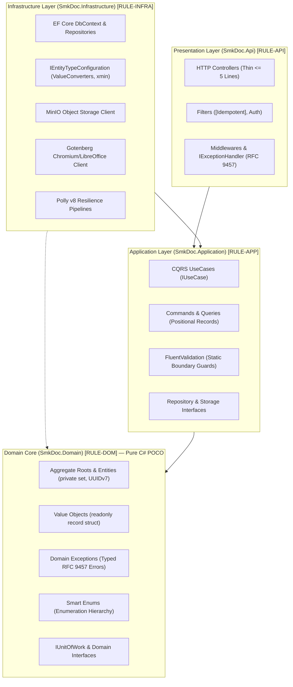
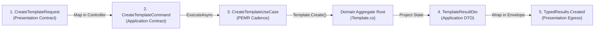
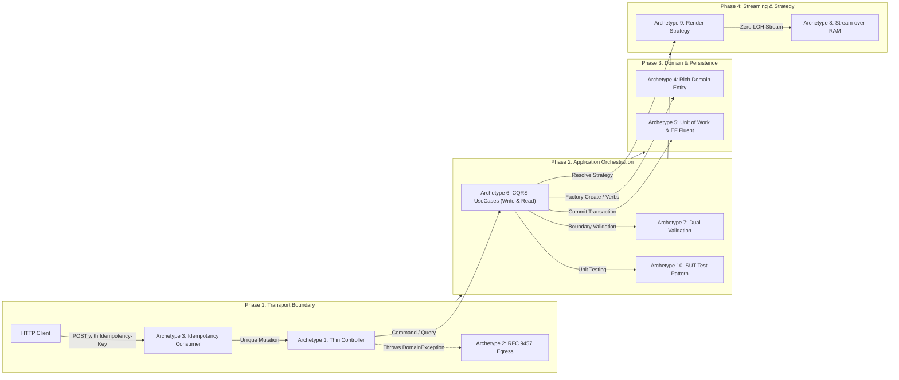

# PATTERNS.md — Canonical Architectural Patterns & Implementation Archetypes

> **[PURPOSE_SCOPE_SSOT]:** Authoritative Pure Backend Architectural Cookbook and Master Generative Blueprint for the SMK Document Server (`backend-v2/`). All frontend Next.js 15.2 / React 19 UI archetypes reside exclusively in [`FRONTEND_SPEC.md`](file:///c:/Users/jossl.000/Downloads/Compressed/smk-doc-server/smk-doc-server/docs/AI/FRONTEND_SPEC.md).
> **[AI_DIRECTIVE]:** AI Assistants (LLMs) and software engineers MUST treat these patterns as immutable golden archetypes. When creating new endpoints, use cases, domain entities, or infrastructure services, mirror the structural anatomy, naming conventions, and data flows defined here.
> **[UNIVERSAL_SCOPE_DIRECTIVE]:** All patterns, formulas, and archetypes in this document are **UNIVERSAL BLUEPRINTS** that apply across **ALL bounded contexts and domain entities** (including `Template`, `Project`, `Document`, `User`, `ApiKey`, and `AuditLog`).
> **[ORTHOGONAL_ROLE]:** This document functions as the **Macro-Assembler & Generative Feature-Slice Factory** (multi-file slice assembly, layer contracts, and testing blueprints). For single-line AST grammar rules and syntax tokens, consult [`CODING_CONVENTIONS.md`](file:///c:/Users/jossl.000/Downloads/Compressed/smk-doc-server/smk-doc-server/docs/AI/CODING_CONVENTIONS.md).

---

<system_topology_and_inward_flow>
## 1. 🏛️ Level 1: System Topology & Inward Dependency Flow

### Clean Architecture Inward Flow Invariant
The SMK Document Server implements Clean Architecture with Dependency Inversion. Domain Core remains isolated framework-free POCOs:



### Architectural Invariants Checklist
1. **Inward Dependency Invariant:** Dependencies flow strictly inward. `SmkDoc.Domain` references zero external assemblies, NuGet packages, or infrastructure libraries.
2. **Stateless Rendering:** Execute preview workflows (`PreviewDocumentUseCase`) 100% in-memory without persisting to PostgreSQL or MinIO.
3. **Centralized Localization:** Route all Thai formatting (Buddhist Era dates, Baht text, phone formatting) through `ThaiDataTransformer`.
4. **Engine Extensibility (OCP):** Resolve engine selection dynamically via `IEnumerable<IRenderEngine>`.
5. **Stream over RAM:** Stream Gotenberg and MinIO payloads directly to HTTP responses via `Stream.CopyToAsync(response.Body, ct)`.
6. **Non-Blocking Asynchronous I/O:** Execute all network and disk operations asynchronously accepting `CancellationToken ct = default`.

### Pattern Severity Tiers (Cognitive Constraint Hierarchy)
* **`[TIER-1-FATAL]` (Process & Memory Safety):** Zero LOH memory buffering (`RULE-MEM-001`), atomic Unit of Work commit (`RULE-UOW-002`), rich domain encapsulation (`RULE-DOM-002`), compile-time typed API responses (`RULE-API-002`).
* **`[TIER-2-ARCH]` (Layer & Boundary Integrity):** Strict 5-file slice separation (Presentation ➔ Application ➔ Domain ➔ Infrastructure), inward dependency flow, polymorphic strategy resolution.
* **`[TIER-3-WIRING]` (Syntactic & Property Symmetry):** 1:1 property names across layer boundaries, C# 13 primary constructor formatting with pure `camelCase`, explicit local variable instantiation.
</system_topology_and_inward_flow>

---

<master_feature_slice_pipeline>
## 2. 💎 Level 2: Master 5-File Feature Slice Pipeline

> **[ARCHITECTURAL_BLUEPRINT]:** A standard business feature slice in `smk-doc-server` consists of exactly 5 interconnected files across Clean Architecture layers. Preserve 1:1 property symmetry without inventing intermediary translation glue:



### PEMR Orchestration Lifecycle Formula
Every UseCase in `SmkDoc.Application` executes business logic in strict **PEMR** sequence:
1. **P (Preconditions):** Fail-fast parameter inspection, tenant boundary verification, existence checks.
2. **E (External Retrieval):** Fetch required aggregates via repositories using `.AsNoTracking()` (or tracked only if intended for mutation). Query `timeProvider`.
3. **M (Domain Mutation):** Instantiate or mutate Domain Aggregates via canonical factory methods (`Create(...)`) or domain verbs (`Publish(...)`).
4. **R (Result & Persistence):** Persist mutations via `await unitOfWork.CommitAsync(ct);` and project domain state into an immutable `ResultDto`.

### Contract Property Symmetry Matrix
| Business Field Concept | 1. Presentation Request | 2. Application Command | 3. Domain Entity / Value Object | 4. Application ResultDto | 5. Presentation Envelope |
|---|---|---|---|---|---|
| **Project Identifier** | `request.ProjectId` | `command.ProjectId` | `projectId: command.ProjectId` | *(Scoped to Route)* | `/api/v1/projects/{projectId}` |
| **Template Name** | `request.Name` | `command.Name` | `name: TemplateName.Create(command.Name)` | `result.Name` | `response.Data.Name` |
| **Semantic Slug** | `request.Slug` | `command.Slug` | `slug: TemplateSlug.Create(command.Slug)` | `result.Slug` | `response.Data.Slug` |
| **Business Payload** | `request.Payload` | `command.Payload` | `payload: command.Payload` | `result.Payload` | `response.Data.Payload` |
| **Document Format** | `request.OutputFormat` | `command.OutputFormat` | `outputFormat: command.OutputFormat` | `result.OutputFormat` | `response.Data.OutputFormat` |
| **Audit Timestamp** | *(Client omits)* | *(System stamps)* | `now: timeProvider.GetUtcNow()` | `result.CreatedAt` | `response.Data.CreatedAt` |
</master_feature_slice_pipeline>

---

<generative_feature_archetypes>
## 3. 🔵 Level 3: The 10 Canonical Backend Generative Archetypes



---

### Phase 1: Transport Boundary (HTTP Ingress, Idempotency & Error Egress)

<archetype_1_thin_controller>
#### Archetype 1: Thin Controller & API Envelope Pattern

*   **Intent & Scope:** Acts exclusively as the HTTP entry point. Validates routing, maps request DTOs to Commands/Queries, invokes the target UseCase, and wraps successful outputs in `ApiResponse<T>` using compile-time strongly-typed `TypedResults`.
*   **Formula:** `public sealed class {Entity}Controller : ControllerBase` with actions delegating to `IUseCase<TCommand, TResult>`. Controller action bodies MUST be $\le 5$ lines.

```csharp
// [GENERATIVE_SLOT_FORMULA: ARCHETYPE-1-CONTROLLER]
namespace SmkDoc.Api.Controllers;

[ApiController]
[Route("api/v1/templates")]
[Produces("application/json")]
public sealed class TemplateController(
    IUseCase<CreateTemplateCommand, TemplateResultDto> createUseCase,
    IUseCase<GetTemplateByIdQuery, TemplateResultDto> getByIdUseCase,
    IUseCase<ListTemplatesQuery, PagedApiResponse<TemplateResultDto>> listUseCase) : ControllerBase
{
    [HttpPost]
    [Idempotent]
    [ProducesResponseType(typeof(ApiResponse<TemplateResultDto>), StatusCodes.Status201Created)]
    [ProducesResponseType(typeof(ProblemDetails), StatusCodes.Status400BadRequest)]
    [ProducesResponseType(typeof(ProblemDetails), StatusCodes.Status409Conflict)]
    public async Task<Created<ApiResponse<TemplateResultDto>>> Create(
        [FromBody] CreateTemplateRequest request,
        CancellationToken ct = default)
    {
        var command = new CreateTemplateCommand(request.ProjectId, request.Name, request.Slug);
        var result = await createUseCase.ExecuteAsync(command, ct);
        var response = new ApiResponse<TemplateResultDto>(result);
        
        return TypedResults.Created($"/api/v1/templates/{result.Id}", response);
    }

    [HttpGet("{id:guid}")]
    [ProducesResponseType(typeof(ApiResponse<TemplateResultDto>), StatusCodes.Status200OK)]
    [ProducesResponseType(typeof(ProblemDetails), StatusCodes.Status404NotFound)]
    public async Task<Ok<ApiResponse<TemplateResultDto>>> GetById(
        Guid id,
        CancellationToken ct = default)
    {
        var query = new GetTemplateByIdQuery(id);
        var result = await getByIdUseCase.ExecuteAsync(query, ct);
        var response = new ApiResponse<TemplateResultDto>(result);

        return TypedResults.Ok(response);
    }

    [HttpGet]
    [ProducesResponseType(typeof(PagedApiResponse<TemplateResultDto>), StatusCodes.Status200OK)]
    public async Task<Ok<PagedApiResponse<TemplateResultDto>>> List(
        [FromQuery] int page = 1,
        [FromQuery] int pageSize = 20,
        CancellationToken ct = default)
    {
        var query = new ListTemplatesQuery(page, pageSize);
        var response = await listUseCase.ExecuteAsync(query, ct);

        return TypedResults.Ok(response);
    }
}
```
</archetype_1_thin_controller>

---

<archetype_2_rfc_9457_global_exception_pipeline>
#### Archetype 2: RFC 9457 Global Exception Pipeline (`IExceptionHandler` SSoT)

*   **Intent & Scope:** Centralized exception egress translating strongly-typed Domain Exceptions directly into RFC 9457 `ProblemDetails`. Dispatched automatically by `GlobalExceptionHandler`.
*   **Formula:** Throw strongly-typed Domain Exceptions from Domain or Application layers.

##### SSoT Domain Exception Taxonomy & HTTP Mapping:
| Domain Exception Class | Target HTTP Status | Canonical `errorCode` Token | Trigger Scenario |
|---|---|---|---|
| `DomainValidationException` | `400 Bad Request` | `VALIDATION_FAILED` | Entity factory or invariant validation failure |
| `UnauthorizedException` | `401 Unauthorized` | `AUTHENTICATION_REQUIRED` | Missing or invalid API key / JWT bearer |
| `ForbiddenException` | `403 Forbidden` | `ACCESS_DENIED` | Tenant isolation boundary cross violation |
| `NotFoundException` | `404 Not Found` | `RESOURCE_NOT_FOUND` | Target entity does not exist for specified ID |
| `ConflictException` | `409 Conflict` | `CONFLICT` | Unique key or slug collision |
| `ConcurrencyConflictException` | `409 Conflict` | `CONCURRENCY_CONFLICT` | PostgreSQL `xmin` concurrency token collision |
| `SchemaValidationException` | `422 Unprocessable` | `SCHEMA_VALIDATION_FAILED` | Dynamic JSON payload schema violation |
| `RateLimitExceededException` | `429 Too Many Requests`| `RATE_LIMIT_EXCEEDED` | Request rate bucket exhausted |

##### Consumer Usage Example (Application Layer):
```csharp
// Application Layer UseCase: Throw strongly-typed Domain Exceptions exclusively
if (await templateRepo.ExistsBySlugAsync(command.ProjectId, slug, ct))
{
    throw new ConflictException($"Template with slug '{command.Slug}' already exists in project '{command.ProjectId}'.");
}

var template = await templateRepo.GetByIdAsync(query.Id, ct)
    ?? throw new NotFoundException($"Template with ID '{query.Id}' was not found.");
```
</archetype_2_rfc_9457_global_exception_pipeline>

---

<archetype_3_ietf_idempotency_key_pipeline_pattern>
#### Archetype 3: IETF Idempotency-Key Pipeline Pattern (Safe Mutations)

*   **Intent & Scope:** Guarantees safe retries on state-mutating endpoints (`POST`, `PUT`, `DELETE`). The `[Idempotent]` filter intercepts requests bearing the `Idempotency-Key` header, caches successful responses for 24 hours, and rejects concurrent duplicate requests with HTTP 409.
*   **Formula:** Decorate controller action with `[Idempotent]`.

##### Consumer Usage Example (Controller Layer):
```csharp
// Presentation Layer Controller: Apply [Idempotent] attribute on mutating endpoints
[HttpPost]
[Idempotent]
public async Task<Created<ApiResponse<TemplateResultDto>>> Create(
    [FromBody] CreateTemplateRequest request,
    CancellationToken ct = default)
{
    var command = new CreateTemplateCommand(request.ProjectId, request.Name, request.Slug);
    var result = await createUseCase.ExecuteAsync(command, ct);
    return TypedResults.Created($"/api/v1/templates/{result.Id}", new ApiResponse<TemplateResultDto>(result));
}
```

##### Idempotency Key Semantics:
1. **Header Name:** `Idempotency-Key` (UUIDv4 or client string, max 128 chars).
2. **In-Flight Lease (TTL 30s):** Returns `409 Conflict` (`errorCode: "IDEMPOTENCY_IN_FLIGHT"`) if an identical key is currently executing.
3. **Completed Lease (TTL 24h):** Returns cached status code and payload directly without re-executing the UseCase.
</archetype_3_ietf_idempotency_key_pipeline_pattern>

---

### Phase 2: Domain Boundary (Core Business Invariants & Persistence)

<archetype_4_pure_rich_domain_entity>
#### Archetype 4: Pure Rich Domain Entity & Value Object Pattern

*   **Intent & Scope:** Pure C# POCO with zero external dependencies. State is strictly encapsulated (`private set;`). State creation occurs exclusively through exactly ONE canonical `Create(...)` factory method; state mutation occurs exclusively through expressive domain verbs receiving explicit dependencies (`DateTimeOffset now`).
*   **Formula:** `public sealed class {Entity}` with `Guid.CreateVersion7()` and `readonly record struct` Value Objects.

```csharp
// [GENERATIVE_SLOT_FORMULA: ARCHETYPE-4-DOMAIN-ENTITY]
namespace SmkDoc.Domain.Entities;

public sealed class Template
{
    public Guid Id { get; private set; }
    public Guid ProjectId { get; private set; }
    public TemplateName Name { get; private set; }
    public TemplateSlug Slug { get; private set; }
    public string? Category { get; private set; }
    public bool IsActive { get; private set; }
    public DateTimeOffset CreatedAt { get; private set; }
    public DateTimeOffset? UpdatedAt { get; private set; }

    // Required by EF Core Change Tracking
    private Template() { }

    // SSoT Canonical Factory Method
    public static Template Create(
        Guid projectId,
        TemplateName name,
        TemplateSlug slug,
        string? category,
        DateTimeOffset now)
    {
        if (projectId == Guid.Empty)
        {
            throw new DomainValidationException("ProjectId cannot be empty.");
        }

        return new Template
        {
            Id = Guid.CreateVersion7(),
            ProjectId = projectId,
            Name = name,
            Slug = slug,
            Category = category,
            IsActive = true,
            CreatedAt = now,
            UpdatedAt = null
        };
    }

    // Expressive Business Domain Verbs
    public void UpdateMetadata(TemplateName name, TemplateSlug slug, string? category, DateTimeOffset now)
    {
        Name = name;
        Slug = slug;
        Category = category;
        UpdatedAt = now;
    }

    public void Archive(DateTimeOffset now)
    {
        if (!IsActive) return;
        IsActive = false;
        UpdatedAt = now;
    }
}

// Value Object: Immutable readonly record struct with invariant validation
namespace SmkDoc.Domain.ValueObjects;

public readonly record struct TemplateSlug
{
    public string Value { get; }

    private TemplateSlug(string value) => Value = value;

    public static TemplateSlug Create(string value)
    {
        if (string.IsNullOrWhiteSpace(value))
        {
            throw new DomainValidationException("Template slug cannot be null or empty.");
        }

        var normalized = value.Trim().ToLowerInvariant();
        if (normalized.Length > 100)
        {
            throw new DomainValidationException("Template slug cannot exceed 100 characters.");
        }

        return new TemplateSlug(normalized);
    }

    public override string ToString() => Value;
}
```
</archetype_4_pure_rich_domain_entity>

---

<archetype_5_atomic_unit_of_work>
#### Archetype 5: Atomic Unit of Work & Transaction Boundary

*   **Intent & Scope:** Manages persistence boundaries. Repositories track changes; `IUnitOfWork.CommitAsync(ct)` executes atomic commits. Entities are configured via Fluent API (`IEntityTypeConfiguration<T>`) incorporating PostgreSQL `xmin` concurrency tokens and Value Converters.
*   **Formula:** `IUnitOfWork` interface in Domain, `SmkDocDbContext` in Infrastructure, plus explicit aggregate repository.

##### Repository & Unit of Work Interfaces (Domain):
```csharp
namespace SmkDoc.Domain.Interfaces;

public interface IUnitOfWork
{
    Task<int> CommitAsync(CancellationToken ct = default);
}

public interface ITemplateRepository
{
    Task<Template?> GetByIdAsync(Guid id, CancellationToken ct = default);
    Task<bool> ExistsBySlugAsync(Guid projectId, TemplateSlug slug, CancellationToken ct = default);
    Task<IReadOnlyList<Template>> ListAsync(int page, int pageSize, CancellationToken ct = default);
    Task AddAsync(Template template, CancellationToken ct = default);
}
```

##### EF Core Fluent Configuration & Repository Implementation (Infrastructure):
```csharp
namespace SmkDoc.Infrastructure.Persistence.Configurations;

public sealed class TemplateConfiguration : IEntityTypeConfiguration<Template>
{
    public void Configure(EntityTypeBuilder<Template> builder)
    {
        builder.ToTable("templates");

        builder.HasKey(t => t.Id);
        builder.Property(t => t.Id).ValueGeneratedNever();

        builder.Property(t => t.ProjectId).IsRequired();

        builder.Property(t => t.Name)
            .HasConversion(name => name.Value, val => TemplateName.Create(val))
            .HasMaxLength(200)
            .IsRequired();

        builder.Property(t => t.Slug)
            .HasConversion(slug => slug.Value, val => TemplateSlug.Create(val))
            .HasMaxLength(100)
            .IsRequired();

        builder.Property(t => t.Category).HasMaxLength(50);
        builder.Property(t => t.IsActive).IsRequired();
        builder.Property(t => t.CreatedAt).IsRequired();
        builder.Property(t => t.UpdatedAt);

        // Optimistic Concurrency Token via PostgreSQL xmin
        builder.UseXminAsConcurrencyToken();

        builder.HasIndex(t => new { t.ProjectId, t.Slug }).IsUnique();
    }
}
```
</archetype_5_atomic_unit_of_work>

---

### Phase 3: Application & Payload Boundary (CQRS Orchestration)

<archetype_6_action_centric_cqrs_usecase>
#### Archetype 6: Action-Centric CQRS UseCase Pattern

*   **Intent & Scope:** Orchestrates business execution using 1 Intent = 1 Class. Implements `IUseCase<TCommand, TResult>` with C# 13 Primary Constructor (pure `camelCase` parameters).
*   **Formula:**
    1. **Write Command UseCase:** Executes strict PEMR sequence and commits atomically.
    2. **Read / Paged Query UseCase:** Read-only execution with `.AsNoTracking()`, pagination calculation, and projection into `PagedApiResponse<T>`.

##### 6.1 Write Command UseCase (PEMR Cadence):
```csharp
// [GENERATIVE_SLOT_FORMULA: ARCHETYPE-6-WRITE-USECASE]
namespace SmkDoc.Application.Features.Templates.Commands.CreateTemplate;

public sealed class CreateTemplateUseCase(
    ITemplateRepository templateRepo,
    IUnitOfWork unitOfWork,
    TimeProvider timeProvider) : IUseCase<CreateTemplateCommand, TemplateResultDto>
{
    public async Task<TemplateResultDto> ExecuteAsync(CreateTemplateCommand command, CancellationToken ct = default)
    {
        // 1. P: Preconditions (Fail-fast validation)
        var slug = TemplateSlug.Create(command.Slug);
        var templateName = TemplateName.Create(command.Name);

        if (await templateRepo.ExistsBySlugAsync(command.ProjectId, slug, ct))
        {
            throw new ConflictException($"Template with slug '{command.Slug}' already exists.");
        }

        // 2. E: External Retrieval & Deterministic Clock
        var now = timeProvider.GetUtcNow();

        // 3. M: Domain Mutation (Canonical Factory SSoT)
        var template = Template.Create(
            projectId: command.ProjectId,
            name: templateName,
            slug: slug,
            category: command.Category,
            now: now);

        await templateRepo.AddAsync(template, ct);

        // 4. R: Result & Single Atomic Transaction Boundary
        await unitOfWork.CommitAsync(ct);

        return new TemplateResultDto(
            Id: template.Id,
            Name: template.Name.Value,
            Slug: template.Slug.Value,
            CreatedAt: template.CreatedAt);
    }
}
```

##### 6.2 Read / Paged Query UseCase (Projection & AsNoTracking):
```csharp
// [GENERATIVE_SLOT_FORMULA: ARCHETYPE-6-READ-USECASE]
namespace SmkDoc.Application.Features.Templates.Queries.ListTemplates;

public sealed class ListTemplatesUseCase(
    ITemplateRepository templateRepo) : IUseCase<ListTemplatesQuery, PagedApiResponse<TemplateResultDto>>
{
    public async Task<PagedApiResponse<TemplateResultDto>> ExecuteAsync(
        ListTemplatesQuery query,
        CancellationToken ct = default)
    {
        // 1. P: Guard Query Limits
        var page = Math.Max(1, query.Page);
        var pageSize = Math.Clamp(query.PageSize, 1, 100);

        // 2. E: Read-Only Evaluation via Repository with .AsNoTracking()
        var templates = await templateRepo.ListAsync(page, pageSize, ct);

        // 3. R: Project Domain State directly into Immutable Positional Records
        var dtos = templates.Select(t => new TemplateResultDto(
            Id: t.Id,
            Name: t.Name.Value,
            Slug: t.Slug.Value,
            CreatedAt: t.CreatedAt)).ToList();

        return new PagedApiResponse<TemplateResultDto>(
            Data: dtos,
            Page: page,
            PageSize: pageSize,
            TotalCount: dtos.Count);
    }
}
```
</archetype_6_action_centric_cqrs_usecase>

---

<archetype_7_dual_engine_validation_pipeline>
#### Archetype 7: Dual-Engine Validation Pipeline (Static Command + Dynamic Schema)

*   **Intent & Scope:** Boundary gate keeping invalid payloads out of Application and Domain. Static DTO structure is checked via `FluentValidation`; dynamic document payload JSON is verified against cached JSON Schema Draft-07.
*   **Formula:** `public sealed class {Action}{Entity}Validator : AbstractValidator<{Action}{Entity}Command>`.

```csharp
// [GENERATIVE_SLOT_FORMULA: ARCHETYPE-7-VALIDATOR]
namespace SmkDoc.Application.Features.Templates.Commands.CreateTemplate;

public sealed class CreateTemplateValidator : AbstractValidator<CreateTemplateCommand>
{
    public CreateTemplateValidator()
    {
        RuleFor(c => c.ProjectId)
            .NotEmpty()
            .WithMessage("ProjectId is required.");

        RuleFor(c => c.Name)
            .NotEmpty()
            .MaximumLength(200)
            .WithMessage("Template name must not exceed 200 characters.");

        RuleFor(c => c.Slug)
            .NotEmpty()
            .MaximumLength(100)
            .Matches("^[a-z0-9-]+$")
            .WithMessage("Slug must contain only lowercase letters, numbers, and hyphens.");
    }
}
```
</archetype_7_dual_engine_validation_pipeline>

---

### Phase 4: Binary & Stream Boundary (High-Throughput Rendering)

<archetype_8_zero_loh_stream_over_ram_direct_pipeline>
#### Archetype 8: Zero-LOH Stream-over-RAM Direct Pipeline

*   **Intent & Scope:** High-throughput document streaming. Stream payloads directly to HTTP responses to preserve Large Object Heap (LOH) health without buffering in memory.
*   **Formula:** Gotenberg / MinIO ➔ `Stream` ➔ `Stream.CopyToAsync(response.Body, ct)`.

```csharp
// [GENERATIVE_SLOT_FORMULA: ARCHETYPE-8-STREAMING]
namespace SmkDoc.Infrastructure.Rendering;

public sealed class GotenbergPdfRenderEngine(
    HttpClient httpClient,
    IOptions<GotenbergOptions> options) : IRenderEngine
{
    public RenderEngineType EngineType => RenderEngineType.ChromiumHtml;

    public async Task RenderAsync(
        Stream htmlStream,
        Stream destinationStream,
        CancellationToken ct = default)
    {
        using var content = new MultipartFormDataContent();
        content.Add(new StreamContent(htmlStream), "files", "index.html");

        using var request = new HttpRequestMessage(HttpMethod.Post, "/forms/chromium/convert/html")
        {
            Content = content
        };

        // Stream direct from network socket without buffering in memory
        using var response = await httpClient.SendAsync(
            request,
            HttpCompletionOption.ResponseHeadersRead,
            ct);

        response.EnsureSuccessStatusCode();

        await using var responseStream = await response.Content.ReadAsStreamAsync(ct);
        await responseStream.CopyToAsync(destinationStream, ct);
    }
}
```
</archetype_8_zero_loh_stream_over_ram_direct_pipeline>

---

<archetype_9_polymorphic_render_strategy_engine>
#### Archetype 9: Polymorphic Render Strategy Engine

*   **Intent & Scope:** Adheres to Open/Closed Principle (OCP). Registers rendering engines (`ChromiumHtml`, `OpenXmlDocx`, `FastExcelXlsx`) into DI as `IEnumerable<IRenderEngine>`. Dispatches active engine polymorphically via Smart Enum without `switch` or `if-else` branching.
*   **Formula:** `IEnumerable<IRenderEngine>` resolved by `RenderEngineType`.

```csharp
// [GENERATIVE_SLOT_FORMULA: ARCHETYPE-9-STRATEGY]
namespace SmkDoc.Application.Services;

public sealed class DocumentRenderDispatcher(
    IEnumerable<IRenderEngine> engines) : IDocumentRenderDispatcher
{
    public async Task RenderDocumentAsync(
        RenderEngineType engineType,
        Stream sourceStream,
        Stream targetStream,
        CancellationToken ct = default)
    {
        var engine = engines.FirstOrDefault(e => e.EngineType == engineType)
            ?? throw new ConflictException($"Render engine '{engineType.Name}' is not registered.");

        await engine.RenderAsync(sourceStream, targetStream, ct);
    }
}
```
</archetype_9_polymorphic_render_strategy_engine>

---

<archetype_10_gold_standard_cqrs_unit_testing_pattern>
#### Archetype 10: Gold-Standard CQRS Unit Testing Pattern

*   **Intent & Scope:** Unit test architecture adhering to 1:1 CQRS Folder Parity (`Commands/` vs `Queries/`), direct Moq mocks, `TestConstants.BaselineTime`, and SSoT `CreateSut()`. Zero disk or network I/O in unit tests.
*   **Formula:** `public sealed class {Action}{Entity}UseCaseTests` using `FluentAssertions`.

```csharp
// [GENERATIVE_SLOT_FORMULA: ARCHETYPE-10-UNIT-TEST]
namespace SmkDoc.Tests.Features.Templates.Commands;

public sealed class CreateTemplateUseCaseTests
{
    private readonly Mock<ITemplateRepository> _templateRepoMock = new();
    private readonly Mock<IUnitOfWork> _unitOfWorkMock = new();
    private readonly Mock<TimeProvider> _timeProviderMock = new();

    private CreateTemplateUseCase CreateSut()
    {
        _timeProviderMock.Setup(t => t.GetUtcNow()).Returns(TestConstants.BaselineTime);
        return new CreateTemplateUseCase(
            templateRepo: _templateRepoMock.Object,
            unitOfWork: _unitOfWorkMock.Object,
            timeProvider: _timeProviderMock.Object);
    }

    [Fact]
    public async Task ExecuteAsync_WhenSlugDoesNotExist_ShouldCreateTemplateAndCommit()
    {
        // Arrange
        var command = new CreateTemplateCommand(
            ProjectId: Guid.CreateVersion7(),
            Name: "Invoice Template",
            Slug: "invoice-standard");

        _templateRepoMock
            .Setup(r => r.ExistsBySlugAsync(command.ProjectId, It.IsAny<TemplateSlug>(), It.IsAny<CancellationToken>()))
            .ReturnsAsync(false);

        var sut = CreateSut();

        // Act
        var result = await sut.ExecuteAsync(command, CancellationToken.None);

        // Assert
        result.Should().NotBeNull();
        result.Name.Should().Be("Invoice Template");
        result.Slug.Should().Be("invoice-standard");

        _templateRepoMock.Verify(r => r.AddAsync(It.IsAny<Template>(), It.IsAny<CancellationToken>()), Times.Once);
        _unitOfWorkMock.Verify(u => u.CommitAsync(It.IsAny<CancellationToken>()), Times.Once);
    }

    [Fact]
    public async Task ExecuteAsync_WhenSlugAlreadyExists_ShouldThrowConflictException()
    {
        // Arrange
        var command = new CreateTemplateCommand(
            ProjectId: Guid.CreateVersion7(),
            Name: "Invoice Template",
            Slug: "invoice-duplicate");

        _templateRepoMock
            .Setup(r => r.ExistsBySlugAsync(command.ProjectId, It.IsAny<TemplateSlug>(), It.IsAny<CancellationToken>()))
            .ReturnsAsync(true);

        var sut = CreateSut();

        // Act
        var act = () => sut.ExecuteAsync(command, CancellationToken.None);

        // Assert
        await act.Should().ThrowAsync<ConflictException>()
            .WithMessage("*already exists*");

        _unitOfWorkMock.Verify(u => u.CommitAsync(It.IsAny<CancellationToken>()), Times.Never);
    }
}
```
</archetype_10_gold_standard_cqrs_unit_testing_pattern>
</generative_feature_archetypes>

---

<specialized_production_recipes>
## 4. 🚀 Level 4: Specialized Production Recipes

### Recipe 1: Type-Safe Smart Enums & Polymorphic Dispatch
```csharp
namespace SmkDoc.Domain.Enums;

public abstract class RenderEngineType : SmartEnum<RenderEngineType>
{
    public static readonly RenderEngineType ChromiumHtml = new ChromiumHtmlEngine();
    public static readonly RenderEngineType OpenXmlDocx = new OpenXmlDocxEngine();
    public static readonly RenderEngineType FastExcelXlsx = new FastExcelXlsxEngine();

    private RenderEngineType(string name, int value, string mimeType) : base(name, value) => MimeType = mimeType;

    public string MimeType { get; }

    private sealed class ChromiumHtmlEngine() : RenderEngineType("ChromiumHtml", 1, "application/pdf");
    private sealed class OpenXmlDocxEngine() : RenderEngineType("OpenXmlDocx", 2, "application/vnd.openxmlformats-officedocument.wordprocessingml.document");
    private sealed class FastExcelXlsxEngine() : RenderEngineType("FastExcelXlsx", 3, "application/vnd.openxmlformats-officedocument.spreadsheetml.sheet");
}
```

---

### Recipe 2: Centralized Localization & Thai Data Transformer
```csharp
namespace SmkDoc.Infrastructure.Localization;

public static class ThaiDataTransformer
{
    public static string Transform(object? value, string transformType) => transformType switch
    {
        "thai_date_be" => FormatBuddhistEra(value),
        "thai_baht_text" => ConvertToBahtText(Convert.ToDecimal(value)),
        "thai_phone" => FormatPhoneNumber(value?.ToString()),
        _ => value?.ToString() ?? string.Empty
    };

    private static string FormatBuddhistEra(object? value)
    {
        if (value is not DateTime dt && !DateTime.TryParse(value?.ToString(), out dt)) return string.Empty;
        var culture = new CultureInfo("th-TH");
        return dt.ToString("d MMMM yyyy", culture);
    }

    private static string ConvertToBahtText(decimal amount) => ThaiBahtConverter.ToBahtText(amount);

    private static string FormatPhoneNumber(string? raw)
    {
        if (string.IsNullOrWhiteSpace(raw)) return string.Empty;
        var digits = new string(raw.Where(char.IsDigit).ToArray());
        return digits.Length == 10 ? $"{digits[..3]}-{digits[3..6]}-{digits[6..]}" : raw;
    }
}
```

---

### Recipe 3: High-Throughput Handlebars AST Compilation Cache
```csharp
namespace SmkDoc.Infrastructure.Templating;

public sealed class HandlebarsCompilationCache(
    IMemoryCache cache,
    IOptions<CacheOptions> options) : ITemplateCompiler
{
    public HandlebarsTemplate<object, object> GetOrCompile(string templateKey, string rawContent)
    {
        return cache.GetOrCreate($"hbs_ast_{templateKey}", entry =>
        {
            entry.SetSlidingExpiration(TimeSpan.FromMinutes(options.Value.AstSlidingMinutes));
            return Handlebars.Compile(rawContent);
        })!;
    }
}
```

---

### Recipe 4: Polly v8 Enterprise HTTP Resilience Pipeline
```csharp
namespace SmkDoc.Infrastructure.Resilience;

public static class ResilienceConfiguration
{
    public static IHttpClientBuilder AddGotenbergResilience(this IHttpClientBuilder builder)
    {
        return builder.AddResilienceHandler("gotenberg_pipeline", pipeline =>
        {
            pipeline.AddTimeout(TimeSpan.FromSeconds(30));
            pipeline.AddRetry(new HttpRetryStrategyOptions
            {
                MaxRetryAttempts = 3,
                Delay = TimeSpan.FromMilliseconds(200),
                BackoffType = DelayBackoffType.Exponential
            });
            pipeline.AddCircuitBreaker(new HttpCircuitBreakerStrategyOptions
            {
                SamplingDuration = TimeSpan.FromSeconds(60),
                FailureRatio = 0.5,
                MinimumThroughput = 10
            });
        });
    }
}
```
</specialized_production_recipes>

---

<cross_document_integration_matrix>
## 5. 🔄 Level 5: Cross-Document Integration Matrix

| Document Path | Governed SSoT Layer | Synchronization Trigger |
|---|---|---|
| [`CODING_CONVENTIONS.md`](file:///c:/Users/jossl.000/Downloads/Compressed/smk-doc-server/smk-doc-server/docs/AI/CODING_CONVENTIONS.md) | Micro-AST Grammar, Syntax Substitution, Naming SSOT | Any C# language version bump or micro syntax change |
| [`API_CONTRACT.md`](file:///c:/Users/jossl.000/Downloads/Compressed/smk-doc-server/smk-doc-server/docs/AI/API_CONTRACT.md) | Wire HTTP Endpoints, DTO Schemas, RFC 9457 Codes | Adding or mutating Controller actions or Request DTOs |
| [`DB_SCHEMA.md`](file:///c:/Users/jossl.000/Downloads/Compressed/smk-doc-server/smk-doc-server/docs/AI/DB_SCHEMA.md) | Relational Tables, Indexes, Migrations, Postgres Types | Adding or mutating Entity fields or EF Core Configurations |
| [`ANTI-PATTERNS.md`](file:///c:/Users/jossl.000/Downloads/Compressed/smk-doc-server/smk-doc-server/docs/AI/ANTI-PATTERNS.md) | Negative Quality Guardrails (PR Review Shield) | Identifying recurring defects or anti-patterns |
</cross_document_integration_matrix>
