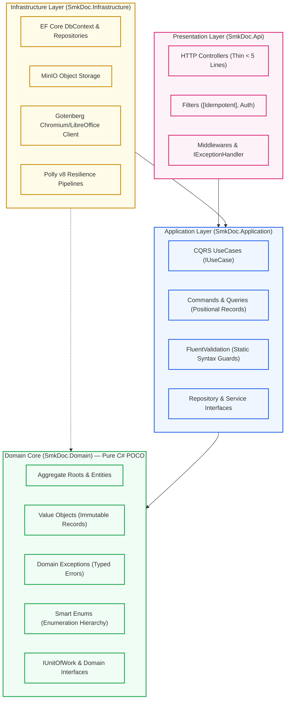
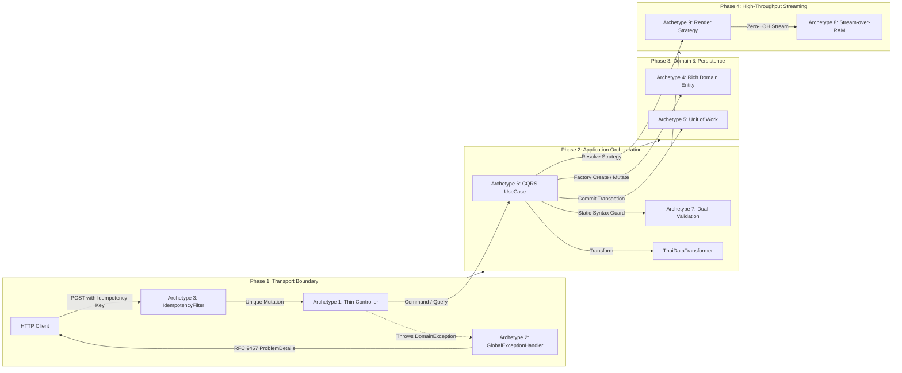

# PATTERNS.md — Canonical Architectural Patterns & Implementation Archetypes

> **[PURPOSE_SCOPE_SSOT]:** Authoritative Pure Backend Architectural Cookbook and Master Implementation Blueprint for the SMK Document Server (`backend-v2/`). All frontend Next.js 15.2 / React 19 UI archetypes reside exclusively in [`FRONTEND_SPEC.md`](file:///c:/Users/jossl.000/Downloads/Compressed/smk-doc-server/smk-doc-server/docs/AI/FRONTEND_SPEC.md).
> **[AI_DIRECTIVE]:** AI Assistants (LLMs) and software engineers MUST treat these patterns as immutable golden archetypes. When creating new endpoints, use cases, domain entities, or infrastructure services, you MUST mirror the structural anatomy, naming conventions, and data flows defined here. Never invent alternative architectural patterns.
> **[UNIVERSAL_SCOPE_DIRECTIVE]:** All patterns, formulas, and archetypes in this document are **UNIVERSAL BLUEPRINTS** that apply across **ALL bounded contexts and domain entities** (including `Template`, `Project`, `Document`, `User`, `ApiKey`, and `AuditLog`). Never assume that an archetype or naming rule is exclusive to the specific entity shown in the example.

---

<patterns_cognitive_framing>
## 1. 🏛️ Level 1: System Topology & Inward Dependency Flow

### Clean Architecture Inward Flow Invariant
The SMK Document Server strictly implements the Clean Architecture dependency inversion principle. High-level policies and business rules must never depend on low-level technical mechanisms:



### Architectural Invariants Checklist
1. **Inward Dependency Invariant:** Dependencies flow strictly inward. `SmkDoc.Domain` references ZERO external assemblies, NuGet packages, or infrastructure libraries.
2. **Stateless Rendering:** Preview endpoints (`PreviewDocumentUseCase`) MUST remain 100% in-memory. NEVER write to PostgreSQL or MinIO during preview.
3. **Centralized Localization:** All Thai formatting (Buddhist Era dates, Baht text, phone formatting) MUST route through `ThaiDataTransformer`. NEVER implement inline formatting logic inside templates.
4. **Engine Extensibility (OCP):** Engine selection is resolved dynamically via `IEnumerable<IRenderEngine>`. NEVER use hardcoded `switch` or `if-else` chains.
5. **Stream over RAM:** Gotenberg and MinIO payloads MUST be streamed directly to HTTP responses. Buffering multi-MB documents into memory (`byte[]`) is STRICTLY PROHIBITED.
6. **Non-Blocking Asynchronous I/O:** All network and disk operations MUST be asynchronous and accept `CancellationToken`. NEVER block threads with `.Result` or `.Wait()`.

### Pattern Severity Tiers (Cognitive Constraint Hierarchy)
When authoring backend feature slices, resolve priority collisions using this hierarchy:
* **`[TIER-1-FATAL]` (Process & Memory Safety):** Zero LOH memory buffering (`RULE-MEM-001`), atomic Unit of Work commit (`RULE-UOW-002`), rich domain encapsulation (`RULE-DOM-002`), compile-time typed API responses (`RULE-API-002`).
* **`[TIER-2-ARCH]` (Layer & Boundary Integrity):** Strict 5-file slice separation (Presentation ➔ Application ➔ Domain ➔ Infrastructure), inward dependency flow, polymorphic strategy resolution.
* **`[TIER-3-WIRING]` (Syntactic & Property Symmetry):** 1:1 property names across layer boundaries, C# 13 primary constructor formatting with pure `camelCase`, explicit local variable instantiation.
</patterns_cognitive_framing>

---

<patterns_syntax_substitution_map>
## ⚡ High-Salience Architectural Syntax Substitution Map

> **[COGNITIVE_PURPOSE]:** Direct hash-lookup table designed to immediately override pre-training priors across all Transformer attention heads. Whenever the model contemplates generating a pattern from the left column, it MUST instantly substitute it with the canonical pattern from the right column.

| Pattern / Integration Context | Defective Pattern (❌ Banned) | Canonical Standard (✅ Mandatory Target) | Governing Invariant |
|---|---|---|---|
| **Controller Egress** | `ActionResult<ApiResponse<T>>`, `return Ok(...)` | `Task<Ok<ApiResponse<T>>>`, `TypedResults.Ok(response)` | Compile-time typed HTTP result (`RULE-API-002`) |
| **Object Instantiation** | `return Ok(new ApiResponse<T>(result));` | `var response = new ApiResponse<T>(result); return TypedResults.Ok(response);` | Explicit local variable first (`RULE-CRAFT-007`) |
| **Primary Constructor DI** | `_templateRepo`, `_unitOfWork` | `templateRepo`, `unitOfWork` | Pure `camelCase` parameters (`RULE-APP-002`) |
| **Repository Return Type** | `IQueryable<T> Query()` | `Task<IReadOnlyList<T>> ListAsync(ct)` | Zero leaked uncommitted queries (`RULE-SOLID-004`) |
| **Engine Selection** | `switch (engineType) { case "html": ... }` | `IEnumerable<IRenderEngine>` dispatch via Smart Enum | Open/Closed polymorphic strategy (`RULE-SOLID-002`) |
| **Domain Instantiation** | `new Template(...)` (caller instantiation) | `Template.Create(...)` | Single canonical factory method SSoT (`RULE-DOM-003`) |
| **External Side-Effect Flow**| Uploading to MinIO before DB creation | **DB Intent (Pending) ➔ Storage Upload ➔ DB Finalize** | Safe two-phase workflow (`RULE-FLOW-001`) |
| **Streaming Pipeline** | `new MemoryStream()`, `stream.ToArray()` | `Stream.CopyToAsync()`, `PipeWriter` | Zero-LOH Stream-over-RAM (`RULE-MEM-001`, `002`) |
| **Deterministic Clock** | `DateTime.UtcNow`, `DateTimeOffset.UtcNow` | `timeProvider.GetUtcNow()`, explicit `DateTimeOffset now` | Testable deterministic time (`RULE-APP-005`) |
| **Thai Localization** | Inline formatting inside templates | `ThaiDataTransformer.Transform(val, "thai_baht_text")` | Centralized Localization SSoT (`AGENTS.md`) |
</patterns_syntax_substitution_map>

---

<master_feature_slice_blueprint>
## 2. 💎 Level 2: Master 5-File Feature Slice Trace (Wiring Blueprint)

> **[ARCHITECTURAL_BLUEPRINT]:** A standard business feature slice in `smk-doc-server` consists of exactly 5 interconnected files across Clean Architecture layers. When generating a feature slice, you MUST preserve 1:1 property symmetry without inventing intermediary translation glue:

```text
[1. Wire HTTP Request] ──(Map in Controller)──► [2. CQRS Command & Validator] ──(Pass to UseCase)──► [3. UseCase Orchestrator]
SmkDoc.Api/Contracts                            SmkDoc.Application/Commands                           SmkDoc.Application/UseCases
CreateTemplateRequest                           CreateTemplateCommand                                 CreateTemplateUseCase.ExecuteAsync
  ├─ projectId: Guid ─────────────────────────────├─ ProjectId: Guid ───────────────────────────────────├─ P: Preconditions (Guards)
  ├─ name: string ────────────────────────────────├─ Name: string ──────────────────────────────────────├─ E: External Retrieval
  ├─ slug: string ────────────────────────────────├─ Slug: string ──────────────────────────────────────├─ M: Domain Mutation ──┐
  └─ category: string? ───────────────────────────└─ Category: string? ─────────────────────────────────└─ R: Persistence/Result│
                                                                                                                                 │
[5. Thin Controller] ◄──(Wrap in Envelope)───── [4. Output Result DTO] ◄────────(Project Domain State)── [Domain Aggregate Root] ◄──┘
SmkDoc.Api/Controllers                          SmkDoc.Application/DTOs                               SmkDoc.Domain/Entities
TemplateController.Create                       TemplateResultDto                                     Template.Create(...)
  └─ TypedResults.Created(location, response)     ├─ Id: Guid ◄─────────────────────────────────────────├─ Id: Guid (UUIDv7)
       └─ response: ApiResponse<ResultDto>        ├─ Name: string ◄─────────────────────────────────────├─ Name.Value: string
                                                  └─ CreatedAt: DateTimeOffset ◄────────────────────────└─ CreatedAt: DateTimeOffset
```

### PEMR Orchestration Lifecycle Formula
Every UseCase in `SmkDoc.Application` MUST execute business logic in strict **PEMR** sequence:
1. **P (Preconditions):** Fail-fast parameter inspection, tenant boundary resolution, and entity existence verification.
2. **E (External Retrieval):** Fetch required aggregates via repositories (`GetByIdAsync`, `ExistsBySlugAsync`) using tracking only when mutation is intended.
3. **M (Domain Mutation):** Instantiate or mutate Domain Aggregates via canonical factory methods (`Create(...)`) or domain verbs (`Publish(...)`).
4. **R (Result & Persistence):** Persist mutations via `IUnitOfWork.CommitAsync(ct)` and project domain state into an immutable `ResultDto`.

### Contract Property Symmetry Matrix
| Business Field Concept | 1. Presentation Request | 2. Application Command | 3. Domain Entity / Value Object | 4. Application ResultDto | 5. Presentation Envelope |
|---|---|---|---|---|---|
| **Project Identifier** | `request.ProjectId` | `command.ProjectId` | `projectId: command.ProjectId` | `(scoped to tenant context)` | `/api/v1/projects/{projectId}` |
| **Template Name** | `request.Name` | `command.Name` | `name: TemplateName.Create(command.Name)` | `result.Name` | `response.Data.Name` |
| **Semantic Slug** | `request.Slug` | `command.Slug` | `slug: TemplateSlug.Create(command.Slug)` | `result.Slug` | `response.Data.Slug` |
| **Optional Category** | `request.Category` | `command.Category` | `category: command.Category` | `result.Category` | `response.Data.Category` |
| **Audit Timestamp** | *(Client omits)* | *(System generates)* | `now: timeProvider.GetUtcNow()` | `result.CreatedAt` | `response.Data.CreatedAt` |
</master_feature_slice_blueprint>

---

<backend_lifecycle_archetypes>
## 3. 🔵 Level 3: The 9 Canonical Backend Lifecycle Archetypes



---

### Phase 1: Transport Boundary (HTTP Ingress, Idempotency & Error Egress)

<archetype_1_thin_controller>
#### Archetype 1: Thin Controller & API Envelope Pattern

*   **Intent & Scope:** Acts exclusively as the HTTP entry point. Validates routing, unpacks incoming HTTP request bodies, maps them to Application Commands or Queries, invokes the target UseCase, and wraps successful outputs in a standard response envelope (`ApiResponse<T>` or raw stream) using compile-time strongly-typed `TypedResults`.
*   **Formula:** `public sealed class [Entity]Controller : ControllerBase` with actions delegating to `IUseCase<TCommand, TResult>`.

```csharp
// [GENERATIVE_SLOT_FORMULA: ARCHETYPE-1-CONTROLLER]
[ApiController]
[Route("api/v1/{resources}")]
[Produces("application/json")]
public sealed class {Entity}Controller(
    IUseCase<{CreateEntity}Command, {Entity}ResultDto> createUseCase,
    IUseCase<{GetEntityById}Query, {Entity}ResultDto> getByIdUseCase) : ControllerBase
{
    [HttpGet("{id:guid}")]
    [ProducesResponseType(typeof(ApiResponse<{Entity}ResultDto>), StatusCodes.Status200OK)]
    [ProducesResponseType(typeof(ProblemDetails), StatusCodes.Status404NotFound)]
    public async Task<Ok<ApiResponse<{Entity}ResultDto>>> GetById(
        Guid id, 
        CancellationToken ct)
    {
        var query = new {GetEntityById}Query(id);
        var result = await getByIdUseCase.ExecuteAsync(query, ct);
        var response = new ApiResponse<{Entity}ResultDto>(result);
        return TypedResults.Ok(response);
    }

    [HttpPost]
    [Idempotent]
    [ProducesResponseType(typeof(ApiResponse<{Entity}ResultDto>), StatusCodes.Status201Created)]
    [ProducesResponseType(typeof(ProblemDetails), StatusCodes.Status400BadRequest)]
    [ProducesResponseType(typeof(ProblemDetails), StatusCodes.Status409Conflict)]
    public async Task<Created<ApiResponse<{Entity}ResultDto>>> Create(
        [FromBody] {CreateEntity}Request request,
        CancellationToken ct)
    {
        var command = new {CreateEntity}Command(request.{Field1}, request.{Field2});
        var result = await createUseCase.ExecuteAsync(command, ct);
        var response = new ApiResponse<{Entity}ResultDto>(result);
        return TypedResults.Created($"/api/v1/{resources}/{result.Id}", response);
    }
}
```

```csharp
// =========================================================================
// THE CANONICAL GOLDEN IMPLEMENTATION: Archetype 1 (TemplateController)
// =========================================================================
namespace SmkDoc.Api.Controllers;

using Microsoft.AspNetCore.Http;
using Microsoft.AspNetCore.Http.HttpResults;
using Microsoft.AspNetCore.Mvc;
using SmkDoc.Application.Common.Interfaces;
using SmkDoc.Application.Modules.Authoring.Templates.Commands.CreateTemplate;
using SmkDoc.Application.Modules.Authoring.DTOs;
using SmkDoc.Application.Modules.Authoring.Queries.GetTemplateById;
using SmkDoc.Api.Contracts.Common;
using SmkDoc.Api.Contracts.Templates;
using SmkDoc.Api.Filters;

[ApiController]
[Route("api/v1/templates")]
[Produces("application/json")]
public sealed class TemplateController(
    IUseCase<CreateTemplateCommand, TemplateResultDto> createTemplateUseCase,
    IUseCase<GetTemplateByIdQuery, TemplateResultDto> getTemplateByIdUseCase) : ControllerBase
{
    // 1. GET by ID: Standard 200 OK wrapped in ApiResponse<T>
    [HttpGet("{templateId:guid}")]
    [ProducesResponseType(typeof(ApiResponse<TemplateResultDto>), StatusCodes.Status200OK)]
    [ProducesResponseType(typeof(ProblemDetails), StatusCodes.Status404NotFound)]
    public async Task<Ok<ApiResponse<TemplateResultDto>>> GetById(
        [FromRoute] Guid templateId, 
        CancellationToken ct)
    {
        var query = new GetTemplateByIdQuery(templateId);
        var result = await getTemplateByIdUseCase.ExecuteAsync(query, ct);
        var response = new ApiResponse<TemplateResultDto>(result);
        
        return TypedResults.Ok(response);
    }

    // 2. POST Creation: Explicit 201 Created with TypedResults and Idempotency Support
    [HttpPost]
    [Idempotent]
    [ProducesResponseType(typeof(ApiResponse<TemplateResultDto>), StatusCodes.Status201Created)]
    [ProducesResponseType(typeof(ProblemDetails), StatusCodes.Status400BadRequest)]
    [ProducesResponseType(typeof(ProblemDetails), StatusCodes.Status409Conflict)]
    public async Task<Created<ApiResponse<TemplateResultDto>>> Create(
        [FromBody] CreateTemplateRequest request, 
        CancellationToken ct)
    {
        var command = new CreateTemplateCommand(request.ProjectId, request.Name, request.Slug, request.Category);
        var result = await createTemplateUseCase.ExecuteAsync(command, ct);
        var response = new ApiResponse<TemplateResultDto>(result);
        
        return TypedResults.Created($"/api/v1/templates/{result.Id}", response);
    }
}
```

*   **Architectural Invariants & Hard Rules:**
    1. **$\le 5$ Lines Rule:** Controller action bodies must never exceed 5 lines of executable logic.
    2. **Zero Direct Persistence/Business Logic:** NEVER inject `IRepository`, `DbContext`, or business services into a Controller. Controllers interact exclusively with UseCases (`IUseCase<TCommand, TResult>`).
    3. **No Domain Entity Leaks:** NEVER accept a Domain Entity as a parameter and NEVER return a Domain Entity from a Controller action.
    4. **Envelope Invariant:** All JSON responses MUST be wrapped in `ApiResponse<T>` or `PagedApiResponse<T>`. Binary streams (PDF, DOCX, XLSX) MUST be returned directly via `TypedResults.Stream(...)` without an envelope.
</archetype_1_thin_controller>

---

<archetype_2_rfc9457_exception_pipeline>
#### Archetype 2: RFC 9457 Global Exception Pipeline (`IExceptionHandler` SSoT)

*   **Intent & Scope:** Intercepts all unhandled exceptions across the entire ASP.NET Core HTTP pipeline (including Middlewares, Routing, Filters, and UseCases) and maps them into strongly-typed RFC 9457 `ProblemDetails` responses. This guarantees that API consumers never receive raw 500 stack traces or non-standard error envelopes.

```csharp
// =========================================================================
// THE CANONICAL GOLDEN IMPLEMENTATION: Archetype 2
// =========================================================================
namespace SmkDoc.Api.Middlewares;

using System.Diagnostics;
using FluentValidation;
using Microsoft.AspNetCore.Diagnostics;
using Microsoft.AspNetCore.Http;
using Microsoft.AspNetCore.Mvc;
using Microsoft.Extensions.Logging;
using SmkDoc.Domain.Exceptions;

public sealed class GlobalExceptionHandler(ILogger<GlobalExceptionHandler> logger) : IExceptionHandler
{
    public async ValueTask<bool> TryHandleAsync(
        HttpContext httpContext, 
        Exception exception, 
        CancellationToken ct)
    {
        var traceId = Activity.Current?.Id ?? httpContext.TraceIdentifier;

        var (statusCode, title, errorCode, extensions) = exception switch
        {
            ValidationException validationEx => (
                StatusCodes.Status400BadRequest,
                "Validation Failed",
                "VALIDATION_FAILED",
                ExtractValidationErrors(validationEx)
            ),
            NotFoundException notFoundEx => (
                StatusCodes.Status404NotFound,
                "Resource Not Found",
                notFoundEx.ErrorCode ?? "NOT_FOUND",
                null
            ),
            ConflictException conflictEx => (
                StatusCodes.Status409Conflict,
                "Conflict Detected",
                conflictEx.ErrorCode ?? "CONFLICT",
                null
            ),
            UnauthorizedException authEx => (
                StatusCodes.Status401Unauthorized,
                "Unauthorized Access",
                authEx.ErrorCode ?? "UNAUTHORIZED",
                null
            ),
            ForbiddenException forbidEx => (
                StatusCodes.Status403Forbidden,
                "Forbidden Access",
                forbidEx.ErrorCode ?? "FORBIDDEN",
                null
            ),
            DomainException domainEx => (
                StatusCodes.Status422UnprocessableEntity,
                "Domain Rule Violation",
                domainEx.ErrorCode ?? "DOMAIN_RULE_VIOLATION",
                null
            ),
            _ => (
                StatusCodes.Status500InternalServerError,
                "Internal Server Error",
                "INTERNAL_SERVER_ERROR",
                null
            )
        };

        if (statusCode == StatusCodes.Status500InternalServerError)
        {
            logger.LogError(exception, "Unhandled system exception occurred. TraceId: {TraceId}", traceId);
        }
        else
        {
            logger.LogWarning("Handled domain/validation exception: {ErrorCode} - {Message}. TraceId: {TraceId}",
                errorCode, exception.Message, traceId);
        }

        var problemDetails = new ProblemDetails
        {
            Status = statusCode,
            Title = title,
            Detail = statusCode == StatusCodes.Status500InternalServerError 
                ? "An unexpected error occurred. Please refer to traceId when contacting support." 
                : exception.Message,
            Instance = httpContext.Request.Path,
            Extensions =
            {
                ["traceId"] = traceId,
                ["errorCode"] = errorCode
            }
        };

        if (extensions is not null)
        {
            foreach (var (key, value) in extensions)
            {
                problemDetails.Extensions[key] = value;
            }
        }

        httpContext.Response.StatusCode = statusCode;
        httpContext.Response.ContentType = "application/problem+json";

        await httpContext.Response.WriteAsJsonAsync(problemDetails, cancellationToken: ct);
        return true;
    }

    private static Dictionary<string, object?> ExtractValidationErrors(ValidationException ex)
    {
        var invalidParams = ex.Errors
            .Select(error => new { name = error.PropertyName, reason = error.ErrorMessage })
            .ToArray();

        return new Dictionary<string, object?> { ["invalidParams"] = invalidParams };
    }
}
```

*   **Architectural Invariants & Hard Rules:**
    1. **Zero `try-catch` in Controllers:** NEVER wrap Controller actions in `try-catch` blocks. Throw strongly-typed Domain Exceptions from UseCases and let `GlobalExceptionHandler` handle mapping.
    2. **RFC 9457 Strict Compliance:** All error bodies MUST be formatted as RFC 9457 `ProblemDetails` (`application/problem+json`). Anonymous error objects (e.g., `return BadRequest(new { error = "invalid" })`) are STRICTLY BANNED.
</archetype_2_rfc9457_exception_pipeline>

---

<archetype_3_idempotency_pipeline>
#### Archetype 3: IETF Idempotency-Key Pipeline Pattern (Safe Mutations)

*   **Intent & Scope:** Implements the IETF Draft specification for the `Idempotency-Key` header on state-mutating endpoints (`POST`, `PUT`, `DELETE`). Guarantees that network retries execute business operations exactly once, returning the cached HTTP response while eliminating duplicate database writes, render workloads, or storage uploads.
*   **Data Flow:**
    ```text
    Client ──(POST with Idempotency-Key)──► [ IdempotencyFilter : IAsyncActionFilter ]
                                                          │
                                         ┌────────────────┴────────────────┐
                                         ▼                                 ▼
                             Cache: Completed?                   Cache: In-Flight?
                                         │                                 │
                         ┌───────────────┴───────────────┐                 ▼
                         ▼                               ▼           Return 409 Conflict
                  Fingerprint Match?              Fingerprint Mismatch?
                         │                               │
                Yes ─────┴───── No                       ▼
                 │              │                Return 422 Unprocessable Entity
                 ▼              ▼
        Return Cached (201)   Acquire In-Flight Lock (Atomic)
        + Idempotency-Replayed           │
                                         ▼
                             Execute UseCase (try/catch)
                                         │
                         ┌───────────────┴───────────────┐
                         ▼                               ▼
                 Success (2xx)                   Failure / Exception
                         │                               │
                         ▼                               ▼
             Save Response in Cache (24h)     Rollback Lock (RemoveAsync)
             Return Fresh Response (201)      Rethrow / Return ProblemDetails
    ```

```csharp
// =========================================================================
// THE CANONICAL GOLDEN IMPLEMENTATION: Archetype 3
// =========================================================================
namespace SmkDoc.Api.Filters;

using System.Text.Json;
using Microsoft.AspNetCore.Http;
using Microsoft.AspNetCore.Mvc;
using Microsoft.AspNetCore.Mvc.Filters;
using Microsoft.Extensions.Logging;
using Microsoft.Extensions.Options;
using SmkDoc.Application.Common.Interfaces;

[AttributeUsage(AttributeTargets.Method | AttributeTargets.Class)]
public sealed class IdempotentAttribute : Attribute, IFilterFactory
{
    public int TtlHours { get; set; } = 24;
    public bool Mandatory { get; set; } = false;
    public bool IsReusable => false;

    public IFilterMetadata CreateInstance(IServiceProvider serviceProvider)
    {
        var idempotencyStore = serviceProvider.GetRequiredService<IIdempotencyStore>();
        var executionContext = serviceProvider.GetRequiredService<IExecutionContext>();
        var logger = serviceProvider.GetRequiredService<ILogger<IdempotencyFilter>>();
        var jsonOptions = serviceProvider.GetService<IOptions<JsonOptions>>()?.Value.JsonSerializerOptions
            ?? new JsonSerializerOptions { PropertyNamingPolicy = JsonNamingPolicy.CamelCase };

        return new IdempotencyFilter(
            idempotencyStore,
            executionContext,
            logger,
            jsonOptions,
            TimeSpan.FromHours(TtlHours),
            Mandatory);
    }
}

public sealed class IdempotencyFilter(
    IIdempotencyStore idempotencyStore,
    IExecutionContext executionContext,
    ILogger<IdempotencyFilter> logger,
    JsonSerializerOptions jsonSerializerOptions,
    TimeSpan completedTtl,
    bool mandatory) : IAsyncActionFilter
{
    public const string HeaderName = "Idempotency-Key";
    public const string HeaderReplayed = "Idempotency-Replayed";
    private static readonly TimeSpan InFlightTtl = TimeSpan.FromMinutes(2);

    public async Task OnActionExecutionAsync(ActionExecutingContext context, ActionExecutionDelegate next)
    {
        // 1. Inspect Header (Opt-in vs Mandatory)
        if (!context.HttpContext.Request.Headers.TryGetValue(HeaderName, out var rawKey) || string.IsNullOrWhiteSpace(rawKey))
        {
            if (mandatory)
            {
                var problem = new ProblemDetails
                {
                    Status = StatusCodes.Status400BadRequest,
                    Title = "Missing Idempotency-Key",
                    Detail = "The 'Idempotency-Key' request header is required for this operation.",
                    Instance = context.HttpContext.Request.Path
                };
                problem.Extensions["errorCode"] = "MISSING_IDEMPOTENCY_KEY";
                context.Result = new BadRequestObjectResult(problem);
                return;
            }

            await next();
            return;
        }

        var idempotencyKey = rawKey.ToString().Trim();
        var callerId = executionContext.CallerApp ?? executionContext.ProjectId?.ToString("N") ?? "anonymous";
        var cacheKey = $"idempotency:{callerId}:{idempotencyKey}";
        var fingerprint = RequestFingerprintCalculator.ComputeFingerprint(context, jsonSerializerOptions);

        // 2. Atomic Acquisition & State Inspection
        var acquisitionResult = await idempotencyStore.TryAcquireOrGetAsync(
            cacheKey, fingerprint, InFlightTtl, context.HttpContext.RequestAborted);

        if (!acquisitionResult.IsAcquired && acquisitionResult.ExistingRecord is not null)
        {
            var existing = acquisitionResult.ExistingRecord;

            if (existing.Status == IdempotencyStatus.InFlight)
            {
                var conflict = new ProblemDetails
                {
                    Status = StatusCodes.Status409Conflict,
                    Title = "Request In-Flight",
                    Detail = "A mutation request with this Idempotency-Key is currently being processed.",
                    Instance = context.HttpContext.Request.Path
                };
                conflict.Extensions["errorCode"] = "IDEMPOTENCY_IN_FLIGHT";
                context.Result = new ConflictObjectResult(conflict);
                return;
            }

            if (existing.Status == IdempotencyStatus.Completed)
            {
                if (!string.Equals(existing.RequestFingerprint, fingerprint, StringComparison.Ordinal))
                {
                    var mismatch = new ProblemDetails
                    {
                        Status = StatusCodes.Status422UnprocessableEntity,
                        Title = "Idempotency-Key Payload Mismatch",
                        Detail = "This Idempotency-Key was previously used with a different request payload.",
                        Instance = context.HttpContext.Request.Path
                    };
                    mismatch.Extensions["errorCode"] = "IDEMPOTENCY_PAYLOAD_MISMATCH";
                    context.Result = new ObjectResult(mismatch) { StatusCode = StatusCodes.Status422UnprocessableEntity };
                    return;
                }

                // Replay cached response with IETF transparency header
                context.HttpContext.Response.Headers[HeaderReplayed] = "true";
                if (existing.Headers is not null)
                {
                    foreach (var (k, v) in existing.Headers) context.HttpContext.Response.Headers[k] = v;
                }

                var cachedStatus = existing.StatusCode ?? StatusCodes.Status200OK;
                context.Result = !string.IsNullOrWhiteSpace(existing.ResponseJson)
                    ? new ContentResult { Content = existing.ResponseJson, ContentType = "application/json; charset=utf-8", StatusCode = cachedStatus }
                    : new StatusCodeResult(cachedStatus);
                return;
            }
        }

        // 3. Execution with Failure Rollback
        ActionExecutedContext executedContext;
        try
        {
            executedContext = await next();
        }
        catch (Exception ex)
        {
            logger.LogWarning(ex, "Execution failed for key {IdempotencyKey}. Rolling back in-flight lock.", idempotencyKey);
            await idempotencyStore.RemoveAsync(cacheKey, context.HttpContext.RequestAborted);
            throw;
        }

        if (executedContext.Exception is not null)
        {
            await idempotencyStore.RemoveAsync(cacheKey, context.HttpContext.RequestAborted);
            return;
        }

        // 4. Save Completed Successful Response
        if (executedContext.Result is ObjectResult objectResult && objectResult.StatusCode is >= 200 and < 300)
        {
            Dictionary<string, string>? headersToCache = null;
            if (context.HttpContext.Response.Headers.TryGetValue("Location", out var loc))
            {
                headersToCache = new Dictionary<string, string> { ["Location"] = loc.ToString() };
            }

            var serialized = JsonSerializer.Serialize(objectResult.Value, jsonSerializerOptions);
            await idempotencyStore.SaveCompletedAsync(
                cacheKey, fingerprint, objectResult.StatusCode.Value, serialized, headersToCache, completedTtl, context.HttpContext.RequestAborted);
        }
        else
        {
            // Non-2xx response: evict in-flight lock so client can retry
            await idempotencyStore.RemoveAsync(cacheKey, context.HttpContext.RequestAborted);
        }
    }
}
```
</archetype_3_idempotency_pipeline>

---

### Phase 2: Domain Boundary (Core Business Invariants & Persistence)

<archetype_4_rich_domain_entity>
#### Archetype 4: Pure Rich Domain Entity & Value Object Pattern

*   **Intent & Scope:** Houses the core business rules and enterprise data invariants. Domain Entities are Plain Old CLR Objects (POCOs) completely isolated from frameworks, databases, and serialization concerns.
*   **Formula:** `public sealed class [Entity] : BaseEntity` with canonical factory `public static [Entity] Create(...)`, `internal` constructor for test fixtures, and domain mutation verbs.

```csharp
// [GENERATIVE_SLOT_FORMULA: ARCHETYPE-4-DOMAIN-ENTITY]
public sealed class {Entity} : BaseEntity
{
    // Encapsulated state: private setters
    public Guid {TenantId} { get; private set; }
    public {EntityName} Name { get; private set; } = null!;
    public bool IsActive { get; private set; }

    private {Entity}() { } // EF Core constructor

    internal {Entity}(Guid? id, Guid {tenantId}, {EntityName} name, DateTimeOffset now) 
        : base(id, createdAt: now)
    {
        {TenantId} = Guard.NotEmpty({tenantId}, nameof({TenantId}));
        Name = Guard.NotNull(name, nameof(Name));
        IsActive = true;
    }

    public static {Entity} Create(Guid {tenantId}, {EntityName} name, DateTimeOffset now) =>
        new(null, {tenantId}, name, now);

    public void Deactivate(DateTimeOffset now)
    {
        if (!IsActive) return; // Idempotent exit
        IsActive = false;
        SetUpdated(now);
    }
}
```

```csharp
// =========================================================================
// THE CANONICAL GOLDEN IMPLEMENTATION: Archetype 4 (Template & Value Object)
// =========================================================================
namespace SmkDoc.Domain.Entities;

using System.Text.RegularExpressions;
using SmkDoc.Domain.Common;
using SmkDoc.Domain.Exceptions;
using SmkDoc.Domain.ValueObjects;

public sealed class Template : BaseEntity, IMustHaveProject
{
    private readonly List<TemplateVersion> versions = [];

    // Properties: Encapsulated with private setters
    public Guid ProjectId { get; private set; }
    public TemplateName Name { get; private set; } = null!;
    public TemplateSlug Slug { get; private set; } = null!;
    public string? Category { get; private set; }
    public bool IsActive { get; private set; }
    public Guid? CurrentVersionId { get; private set; }
    public IReadOnlyCollection<TemplateVersion> Versions => versions.AsReadOnly();

    // 1. Parameterless private constructor exclusively for EF Core materialization
    private Template() { }

    // 2. Internal constructor accessible to Test Fixtures via InternalsVisibleTo
    internal Template(
        Guid? id, 
        Guid projectId, 
        TemplateName name, 
        TemplateSlug slug, 
        string? category, 
        DateTimeOffset now) : base(id, createdAt: now)
    {
        ProjectId = Guard.NotEmpty(projectId, nameof(ProjectId));
        Name = Guard.NotNull(name, nameof(Name));
        Slug = Guard.NotNull(slug, nameof(Slug));
        Category = string.IsNullOrWhiteSpace(category) ? null : category.Trim();
        IsActive = true;
    }

    // 3. Single Canonical Factory Method (SSoT for creation)
    public static Template Create(
        Guid projectId, 
        TemplateName name, 
        TemplateSlug slug, 
        string? category, 
        DateTimeOffset now) =>
        new(null, projectId, name, slug, category, now);

    // 4. Expressive Domain Verbs (Encapsulated State Mutations)
    public void SetCurrentVersion(Guid versionId, DateTimeOffset now)
    {
        Guard.NotEmpty(versionId, nameof(versionId));

        if (!IsActive)
        {
            throw new BusinessRuleViolationException("Cannot assign a version to an inactive template.", "INACTIVE_TEMPLATE");
        }

        if (versions.Count > 0 && !versions.Any(v => v.Id == versionId))
        {
            throw new VersionNotInTemplateException(Id, versionId);
        }

        CurrentVersionId = versionId;
        SetUpdated(now);
    }

    public void Deactivate(DateTimeOffset now)
    {
        if (!IsActive) return; // Idempotent exit
        
        IsActive = false;
        SetUpdated(now);
    }
}

// Canonical Value Object Archetype: Self-validating, immutable record
public sealed partial record TemplateSlug
{
    public string Value { get; }

    public TemplateSlug(string value)
    {
        if (string.IsNullOrWhiteSpace(value))
        {
            throw new DomainValidationException("Slug cannot be empty.");
        }

        var normalized = value.Trim().ToLowerInvariant();
        if (!SlugRegex().IsMatch(normalized))
        {
            throw new DomainValidationException($"Slug '{value}' is invalid. Must be lowercase alphanumeric with hyphens.");
        }

        Value = normalized;
    }

    public static TemplateSlug Create(string value) => new(value);

    [GeneratedRegex("^[a-z0-9]+(?:-[a-z0-9]+)*$")]
    private static partial Regex SlugRegex();
}
```

*   **Architectural Invariants & Hard Rules:**
    1. **Persistence Ignorance:** NEVER reference EF Core, Npgsql, or NuGet packages inside `SmkDoc.Domain`.
    2. **No Public Property Setters:** Properties MUST have `private set;`. Direct external mutation (e.g., `template.IsActive = false;`) is STRICTLY PROHIBITED.
    3. **Canonical Factory SSoT:** Entity creation MUST pass through the canonical `Create()` factory method. Never expose public parameterized constructors.
    4. **No Records for Entities:** Entities MUST be declared as `public sealed class`. NEVER declare Domain Entities as `record` types (EF Core Change Tracker requires reference identity).
</archetype_4_rich_domain_entity>

---

<archetype_5_atomic_unit_of_work>
#### Archetype 5: Atomic Unit of Work & Transaction Boundary

*   **Intent & Scope:** Coordinates operations across multiple domain repositories to ensure that state mutations are committed atomically within a single PostgreSQL database transaction.
*   **Formula:** Repositories mutate in-memory state; `IUnitOfWork.CommitAsync(ct)` finalizes the database transaction.

```csharp
// =========================================================================
// THE CANONICAL GOLDEN IMPLEMENTATION: Archetype 5
// =========================================================================
namespace SmkDoc.Domain.Interfaces;

using SmkDoc.Domain.Entities;
using SmkDoc.Domain.ValueObjects;

public interface ITemplateRepository
{
    Task<Template?> GetByIdAsync(Guid id, CancellationToken ct = default);
    Task<Template?> GetBySlugAsync(Guid projectId, TemplateSlug slug, CancellationToken ct = default);
    Task<bool> ExistsBySlugAsync(Guid projectId, TemplateSlug slug, CancellationToken ct = default);
    Task<IReadOnlyList<Template>> ListByProjectAsync(Guid projectId, CancellationToken ct = default);
    Task AddAsync(Template template, CancellationToken ct = default);
    void Remove(Template template);
}

public interface IUnitOfWork
{
    Task<int> CommitAsync(CancellationToken ct = default);
}

// Canonical Usage Pattern across Multi-Aggregate Operations:
public async Task<TemplateResultDto> ExecuteAsync(CreateTemplateWithVersionCommand command, CancellationToken ct)
{
    var now = timeProvider.GetUtcNow();
    var slug = TemplateSlug.Create(command.Slug);
    var template = Template.Create(command.ProjectId, TemplateName.Create(command.Name), slug, command.Category, now);
    var version = TemplateVersion.Create(template.Id, 1, command.HtmlContent, now);

    // Enqueue mutations across distinct repositories
    await templateRepository.AddAsync(template, ct);
    await versionRepository.AddAsync(version, ct);

    // Atomic commit: Either both entities persist, or neither persists
    await unitOfWork.CommitAsync(ct);

    return new TemplateResultDto(template.Id, template.Name.Value, template.CreatedAt);
}
```

*   **Architectural Invariants & Hard Rules:**
    1. **Atomic Boundaries:** Repositories MUST NOT call `SaveChangesAsync()` internally. Persistence is strictly finalized via `IUnitOfWork.CommitAsync(ct)`.
    2. **Pure DDD Repository Method Signatures:** Always use strongly-typed Value Objects (`TemplateSlug`) rather than primitive strings, and require tenant/project identifiers first (e.g., `ExistsBySlugAsync(Guid projectId, TemplateSlug slug, CancellationToken ct)`).
</archetype_5_atomic_unit_of_work>

---

### Phase 3: Application & Payload Boundary (CQRS Orchestration)

<archetype_6_action_cqrs_usecase>
#### Archetype 6: Action-Centric CQRS UseCase Pattern

*   **Intent & Scope:** Orchestrates business operations by loading aggregates via repositories, executing domain mutations, saving changes via the Unit of Work, and returning strictly mapped Application DTOs.
*   **Formula:** `public sealed class [Action][Entity]UseCase(...) : IUseCase<[Action][Entity]Command, [Context]ResultDto>`.

```csharp
// [GENERATIVE_SLOT_FORMULA: ARCHETYPE-6-USECASE]
public sealed class {Action}{Entity}UseCase(
    I{Entity}Repository {entity}Repo,
    IUnitOfWork unitOfWork,
    TimeProvider timeProvider) : IUseCase<{Action}{Entity}Command, {Entity}ResultDto>
{
    public async Task<{Entity}ResultDto> ExecuteAsync({Action}{Entity}Command command, CancellationToken ct)
    {
        // 1. P - Preconditions (Fail-fast guards)
        var now = timeProvider.GetUtcNow();

        // 2. E - External Retrieval (State check with .AsNoTracking() in repo)
        var exists = await {entity}Repo.ExistsAsync(command.Id, ct);
        if (exists) throw new ConflictException("Entity already exists.");

        // 3. M - Mutation (Domain Factory with Named Arguments)
        var entity = {Entity}.Create(command.{Field1}, now);

        // 4. R - Result & Persistence (Single Atomic Commit)
        await {entity}Repo.AddAsync(entity, ct);
        await unitOfWork.CommitAsync(ct);

        return new {Entity}ResultDto(entity.Id, entity.Name.Value, entity.CreatedAt);
    }
}
```

```csharp
// =========================================================================
// THE CANONICAL GOLDEN IMPLEMENTATION: Archetype 6 (CreateTemplateUseCase)
// =========================================================================
namespace SmkDoc.Application.Modules.Authoring.Templates.Commands.CreateTemplate;

using SmkDoc.Application.Common.Exceptions;
using SmkDoc.Application.Common.Interfaces;
using SmkDoc.Application.Modules.Authoring.DTOs;
using SmkDoc.Domain.Entities;
using SmkDoc.Domain.Interfaces;
using SmkDoc.Domain.ValueObjects;

public sealed class CreateTemplateUseCase(
    ITemplateRepository templateRepo,
    IProjectRepository projectRepo,
    IUnitOfWork unitOfWork,
    TimeProvider timeProvider) : IUseCase<CreateTemplateCommand, TemplateResultDto>
{
    public async Task<TemplateResultDto> ExecuteAsync(CreateTemplateCommand command, CancellationToken ct)
    {
        // 1. Guard Clauses & Precondition Validation (P)
        var project = await projectRepo.GetByIdAsync(command.ProjectId, ct);
        if (project is null)
        {
            throw new NotFoundException($"Project '{command.ProjectId}' does not exist.");
        }

        var slug = TemplateSlug.Create(command.Slug);
        if (await templateRepo.ExistsBySlugAsync(command.ProjectId, slug, ct))
        {
            throw new ConflictException($"Template with slug '{command.Slug}' already exists in this project.");
        }

        // 2. Domain Entity Creation via Canonical Factory (M)
        var now = timeProvider.GetUtcNow();
        var templateName = TemplateName.Create(command.Name);
        var template = Template.Create(
            projectId: command.ProjectId, 
            name: templateName, 
            slug: slug, 
            category: command.Category, 
            now: now);

        // 3. Persistence via Repository & UnitOfWork (R)
        await templateRepo.AddAsync(template, ct);
        await unitOfWork.CommitAsync(ct);

        // 4. Return Immutable Result DTO
        return new TemplateResultDto(template.Id, template.Name.Value, template.CreatedAt);
    }
}
```

*   **Architectural Invariants & Hard Rules:**
    1. **Primary Constructor Invariant:** Must use C# 13 Primary Constructor with pure `camelCase` parameters. Re-declaring `private readonly` fields is STRICTLY FORBIDDEN.
    2. **Deterministic Time Injection:** NEVER call `DateTime.UtcNow`. Always obtain timestamps via `timeProvider.GetUtcNow()`.
    3. **DTO Output Barrier:** NEVER return Domain Entities from a UseCase. All outputs must be immutable positional records (`*ResultDto`).
</archetype_6_action_cqrs_usecase>

---

<archetype_7_dual_engine_validation>
#### Archetype 7: Dual-Engine Validation Pipeline (Static Command + Dynamic Schema)

*   **Intent & Scope:** Implements a two-tier fail-fast validation architecture:
    1. **Tier 1 (Static Input Format):** Validates incoming C# Commands at the HTTP edge using `FluentValidation` before reaching the UseCase.
    2. **Tier 2 (Dynamic Document Payload):** Validates arbitrary JSON data payloads against the template's JSON Schema (Draft-07) using cached `JsonSchema.Net` in Application/Infrastructure.

```csharp
// =========================================================================
// THE CANONICAL GOLDEN IMPLEMENTATION: Archetype 7
// =========================================================================
namespace SmkDoc.Application.Modules.Authoring.Templates.Commands.CreateTemplate;

using FluentValidation;

// 1. Tier 1 Static Command Validator (Colocated with Command in Application)
public sealed class CreateTemplateCommandValidator : AbstractValidator<CreateTemplateCommand>
{
    public CreateTemplateCommandValidator()
    {
        RuleFor(x => x.ProjectId).NotEmpty();
        RuleFor(x => x.Name).NotEmpty().Length(2, 100);
        RuleFor(x => x.Slug).NotEmpty().Matches(@"^[a-z0-9]+(?:-[a-z0-9]+)*$");
    }
}

// 2. Tier 2 Dynamic JSON Schema Validation within Document Execution
public async Task<DocumentResultDto> ExecuteAsync(GenerateDocumentCommand command, CancellationToken ct)
{
    var template = await templateRepo.GetByIdAsync(command.TemplateId, ct)
        ?? throw new NotFoundException($"Template '{command.TemplateId}' not found.");

    // Dynamic Payload Validation via In-Memory Cached JsonSchema.Net
    if (!command.SkipValidation)
    {
        var validationResult = await schemaValidationService.ValidatePayloadAsync(
            template.CurrentVersion.SchemaJson, 
            command.PayloadJson, 
            ct);

        if (!validationResult.IsValid)
        {
            throw new SchemaValidationException(template.Slug.Value, validationResult.Errors);
        }
    }

    // Proceed to rendering pipeline...
    return ...;
}
```

*   **Architectural Invariants & Hard Rules:**
    1. **No Rule Duplication (DRY):** Input format and syntax checks belong exclusively to `FluentValidation`. Business domain rules belong exclusively inside Domain Entities. Never validate the same constraint in both tiers.
    2. **Schema Compilation Caching:** `JsonSchemaValidationService` MUST cache compiled `JsonSchema` instances in memory (via `ConcurrentDictionary`) to eliminate redundant JSON AST parsing during high-throughput workloads.
</archetype_7_dual_engine_validation>

---

### Phase 4: Binary & Stream Boundary (High-Throughput Rendering)

<archetype_8_stream_over_ram>
#### Archetype 8: Zero-LOH Stream-over-RAM Direct Pipeline

*   **Intent & Scope:** Ingests HTML or Office templates, renders them through Gotenberg (Chromium/LibreOffice), and streams output PDFs directly to MinIO or HTTP responses without buffering multi-megabyte `byte[]` arrays into RAM. Prevents Large Object Heap (LOH) fragmentation and Out-of-Memory (OOM) crashes under high concurrency.
*   **Data Flow:**
    ```text
    [ MinIO Storage ] ──(DownloadStream)──► [ Handlebars Compiler / Template Engine ]
                                                          │
                                                    (RenderStream)
                                                          ▼
                                            [ Gotenberg HTTP Client ]
                                                          │ (HttpResponseMessage.Content.ReadAsStreamAsync)
                                                          ▼
                                            [ Direct Network Stream ]
                                             │                     │
                                (Stateless Preview)         (Persisted Production)
                                             ▼                     ▼
                                  HTTP Response (Stream)    MinIO UploadStream
    ```

```csharp
// =========================================================================
// THE CANONICAL GOLDEN IMPLEMENTATION: Archetype 8
// =========================================================================
public sealed class GenerateDocumentUseCase(
    ITemplateRepository templateRepo,
    IStorageService storageService,
    IRenderEngine renderEngine,
    TimeProvider timeProvider) : IUseCase<GenerateDocumentCommand, DocumentResultDto>
{
    public async Task<DocumentResultDto> ExecuteAsync(GenerateDocumentCommand command, CancellationToken ct)
    {
        var template = await templateRepo.GetByIdAsync(command.TemplateId, ct)
            ?? throw new NotFoundException($"Template '{command.TemplateId}' not found.");

        // 1. Stream template source from storage (Zero LOH memory allocation)
        await using var templateStream = await storageService.DownloadAsync(
            StorageBuckets.Templates, 
            template.CurrentVersion.StorageKey, 
            ct);

        // 2. Render through engine directly returning a readable Network Stream
        await using var outputPdfStream = await renderEngine.RenderStreamAsync(
            templateStream, 
            command.PayloadJson, 
            OutputFormat.Pdf, 
            ct);

        // 3. Pipe output stream directly into MinIO S3 upload without byte[] buffering
        var outputKey = $"outputs/{Guid.CreateVersion7()}.pdf";
        await storageService.UploadAsync(
            StorageBuckets.Outputs, 
            outputKey, 
            outputPdfStream, 
            "application/pdf", 
            ct);

        return new DocumentResultDto(outputKey, OutputFormat.Pdf.Extension);
    }
}
```

*   **Architectural Invariants & Hard Rules:**
    1. **Zero `byte[]` Buffering:** NEVER call `MemoryStream.ToArray()` or allocate `byte[]` arrays for generated documents. All transformations and network transfers MUST operate over raw `Stream` instances.
    2. **Stateless Preview Isolation:** Preview endpoints (`PreviewDocumentUseCase`) MUST remain 100% in-memory and stream directly to the HTTP response. NEVER persist preview artifacts to PostgreSQL or MinIO.
</archetype_8_stream_over_ram>

---

<archetype_9_render_strategy>
#### Archetype 9: Polymorphic Render Strategy Engine

*   **Intent & Scope:** Provides an extensible rendering pipeline (Open/Closed Principle) that dynamically selects the correct document renderer (HTML/Chromium, DOCX/OpenXml, XLSX/ClosedXML) at runtime without using hardcoded `switch` or `if/else` statements.
*   **Formula:** Inject `IEnumerable<IRenderEngine>` into Application UseCases and resolve via `engines.FirstOrDefault(e => e.EngineType == requestedType)`.

```csharp
// =========================================================================
// THE CANONICAL GOLDEN IMPLEMENTATION: Archetype 9
// =========================================================================
namespace SmkDoc.Infrastructure.Engines;

using SmkDoc.Domain.Enums;

public interface IRenderEngine
{
    RenderEngineType EngineType { get; }
    Task<Stream> RenderStreamAsync(Stream templateStream, string payloadJson, OutputFormat outputFormat, CancellationToken ct);
}

// Canonical Strategy Resolution in Application Layer:
public sealed class RenderDocumentUseCase(
    IEnumerable<IRenderEngine> renderEngines) : IUseCase<RenderDocumentCommand, DocumentStreamResult>
{
    public async Task<DocumentStreamResult> ExecuteAsync(RenderDocumentCommand command, CancellationToken ct)
    {
        // Polymorphic strategy selection: Zero hardcoded switch or if-else ladders
        var targetEngine = renderEngines.FirstOrDefault(engine => engine.EngineType == command.EngineType)
            ?? throw new InvalidOperationException($"No render engine is registered for '{command.EngineType}'.");

        var stream = await targetEngine.RenderStreamAsync(command.TemplateStream, command.PayloadJson, command.OutputFormat, ct);
        return new DocumentStreamResult(stream, command.OutputFormat.MimeType);
    }
}
```

*   **Architectural Invariants & Hard Rules:**
    1. **No `switch` on Engine Types:** NEVER write `switch (engineType)` or `if (type == "html")` to instantiate engines. New engines MUST be added simply by implementing `IRenderEngine` and registering in Dependency Injection.
</archetype_9_render_strategy>

</backend_lifecycle_archetypes>

---

<specialized_production_recipes>
## 4. 🔬 Level 4: Specialized Production Recipes

<recipe_1_smart_enums>
### Recipe 1: Type-Safe Smart Enums & Polymorphic Dispatch

*   **Intent & Scope:** Replaces brittle C# primitive enums with rich, strongly-typed `Enumeration` classes. Provides encapsulated metadata (MIME types, default engines), O(1) reflection-cached lookup by ID and Name, and seamless serialization.

```csharp
// =========================================================================
// THE CANONICAL GOLDEN IMPLEMENTATION: Recipe 1 (Smart Enum)
// Namespace: SmkDoc.Domain.Common / SmkDoc.Domain.Enums
// =========================================================================
namespace SmkDoc.Domain.Enums;

using SmkDoc.Domain.Common;

public sealed class TemplateFormat : Enumeration
{
    public static readonly TemplateFormat Html = new(1, "html", "text/html", RenderEngineType.Html);
    public static readonly TemplateFormat Docx = new(2, "docx", "application/vnd.openxmlformats-officedocument.wordprocessingml.document", RenderEngineType.Docx);
    public static readonly TemplateFormat Xlsx = new(3, "xlsx", "application/vnd.openxmlformats-officedocument.spreadsheetml.sheet", RenderEngineType.Excel);
    public static readonly TemplateFormat Pdf  = new(4, "pdf", "application/pdf", RenderEngineType.Html);

    public string MimeType { get; }
    public RenderEngineType DefaultEngineType { get; }

    private TemplateFormat(int id, string name, string mimeType, RenderEngineType defaultEngineType) 
        : base(id, name)
    {
        MimeType = mimeType;
        DefaultEngineType = defaultEngineType;
    }

    public static TemplateFormat FromExtension(string extension) =>
        extension.TrimStart('.').ToLowerInvariant() switch
        {
            "html" or "htm" => Html,
            "docx" => Docx,
            "xlsx" => Xlsx,
            "pdf" => Pdf,
            _ => throw new ArgumentOutOfRangeException(nameof(extension), $"Unsupported format '{extension}'.")
        };
}
```
</recipe_1_smart_enums>

---

<recipe_2_centralized_thai_formatting>
### Recipe 2: Centralized Localization & Thai Data Transformer

*   **Intent & Scope:** SSoT for all Thai localization operations across all document render engines (HTML, Word, Excel). Converts numbers to Thai Baht Text (e.g. `2,500,000` ➔ `สองล้านห้าแสนบาทถ้วน`), formats Buddhist Era dates (e.g. `2026-09-09` ➔ `9 กันยายน 2569`), and masks citizen ID cards.
*   **Hard Rule:** NEVER format Thai dates or currencies inline in templates or random classes. Route exclusively through `ThaiDataTransformer.Transform(...)`.

```csharp
// =========================================================================
// THE CANONICAL GOLDEN IMPLEMENTATION: Recipe 2 (ThaiDataTransformer)
// Namespace: SmkDoc.Application.Common.Helpers
// =========================================================================
namespace SmkDoc.Application.Common.Helpers;

using System.Globalization;
using System.Text.RegularExpressions;

public static class ThaiDataTransformer
{
    public static string Transform(string? value, string transformType)
    {
        if (string.IsNullOrWhiteSpace(value)) return string.Empty;

        var normalizedType = transformType.Trim().ToLowerInvariant();

        return normalizedType switch
        {
            "baht" or "thaibaht" or "thai_baht_text" or "baht_text" => ToThaiBahtText(value),
            "currency" or "money" or "number" => FormatCurrency(value, decimalPlaces: 2),
            "currency0" => FormatCurrency(value, decimalPlaces: 0),
            "date" or "thaidate" or "thai_date" => FormatThaiDate(value, abbreviated: false),
            "thaidate_short" or "thai_date_abbr" => FormatThaiDate(value, abbreviated: true),
            "phone" or "thaiphone" or "tel" => FormatPhone(value),
            "idcard" or "thaiid" or "citizen_id" => FormatThaiIdCard(value),
            _ => value
        };
    }

    public static string ToThaiBahtText(string input)
    {
        if (string.IsNullOrWhiteSpace(input)) return string.Empty;

        var cleaned = input.Replace(",", "").Replace("฿", "").Trim();
        if (!decimal.TryParse(cleaned, NumberStyles.Any, CultureInfo.InvariantCulture, out var amount))
        {
            return input;
        }

        return ConvertDecimalToBahtText(amount);
    }

    public static string FormatThaiDate(string input, bool abbreviated = false)
    {
        if (!DateTime.TryParse(input, CultureInfo.InvariantCulture, DateTimeStyles.None, out var date))
        {
            return input;
        }

        var thaiYear = date.Year + 543; // Buddhist Era Offset
        var monthName = abbreviated ? AbbrThaiMonths[date.Month] : FullThaiMonths[date.Month];
        return $"{date.Day} {monthName} {thaiYear}";
    }

    private static readonly string[] FullThaiMonths = [
        "", "มกราคม", "กุมภาพันธ์", "มีนาคม", "เมษายน", "พฤษภาคม", "มิถุนายน",
        "กรกฎาคม", "สิงหาคม", "กันยายน", "ตุลาคม", "พฤศจิกายน", "ธันวาคม"
    ];

    private static readonly string[] AbbrThaiMonths = [
        "", "ม.ค.", "ก.พ.", "มี.ค.", "เม.ย.", "พ.ค.", "มิ.ย.",
        "ก.ค.", "ส.ค.", "ก.ย.", "ต.ค.", "พ.ย.", "ธ.ค."
    ];
}
```
</recipe_2_centralized_thai_formatting>

---

<recipe_3_handlebars_cache>
### Recipe 3: High-Throughput Handlebars AST Compilation Cache

*   **Intent & Scope:** In-memory caching for compiled Handlebars template delegates (`Func<object, string>`) using `IMemoryCache` with sliding expiration and a per-key concurrency lock via `ConcurrentDictionary`. Eliminates AST re-compilation overhead under high concurrency.

```csharp
// =========================================================================
// THE CANONICAL GOLDEN IMPLEMENTATION: Recipe 3 (Template Cache)
// Namespace: SmkDoc.Infrastructure.Cache
// =========================================================================
namespace SmkDoc.Infrastructure.Cache;

using System.Collections.Concurrent;
using Microsoft.Extensions.Caching.Memory;
using SmkDoc.Application.Common.Interfaces;

public sealed class MemoryCompiledTemplateCache(
    IMemoryCache cache, 
    IDocumentMetrics? metrics = null) : ICompiledTemplateCache
{
    private static readonly TimeSpan DefaultSlidingExpiration = TimeSpan.FromHours(1);
    private readonly ConcurrentDictionary<string, object> locks = new();

    public Func<object, string> GetOrAdd(string key, Func<Func<object, string>> factory)
    {
        ArgumentException.ThrowIfNullOrWhiteSpace(key);
        ArgumentNullException.ThrowIfNull(factory);

        var cacheKey = $"compiled_template:{key}";
        if (cache.TryGetValue(cacheKey, out Func<object, string>? cached) && cached is not null)
        {
            metrics?.RecordCacheRequest(isHit: true);
            return cached;
        }

        var keyLock = locks.GetOrAdd(cacheKey, _ => new object());
        lock (keyLock)
        {
            return cache.GetOrCreate(cacheKey, entry =>
            {
                metrics?.RecordCacheRequest(isHit: false);
                entry.SlidingExpiration = DefaultSlidingExpiration;
                return factory();
            })!;
        }
    }
}
```
</recipe_3_handlebars_cache>

---

<recipe_4_polly_resilience_pipeline>
### Recipe 4: Polly v8 Enterprise HTTP Resilience Pipeline

*   **Intent & Scope:** Wraps Gotenberg and MinIO HTTP clients in a resilient Polly v8 execution pipeline combining:
    1. **Adaptive Exponential Backoff + Jitter:** 3 retry attempts with exponential delay for 503/504 errors.
    2. **Circuit Breaker:** Trips on 50% failures over a 30s window; breaks for 15s to prevent cascading downstream exhaustion.
    3. **Per-Attempt Timeout:** Enforces 30s timeout per HTTP request, preventing hanging Chromium/LibreOffice render processes from locking connection pools.

```csharp
// =========================================================================
// THE CANONICAL GOLDEN IMPLEMENTATION: Recipe 4 (Polly v8 Resilience)
// Namespace: SmkDoc.Infrastructure (DependencyInjection.cs)
// =========================================================================
services.AddHttpClient<IGotenbergClient, GotenbergClient>(client =>
{
    client.BaseAddress = new Uri(gotenbergSettings.Url);
    client.Timeout = TimeSpan.FromSeconds(60);
})
.AddResilienceHandler("gotenberg-resilience", builder =>
{
    // 1. Adaptive Retry with Exponential Backoff + Jitter
    builder.AddRetry(new Microsoft.Extensions.Http.Resilience.HttpRetryStrategyOptions
    {
        MaxRetryAttempts = 3,
        Delay = TimeSpan.FromSeconds(1),
        BackoffType = Polly.DelayBackoffType.Exponential,
        UseJitter = true,
        ShouldHandle = args =>
        {
            if (args.Outcome.Result is HttpResponseMessage response)
            {
                var statusCode = (int)response.StatusCode;
                return ValueTask.FromResult(statusCode is 503 or 504);
            }

            return ValueTask.FromResult(args.Outcome.Exception is HttpRequestException or Polly.Timeout.TimeoutRejectedException);
        }
    });

    // 2. Circuit Breaker (Trip on 50% failure rate; 15s break duration)
    builder.AddCircuitBreaker(new Microsoft.Extensions.Http.Resilience.HttpCircuitBreakerStrategyOptions
    {
        FailureRatio = 0.5,
        SamplingDuration = TimeSpan.FromSeconds(30),
        MinimumThroughput = 5,
        BreakDuration = TimeSpan.FromSeconds(15),
        ShouldHandle = args =>
        {
            if (args.Outcome.Result is HttpResponseMessage response)
            {
                var statusCode = (int)response.StatusCode;
                return ValueTask.FromResult(statusCode is 503 or 504);
            }

            return ValueTask.FromResult(args.Outcome.Exception is HttpRequestException or Polly.Timeout.TimeoutRejectedException);
        }
    });

    // 3. Per-Attempt Timeout (Guards against hanging Chromium render tasks)
    builder.AddTimeout(TimeSpan.FromSeconds(30));
});
```
</recipe_4_polly_resilience_pipeline>

</specialized_production_recipes>

---

<cross_document_flow_matrix>
## 5. 🏛️ Level 5: Cross-Document Living Integration Matrix

To preserve the Single Source of Truth (SSoT) across the entire documentation suite, use this integration map:

```text
┌────────────────────────────────────────────────────────────────────────┐
│ AGENTS.md (Operating System & Governance Engine)                       │
│  - Mandates Clean Architecture and non-negotiable invariants.          │
│  - Enforces Context Triggers and Verification Protocols.               │
└───────────────────────────────────┬────────────────────────────────────┘
                                    │
         ┌──────────────────────────┼──────────────────────────┐
         ▼                          ▼                          ▼
┌──────────────────────────┐┌──────────────────────────┐┌──────────────────────────┐
│ docs/AI/                 ││ docs/AI/                 ││ docs/AI/                 │
│ CODING_CONVENTIONS.md    ││ PATTERNS.md              ││ FRONTEND_SPEC.md         │
│ (The Neural Linter)      ││ (Architectural Cookbook) ││ (Frontend Specifications)│
│  - The 15 Invariants.    ││  - 9 Backend Archetypes. ││  - ASCII Wireframes.     │
│  - C# 13 / .NET 10 Idioms││  - Master 5-File Slice.  ││  - Archetypes 10, 11, 12.│
│  - Stepdown Proximity.   ││  - 4 Production Recipes. ││  - Stitch Sanitizer.     │
│  - Naming Matrix (camel).││  - Zero Frontend Tokens. ││  - Design Tokens SSoT.   │
└────────────┬─────────────┘└────────────┬─────────────┘└────────────┬─────────────┘
             │                           │                           │
             └───────────────────────────┼───────────────────────────┘
                                         ▼
┌────────────────────────────────────────────────────────────────────────┐
│ docs/AI/API_CONTRACT.md (The Wire Specification & Manifest SSoT)       │
│ docs/AI/DB_SCHEMA.md (The Enterprise Database & Migrations SSoT)       │
└────────────────────────────────────────────────────────────────────────┘
```
</cross_document_flow_matrix>
