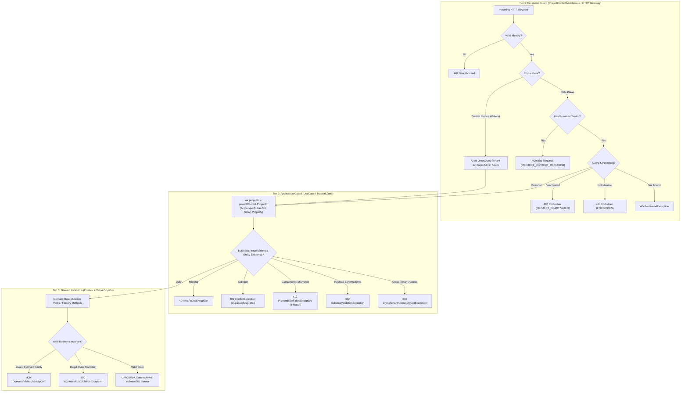
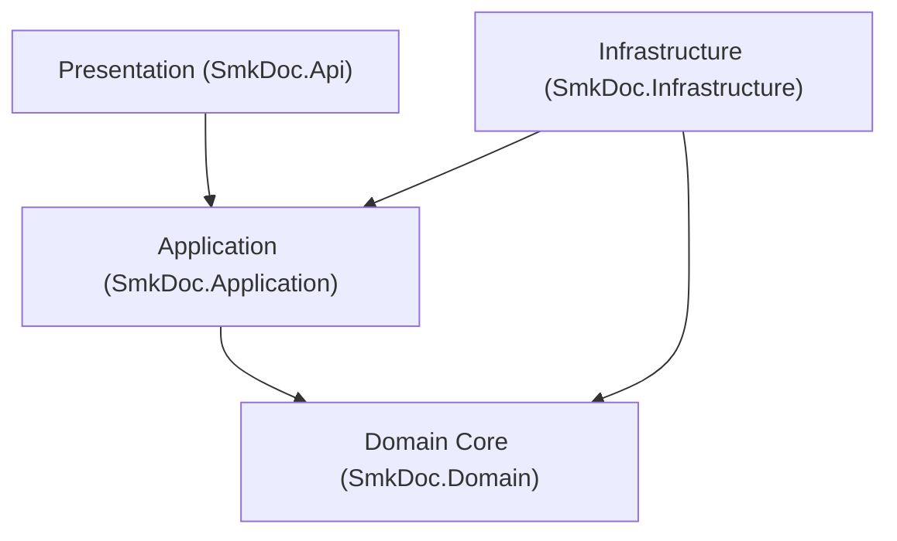

# [CORE-001]: 01_system_architecture.md — Master System Architecture, Tier Topology & Layer Boundaries

<context>
Category: 00_architecture_core
Domain: Master System Architecture, Tier Topology & Bounded Context Matrix
SoleResponsibilities:
  - Macro container topology (API, Gotenberg, MinIO, Redis, PostgreSQL) and physical solution structure
  - Bounded Context collaboration matrix (Authoring, DataBinding, Rendering, Integration, IdentityAccess)
  - 2-track execution pipelines (Sync preview vs Async batch generation)
  - Cross-cutting layer dependency rules and Clean Architecture boundary invariants
Target: Full Stack (`backend-v2/` and `frontend-v2/`)
Signal: [ARCH_EVOLUTION_CORE]
</context>

---

## 1. Level 1: System Topology & Layer Invariants Matrix

### 1.1 Core Mission & Caller Personas
`smk-doc-server` is an enterprise-grade, high-throughput centralized document gateway ingesting structured JSON payloads and external database queries to produce deterministic outputs across three target formats: **PDF**, **DOCX**, and **XLSX**.
* **Primary Persona**: Automated Machine-to-Machine (M2M) callers (Enterprise ERPs, Core Banking, Billing Engines) communicating via SHA-256 API Keys on the Data Plane.
* **Secondary Persona**: Template Authors and Administrators interacting with the Web Studio Portal (`frontend-v2`) via JWT Bearer sessions on the Data Plane.
* **Platform Governance Persona**: System Administrators managing tenant lifecycle, quotas, and bootstrap keys via the Control Plane (`/api/v1/management/**`).
* **Non-Persona**: End-users of client systems (e.g., banking customers receiving invoices) never exist as accounts in this system.

### 1.1.1 Architectural Planes: Control Plane vs Data Plane Partitioning
The system enforces strict architectural separation between two decoupled operational planes (SOC 2 Type II / ISO 27001 / AWS Model):
1. **Control Plane (`/api/v1/management/**`)**:
   - Governance & tenant lifecycle: Project provisioning, quota allocations, global font management, bootstrap admin keys.
   - Authorized strictly via `RequireSuperAdmin`. SuperAdmin operates on project containers without requiring tenant membership.
   - Ingress Tenancy: Permitted without resolved tenant context when caller identity is `SystemRole.SuperAdmin`.
2. **Data Plane (`/api/v1/**` excluding `/management/` and `/auth/`)**:
   - Tenant workload resources: Templates, Documents, Datasets, Mappings, Tenant Sub-Keys, Project Users.
   - Requires valid ambient tenant context (`ICurrentProjectContext`).
   - Ingress Tenancy: **100% Mandatory Ambient Tenant**. Un-tenanted calls are rejected fail-fast at Tier 1 Perimeter with `400 Bad Request` (`ErrorCode: PROJECT_CONTEXT_REQUIRED`).
   - **Zero Standing Access for SuperAdmin**: SuperAdmin receives strictly `RoleConstants.SuperAdmin` (never `Admin`). On Data Plane routes, SuperAdmin has zero standing access and is rejected with `403 Forbidden` unless explicitly invited and mapped in `UserProjectRole` by the tenant.

### 1.1.2 The 3-Tier Guard Model & Defense-in-Depth Hierarchy
To eliminate "Defensive Overkill", redundant checking, and cross-layer paranoia, boundary defense is strictly partitioned into 3 independent tiers:

1. **Tier 1 (Perimeter Guard — `ProjectContextMiddleware`)**:
   - Gatekeeper of identity, route plane, and tenant isolation (Who, Where, Which Tenant).
   - Blocks un-tenanted Data Plane traffic immediately (`400 Bad Request`). Controllers and UseCases are guaranteed to never receive raw un-tenanted requests.
2. **Tier 2 (Application Guard — UseCase Step 1 PEMR)**:
   - Operates in a **Trusted Zone**. Does not re-police HTTP headers or throw 401 Unauthorized.
   - **Self-Guarding Smart Context (Fail-Fast Property)**: `var projectId = projectContext.ProjectId;` applied at line 1 of Step 1 PEMR strictly when `ProjectId` or caller identity is consumed in domain logic (Entity creation, MinIO storage path, DraftCache, composite key queries). Throws `TenantContextRequiredException` (`TENANT_CONTEXT_REQUIRED`, 403 Forbidden) immediately if accessed while unresolved.
   - **Zero Phantom Context Injection**: UseCases operating on existing aggregates by ID or relying on EF Core global query filters must NOT inject `ICurrentProjectContext`.
   - **Cross-Tenant Ownership Defense**: Throws `CrossTenantAccessDeniedException` (`CROSS_TENANT_ACCESS_DENIED`, 403 Forbidden) when a tenant caller queries or mutates resources belonging to another project.
   - Evaluates Business Preconditions: `NotFoundException` (404), `ConflictException` (409), `DraftExpiredException` (410), `PreconditionFailedException` (412 via `IConcurrencyContext.EnsureMatches`), and `SchemaValidationException` (422).
3. **Tier 3 (Domain Invariant Guard — Entities & Value Objects)**:
   - Self-validating aggregate roots and value objects.
   - Enforces data integrity and state invariants via Factory Methods (`Create`) and expressive domain verbs, throwing `DomainValidationException` (400) or `BusinessRuleViolationException` (400).

### 1.2 Clean Architecture Layer Invariants Matrix


| Layer Project | Inbound Allowed | Affirmative Architectural Invariants (Positive Core Laws) | Boundary Vector |
|---|---|---|---|
| **`SmkDoc.Domain`** | `Application`, `Infrastructure`, `Api` | Pure C# 13 POCOs only. Encapsulated state via `private set`. Explicit dependencies passed via parameters (`DateTimeOffset now`, `TimeProvider`). Exactly 1 canonical factory method (`Create`) per Aggregate Root. | Core Center |
| **`SmkDoc.Application`** | `Infrastructure`, `Api` | CQRS Single-Responsibility workflows via `IUseCase<TReq, TRes>`. Cross-boundary payloads strictly use immutable positional records (`*Command`, `*Query`, `*ResultDto`). Atomic persistence coordination via `IUnitOfWork`. Enforces 1-Primary-Type-Per-File co-located in feature slices. | Inward => Domain |
| **`SmkDoc.Infrastructure`**| `Api` (Composition Root only) | Implements Application ports (EF Core, MinIO, Gotenberg, SQL Drivers). Enforces ambient multi-tenancy via EF Core global query filters. Streams binary outputs directly through bounded 81,920-byte buffers. Pluggable adapters via Factory/Strategy patterns. | Inward => Domain & Application |
| **`SmkDoc.Api`** | None (Entry Point) | Thin HTTP orchestrators ($\le 5$ LOC per action) with C# 13 Primary Constructors. Translates HTTP requests to Commands/Queries and delegates directly to UseCases. Centralizes RFC 9457 `ProblemDetails` via `IExceptionHandler`. | Inward => Application |

### 1.3 The Bounded Context Collaboration Matrix
| Bounded Context | Core Aggregates (Domain) | Upstream Dependencies | Downstream Consumers | Shared Boundary Contracts |
|---|---|---|---|---|
| **`Authoring`** | `Template`, `TemplateVersion`, `FieldMapping`, `Font` | `IdentityAccess` (Project scoping) | `Rendering`, `DataBinding` | `TemplateId`, `TemplateSlug`, `TemplateVersionId`, `TemplatePublishedDomainEvent` |
| **`DataBinding`** | None (Pure Engine Services) | `Authoring` (Mappings/Schema), `Integration` (Datasets) | `Rendering` (Pipeline synthesis) | `IDataBindingEngine`, `BoundDocumentData`, `ResolvedDatasetContext` |
| **`Rendering`** | `Document`, `DocumentVersion`, `GenerationLog` | `Authoring` (Templates), `DataBinding` (Bound data) | External Callers, Portal UI | `DocumentId`, `RenderEngineType`, `OutputFormat`, `Stream` |
| **`Integration`**| `DataConnection`, `Dataset` | `IdentityAccess` (Project scoping) | `DataBinding` (Data extraction) | `DataConnectionId`, `DatasetId`, `ExtractionStrategy` |
| **`IdentityAccess`**| `Company`, `Project`, `User`, `ApiKey` | Edge Authentication Middleware | All other Contexts (Tenant filtering) | `ProjectId`, `CompanyId`, `UserId`, `ApiKeyId`, `ICurrentProjectContext` |

### 1.4 The 2 Core Execution Pipelines
```
[PIPELINE_A: M2M DOCUMENT GENERATION (Persistent & Audited)]
HTTP Request (API Key) 
  => ProjectContextMiddleware (Dual-Channel Auth: Channel A M2M API Key)
  => DocumentGenerationController (<= 5 LOC)
  => GenerateDocumentUseCase (PEMR Cadence)
  => Engine Dispatcher (Gotenberg / OpenXML / ClosedXML)
  => ResponseDisposingStream (Bounded 81,920 buffer passthrough)
  => Async Background Audit & MinIO Archive

[PIPELINE_B: WEB STUDIO LIVE PREVIEW (100% In-Memory & Non-Persistent)]
HTTP Request (JWT Bearer)
  => ProjectContextMiddleware (Dual-Channel Auth: Channel B JWT Session)
  => PreviewController (<= 5 LOC)
  => PreviewDocumentUseCase (Unified SSoT for Monaco HTML, Template Slug, ID, or RAM Draft)
  => Gotenberg Sandboxed Chromium Cluster (In-Memory HTML/CSS)
  => Direct MemoryStream Passthrough to Response
  => ZERO Database Mutation & ZERO MinIO Persistence
```

### 1.5 Application Module Taxonomy Tree
```
backend-v2/src/SmkDoc.Application/Modules/
  Authoring/
    Commands/ # CreateTemplate, UpdateTemplateDetails, DeactivateTemplate, SaveTemplateHtml, ParseTemplateDraft, CommitTemplateDraft, RollbackTemplateVersion
    Queries/  # GetTemplateById, ListTemplates, ListTemplateVersions, DownloadTemplate, ScanTemplatePlaceholders, GetTemplateHtmlSource, GetTemplateStudioBundle, GetTemplateSchema, ValidateTemplateHtml, ValidateTemplatePayload
    DTOs/     # TemplateResultDto, TemplateVersionDto, ParseDraftResultDto, CommitDraftResultDto, ScanFieldsResultDto, TemplateStudioDto, TemplateSchemaDto
  DataBinding/
    Services/ # DataBindingEngine (IDataBindingEngine SSoT), DatasetBatchExecutor (IDatasetBatchExecutor)
    Helpers/  # JsonPathEvaluator, DatasetCacheKeyBuilder
    DTOs/     # BoundDocumentData, ResolvedDatasetContext
  Rendering/
    Commands/ # GenerateDocument, EnqueueGeneration
    Queries/  # PreviewDocument (Unified SSoT), GetVersions, GetJob, ListLogs
    DTOs/     # GenerateDocumentResultDto, DocumentJobDto, DocumentVersionDto
  Integration/
    Commands/ # CreateDataConnection, TestConnection, SaveDataset
    Queries/  # GetDataConnectionById, ExecuteDatasetQuery, ListDatasets
    DTOs/     # DataConnectionResultDto, DatasetResultDto, QueryPreviewDto
  IdentityAccess/
    Commands/ # LoginUser, RefreshToken, CreateApiKey, RevokeApiKey, TransferProjectOwner, SwitchProject
    Queries/  # GetCurrentUser, ListProjects, ValidateApiKey, ListApiKeys
    DTOs/     # AuthTokenResultDto, UserProfileResultDto, ApiKeyResultDto
```

### 1.6 Domain Bounded Context Taxonomy Tree
```
backend-v2/src/SmkDoc.Domain/
  Common/                        # Shared domain primitives & base classes
    BaseEntity.cs                # Generic BaseEntity<TId> (Identity & Timestamps) & BaseEntity (Guid)
    AggregateRoot.cs             # Generic AggregateRoot<TId> (Domain Events & Concurrency)
    Guard.cs                     # Invariant guards
    Enumeration.cs               # Smart enum base
    IDomainEvent.cs              # Domain event marker
    IHaveDomainEvents.cs         # Event harvesting contract
  Interfaces/                    # Universal domain contracts
    IUnitOfWork.cs
    ICurrentProjectContext.cs
    IMustHaveProject.cs
    IConcurrencyAware.cs
  Authoring/                     # Authoring Bounded Context
    Entities/                    # Template, TemplateVersion, FieldMapping, Font
    ValueObjects/                # TemplateSlug, TemplateName, VersionNumber
    Events/                      # TemplateCreatedDomainEvent, TemplatePublishedDomainEvent
    Exceptions/                  # TemplateNotFoundException, TemplateVersionNotFoundException
  Rendering/                     # Rendering Bounded Context
    Entities/                    # Document, DocumentVersion, GenerationLog
    ValueObjects/                # StorageKey, Checksum
    Enums/                       # RenderEngineType, OutputFormat, GenerationStatus
    Events/                      # DocumentRenderedDomainEvent
  Integration/                   # Integration Bounded Context
    Entities/                    # DataConnection, Dataset, TemplateDataset
    ValueObjects/                # ConnectionStringEncrypted, DatasetQuery
    Enums/                       # DataConnectionType
  IdentityAccess/                # Identity & Access Bounded Context
    Entities/                    # Company, Project, User, ApiKey, UserProjectRole
    ValueObjects/                # KeyHash, EmailAddress, ProjectSlug
    Enums/                       # SystemRole, RoleType, ApiKeyScope
```

---

## 2. Level 2: Architectural Rationales & Structural Firewalls

### 2.1 Engineering Rationale & Causal Decisions
* **Why Inward-Only Dependency Flow**: Prevents database schema changes and third-party library churn from forcing breaking changes onto core business invariants.
* **Why Single-Responsibility `IUseCase` over MediatR**: Eliminates runtime reflection, assembly scanning allocations, and opaque call stacks. Direct `IUseCase<TRequest, TResponse>` gives compile-time verification, clean stack traces, and straightforward unit testing via `CreateSut()`.
* **Why Decoupled Gotenberg Chromium Cluster**: Embedded headless browser processes are prone to memory leaks, font shifting across OS platforms, and sudden SIGSEGV process crashes. External Gotenberg pods isolate rendering compute from the core API gateway.
* **Why Modular Composition Roots across All Layers**: Monolithic service registration classes accumulate debt indiscriminately, mask lifetime mismatches (e.g. captive dependencies), and bloat git merge conflicts. Decomposing DI by Bounded Context and Subsystem isolates concerns and ensures test harness parity.
* **Why Total Elimination of God Services**: Multi-action services inevitably accumulate unrelated dependencies, cross-cutting baggage, and hidden state couplings. Action-Centric Vertical Slices (1 UseCase = 1 Responsibility) isolate failure blast radiuses and eliminate regression bleed.
* **Why Zero Pass-Through Indirection & Strict Codebase SSoT**: Artificial forwarding wrappers and duplicate helper methods create cognitive noise and memory allocations without delivering domain value. Every domain rule and engine must have exactly ONE authoritative implementation.

### 2.2 Proactive Structural Firewalls
```yaml
DomainIntegrityFirewall:
  Invariant: "SmkDoc.Domain must contain strictly 100% pure C# POCOs."
  ActionOnViolation: "Reject any third-party framework or persistence dependencies (EF Core, ASP.NET Core, AWS/MinIO SDKs)."

PersistenceIsolationFirewall:
  Invariant: "SmkDoc.Application must never reference EF Core DbContext directly."
  ActionOnViolation: "Enforce persistence abstraction behind Repository interfaces and IUnitOfWork."

ApiOrchestrationFirewall:
  Invariant: "SmkDoc.Api controllers are thin dispatchers strictly <= 5 LOC per action."
  ActionOnViolation: "Delegate workflow execution directly to IUseCase<TReq, TRes> and wrap output in ApiResponse<T>."

SliceModularityFirewall:
  Invariant: "Enforce 1-Primary-Type-Per-File co-located within feature slices."
  ActionOnViolation: "Split bundled types into separate dedicated files ({TypeName}.cs)."

CompositionRootFirewall:
  Invariant: "All DI registrations across ALL layers must be modularized by Bounded Context / Subsystem. Monolithic Program.cs or dumping registrations into root DependencyInjection.cs is strictly prohibited."
  ActionOnViolation: "Decompose into Add{Context}Module() or Add{Subsystem}Infrastructure() extension methods."

GodServiceEliminationFirewall:
  Invariant: "Multi-action service classes are 100% prohibited across the entire platform. Every business capability must be an isolated Action-Centric Vertical Slice (1 UseCase = 1 Command/Query = 1 Responsibility). Boilerplate must be eliminated via C# 13 Primary Constructors and positional records, NEVER via generic CRUD base classes or runtime reflection."
  ActionOnViolation: "Refactor fat multi-action service into isolated UseCase slices."

CodebaseSSoTAndDeduplicationFirewall:
  Invariant: "Every business rule, transformer, and engine must have exactly ONE authoritative implementation (Codebase SSoT). Zero duplicate services, zero pass-through indirection wrappers, and zero parallel shims."
  ActionOnViolation: "Purge obsolete/wrapper services and route 100% of callers to the canonical SSoT implementation."
```

---

## 3. Level 3: Canonical Working Archetypes (100% Fully-Hydrated Recipes)

### 3.1 The 5-File Co-Located CQRS Vertical Slice Topology
>> MANDATORY CANONICAL TEMPLATE [RULE-STRUCT-004]:
* [MUST] Isolate every `*Command`, `*Query`, `*Validator`, and `*UseCase` into its own dedicated `.cs` file (`{TypeName}.cs`) co-located inside `Modules/{Context}/{Aggregate}/{Commands|Queries}/{SliceName}/`.
* [MUST NOT] Bundle `*Command`, `*Query`, or `*Validator` declarations inside `*UseCase.cs`.

```
Modules/{Context}/{Aggregate}/Commands/{Verb}{Aggregate}/
  {Verb}{Aggregate}Command.cs          # 1. Positional input record
  {Verb}{Aggregate}CommandValidator.cs # 2. FluentValidation rules
  {Verb}{Aggregate}UseCase.cs          # 3. Single-responsibility orchestrator
  {Aggregate}ResultDto.cs              # 4. Immutable output record
  {Verb}{Aggregate}Errors.cs           # 5. Strongly-typed slice domain errors
```

```csharp
// 1. {Verb}{Aggregate}Command.cs (Surgical AST: Positional Input Contract)
public sealed record {Verb}{Aggregate}Command(
    string Name,
    string Slug,
    string? Category = null);

// 2. {Aggregate}ResultDto.cs (Surgical AST: Canonical Output Contract co-located in DTOs/ or Slice)
public sealed record {Aggregate}ResultDto(
    Guid Id,
    Guid ProjectId,
    string Name,
    string Slug,
    string? Category,
    bool IsActive,
    DateTimeOffset CreatedAt,
    DateTimeOffset? UpdatedAt,
    string ConcurrencyToken) : IHasConcurrencyToken;

// 3. Archetype A: Entity-Creating UseCase (Create{Aggregate}UseCase.cs - Surgical AST: 4-Step PEMR Cadence)
// (Note: Archetype B UseCases operating by ID or using EF Core Global Query Filter do NOT inject ICurrentProjectContext)
public sealed class Create{Aggregate}UseCase(
    I{Aggregate}Repository {aggregate}Repository,
    ICurrentProjectContext projectContext,
    IUnitOfWork unitOfWork,
    TimeProvider timeProvider) : IUseCase<Create{Aggregate}Command, {Aggregate}ResultDto>
{
    public async Task<{Aggregate}ResultDto> ExecuteAsync(Create{Aggregate}Command command, CancellationToken ct = default)
    {
        // Step 1: Parse & Guard (Fail-fast Smart Context property: throws TenantContextRequiredException if unresolved)
        var projectId = projectContext.ProjectId;

        // Step 2: Ensure Preconditions (Business rules & slug uniqueness)
        if (await {aggregate}Repository.SlugExistsAsync(command.Slug, ct))
        {
            throw ConflictException.DuplicateSlug(command.Slug);
        }

        var now = timeProvider.GetUtcNow(); // Injected clock: deterministic testability

        // Step 3: Mutate State (Expressive domain entity factory verb)
        var entity = {Aggregate}.Create(
            projectId,
            {Aggregate}Name.Create(command.Name),
            {Aggregate}Slug.Create(command.Slug),
            command.Category,
            now);

        await {aggregate}Repository.AddAsync(entity, ct);

        // Step 4: Return ResultDto (Atomic transaction commit & immutable output)
        await unitOfWork.CommitAsync(ct);
        return new {Aggregate}ResultDto(
            entity.Id.Value,
            entity.ProjectId.Value,
            entity.Name.Value,
            entity.Slug.Value,
            entity.Category,
            entity.IsActive,
            entity.CreatedAt,
            entity.UpdatedAt,
            entity.GetConcurrencyToken());
    }
}
```

---

## 4. Level 4: Anti-Patterns & Unified Micro-Diffs

### [TRAP-ARCH-001]: Direct DbContext or Entity Leakage in Application Layer
```diff
- public sealed class Get{Aggregate}UseCase(AppDbContext dbContext) {
-     public async Task<{Aggregate}> ExecuteAsync(Guid id) => await dbContext.Set<{Aggregate}>().FindAsync(id);
- }
+ public sealed class Get{Aggregate}UseCase(I{Aggregate}Repository repository) : IUseCase<Get{Aggregate}Query, {Aggregate}ResultDto> {
+     public async Task<{Aggregate}ResultDto> ExecuteAsync(Get{Aggregate}Query query, CancellationToken ct) {
+         var entity = await repository.GetByIdAsync(query.Id, ct) ?? throw new NotFoundException("{Aggregate} not found.");
+         return new {Aggregate}ResultDto(entity.Id.Value, entity.Name, entity.Slug);
+     }
+ }
```
*Rationale: Direct `DbContext` usage in Application leaks persistence infrastructure; returning Domain Entities exposes internal domain models and navigation proxies across boundaries.*

### [TRAP-ARCH-002]: Bundling Multiple Primary Types Inside UseCase File
```diff
- // Inside {Verb}{Aggregate}UseCase.cs:
- public sealed record {Verb}{Aggregate}Command(...);
- public sealed class {Verb}{Aggregate}Validator : AbstractValidator<{Verb}{Aggregate}Command> { ... }
- public sealed class {Verb}{Aggregate}UseCase(...) { ... }
+ // Split into separate 1-Primary-Type-Per-File co-located records:
+ // {Verb}{Aggregate}Command.cs -> contains {Verb}{Aggregate}Command
+ // {Verb}{Aggregate}CommandValidator.cs -> contains {Verb}{Aggregate}CommandValidator
+ // {Verb}{Aggregate}UseCase.cs -> contains {Verb}{Aggregate}UseCase
```
*Rationale: Bundling hides type contracts from Solution Explorer and git diffs, degrading team readability and cognitive clarity.*
