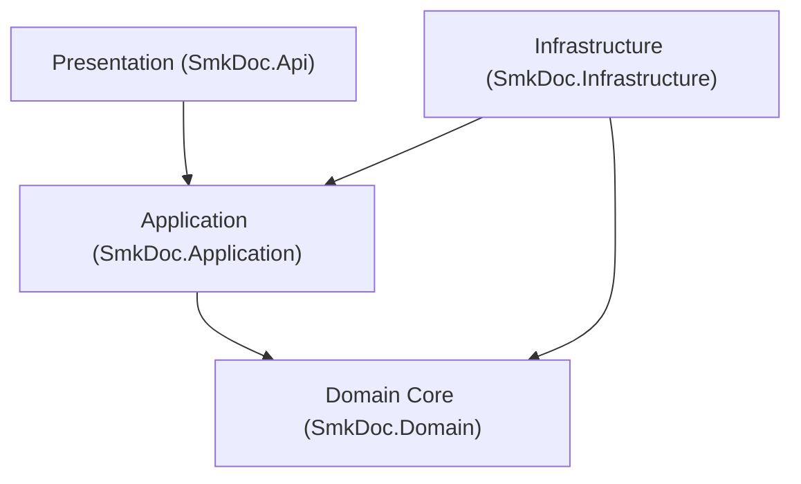

# [CORE-001]: 01_system_architecture.md — Master System Architecture, Tier Topology & Layer Boundaries

<context>
Scope: Macro Container Topology, 4 Bounded Contexts Collaboration, Tier Matrix, 2 Execution Pipelines, Clean Architecture Layer Boundaries, and System Structural Interceptors.
SSoT_For: Overall System Architecture, Layer Dependency Invariants, Container Topology, and Execution Pipeline Lifecycles.
Out_Of_Scope: C# 13 syntax and linear cadences (see: 02_coding_conventions.md), M2M security and performance limits (see: 03_security_and_performance.md), Lexical naming (see: 04_naming_standards.md), Anti-patterns (see: 05_anti_pattern_firewall.md).
Target: `backend-v2/` (`SmkDoc.Domain`, `SmkDoc.Application`, `SmkDoc.Infrastructure`, `SmkDoc.Api`) and `frontend-v2/`.
ArchitecturalSignals: [ARCH_EVOLUTION_CORE]
</context>

---

## 1. Level 1: System Topology & Layer Invariants Matrix

### 1.1 Core Mission & Caller Personas
`smk-doc-server` is an enterprise-grade, high-throughput centralized document gateway ingesting structured JSON payloads and external database queries to produce deterministic outputs across three target formats: **PDF**, **DOCX**, and **XLSX**.
* **Primary Persona**: Automated Machine-to-Machine (M2M) callers (Enterprise ERPs, Core Banking, Billing Engines) communicating via SHA-256 API Keys.
* **Secondary Persona**: Template Authors and Administrators interacting with the Web Studio Portal (`frontend-v2`) via JWT Bearer sessions.
* **Non-Persona**: End-users of client systems (e.g., banking customers receiving invoices) never exist as accounts in this system.

### 1.2 Clean Architecture Layer Invariants Matrix


| Layer Project | Inbound Allowed | Affirmative Architectural Invariants (Positive Core Laws) | Boundary Vector |
|---|---|---|---|
| **`SmkDoc.Domain`** | `Application`, `Infrastructure`, `Api` | Pure C# 13 POCOs only. Encapsulated state via `private set`. Explicit dependencies passed via parameters (`DateTimeOffset now`, `TimeProvider`). Exactly 1 canonical factory method (`Create`) per Aggregate Root. | Core Center |
| **`SmkDoc.Application`** | `Infrastructure`, `Api` | CQRS Single-Responsibility workflows via `IUseCase<TReq, TRes>`. Cross-boundary payloads strictly use immutable positional records (`*Command`, `*Query`, `*ResultDto`). Atomic persistence coordination via `IUnitOfWork`. Enforces 1-Primary-Type-Per-File co-located in feature slices. | Inward => Domain |
| **`SmkDoc.Infrastructure`**| `Api` (Composition Root only) | Implements Application ports (EF Core, MinIO, Gotenberg, SQL Drivers). Enforces ambient multi-tenancy via EF Core global query filters. Streams binary outputs directly through bounded 81,920-byte buffers. Pluggable adapters via Factory/Strategy patterns. | Inward => Domain & Application |
| **`SmkDoc.Api`** | None (Entry Point) | Thin HTTP orchestrators ($\le 5$ LOC per action) with C# 13 Primary Constructors. Translates HTTP requests to Commands/Queries and delegates directly to UseCases. Centralizes RFC 9457 `ProblemDetails` via `IExceptionHandler`. | Inward => Application |

### 1.3 The Bounded Context Collaboration Matrix
| Bounded Context | Core Aggregates (Domain) | Upstream Dependencies | Downstream Consumers | Shared Boundary Contracts |
|---|---|---|---|---|
| **`Authoring`** | `Template`, `TemplateVersion`, `FieldMapping`, `Font` | `IdentityAccess` (Project scoping) | `Rendering`, `DataBinding` | `TemplateId`, `TemplateSlug`, `TemplateVersionId`, `TemplatePublishedDomainEvent` |
| **`DataBinding`** | None (Pure Engine Services) | `Authoring` (Mappings/Schema), `Integration` (Datasets) | `Rendering` (Pipeline synthesis) | `IDataBindingEngine`, `BoundDocumentData`, `ResolvedDatasetContext` |
| **`Rendering`** | `Document`, `DocumentVersion`, `GenerationLog` | `Authoring` (Templates), `DataBinding` (Bound data) | External Callers, Portal UI | `DocumentId`, `RenderEngineType`, `OutputFormat`, `Stream` |
| **`Integration`**| `DataConnection`, `Dataset` | `IdentityAccess` (Project scoping) | `DataBinding` (Data extraction) | `DataConnectionId`, `DatasetId`, `ExtractionStrategy` |
| **`IdentityAccess`**| `Company`, `Project`, `User`, `ApiKey` | Edge Authentication Middleware | All other Contexts (Tenant filtering) | `ProjectId`, `CompanyId`, `UserId`, `ApiKeyId`, `ICurrentProjectContext` |

### 1.4 The 2 Core Execution Pipelines
```
[PIPELINE_A: M2M DOCUMENT GENERATION (Persistent & Audited)]
HTTP Request (API Key) 
  => ApiKeyAuthMiddleware (Resolves ProjectContext)
  => RenderDocumentController (<= 5 LOC)
  => RenderDocumentUseCase (PEMR Cadence)
  => Engine Dispatcher (Gotenberg / OpenXML / ClosedXML)
  => ResponseDisposingStream (Bounded 81,920 buffer passthrough)
  => Async Background Audit & MinIO Archive

[PIPELINE_B: WEB STUDIO LIVE PREVIEW (100% In-Memory & Non-Persistent)]
HTTP Request (JWT Bearer)
  => JwtSessionMiddleware (Resolves User & Draft ProjectContext)
  => PreviewController (<= 5 LOC)
  => RenderPreviewUseCase (In-Memory Draft Rendering)
  => Gotenberg Sandboxed Chromium Cluster (In-Memory HTML/CSS)
  => Direct MemoryStream Passthrough to Response
  => ZERO Database Mutation & ZERO MinIO Persistence
```

### 1.5 Application Module Taxonomy Tree
```
backend-v2/src/SmkDoc.Application/Modules/
  Authoring/
    Commands/ # CreateTemplate, UpdateTemplate, PublishVersion, SaveMappings, CommitDraft
    Queries/  # GetTemplateById, ListTemplates, ListVersions, GetMappings, GetStudioBundle
    DTOs/     # TemplateResultDto, TemplateVersionResultDto, FieldMappingDto, TemplateStudioDto
  DataBinding/
    Services/ # DataBindingEngine (IDataBindingEngine SSoT), FieldMappingApplicatorService
    DTOs/     # BoundDocumentData, ResolvedDatasetContext
  Rendering/
    Commands/ # GenerateDocument, EnqueueGeneration
    Queries/  # PreviewDocument (Unified SSoT), GetVersions, GetJob, ListLogs
    DTOs/     # GenerateDocumentResultDto, DocumentJobDto, DocumentVersionDto
  Integration/
    Commands/ # CreateDataConnection, TestConnection, SaveDataset
    Queries/  # GetDataConnectionById, ExecuteDatasetQuery, ListDatasets
    DTOs/     # DataConnectionResultDto, DatasetResultDto, QueryPreviewDto
  IdentityAccess/
    Commands/ # LoginUser, RefreshToken, CreateApiKey, RevokeApiKey, TransferProjectOwner, SwitchProject
    Queries/  # GetCurrentUser, ListProjects, ValidateApiKey, ListApiKeys
    DTOs/     # AuthTokenResultDto, UserProfileResultDto, ApiKeyResultDto
```

---

## 2. Level 2: Architectural Rationales & Structural Firewalls

### 2.1 Engineering Rationale & Causal Decisions
* **Why Inward-Only Dependency Flow**: Prevents database schema changes and third-party library churn from forcing breaking changes onto core business invariants.
* **Why Single-Responsibility `IUseCase` over MediatR**: Eliminates runtime reflection, assembly scanning allocations, and opaque call stacks. Direct `IUseCase<TRequest, TResponse>` gives compile-time verification, clean stack traces, and straightforward unit testing via `CreateSut()`.
* **Why Decoupled Gotenberg Chromium Cluster**: Embedded headless browser processes are prone to memory leaks, font shifting across OS platforms, and sudden SIGSEGV process crashes. External Gotenberg pods isolate rendering compute from the core API gateway.

### 2.2 Proactive Structural Firewalls
```yaml
DomainIntegrityFirewall:
  Invariant: "SmkDoc.Domain must contain strictly 100% pure C# POCOs."
  ActionOnViolation: "Reject any third-party framework or persistence dependencies (EF Core, ASP.NET Core, AWS/MinIO SDKs)."

PersistenceIsolationFirewall:
  Invariant: "SmkDoc.Application must never reference EF Core DbContext directly."
  ActionOnViolation: "Enforce persistence abstraction behind Repository interfaces and IUnitOfWork."

ApiOrchestrationFirewall:
  Invariant: "SmkDoc.Api controllers are thin dispatchers strictly <= 5 LOC per action."
  ActionOnViolation: "Delegate workflow execution directly to IUseCase<TReq, TRes> and wrap output in ApiResponse<T>."

SliceModularityFirewall:
  Invariant: "Enforce 1-Primary-Type-Per-File co-located within feature slices."
  ActionOnViolation: "Split bundled types into separate dedicated files ({TypeName}.cs)."
```

---

## 3. Level 3: Canonical Working Archetypes (100% Fully-Hydrated Recipes)

### 3.1 The 5-File Co-Located CQRS Vertical Slice Topology
>> MANDATORY CANONICAL TEMPLATE [RULE-STRUCT-004]:
* [MUST] Isolate every `*Command`, `*Query`, `*Validator`, and `*UseCase` into its own dedicated `.cs` file (`{TypeName}.cs`) co-located inside `Modules/{Context}/{Aggregate}/{Commands|Queries}/{SliceName}/`.
* [MUST NOT] Bundle `*Command`, `*Query`, or `*Validator` declarations inside `*UseCase.cs`.

```
Modules/{Context}/{Aggregate}/Commands/{Verb}{Aggregate}/
  {Verb}{Aggregate}Command.cs          # 1. Positional input record
  {Verb}{Aggregate}CommandValidator.cs # 2. FluentValidation rules
  {Verb}{Aggregate}UseCase.cs          # 3. Single-responsibility orchestrator
  {Aggregate}ResultDto.cs              # 4. Immutable output record
  {Verb}{Aggregate}Errors.cs           # 5. Strongly-typed slice domain errors
```

```csharp
// 1. {Verb}{Aggregate}Command.cs (Surgical AST: Positional Input Contract)
public sealed record {Verb}{Aggregate}Command(
    string Name,
    string Slug,
    string? Category = null);

// 2. {Verb}{Aggregate}UseCase.cs (Surgical AST: 4-Step PEMR Cadence)
public sealed class {Verb}{Aggregate}UseCase(
    I{Aggregate}Repository {aggregate}Repository,
    ICurrentProjectContext projectContext,
    IUnitOfWork unitOfWork,
    TimeProvider timeProvider) : IUseCase<{Verb}{Aggregate}Command, {Aggregate}ResultDto>
{
    public async Task<{Aggregate}ResultDto> ExecuteAsync({Verb}{Aggregate}Command command, CancellationToken ct = default)
    {
        // Step 1: Parse & Guard (Fail-fast ambient tenant validation)
        if (!projectContext.IsResolved)
        {
            throw new ForbiddenException("Project context is required.");
        }

        // Step 2: Ensure Preconditions (Business rules & slug uniqueness)
        var now = timeProvider.GetUtcNow(); // Injected clock: deterministic testability

        // Step 3: Mutate State (Expressive domain entity factory verb)
        var entity = {Aggregate}.Create(
            projectContext.ProjectId,
            {Aggregate}Name.Create(command.Name),
            {Aggregate}Slug.Create(command.Slug),
            command.Category,
            now);

        await {aggregate}Repository.AddAsync(entity, ct);

        // Step 4: Return ResultDto (Atomic transaction commit & immutable output)
        await unitOfWork.CommitAsync(ct);
        return new {Aggregate}ResultDto(entity.Id.Value, entity.Name.Value, entity.Slug.Value, entity.Category);
    }
}
```

---

## 4. Level 4: Anti-Patterns & Unified Micro-Diffs

### [TRAP-ARCH-001]: Direct DbContext or Entity Leakage in Application Layer
```diff
- public sealed class Get{Aggregate}UseCase(AppDbContext dbContext) {
-     public async Task<{Aggregate}> ExecuteAsync(Guid id) => await dbContext.Set<{Aggregate}>().FindAsync(id);
- }
+ public sealed class Get{Aggregate}UseCase(I{Aggregate}Repository repository) : IUseCase<Get{Aggregate}Query, {Aggregate}ResultDto> {
+     public async Task<{Aggregate}ResultDto> ExecuteAsync(Get{Aggregate}Query query, CancellationToken ct) {
+         var entity = await repository.GetByIdAsync(query.Id, ct) ?? throw new NotFoundException("{Aggregate} not found.");
+         return new {Aggregate}ResultDto(entity.Id.Value, entity.Name, entity.Slug);
+     }
+ }
```
*Rationale: Direct `DbContext` usage in Application leaks persistence infrastructure; returning Domain Entities exposes internal domain models and navigation proxies across boundaries.*

### [TRAP-ARCH-002]: Bundling Multiple Primary Types Inside UseCase File
```diff
- // Inside {Verb}{Aggregate}UseCase.cs:
- public sealed record {Verb}{Aggregate}Command(...);
- public sealed class {Verb}{Aggregate}Validator : AbstractValidator<{Verb}{Aggregate}Command> { ... }
- public sealed class {Verb}{Aggregate}UseCase(...) { ... }
+ // Split into separate 1-Primary-Type-Per-File co-located records:
+ // {Verb}{Aggregate}Command.cs -> contains {Verb}{Aggregate}Command
+ // {Verb}{Aggregate}CommandValidator.cs -> contains {Verb}{Aggregate}CommandValidator
+ // {Verb}{Aggregate}UseCase.cs -> contains {Verb}{Aggregate}UseCase
```
*Rationale: Bundling hides type contracts from Solution Explorer and git diffs, degrading team readability and cognitive clarity.*
