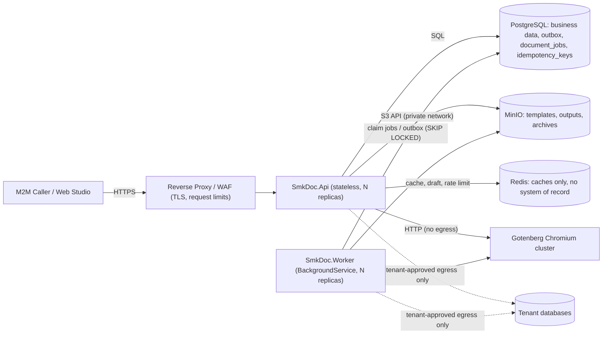
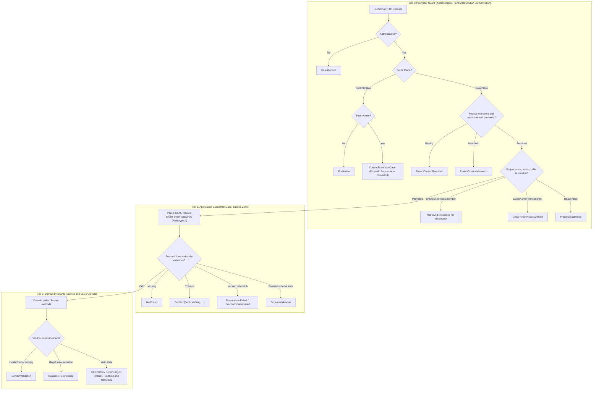
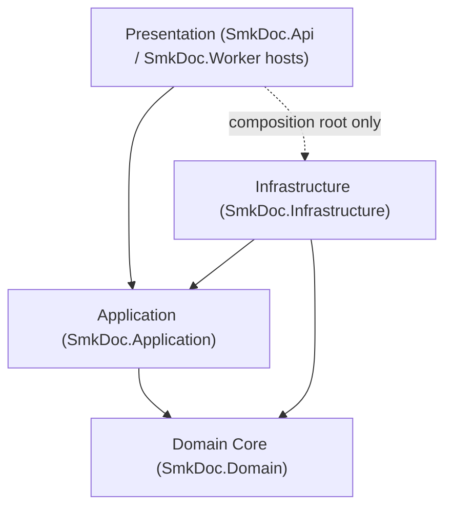

# [CORE-001]: 01_system_architecture.md — Master System Architecture, Tier Topology & Layer Boundaries

<context>
Category: 00_architecture_core
Domain: Master System Architecture, Tier Topology & Bounded Context Matrix
SoleResponsibilities:
  - Macro container topology (API, Worker, Gotenberg, MinIO, Redis, PostgreSQL) and physical solution structure
  - Macro Zoning (Control Plane vs Data Plane) and The 3-Tier Guard Model hierarchy
  - Bounded Context collaboration matrix (Authoring, DataBinding, Rendering, Integration, IdentityAccess, TenantManagement)
  - 3 execution pipelines (A: sync generation, B: sync live preview, C: async batch jobs)
  - Cross-cutting layer dependency rules and Clean Architecture boundary invariants
Out of scope (owned elsewhere): code idioms and canonical recipes (02), security controls and performance budgets (03), naming (04), trap registry (05), wire contract and exception-to-HTTP mapping (06).
Target: Full Stack (`backend-v2/` and `frontend-v2/`)
Platform baseline: .NET 10 / C# 14 (ADR-01). `LangVersion` and `TargetFramework` are declared once in `Directory.Build.props`; documents must not hard-code a language version in prose.
Signal: [ARCH_EVOLUTION_CORE]
</context>

---

## 1. Level 1: System Topology & Layer Invariants Matrix

### 1.1 Core Mission & Caller Personas
`smk-doc-server` is an enterprise-grade, high-throughput centralized document gateway ingesting structured JSON payloads and external database queries to produce deterministic outputs across three target formats: **PDF**, **DOCX**, and **XLSX**.
* **Primary Persona**: Automated Machine-to-Machine (M2M) callers (Enterprise ERPs, Core Banking, Billing Engines) authenticating with API keys (stored hashed, bound to exactly one project) on the Data Plane.
* **Secondary Persona**: Template Authors and Administrators using the Web Studio Portal (`frontend-v2`) with JWT Bearer sessions on the Data Plane.
* **Platform Governance Persona**: System Administrators managing tenant lifecycle, quotas, global fonts and bootstrap keys through the Control Plane (`/api/v1/management/**`).
* **Non-Persona**: End-users of client systems (e.g. banking customers receiving invoices) never exist as accounts in this system.

### 1.1.0 Container Topology (C4 Level 2)

* `SmkDoc.Api` and `SmkDoc.Worker` share the same Application, Domain and Infrastructure assemblies; they differ only in the composition root (HTTP host vs background host).
* Redis is a **cache only** (draft cache, tenant status cache, rate-limit counters). No business or idempotency state lives only in Redis.
* PostgreSQL is the only system of record and the queue for Pipeline C (ADR-02). No broker is introduced.
* Gotenberg, MinIO, Redis and PostgreSQL are never routable from outside the private network. Gotenberg has no internet egress (see 03).

### 1.1.1 Architectural Planes: Control Plane vs Data Plane Partitioning
The system enforces strict separation between two operational planes (SOC 2 Type II / ISO 27001 / AWS model). A third zone, **Public/Auth** (`/api/v1/auth/**`, health endpoints, OpenAPI), is unauthenticated or pre-tenant by design and is outside both planes.
1. **Control Plane (`/api/v1/management/**`)**:
   - Governance & tenant lifecycle: project provisioning, quota allocation, global font management, bootstrap admin keys.
   - Authorized strictly via the `RequireSuperAdmin` policy. The target `ProjectId` comes from the route or the command; no ambient tenant is resolved.
   - Owned by the `TenantManagement` bounded context.
2. **Data Plane (`/api/v1/**` excluding `/management/` and `/auth/`)**:
   - Tenant workload resources: Templates, Documents, Document Jobs, Datasets, Mappings, Tenant Sub-Keys, Project Users.
   - Requires a resolved ambient tenant (`ICurrentProjectContext`) from the `Project-Id` header (ADR-03). An API key is bound to one project; a JWT must select the project explicitly. **Any mismatch between header and credential is rejected, never resolved by precedence.**
   - Missing tenant is rejected at Tier 1 as `PROJECT_CONTEXT_REQUIRED`.
   - **Zero Standing Access for SuperAdmin**: SuperAdmin receives strictly `SystemRole.SuperAdmin` (never a tenant role). On Data Plane routes SuperAdmin is rejected (`CROSS_TENANT_ACCESS_DENIED`) unless explicitly invited and mapped in `UserProjectRole` by the tenant, or holds an active **break-glass grant** (just-in-time, time-boxed, approved, fully audited).

### 1.1.2 The 3-Tier Guard Model & Defense-in-Depth Hierarchy
Boundary defense is partitioned into 3 independent tiers. Diagrams show **error categories**; the HTTP status of each category is defined once in [06_api_contract_standards.md §3.3](06_api_contract_standards.md) (Domain and Application layers never know HTTP status codes).

1. **Tier 1: Perimeter Guard**. Implemented as three separate ASP.NET Core stages (single responsibility): `UseAuthentication` (two schemes: `ApiKey`, `Jwt`, implemented as `AuthenticationHandler`s), `TenantResolutionMiddleware` (plane routing, `Project-Id` resolution, membership and active check via cached `ITenantResolutionResolver` lookup with event-based invalidation; never direct `AppDbContext`), and `UseAuthorization` (policies such as `RequireSuperAdmin`, `TenantMember`). Controllers and UseCases never receive un-tenanted Data Plane requests.
2. **Tier 2: Application Guard** (UseCase PEMR). Operates in a **Trusted Zone**: does not re-check HTTP headers or authentication.
   - Archetype A UseCases (create entities, build storage paths or cache keys from the project) call `projectContext.GetRequiredProjectId()` in Step 1. If the tenant is unresolved here, it is a **programming error** (middleware bypassed): `TenantContextNotResolvedException` (internal error, alert), not a client error. `TryGetProjectId()` exists for code that tolerates absence.
   - Archetype B UseCases (by-ID or collection reads and updates) do not inject `ICurrentProjectContext`; tenant scoping is enforced by the layers in §1.1.3.
   - Evaluates business preconditions: `NotFoundException`, `ConflictException`, `DraftExpiredException`, `PreconditionFailedException` / `PreconditionRequiredException` (via the concurrency mechanism in 06/02), `SchemaValidationException`.
3. **Tier 3: Domain Invariant Guard**. Self-validating aggregates and value objects throw `DomainValidationException` or `BusinessRuleViolationException`.

### 1.1.3 Tenant Isolation: Layered, Fail-Closed
Cross-tenant data exposure is the highest-impact failure of this platform, so tenant isolation is the one area where **redundant controls are mandatory** (this is not "defensive overkill"):
1. **EF Core global query filter** on every `IMustHaveProject` entity, **fail-closed**: an unresolved tenant yields zero rows, never all rows.
2. **Write-side interceptor** that sets and verifies `ProjectId` on `IMustHaveProject` entities at `SaveChanges`.
3. **PostgreSQL Row-Level Security** on tenant tables (`SET LOCAL app.project_id` per transaction), so a missed filter, raw SQL or `IgnoreQueryFilters()` cannot cross tenants.
4. **Banned APIs** outside an allow-listed module: `IgnoreQueryFilters`, `FromSqlRaw`/`ExecuteSqlRaw` with interpolation.
5. **Automated cross-tenant leakage tests**: every endpoint is called as tenant B with tenant A identifiers and must return `NotFound`.
6. **Background workers (Pipeline C, outbox relay)** have no HTTP context: each job and outbox message carries `ProjectId`; the worker sets the ambient tenant explicitly before invoking a UseCase and clears it afterwards.
With a global filter, rows of another tenant are indistinguishable from missing rows, so resource-level cross-tenant access surfaces as `NotFoundException`. `CrossTenantAccessDeniedException` is reserved for plane-level denial (SuperAdmin on the Data Plane without grant).
> SSoT DELEGATION: Multi-Tenant Security Pipeline & 3-Tier Guard Model detail is governed by [multi_tenant_security_pipeline.md](../03_specialized_mechanics/multi_tenant_security_pipeline.md).

### 1.2 Clean Architecture Layer Invariants Matrix


| Layer Project | May reference | Affirmative Architectural Invariants (Positive Core Laws) |
|---|---|---|
| **`SmkDoc.Domain`** | nothing (BCL only) | Framework-free rich domain model: no EF Core, ASP.NET Core or SDK types. Encapsulated state (`private set`, private constructors). Named static factory methods enforce invariants (EF uses a private parameterless constructor for rehydration). Time enters as `DateTimeOffset now` parameters. Contains aggregates, value objects, domain events, repository **interfaces per aggregate**, `DomainValidationException`, `BusinessRuleViolationException`. |
| **`SmkDoc.Application`** | Domain | CQRS UseCases via `IUseCase<TRequest, TResponse>`. Cross-boundary payloads are immutable positional records (`*Command`, `*Query`, `*ResultDto`). Owns application ports: `IUnitOfWork`, `ICurrentProjectContext`, `ITenantScope`, `IDocumentJobQueue`, `I*ReadModel`, `I*Port`. Owns `NotFoundException`, `ConflictException`, `PreconditionFailedException`, `PreconditionRequiredException`, `SchemaValidationException`, `ForbiddenException`, `TenantContextNotResolvedException` (the full catalogue and its HTTP mapping live in 06 §3.3). Uses decorators for cross-cutting concerns (§3.3). |
| **`SmkDoc.Infrastructure`** | Application, Domain | Implements ports (EF Core, read models, MinIO, Gotenberg, SQL drivers, outbox, idempotency store). Enforces tenant isolation (§1.1.3). Streams binary output with bounded, pooled buffers. Adapters use Strategy/Factory. |
| **`SmkDoc.Api`** and **`SmkDoc.Worker`** | Application, Infrastructure (composition root only) | Thin HTTP/background orchestrators: translate requests into Commands/Queries, delegate to UseCases, contain no business logic. `IExceptionHandler` is the single place that maps exception categories to RFC 9457 `ProblemDetails` (table in 06). |

Dependency rules are enforced by architecture tests (see §2.2 `ArchitectureEnforcement`), not by convention.

### 1.3 The Bounded Context Collaboration Matrix
| Bounded Context | Core Aggregates (Domain) | Upstream | Downstream | Relationship and Published Contracts |
|---|---|---|---|---|
| **`TenantManagement`** | `Company`, `Project`, `ProjectQuota`, `Font` (platform-global) | none | all other contexts (tenant status, quota) | Open Host Service. Contracts: `ProjectId`, `CompanyId`, `IProjectStatusReader`, `IQuotaReader`, `ProjectDeactivatedDomainEvent` |
| **`IdentityAccess`** | `User`, `ApiKey`, `UserProjectRole` | `TenantManagement` (project existence) | all other contexts (caller identity) | Customer-Supplier. Contracts: `UserId`, `ApiKeyId`, `ICurrentProjectContext`, `IApiKeyIssuer` |
| **`Authoring`** | `Template`, `TemplateVersion`, `FieldMapping` | `TenantManagement`, `IdentityAccess` | `Rendering`, `DataBinding` | Published Language: `TemplateId`, `TemplateSlug`, `TemplateVersionId`, `TemplatePublishedDomainEvent` |
| **`Integration`** | `DataConnection`, `Dataset` | `TenantManagement` | `DataBinding` | Anti-Corruption Layer toward tenant databases. Contracts: `DataConnectionId`, `DatasetId`, `ExtractionStrategy` |
| **`DataBinding`** | none (pure engine) | `Authoring` (mappings, schema), `Integration` (datasets) | `Rendering` | Contracts: `IDataBindingEngine`, `BoundDocumentData`, `ResolvedDatasetContext` |
| **`Rendering`** | `Document`, `DocumentVersion`, `GenerationLog`, `DocumentJob` | `Authoring`, `DataBinding`, `TenantManagement` (quota) | HTTP callers and Portal UI are consumers of the API, not contexts | Contracts: `DocumentId`, `DocumentJobId`, `RenderEngineType`, `OutputFormat`, `DocumentJobStatus` |

Rules: contexts talk only through the published contracts above (ports, IDs, domain events). No context reads another context's tables. Quota checks use `IQuotaReader`; a quota breach is rejected before enqueueing or rendering.

### 1.4 The 3 Core Execution Pipelines
```
[PIPELINE_A: M2M SYNCHRONOUS DOCUMENT GENERATION (Durable audit, zero truncated-200)]
HTTP Request (API Key, Idempotency-Key REQUIRED)
  => Tier 1 (ApiKey authentication => Tenant resolution => Authorization)
  => DocumentsController (<= 5 LOC)
  => GenerateDocumentUseCase (PEMR — never holds a DB transaction open during external I/O)
       Step 1 Parse:  value objects, tenant (GetRequiredProjectId), idempotency key claim
       Step 2 Ensure: quota check (IQuotaReader), published TemplateVersion snapshot (AsNoTracking/cache),
                      tenant dataset extraction & JSON Schema validation (IDataBindingEngine)
       Step 3 Mutate:
         3a. Render via engine dispatcher (Gotenberg / OpenXML / ClosedXML) into a bounded HybridSpoolStream
             (64 KB ArrayPool<byte> in RAM; spills to a DeleteOnClose temp file up to the format size cap).
             Computes exact Content-Length and SHA-256 checksum before any HTTP 200 header is sent.
         3b. Stream-upload the spooled artifact to MinIO (deterministic key outputs/{projectId}/{yyyy/MM/dd}/{documentId}.{ext}).
         3c. Persist Document + GenerationLog(Succeeded, checksum, sizeBytes, storageKey) + IdempotencyRecord
             + OutboxMessage(DocumentRenderedDomainEvent) atomically in ONE short DB transaction (< 5 ms).
       Step 4 Return: rewind HybridSpoolStream and return via FileStreamResult (disposes spool stream on completion).
  Failure policy: if rendering fails mid-stream, no 200 header has been written so GlobalExceptionHandler returns
  502/504 ProblemDetails (the caller never receives a truncated 200). If the short DB commit fails after upload,
  the orphaned MinIO object is cleaned up by the background retention worker.

[PIPELINE_B: WEB STUDIO LIVE PREVIEW (Non-Persistent)]
HTTP Request (JWT Bearer)
  => Tier 1 (Jwt authentication => Tenant resolution => Authorization)
  => PreviewController (<= 5 LOC)
  => PreviewDocumentUseCase (single SSoT for Monaco HTML, Template Slug, ID, or RAM Draft)
  => Gotenberg sandboxed Chromium (no egress, JS policy, timeout, size cap; see 03)
  => Bounded in-memory buffer with a hard size cap (policy owned by 03)
  => ZERO database mutation and ZERO MinIO persistence

[PIPELINE_C: ASYNC BATCH DOCUMENT JOBS (Durable, Retryable, Audited)]
HTTP Request (API Key or JWT, Idempotency-Key REQUIRED)
  => Tier 1 guards
  => DocumentJobsController (<= 5 LOC)
  => EnqueueDocumentGenerationUseCase (PEMR)
       validates request, checks quota and batch size cap, claims the idempotency key,
       inserts DocumentJob(Queued) + OutboxMessage in ONE transaction
  => 202 Accepted + Location: /api/v1/document-jobs/{id} + Retry-After
  ...
  DocumentJobWorker (BackgroundService, N replicas)
  => claims one job with FOR UPDATE SKIP LOCKED, sets a lease (locked_until) and heartbeats
  => sets the ambient tenant from job.ProjectId (fail-closed), then runs GenerateDocumentUseCase
     (same SSoT as Pipeline A; output written to MinIO as a stream)
  => Succeeded | Failed | retry with exponential backoff + jitter (max attempts, then Failed with lastError)
  => OutboxMessage DocumentJobCompleted (optional signed webhook, see 06)
```

#### 1.4.1 DocumentJob State Machine (Pipeline C)
| From | Event | To | Rules |
|---|---|---|---|
| (none) | Enqueue | `Queued` | Unique `(project_id, idempotency_key)`; request fingerprint stored |
| `Queued` | Claim | `Running` | `attempt += 1`; lease `locked_until = db_now + 5 min`; heartbeat extends |
| `Running` | Complete | `Succeeded` | `result_storage_key`, `completed_at`; terminal |
| `Running` | Fail (retryable) | `Queued` | `available_at = now + backoff(attempt) + jitter` while `attempt < max_attempts` |
| `Running` | Fail (final) or non-retryable | `Failed` | `last_error` (sanitized), terminal (acts as dead-letter state; operator can `Retry`) |
| `Running` | Lease expired | `Queued` | Reclaimed by another worker; counts as an attempt |
| `Queued` / `Running` | Cancel | `Canceled` | Cooperative: `cancel_requested` is checked between items; terminal |
| `Failed` / `Canceled` | Retry (operator) | `Queued` | New attempt budget; audited |

Canonical claim statement (the lease uses the **database clock** deliberately: it is the single time authority across replicas; this is the documented exception to `TimeProvider` injection):
```sql
UPDATE document_jobs
SET status = 'running', attempt = attempt + 1, locked_until = now() + interval '5 minutes'
WHERE id = (SELECT id FROM document_jobs
            WHERE status = 'queued' AND available_at <= now()
            ORDER BY available_at
            FOR UPDATE SKIP LOCKED
            LIMIT 1)
RETURNING *;
```
Operational limits (all configuration, per-project overrides): max items per job, max concurrent running jobs per project, global worker concurrency sized to Gotenberg capacity, result retention TTL. The worker count and concurrency are bounded so that the sum of Chromium sessions never exceeds the cluster capacity (backpressure instead of timeouts).

#### 1.4.2 Transactional Outbox
`IUnitOfWork.CommitAsync` persists aggregate changes **and** the harvested domain events (as `outbox_messages`: id, project_id, type, payload, occurred_at, processed_at, attempts) in the same transaction. A relay (hosted in `SmkDoc.Worker`) claims unprocessed rows with `FOR UPDATE SKIP LOCKED`, dispatches them at-least-once, and marks them processed. Consumers are idempotent (message id). Events are cleared from the aggregate after harvesting. This single mechanism serves domain-event dispatch, Pipeline A audit/archive and Pipeline C completion notifications; there is no in-process "commit then dispatch" path.

#### 1.4.3 Idempotency Store
Commands that must not execute twice implement `IIdempotentCommand` (positional `IdempotencyKey Key`, filled explicitly by a model binder from the `Idempotency-Key` header; no ambient state). An `IdempotencyDecorator` (§3.3) runs around the UseCase:
1. **Fingerprint** = SHA-256 of the canonical command JSON without the key.
2. **Claim** in its own short transaction: `INSERT INTO idempotency_keys (project_id, scope, key, fingerprint, status, created_at, expires_at) VALUES (..., 'in_progress', ...) ON CONFLICT DO NOTHING`. `scope` is the credential (API key id or user id).
3. **Inserted** → execute the UseCase. **Not inserted** → load the row: different fingerprint → `IdempotencyKeyReusedException` (422); `in_progress` and not stale → `ConflictException.IdempotencyInProgress` (409 + `Retry-After`); `completed` → replay the stored result.
4. **Complete** inside the UseCase's business transaction: `UPDATE ... SET status='completed', result_ref/result_json, http_status` so completion is atomic with the state change. For `GenerateDocument` the stored result is the `documentId` (binary bytes are never stored); for `EnqueueDocumentGeneration` it is the `DocumentJobDto` and the job id.
5. **Failure** → the claim is released (row deleted) so the client may retry with the same key; a crashed claim becomes reclaimable when `in_progress` is older than the lease (default 2 minutes).
6. `IdempotencyCleanupWorker` deletes rows past `expires_at` (default 24 h). Redis may cache lookups but is never the only record.

#### 1.4.4 Optimistic Concurrency (Version Token)
Every aggregate that clients can mutate implements `IConcurrencyAware` with an explicit `long Version` property (initialized to `1` on creation and incremented by `SetUpdated(now)` on every state mutation; mapped to `version bigint` in PostgreSQL with `.IsConcurrencyToken()`). Explicit `long Version` is preferred over PostgreSQL `xmin` because it is portable, visible in pure in-memory unit tests, and unaffected by `pg_dump`/restore.
* Update and state-transition commands carry `long ExpectedVersion` (parsed from the strong `If-Match: "v{version}"` header by `IfMatchVersionBinder`).
* **Two-phase verification (zero ORM leakage in Domain):**
  1. **Step 2 (Ensure) in the UseCase:** checks `if (entity.Version != command.ExpectedVersion) throw PreconditionFailedException.VersionMismatch();` before mutating state or performing external I/O. This keeps `I{Aggregate}Repository` in `SmkDoc.Domain` 100% free of EF Core `ChangeTracker` methods (`SetExpectedVersion`) and allows pure unit testing.
  2. **Step 4 (Commit) in `IUnitOfWork`:** EF Core emits `UPDATE ... SET version = @newVersion WHERE id = @id AND version = @originalVersion`. If a concurrent transaction committed between `FindByIdAsync` and `CommitAsync`, zero rows are affected and `DbUpdateConcurrencyException` is translated by `IUnitOfWork` into the same `PreconditionFailedException` (`412 PRECONDITION_FAILED`).
* The wire validator is `"v{version}"` (format in 06 §2.4); no ambient `IConcurrencyContext` is used.

### 1.5 Application Module Taxonomy Tree
```
backend-v2/src/SmkDoc.Application/
  Abstractions/          # IUseCase, IUnitOfWork, ICurrentProjectContext, ITenantScope, IDocumentJobQueue, I*ReadModel, I*Port
  Exceptions/            # NotFoundException, ConflictException, PreconditionFailedException, PreconditionRequiredException,
                         # SchemaValidationException, DraftExpiredException, CrossTenantAccessDeniedException,
                         # TenantContextNotResolvedException, SecurityViolationException, QuotaExceededException
  Behaviors/             # UseCase decorators: LoggingDecorator, IdempotencyDecorator, ValidationDecorator
  Modules/
    TenantManagement/
      Commands/ # ProvisionProject, CreateCompany, UpdateProjectQuota, DeactivateProject, ActivateProject, TransferProjectOwner, CreateGlobalFont, DeactivateGlobalFont
      Queries/  # GetProjectById, ListProjects, GetProjectQuota, ListGlobalFonts
    IdentityAccess/
      Commands/ # LoginUser, RefreshToken, CreateApiKey, RevokeApiKey, SwitchProject, AssignRole, UnassignRole
      Queries/  # GetCurrentUser, ListMyProjects, ListApiKeys, ValidateApiKey
    Authoring/
      Commands/ # CreateTemplate, UpdateTemplateDetails, DeactivateTemplate, SaveTemplateHtml, ParseTemplateDraft, CommitTemplateDraft, RollbackTemplateVersion, PublishTemplateVersion
      Queries/  # GetTemplateById, ListTemplates, ListTemplateVersions, DownloadTemplate, ScanTemplatePlaceholders, GetTemplateHtmlSource, GetTemplateStudioBundle, GetTemplateSchema, ValidateTemplateHtml, ValidateTemplatePayload
    DataBinding/
      Engines/    # DataBindingEngine (IDataBindingEngine SSoT), DatasetBatchExecutor (IDatasetBatchExecutor)
      Evaluators/ # JsonPathEvaluator
      Builders/   # DatasetCacheKeyBuilder
    Rendering/
      Commands/ # GenerateDocument, EnqueueDocumentGeneration, CancelDocumentJob, RetryDocumentJob
      Queries/  # PreviewDocument (single SSoT), ListDocumentVersions, GetDocumentJob, ListDocumentJobs, ListGenerationLogs, DownloadDocument
    Integration/
      Commands/ # CreateDataConnection, VerifyDataConnection, SaveDataset
      Queries/  # GetDataConnectionById, ExecuteDatasetQuery, ListDatasets
```
Each feature slice follows §3.1 (`{Aggregate}/{Commands|Queries}/{SliceName}/`); the lists above name the slices. Shared DTOs live in `{Aggregate}/Shared/`; slice-specific DTOs live in the slice. Verb vocabulary is governed by [04_naming_standards.md](04_naming_standards.md).

### 1.6 Domain Bounded Context Taxonomy Tree
```
backend-v2/src/SmkDoc.Domain/
  Common/                        # Shared Kernel across all bounded contexts
    BaseEntity.cs                # BaseEntity<TId> (identity, timestamps)
    AggregateRoot.cs             # AggregateRoot<TId> (domain events, long Version)
    Guard.cs                     # invariant guards
    Enumeration.cs               # smart enum base
    IDomainEvent.cs              # domain event marker
    IHaveDomainEvents.cs         # event harvesting contract
    IMustHaveProject.cs          # tenant-owned marker (ProjectId)
    IConcurrencyAware.cs         # version marker (long Version)
    ValueObjects/                # Shared Kernel IDs: ProjectId, CompanyId, UserId
    Exceptions/                  # DomainValidationException, BusinessRuleViolationException
  TenantManagement/
    Entities/                    # Company, Project, ProjectQuota, Font
    ValueObjects/                # ProjectSlug, QuotaLimit
    Repositories/                # ICompanyRepository, IProjectRepository, IFontRepository
    Events/                      # ProjectProvisionedDomainEvent, ProjectDeactivatedDomainEvent
  IdentityAccess/
    Entities/                    # User, ApiKey, UserProjectRole
    ValueObjects/                # KeyHash, EmailAddress
    Enums/                       # SystemRole, RoleType, ApiKeyScope
    Repositories/                # IUserRepository, IApiKeyRepository
  Authoring/
    Entities/                    # Template, TemplateVersion, FieldMapping
    ValueObjects/                # TemplateSlug, TemplateName, VersionNumber
    Repositories/                # ITemplateRepository
    Events/                      # TemplateCreatedDomainEvent, TemplatePublishedDomainEvent
  Rendering/
    Entities/                    # Document, DocumentVersion, GenerationLog, DocumentJob
    ValueObjects/                # StorageKey, Checksum, IdempotencyKey
    Enums/                       # RenderEngineType, OutputFormat, GenerationStatus, DocumentJobStatus
    Repositories/                # IDocumentRepository, IDocumentJobRepository
    Events/                      # DocumentRenderedDomainEvent, DocumentJobSucceededDomainEvent, DocumentJobFailedDomainEvent
  Integration/
    Entities/                    # DataConnection, Dataset, TemplateDataset
    ValueObjects/                # ConnectionStringEncrypted (ciphertext only), DatasetQuery
    Enums/                       # DataConnectionType
    Repositories/                # IDataConnectionRepository, IDatasetRepository
```
`ProjectId`, `CompanyId` and `UserId` live in `SmkDoc.Domain/Common/ValueObjects/` (Shared Kernel) so that `IMustHaveProject` and repository contracts across contexts never reference `SmkDoc.Domain.TenantManagement` or `IdentityAccess`. `IUnitOfWork`, `ICurrentProjectContext` and all application ports are **not** in Domain (they live in `SmkDoc.Application/Abstractions`). "Not found" is an Application outcome (`NotFoundException`), not a Domain exception.

---

## 2. Level 2: Architectural Rationales & Structural Firewalls

### 2.1 Engineering Rationale & Causal Decisions
* **Why Inward-Only Dependency Flow**: Database schema changes and third-party library churn cannot force breaking changes onto core business invariants.
* **Why Single-Responsibility `IUseCase` over MediatR**: Explicit dependencies, compile-time traceability from controller to UseCase, clean stack traces and straightforward unit testing via `CreateSut()`; no hidden pipeline. Cross-cutting concerns are explicit decorators (§3.3). Third-party licensing risk is an additional reason. (Performance is not the argument.)
* **Why Decoupled Gotenberg Chromium Cluster**: Embedded headless browsers are prone to memory leaks, font shifting across OS platforms and process crashes. External Gotenberg pods isolate rendering compute from the API gateway.
* **Why PostgreSQL as the Pipeline C queue (ADR-02)**: Jobs, idempotency keys and outbox messages are written in the same transaction as business data, which removes the dual-write problem and adds no infrastructure to operate. `FOR UPDATE SKIP LOCKED` gives safe multi-replica claiming. If sustained throughput ever exceeds what PostgreSQL can queue, the worker port (`IDocumentJobQueue`) allows swapping the transport without touching UseCases.
* **Why Transactional Outbox over "commit then dispatch"**: Dispatching after commit loses events when the process dies between the two steps; dispatching before commit creates phantom events. The outbox makes state change and event publication atomic.
* **Why Modular Composition Roots across All Layers**: Monolithic registration classes accumulate debt, mask lifetime mismatches (captive dependencies) and bloat merge conflicts. DI is decomposed by Bounded Context and Subsystem.
* **Why Action-Centric Vertical Slices instead of God Services**: Multi-action services accumulate unrelated dependencies and hidden state coupling; one UseCase = one responsibility isolates failure blast radius.
* **Why a Single Source of Truth per rule**: Every domain rule and engine has exactly one authoritative implementation. Pass-through wrappers that only forward arguments are rejected; cohesive collaborators with their own responsibility, port and tests are allowed.
* **Why `TenantManagement` is its own context**: Tenant lifecycle, quotas and global fonts are platform governance (Control Plane), have a different actor (SuperAdmin), a different consistency model and are not tenant-scoped; mixing them into `IdentityAccess` or `Authoring` would put global data behind tenant-scoped infrastructure (`IMustHaveProject`).

### 2.2 Proactive Structural Firewalls
Each firewall has a mechanical enforcement (see 05 for the registry with detection and CI gate). Prose without enforcement is advisory.
```yaml
DomainIntegrityFirewall:
  Invariant: "SmkDoc.Domain is framework-free: no EF Core, ASP.NET Core, SDK or persistence types."
  Enforcement: "NetArchTest: Domain must not depend on Application, Infrastructure, Api, Microsoft.EntityFrameworkCore, Microsoft.AspNetCore, Minio."

PersistenceIsolationFirewall:
  Invariant: "SmkDoc.Application never references EF Core DbContext. Commands use repository interfaces and IUnitOfWork; Queries use read-model ports that return projections (DTOs)."
  Enforcement: "NetArchTest: Application must not depend on Microsoft.EntityFrameworkCore or Npgsql."

ApiOrchestrationFirewall:
  Invariant: "Controllers contain no business logic: translate request to Command/Query, call one UseCase, return the result. (About 5 lines is a guideline, not the rule.)"
  Enforcement: "NetArchTest: Api must not depend on Domain entities or Infrastructure (except composition root); analyzer on cognitive complexity."

TenantIsolationFirewall:
  Invariant: "Tenant isolation is layered and fail-closed (section 1.1.3)."
  Enforcement: "BannedApiAnalyzers (IgnoreQueryFilters, raw SQL interpolation), RLS migration test, cross-tenant leakage test suite in CI."

OutboxFirewall:
  Invariant: "State changes and events are persisted atomically; no in-process commit-then-dispatch, no fire-and-forget side effects."
  Enforcement: "NetArchTest: event dispatchers only referenced from the outbox relay; analyzer VSTHRD110 for unobserved tasks."

SliceModularityFirewall:
  Invariant: "One primary type per file, co-located in feature slices."
  Enforcement: "Analyzer (SA1402/SA1649 or custom), NetArchTest naming rules."

CompositionRootFirewall:
  Invariant: "DI registrations are modular per Bounded Context / Subsystem (Add{Context}Module, Add{Subsystem}Infrastructure). No monolithic Program.cs or root DependencyInjection.cs."
  Enforcement: "Line-count and registration-count test on composition files; code review checklist."

GodServiceEliminationFirewall:
  Invariant: "Business capabilities are isolated vertical slices (1 UseCase = 1 Command/Query = 1 responsibility). Generic CRUD service base classes are not allowed; plumbing generics (AggregateRoot<TId>, IUseCase<,>) are fine."
  Enforcement: "NetArchTest: no type named *Service in Application.Modules; cognitive-complexity cap."

CodebaseSSoTFirewall:
  Invariant: "Every business rule and engine has one authoritative implementation. Pure pass-through wrappers and duplicate parallel services are rejected."
  Enforcement: "Code review checklist; duplicate-code analyzer (jscpd/Sonar) in CI."

ArchitectureEnforcement:
  Invariant: "Layer rules are executable tests, not prose."
  Enforcement: "NetArchTest/ArchUnitNET project run in CI as a required check."
```

---

## 3. Level 3: Canonical Working Archetypes

### 3.1 CQRS Vertical Slice Topology
> MANDATORY CANONICAL TEMPLATE [RULE-STRUCT-004]:
* [MUST] Each `*Command`, `*Query`, `*CommandValidator` and `*UseCase` lives in its own `{TypeName}.cs`, co-located in `Modules/{Context}/{Aggregate}/{Commands|Queries}/{SliceName}/`.
* [MUST NOT] Declare `*Command`, `*Query` or validators inside `*UseCase.cs`.

```
Modules/{Context}/{Aggregate}/Commands/{Verb}{Aggregate}/
  {Verb}{Aggregate}Command.cs            # positional input record
  {Verb}{Aggregate}CommandValidator.cs   # FluentValidation, executed by ValidationDecorator
  {Verb}{Aggregate}UseCase.cs            # single-responsibility orchestrator
  {Aggregate}ResultDto.cs                # only if slice-specific; shared DTOs live in {Aggregate}/Shared/

Modules/{Context}/{Aggregate}/Queries/{Verb}{Aggregate}/
  {Verb}{Aggregate}Query.cs
  {Verb}{Aggregate}UseCase.cs            # reads through I{Aggregate}ReadModel (projection, AsNoTracking)
  {Aggregate}ResultDto.cs                # or shared
```
Slice-specific errors are an optional `{Verb}{Aggregate}Errors.cs` holding static factories for exceptions of the shared catalogue; it is not a required file.

The **canonical UseCase code** (4-step PEMR, tenant resolution, uniqueness handling, concurrency, mapping) has exactly one listing: [02_coding_conventions.md §3.2](02_coding_conventions.md). This document does not duplicate it.

### 3.2 Key Aggregates Introduced by This Architecture
* **`DocumentJob`** (Rendering): `Id`, `ProjectId`, `IdempotencyKey`, `RequestFingerprint`, `Status`, `Attempt`, `AvailableAt`, `LockedUntil`, `CancelRequested`, `ResultStorageKey?`, `LastError?`, `CreatedAt`, `StartedAt?`, `CompletedAt?`, `Version`. State transitions are domain verbs (`Claim`, `Complete`, `Fail`, `Cancel`, `RequestRetry`) that enforce the table in §1.4.1 and raise `DocumentJob*DomainEvent`.
* **`ProjectQuota`** (TenantManagement): limits for requests, concurrent jobs, batch size and storage; read via `IQuotaReader`.
* **`Font`** (TenantManagement, platform-global): not `IMustHaveProject`; read access for all tenants through a read model; the font versions used by a published template are frozen in its `TemplateVersion` snapshot so renders stay reproducible.

### 3.3 UseCase Decorator Chain (replaces MediatR behaviors)
`IUseCase<TRequest, TResponse>` is wrapped at composition time (Scrutor or manual) in a fixed order: `LoggingDecorator` → `IdempotencyDecorator` (only for `IIdempotentCommand`, §1.4.3) → `ValidationDecorator` (runs `AbstractValidator<TRequest>` when present, raises the validation category) → UseCase. Decorators are registered once per context module; UseCases do not call validators manually. Database transactions are committed explicitly at Step 4 via `IUnitOfWork.CommitAsync(ct)` rather than an outer `TransactionDecorator` so that database connections are never held open during external network or rendering I/O.

---

## 4. Level 4: Anti-Patterns & Unified Micro-Diffs

### [TRAP-ARCH-001]: Direct DbContext or Entity Leakage in Application Layer
```diff
- public sealed class Get{Aggregate}UseCase(AppDbContext dbContext) {
-     public async Task<{Aggregate}> ExecuteAsync(Guid id) => await dbContext.Set<{Aggregate}>().FindAsync(id);
- }
+ public sealed class Get{Aggregate}UseCase(I{Aggregate}ReadModel readModel)
+     : IUseCase<Get{Aggregate}Query, {Aggregate}ResultDto>
+ {
+     public async Task<{Aggregate}ResultDto> ExecuteAsync(Get{Aggregate}Query query, CancellationToken ct) =>
+         await readModel.FindByIdAsync(query.Id, ct) ?? throw NotFoundException.For<{Aggregate}>(query.Id);
+ }
```
*Rationale: A DbContext in Application leaks persistence; returning entities exposes the domain model. Queries read through a projection port and never load aggregates just to map them.*

### [TRAP-ARCH-002]: Bundling Multiple Primary Types Inside UseCase File
```diff
- // Inside {Verb}{Aggregate}UseCase.cs:
- public sealed record {Verb}{Aggregate}Command(...);
- public sealed class {Verb}{Aggregate}CommandValidator : AbstractValidator<{Verb}{Aggregate}Command> { ... }
- public sealed class {Verb}{Aggregate}UseCase(...) { ... }
+ // {Verb}{Aggregate}Command.cs          -> {Verb}{Aggregate}Command
+ // {Verb}{Aggregate}CommandValidator.cs -> {Verb}{Aggregate}CommandValidator
+ // {Verb}{Aggregate}UseCase.cs          -> {Verb}{Aggregate}UseCase
```
*Rationale: Bundling hides contracts in Solution Explorer and diffs.*

### [TRAP-ARCH-003]: Commit Then Dispatch (Lost Events)
```diff
- await unitOfWork.CommitAsync(ct);
- await eventDispatcher.DispatchAsync(entity.DomainEvents, ct);   // crash here loses the event
+ await unitOfWork.CommitAsync(ct);   // persists entity changes AND outbox_messages atomically; the relay dispatches
```
*Rationale: Two writes to two systems are not atomic. The outbox turns publication into part of the transaction.*

### [TRAP-ARCH-004]: Tenant Context in a Worker Left Implicit
```diff
- await generateDocumentUseCase.ExecuteAsync(command, ct);        // worker has no HTTP context: filter may return nothing or everything
+ using (tenantScope.Begin(job.ProjectId))                       // explicit, fail-closed ambient tenant
+ {
+     await generateDocumentUseCase.ExecuteAsync(command, ct);
+ }
```
*Rationale: Workers must carry the tenant with the job and set it explicitly; an unresolved tenant yields zero rows.*
