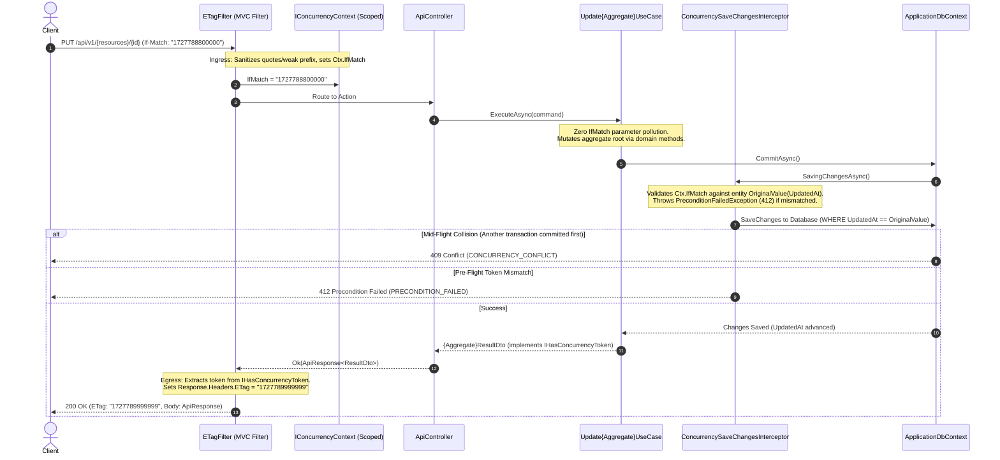

# [CORE-006]: 06_api_contract_standards.md — Universal API Contract & Wire Protocol SSoT

<context>
Category: 00_architecture_core
Domain: Universal API Contract, Wire Protocols & Optimistic Concurrency SSoT
SoleResponsibilities:
  - Universal response envelopes (`ApiResponse<T>`, `PagedApiResponse<T>`) and pagination schemas
  - RFC 9457 `ProblemDetails` error wire formats with actionable error codes
  - HTTP mutation semantics and wire-level optimistic concurrency (`ETag`, `If-Match: "<unix_ms_token>"`)
  - OpenAPI 3.1 specification sync governance (`specs/openapi.json`)
Target: Cross-boundary contracts in `backend-v2/` (`SmkDoc.Api/Contracts/`) and `frontend-v2/` (`src/types/api.ts`)
Signal: [ARCH_EVOLUTION_CONTRACT]
</context>

---

## 1. Level 1: Affirmative Wire Protocol & Contract Invariants Matrix

### 1.1 Architectural Wiring & Cross-Boundary Contract Flow
| Direction | Upstream Origin | Current Layer Role (Wire Contract Boundary) | Downstream Destination |
|---|---|---|---|
| **Client Wire Request** | Next.js API Proxy / Client | Enforces Headers (`x-project-id`, `If-Match`, `Idempotency-Key`) | ASP.NET Core Request Pipeline |
| **Command Mutation** | HTTP Wire Body (JSON) | Validates JSON against camelCase Contract Schema | Application Command Handler |
| **Single Resource Egress**| Application DTO | Envelopes payload strictly inside `{ "data": T }` | HTTP Client (`200 OK`, `201 Created` + Location) |
| **Paginated Egress** | Application Paged Collection | Envelopes items inside `{ "data": T[], "pagination": { ... } }` | HTTP Client (`200 OK`) |
| **Binary Stream Egress** | Storage / Render Stream | Bypasses JSON; streams live binary chunks (`application/pdf`) | HTTP Wire Body (`81,920`-byte buffer) |
| **Error Egress** | Exception / Validation Failure | Dispatches RFC 9457 `ProblemDetails` (`application/problem+json`)| Client Error Handler (`ApiError`) |

### 1.2 Affirmative Wire Protocol Invariants
| Contract Architectural Concern | Affirmative Wire Invariant (Positive SSoT Law) | Boundary Vector |
|---|---|---|
| **JSON Field Casing** | Wire JSON serialization is strictly standard `camelCase`. `PascalCase` and `snake_case` on the HTTP wire are prohibited. | Serialization Pipeline |
| **Single Entity Envelope** | All successful non-streaming single-resource endpoints encapsulate payloads in `{ "data": T }`. Unwrapped raw JSON returns are prohibited. | Wire Payload Schema |
| **Paginated Collection Envelope**| All collection endpoints return `{ "data": T[], "pagination": PaginationMetadata }`. Flat pagination fields at root or unwrapped arrays are prohibited. | Collection Egress |
| **RFC 9457 Error Wire Schema** | Errors emit standard RFC 9457 `application/problem+json` containing IETF RFC 9110 `type`, `title`, `status`, `detail`, `instance`, mandatory `errorCode` and `traceId` extensions, and optional structured field errors in `errors`. Ad-hoc `{ error: "msg" }` JSON is prohibited. | Error Handling Pipeline |
| **Temporal Wire Format** | All datetime values on the wire serialize to ISO-8601 UTC strings terminated with the `Z` suffix (`YYYY-MM-DDTHH:mm:ssZ`). Unspecified local times and Unix epoch integers are prohibited. | Temporal Serialization |
| **Null vs Undefined Semantics** | Missing optional values serialize explicitly as `null` or are omitted per schema. Emitting string `"undefined"` or `"null"` is prohibited. | Wire Payload Fidelity |
| **Mutation Deduplication** | Non-idempotent state mutations (`POST`) require `Idempotency-Key: <uuidv7>`. Duplicate requests replay cached responses without re-execution. | Mutation Boundary |
| **Optimistic Concurrency Wire** | Resource mutations (`PUT`, `DELETE`) require `If-Match: "<token>"` evaluated by the ambient concurrency pipeline (`ETagFilter` + `ConcurrencySaveChangesInterceptor`). Server emits updated token in `ETag` header automatically from `IHasConcurrencyToken`. | Concurrency Control |
| **Tenant Scope Header** | Multi-tenant context passes explicitly via `x-project-id: <guid>` header or JWT `projectId` claim. Tenant identity in request JSON body is prohibited. | Multi-Tenant Perimeter |
| **RESTful Route Taxonomy** | Public routes use plural kebab-case nouns prefixed with `api/v1/{resources}`. Verb-based routes (`/api/createTemplate`) and legacy `/api/*` are prohibited. | Wire URL Addressing |
| **OpenAPI SSoT Fidelity** | `specs/openapi.json` is the sole machine-readable schema authority, generated deterministically during `.NET` build. Manual edits to `specs/openapi.json` are prohibited. | Schema Governance |

### 1.3 HTTP Status Codes & REST Verb Semantics Matrix
| HTTP Verb | Route Target | Success Status | Egress Contract Shape | Mandatory Headers |
|---|---|---|---|---|
| `GET` | `api/v1/{resources}` | `200 OK` | `PagedApiResponse<T>` (`{ data: [...], pagination: { ... } }`) | `x-project-id` |
| `GET` | `api/v1/{resources}/{id}` | `200 OK` | `ApiResponse<T>` (`{ data: T }`) | `ETag` (response), `x-project-id` |
| `GET` | `api/v1/{resources}/{id}/download` | `200 OK` | Raw Stream (`application/pdf`, `application/vnd.openxmlformats-...`) | `Content-Disposition`, `Content-Type` |
| `POST` | `api/v1/{resources}` | `201 Created` | `ApiResponse<T>` (`{ data: T }`) | `Location: api/v1/{resources}/{id}`, `Idempotency-Key` |
| `POST` | `api/v1/documents/generate-async` | `202 Accepted`| `ApiResponse<JobStatusDto>` (`{ data: { jobId, status } }`) | `Location: api/v1/documents/jobs/{jobId}` |
| `POST` | `api/v1/{resources}/test` | `200 OK` | `ApiResponse<TestResultDto>` (`{ data: { success, message, latencyMs } }`)| `x-project-id` |
| `PUT` | `api/v1/{resources}/{id}` | `200 OK` | `ApiResponse<T>` (`{ data: T }`) | `If-Match` (request), `ETag` (response) |
| `DELETE` | `api/v1/{resources}/{id}` | `204 NoContent`| Empty Body | `If-Match` (request) |

---

## 2. Level 2: Core Wire Contracts & Cognitive Rationale

### 2.1 Engineering Rationale & Architectural Decisions
* **Why the Envelope Pattern (`{ data: ... }`):** Prevents JSON top-level array security vulnerabilities in older clients, ensures consistent consumption contracts across diverse frontend libraries, and leaves extensible room for top-level wire metadata without breaking schemas.
* **Why Nested `pagination` Metadata (`data` + `pagination`):** Separates resource items from collection telemetry (`page`, `limit`, `totalCount`, `totalPages`). Flat pagination fields directly on the root object pollute entity schema contracts and make generic client typing (`ApiResponse<T>`) brittle.
* **Why RFC 9457 ProblemDetails over Ad-Hoc Errors:** Ad-hoc formats like `{ "error": "something went wrong" }` lack machine-parsable semantics. RFC 9457 provides an IETF standard with typed URIs, standardized HTTP status mapping, and structured validation dictionaries under `errors`.
* **Why HTTP 200 for Diagnostic Connection Probes:** An unreachable database or invalid credential is a valid diagnostic business result, NOT an HTTP transport failure. Emitting HTTP 400 confuses automated monitoring and breaks client error handlers.
* **Why Dedicated Machine-Readable `specs/openapi.json`:** Eliminates documentation drift by generating contracts directly from the compiled ASP.NET Core API reflection pipeline, providing frontend TypeScript code-generators a single source of truth.
* **Why Optimistic Concurrency (`ETag` / `If-Match`) over Distributed Locks for Mutations:** Mutating existing resources (`PUT`, `DELETE`) is naturally idempotent by HTTP semantics; acquiring distributed Redis locks introduces latency and deadlocks while failing to catch lost-update anomalies if two users read stale data minutes apart. `If-Match` carrying the resource state token (`IConcurrencyAware.GetConcurrencyToken()`) completely eliminates lost updates with zero distributed locking overhead.
* **Why Ambient Cross-Cutting Concurrency over Controller/Command Plumbing:** Parsing `If-Match` headers and setting `Response.Headers.ETag` manually inside every Controller action and Command pollutes business contracts. A global `ETagFilter` captures and sanitizes `If-Match` into scoped `IConcurrencyContext` on ingress and extracts `IHasConcurrencyToken.ConcurrencyToken` from `IApiResponse` on egress, while `ConcurrencySaveChangesInterceptor` verifies the token against EF Core `OriginalValue` on `CommitAsync`.
* **Why Distinct 412 Precondition Failed vs 409 Conflict:**
  * `412 Precondition Failed`: Pre-execution or pre-commit validation failure. The caller's `If-Match` token does not match the current database state (verified by `ConcurrencySaveChangesInterceptor` on `SaveChangesAsync` or pre-flight `IConcurrencyContext.EnsureMatches` prior to external I/O).
  * `409 Conflict`: Mid-flight concurrency collision. The `If-Match` matched at read-time, but another concurrent transaction committed changes at the exact microsecond before this transaction called `CommitAsync` (detected via EF Core `DbUpdateConcurrencyException` on `.IsConcurrencyToken()`).

### 2.2 Proactive Wire Protocol Firewalls
```yaml
WireCasingFirewall:
  Invariant: "All JSON wire properties must be camelCase."
  ActionOnViolation: "Configure System.Text.Json naming policy to JsonNamingPolicy.CamelCase."

ResponseEnvelopeFirewall:
  Invariant: "All non-streaming JSON responses must wrap output in ApiResponse<T> or PagedApiResponse<T>."
  ActionOnViolation: "Wrap raw object or list in new ApiResponse<T>(result) or PagedApiResponse<T>(...)."

PaginationContractFirewall:
  Invariant: "Paginated endpoints must emit { data: T[], pagination: PaginationMetadata }."
  ActionOnViolation: "Nest pagination fields inside PaginationMetadata record; prohibit flat root fields."

ErrorEnvelopeFirewall:
  Invariant: "Errors must serialize as application/problem+json adhering to RFC 9457."
  ActionOnViolation: "Dispatch unhandled and domain exceptions via GlobalExceptionHandler."

HeaderSemanticsFirewall:
  Invariant: "Enforce Idempotency-Key on state-mutating POST; enforce If-Match on PUT/DELETE."
  ActionOnViolation: "Attach [Idempotent] filter to POST; decorate PUT/DELETE with [ProducesResponseType(StatusCodes.Status412PreconditionFailed)] and enforce via global ETagFilter + ConcurrencySaveChangesInterceptor."
```

### 2.3 Universal Pagination, Sorting & Filtering Taxonomy
All collection query endpoints must conform strictly to these standardized query string parameters:

| Query Parameter | Type | Default Value | Description / Constraint |
|---|---|---|---|
| `page` | `integer` | `1` | 1-based page index ($\ge 1$). |
| `pageSize` | `integer` | `20` | Items per page (clamped strictly between $1 \le \text{pageSize} \le 100$). Accepts alias `limit`. |
| `sortBy` | `string` | `"createdAt"` | Name of property to order by (must be validated against allowed schema fields). |
| `sortDir` | `string` | `"desc"` | Sort direction: `"asc"` (Ascending) or `"desc"` (Descending). |
| `search` | `string?` | `null` | Sanitized substring search query. |
| `isActive` | `boolean?`| `null` | Filter by lifecycle state: `true`, `false`, or omitted for all. |

* **Ingress vs Egress Parameter Parity:** The HTTP Query String accepts either `pageSize` or `limit` (canonical default: `pageSize`). The HTTP Egress Response strictly envelopes items per page under `pagination.limit` conforming to `PaginationMetadata`.

### 2.4 Optimistic Concurrency & ETag/If-Match Parity Protocol (Pre-flight 412 vs Mid-flight 409)
The wire protocol strictly enforces optimistic concurrency across all state-mutating endpoints (`PUT`, `DELETE`) on mutable resources (Templates, Datasets, DataConnections) using HTTP standard headers (RFC 9110 §13.1.1, RFC 7232):

| Header | Direction | Format / Syntax | Semantic Meaning & Wire Invariant |
|---|---|---|---|
| `ETag` | Response (`GET`, `PUT`) | `ETag: "1727788800000"` | Resource state token derived from `(UpdatedAt ?? CreatedAt).ToUnixTimeMilliseconds()`. Enclosed in double quotes. |
| `If-Match` | Request (`PUT`, `DELETE`) | `If-Match: "1727788800000"` or `*` | Ingress concurrency precondition. Must match target resource's current token. Wildcard `*` bypasses pre-check. |

#### Wire Concurrency Error Resolution Matrix
| Failure Scenario | HTTP Wire Status | RFC 9457 `errorCode` | Wire Resolution & Client Behavior |
|---|---|---|---|
| **Pre-flight Token Mismatch** | `412 Precondition Failed` | `PRECONDITION_FAILED` | Ingress `If-Match` differs from current resource state. Request terminates before domain execution. Client must refetch latest state. |
| **Mid-flight Mutation Collision** | `409 Conflict` | `CONCURRENCY_CONFLICT` | Resource was modified concurrently by another transaction during processing. Client must reload latest state and prompt user to reconcile. |

#### End-to-End Ambient Concurrency Pipeline Flow


---

## 3. Level 3: Canonical Contract AST Blueprints (C# & TypeScript 1:1 Parity)

### 3.1 Standard Response Envelope Blueprint (`ApiResponse<T>`)
>> MANDATORY CANONICAL BLUEPRINT [RULE-CONTRACT-001]:
* Encapsulates single-resource payload in `data`.

**C# SSoT Definition (`backend-v2/src/SmkDoc.Api/Common/Responses/ApiResponse.cs`):**
```csharp
public interface IApiResponse
{
    object? Data { get; }
}

public record ApiResponse<T>(T Data) : IApiResponse
{
    object? IApiResponse.Data => Data;
}
```

**TypeScript SSoT Definition (`frontend-v2/src/types/api.ts`):**
```typescript
export interface ApiResponse<T> {
  data: T;
}
```

**JSON Wire Representation:**
```json
{
  "data": {
    "id": "0192e2c8-72b1-7000-8000-111111111111",
    "name": "Standard Invoice",
    "slug": "standard-invoice",
    "category": "Billing",
    "isActive": true,
    "createdAt": "2026-11-06T12:00:00Z"
  }
}
```

---

### 3.2 Paginated Collection Envelope Blueprint (`PagedApiResponse<T>`)
>> MANDATORY CANONICAL BLUEPRINT [RULE-CONTRACT-002]:
* Encapsulates items array in `data` and telemetry metadata in `pagination`.

**C# SSoT Definition (`backend-v2/src/SmkDoc.Api/Common/Responses/ApiResponse.cs`):**
```csharp
public record PaginationMetadata(
    int Page,
    int Limit,
    int TotalCount,
    int TotalPages
)
{
    public static PaginationMetadata Create(int totalCount, int page, int limit)
    {
        // Step 1: Clamp bounds defensively <Why: prevent division by zero, negative page indices, and runaway allocations>
        var safeLimit = Math.Max(1, limit);
        var safePage = Math.Max(1, page);
        var safeTotal = Math.Max(0, totalCount);

        // Step 2: Compute ceiling total pages <Why: ensure trailing partial records occupy a dedicated final page>
        var totalPages = (int)Math.Ceiling((double)safeTotal / safeLimit);

        // Step 3: Instantiate immutable telemetry record <Why: guarantee thread-safe deterministic serialization across wire>
        return new PaginationMetadata(safePage, safeLimit, safeTotal, totalPages);
    }
}

public record PagedApiResponse<T>(
    IEnumerable<T> Data,
    PaginationMetadata Pagination
) : ApiResponse<IEnumerable<T>>(Data)
{
    public PagedApiResponse(IEnumerable<T> data, int totalCount, int page, int limit)
        : this(data, PaginationMetadata.Create(totalCount, page, limit))
    {
    }
}
```

**TypeScript SSoT Definition (`frontend-v2/src/types/api.ts`):**
```typescript
export interface PaginationMetadata {
  page: number;
  limit: number;
  totalCount: number;
  totalPages: number;
}

export interface PagedApiResponse<T> extends ApiResponse<T[]> {
  data: T[];
  pagination: PaginationMetadata;
}
```

**JSON Wire Representation:**
```json
{
  "data": [
    {
      "id": "0192e2c8-72b1-7000-8000-111111111111",
      "name": "Standard Invoice",
      "slug": "standard-invoice"
    }
  ],
  "pagination": {
    "page": 1,
    "limit": 20,
    "totalCount": 42,
    "totalPages": 3
  }
}
```

---

### 3.3 RFC 9457 ProblemDetails Error Schema Blueprint
>> MANDATORY CANONICAL BLUEPRINT [RULE-CONTRACT-003]:
* Centralized error construction via `ProblemDetailsBuilder` and `GlobalExceptionHandler` producing IETF RFC 9457 compliant error schemas with standard RFC 9110 `type` URIs, `errorCode`, `traceId`, and field-level diagnostics.

**C# SSoT Builder Contract (`backend-v2/src/SmkDoc.Api/Common/Responses/ProblemDetailsBuilder.cs`):**
```csharp
public static class ProblemDetailsBuilder
{
    public static ProblemDetails Create(
        int status,
        string title,
        string detail,
        string errorCode,
        string? instance = null,
        string? traceId = null,
        object? errors = null);

    public static string ResolveTypeUri(int? statusCode);
    public static string ResolveDefaultErrorCode(int? statusCode);
}
```

**TypeScript Error Client Definition (`frontend-v2/src/lib/api/client.ts`):**
```typescript
export interface SchemaValidationErrorItem {
  path: string;
  message: string;
  rule: string;
}

export interface ProblemDetails {
  type?: string;
  title?: string;
  status?: number;
  detail?: string;
  instance?: string;
  errorCode?: string;
  traceId?: string;
  errors?: Record<string, string[]> | SchemaValidationErrorItem[];
  [key: string]: unknown;
}
```

**JSON Wire Representation (400 Request Validation Failure — Property Map):**
```json
{
  "type": "https://tools.ietf.org/html/rfc9110#section-15.5.1",
  "title": "Validation Failed",
  "status": 400,
  "detail": "One or more validation errors occurred.",
  "instance": "/api/v1/templates",
  "errorCode": "VALIDATION_FAILED",
  "traceId": "0HN7G6K9A1B2C:00000001",
  "errors": {
    "name": [
      "The Name field is required.",
      "The length of 'Name' must be at least 3 characters."
    ],
    "slug": [
      "Slug must contain only lowercase alphanumeric characters and hyphens."
    ]
  }
}
```

**JSON Wire Representation (422 Schema Validation Failure — Rule Violation List):**
```json
{
  "type": "https://tools.ietf.org/html/rfc9110#section-15.5.21",
  "title": "Schema Validation Failed",
  "status": 422,
  "detail": "Payload failed JSON schema validation.",
  "instance": "/api/v1/documents/generate",
  "errorCode": "SCHEMA_VALIDATION_FAILED",
  "traceId": "0HN7G6K9A1B2C:00000002",
  "errors": [
    {
      "path": "/customer/tax_id",
      "message": "String length must be 13 characters.",
      "rule": "minLength"
    }
  ]
}
```

---

### 3.4 Diagnostic Probe Result Blueprint (`ApiResponse<TestResultDto>`)
>> MANDATORY CANONICAL BLUEPRINT [RULE-CONTRACT-004]:
* Connectivity and diagnostic checks emit HTTP `200 OK` with standardized result payload.

**JSON Wire Representation:**
```json
{
  "data": {
    "success": false,
    "message": "Connection refused: Host 10.0.0.1:5432 unreachable after 3000ms timeout.",
    "latencyMs": 3005,
    "checkedAt": "2026-11-06T12:00:00Z"
  }
}
```

---

### 3.5 Optimistic Concurrency Error Wire Blueprints (`412 Precondition Failed` & `409 Conflict`)
>> MANDATORY CANONICAL BLUEPRINT [RULE-CONTRACT-005]:
* Concurrency errors serialize strictly as RFC 9457 `ProblemDetails` differentiating pre-flight (`412`) vs mid-flight (`409`).

**JSON Wire Representation: 412 Precondition Failed (Pre-flight Token Mismatch):**
```json
{
  "type": "https://tools.ietf.org/html/rfc9110#section-15.5.13",
  "title": "Precondition Failed",
  "status": 412,
  "detail": "Precondition failed for template '0192e2c8-72b1-7000-8000-111111111111'. ETag '54217' does not match current state '54218'.",
  "instance": "/api/v1/templates/0192e2c8-72b1-7000-8000-111111111111",
  "errorCode": "PRECONDITION_FAILED",
  "traceId": "0HN7G6K9A1B2C:00000003"
}
```

**JSON Wire Representation: 409 Conflict (Mid-flight Commit Collision):**
```json
{
  "type": "https://tools.ietf.org/html/rfc9110#section-15.5.10",
  "title": "Concurrency Conflict",
  "status": 409,
  "detail": "The resource was modified by another transaction while your request was processing. Please reload the latest state and retry.",
  "instance": "/api/v1/templates/0192e2c8-72b1-7000-8000-111111111111",
  "errorCode": "CONCURRENCY_CONFLICT",
  "traceId": "0HN7G6K9A1B2C:00000004"
}
```

---

## 4. Level 4: Anti-Patterns & Unified Micro-Diffs

### [TRAP-CONTRACT-001]: Flat Pagination Properties Leaking into Root Envelope
```diff
- { "data": [...], "page": 1, "pageSize": 20, "totalCount": 100 }
+ { "data": [...], "pagination": { "page": 1, "limit": 20, "totalCount": 100, "totalPages": 5 } }
```
*Rationale: Flat pagination fields on the root envelope break client generic envelope parsing (`ApiResponse<T>`) and couple pagination telemetry directly to the resource envelope.*

### [TRAP-CONTRACT-002]: Ad-Hoc Error JSON Bypassing RFC 9457 ProblemDetails
```diff
- { "error": "Template not found", "code": 404 }
+ { "type": "https://tools.ietf.org/html/rfc9110#section-15.5.5", "title": "Not Found", "status": 404, "detail": "Template with id '...' was not found.", "instance": "/api/v1/templates/...", "errorCode": "TEMPLATE_NOT_FOUND", "traceId": "0HN7G6K9A1B2C:00000005" }
```
*Rationale: Ad-hoc error formats prevent automated client error handling, break typing in client SDKs, and omit machine-readable validation dictionaries.*

### [TRAP-CONTRACT-003]: Raw Unenveloped JSON or Top-Level Arrays
```diff
- [ { "id": "1", "name": "Item 1" }, { "id": "2", "name": "Item 2" } ]
+ { "data": [ { "id": "1", "name": "Item 1" }, { "id": "2", "name": "Item 2" } ], "pagination": { "page": 1, "limit": 20, "totalCount": 2, "totalPages": 1 } }
```
*Rationale: Returning raw top-level JSON arrays exposes endpoints to JSON array hijacking in legacy environments and prevents future wire metadata expansion.*

### [TRAP-CONTRACT-004]: PascalCase or snake_case Property Leaks on the Wire
```diff
- { "Project_Id": "...", "CreatedAt": "2026-11-06T12:00:00Z" }
+ { "projectId": "...", "createdAt": "2026-11-06T12:00:00Z" }
```
*Rationale: Leaking C# PascalCase or database snake_case across the HTTP wire violates JavaScript/TypeScript client ergonomics and breaks OpenAPI contract generation.*

### [TRAP-CONTRACT-005]: Unspecified Local DateTime Strings Lacking ISO-8601 UTC `Z` Suffix
```diff
- { "createdAt": "2026-11-06 12:00:00" }
+ { "createdAt": "2026-11-06T12:00:00Z" }
```
*Rationale: Omitting the UTC timezone specifier (`Z`) causes browsers in different timezones to parse the timestamp into inconsistent local times.*

### [TRAP-CONTRACT-006]: Split-Brain Mutation Semantics (Applying Idempotency-Key on PUT/DELETE)
```diff
- PUT /api/v1/templates/123 [Headers: Idempotency-Key: ...]
+ PUT /api/v1/templates/123 [Headers: If-Match: "54218"]
```
*Rationale: PUT and DELETE are naturally idempotent; applying Idempotency-Key incurs unnecessary distributed lock overhead while failing to protect against lost updates.*

### [TRAP-CONTRACT-007]: Manual Out-of-Band Modification of `specs/openapi.json`
```diff
- // Manually editing specs/openapi.json
+ // Run dotnet build backend-v2/src/SmkDoc.Api to re-generate specs/openapi.json automatically
```
*Rationale: Manual edits to openapi.json are overwritten on the next API build and introduce silent schema drift.*

### [TRAP-CONTRACT-008]: Swallowing Mid-flight Concurrency Collisions as 500 or Ignoring If-Match Headers
```diff
- // Unhandled DbUpdateConcurrencyException falling back to generic 500 Internal Error
- // Or executing PUT/DELETE without validating If-Match (Blind Last-Write-Wins)
+ // ConcurrencySaveChangesInterceptor / IConcurrencyContext validates If-Match -> 412 Precondition Failed
+ // GlobalExceptionHandler maps DbUpdateConcurrencyException -> 409 Conflict
```
*Rationale: Leaking DbUpdateConcurrencyException as HTTP 500 signals internal server degradation to monitoring dashboards, whereas it is an expected HTTP 409 client-level race condition. Ignoring If-Match allows silent overwrites and lost updates.*
