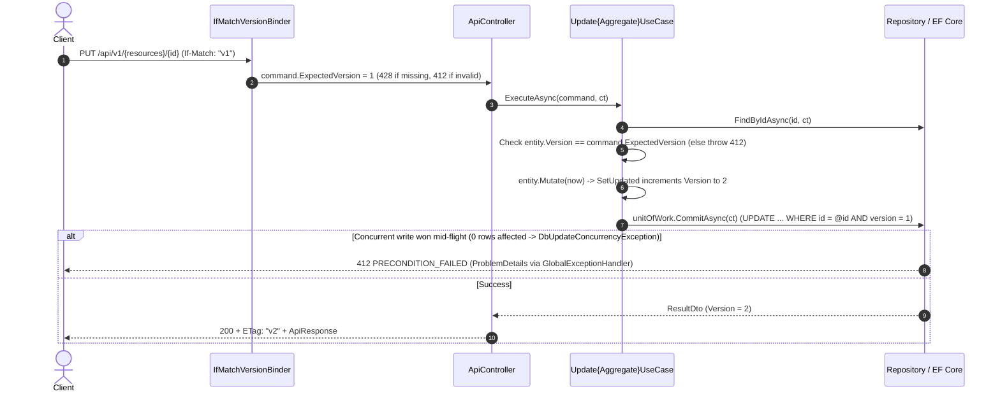

# [CORE-006]: 06_api_contract_standards.md — Universal API Contract & Wire Protocol SSoT

<context>
Category: 00_architecture_core
Domain: Universal API Contract, Wire Protocols, Exception-to-HTTP Mapping & Optimistic Concurrency SSoT
SoleResponsibilities:
  - Response envelopes (`ApiResponse<T>`, `PagedApiResponse<T>`) and pagination schemas
  - RFC 9457 `ProblemDetails` wire format, **the single exception catalogue and HTTP status mapping**, and the error code registry
  - HTTP mutation semantics: conditional requests (`ETag`, `If-Match`), idempotency, resource routes (including document generation and document jobs)
  - OpenAPI sync governance (`specs/openapi.json`)
Target: Cross-boundary contracts in `backend-v2/` (`SmkDoc.Api/Contracts/`) and `frontend-v2/` (types generated from OpenAPI)
Revision status (consolidation pass): All sections (1.1–1.4, 2.1–2.6, 3.1–3.6, 4) are finalized (WP2–WP10 complete).
Signal: [ARCH_EVOLUTION_CONTRACT]
</context>

---

## 1. Level 1: Wire Protocol & Contract Invariants Matrix

### 1.1 Cross-Boundary Contract Flow
| Direction | Upstream Origin | Wire Contract Boundary | Downstream |
|---|---|---|---|
| **Client Request** | Next.js API proxy / M2M client | Headers: `Project-Id`, `If-Match`, `Idempotency-Key`, credentials | ASP.NET Core pipeline |
| **Command Mutation** | JSON body | Validates against the camelCase contract schema | UseCase (via Command) |
| **Single Resource** | Application DTO | `{ "data": T }` | HTTP client (`200`, `201` + `Location`) |
| **Collection** | Application paged result | `{ "data": T[], "pagination": { ... } }` | HTTP client (`200`) |
| **Binary** | Storage / render stream | Streams the artifact (`application/pdf`, ...) | HTTP client |
| **Error** | Exception / validation failure | RFC 9457 `application/problem+json` | Client error handler (`ApiError`) |

### 1.2 Wire Protocol Invariants
| Concern | Invariant | Boundary |
|---|---|---|
| **JSON casing** | `camelCase`. `PascalCase` and `snake_case` are prohibited on the wire. | Serialization |
| **Single entity envelope** | Successful non-streaming single-resource responses are `{ "data": T }`. | Payload schema |
| **Collection envelope** | Collections are `{ "data": T[], "pagination": PaginationMetadata }`. | Collection egress |
| **Errors** | RFC 9457 `application/problem+json` with `type`, `title`, `status`, `detail`, `instance`, mandatory `errorCode` and `traceId` extensions, optional `errors` (one shape, §3.3). Ad-hoc `{ error: "msg" }` is prohibited. | Error pipeline |
| **Temporal** | ISO-8601 / RFC 3339 UTC strings ending in `Z`. Unspecified local times and epoch integers are prohibited. (Fractional seconds are allowed; the serializer converter must emit `Z`, not `+00:00`.) | Serialization |
| **Null policy** | A property is either always present (possibly `null`) or always omitted when `null`, as declared per schema. The strings `"undefined"` and `"null"` are prohibited. | Payload fidelity |
| **Idempotency** | `Idempotency-Key` is **required** on creating operations that are not naturally idempotent where duplicates are costly: `POST /documents` and `POST /document-jobs`; optional elsewhere. Rules in §2.5. | Mutation boundary |
| **Optimistic concurrency** | `PUT`, `DELETE` and state-transition actions on versioned resources require `If-Match: "v{version}"` (e.g. `"v1"`, `"v2"`); a missing header is `428`; a stale or malformed token is `412`. The token is a **strong** validator derived from `AggregateRoot<TId>.Version` (`long`, persisted in `version bigint`). Timestamp-derived tokens, weak validators (`W/`) and `If-Match: *` on `PUT` are prohibited. | Concurrency |
| **Tenant scope** | The tenant is passed in the **`Project-Id`** header (GUID). An API key is bound to one project; a JWT must select the project explicitly. A header that disagrees with the credential is rejected (`400 PROJECT_CONTEXT_MISMATCH`), never "last wins". Tenant identity in request bodies, query strings or form data is prohibited. | Multi-tenant perimeter |
| **Routes** | Resource-oriented: plural kebab-case nouns under `/api/v1/`. State transitions and non-CRUD operations use sub-resources (e.g. `document-jobs`, `connectivity-checks`) or the custom-method form `/{resource}/{id}:{verb}` (e.g. `:publish`). Verb path segments such as `/createTemplate`, `/generate-async`, `/test` are prohibited. `Location` is an absolute-path reference starting with `/`. | URL addressing |
| **OpenAPI** | `specs/openapi.json` is the only machine-readable schema authority, generated from code. Client TypeScript types are generated from it; hand-written copies are prohibited. | Schema governance |

### 1.4 Scalar Wire Types for Banking & Thai Documents
| Data Type | Wire Representation | Example | Forbidden Representation & Rationale |
|---|---|---|---|
| **Monetary Amount** | Fixed-point decimal string (`"^\d+(\.\d{1,4})?$"`) paired with an ISO 4217 3-letter `currency` code (`"THB"`, `"USD"`), or integer minor units (`amountSatang`). | `{ "amount": "12500.50", "currency": "THB" }` | IEEE 754 `float`/`double` (`12500.5`) is **prohibited** due to binary rounding errors in financial invoices and tax calculations. |
| **64-bit Integers (`long` / `int64`)** | JSON number when bounded within $\le 2^{53}-1$ (`9007199254740991`, e.g. `version`, `sizeBytes`); serialized as a JSON string (`JsonNumberHandling.WriteAsString`) for unbounded 64-bit identifiers or external ledger IDs. | `"externalLedgerId": "9223372036854775807"` | Raw JSON numbers $> 2^{53}-1$ silently lose precision in JavaScript `Number` (`JSON.parse`). |
| **Calendar Date (`DateOnly`)** | ISO-8601 `YYYY-MM-DD` in **Gregorian Common Era (CE / ค.ศ.)**. | `"issueDate": "2026-11-14"` | **Buddhist Era (BE / พ.ศ., +543 years, e.g. `"2569-11-14"`) is strictly prohibited on the JSON wire.** Conversion to Thai Buddhist calendar (`14 พฤศจิกายน 2569`) or Thai Baht text (`หนึ่งหมื่นสองพันห้าร้อยบาทห้าสิบสตางค์`) is performed exclusively by the rendering/presentation formatting engine. |
| **Timestamp (`DateTimeOffset`)** | ISO-8601 / RFC 3339 UTC string ending in literal `Z` via `UtcDateTimeOffsetJsonConverter`. | `"createdAt": "2026-11-14T05:11:49Z"` | Local offsets (`+07:00`), timezone-less strings (`"2026-11-14 12:11:49"`), and Unix epoch numbers on domain DTOs. |
| **Enumerations** | Lowercase/camelCase or UPPER_SNAKE_CASE string token per schema (`JsonStringEnumConverter`). | `"status": "succeeded"`, `"outcome": "UNREACHABLE"` | Numeric enum ordinals (`0`, `1`, `2`), which break backward compatibility when enum members are reordered. |
| **UUID / Strongly-Typed ID** | Lowercase hyphenated 36-character UUIDv7 string (`Guid`). | `"id": "0192e2c8-72b1-7000-8000-111111111111"` | Nested `{ "value": "..." }` wrapper objects on the JSON wire, or uppercase/brace-wrapped GUIDs. |

### 1.3 HTTP Verb & Route Matrix
Request headers are marked (req), response headers (res). `Project-Id` (req) is required on every Data Plane route and omitted from the table.
| Verb | Route | Success | Body | Headers |
|---|---|---|---|---|
| `GET` | `/api/v1/{resources}` | `200` | `PagedApiResponse<T>` | |
| `GET` | `/api/v1/{resources}/{id}` | `200` | `ApiResponse<T>` | `ETag` (res) |
| `POST` | `/api/v1/{resources}` | `201` | `ApiResponse<T>` | `Location` (res), `ETag` (res) |
| `PUT` | `/api/v1/{resources}/{id}` | `200` | `ApiResponse<T>` | `If-Match` (req, required), `ETag` (res) |
| `DELETE` | `/api/v1/{resources}/{id}` | `204` | empty | `If-Match` (req, required) |
| `POST` | `/api/v1/{resources}/{id}:{verb}` (e.g. `:publish`, `:deactivate`, `:rollback`) | `200` | `ApiResponse<T>` | `If-Match` (req, required), `ETag` (res) |
| `GET` | `/api/v1/templates/{id}/source` or `/api/v1/documents/{id}/content` | `200` | binary | `Content-Disposition` (res), `Content-Type` (res) |
| `POST` | `/api/v1/documents` (synchronous generation, §3.6) | `200` | binary | `Idempotency-Key` (req, required), `Document-Id` (res) |
| `POST` | `/api/v1/document-jobs` (asynchronous generation, §3.6) | `202` | `ApiResponse<DocumentJobDto>` | `Idempotency-Key` (req, required), `Location` (res), `Retry-After` (res) |
| `GET` | `/api/v1/document-jobs/{id}` | `200` | `ApiResponse<DocumentJobDto>` | `Retry-After` (res) while not terminal |
| `GET` | `/api/v1/document-jobs/{id}/result` | `200` / `303` | binary / redirect to document content | |
| `GET` | `/api/v1/document-jobs` | `200` | `PagedApiResponse<DocumentJobDto>` (cursor) | |
| `POST` | `/api/v1/document-jobs/{id}:cancel` , `:retry` | `200` | `ApiResponse<DocumentJobDto>` | |
| `POST` | `/api/v1/data-connections/{id}/connectivity-checks` | `200` | `ApiResponse<ConnectivityCheckResultDto>` | |
| `POST` | `/api/v1/management/projects` (Control Plane) | `201` | `ApiResponse<ProjectResultDto>` | no `Project-Id`; SuperAdmin only |

---

## 2. Level 2: Core Wire Contracts & Rationale

### 2.1 Rationale
* **Envelope `{ data }`:** uniform client typing and room for top-level metadata without breaking schemas. (The historic "JSON array hijacking" argument no longer applies to modern browsers and is not a reason.)
* **Nested `pagination`:** keeps resource items separate from collection telemetry and keeps generic client typing stable.
* **RFC 9457 over ad-hoc errors:** machine-readable, standard, and extensible with `errorCode` and `errors`.
* **`200` for connectivity checks:** a failed probe is a valid diagnostic result, not a transport failure. The body is deliberately coarse (§3.4).
* **Optimistic concurrency over locks:** `If-Match` with a version token removes lost updates without distributed locks.
* **Single `412` for any failed precondition:** RFC 9110 defines `412` as "a precondition evaluated to false". A mismatch discovered at pre-check or at commit (`DbUpdateConcurrencyException` on the version column) is the same condition with the same client remedy (refetch and retry), so there is one status and one `errorCode`. `409` is reserved for business state conflicts (duplicate slug, version already published, job already terminal).
* **`428` for a missing precondition header:** RFC 6585; clients learn that `If-Match` is mandatory instead of silently overwriting.
* **Why `Project-Id` (no `x-` prefix):** `X-` prefixes are deprecated by RFC 6648. The name is the same everywhere (client, proxy, server, docs).

### 2.2 Wire Firewalls
```yaml
WireCasingFirewall:
  Invariant: "JSON wire properties are camelCase."
  Enforcement: "System.Text.Json naming policy + OpenAPI schema test."
ResponseEnvelopeFirewall:
  Invariant: "Non-streaming JSON responses are wrapped in ApiResponse<T> or PagedApiResponse<T>."
  Enforcement: "Contract test over openapi.json: every 2xx JSON response schema has a data property."
ErrorEnvelopeFirewall:
  Invariant: "Every error is application/problem+json and comes from one IExceptionHandler using the catalogue in 3.3."
  Enforcement: "Test that iterates the catalogue; NetArchTest forbids returning ProblemDetails from controllers."
HeaderSemanticsFirewall:
  Invariant: "428 without If-Match on versioned mutations, 412 on mismatch, Idempotency-Key rules in 2.5."
  Enforcement: "Integration tests per mutating endpoint."
OpenApiFirewall:
  Invariant: "specs/openapi.json is generated; CI regenerates it and fails on any diff; breaking changes are detected by oasdiff."
  Enforcement: "CI gates (WP10)."
```

### 2.3 Pagination, Sorting & Filtering
| Parameter | Type | Default | Constraint |
|---|---|---|---|
| `limit` | integer | `20` | `1..100`; out-of-range values are rejected with `422` (no silent clamping) |
| `page` | integer | `1` | offset paging, only for small bounded lists (admin lists) |
| `cursor` | string | none | opaque keyset cursor; used for large or append-only collections (logs, document jobs, job items) |
| `sortBy` | string | `createdAt` | must be in the per-resource allow-list published in OpenAPI |
| `sortDir` | string | `desc` | `asc` or `desc` |
| `search` | string? | none | minimum length 2; `%`, `_` are escaped; served by an indexed (trigram) query |
| `isActive` | boolean? | none | lifecycle filter where the resource has one |

There is one page-size name (`limit`) on both request and response. Offset responses carry `pagination: { page, limit, totalCount?, totalPages? }`; `totalCount` is computed only when `?includeTotal=true` (a `COUNT(*)` on every request is not acceptable on large tables). Cursor responses carry `pagination: { limit, nextCursor }` (`nextCursor` is `null` on the last page).

### 2.4 Optimistic Concurrency Protocol (Two-Phase Explicit Concurrency)
| Header | Direction | Syntax | Meaning |
|---|---|---|---|
| `ETag` | response (`GET`, `POST`, `PUT`, `:verb`) | `ETag: "v{version}"` (e.g. `"v1"`, `"v2"`) | Strong validator derived from `AggregateRoot<TId>.Version` (`long`, persisted in `version bigint`). |
| `If-Match` | request (`PUT`, `DELETE`, `:verb`) | `If-Match: "v{version}"` | Must equal the current strong validator. Weak `W/` validators, wildcard `*` on `PUT`, and unquoted or non-integer tokens are rejected with `412`. |

| Scenario | Status | `errorCode` | Client behaviour |
|---|---|---|---|
| `If-Match` missing on a versioned mutation | `428` | `PRECONDITION_REQUIRED` | Send `If-Match` from the last `GET`. |
| `If-Match` is malformed, weak (`W/`), `*`, or does not match at pre-check or commit | `412` | `PRECONDITION_FAILED` | Refetch, reconcile, retry. |

The token never appears in error messages. Concurrency is enforced without leaking EF Core mechanics into Domain ports via **Two-Phase Explicit Concurrency**:
1. **Transport Binding (`IfMatchVersionBinder`):** Parses `If-Match: "v{version}"` into `long ExpectedVersion` on the Command (`428 PRECONDITION_REQUIRED` when absent; `412 PRECONDITION_FAILED` when malformed, weak `W/`, or `*`).
2. **Phase 1 — Domain/UseCase Pre-Check:** After loading the aggregate, the UseCase checks `if (entity.Version != command.ExpectedVersion) throw PreconditionFailedException.VersionMismatch();`. Domain mutations call `SetUpdated(now)`, which increments `Version` (`Version + 1`).
3. **Phase 2 — Atomic Persistence Check:** EF Core configures `builder.Property(x => x.Version).IsConcurrencyToken()` on the `version bigint` column (`UPDATE ... SET version = @p1 WHERE id = @p0 AND version = @p_expected`). If a concurrent request commits between Phase 1 and Phase 2, EF Core throws `DbUpdateConcurrencyException`, which `GlobalExceptionHandler` maps to the identical `412 PRECONDITION_FAILED` response.



### 2.5 Idempotency Protocol
| Rule | Specification |
|---|---|
| Header | `Idempotency-Key: <opaque string, at least 16 bytes of entropy>` (a UUID is recommended). |
| Scope | Per project **and** per credential (API key id or user id). |
| Storage | PostgreSQL table with unique `(project_id, scope, key)`; Redis may cache lookups but is never the only record. |
| Fingerprint | A hash of method, route and body is stored. Same key with a different fingerprint → `422 IDEMPOTENCY_KEY_REUSED`. |
| In-flight duplicate | `409 IDEMPOTENCY_IN_PROGRESS` with `Retry-After`. |
| Replay | Replays the stored **result reference and status**, not binary bytes: `POST /document-jobs` replays `202` with the same `Location`; `POST /documents` replays `200` by streaming the already stored document (found through the stored `documentId`) or `409`/`410` if it is gone. |
| TTL | 24 hours (configuration). |
| Not applicable | `PUT` and `DELETE` are idempotent by method semantics plus `If-Match`; a key is neither needed nor accepted. |

### 2.6 Security Schemes, CORS Headers, API Evolution & CI Contract Gates

#### OpenAPI Security Schemes (`securitySchemes`)
`specs/openapi.json` declares two canonical authentication schemes:
* **`BearerAuth` (`http`, scheme `bearer`, bearerFormat `JWT`):** Used by interactive Portal users (via Next.js BFF `HttpOnly` session proxy). Data Plane calls require the explicit `Project-Id` header matching an active project membership.
* **`ApiKeyAuth` (`apiKey` / `Authorization: ApiKey smk_live_{keyId}_{secret}`):** Used by M2M backend integrations. Every API key is cryptographically bound to a single `ProjectId`; the caller still sends `Project-Id`, and any mismatch is rejected with `400 PROJECT_CONTEXT_MISMATCH`.

#### CORS Header Allow & Expose Policy
Browser requests originating from configured Portal origins enforce an explicit CORS header policy:
* **`Access-Control-Allow-Headers`:** `Authorization`, `Content-Type`, `Accept`, `Project-Id`, `If-Match`, `Idempotency-Key`, `traceparent`, `tracestate`.
* **`Access-Control-Expose-Headers`:** `ETag`, `Location`, `Retry-After`, `Document-Id`, `Content-Disposition`, `RateLimit-Limit`, `RateLimit-Remaining`, `RateLimit-Reset`, `Deprecation`, `Sunset`, `Link`, `traceparent`.

#### API Versioning & Deprecation Lifecycle (RFC 8594)
* **Additive (Non-Breaking) Changes:** Adding optional request properties with safe defaults, adding new response properties, or adding new endpoints is permitted within `/api/v1/`. Clients must ignore unknown JSON response properties.
* **Breaking Changes:** Removing or renaming properties, changing scalar wire types, adding required request fields/headers, or tightening validation rules requires introducing `/api/v2/` (or a parallel resource) alongside a migration period.
* **Deprecation Protocol:** Deprecated endpoints or fields remain operational for a minimum **90-day sunset window** and emit RFC 8594 headers on every response:
  * `Deprecation: @1767225600` (Unix timestamp when deprecation took effect)
  * `Sunset: Wed, 01 Apr 2027 00:00:00 GMT` (HTTP-date after which the endpoint may be removed)
  * `Link: <https://docs.smkdoc.internal/migrations/v2>; rel="sunset"`

#### CI Contract Governance Gates
1. **OpenAPI Drift Gate:** `dotnet build` generates `specs/openapi.json` from controller metadata; CI runs `git diff --exit-code specs/openapi.json` and fails if uncommitted schema drift exists.
2. **Breaking Change Gate:** CI runs `oasdiff breaking origin/main:specs/openapi.json specs/openapi.json` on every pull request and blocks unapproved breaking contract mutations.
3. **OpenAPI Lint Gate:** CI validates `specs/openapi.json` with `Redocly CLI` (verifying `ApiResponse<T>` envelopes, `ProblemDetails` on `4xx`/`5xx`, and `securitySchemes`).
4. **TypeScript Generation Gate:** Frontend CI runs `openapi-typescript specs/openapi.json -o frontend-v2/src/lib/api/schema.d.ts` followed by `git diff --exit-code` and `pnpm typecheck` so client types never drift from backend contracts.

---

## 3. Level 3: Canonical Contract Blueprints

### 3.1 `ApiResponse<T>` Blueprint
> MANDATORY CANONICAL BLUEPRINT [RULE-CONTRACT-001]
```csharp
public interface IApiResponse { object? Data { get; } }

public sealed record ApiResponse<T>(T Data) : IApiResponse
{
    object? IApiResponse.Data => Data;
}
```
The TypeScript type is generated from `openapi.json`; the equivalent shape is `{ data: T }`.
```json
{ "data": { "id": "0192e2c8-72b1-7000-8000-111111111111", "name": "Standard Invoice", "slug": "standard-invoice",
            "category": "Billing", "isActive": true, "createdAt": "2026-11-06T12:00:00Z", "updatedAt": null } }
```
The wire sample is the serialized `{Aggregate}ResultDto`; the version token travels in the `ETag` header, not in the body.

### 3.2 Paged Envelope Blueprint
> MANDATORY CANONICAL BLUEPRINT [RULE-CONTRACT-002]
```csharp
public sealed record PaginationMetadata(int? Page, int Limit, long? TotalCount, int? TotalPages, string? NextCursor)
{
    public static PaginationMetadata ForOffset(int page, int limit, long? totalCount)
    {
        var totalPages = totalCount is null ? (int?)null : (int)((totalCount.Value + limit - 1) / limit);   // integer arithmetic
        return new PaginationMetadata(page, limit, totalCount, totalPages, null);
    }

    public static PaginationMetadata ForCursor(int limit, string? nextCursor) => new(null, limit, null, null, nextCursor);
}

public sealed record PagedApiResponse<T>(IReadOnlyList<T> Data, PaginationMetadata Pagination) : IApiResponse
{
    object? IApiResponse.Data => Data;
}
```
Out-of-range `limit`/`page` is rejected by the request validator before the UseCase runs. Cursor responses omit `page`, `totalCount` and `totalPages` from the serialized JSON (null-omitting policy for this record).
```json
{ "data": [ { "id": "0192e2c8-72b1-7000-8000-111111111111", "status": "succeeded" } ],
  "pagination": { "limit": 20, "nextCursor": "eyJpZCI6IjAxOTJlMmM4In0" } }
```

### 3.3 RFC 9457 ProblemDetails & the Exception Catalogue (SSoT)
> MANDATORY CANONICAL BLUEPRINT [RULE-CONTRACT-003]
* `IExceptionHandler` is the **only** place that maps exceptions to HTTP. Domain and Application exceptions carry an `ErrorCode` and a category, never an HTTP status.
* `type` is a **stable URI per problem** (`https://{api-host}/problems/{kebab-error-code}`, base URI from configuration, pages describe the problem and its remedy). `errorCode` is the short stable alias of the same problem.
* `traceId` is the W3C trace id of the current `Activity` (not the Kestrel connection id). `traceparent` is propagated on responses.
* `detail` never contains exception messages, SQL, hosts, IP addresses, tokens or internal ids that the caller did not send.

**Validation error shape (identical for every validation failure):**
```json
{
  "type": "https://{api-host}/problems/validation-failed",
  "title": "Validation Failed",
  "status": 422,
  "detail": "One or more fields are invalid.",
  "instance": "/api/v1/templates",
  "errorCode": "VALIDATION_FAILED",
  "traceId": "4bf92f3577b34da6a3ce929d0e0e4736",
  "errors": [
    { "pointer": "/name", "code": "MIN_LENGTH", "message": "Name must be at least 3 characters." },
    { "pointer": "/slug", "code": "INVALID_FORMAT", "message": "Slug may contain only lowercase letters, digits and hyphens." }
  ]
}
```
Schema validation of payloads (`SCHEMA_VALIDATION_FAILED`) uses the same `errors` array with `pointer` (JSON Pointer into the payload), `code` (the schema keyword, e.g. `minLength`) and `message`.
```typescript
// generated from openapi.json
export interface ProblemDetails {
  type: string; title: string; status: number; detail?: string; instance?: string;
  errorCode: string; traceId: string;
  errors?: { pointer: string; code: string; message: string }[];
}
```

**Exception catalogue and HTTP mapping**

| Exception | Layer | Category | HTTP | Default `errorCode` | Guidance |
|---|---|---|---|---|---|
| `UnauthorizedException` | Tier 1 | Unauthenticated | `401` + `WWW-Authenticate` | `UNAUTHORIZED` | Missing/invalid/expired credential. Never thrown from UseCases. |
| `ForbiddenException` | Tier 1, UseCase | Forbidden | `403` | `FORBIDDEN` | Authenticated but lacks role/permission. |
| `ProjectContextRequiredException` | Tier 1 | Client protocol | `400` | `PROJECT_CONTEXT_REQUIRED` | Data Plane request without `Project-Id`. |
| `ProjectContextMismatchException` | Tier 1 | Client protocol | `400` | `PROJECT_CONTEXT_MISMATCH` | `Project-Id` disagrees with the credential. |
| `CrossTenantAccessDeniedException` | Tier 1 | Forbidden | `403` | `CROSS_TENANT_ACCESS_DENIED` | **Plane-level** denial (e.g. SuperAdmin on the Data Plane without grant). Resource-level cross-tenant access is `NotFoundException`. |
| `ProjectDeactivatedException` | Tier 1 | Forbidden | `403` | `PROJECT_DEACTIVATED` | Raised only for callers who are members. |
| `TenantContextNotResolvedException` | Application | Internal | `500` | `TENANT_CONTEXT_NOT_RESOLVED` | Programming error (middleware bypassed). Alert; no client detail. |
| `NotFoundException` | Application | NotFound | `404` | `NOT_FOUND` (or `{RESOURCE}_NOT_FOUND`) | Missing resource **or** resource of another tenant; unknown/non-member project. |
| `ConflictException` | Application | Conflict | `409` | `RESOURCE_CONFLICT`, `DUPLICATE_SLUG`, `DUPLICATE_VERSION`, `DUPLICATE_PLACEHOLDER`, `DUPLICATE_DATASET_ALIAS`, `JOB_NOT_READY`, `JOB_ALREADY_TERMINAL`, `IDEMPOTENCY_IN_PROGRESS` | State/resource collisions. Quota breach is **not** a conflict. |
| `BusinessRuleViolationException` | Domain | Conflict | `409` | `BUSINESS_RULE_VIOLATION` | Illegal state transition (edit archived version, remove last admin). |
| `DraftExpiredException` | Application | Gone | `410` | `DRAFT_EXPIRED` | Cached draft exceeded its TTL. |
| `PreconditionFailedException` | Application | Precondition | `412` | `PRECONDITION_FAILED` | `If-Match` mismatch (pre-check or commit). |
| `PreconditionRequiredException` | Application | Precondition | `428` | `PRECONDITION_REQUIRED` | `If-Match` missing on a versioned mutation. |
| `DomainValidationException`, `ValidationException` (FluentValidation) | Domain, Application | Validation | `422` | `VALIDATION_FAILED` | Field-level semantic validation. |
| `SchemaValidationException` | Application | Validation | `422` | `SCHEMA_VALIDATION_FAILED` | Payload fails the template JSON schema. |
| `IdempotencyKeyReusedException` | Application | Validation | `422` | `IDEMPOTENCY_KEY_REUSED` | Same key, different fingerprint. |
| Request binding / JSON syntax error | Api | Client protocol | `400` | `MALFORMED_REQUEST` | Unparseable body, wrong types. |
| Payload too large / unsupported media type | Api | Client protocol | `413` / `415` | `PAYLOAD_TOO_LARGE` / `UNSUPPORTED_MEDIA_TYPE` | Limits from configuration. |
| `QuotaExceededException` | Application | Throttle | `429` | `QUOTA_EXCEEDED` | `Retry-After` when the window resets. |
| Rate limiter rejection | Api | Throttle | `429` | `RATE_LIMITED` | `Retry-After` always. |
| `SecurityViolationException` | Infrastructure | Forbidden | `403` | `EGRESS_DENIED` | Generic message only (03). |
| `ExternalServiceException` | Infrastructure | Upstream | `502` | `EXTERNAL_SERVICE_ERROR` | Gotenberg/tenant database returned an error. |
| `ExternalServiceUnavailableException` | Infrastructure | Upstream | `503` | `EXTERNAL_SERVICE_UNAVAILABLE` | `Retry-After`. Also used for database outage. |
| Upstream timeout (`TimeoutRejectedException`) | Infrastructure | Upstream | `504` | `EXTERNAL_SERVICE_TIMEOUT` | |
| `OperationCanceledException` (client abort) | any | n/a | none | n/a | No body, debug log only; not an error. |
| Unhandled | any | Internal | `500` | `INTERNAL_ERROR` | No detail; trace id only; error log once. |

An **error code registry** (`ErrorCodes` constants, generated into the documentation) holds every code: one code per condition, no synonyms. Validation never returns `VALIDATION_ERROR`/`DOMAIN_VALIDATION_ERROR`; it is always `VALIDATION_FAILED`.

> [!NOTE] Missing tenant vs unresolved tenant
> A client that omits `Project-Id` is a protocol error rejected at Tier 1 (`400 PROJECT_CONTEXT_REQUIRED`). `TenantContextNotResolvedException` (`500`) only occurs when code consumes the tenant although Tier 1 should have guaranteed it, i.e. a defect.

### 3.4 Connectivity Check Blueprint
> MANDATORY CANONICAL BLUEPRINT [RULE-CONTRACT-004]
`POST /api/v1/data-connections/{id}/connectivity-checks` returns `200` even when the probe fails. The body is **coarse** so that it cannot be used to map internal networks:
```json
{ "data": { "success": false, "outcome": "UNREACHABLE", "latencyMs": 3005, "checkedAt": "2026-11-06T12:00:00Z" } }
```
`outcome` ∈ `OK | DNS_FAILURE | TIMEOUT | TLS_FAILURE | AUTH_FAILED | UNREACHABLE`. A target blocked by egress policy is reported as `UNREACHABLE` (the detail is logged). Driver messages, hosts, IPs and ports are never returned. The endpoint is rate limited per project (03).

### 3.5 Precondition Error Blueprints
> MANDATORY CANONICAL BLUEPRINT [RULE-CONTRACT-005]
```json
{ "type": "https://{api-host}/problems/precondition-failed", "title": "Precondition Failed", "status": 412,
  "detail": "The resource was modified since you last read it. Fetch the latest version and retry.",
  "instance": "/api/v1/templates/0192e2c8-72b1-7000-8000-111111111111",
  "errorCode": "PRECONDITION_FAILED", "traceId": "4bf92f3577b34da6a3ce929d0e0e4736" }
```
```json
{ "type": "https://{api-host}/problems/precondition-required", "title": "Precondition Required", "status": 428,
  "detail": "This operation requires an If-Match header.", "instance": "/api/v1/templates/0192e2c8-72b1-7000-8000-111111111111",
  "errorCode": "PRECONDITION_REQUIRED", "traceId": "4bf92f3577b34da6a3ce929d0e0e4736" }
```

### 3.6 Document Generation & Document Job Blueprints
> MANDATORY CANONICAL BLUEPRINT [RULE-CONTRACT-006]

**Synchronous generation (Pipeline A): `POST /api/v1/documents`**
```json
{ "templateSlug": "standard-invoice", "version": null, "format": "pdf", "data": { "customer": { "taxId": "0105500000000" } } }
```
Success `200` streams the artifact: `Content-Type` of the format, `Content-Disposition: attachment; filename*=UTF-8''<name>`, `Document-Id: <guid>`, `Cache-Control: private, no-store`, `X-Content-Type-Options: nosniff`; `Content-Length` when known. `format` ∈ `pdf | docx | xlsx` (an `Accept` header must agree with it, otherwise `406`). `version: null` means the latest published version. Errors are ProblemDetails (`404` template, `422` payload/schema, `429` quota/rate, `413` payload too large, `502/503/504` upstream). The response is committed only after rendering has succeeded (01 §1.4); the caller never receives a truncated `200`.

**Asynchronous jobs (Pipeline C): `POST /api/v1/document-jobs`**
```json
{ "items": [ { "templateSlug": "standard-invoice", "format": "pdf", "data": { } } ], "webhookId": null }
```
The number of `items` is capped by configuration (`422 VALIDATION_FAILED` above the cap). Success: `202 Accepted`, `Location: /api/v1/document-jobs/{id}`, `Retry-After: <seconds>`, body:
```json
{ "data": { "id": "0192e2c8-72b1-7000-8000-222222222222", "status": "queued", "itemCount": 1, "attempt": 0,
            "createdAt": "2026-11-06T12:00:00Z", "startedAt": null, "completedAt": null, "error": null, "resultUrl": null } }
```
| Aspect | Contract |
|---|---|
| `status` | `queued`, `running`, `succeeded`, `failed`, `canceled` (state machine in 01 §1.4.1). Terminal: `succeeded`, `failed`, `canceled`. |
| Polling | `GET /document-jobs/{id}`; clients honour `Retry-After` while the job is not terminal. |
| Result | `GET /document-jobs/{id}/result`: `200` binary for a single-item job or `303` to the document content; multi-item jobs expose items through `GET /document-jobs/{id}/items` (cursor-paged, per-item `status`, `documentId`, `error`). Before completion: `409 JOB_NOT_READY`. |
| Cancel / retry | `POST /document-jobs/{id}:cancel` (`409 JOB_ALREADY_TERMINAL` if terminal), `POST /document-jobs/{id}:retry` (only from `failed`/`canceled`, audited). |
| Idempotency | `Idempotency-Key` required (§2.5). |
| Error object | `error` is `{ errorCode, message }` with a sanitized message (never driver text or hosts). |
| Webhooks (optional) | A project may register a callback URL (validated by the same egress policy). Events are delivered from the outbox, at least once, signed with `Webhook-Signature: t=<unix>,v1=<hmac-sha256>`, with retries and a delivery log. Receivers verify the signature and timestamp and deduplicate on the event id. |
| Retention | Results are kept for the configured TTL, then `result` returns `410 Gone`. |

---

## 4. Level 4: Anti-Patterns & Unified Micro-Diffs

### [TRAP-CONTRACT-001]: Flat Pagination Fields or Mismatched Page-Size Names
```diff
- { "data": [...], "page": 1, "pageSize": 20, "totalCount": 100 }
+ { "data": [...], "pagination": { "page": 1, "limit": 20, "totalCount": 100, "totalPages": 5 } }
```

### [TRAP-CONTRACT-002]: Ad-Hoc Error JSON
```diff
- { "error": "Template not found", "code": 404 }
+ { "type": "https://{api-host}/problems/template-not-found", "title": "Not Found", "status": 404, "errorCode": "TEMPLATE_NOT_FOUND", "traceId": "4bf92f3577b34da6a3ce929d0e0e4736" }
```

### [TRAP-CONTRACT-003]: Raw Unenveloped JSON or Top-Level Arrays
```diff
- [ { "id": "1" } ]
+ { "data": [ { "id": "1" } ], "pagination": { "page": 1, "limit": 20, "totalCount": 1, "totalPages": 1 } }
```

### [TRAP-CONTRACT-004]: PascalCase or snake_case on the Wire
```diff
- { "Project_Id": "...", "CreatedAt": "2026-11-06T12:00:00Z" }
+ { "projectId": "...", "createdAt": "2026-11-06T12:00:00Z" }
```

### [TRAP-CONTRACT-005]: Local DateTime Without Zone
```diff
- { "createdAt": "2026-11-06 12:00:00" }
+ { "createdAt": "2026-11-06T12:00:00Z" }
```

### [TRAP-CONTRACT-006]: Idempotency-Key on PUT/DELETE, or Cached Binary Replay
```diff
- PUT /api/v1/templates/123 [Idempotency-Key: ...]
+ PUT /api/v1/templates/123 [If-Match: "<token>"]
- Replay stores the generated PDF bytes in Redis for the idempotency key
+ Replay stores the document reference and re-streams the stored document
```

### [TRAP-CONTRACT-007]: Hand-Edited `specs/openapi.json` or Hand-Written TypeScript API Types
```diff
- // edit specs/openapi.json or src/types/api.ts by hand
+ // dotnet build regenerates openapi.json; CI fails on diff; TypeScript types are generated from it
```

### [TRAP-CONTRACT-008]: Timestamp or Weak ETag Used as Concurrency Token
```diff
- ETag: "1727788800000"            // UpdatedAt in ms: two updates in the same millisecond collide
- If-Match: W/"abc"               // weak validator must not match
- If-Match: *                     // bypasses the lost-update protection on PUT
+ ETag: "v3"                      // Strong validator derived from AggregateRoot<TId>.Version (long)
```

### [TRAP-CONTRACT-009]: Mid-Flight Version Conflict Reported as 500 (or as a Different Status)
```diff
- // DbUpdateConcurrencyException -> 500, or 409 for the same condition as a pre-check mismatch
+ // GlobalExceptionHandler maps a stale version at pre-check or commit to 412 PRECONDITION_FAILED
```

### [TRAP-CONTRACT-010]: Relative `Location` or Verb Routes
```diff
- Location: api/v1/document-jobs/123          // resolves relative to the request path
- POST /api/v1/documents/generate-async
+ Location: /api/v1/document-jobs/123
+ POST /api/v1/document-jobs
```

### [TRAP-CONTRACT-011]: Internal Details in `detail` or Probe Results
```diff
- "message": "Connection refused: Host 10.0.0.1:5432 unreachable after 3000ms timeout."
+ "outcome": "UNREACHABLE"
```

### [TRAP-CONTRACT-012]: Polymorphic `errors` Property
```diff
- "errors": { "name": ["..."] }      // 400 shape
- "errors": [ { "path": "/x" } ]     // 422 shape
+ "errors": [ { "pointer": "/name", "code": "MIN_LENGTH", "message": "..." } ]   // one shape everywhere
```

### [TRAP-CONTRACT-013]: IEEE 754 Floats for Money or Buddhist Era (พ.ศ.) Years on the JSON Wire
```diff
- { "totalAmount": 12500.5, "issueDate": "2569-11-14" }
+ { "totalAmount": "12500.50", "currency": "THB", "issueDate": "2026-11-14" }
```
