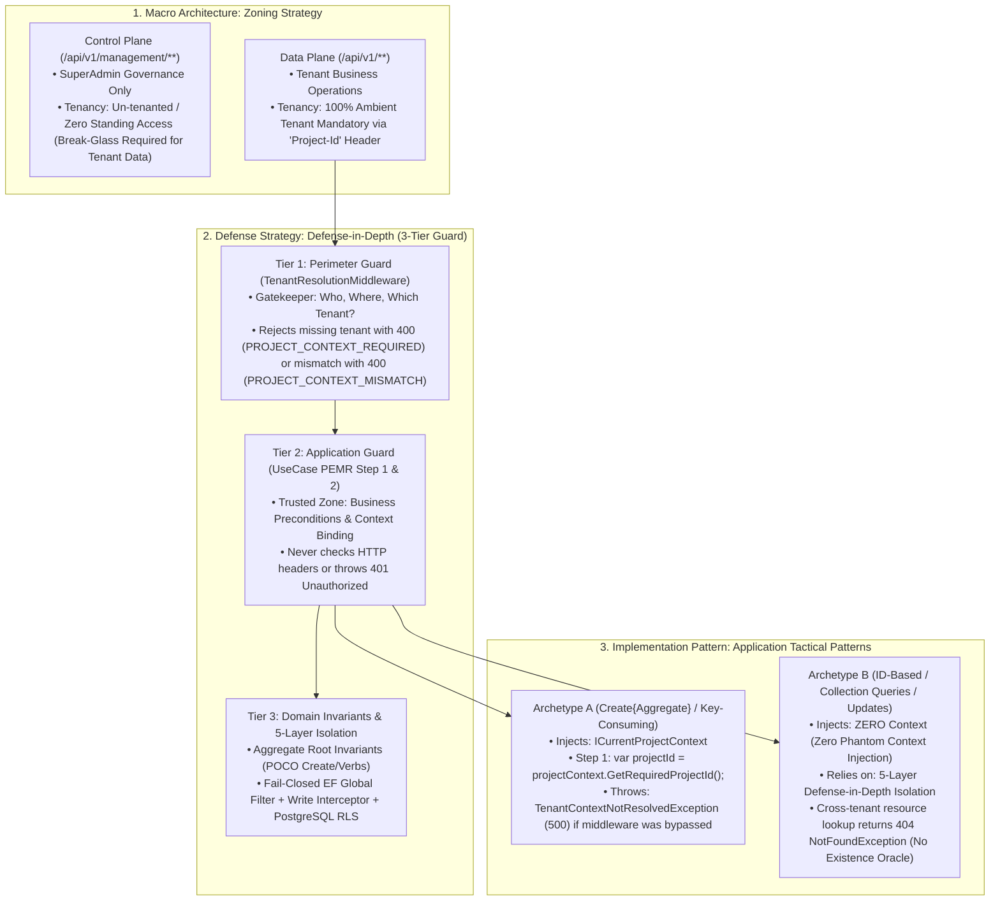

# [PATTERN-002]: 02_application_layer.md — Application Layer Design Patterns & PEMR Pipeline

<context>
Category: 01_clean_arch_patterns
Domain: Application Layer CQRS Architecture, UseCases & PEMR Pipeline
SoleResponsibilities:
  - Vertical CQRS slice topology under `Modules/{BoundedContext}/{Aggregate}/`
  - Action-centric `IUseCase<TRequest, TResponse>` execution and 4-step PEMR pipeline
  - Request validation (`FluentValidation`), immutable `*ResultDto` returns, and Two-Phase Explicit Concurrency (`ExpectedVersion`)
  - Tier 2 Application Guard, `projectContext.GetRequiredProjectId()` fail-fast, and Archetype A vs B tenancy execution
  - Modular Application DI feature installers (`{Module}ModuleExtensions.cs`)
Target: `SmkDoc.Application/` (`Modules/`, `Abstractions/`, `Common/`)
Signal: [ARCH_EVOLUTION_APPLICATION]
</context>

---

## 1. Level 1: Affirmative Application Invariants Matrix

### 1.1 The Unified Tenancy & Security Governance Spine in Application Layer
The Application Layer sits at the intersection of the system's 3-Tier Governance Hierarchy. To prevent cognitive fragmentation, every Application UseCase strictly adheres to this linear chain:



* **Application Layer Location in Defense Hierarchy**: Application UseCases execute strictly within **Tier 2 (Application Guard)** in a **Trusted Zone**.
* **Zero Perimeter Duplication**: Application UseCases must NEVER re-parse HTTP headers, validate API keys, inspect JWT tokens, or throw `401 Unauthorized`. Tier 1 Perimeter Guard guarantees identity and route plane clearance before any UseCase is invoked.
* **Archetype Tactical Selection Matrix**:
  * **Archetype A (`Create{Aggregate}`, MinIO Storage, DraftCache, Tenant ApiKey)**: Injects `ICurrentProjectContext` and calls `var projectId = projectContext.GetRequiredProjectId();` in Step 1. Throws `TenantContextNotResolvedException` (`TENANT_CONTEXT_NOT_RESOLVED`, `500 Internal Server Error`) if invoked without a resolved tenant (which can only occur via a programming defect bypassing Tier 1).
  * **Archetype B (`GetById`, `Update`, `Delete`, `List`, `Preview`)**: Strictly **prohibited** from injecting `ICurrentProjectContext`. Operates on aggregate IDs or collection queries where tenant isolation is guaranteed by the 5-Layer Defense-in-Depth Isolation Architecture ([01_system_architecture.md](../00_architecture_core/01_system_architecture.md#113-tenant-isolation-layered-fail-closed)). Because Global Query Filters and PostgreSQL RLS filter by active `ProjectId`, any attempt to access another tenant's resource ID returns `null` from `FindByIdAsync` and throws `NotFoundException` (`404 Not Found`), eliminating cross-tenant existence enumeration oracles. (`403 CROSS_TENANT_ACCESS_DENIED` is reserved strictly for plane-level denial at Tier 1.)

### 1.2 Architectural Wiring & Layer Contracts
| Direction | Upstream Origin | Current Layer Role (Application Orchestrator) | Downstream Destination |
|---|---|---|---|
| **Inbound Request** | Presentation Controller | Validates line 1 via `ValidationDecorator` (`IValidator<T>`) | Application UseCase (`IUseCase<TRequest, TResponse>`) |
| **Precondition** | Normalized Value Objects | Verifies existence / business uniqueness via Domain/Read Port | Repository (`I{Aggregate}Repository.SlugExistsAsync`) |
| **Domain Mutation** | Validated Command | Checks `entity.Version != command.ExpectedVersion` (`412`) & invokes Verb | Domain Aggregate (`{Aggregate}.Create(...)` or `{Aggregate}.{Verb}(...)`) |
| **Persistence** | Mutated Aggregate | Commits transaction & writes `OutboxMessage` rows atomically | Unit of Work (`IUnitOfWork.CommitAsync(ct)`) |
| **Outbound Egress** | Mutated State | Maps directly to immutable Application DTO or Stream | Presentation Layer (`{Aggregate}ResultDto` / `Stream`) |
| **Side-Effects** | `outbox_messages` Table | Relayed asynchronously at-least-once by background worker | `OutboxRelayWorker` (Audit, Webhooks, Cache) |

### 1.3 Affirmative Application Orchestration Invariants
| Application Architectural Concern | Affirmative Application Invariant (Positive SSoT Law) | Boundary Vector |
|---|---|---|
| **Class Topology** | Exactly 1 public execution method per use case class: `Task<TResponse> ExecuteAsync(TRequest request, CancellationToken ct)`. `ct` is required (never `= default`). | Class Contract |
| **Interface Binding** | Every use case implements `IUseCase<TRequest, TResponse>` or `IUseCase<TRequest>`. Registered via `services.AddUseCase<TRequest, TResponse, TUseCase>()`. | DI Container |
| **CQRS Input Semantics** | State mutations MUST be named `*Command` (parameter named `command`). Read/Stream operations MUST be named `*Query` (parameter named `query`). All inputs are positional `sealed record` types. | Feature Slices |
| **Boundary DTO Firewall** | UseCases return dedicated immutable `*ResultDto` records or live `Stream`. Domain Entities, Aggregate Roots, and unhydrated primitives remain strictly sealed inside the Application boundary. | Presentation Egress |
| **Fail-Fast Line 1 Validation**| Payload schema and format invariants are verified at Line 1 via `ValidationDecorator` wrapping `IValidator<T>` (mapping failures to `422 VALIDATION_FAILED`). | Pipeline Ingress |
| **Temporal Determinism** | System time is retrieved exclusively via injected `TimeProvider.GetUtcNow()`. Zero ambient system clock queries (`DateTime.UtcNow`). | Temporal Context |
| **Transaction Boundary** | State mutations commit exclusively via `IUnitOfWork.CommitAsync(ct)` at egress (never holding DB transactions open across external I/O). Read queries use `*ReadModel` ports with `.AsNoTracking()`. | Data Persistence |
| **Bounded Pooled Streaming** | Binary render/export operations consume and return live `Stream`. Spooling utilizes `HybridSpoolStream` ($\le 64\text{ KB}$ pooled `ArrayPool<byte>`; $> 64\text{ KB}$ `DeleteOnClose` temp `FileStream`). Zero unbounded `byte[]` on the LOH. | Memory & GC |
| **Pagination Validation** | Paginated queries validate `Limit` (`1..100`, rejecting out-of-range values with `422 VALIDATION_FAILED` via FluentValidation). Hot-path list projections select scalar columns only via `I{Aggregate}ReadModel`. | Query Scaling |
| **Two-Phase Explicit Concurrency** | Versioned update/delete/transition commands carry `long ExpectedVersion` (bound from `If-Match: "v{version}"` by `IfMatchVersionBinder`). UseCases check `if (entity.Version != command.ExpectedVersion) throw PreconditionFailedException.VersionMismatch();` in Step 2 before mutation or external I/O, and EF Core `.IsConcurrencyToken()` on `version bigint` guards the atomic commit in Step 4 (`DbUpdateConcurrencyException` → `412 PRECONDITION_FAILED`). | Concurrency Control |
| **Single-Type File Topology** | Every `*Command`, `*Query`, `*Validator`, and `*UseCase` resides in its own isolated `{TypeName}.cs` file inside its vertical slice directory (`Commands/{SliceName}/` or `Queries/{SliceName}/`). | Physical Structure |
| **Modular Module Installers** | Each bounded context slice registers its use cases and services through dedicated `{Module}ModuleExtensions.cs` (`AuthoringModuleExtensions`, `RenderingModuleExtensions`, `IntegrationModuleExtensions`, `IdentityAccessModuleExtensions`, `TenantManagementModuleExtensions`). | DI Container |
| **Cohesive Collaborators** | Workflows consume cohesive domain/rendering ports (`IDataBindingEngine`, `IDocumentRenderer`) directly. Pure pass-through wrapper classes with zero independent logic are prohibited (`TRAP-WRAPPER-018`). | Pipeline Structure |
| **Ingestion Consolidation SSoT** | Template file placeholder scanning and draft parsing execute exclusively within `CreateTemplateUseCase` and `ParseTemplateDraftUseCase`. Standalone file scanning endpoints (`/scan-fields`) outside the draft/creation lifecycle are prohibited. | Ingestion Pipeline |
| **PEMR Step 1 Tenancy & VO Normalization** | In Archetype A UseCases, Step 1 resolves `var projectId = projectContext.GetRequiredProjectId();` and constructs/normalizes all Domain Value Objects (`{Aggregate}Slug.Create(command.Slug)`) **before** Step 2 queries `SlugExistsAsync(projectId, slug, ct)` (`TRAP-TENANT-024`). | PEMR Cadence |
| **Zero Phantom Context Injection** | UseCases inject `ICurrentProjectContext` strictly when `ProjectId` or caller identity is consumed in domain logic (Archetype A). Archetype B UseCases operating by aggregate ID or querying collections filtered by the 5-Layer Tenant Isolation pipeline **must NOT inject context** (`TRAP-TENANT-023`). | Dependency Purity |

---

## 2. Level 2: Core Application SSoT Catalogs & Cognitive Governance Engine

### 2.1 Engineering Rationale & Architectural Decisions
* **Why Action-Centric `IUseCase` over MediatR:** Eliminates runtime reflection allocations, avoids opaque pipeline behaviors, produces transparent call stacks, and guarantees compile-time verified DI.
* **Why Positional `sealed record` for Commands/DTOs:** Guarantees absolute immutability across layer boundaries, eliminates mutation side-effects, and provides zero-boilerplate structural equality.
* **Why Automatic Line-1 Validation via Decorator:** Prevents invalid or malformed payloads from touching repositories or executing expensive database queries, throwing strongly-typed `ValidationException` (`422 VALIDATION_FAILED`) immediately.
* **Why Application DTOs as Boundary Firewalls:** Domain entities must never cross the layer boundary into Presentation; prevents leaking internal domain state or triggering EF Core lazy-loading traps.
* **Why Direct Stream Return for Render/Preview:** Avoids Large Object Heap (LOH $\ge 85\text{ KB}$) RAM allocations during high-throughput document streaming.
* **Why Transactional Outbox over Post-Commit In-Memory Dispatch:** Writing `OutboxMessage` records in the same PostgreSQL transaction as `unitOfWork.CommitAsync(ct)` guarantees zero lost domain events if a pod crashes immediately after commit (`TRAP-EVENT-010`).
* **Why Two-Phase Explicit Concurrency (`ExpectedVersion`) over Ambient `IConcurrencyContext`:** Passing `long ExpectedVersion` on the Command (bound from `If-Match: "v{version}"` at the HTTP boundary) makes concurrency explicit, deterministic, and 100% unit-testable without ambient state or leaking EF Core `SetExpectedVersion` into Domain repository interfaces. Both Step 2 mismatches and Step 4 mid-flight `DbUpdateConcurrencyException` races map to the single HTTP `412 PRECONDITION_FAILED` contract.

### 2.2 Primary SSoT Interfaces & Exception Catalogue Delegation
```csharp
public interface IUseCase<in TRequest, TResponse>
{
    Task<TResponse> ExecuteAsync(TRequest request, CancellationToken ct);
}

public interface IUseCase<in TRequest>
{
    Task ExecuteAsync(TRequest request, CancellationToken ct);
}

public interface IUnitOfWork
{
    Task<int> CommitAsync(CancellationToken ct);
}

public interface ICurrentProjectContext
{
    bool IsResolved { get; }
    ProjectId GetRequiredProjectId();
    bool TryGetProjectId(out ProjectId projectId);
}

public interface IHasVersion
{
    long Version { get; }
}
```

> **SSoT Delegation — Exception Catalogue & HTTP Mapping:** Application and Domain exceptions carry a stable `ErrorCode` and category, never raw HTTP status codes. The single authoritative Exception-to-HTTP mapping table lives in [06_api_contract_standards.md §3.3](../00_architecture_core/06_api_contract_standards.md#33-rfc-9457-problemdetails--the-exception-catalogue-ssot) (e.g., `ValidationException` / `DomainValidationException` → `422 VALIDATION_FAILED`, `NotFoundException` → `404`, `ConflictException` / `BusinessRuleViolationException` → `409`, `PreconditionFailedException` / `DbUpdateConcurrencyException` → `412 PRECONDITION_FAILED`, `PreconditionRequiredException` → `428 PRECONDITION_REQUIRED`, `TenantContextNotResolvedException` → `500 TENANT_CONTEXT_NOT_RESOLVED`).

### 2.3 Proactive Application Firewalls
```yaml
ApplicationBoundaryFirewall:
  Invariant: "UseCases must return dedicated immutable *ResultDto records or Stream."
  ActionOnViolation: "Replace Domain Entity return types with fully-hydrated *ResultDto."

MediatRProhibitionFirewall:
  Invariant: "Application layer executes use cases directly via IUseCase<TReq, TRes>."
  ActionOnViolation: "Remove MediatR IRequestHandler and register use case with AddUseCase DI."

TransactionCommitFirewall:
  Invariant: "Mutating use cases must commit state changes via IUnitOfWork.CommitAsync(ct)."
  ActionOnViolation: "Insert await unitOfWork.CommitAsync(ct) before returning ResultDto."

ZeroLOHStreamingFirewall:
  Invariant: "Binary export and render pipelines must never buffer whole payloads in byte[]."
  ActionOnViolation: "Refactor return type to live Stream with HybridSpoolStream buffering."

FileTopologyFirewall:
  Invariant: "Every *Command, *Query, *Validator, and *UseCase must live in its own {TypeName}.cs file."
  ActionOnViolation: "Split bundled types into dedicated files co-located in slice folders."

ApplicationModularDiFirewall:
  Invariant: "Application use cases and services must register strictly within their Bounded Context module extension methods, never in a monolithic root file."
  ActionOnViolation: "Extract slice registrations into Modules/{BoundedContext}/{BoundedContext}ModuleExtensions.cs."

GodServiceEliminationFirewall:
  Invariant: "Multi-action application services are 100% prohibited. Every business capability must be an isolated Action-Centric Vertical Slice implementing IUseCase<TReq, TRes>."
  ActionOnViolation: "Decompose multi-method service into discrete single-purpose UseCases."

IngestionConsolidationFirewall:
  Invariant: "File scanning and placeholder extraction must be co-located within CreateTemplate and ParseTemplateDraft UseCases."
  ActionOnViolation: "Purge standalone scanner use cases and endpoints (/scan-fields); route all ingestion through draft/creation pipelines."

UseCaseTenancyPerimeterFirewall:
  Invariant: "Tenant boundary resolution for domain mutation belongs strictly in Step 1 (Parse & Guard) of UseCase execution via projectContext.GetRequiredProjectId() strictly when ProjectId or CallerIdentity is consumed."
  ActionOnViolation: "Remove ICurrentProjectContext from controllers; invoke var projectId = projectContext.GetRequiredProjectId(); in Step 1 only in Archetype A UseCases."

ZeroPhantomContextFirewall:
  Invariant: "Inject ICurrentProjectContext only in UseCases that actively consume ProjectId or CallerIdentity in domain logic (Archetype A). UseCases operating strictly by ID or using EF Core Global Query Filters (Archetype B) must NOT inject context."
  ActionOnViolation: "Remove ICurrentProjectContext from all Archetype B UseCases (GetById, Update, Delete, List)."
```

---

## 3. Level 3: Canonical Working Archetypes (Surgical AST Recipes)

### 3.1 Archetype A: Entity-Creating / Key-Consuming Command Slice Archetype (`Create{Aggregate}`)
>> MANDATORY CANONICAL BLUEPRINT [RULE-APP-CMD-001]:
* Co-located inside `Modules/{BoundedContext}/{Aggregate}/Commands/Create{Aggregate}/` with strictly 1 primary public type per `.cs` file.
* **When to Use Archetype A**: Used when creating brand-new domain entities, provisioning tenant storage assets (MinIO), storing drafts in DraftCache, or managing tenant API keys/users.
* **Tenancy & Value Object Normalization**: Injects `ICurrentProjectContext`, resolves `var projectId = projectContext.GetRequiredProjectId();`, and constructs/normalizes all Domain Value Objects (`{Aggregate}Name.Create`, `{Aggregate}Slug.Create`) in Step 1 **before** querying `SlugExistsAsync(projectId, slug, ct)` in Step 2 ([TRAP-TENANT-024](../00_architecture_core/05_anti_pattern_firewall.md#trap-tenant-024--archetype-a-missing-icurrentprojectcontext--un-normalized-uniqueness-checks-critical)).
* Executes strictly via the 4-step PEMR (Parse & Guard, Preconditions, Mutate, Return) pipeline.

```csharp
// --- File: Commands/Create{Aggregate}/Create{Aggregate}Command.cs ---
public sealed record Create{Aggregate}Command(
    string Name,
    string Slug,
    string? Category);

// --- File: Commands/Create{Aggregate}/Create{Aggregate}CommandValidator.cs ---
public sealed class Create{Aggregate}CommandValidator : AbstractValidator<Create{Aggregate}Command>
{
    public Create{Aggregate}CommandValidator()
    {
        RuleFor(x => x.Name).NotEmpty().MaximumLength(100);
        RuleFor(x => x.Slug).NotEmpty().MaximumLength(100).Matches("^[a-z0-9-]+$");
    }
}

// --- File: DTOs/{Aggregate}ResultDto.cs ---
public sealed record {Aggregate}ResultDto(
    Guid Id,
    Guid ProjectId,
    string Name,
    string Slug,
    string? Category,
    bool IsActive,
    DateTimeOffset CreatedAt,
    DateTimeOffset? UpdatedAt,
    [property: JsonIgnore] long Version = 1) : IHasVersion;

public sealed record {Aggregate}PagedResultDto(
    IReadOnlyList<{Aggregate}ResultDto> Items,
    long? TotalCount,
    int Page,
    int Limit);

// --- File: Commands/Create{Aggregate}/Create{Aggregate}UseCase.cs ---
public sealed class Create{Aggregate}UseCase(
    I{Aggregate}Repository {aggregate}Repository,
    ICurrentProjectContext projectContext,
    IUnitOfWork unitOfWork,
    TimeProvider timeProvider) : IUseCase<Create{Aggregate}Command, {Aggregate}ResultDto>
{
    public async Task<{Aggregate}ResultDto> ExecuteAsync(Create{Aggregate}Command command, CancellationToken ct)
    {
        // Step 1: Parse & Guard (Resolve required ProjectId and normalize Value Objects FIRST)
        var projectId = projectContext.GetRequiredProjectId();
        var name = {Aggregate}Name.Create(command.Name);
        var slug = {Aggregate}Slug.Create(command.Slug);

        // Step 2: Ensure Preconditions <Why: check uniqueness using normalized Value Object>
        if (await {aggregate}Repository.SlugExistsAsync(projectId, slug, ct))
        {
            throw ConflictException.DuplicateSlug((string)slug);
        }

        // Step 3: Mutate Domain State <Why: enforce aggregate business invariants>
        var now = timeProvider.GetUtcNow();
        var aggregate = {Aggregate}.Create(projectId, name, slug, command.Category, now);
        {aggregate}Repository.Add(aggregate);

        // Step 4: Commit & Egress <Why: atomic persistence + Outbox in a single fast DB transaction>
        await unitOfWork.CommitAsync(ct);

        return aggregate.ToResultDto();
    }
}
```

### 3.2 Archetype B: Bounded Pooled Streaming Query Slice Archetype (`Preview{Aggregate}`)
>> MANDATORY CANONICAL BLUEPRINT [RULE-APP-STRM-002]:
* Returns live `Stream` directly to caller without intermediary `byte[]` or `MemoryStream.ToArray()` buffering.
* Uses `HybridSpoolStream` for operations requiring seekable buffers.
* **Zero Phantom Context Injection**: Operates on an existing aggregate by ID. Relies on Tier 1 Perimeter Guard for tenant authentication and the 5-Layer Isolation Architecture for tenant data isolation. **Must NOT inject `ICurrentProjectContext`.**

```csharp
// --- File: Queries/{Verb}{Aggregate}/{Verb}{Aggregate}Query.cs ---
public sealed record {Verb}{Aggregate}Query(
    {Aggregate}Id {Aggregate}Id,
    string PayloadJson);

// --- File: Queries/{Verb}{Aggregate}/{Verb}{Aggregate}QueryValidator.cs ---
public sealed class {Verb}{Aggregate}QueryValidator : AbstractValidator<{Verb}{Aggregate}Query>
{
    public {Verb}{Aggregate}QueryValidator()
    {
        RuleFor(x => x.{Aggregate}Id.Value).NotEmpty();
        RuleFor(x => x.PayloadJson).NotEmpty();
    }
}

// --- File: Queries/{Verb}{Aggregate}/{Verb}{Aggregate}UseCase.cs ---
public sealed class {Verb}{Aggregate}UseCase(
    I{Aggregate}Repository {aggregate}Repository,
    IStoragePort storagePort,
    IRenderEngineFactory engineFactory) : IUseCase<{Verb}{Aggregate}Query, Stream>
{
    public async Task<Stream> ExecuteAsync({Verb}{Aggregate}Query query, CancellationToken ct)
    {
        // Step 1: Parse & Guard <Why: fail-fast input validation; ambient tenant secured by Tier 1>

        // Step 2: Ensure Preconditions <Why: fail-fast 404 on non-existent or other-tenant resource>
        var aggregate = await {aggregate}Repository.FindByIdAsync(query.{Aggregate}Id, ct)
            ?? throw NotFoundException.For<{Aggregate}>(query.{Aggregate}Id.Value);

        // Step 3: Stream Ingress <Why: bounded pooled memory stream passthrough>
        await using var artifactStream = await storagePort.OpenReadAsync(
            StorageBuckets.{Aggregate}s,
            aggregate.StorageKey,
            ct);

        // Step 4: Polymorphic Engine Stream Execution <Why: bypass Gen 2 GC LOH allocations>
        var engine = engineFactory.GetEngine(aggregate.RenderEngineType);
        return await engine.RenderStreamAsync(artifactStream, query.PayloadJson, OutputFormat.Pdf, ct);
    }
}
```

### 3.3 Archetype B: Materialized Paged Query Slice Archetype (`List{Aggregate}s`)
>> MANDATORY CANONICAL BLUEPRINT [RULE-APP-QRY-003]:
* Validates `Page >= 1` and `Limit` (`1..100`) via FluentValidation (`422 VALIDATION_FAILED` if out of range).
* Projects directly to lightweight scalar DTOs via `I{Aggregate}ReadModel` (`.AsNoTracking()`), bypassing heavy `jsonb` payloads.
* **Zero Phantom Context Injection**: Relies on Tier 1 Perimeter Guard (`TenantResolutionMiddleware`) to reject un-tenanted calls with `400 PROJECT_CONTEXT_REQUIRED`, while `I{Aggregate}ReadModel` / EF Core + RLS automatically applies the tenant filter. **Must NOT inject `ICurrentProjectContext` or pass `projectId` manually.**

```csharp
// --- File: Queries/List{Aggregate}s/List{Aggregate}sQuery.cs ---
public sealed record List{Aggregate}sQuery(
    string? SearchTerm,
    string? Category,
    bool? IsActive,
    int Page = 1,
    int Limit = 20,
    bool IncludeTotal = false);

// --- File: Queries/List{Aggregate}s/List{Aggregate}sUseCase.cs ---
public sealed class List{Aggregate}sUseCase(
    I{Aggregate}ReadModel {aggregate}ReadModel) : IUseCase<List{Aggregate}sQuery, {Aggregate}PagedResultDto>
{
    public async Task<{Aggregate}PagedResultDto> ExecuteAsync(List{Aggregate}sQuery query, CancellationToken ct)
    {
        // Step 1: Materialized SQL Projection <Why: bypass multi-KB jsonb payload columns; EF filter + RLS isolates tenant>
        var (items, totalCount) = await {aggregate}ReadModel.ListPagedAsync(
            query.SearchTerm,
            query.Category,
            query.IsActive,
            query.Page,
            query.Limit,
            query.IncludeTotal,
            ct);

        // Step 2: Wrap Paged Result <Why: immutable pagination result>
        return new {Aggregate}PagedResultDto(items, totalCount, query.Page, query.Limit);
    }
}
```

### 3.4 Pre-Compiled Template Cache Archetype
>> MANDATORY CANONICAL BLUEPRINT [RULE-APP-CACHE-004]:
* Pre-compiles render trees into thread-safe memory caches to avoid repeated parsing overhead.
* Evicts or refreshes cache entries upon publication events.

```csharp
public sealed class CachedTemplateRenderer(
    ICompiledTemplateCache templateCache,
    IRenderEngine renderEngine)
{
    public async Task<Stream> RenderCachedAsync(
        string templateId,
        string htmlContent,
        string payloadJson,
        CancellationToken ct)
    {
        // Step 1: Retrieve or compile AST <Why: avoid re-parsing Handlebars tree per request>
        var compiledTemplate = await templateCache.GetOrCompileAsync(templateId, htmlContent, ct);

        // Step 2: Merge JSON payload <Why: thread-safe stateless merge>
        var mergedHtml = compiledTemplate.Render(payloadJson);

        // Step 3: Stream to Render Engine <Why: bounded pooled stream egress>
        await using var htmlStream = await HybridSpoolStream.CreateFromUtf8StringAsync(mergedHtml, ct: ct);
        return await renderEngine.RenderStreamAsync(htmlStream, "{}", OutputFormat.Pdf, ct);
    }
}
```

### 3.5 Archetype B: Two-Phase Explicit Concurrency Mutating Slice Archetype (`Update{Aggregate}`)
>> MANDATORY CANONICAL BLUEPRINT [RULE-APP-CMD-005]:
* Co-located inside `Modules/{BoundedContext}/{Aggregate}/Commands/Update{Aggregate}/`.
* **Zero Phantom Context Injection**: Operates on an existing aggregate by ID (`{aggregate}Repository.FindByIdAsync`). Ambient tenancy is guaranteed by Tier 1 Perimeter Guard and 5-Layer Isolation. **Must NOT inject `ICurrentProjectContext`.**
* Command carries explicit `long ExpectedVersion` (bound from `If-Match: "v{version}"` by `IfMatchVersionBinder` at the HTTP layer; `428` if missing, `412` if malformed).
* **Phase 1 (UseCase Step 2 Pre-Check):** Evaluates `if (entity.Version != command.ExpectedVersion) throw PreconditionFailedException.VersionMismatch();` immediately after loading the entity, failing fast with `412 PRECONDITION_FAILED` before domain mutation or external I/O.
* **Phase 2 (Atomic Persistence Guard):** `entity.UpdateDetails(..., now)` calls `SetUpdated(now)`, incrementing `entity.Version`. On `unitOfWork.CommitAsync(ct)`, EF Core `.IsConcurrencyToken()` on `version bigint` emits `WHERE id = @id AND version = @expected_version` (`DbUpdateConcurrencyException` → `412 PRECONDITION_FAILED`).

```csharp
// --- File: Commands/Update{Aggregate}/Update{Aggregate}Command.cs ---
public sealed record Update{Aggregate}Command(
    {Aggregate}Id Id,
    string Name,
    string? Category,
    long ExpectedVersion);

// --- File: Commands/Update{Aggregate}/Update{Aggregate}CommandValidator.cs ---
public sealed class Update{Aggregate}CommandValidator : AbstractValidator<Update{Aggregate}Command>
{
    public Update{Aggregate}CommandValidator()
    {
        RuleFor(x => x.Id.Value).NotEmpty();
        RuleFor(x => x.Name).NotEmpty().MaximumLength(100);
        RuleFor(x => x.ExpectedVersion).GreaterThan(0);
    }
}

// --- File: Commands/Update{Aggregate}/Update{Aggregate}UseCase.cs ---
public sealed class Update{Aggregate}UseCase(
    I{Aggregate}Repository {aggregate}Repository,
    IUnitOfWork unitOfWork,
    TimeProvider timeProvider) : IUseCase<Update{Aggregate}Command, {Aggregate}ResultDto>
{
    public async Task<{Aggregate}ResultDto> ExecuteAsync(Update{Aggregate}Command command, CancellationToken ct)
    {
        // Step 1: Parse & Guard <Why: normalize Value Objects before querying>
        var name = {Aggregate}Name.Create(command.Name);

        // Step 2: Ensure Preconditions <Why: Phase 1 fail-fast on stale If-Match version before mutation or external I/O>
        var entity = await {aggregate}Repository.FindByIdAsync(command.Id, ct)
            ?? throw NotFoundException.For<{Aggregate}>(command.Id.Value);

        if (entity.Version != command.ExpectedVersion)
        {
            throw PreconditionFailedException.VersionMismatch();
        }

        // Step 3: Mutate Domain State <Why: enforce domain invariants; SetUpdated advances UpdatedAt and increments Version>
        var now = timeProvider.GetUtcNow();
        entity.UpdateDetails(name, command.Category, now);

        // Step 4: Commit & Egress <Why: Phase 2 atomic persistence guarded by EF Core IsConcurrencyToken on version bigint>
        await unitOfWork.CommitAsync(ct);

        return entity.ToResultDto();
    }
}
```

### 3.6 Modular Application DI Composition Archetype (`AddApplicationServices` & Bounded Context Modules)
>> MANDATORY CANONICAL BLUEPRINT [RULE-APP-DI-006]:
* Root `AddApplicationServices()` acts strictly as a lightweight orchestrator (< 25 LOC), delegating to modular Bounded Context extensions.
* Each Bounded Context manages its own registrations via `{BoundedContext}ModuleExtensions.cs` using `services.AddUseCase<TRequest, TResponse, TImplementation>()`.
* Prohibits monolithic dumping of all use cases or services directly into root `DependencyInjection.cs`.

```csharp
// --- File: DependencyInjection.cs (Root Application Orchestrator) ---
public static class DependencyInjection
{
    public static IServiceCollection AddApplicationServices(this IServiceCollection services)
    {
        // 1. Shared Engine Services & Helpers <Why: cross-cutting calculation & binding SSoT>
        services.AddScoped<IDataBindingEngine, DataBindingEngine>();

        // 2. Modular Bounded Context Installers <Why: isolates slice registrations by domain boundary>
        services.AddRenderingModule();
        services.AddAuthoringModule();
        services.AddIntegrationModule();
        services.AddIdentityAccessModule();
        services.AddTenantManagementModule();

        // 3. Automated FluentValidation Assembly Scanning <Why: fail-fast request validation>
        services.AddValidatorsFromAssemblyContaining<{AnyCommandValidator}>();

        return services;
    }
}

// --- File: Modules/{BoundedContext}/{BoundedContext}ModuleExtensions.cs ---
public static class {BoundedContext}ModuleExtensions
{
    public static IServiceCollection Add{BoundedContext}Module(this IServiceCollection services)
    {
        // Action-Centric Vertical Slices (Strictly 1 UseCase per Command/Query)
        services.AddUseCase<{Verb}{Aggregate}Command, {Aggregate}ResultDto, {Verb}{Aggregate}UseCase>();
        services.AddUseCase<Get{Aggregate}Query, {Aggregate}ResultDto, Get{Aggregate}UseCase>();

        return services;
    }
}
```

---

## 4. Level 4: Anti-Patterns & Unified Micro-Diffs

### [TRAP-APP-001]: Entity Leakage vs Application DTO
```diff
- public async Task<{Aggregate}> ExecuteAsync(Get{Aggregate}Query query, CancellationToken ct)
+ public async Task<{Aggregate}ResultDto> ExecuteAsync(Get{Aggregate}Query query, CancellationToken ct)
```
*Rationale: Domain entities leak navigation proxies, internal business states, and EF Core change tracking state.*

### [TRAP-APP-002]: MediatR Reflection Indirection vs Direct IUseCase
```diff
- public sealed class {Verb}{Aggregate}Handler : IRequestHandler<{Verb}{Aggregate}Request, {Aggregate}Result> { }
+ public sealed class {Verb}{Aggregate}UseCase : IUseCase<{Verb}{Aggregate}Command, {Aggregate}ResultDto> { }
```
*Rationale: MediatR runtime reflection allocations and hidden handler indirection obscure call stacks and degrade cold-start execution.*

### [TRAP-APP-003]: Transaction Boundary: Uncommitted Mutations
```diff
- await {aggregate}Repository.AddAsync(aggregate, ct); return aggregate.ToResultDto();
+ {aggregate}Repository.Add(aggregate); await unitOfWork.CommitAsync(ct); return aggregate.ToResultDto();
```
*Rationale: Adding an entity to repository without calling `unitOfWork.CommitAsync(ct)` results in silent loss of state changes.*

### [TRAP-APP-004]: LOH In-Memory Buffering vs Streaming Pass-Through
```diff
- using var ms = new MemoryStream(); await sourceStream.CopyToAsync(ms, ct); return ms.ToArray();
+ return await renderEngine.RenderStreamAsync(sourceStream, payload, format, ct);
```
*Rationale: Buffering binary payloads >= 85KB into byte arrays causes GC Gen 2 LOH fragmentation and OutOfMemory crashes under concurrency.*

### [TRAP-APP-005]: Direct Clock Query vs TimeProvider
```diff
- var now = DateTime.UtcNow;
+ var now = timeProvider.GetUtcNow();
```
*Rationale: Ambient system clock queries prevent deterministic test harness assertion via `FakeTimeProvider`.*

### [TRAP-APP-006]: Unbounded Query Size (Denial of Service)
```diff
- // Accepting unbounded Limit without validation (Attacker requests limit = 1_000_000)
+ RuleFor(x => x.Limit).InclusiveBetween(1, 100); // Rejects out-of-range Limit with 422 VALIDATION_FAILED
```
*Rationale: Unbounded page sizes allow malicious or misconfigured callers to exhaust database memory and connection pools.*

### [TRAP-APP-007]: Bundled Command/Validator in `*UseCase.cs` or Detached `Validators/` Bucket
```diff
- // {Verb}{Aggregate}UseCase.cs (declaring Command + Validator + UseCase together)
- // OR Validators/{Aggregate}Validators.cs (detached from slice namespace)
+ // Commands/{Verb}{Aggregate}/{Verb}{Aggregate}Command.cs
+ // Commands/{Verb}{Aggregate}/{Verb}{Aggregate}CommandValidator.cs
+ // Commands/{Verb}{Aggregate}/{Verb}{Aggregate}UseCase.cs
```
*Rationale: Every `*Command`, `*Query`, `*Validator`, and `*UseCase` MUST live in its own `{TypeName}.cs` file co-located inside its vertical slice namespace.*

### [TRAP-APP-008]: Raw HTTP `If-Match` String Parsing or Ambient `IConcurrencyContext` vs. `long ExpectedVersion`
```diff
- public sealed record Update{Aggregate}Command(Guid Id, string Name, string? IfMatch = null);
- // OR injecting ambient IConcurrencyContext / calling repository.SetExpectedVersion(entity, version)
+ public sealed record Update{Aggregate}Command({Aggregate}Id Id, string Name, long ExpectedVersion);
+ // Bound by IfMatchVersionBinder at HTTP boundary; verified via 'if (entity.Version != command.ExpectedVersion) throw PreconditionFailedException.VersionMismatch();'
```
*Rationale: Threading raw HTTP `If-Match` strings or ambient `IConcurrencyContext` obscures concurrency preconditions, while `repository.SetExpectedVersion` leaks EF Core mechanics into Domain ports.*

### [TRAP-APP-009]: Application Monolithic Composition Root & God Registration Sprawl
```diff
- // Root DependencyInjection.cs dumping 50+ UseCases across unrelated Bounded Contexts
- services.AddUseCase<GenerateDocumentCommand, ...>();
- services.AddUseCase<PreviewDocumentQuery, ...>();
- services.AddUseCase<CreateTemplateCommand, ...>();
- services.AddUseCase<LoginUserCommand, ...>();
+ // Modular Bounded Context Installers complying with system-wide CompositionRootFirewall
+ services.AddRenderingModule();
+ services.AddAuthoringModule();
+ services.AddIntegrationModule();
+ services.AddIdentityAccessModule();
+ services.AddTenantManagementModule();
```
*Rationale: Violates system-wide CompositionRootFirewall. Dumping UseCases across multiple Bounded Contexts into a single root file breaks domain isolation, masks dependencies, and generates severe merge conflicts.*

### [TRAP-APP-010]: Delayed Concurrency Validation (Missing Step 2 `entity.Version != command.ExpectedVersion`)
```diff
  // Step 2: Ensure Preconditions
  var entity = await {aggregate}Repository.FindByIdAsync(command.Id, ct) ?? throw NotFoundException.For<{Aggregate}>(command.Id.Value);
+ if (entity.Version != command.ExpectedVersion) throw PreconditionFailedException.VersionMismatch(); // Fail-fast 412 before mutation or external I/O
  // Step 3: Mutate Domain State
  entity.UpdateDetails(name, category, now);
- // Concurrency check only happens later in Step 4 CommitAsync after wasting mutation and I/O cycles!
```
*Rationale: Deferring ETag validation to CommitAsync wastes CPU cycles on domain mutations and risks executing irreversible external I/O (S3 uploads, Gotenberg rendering) for requests doomed to fail HTTP 412.*

>> SSoT DELEGATION: Document rendering pipeline composition, data binding integration, and anemic pass-through wrapper prohibitions are governed strictly by [document_rendering_mechanics.md](../03_specialized_mechanics/document_rendering_mechanics.md#trap-mech-008-pass-through-indirection-wrapper-or-intermediate-pipeline-in-rendering).
