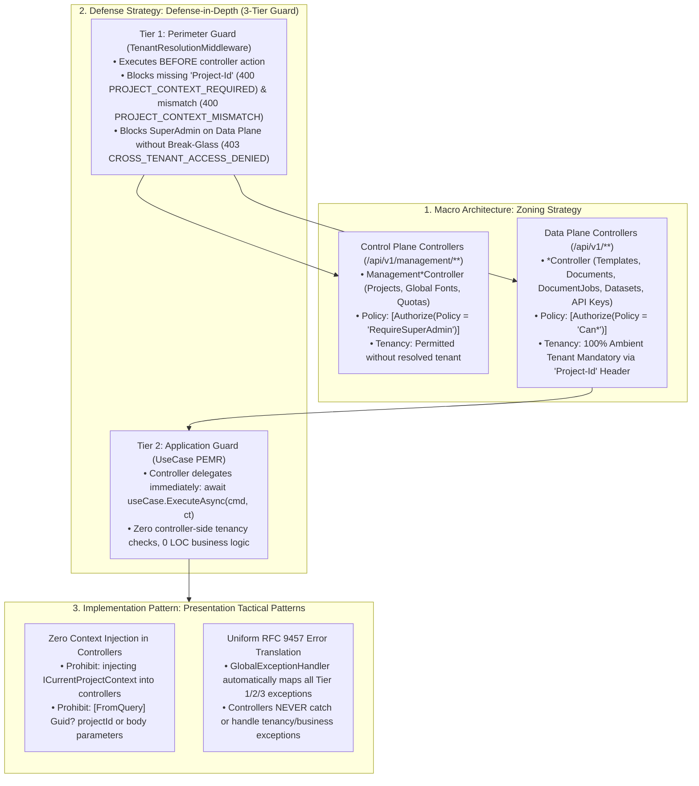

# [PATTERN-004]: 04_api_presentation_layer.md — Presentation Layer Design Patterns & HTTP SSoT

<context>
Category: 01_clean_arch_patterns
Domain: Presentation Layer HTTP Controllers, Routing & Endpoint Authorization
SoleResponsibilities:
  - Thin ASP.NET Core API controllers (<= 5 LOC per action) with .NET 10 / C# 14 Primary Constructors
  - Control Plane (`/api/v1/management/**`) vs Data Plane (`/api/v1/**`) controller partitioning & zero tenancy injection
  - Unified Preview Gateway routing (delegating preview endpoints to `PreviewDocumentUseCase`)
  - Declarative policy authorization (`[Authorize(Policy = "...")]`) and tenant sub-key routing
  - RFC 9457 `ProblemDetails` exception mapping (`GlobalExceptionHandler`) and Two-Phase Explicit Concurrency (`IfMatchVersionBinder` + `ETagResponseFilter`)
Target: `backend-v2/` (`SmkDoc.Api/Controllers/`, `SmkDoc.Api/Filters/`, `SmkDoc.Api/Middleware/`)
Signal: [ARCH_EVOLUTION_API]
</context>

---

## 1. Level 1: Affirmative Presentation Invariants Matrix

### 1.1 The Unified Tenancy & Security Governance Spine in Presentation Layer
The Presentation Layer serves as the gateway to the 3-Tier Governance Hierarchy, translating HTTP wire requests into CQRS command/query execution:



* **Zoning Boundary Enforcement**:
  * **Control Plane (`/api/v1/management/**`)**: Handled strictly by `Management*Controller` classes decorated with `[Authorize(Policy = "RequireSuperAdmin")]`. Un-tenanted access is permitted for platform lifecycle operations.
  * **Data Plane (`/api/v1/**`)**: Handled by standard `*Controller` classes decorated with project-level policies (`RequireProjectAdmin`, `CanManageTemplates`, `CanGenerateDocuments`). Un-tenanted traffic is intercepted at Tier 1 before reaching controller actions.
* **Perimeter Handoff**: Controllers are thin dispatchers ($\le 5$ LOC) that instantiate the command/query DTO from route/body parameters and forward directly to `IUseCase<TRequest, TResponse>`. Controllers MUST NOT inject `ICurrentProjectContext` or manually check tenant status.

### 1.2 Architectural Wiring & Layer Contracts
| Direction | Upstream Origin | Current Layer Role (HTTP Presentation Gateway) | Downstream Destination |
|---|---|---|---|
| **Wire Inbound** | HTTP Client (Next.js Proxy / ERP) | Resolves Tenant (`Project-Id`) & Auth Context | Controller Action (`[ApiController]`) |
| **Command Dispatch** | Route, Body & `If-Match` Parameters | Instantiates Command & forwards to UseCase | Application (`{verb}{Aggregate}UseCase.ExecuteAsync`) |
| **POST Mutation Safeguard**| Costly Creating `POST` Methods (`/documents`, `/document-jobs`) | Enforces durable deduplication via `Idempotency-Key` | PostgreSQL `idempotency_keys` (`request_hash` SHA-256) |
| **PUT/DELETE Concurrency** | Versioned `PUT` / `DELETE` / `:verb` | Binds `If-Match: "v{version}"` (`428` if missing, `412` if stale) | `command.ExpectedVersion` & EF Core `.IsConcurrencyToken()` |
| **Wire Egress** | Application DTO (`{Aggregate}ResultDto`) | Envelopes into `ApiResponse<T>` with `ETag: "v{version}"` | Client (`200 OK`, `201 Created` + `Location`) |
| **Streaming Egress** | Binary Render Stream | Returns `FileStreamResult` (transferring stream disposal) | HTTP Stream (`application/pdf`, `Document-Id`) |
| **Error Egress** | Unhandled Exceptions | Dispatches to RFC 9457 `ProblemDetails` (`GlobalExceptionHandler`) | HTTP Client (`application/problem+json`) |

### 1.3 Affirmative Presentation Invariants
| Presentation Architectural Concern | Affirmative Presentation Invariant (Positive SSoT Law) | Boundary Vector |
|---|---|---|
| **Thin Controller Boundary** | Controllers remain thin orchestrators ($\le 5$ LOC per action) delegating directly to a single-responsibility `IUseCase<TRequest, TResponse>`. Business logic is strictly sealed in Application/Domain. | Controller Action |
| **Unified Response Envelopes** | All standard JSON responses are wrapped in immutable `ApiResponse<T>` or `PagedApiResponse<T>`. Anonymous object returns (`new { ... }`) are prohibited. | Wire Output |
| **RFC 9457 ProblemDetails** | Unhandled and domain exceptions translate through `GlobalExceptionHandler` into RFC 9457 `ProblemDetails` (`application/problem+json`) with stable `type` URI (`https://{api-host}/problems/{kebab-error-code}`), `errorCode`, W3C `traceId`, and uniform `errors` array (`{ pointer, code, message }`). | Error Pipeline |
| **POST Mutation Idempotency** | `POST /api/v1/documents` and `POST /api/v1/document-jobs` require the `Idempotency-Key` header, persisted durably in PostgreSQL `idempotency_keys` with request payload SHA-256 verification (`422 IDEMPOTENCY_KEY_REUSED` on payload mismatch; `409 IDEMPOTENCY_IN_PROGRESS` while in flight). | Mutation Safety |
| **PUT/DELETE Two-Phase Concurrency** | Versioned `PUT`, `DELETE`, and `:verb` endpoints require `If-Match: "v{version}"` (`428 PRECONDITION_REQUIRED` if missing; `412 PRECONDITION_FAILED` if weak `W/`, `*`, or version mismatch). `ETagResponseFilter` emits `ETag: "v{version}"` from `IHasVersion` on `2xx` egress. | Concurrency Control |
| **Diagnostic Probe Semantics** | Connectivity probes (`POST /api/v1/data-connections/{id}/connectivity-checks`) return HTTP `200 OK` with coarse `ApiResponse<ConnectivityCheckResultDto>` (`{ success, outcome, latencyMs, checkedAt }`) where `outcome` ∈ `OK \| DNS_FAILURE \| TIMEOUT \| TLS_FAILURE \| AUTH_FAILED \| UNREACHABLE`. Never leak hosts, IPs, ports, or driver messages. | Integration Diagnostics |
| **SSRF Perimeter Defense** | External data connections execute pre-flight `await hostValidator.ResolveAndValidateAsync(hostname, port, projectId, ct)` via `ConnectionHostValidator` (normalizing IPv4-mapped IPv6, checking platform deny-list + per-tenant allow-list CIDRs, and pinning the validated IP addresses while preserving TLS SNI/SAN hostname verification). Any blocked target throws `SecurityViolationException` (`403 EGRESS_DENIED`). | Network Boundary |
| **Bounded Pooled Streaming Egress** | Binary render/download endpoints return `File(result.ContentStream, result.ContentType, result.FileName, enableRangeProcessing: false)` **without** wrapping the stream in `await using` (`TRAP-SEC-002` / `TRAP-MEM-003`). | Memory & GC |
| **Plural RESTful Taxonomy** | Routes adhere to plural kebab-case `api/v1/{resources}` on `{Aggregate}sController`, with state transitions using `/{resource}/{id}:{verb}` (`:publish`, `:cancel`, `:retry`). Legacy `/api/*` and verb path segments (`/generate-async`, `/test`) are prohibited. | Route Routing |
| **Dual-Track Rendering** | Document generation is partitioned into Pipeline A (`POST /api/v1/documents`, sync with `rendering` rate limit) and Pipeline C (`POST /api/v1/document-jobs`, returning `202 Accepted` + `Location: /api/v1/document-jobs/{id}` + `Retry-After`). | Rendering Gateway |
| **Unified Preview Gateway** | Live preview requests (Monaco raw HTML, template draft ID, template slug, or template UUID) route exclusively through `PreviewDocumentUseCase`. Duplicate preview use cases are prohibited. | Preview SSoT |
| **Pure Schema Ingestion** | Incoming JSON payloads are validated fail-fast during generation (`422 SCHEMA_VALIDATION_FAILED`) without mutating payload data or duplicating validation endpoints. | Ingestion Pipeline |
| **Declarative Policy Security**| Actions are authorized via declarative `[Authorize(Policy = "...")]` attributes matching the Declarative Authorization Policies Matrix. | Endpoint Authorization |
| **Separated API Key Routes** | Tenant sub-key operations reside on `/api/v1/api-keys` (Project Admin, quota max 2), while platform-wide governance resides on `/api/v1/management/api-keys` (SuperAdmin). | Key Governance |
| **OpenAPI Schema Contracts** | Every controller action declares explicit `[ProducesResponseType(typeof(ApiResponse<T>), 2xx)]` for success envelopes and type-less `[ProducesResponseType(StatusCodes.Status4xx)]` for error statuses. | Contract Metadata |
| **Ambient Tenant Ingress Purity** | Multi-tenant context resolves exclusively via Tier 1 Perimeter Middleware (`TenantResolutionMiddleware`) from the `Project-Id` header into `ICurrentProjectContext`. Controllers never declare `[FromQuery] Guid? projectId` or inject `ICurrentProjectContext`. Archetype A UseCases call `var projectId = projectContext.GetRequiredProjectId();`. | Controller Tenancy |

---

## 2. Level 2: Core Presentation SSoT Catalogs & Cognitive API Engine

### 2.1 Engineering Rationale & Architectural Decisions
* **Why Thin Controllers (<= 5 Lines):** Keeps controllers purely focused on HTTP transport and identity resolution, preventing business logic duplication and making use cases independently testable.
* **Why POST Idempotency vs PUT/DELETE ETag Concurrency:** `POST` operations create new resources and are naturally non-idempotent; network retries without an `[Idempotent]` filter risk duplicate billing or entity creation. Conversely, `PUT` and `DELETE` are naturally idempotent by HTTP specification; their primary risk is concurrent overwrites ("lost updates"), which is cleanly solved via `If-Match` / `ETag` optimistic concurrency without Redis lock overhead.
* **Why HTTP 200 for Test Connection Probes:** When testing database connectivity (`POST /api/v1/data-connections/test`), an unreachable database or invalid password is a valid diagnostic business result, NOT an HTTP transport failure. Returning HTTP 400 violates REST semantics and breaks automated health check clients. HTTP 4xx is reserved strictly for syntactically malformed JSON (400) or SSRF security violations (403).
* **Why Pre-Flight `ConnectionHostValidator` Defense:** Attacking internal services via SSRF (Server-Side Request Forgery) using customer database strings is a high-risk attack vector. Validating hostnames against blocked infrastructure and resolving DNS prior to opening TCP sockets prevents internal reconnaissance.
* **Why Standard Response Envelopes (`ApiResponse<T>`):** Guarantees consistent client consumption contracts (`{ "data": T }` per `06_api_contract_standards.md` SSoT) across all endpoints.
* **Why Delegated Tenant Sub-Keys (`/api/v1/api-keys`) vs Platform Governance (`/api/v1/management/api-keys`):** Eliminates route ambiguity and operational bottlenecks. Tenant Project Admins manage operational application keys (ERP, CRM) via ambient project context under strict quota guardrails (max 2 keys), while SuperAdmin retains dedicated platform-wide oversight, quota adjustment, and emergency break-glass revocation on `/api/v1/management/...`.
* **Why RFC 9457 Global Exception Handler:** Replaces ad-hoc error formats with an IETF standard, ensuring clients receive machine-parsable error codes and validation details without stack traces.

### 2.2 Proactive Presentation Firewalls
```yaml
ControllerFatLogicFirewall:
  Invariant: "Controller actions must not exceed 5 lines or execute business logic."
  ActionOnViolation: "Delegate action execution directly to single IUseCase<TReq, TRes>."

VariableNamingFirewall:
  Invariant: "UseCase execution output must be assigned strictly to var result."
  ActionOnViolation: "Rename pagedResult, pagedLogs, pdfStream, response to var result."

MutationSemanticsFirewall:
  Invariant: "Apply [Idempotent] strictly to POST; enforce ambient If-Match on PUT/DELETE."
  ActionOnViolation: "Remove [Idempotent] from PUT/DELETE and decorate with [ProducesResponseType(StatusCodes.Status412PreconditionFailed)]."

RateLimitingPolicyFirewall:
  Invariant: "Every controller must be decorated with [EnableRateLimiting] policy."
  ActionOnViolation: "Add [EnableRateLimiting('api')] or specific policy attribute to controller."

NotFoundExceptionFirewall:
  Invariant: "Controllers must never check if (result == null) return NotFound()."
  ActionOnViolation: "Remove null check; UseCase must throw strongly-typed NotFoundException."

ProblemDetailsSSoTFirewall:
  Invariant: "All RFC 9457 ProblemDetails instances must be constructed via ProblemDetailsBuilder with errorCode and traceId."
  ActionOnViolation: "Replace inline new ProblemDetails { ... } with ProblemDetailsBuilder.Create(..., traceId: httpContext.TraceIdentifier)."

ErrorProducesResponseTypeFirewall:
  Invariant: "Error [ProducesResponseType] attributes must never declare typeof(ValidationProblemDetails) or typeof(ApiResponse<T>)."
  ActionOnViolation: "Use parameterless [ProducesResponseType(StatusCodes.Status4xx)] and let OpenApiOperationTransformer attach ProblemDetails."
```

### 2.3 RFC 9457 ProblemDetails Exception Translation Matrix (Delegated to `06_api_contract_standards.md`)
> **SSoT Delegation:** The single authoritative Exception-to-HTTP mapping table and error code registry is defined in [06_api_contract_standards.md §3.3](../00_architecture_core/06_api_contract_standards.md#33-rfc-9457-problemdetails--the-exception-catalogue-ssot). Key mappings enforced by `GlobalExceptionHandler`:
* `ValidationException` / `DomainValidationException` → `422 Unprocessable Entity` (`VALIDATION_FAILED`)
* `SchemaValidationException` → `422 Unprocessable Entity` (`SCHEMA_VALIDATION_FAILED`)
* `IdempotencyKeyReusedException` → `422 Unprocessable Entity` (`IDEMPOTENCY_KEY_REUSED`)
* `ProjectContextRequiredException` / `ProjectContextMismatchException` → `400 Bad Request` (`PROJECT_CONTEXT_REQUIRED` / `PROJECT_CONTEXT_MISMATCH`)
* `UnauthorizedException` → `401 Unauthorized` + `WWW-Authenticate` (`UNAUTHORIZED`)
* `ForbiddenException` / `ProjectDeactivatedException` / `CrossTenantAccessDeniedException` (plane-level) → `403 Forbidden`
* `SecurityViolationException` → `403 Forbidden` (`EGRESS_DENIED` — generic message only)
* `NotFoundException` (missing resource or cross-tenant resource ID) → `404 Not Found` (`NOT_FOUND` / `{RESOURCE}_NOT_FOUND`)
* `ConflictException` / `BusinessRuleViolationException` → `409 Conflict` (`RESOURCE_CONFLICT`, `DUPLICATE_SLUG`, `IDEMPOTENCY_IN_PROGRESS`, `BUSINESS_RULE_VIOLATION`)
* `DraftExpiredException` → `410 Gone` (`DRAFT_EXPIRED`)
* `PreconditionFailedException` **and** `DbUpdateConcurrencyException` → `412 Precondition Failed` (`PRECONDITION_FAILED`)
* `PreconditionRequiredException` → `428 Precondition Required` (`PRECONDITION_REQUIRED`)
* `QuotaExceededException` / Rate Limiter → `429 Too Many Requests` + `Retry-After` (`QUOTA_EXCEEDED` / `RATE_LIMITED`)
* `TenantContextNotResolvedException` → `500 Internal Server Error` (`TENANT_CONTEXT_NOT_RESOLVED`)
* `ExternalServiceException` / `ExternalServiceUnavailableException` / `TimeoutRejectedException` → `502` / `503` / `504`
* `OperationCanceledException` (client abort) → No response body, debug log only (never logged as 5xx).

### 2.4 Specialized Rate Limiting Policies Matrix
| Policy Name | Target Endpoints | Limit & Window | Rejection Status | Primary Architectural Rationale |
|---|---|---|---|---|
| `auth-strict` | `POST /api/v1/auth/login`, `POST /api/v1/auth/refresh` | 5 permits / 1 min (by IP + Email) | `429 RATE_LIMITED` | Defends against password brute-force and credential stuffing |
| `rendering` | `POST /api/v1/documents`, `POST /api/v1/document-jobs`, `preview*` | 30 permits / 1 min + Concurrency Bulkhead (by ProjectId) | `429 RATE_LIMITED` | Protects Gotenberg Chromium pods from memory saturation and OOM crashes |
| `test-conn` | `POST /api/v1/data-connections/{id}/connectivity-checks` | 10 permits / 1 min (by ProjectId) | `429 RATE_LIMITED` | Mitigates internal network scanning, port enumeration, and SSRF probing |
| `api` | All standard CRUD, query, and management endpoints | 60 permits / 1 min (by Partition) | `429 RATE_LIMITED` | Baseline API throttling for fair resource distribution |

### 2.5 Declarative Authorization Policies Matrix (`AuthorizationPolicies`)
The portal operates as an internal operator and authoring console (SuperAdmin and Template Designers); external enterprise callers (ERP, CRM) integrate exclusively via Channel A (M2M API Keys). All controller actions enforce authorization declaratively through policies:

| Policy Name | Target Endpoints & Controller Scope | Allowed Subject Identities | Policy Enforcement Criteria |
|---|---|---|---|
| `RequireSuperAdmin` | `api/v1/management/api-keys`, `api/v1/management/projects/*`, `api/v1/management/users/*/status`, `api/v1/management/fonts` | Platform SuperAdmin exclusively (Control Plane) | `ctx.User.IsInRole(SystemRole.SuperAdmin)` |
| `RequireProjectAdmin` | `api/v1/api-keys`, `api/v1/generation-logs`, `api/v1/users` | Project Admin or M2M ReadWrite (Zero Standing Access for SuperAdmin) | `ctx.User.IsInRole(RoleType.Admin)` \| `(ctx.User.IsInRole("M2MClient") & Scope == "ReadWrite")` |
| `CanManageTemplates` | `api/v1/templates`, `api/v1/templates/{id}/*`, `mappings`, `datasets`, `fonts` | Template Designer (`Developer`), Admin, or M2M ReadWrite | `IsInRole(RoleType.Developer)` \| `IsInRole(RoleType.Admin)` \| `(IsInRole("M2MClient") & Scope == "ReadWrite")` |
| `CanGenerateDocuments` | `api/v1/documents`, `api/v1/document-jobs`, `preview`, `download` | Any authenticated user with tenant membership or M2M key (ReadOnly/ReadWrite) | `ctx.User.Identity.IsAuthenticated == true` |
| `CanManageDataConnections`| `api/v1/data-connections/*` (`GET`, `POST`, `PUT`, `DELETE`, `connectivity-checks`) | Project Admin exclusively | `ctx.User.IsInRole(RoleType.Admin)` |
| `CanManageDatasets` | `api/v1/datasets/*` (`GET`, `POST`, `PUT`, `DELETE`) | Template Designer (`Developer`), Admin, or M2M ReadWrite | `IsInRole(RoleType.Developer)` \| `IsInRole(RoleType.Admin)` \| `(IsInRole("M2MClient") & Scope == "ReadWrite")` |

### 2.6 Controller Partitioning & Companion Diagnostics Pattern
When an aggregate's capabilities exceed 5 UseCases, or encompass specialized operational concerns (e.g. diagnostics, reachability tests, dry-run schema introspection), enforce single-responsibility by decomposing into cohesive companion controllers sharing the same route prefix:
* **Primary Resource Controller**: `{Aggregate}sController` handles standard state mutations and queries (List, Get, Create, Update, Deactivate) decorated with `[EnableRateLimiting("api")]`.
* **Companion Diagnostics Controller**: `{Resource}DiagnosticsController` isolates network reachability, test probes, or dry-run introspection calls decorated with dedicated `[EnableRateLimiting("test-conn")]`.

| Partitioning Strategy | Route Scope | Typical Invariants & Policies | Canonical Example |
|---|---|---|---|
| **Primary Resource Lifecycle**| `api/v1/{resources}` | Standard 3-step dispatcher, `[EnableRateLimiting("api")]`, `[Idempotent]` on POST, `If-Match` on PUT/DELETE ($\le 5$ ctor dependencies) | `TemplateLifecycleController`, `DataConnectionsController` |
| **Companion Asset & Validation** | `api/v1/{resources}` | File download streaming, schema introspection, dry-run payload validation | `TemplateAssetController` |
| **Interactive Studio Draft**| `api/v1/{resources}/draft` | RAM-only preview lifecycle, ephemeral streaming, Monaco syntax validation, delegates to `PreviewDocumentUseCase` | `TemplateDraftController`, `TemplateStudioController` |
| **Companion Diagnostics** | `api/v1/{resources}` | Reachability checks, test connection probes, `[EnableRateLimiting("test-conn")]` (10 req/min) | `DataConnectionDiagnosticsController`, `DatasetDiagnosticsController` |

---

## 3. Level 3: Canonical Presentation Archetypes (Surgical AST Recipes)

### 3.1 Thin Primary Controller Archetype (`{Aggregate}sController`)
>> MANDATORY CANONICAL BLUEPRINT [RULE-API-001]:
* Inherits from `ControllerBase`, applies `[ApiController]`, marks class `sealed`, and defines route as `[Route("api/v1/{plural-kebab-resource}")]`.
* Injects single-responsibility `IUseCase<TRequest, TResponse>` abstractions via primary constructor ($\le 5$ dependencies).
* Action methods stay thin ($\le 5$ LOC): execute 3-step dispatcher (Instantiate Input, Execute UseCase to `var result`, Envelope Return).
* Binds `If-Match: "v{version}"` on `PUT`, `DELETE`, and `:verb` via `[FromIfMatch] long expectedVersion` (`IfMatchVersionBinder` throws `428 PRECONDITION_REQUIRED` if missing and `412 PRECONDITION_FAILED` if malformed), and `ETagResponseFilter` emits `ETag: "v{version}"` from `IHasVersion` on `2xx` egress.

```csharp
[ApiController]
[Route("api/v1/{aggregate-kebab-plural}")]
[EnableRateLimiting("api")]
public sealed class {Aggregate}sController(
    IUseCase<List{Aggregate}sQuery, {Aggregate}PagedResultDto> listUseCase,
    IUseCase<Get{Aggregate}ByIdQuery, {Aggregate}ResultDto> getByIdUseCase,
    IUseCase<Create{Aggregate}Command, {Aggregate}ResultDto> createUseCase,
    IUseCase<Update{Aggregate}Command, {Aggregate}ResultDto> updateUseCase,
    IUseCase<Delete{Aggregate}Command> deleteUseCase) : ControllerBase
{
    [HttpGet]
    [ProducesResponseType(typeof(PagedApiResponse<{Aggregate}ResultDto>), StatusCodes.Status200OK)]
    public async Task<IActionResult> List([FromQuery] int page = 1, [FromQuery] int limit = 20, [FromQuery] bool includeTotal = false, CancellationToken ct)
    {
        var query = new List{Aggregate}sQuery(null, null, null, page, limit, includeTotal);
        var result = await listUseCase.ExecuteAsync(query, ct);
        return Ok(new PagedApiResponse<{Aggregate}ResultDto>(result.Items, PaginationMetadata.ForOffset(result.Page, result.Limit, result.TotalCount)));
    }

    [HttpGet("{id:guid}")]
    [ProducesResponseType(typeof(ApiResponse<{Aggregate}ResultDto>), StatusCodes.Status200OK)]
    [ProducesResponseType(StatusCodes.Status404NotFound)]
    public async Task<IActionResult> GetById([FromRoute] Guid id, CancellationToken ct)
    {
        var query = new Get{Aggregate}ByIdQuery(new {Aggregate}Id(id));
        var result = await getByIdUseCase.ExecuteAsync(query, ct);
        return Ok(new ApiResponse<{Aggregate}ResultDto>(result));
    }

    [HttpPost]
    [ProducesResponseType(typeof(ApiResponse<{Aggregate}ResultDto>), StatusCodes.Status201Created)]
    [ProducesResponseType(StatusCodes.Status409Conflict)]
    [ProducesResponseType(StatusCodes.Status422UnprocessableEntity)]
    public async Task<IActionResult> Create([FromBody] Create{Aggregate}Request request, CancellationToken ct)
    {
        var command = new Create{Aggregate}Command(request.Name, request.Slug, request.Category);
        var result = await createUseCase.ExecuteAsync(command, ct);
        return CreatedAtAction(nameof(GetById), new { id = result.Id }, new ApiResponse<{Aggregate}ResultDto>(result));
    }

    [HttpPut("{id:guid}")]
    [ProducesResponseType(typeof(ApiResponse<{Aggregate}ResultDto>), StatusCodes.Status200OK)]
    [ProducesResponseType(StatusCodes.Status404NotFound)]
    [ProducesResponseType(StatusCodes.Status412PreconditionFailed)]
    [ProducesResponseType(StatusCodes.Status422UnprocessableEntity)]
    [ProducesResponseType(StatusCodes.Status428PreconditionRequired)]
    public async Task<IActionResult> Update(
        [FromRoute] Guid id,
        [FromIfMatch] long expectedVersion,
        [FromBody] Update{Aggregate}Request request,
        CancellationToken ct)
    {
        var command = new Update{Aggregate}Command(new {Aggregate}Id(id), request.Name, request.Category, expectedVersion);
        var result = await updateUseCase.ExecuteAsync(command, ct);
        return Ok(new ApiResponse<{Aggregate}ResultDto>(result));
    }

    [HttpDelete("{id:guid}")]
    [ProducesResponseType(StatusCodes.Status204NoContent)]
    [ProducesResponseType(StatusCodes.Status404NotFound)]
    [ProducesResponseType(StatusCodes.Status412PreconditionFailed)]
    [ProducesResponseType(StatusCodes.Status428PreconditionRequired)]
    public async Task<IActionResult> Delete(
        [FromRoute] Guid id,
        [FromIfMatch] long expectedVersion,
        CancellationToken ct)
    {
        var command = new Delete{Aggregate}Command(new {Aggregate}Id(id), expectedVersion);
        await deleteUseCase.ExecuteAsync(command, ct);
        return NoContent();
    }

    // For reversible state disable transitions (instead of DELETE), expose a dedicated custom-verb action
    // (kept in a focused *LifecycleController when constructor dependencies would exceed 5 UseCases):
    // [HttpPost("{id:guid}:deactivate")] -> Ok(new ApiResponse<{Aggregate}ResultDto>(result)) + updated ETag.
}
```

### 3.2 Centralized RFC 9457 Global Exception Handler & ProblemDetails SSoT Archetype
>> MANDATORY CANONICAL BLUEPRINT [RULE-API-002]:
* Implements `IExceptionHandler` delegating RFC 9457 construction to `ProblemDetailsBuilder` (which sets `type` to `https://{api-host}/problems/{kebab-error-code}`) and serialization to `IProblemDetailsService`.
* Attaches W3C trace ID (`Activity.Current?.TraceId.ToString() ?? httpContext.TraceIdentifier`) as `problemDetails.Extensions["traceId"]`.
* Maps both `PreconditionFailedException` (Step 2 pre-check) and `DbUpdateConcurrencyException` (Step 4 atomic commit race) to `412 Precondition Failed` (`PRECONDITION_FAILED`), `PreconditionRequiredException` to `428 Precondition Required` (`PRECONDITION_REQUIRED`), and projects `FluentValidation.ValidationException`, `DomainValidationException`, and `SchemaValidationException` uniformly into `errors: [{ pointer, code, message }]` without leaking raw `exception.Message`.

```csharp
public sealed class GlobalExceptionHandler(
    ILogger<GlobalExceptionHandler> logger,
    IProblemDetailsService problemDetailsService) : IExceptionHandler
{
    private const string UnexpectedErrorDetail = "An unexpected error occurred.";
    private const string PreconditionFailedDetail =
        "The resource was modified since you last read it. Fetch the latest version and retry.";

    public async ValueTask<bool> TryHandleAsync(HttpContext httpContext, Exception exception, CancellationToken ct)
    {
        if (exception is OperationCanceledException && httpContext.RequestAborted.IsCancellationRequested)
        {
            logger.LogDebug("Request aborted by client ({Path}).", httpContext.Request.Path);
            return true;
        }

        var (status, title, errorCode) = ResolveExceptionDetails(exception);
        var traceId = Activity.Current?.TraceId.ToString() ?? httpContext.TraceIdentifier;

        LogException(exception, status, errorCode, traceId);

        var problemDetails = ProblemDetailsBuilder.Create(
            status: status,
            title: title,
            detail: ResolveDetailMessage(exception, status),
            errorCode: errorCode,
            instance: httpContext.Request.Path,
            traceId: traceId,
            errors: ExtractValidationErrors(exception));

        httpContext.Response.StatusCode = status;
        await problemDetailsService.WriteAsync(new ProblemDetailsContext
        {
            HttpContext = httpContext,
            ProblemDetails = problemDetails,
            Exception = exception
        });

        return true;
    }

    private void LogException(Exception exception, int status, string errorCode, string traceId)
    {
        if (status >= StatusCodes.Status500InternalServerError)
        {
            logger.LogError(exception, "Unhandled 5xx Server Error [{ErrorCode}] (TraceId: {TraceId})", errorCode, traceId);
            return;
        }

        logger.LogWarning("Handled 4xx Client/Domain Error [{ErrorCode}] (TraceId: {TraceId})", errorCode, traceId);
    }

    private static string ResolveDetailMessage(Exception exception, int status) =>
        exception switch
        {
            ProjectContextRequiredException => "The Project-Id header is required for Data Plane requests.",
            ProjectContextMismatchException => "The Project-Id header does not match the active credential.",
            UnauthorizedException => "Authentication credentials are missing or invalid.",
            ForbiddenException or CrossTenantAccessDeniedException => "You do not have permission to perform this action.",
            ProjectDeactivatedException => "The target project is deactivated.",
            SecurityViolationException => "Outbound connection to the specified target is not permitted by network policy.",
            NotFoundException => "The requested resource was not found.",
            ConflictException or BusinessRuleViolationException => "The operation conflicts with the current resource state.",
            DraftExpiredException => "The referenced template draft has expired.",
            PreconditionFailedException or DbUpdateConcurrencyException => PreconditionFailedDetail,
            PreconditionRequiredException => "An If-Match header with the current resource version is required.",
            FluentValidation.ValidationException or DomainValidationException => "One or more validation errors occurred.",
            SchemaValidationException => "The submitted payload failed template JSON schema validation.",
            ExternalServiceException => "An upstream dependency failed to complete the request.",
            _ when status >= StatusCodes.Status500InternalServerError => UnexpectedErrorDetail,
            _ => "The request could not be processed."
        };

    private static IReadOnlyList<ValidationErrorItem>? ExtractValidationErrors(Exception exception) =>
        exception switch
        {
            FluentValidation.ValidationException fv => fv.Errors
                .Select(e => new ValidationErrorItem($"/{ToCamelCasePointer(e.PropertyName)}", e.ErrorCode, e.ErrorMessage))
                .ToArray(),
            DomainValidationException dv => dv.Errors,
            SchemaValidationException sv => sv.Errors,
            _ => null
        };

    private static (int Status, string Title, string ErrorCode) ResolveExceptionDetails(Exception exception) =>
        exception switch
        {
            UnauthorizedException or UnauthorizedAccessException => (StatusCodes.Status401Unauthorized, "Unauthorized", "UNAUTHORIZED"),
            ProjectContextRequiredException => (StatusCodes.Status400BadRequest, "Project Context Required", "PROJECT_CONTEXT_REQUIRED"),
            ProjectContextMismatchException => (StatusCodes.Status400BadRequest, "Project Context Mismatch", "PROJECT_CONTEXT_MISMATCH"),
            CrossTenantAccessDeniedException => (StatusCodes.Status403Forbidden, "Cross-Tenant Access Denied", "CROSS_TENANT_ACCESS_DENIED"),
            ProjectDeactivatedException => (StatusCodes.Status403Forbidden, "Project Deactivated", "PROJECT_DEACTIVATED"),
            SecurityViolationException => (StatusCodes.Status403Forbidden, "Egress Denied", "EGRESS_DENIED"),
            ForbiddenException => (StatusCodes.Status403Forbidden, "Forbidden", "FORBIDDEN"),
            NotFoundException nf => (StatusCodes.Status404NotFound, "Not Found", nf.ErrorCode),
            ConflictException cf => (StatusCodes.Status409Conflict, "Conflict", cf.ErrorCode),
            BusinessRuleViolationException br => (StatusCodes.Status409Conflict, "Business Rule Violation", br.ErrorCode),
            DraftExpiredException => (StatusCodes.Status410Gone, "Draft Expired", "DRAFT_EXPIRED"),
            PreconditionFailedException or DbUpdateConcurrencyException => (StatusCodes.Status412PreconditionFailed, "Precondition Failed", "PRECONDITION_FAILED"),
            PreconditionRequiredException => (StatusCodes.Status428PreconditionRequired, "Precondition Required", "PRECONDITION_REQUIRED"),
            SchemaValidationException => (StatusCodes.Status422UnprocessableEntity, "Schema Validation Failed", "SCHEMA_VALIDATION_FAILED"),
            IdempotencyKeyReusedException => (StatusCodes.Status422UnprocessableEntity, "Idempotency Key Reused", "IDEMPOTENCY_KEY_REUSED"),
            ValidationException or DomainValidationException => (StatusCodes.Status422UnprocessableEntity, "Validation Failed", "VALIDATION_FAILED"),
            QuotaExceededException => (StatusCodes.Status429TooManyRequests, "Quota Exceeded", "QUOTA_EXCEEDED"),
            ExternalServiceException => (StatusCodes.Status502BadGateway, "External Service Error", "EXTERNAL_SERVICE_ERROR"),
            ExternalServiceUnavailableException => (StatusCodes.Status503ServiceUnavailable, "External Service Unavailable", "EXTERNAL_SERVICE_UNAVAILABLE"),
            TimeoutRejectedException => (StatusCodes.Status504GatewayTimeout, "External Service Timeout", "EXTERNAL_SERVICE_TIMEOUT"),
            TenantContextNotResolvedException => (StatusCodes.Status500InternalServerError, "Internal Error", "TENANT_CONTEXT_NOT_RESOLVED"),
            _ => (StatusCodes.Status500InternalServerError, "Internal Server Error", "INTERNAL_ERROR")
        };
}
```

### 3.3 Unified Response Envelopes, `IfMatchVersionBinder` & `ETagResponseFilter` Archetypes
>> MANDATORY CANONICAL BLUEPRINT [RULE-API-003]:
* Encapsulates single-resource responses in immutable `ApiResponse<T>(T Data) : IApiResponse`.
* Encapsulates collection responses in `PagedApiResponse<T>(IReadOnlyList<T> Data, PaginationMetadata Pagination)`.
* `IfMatchVersionBinder` parses strong `If-Match: "v{version}"` headers into `long expectedVersion` (`428` if missing, `412` if weak `W/`, `*`, or invalid), and `ETagResponseFilter` attaches `ETag: "v{version}"` from `IHasVersion` on `2xx` egress without reflection.
>> SSoT DELEGATION: Universal response envelopes (`ApiResponse<T>`, `PagedApiResponse<T>`) and RFC 9457 error wire schemas are governed strictly by [06_api_contract_standards.md](../00_architecture_core/06_api_contract_standards.md).

```csharp
public interface IApiResponse
{
    object? Data { get; }
}

public sealed record ApiResponse<T>(T Data) : IApiResponse
{
    object? IApiResponse.Data => Data;
}

public sealed class ETagResponseFilter : IAsyncActionFilter
{
    public async Task OnActionExecutionAsync(ActionExecutingContext context, ActionExecutionDelegate next)
    {
        var executed = await next();

        // Emit strong ETag: "v{version}" on 2xx Egress from IHasVersion
        if (executed.Exception is null &&
            executed.Result is ObjectResult { StatusCode: null or (>= 200 and < 300), Value: IApiResponse { Data: IHasVersion { Version: > 0 } versioned } })
        {
            context.HttpContext.Response.Headers.ETag = $"\"v{versioned.Version}\"";
        }
    }
}
```

### 3.4 Companion Diagnostics Controller Archetype (`DataConnectionDiagnosticsController`)
>> MANDATORY CANONICAL BLUEPRINT [RULE-API-004]:
* Separates diagnostic, reachability, or schema introspection endpoints into companion controllers to uphold the $\le 5$ use cases limit.
* Applies dedicated rate limiting (`[EnableRateLimiting("test-conn")]`) on `POST /api/v1/data-connections/{id}/connectivity-checks`.
* Returns HTTP `200 OK` with coarse `ApiResponse<ConnectivityCheckResultDto>` (`{ success, outcome, latencyMs, checkedAt }`) so probe responses cannot be used to map internal networks ([06_api_contract_standards.md §3.4](../00_architecture_core/06_api_contract_standards.md#34-connectivity-check-blueprint)).

```csharp
[ApiController]
[Route("api/v1/data-connections")]
[Authorize(Policy = AuthorizationPolicies.CanManageDataConnections)]
public sealed class DataConnectionDiagnosticsController(
    IUseCase<VerifyDataConnectionCommand, ConnectivityCheckResultDto> verifyUseCase) : ControllerBase
{
    [HttpPost("{id:guid}/connectivity-checks")]
    [EnableRateLimiting("test-conn")]
    [ProducesResponseType(typeof(ApiResponse<ConnectivityCheckResultDto>), StatusCodes.Status200OK)]
    [ProducesResponseType(StatusCodes.Status404NotFound)]
    public async Task<IActionResult> VerifyConnectivity([FromRoute] Guid id, CancellationToken ct)
    {
        var command = new VerifyDataConnectionCommand(new DataConnectionId(id));
        var result = await verifyUseCase.ExecuteAsync(command, ct);
        return Ok(new ApiResponse<ConnectivityCheckResultDto>(result));
    }
}
```

---

## 4. Level 4: Anti-Patterns & Unified Micro-Diffs

### [TRAP-API-001]: Fat Controller Action & Business Logic Leakage
```diff
- [HttpPost] public async Task<IActionResult> Create(Create{Aggregate}Request req) { if (string.IsNullOrEmpty(req.Name)) return BadRequest(); var t = {Aggregate}.Create(...); await repo.AddAsync(t); await uow.CommitAsync(); return Ok(t); }
+ [HttpPost] [Idempotent] public async Task<IActionResult> Create([FromBody] Create{Aggregate}Request request, CancellationToken ct) { var command = new Create{Aggregate}Command(request.Name, request.Slug); var result = await useCase.ExecuteAsync(command, ct); return CreatedAtAction(nameof(GetById), new { id = result.Id }, new ApiResponse<{Aggregate}ResultDto>(result)); }
```
*Rationale: Placing business logic in controllers violates single responsibility, bypasses application pipelines, and makes endpoint testing cumbersome.*

### [TRAP-API-002]: Ad-Hoc Anonymous Response Envelope
```diff
- return Ok(new { success = true, result = {aggregate}Dto });
+ return Ok(new ApiResponse<{Aggregate}ResultDto>(result));
```
*Rationale: Anonymous object returns produce untyped OpenAPI schemas and break client code-generator typing.*

### [TRAP-API-003]: Split-Brain Mutation Semantics or Raw If-Match String Parsing in Controllers
```diff
- [HttpPut("{id:guid}")]
- [Idempotent]
- public async Task<IActionResult> Update([FromRoute] Guid id, [FromBody] Update{Aggregate}Request request, [FromHeader(Name = "If-Match")] string? ifMatch)
+ [HttpPut("{id:guid}")]
+ [ProducesResponseType(StatusCodes.Status412PreconditionFailed)]
+ [ProducesResponseType(StatusCodes.Status428PreconditionRequired)]
+ public async Task<IActionResult> Update([FromRoute] Guid id, [FromIfMatch] long expectedVersion, [FromBody] Update{Aggregate}Request request, CancellationToken ct)
```
*Rationale: PUT and DELETE are naturally idempotent by HTTP specification; applying `[Idempotent]` is prohibited, and `IfMatchVersionBinder` (`[FromIfMatch] long expectedVersion`) centralizes RFC 9110 strong ETag parsing (`428` if missing, `412` if weak/malformed).*

### [TRAP-API-004]: Multi-MB File Download via RAM Byte Array
```diff
- var bytes = await storage.DownloadAsync(id, ct); return File(bytes, "application/pdf", "output.pdf");
+ var result = await downloadDocumentUseCase.ExecuteAsync(new DownloadDocumentQuery(new DocumentId(id)), ct);
+ return File(result.ContentStream, result.ContentType, result.FileName, enableRangeProcessing: false);
```
*Rationale: Buffering binary documents into `byte[]` arrays causes Large Object Heap fragmentation under concurrent downloads. Transfer stream disposal ownership directly to `FileStreamResult` (`TRAP-MEM-003`).*

### [TRAP-API-005]: Direct Domain Entity Egress Across Controller Boundary
```diff
- [HttpGet("{id}")] public async Task<ActionResult<{Aggregate}>> Get(Guid id) => Ok(await repo.FindByIdAsync(new {Aggregate}Id(id)));
+ [HttpGet("{id:guid}")] public async Task<IActionResult> GetById([FromRoute] Guid id, CancellationToken ct) {
+     var query = new Get{Aggregate}ByIdQuery(new {Aggregate}Id(id));
+     var result = await useCase.ExecuteAsync(query, ct);
+     return Ok(new ApiResponse<{Aggregate}ResultDto>(result));
+ }
```
*Rationale: Returning Domain Entities directly exposes internal data models, navigation proxies, and private domain invariants to outside callers.*

### [TRAP-API-006]: HTTP 400 or Raw Driver Details Returned on Connectivity Check
```diff
- if (!result.Success) return BadRequest(new { error = result.DriverExceptionMessage });
+ return Ok(new ApiResponse<ConnectivityCheckResultDto>(result)); // Coarse outcome: UNREACHABLE | TIMEOUT | AUTH_FAILED
```
*Rationale: An unreachable remote host during connection testing is a normal diagnostic result (`200 OK`), and raw driver messages/IPs must never be leaked on the wire (`TRAP-CONTRACT-011`).*

### [TRAP-API-007]: Missing SSRF Pre-Flight Validation & IP Pinning on Remote Network Host
```diff
- var connection = new NpgsqlConnection(command.ConnectionString);
- await connection.OpenAsync(ct);
+ var validatedIps = await hostValidator.ResolveAndValidateAsync(config.Hostname, config.Port, projectId, ct);
+ var builder = new NpgsqlConnectionStringBuilder { Host = validatedIps[0].ToString(), /* ... */ };
+ // Validate server certificate SAN against config.Hostname (never Disable/TrustServerCertificate)
+ await using var connection = new NpgsqlConnection(builder.ConnectionString);
+ await connection.OpenAsync(ct);
```
*Rationale: Directly opening database connections without `ConnectionHostValidator` IP pinning and `DbConnectionStringBuilder` allows SSRF and connection-string injection (`TRAP-SQL-011`).*

### [TRAP-API-008]: Double UseCase Calls & Manual Re-Querying in Controller Action
```diff
- [HttpPost("{id:guid}/items")]
- public async Task<IActionResult> AddItem([FromRoute] Guid id, [FromBody] AddItemRequest request, CancellationToken ct)
- {
-     var command = new AddItemCommand(id, request.Name);
-     await addItemUseCase.ExecuteAsync(command, ct);
-     var query = new GetItemsQuery(id);
-     var result = await getItemsUseCase.ExecuteAsync(query, ct);
-     return Ok(new ApiResponse<IReadOnlyList<ItemDto>>(result));
- }
+ [HttpPost("{id:guid}/items")]
+ [Idempotent]
+ public async Task<IActionResult> AddItem([FromRoute] Guid id, [FromBody] AddItemRequest request, CancellationToken ct)
+ {
+     var command = new AddItemCommand(id, request.Name);
+     var result = await addItemUseCase.ExecuteAsync(command, ct);
+     return Ok(new ApiResponse<IReadOnlyList<ItemDto>>(result));
+ }
```
*Rationale: Calling a command UseCase followed by a query UseCase in a single controller action creates distributed transaction/isolation anomalies, breaks thin controller invariants (<= 5 LOC), and doubles database roundtrips. Command UseCases must return the updated collection or resource directly.*

### [TRAP-API-009]: Manual return NotFound() Bypassing RFC 9457 Global Exception Handler
```diff
- var result = await get{Aggregate}ByIdUseCase.ExecuteAsync(query, ct);
- if (result == null) return NotFound();
- return Ok(new ApiResponse<{Aggregate}ResultDto>(result));
+ var result = await get{Aggregate}ByIdUseCase.ExecuteAsync(query, ct);
+ return Ok(new ApiResponse<{Aggregate}ResultDto>(result));
```
*Rationale: Manual null-checks returning raw NotFound() produce inconsistent error schemas and bypass the centralized RFC 9457 ProblemDetails pipeline. Application UseCases must throw strongly-typed NotFoundException.*

### [TRAP-API-010]: Raw StatusCode(201/202) Returns Violating REST Location Contracts
```diff
- var result = await create{Aggregate}UseCase.ExecuteAsync(command, ct);
- return StatusCode(StatusCodes.Status201Created, new ApiResponse<{Aggregate}ResultDto>(result));
+ var result = await create{Aggregate}UseCase.ExecuteAsync(command, ct);
+ return CreatedAtAction(nameof(GetById), new { id = result.Id }, new ApiResponse<{Aggregate}ResultDto>(result));
```
*Rationale: Using raw StatusCode(201, ...) or StatusCode(202, ...) omits the mandatory RFC 7231 / RFC 9110 Location header. Typed helpers CreatedAtAction and AcceptedAtAction ensure standard discoverability for downstream REST clients.*

### [TRAP-API-011]: Unthrottled Public Controller Endpoint Missing [EnableRateLimiting]
```diff
- [ApiController]
- [Route("api/v1/{aggregate-kebab-plural}")]
- public sealed class {Aggregate}sController : ControllerBase
+ [ApiController]
+ [Route("api/v1/{aggregate-kebab-plural}")]
+ [EnableRateLimiting("api")]
+ public sealed class {Aggregate}sController : ControllerBase
```
*Rationale: Exposing public API controllers without declarative rate limiting leaves services vulnerable to volumetric denial-of-service, runaway automation scripts, and cross-tenant resource starvation. Controllers and sensitive endpoints must be bound to their designated rate limiting policy.*

### [TRAP-API-012]: Ad-Hoc ProblemDetails Instantiation or Typed Error [ProducesResponseType] Leaks
```diff
- [ProducesResponseType(typeof(ApiResponse<object>), StatusCodes.Status400BadRequest)]
- var problem = new ProblemDetails { Status = 400, Title = "Bad Request", Detail = msg }; // Missing errorCode & traceId
+ [ProducesResponseType(StatusCodes.Status400BadRequest)]
+ var problem = ProblemDetailsBuilder.Create(StatusCodes.Status400BadRequest, "Bad Request", msg, "BAD_REQUEST", context.Request.Path, context.TraceIdentifier);
```
*Rationale: Instantiating raw ProblemDetails inline omits mandatory errorCode and traceId extensions. Declaring typeof(ApiResponse<object>) or typeof(ValidationProblemDetails) on 4xx attributes pollutes OpenAPI components.schemas with unused types that fail Redocly lint.*

### [TRAP-API-013]: Duplicate Preview UseCase or Bypassing Unified Preview Pipeline
```diff
- // Creating duplicate preview use cases across controllers (e.g. PreviewTemplateDraftUseCase, PreviewTemplateMappingUseCase):
- var result = await previewTemplateDraftUseCase.ExecuteAsync(query, ct);
+ // Delegating to unified PreviewDocumentUseCase SSoT across all authoring/draft controllers:
+ var result = await previewDocumentUseCase.ExecuteAsync(new PreviewDocumentQuery(payload, DraftId: draftId), ct);
```
*Rationale: All live preview operations (Monaco raw HTML, template draft ID, template slug, template ID, or mapping studio preview) must route through the single unified `PreviewDocumentUseCase`. Duplicate preview use cases cause rendering logic divergence and dual maintenance.*

### [TRAP-API-014]: Controller Tenancy Injection or Query String ProjectId
```diff
- // Controller injecting ICurrentProjectContext and declaring [FromQuery] Guid? projectId:
- public sealed class TemplateLifecycleController(..., ICurrentProjectContext context) : ControllerBase {
-     [HttpGet] public async Task<IActionResult> ListTemplates([FromQuery] Guid? projectId, ...) {
-         if (!context.IsResolved || projectId != context.ProjectId.Value) throw ...;
-     }
- }
+ // Pure thin dispatcher delegating ambient resolution exclusively to UseCase PEMR:
+ public sealed class TemplateLifecycleController(...) : ControllerBase {
+     [HttpGet] public async Task<IActionResult> ListTemplates([FromQuery] string? search, ...) {
+         var query = new ListTemplatesQuery(search);
+         var result = await listTemplatesUseCase.ExecuteAsync(query, ct);
+         return Ok(new PagedApiResponse<TemplateResultDto>(result.Items, ...));
+     }
+ }
```
*Rationale: Declaring `[FromQuery] Guid? projectId` leaks tenancy parameters into the public API query string, while injecting `ICurrentProjectContext` into controllers bloats constructor dependencies (> 5) and duplicates ambient tenancy checks. Controllers must remain pure 3-step dispatchers (<= 5 LOC); ambient tenant resolution for domain mutation belongs strictly inside UseCases that actively consume ProjectId via Tier 2 Smart Context (`var projectId = projectContext.GetRequiredProjectId();`). UseCases operating strictly by ID or using EF Core Global Query Filters must NOT inject context.*
