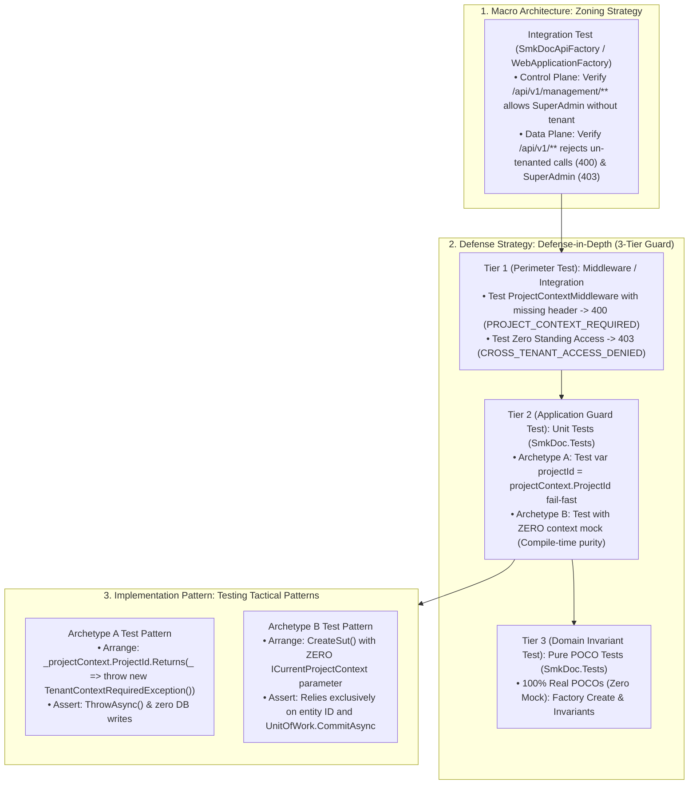

# [PATTERN-005]: 05_testing_archetypes.md — Testing Design Patterns & SSoT Test Archetypes

<context>
Category: 01_clean_arch_patterns
Domain: Testing Archetypes, DAMP AAA Cadence & Test Modernization SSoT
SoleResponsibilities:
  - Unit test archetypes using DAMP AAA cadence, SUT factory (`CreateSut()`), and NSubstitute mocking
  - Testing the 3-Tier Guard Model (Archetype A fail-fast `TenantContextRequiredException` & Archetype B zero-mock isolation)
  - Integration test harness with Testcontainers (PostgreSQL, MinIO, Redis)
  - Injected `TimeProvider` temporal testing and FluentValidation isolation
  - Test modernization parity (purging obsolete fixtures, prohibiting commented-out `[Fact]` tests)
Target: `SmkDoc.Tests/` and `SmkDoc.IntegrationTests/`
Signal: [ARCH_EVOLUTION_TESTING]
</context>

---

## 1. Level 1: Affirmative Testing Invariants Matrix

### 1.1 The Unified Tenancy & Security Governance Spine in Testing
Testing is partitioned strictly across the 3-Tier Governance Hierarchy, ensuring each tier is verified at its appropriate isolation level without mock bleed or redundant verification:



* **Tier 1 (Perimeter Guard) Test Strategy**: Verified via `SmkDoc.IntegrationTests` (`SmkDocApiFactory`). Verifies that Data Plane HTTP requests without tenant context terminate at the gateway with `400 Bad Request` (`PROJECT_CONTEXT_REQUIRED`), deactivated projects return `403 Forbidden` (`PROJECT_DEACTIVATED`), and SuperAdmin receives `403 Forbidden` (`CROSS_TENANT_ACCESS_DENIED`).
* **Tier 2 (Application Guard) Test Strategy**: Verified via `SmkDoc.Tests` in isolation.
  * **Archetype A**: Tests verify that unresolved context throws `TenantContextRequiredException` (`TENANT_CONTEXT_REQUIRED`, 403 Forbidden) fail-fast before any repository or external service calls.
  * **Archetype B**: SUT factory constructor declares ZERO `ICurrentProjectContext` mock. Proves at compile time that the UseCase does not inject or depend on ambient context.
  * **Cross-Tenant Guard**: Tests verify that cross-tenant access attempts throw `CrossTenantAccessDeniedException` (`CROSS_TENANT_ACCESS_DENIED`, 403 Forbidden).
* **Tier 3 (Domain Invariant Guard) Test Strategy**: 100% Real POCO tests without mocking (`Substitute.For<Entity>` is strictly prohibited).

### 1.2 Architectural Wiring & Testing Boundaries
| SUT Layer | Inbound Test Arranger | Mocking Policy | Assertion Verification |
|---|---|---|---|
| **Domain Entities** | Real instantiation via `{Aggregate}.Create(...)` | ZERO MOCK (100% Real POCO) | Invariants, State mutations, Equality |
| **Application UseCases** | Positional Command + SSoT `CreateSut()` | NSubstitute for Repos/UoW/Engines | FluentAssertions on DTO, `.Received(1)` on ports |
| **FluentValidation Validators**| Direct instantiation of `*Validator` | ZERO MOCK (100% Real Validator) | `TestValidate()`, `ShouldHaveValidationErrorFor` |
| **Infrastructure Adapters**| In-Memory SQLite / Mock HttpMessageHandler | Mock external network & storage | Streaming fidelity, zero-buffer piping |
| **Api Middleware/Filters** | ActionExecutingContext / HttpContext mock | Direct unit test or WebApplicationFactory | RFC 9457 ProblemDetails, HTTP status codes |
| **Integration Web API** | `SmkDocApiFactory` (`WebApplicationFactory`) | Real Testcontainers Postgres & MinIO | HTTP status, JSON envelopes, Database commits |
| **Architectural Boundaries**| NetArchTest on compiled assemblies | Pure Reflection | Inward layer dependencies, sealed classes |

### 1.3 Affirmative Testing Standards & Invariants
| Testing Architectural Concern | Affirmative Testing Invariant (Positive SSoT Law) | Boundary Vector |
|---|---|---|
| **Class-Scoped SUT Factory** | Every UseCase test class declares private class-scoped mocks and exactly 1 `private TUseCase CreateSut()` factory method. God Fixtures (`*TestFixture`) bundling mocks are prohibited. | Unit Test Isolation |
| **Mocking Technology** | Mocking is standardized exclusively on NSubstitute (`Substitute.For<T>()`, `.Returns()`, `.Received(1)`). Verbose setups (`Moq`) are prohibited. | Mocking Framework |
| **Pure Domain Realism** | Domain entity tests instantiate 100% real POCOs via static `Create(...)` factories or Hybrid `*Builder`. Mocking domain entities is strictly prohibited. | Domain Layer Test |
| **Isolated Validator Tests** | FluentValidation rules are verified in dedicated `*ValidatorTests` using `TestValidate()`. UseCase test suites verify strictly the fail-fast orchestration link (1 test). | Validation Testing |
| **Explicit AAA Arrangement** | Preconditions and stub returns are declared explicitly inside the Arrange phase of each test method. Hidden setups in fixture constructors are prohibited. | Test Readability (DAMP) |
| **Deterministic Time** | Time assertions and clock queries utilize `FakeTimeProvider` initialized via `TestConstants.CreateFakeClock()`. Prohibit ambient `DateTime.UtcNow`. | Temporal Determinism |
| **Memory Isolation in Unit Tests**| Unit tests (`SmkDoc.Tests`) execute 100% in-memory with zero disk or real network dependencies. Real database and container tests reside in `SmkDoc.IntegrationTests`. | Test Velocity & State |
| **Expressive Assertion Syntax** | Assertions are written exclusively using FluentAssertions (`result.Should().Be(...)`). Primitive assertions (`Assert.True`) are prohibited. | Assertion Semantics |
| **Granular Single-Behavior Specs**| Every test method verifies exactly 1 behavior named via strict 3-phase convention: `Method_WhenCondition_ShouldExpectedResult`. | Specification Design |

---

## 2. Level 2: Core Testing SSoT ASTs & Cognitive Test Engine

### 2.1 Engineering Rationale & Architectural Decisions
* **Why Class-Scoped SSoT `CreateSut()` over God Fixtures:** Prevents mock bleed across unrelated tests, ensuring each test class explicitly documents its dependencies.
* **Why 100% Real POCOs in Domain Tests:** Mocking domain entities tests the mock framework rather than actual business invariants, hiding domain calculation bugs.
* **Why Isolated Validator Tests (`TestValidate()`):** `FluentValidation.TestHelper` tests boundary rules, regex, and message keys in isolation with microsecond execution time. UseCase tests only verify the fail-fast orchestration link.
* **Why Fluent Hybrid Builders (`*Builder` with implicit cast):** Provides clean Object Mother defaults while allowing single-property overrides without verbose constructor calls.
* **Why `FakeTimeProvider` over Ambient Clock:** Guarantees absolute repeatability of time-dependent tests across local developer machines and CI pipelines.
* **Why Testcontainers in Integration Tests:** Executes real PostgreSQL queries and EF Core migrations in isolated throwaway Docker containers, catching true SQL syntax and constraint bugs.

### 2.2 Proactive Test Guards
```yaml
SharedFixtureProhibitionGuard:
  Invariant: "UseCase test classes must use class-scoped mocks and private CreateSut()."
  ActionOnViolation: "Remove shared God Fixture and inline private mocks into test class."

DomainEntityMockGuard:
  Invariant: "Domain entity tests must never use Substitute.For<TAggregate>()."
  ActionOnViolation: "Instantiate 100% real POCOs using static Create(...) or HybridBuilder."

ValidatorDuplicationGuard:
  Invariant: "UseCase tests must not repeat property-level regex/length validations."
  ActionOnViolation: "Move property permutations to *ValidatorTests; retain 1 fail-fast test."

AmbientClockGuard:
  Invariant: "Tests must not query DateTime.UtcNow or DateTime.Now."
  ActionOnViolation: "Inject FakeTimeProvider initialized via TestConstants.CreateFakeClock()."

InMemoryBoundaryGuard:
  Invariant: "SmkDoc.Tests must never execute disk I/O or connect to external databases."
  ActionOnViolation: "Relocate disk/database integration tests to SmkDoc.IntegrationTests."
```

### 2.3 Layer Testing Rules Matrix
| Layer | Target Under Test | Mocking Rule | Mandatory Assertions |
|---|---|---|---|
| **Domain** | Entities, ValueObjects, Domain Services | ZERO MOCK (100% Real POCO) | State mutation, Invariant exceptions, Equality |
| **Application** | CQRS Commands & Queries (`IUseCase`) | NSubstitute for Repos/UoW/Services | Fail-Fast guard, Persistence calls, Result DTO |
| **Validation** | FluentValidation `AbstractValidator<T>` | ZERO MOCK (100% Real Validator) | `ShouldHaveValidationErrorFor`, `ShouldNotHaveAnyValidationErrors` |
| **Infrastructure** | Render Engines, Gotenberg, Storage | NSubstitute / FakeHttpMessageHandler | Zero LOH streams, HTTP contract, Error mapping |
| **Presentation** | Filters, Middlewares, Exception Handlers | Mock HttpContext / ActionContext | RFC 9457 ProblemDetails, Status code, Headers |
| **Integration** | HTTP Endpoints & DB Migrations | Real Testcontainers PostgreSQL & MinIO | HTTP Status, JSON wire contract, DB Row assertion |
| **Architecture** | Assemblies & Dependency Graph | Pure Reflection / NetArchTest | Boundary isolation, Layer direction, Sealed POCOs |

### 2.4 Test Project Folder Parity
```
SmkDoc.Tests/
  Domain/
    Entities/ # Aggregate & Entity Invariant Tests (Zero Mock 100%)
  Application/
    Modules/
      Authoring/ # UseCase SSoT Tests & Validator Tests
      Rendering/
      Integration/
      IdentityAccess/
  Infrastructure/ # Engine, Adapter & Stream Tests (Zero LOH)
  Api/ # Middleware, Filter & RFC 9457 ProblemDetails Tests
  Architecture/ # Clean Architecture Boundary Invariant Tests
  Common/
    Builders/ # Hybrid Builders (Mother + Builder + Implicit Cast)

SmkDoc.IntegrationTests/
  Fixtures/ # SmkDocApiFactory, PostgreSqlContainerFixture, MinioContainerFixture
  Persistence/ # Real EF Core migrations & query performance
  Repositories/ # Real database repository query tests
  Storage/ # Real MinIO S3 bucket upload/download tests
```

---

## 3. Level 3: Canonical Testing Archetypes (Surgical AST Recipes)

### 3.1 SSoT UseCase Test Archetypes (Archetype A vs Archetype B)
>> MANDATORY CANONICAL BLUEPRINT [RULE-TEST-001]:
* Follows DAMP (Descriptive And Meaningful Phrases) over DRY: explicitly declares Arrange, Act, and Assert in every test method.
* Class-scoped private mocks (`Substitute.For<T>()`) and a single `private TUseCase CreateSut()` factory method.
* Strictly 1 behavior per test method with 3-phase AAA naming (`Method_WhenCondition_ShouldExpectedResult`).
* Domain interactions asserted using `.Received(1)` and `.DidNotReceive()`.
* **The 3-Tier Guard Model & Zero Phantom Mocking Protocol**:
  - **Archetype A (`Create{Aggregate}UseCaseTests`)**: Mocks `ICurrentProjectContext` strictly because SUT consumes `ProjectId` via Smart Context fail-fast property (`projectContext.ProjectId`). Asserts fail-fast `TenantContextRequiredException`.
  - **Archetype B (`Update{Aggregate}UseCaseTests`, `List{Aggregate}sUseCaseTests`, `GetById`, `Delete`)**: Strictly PROHIBITS mocking `ICurrentProjectContext` or testing unresolved tenancy. SUT constructor omits context; ambient tenancy is already guaranteed by Tier 1 Perimeter Guard and EF Core Global Query Filter.

#### 3.1.1 Archetype A: Entity-Creating / Key-Consuming UseCase Test (`Create{Aggregate}UseCaseTests`)
```csharp
public sealed class Create{Aggregate}UseCaseTests
{
    private readonly I{Aggregate}Repository _{aggregate}Repo = Substitute.For<I{Aggregate}Repository>();
    private readonly ICurrentProjectContext _projectContext = Substitute.For<ICurrentProjectContext>();
    private readonly IUnitOfWork _unitOfWork = Substitute.For<IUnitOfWork>();
    private readonly FakeTimeProvider _timeProvider = TestConstants.CreateFakeClock();

    private Create{Aggregate}UseCase CreateSut() =>
        new(_{aggregate}Repo, _projectContext, _unitOfWork, _timeProvider);

    [Fact]
    public async Task ExecuteAsync_WhenProjectContextIsUnresolved_ShouldThrowTenantContextRequiredExceptionWithoutTouchingPersistence()
    {
        // Step 1: Arrange <Why: explicit DAMP precondition setup for Smart Context fail-fast property>
        _projectContext.IsResolved.Returns(false);
        _projectContext.ProjectId.Returns(_ => throw new TenantContextRequiredException());
        var command = new Create{Aggregate}Command("Sample Name", "sample-slug", "General");
        var sut = CreateSut();

        // Step 2: Act <Why: capture execution delegate for exception assertion>
        var act = () => sut.ExecuteAsync(command, CancellationToken.None);

        // Step 3: Assert <Why: verify fail-fast security guard and zero side-effects>
        await act.Should().ThrowAsync<TenantContextRequiredException>();
        await _{aggregate}Repo.DidNotReceive().AddAsync(Arg.Any<{Aggregate}>(), Arg.Any<CancellationToken>());
        await _unitOfWork.DidNotReceive().CommitAsync(Arg.Any<CancellationToken>());
    }

    [Fact]
    public async Task ExecuteAsync_WhenSlugAlreadyExists_ShouldThrowConflictException()
    {
        // Step 1: Arrange <Why: configure unique constraint collision>
        var projectId = new ProjectId(Guid.NewGuid());
        _projectContext.IsResolved.Returns(true);
        _projectContext.ProjectId.Returns(projectId);
        var command = new Create{Aggregate}Command("Sample Name", "sample-slug", "General");
        _{aggregate}Repo.SlugExistsAsync(command.Slug, Arg.Any<CancellationToken>())
            .Returns(true);

        var sut = CreateSut();

        // Step 2: Act <Why: invoke business execution>
        var act = () => sut.ExecuteAsync(command, CancellationToken.None);

        // Step 3: Assert <Why: verify business conflict guard>
        await act.Should().ThrowAsync<ConflictException>();
        await _{aggregate}Repo.DidNotReceive().AddAsync(Arg.Any<{Aggregate}>(), Arg.Any<CancellationToken>());
        await _unitOfWork.DidNotReceive().CommitAsync(Arg.Any<CancellationToken>());
    }

    [Fact]
    public async Task ExecuteAsync_WhenCommandIsValid_ShouldPersistAggregateAndReturnDto()
    {
        // Step 1: Arrange <Why: configure valid execution path>
        var projectId = new ProjectId(Guid.NewGuid());
        _projectContext.IsResolved.Returns(true);
        _projectContext.ProjectId.Returns(projectId);
        var command = new Create{Aggregate}Command("Sample Name", "sample-slug", "General");
        _{aggregate}Repo.SlugExistsAsync(command.Slug, Arg.Any<CancellationToken>())
            .Returns(false);

        var sut = CreateSut();

        // Step 2: Act <Why: execute complete use case pipeline>
        var result = await sut.ExecuteAsync(command, CancellationToken.None);

        // Step 3: Assert <Why: verify DTO mapping and persistence calls>
        result.Should().NotBeNull();
        result.ProjectId.Should().Be(projectId.Value);
        result.Name.Should().Be("Sample Name");
        result.Slug.Should().Be("sample-slug");
        result.Category.Should().Be("General");

        await _{aggregate}Repo.Received(1).AddAsync(Arg.Any<{Aggregate}>(), Arg.Any<CancellationToken>());
        await _unitOfWork.Received(1).CommitAsync(Arg.Any<CancellationToken>());
    }
}
```

#### 3.1.2 Archetype B: ID-Based / EF-Filtered Query or Mutation UseCase Test (`Update{Aggregate}UseCaseTests` / `List{Aggregate}sUseCaseTests`)
```csharp
public sealed class Update{Aggregate}UseCaseTests
{
    private readonly I{Aggregate}Repository _{aggregate}Repo = Substitute.For<I{Aggregate}Repository>();
    private readonly IUnitOfWork _unitOfWork = Substitute.For<IUnitOfWork>();
    private readonly IConcurrencyContext _concurrencyContext = Substitute.For<IConcurrencyContext>();
    private readonly FakeTimeProvider _timeProvider = TestConstants.CreateFakeClock();

    // Zero Phantom Context: No ICurrentProjectContext mock (Tier 1 & EF Core filter guarantee tenancy)
    private Update{Aggregate}UseCase CreateSut() =>
        new(_{aggregate}Repo, _unitOfWork, _concurrencyContext, _timeProvider);

    [Fact]
    public async Task ExecuteAsync_WhenEntityDoesNotExist_ShouldThrowNotFound()
    {
        // Step 1: Arrange <Why: entity not found in tenant partition via EF Core filter>
        var aggregateId = new {Aggregate}Id(Guid.NewGuid());
        _{aggregate}Repo.GetByIdAsync(aggregateId, Arg.Any<CancellationToken>())
            .Returns(({Aggregate}?)null);

        var command = new Update{Aggregate}Command(aggregateId.Value, "Updated Name");
        var sut = CreateSut();

        // Step 2: Act & Assert
        var act = () => sut.ExecuteAsync(command, CancellationToken.None);
        await act.Should().ThrowAsync<NotFoundException>();
        await _unitOfWork.DidNotReceive().CommitAsync(Arg.Any<CancellationToken>());
    }

    [Fact]
    public async Task ExecuteAsync_WhenValidCommand_ShouldMutateStateAndCommit()
    {
        // Step 1: Arrange <Why: existing entity loaded>
        var aggregateId = new {Aggregate}Id(Guid.NewGuid());
        var entity = {Aggregate}Builder.CreateDefault(aggregateId);
        _{aggregate}Repo.GetByIdAsync(aggregateId, Arg.Any<CancellationToken>())
            .Returns(entity);

        var command = new Update{Aggregate}Command(aggregateId.Value, "Updated Name");
        var sut = CreateSut();

        // Step 2: Act
        var result = await sut.ExecuteAsync(command, CancellationToken.None);

        // Step 3: Assert
        result.Should().NotBeNull();
        _concurrencyContext.Received(1).EnsureMatches(entity);
        await _unitOfWork.Received(1).CommitAsync(Arg.Any<CancellationToken>());
    }
}
```

### 3.2 Domain Aggregate Invariant Test Archetype
>> MANDATORY CANONICAL BLUEPRINT [RULE-TEST-002]:
* Uses 100% real domain entities (prohibits mocking domain entities via NSubstitute).
* Asserts invariant enforcement by testing state transitions and expected domain exceptions.

```csharp
public sealed class {Aggregate}AggregateTests
{
    private readonly DateTimeOffset _fixedNow = new(2026, 10, 27, 12, 0, 0, TimeSpan.Zero);

    [Fact]
    public void Create_WhenArgumentsAreValid_ShouldInstantiateActiveAggregateWithEmptyCollections()
    {
        // Step 1: Arrange & Act <Why: verify canonical factory instantiation>
        var projectId = new ProjectId(Guid.NewGuid());
        var name = {Aggregate}Name.Create("Sample Name");
        var slug = new {Aggregate}Slug("sample-slug");

        var aggregate = {Aggregate}.Create(projectId, name, slug, "General", _fixedNow);

        // Step 2: Assert <Why: prove aggregate initial state invariants>
        aggregate.Should().NotBeNull();
        aggregate.ProjectId.Should().Be(projectId);
        aggregate.Name.Value.Should().Be("Sample Name");
        aggregate.IsActive.Should().BeTrue();
        aggregate.Children.Should().BeEmpty();
        aggregate.CreatedAt.Should().Be(_fixedNow);
    }

    [Fact]
    public void Deactivate_WhenAggregateIsActive_ShouldSetIsActiveToFalseAndTrackUpdate()
    {
        // Step 1: Arrange <Why: create active baseline aggregate>
        var aggregate = {Aggregate}.Create(new ProjectId(Guid.NewGuid()), {Aggregate}Name.Create("Test"), new {Aggregate}Slug("test"), null, _fixedNow);
        var laterNow = _fixedNow.AddHours(2);

        // Step 2: Act <Why: execute expressive mutation verb>
        aggregate.Deactivate(laterNow);

        // Step 3: Assert <Why: verify scalar update and timestamp tracking>
        aggregate.IsActive.Should().BeFalse();
        aggregate.UpdatedAt.Should().Be(laterNow);
    }
}
```

### 3.3 Isolated FluentValidation Archetype (`TestValidate()`)
>> MANDATORY CANONICAL BLUEPRINT [RULE-TEST-003]:
* Tests FluentValidation validators in isolation from UseCase orchestrators using `FluentValidation.TestHelper`.
* Asserts via `result.ShouldHaveValidationErrorFor(...)` or `result.ShouldNotHaveAnyValidationErrors()`.

```csharp
public sealed class {Verb}{Aggregate}CommandValidatorTests
{
    private readonly {Verb}{Aggregate}CommandValidator _sut = new();

    [Fact]
    public void Validate_WhenNameIsEmpty_ShouldHaveValidationError()
    {
        // Arrange
        var command = new {Verb}{Aggregate}Command("", "valid-slug", null);

        // Act
        var result = _sut.TestValidate(command);

        // Assert
        result.ShouldHaveValidationErrorFor(c => c.Name);
    }

    [Fact]
    public void Validate_WhenSlugContainsUppercase_ShouldHaveValidationError()
    {
        // Arrange
        var command = new {Verb}{Aggregate}Command("Valid Name", "INVALID_SLUG", null);

        // Act
        var result = _sut.TestValidate(command);

        // Assert
        result.ShouldHaveValidationErrorFor(c => c.Slug);
    }

    [Fact]
    public void Validate_WhenCommandIsValid_ShouldNotHaveAnyValidationErrors()
    {
        // Arrange
        var command = new {Verb}{Aggregate}Command("Valid Name", "valid-slug", "General");

        // Act
        var result = _sut.TestValidate(command);

        // Assert
        result.ShouldNotHaveAnyValidationErrors();
    }
}
```

### 3.4 Hybrid Object Mother / Fluent Builder Archetype
>> MANDATORY CANONICAL BLUEPRINT [RULE-TEST-004]:
* Pre-populated with valid defaults (Object Mother).
* Fluent chaining methods (`With*`) returning `this`.
* Implicit cast operator `public static implicit operator {Aggregate}({Aggregate}Builder builder) => builder.Build();`.

```csharp
public sealed class {Aggregate}Builder
{
    private ProjectId _projectId = new(Guid.NewGuid());
    private {Aggregate}Name _name = {Aggregate}Name.Create("Default Name");
    private {Aggregate}Slug _slug = new("default-slug");
    private string? _category = "General";
    private bool _isActive = true;
    private DateTimeOffset _now = new(2026, 10, 27, 12, 0, 0, TimeSpan.Zero);

    public static {Aggregate}Builder Default => new();

    public {Aggregate}Builder WithProjectId(ProjectId projectId)
    {
        _projectId = projectId;
        return this;
    }

    public {Aggregate}Builder WithName(string name)
    {
        _name = {Aggregate}Name.Create(name);
        return this;
    }

    public {Aggregate}Builder WithSlug(string slug)
    {
        _slug = new {Aggregate}Slug(slug);
        return this;
    }

    public {Aggregate}Builder WithCategory(string? category)
    {
        _category = category;
        return this;
    }

    public {Aggregate}Builder AsInactive()
    {
        _isActive = false;
        return this;
    }

    public {Aggregate}Builder AsActive()
    {
        _isActive = true;
        return this;
    }

    public {Aggregate} Build()
    {
        var aggregate = {Aggregate}.Create(_projectId, _name, _slug, _category, _now);
        if (!_isActive) aggregate.Deactivate(_now);
        return aggregate;
    }

    public static implicit operator {Aggregate}({Aggregate}Builder builder) => builder.Build();
}

public static class a{Aggregate}
{
    public static {Aggregate}Builder AsActive() => {Aggregate}Builder.Default.AsActive();
    public static {Aggregate}Builder AsInactive() => {Aggregate}Builder.Default.AsInactive();
}
```

### 3.5 Integration Test Archetype (`SmkDocApiFactory` & Testcontainers)
>> MANDATORY CANONICAL BLUEPRINT [RULE-TEST-005]:
* Placed strictly under `SmkDoc.IntegrationTests`.
* Uses `WebApplicationFactory<Program>` with PostgreSQL and MinIO container fixtures.
* Asserts HTTP status codes, RFC 9457 ProblemDetails envelopes, and database commits end-to-end.

```csharp
[Collection("Integration")]
public sealed class {Aggregate}EndpointIntegrationTests(SmkDocApiFactory factory) : IClassFixture<SmkDocApiFactory>
{
    private readonly HttpClient _client = factory.CreateClient();

    [Fact]
    public async Task Create{Aggregate}_WhenPayloadIsValid_ShouldReturn201CreatedAndPersistToPostgres()
    {
        // Step 1: Arrange <Why: build valid JSON request model>
        var request = new Create{Aggregate}Request("Integration Sample", "integration-sample", "Testing");

        // Step 2: Act <Why: invoke real HTTP pipeline through Testcontainers>
        var httpResponse = await _client.PostAsJsonAsync("api/v1/{aggregate-kebab-plural}", request);

        // Step 3: Assert <Why: verify HTTP wire contract and response envelope>
        httpResponse.StatusCode.Should().Be(HttpStatusCode.Created);
        var envelope = await httpResponse.Content.ReadFromJsonAsync<ApiResponse<{Aggregate}ResultDto>>();
        envelope.Should().NotBeNull();
        envelope!.Data.Name.Should().Be("Integration Sample");
        envelope.Data.Slug.Should().Be("integration-sample");
    }
}
```

---

## 4. Level 4: Anti-Patterns & Unified Micro-Diffs

### [TRAP-TEST-001]: Shared God Fixture Mock Bleed
```diff
- public class {Verb}{Aggregate}UseCaseTests : IClassFixture<SharedGodFixture> { public {Verb}{Aggregate}UseCaseTests(SharedGodFixture f) => _f = f; }
+ public sealed class {Verb}{Aggregate}UseCaseTests { private readonly I{Aggregate}Repository _repo = Substitute.For<I{Aggregate}Repository>(); private {Verb}{Aggregate}UseCase CreateSut() => new(_repo); }
```
*Rationale: Shared fixtures carry forward mock state configurations and stub setups across tests, causing intermittent test order coupling.*

### [TRAP-TEST-002]: Over-Mocking Pure Domain Entities
```diff
- var aggregate = Substitute.For<{Aggregate}>(); aggregate.Name.Returns(name);
+ var aggregate = {Aggregate}.Create(projectId, name, slug, category, now); // 100% Real POCO
```
*Rationale: Mocking domain entities validates the mock engine instead of actual domain invariant enforcement and validation guards.*

### [TRAP-TEST-003]: Validation Logic Duplication in UseCase Slices
```diff
- [Fact] public async Task Execute_WhenSlugHasUppercase_Throws() { ... } // Duplicate field permutation in UseCase test
+ [Fact] public void Validate_WhenSlugHasUppercase_ShouldHaveError() => validator.TestValidate(command).ShouldHaveValidationErrorFor(c => c.Slug);
```
*Rationale: Duplicating field-level regex/boundary permutations inside UseCase tests slows test execution; test property rules in isolation via `TestValidate()` and keep exactly 1 fail-fast orchestration test in the UseCase suite.*

### [TRAP-TEST-004]: Ambient Clock Flakiness
```diff
- var result = await sut.ExecuteAsync(command, ct); result.CreatedAt.Should().BeCloseTo(DateTime.UtcNow, TimeSpan.FromSeconds(1));
+ var result = await sut.ExecuteAsync(command, ct); result.CreatedAt.Should().Be(fakeTimeProvider.GetUtcNow());
```
*Rationale: Asserting against non-deterministic system clocks causes flaky CI failures under CPU scheduling delays.*

### [TRAP-TEST-005]: Disk/Network I/O in Unit Test Project
```diff
- using var stream = File.OpenRead("test.pdf"); await dbContext.Database.MigrateAsync();
+ using var stream = new MemoryStream(pdfBytes); // SmkDoc.Tests must remain 100% in-memory; move I/O to SmkDoc.IntegrationTests
```
*Rationale: Performing disk writes or real database operations inside unit test suites degrades test velocity and causes dirty workspace states.*

### [TRAP-TEST-006]: Hidden Preconditions in Fixture Constructor
```diff
- public TestFixture() { _repo.GetByIdAsync(Arg.Any<Guid>()).Returns(new {Aggregate}(...)); }
+ [Fact] public async Task Test_Behavior() { _repo.GetByIdAsync(id).Returns(aggregate); var sut = CreateSut(); }
```
*Rationale: Hidden arrange setups in constructors make individual test cases opaque and violate strict 3-phase Arrange-Act-Assert clarity.*
