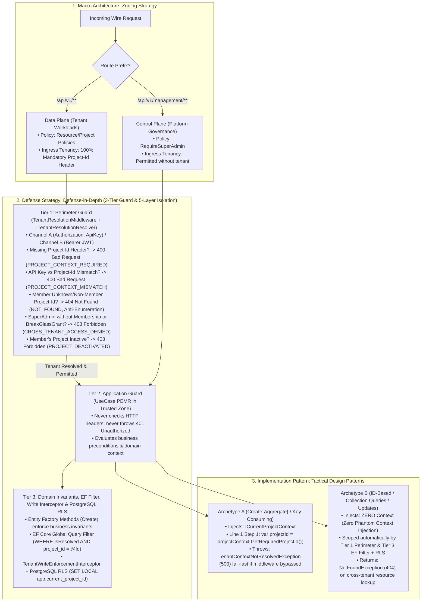
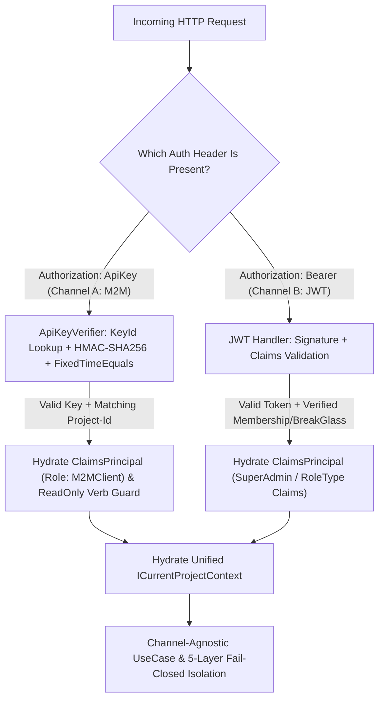

# [MECH-001]: multi_tenant_security_pipeline.md — Multi-Tenant Security & Dual-Auth Pipeline SSoT

<context>
Category: 03_specialized_mechanics
Domain: Multi-Tenant Security Pipeline, Dual-Auth Routing & 5-Layer Isolation Governance
SoleResponsibilities:
  - Macro Zoning (Control Plane vs Data Plane vs Public/Auth) and Zero Standing Access (ZSA) with audited Break-Glass
  - The 3-Tier Guard Model & 5-Layer Multi-Tenant Isolation (Perimeter -> Application -> EF Core Filter -> Write Interceptor -> PostgreSQL RLS)
  - Dual-channel authentication pipeline (Channel A M2M `smk_live_{keyId}_{secret}` HMAC-SHA256 vs Channel B Web JWT)
  - Ambient context hydration and Fail-Fast Method (`ICurrentProjectContext.GetRequiredProjectId()`) contract
  - Project sub-key quota enforcement (max 2 keys per tenant) and ownership transfer
Target: `backend-v2/` (`SmkDoc.Api/Middleware/`, `SmkDoc.Infrastructure/Security/`, `SmkDoc.Application/Common/Interfaces/`)
Signal: [ARCH_EVOLUTION_TENANCY]
</context>

---

## 1. Level 1: Master Architecture & Invariants Matrix

### 1.1 The Master Governance Pipeline Flow
The system's multi-tenant security architecture enforces a single, unbroken, top-down deductive pipeline operating from HTTP ingress to database row-level partitions:



### 1.2 Dimension 1: Macro Zoning Strategy (Control Plane vs Data Plane Partitioning)
| Architectural Plane | Route Scope | Authorized Principals | Tenancy Resolution Rule | Standing Access Policy |
|---|---|---|---|---|
| **Control Plane** | `/api/v1/management/**` | Platform `SuperAdmin` exclusively | Un-tenanted access permitted; operates across tenant containers via explicit route targets. | Full platform administrative oversight (ZSA exemption on management routes). |
| **Data Plane** | `/api/v1/**` (excluding `/management/`, `/auth/`, `/health/`) | Tenant Users (`Admin`, `Developer`, `Viewer`) & M2M Keys (`ReadOnly`, `ReadWrite`) | **100% Mandatory `Project-Id` Header**. Tier 1 rejects missing `Project-Id` with `400 PROJECT_CONTEXT_REQUIRED`, API key binding mismatches with `400 PROJECT_CONTEXT_MISMATCH`, and unknown/non-member `Project-Id` lookups for regular JWT users with `404 NOT_FOUND` (anti-enumeration). | **Zero Standing Access (ZSA)**: SuperAdmin rejected with HTTP 403 (`CROSS_TENANT_ACCESS_DENIED`) unless mapped in `UserProjectRole` or holding an active time-boxed audited `BreakGlassGrant`. |

### 1.3 Dimension 2: Defense-in-Depth Strategy (The 3-Tier Guard Model)
| Defense Tier | Gatekeeper Component | Operating Environment | Primary Verification Concerns | Rejection Exception & HTTP Status |
|---|---|---|---|---|
| **Tier 1: Perimeter Guard** | `TenantResolutionMiddleware` | HTTP Wire Boundary | Identity, route plane, `Project-Id` header extraction, cached `ITenantResolutionResolver` binding & membership check, project active status, ZSA / Break-Glass boundary. | `400 Bad Request` (`PROJECT_CONTEXT_REQUIRED`, `PROJECT_CONTEXT_MISMATCH`), `401 Unauthorized`, `403 Forbidden` (`PROJECT_DEACTIVATED`, `CROSS_TENANT_ACCESS_DENIED`, `INSUFFICIENT_KEY_SCOPE`), `404 Not Found` (`NOT_FOUND`). |
| **Tier 2: Application Guard** | UseCase PEMR (Step 1 & 2) | Trusted Application Zone | Ambient context binding (`GetRequiredProjectId()`), business uniqueness, aggregate existence (cross-tenant returns `404`), Two-Phase Explicit Concurrency (`ExpectedVersion`), payload schema. | `TenantContextNotResolvedException` (`500`), `NotFoundException` (`404`), `ConflictException` (`409`), `PreconditionFailedException` (`412`), `SchemaValidationException` (`422`). |
| **Tier 3: Domain, Interceptor & RLS Guard** | Entities, EF Core Interceptors & PostgreSQL RLS | Core Domain & Relational Engine | Aggregate root business invariants, state transition validity, relational row-level tenant filtering (`WHERE project_id = @Id`), `TenantWriteEnforcementInterceptor`, PostgreSQL RLS (`app.current_project_id`), and `version bigint` concurrency token. | `DomainValidationException` (`422`), `BusinessRuleViolationException` (`409`), `DbUpdateConcurrencyException` → `PreconditionFailedException` (`412`). |

### 1.4 Dimension 3: Tactical Implementation Taxonomy (Archetype A vs Archetype B)
| Tactical Archetype | Typical UseCase Slices | `ICurrentProjectContext` Dependency | PEMR Step 1 Tenancy Cadence | Isolation Guarantee Mechanism |
|---|---|---|---|---|
| **Archetype A** (Entity-Creating / Key-Consuming) | `CreateTemplate`, `CreateDataConnection`, `CreateDataset`, `CreateApiKey`, `UploadFont` | **MANDATORY INJECTION** | Line 1 Fail-Fast: `var projectId = projectContext.GetRequiredProjectId();` (throws `TenantContextNotResolvedException` (`500`) if unresolved). | Fail-fast method binds strongly-typed `ProjectId` directly to new aggregate factory or storage bucket, verified on write by `TenantWriteEnforcementInterceptor` and PostgreSQL RLS. |
| **Archetype B** (ID-Based / Collection Queries / Updates) | `GetById`, `UpdateDetails`, `Delete`, `ListPaged`, `PreviewDocument` | **STRICTLY PROHIBITED (Zero Phantom Context)** | Input validation & parameter clamping only; zero context method calls. | Relies on Tier 1 Perimeter Guard for authenticated ingress and Tier 3 EF Core Global Query Filter + PostgreSQL RLS for SQL data isolation (cross-tenant ID lookup returns `404 NotFoundException`). |

### 1.5 Affirmative Tenancy & Security Invariants Matrix
| Architectural Concern | Affirmative Security Invariant (Positive SSoT Law) | Boundary Vector |
|---|---|---|
| **Cryptographic Key Verification** | API keys follow `smk_live_{keyId}_{secret}` format, looked up by indexed `KeyId` (`char(12)`) and verified via `HMACSHA256.HashData(pepperKey, secretBytes)` (with pepper key in KMS) and `CryptographicOperations.FixedTimeEquals` on `ReadOnlySpan<byte>`. Plaintext keys are emitted exactly once. | Credential Storage |
| **Browser Token Security** | Session JWTs reside in httpOnly, Secure, SameSite cookies via Next.js Proxy (`/api/proxy/[...path]`). Browser localStorage storage is prohibited. | Client Session |
| **Unified Ambient Context** | Tenancy and caller identity converge exclusively into `ICurrentProjectContext` (`GetRequiredProjectId()` / `TryGetProjectId(out var projectId)`). Throwing properties (`projectContext.ProjectId`) and dual ambient contexts (`IExecutionContext`) are prohibited. | Orchestration Core |
| **Fail-Closed Tenancy SQL & RLS** | EF Core Global Query Filter enforces `IsTenantResolved && e.ProjectId == CurrentTenantId` across all `IMustHaveProject` entities, backed by `TenantWriteEnforcementInterceptor` and PostgreSQL RLS (`SET LOCAL app.current_project_id`). `.IgnoreQueryFilters()` in tenant routes is prohibited. | Relational Boundary |
| **Timing Side-Channel Immunity**| API key HMAC digest comparisons execute via `CryptographicOperations.FixedTimeEquals` across `ReadOnlySpan<byte>` buffers. Variable-time string equality is prohibited. | Cryptographic Engine |
| **First-Class M2M Identity** | Channel A hydrates `ClaimsPrincipal` (`AuthenticationScheme: ApiKeyScheme`, `Role: M2MClient`, `ProjectId`, `Scope`, `ApiKeyId`) onto `HttpContext.User`. | Security Context |
| **Anti-Spoofing Parameter Policy**| Tenant UseCases resolve tenancy strictly from ambient `ICurrentProjectContext`. Declaring caller `ProjectId` overrides on tenant Command/Query records, query strings, or JSON bodies is prohibited. | Ingress Parameter |
| **Global Identity Scoping** | `User` is a Global Identity (zero `ProjectId` column, zero `IMustHaveProject`). Multi-project tenancy is mapped exclusively through `UserProjectRole`. | Identity Model |
| **Delegated Sub-Key Quota** | Project Admins manage operational sub-keys on `/api/v1/api-keys` under a strict budget of maximum 2 active keys per tenant (1 `ReadOnly` + 1 `ReadWrite`), returning `409 Conflict` on duplicate scope. | Key Governance |
| **Key Masking Wire Egress** | Key list/get endpoints return masked keys derived from authentic components (`$"{KeyPrefix}_{KeyId}_****{KeySuffix}"`). Synthesizing pseudo-suffixes from the hash is prohibited. | Contract Privacy |
| **Deterministic `Project-Id` Binding**| Data Plane requests require the `Project-Id` header (no `X-` prefix). Missing `Project-Id` returns `400 PROJECT_CONTEXT_REQUIRED`; API key binding mismatch returns `400 PROJECT_CONTEXT_MISMATCH`; unknown or non-member `Project-Id` lookup by a regular JWT user returns `404 NOT_FOUND` (anti-enumeration). | Tenant Extraction |
| **Perimeter Scope Enforcement** | Channel A keys with `ApiKeyScope.ReadOnly` are blocked at `TenantResolutionMiddleware` from executing mutating HTTP verbs (`POST`/`PUT`/`PATCH`/`DELETE`) returning `403 Forbidden` (`INSUFFICIENT_KEY_SCOPE`), permitting only stateless `/preview` and `/validate`. | Perimeter Firewall |
| **Authenticated Preview Protection**| Preview endpoints require authenticated tenant context to resolve templates and protect Gotenberg Chromium pods. Anonymous public access to `/preview` is prohibited. | Render Perimeter |
| **Tenant Idempotency Partition**| Distributed idempotency keys are persisted in PostgreSQL `idempotency_keys` partitioned strictly by `(project_id, credential_id, idempotency_key)` with SHA-256 request fingerprint. Shared caller keying is prohibited. | Idempotency Partitioning |

---

## 2. Level 2: Dual-Channel Ingress, Identity Hydration & Causal Engine

### 2.1 Dual-Channel Ingress Architecture
The gateway strictly segregates external automated traffic (Channel A) from internal human operator traffic (Channel B):



* **Why Internal Backoffice Console vs External Auth Hub**: External enterprise software (ERP, CRM) manages user identities natively; their servers consume document generation via Channel A (M2M API Keys). The web portal exists purely as an internal operator console for SuperAdmin governance and Template Designer authoring.
* **Why Indexed `KeyId` + HMAC-SHA256 with KMS Pepper + `FixedTimeEquals`**: Parsing `smk_live_{keyId}_{secret}` allows an indexed $O(1)$ lookup by `KeyId`, while computing `HMACSHA256.HashData(pepperKey, secretBytes)` with a KMS-held pepper key protects stored digests even if the database is exfiltrated, and `FixedTimeEquals` on `ReadOnlySpan<byte>` eliminates timing side channels.
* **Why `ClaimsPrincipal` Hydration for M2M**: ASP.NET Core `[Authorize]` attributes evaluate `HttpContext.User.Identity.IsAuthenticated`. Leaving `context.User` unhydrated causes M2M clients to fail authorization even with a valid API key.

### 2.2 Unified Ambient Context Contract
```csharp
public interface ICurrentProjectContext
{
    /// <summary>
    /// Fail-fast Tier 2 guard method. Returns strongly-typed ProjectId if resolved;
    /// otherwise, throws TenantContextNotResolvedException (500 Internal Server Error).
    /// </summary>
    ProjectId GetRequiredProjectId();

    /// <summary>
    /// Safe non-throwing accessor for Control Plane, Auth, Background Workers, or AppDbContext.
    /// Returns false when no tenant is active (Never returns ProjectId.Empty).
    /// </summary>
    bool TryGetProjectId(out ProjectId projectId);

    bool IsResolved { get; }
    string? CallerIdentity { get; }
    UserId? UserId { get; }
    SystemRole? SystemRole { get; }
    ApiKeyId? ApiKeyId { get; }
}

public interface ICurrentProjectContextSetter
{
    void SetProject(ProjectId projectId, string? callerIdentity = null);

    void SetActor(
        UserId? userId = null,
        SystemRole? systemRole = null,
        ApiKeyId? apiKeyId = null,
        string? callerIdentity = null);
}
```

### 2.3 Harmonized 2-Tier Role & Scope Taxonomy
Identity is partitioned into Platform-level `SystemRole`, Tenant-level `RoleType`, and M2M `ApiKeyScope`. Spurious aliases (`Editor`, `Author`) are strictly prohibited:

| Identity Channel | Security Principal Tier | Canonical Role / Scope | Primary Operational Scope & Responsibilities |
|---|---|---|---|
| **Channel B (Portal)** | **Tier 1: Platform Level** (`SystemRole`) | `SuperAdmin` | Platform-wide governance, cross-tenant management, system diagnostics, master API keys. |
| **Channel B (Portal)** | **Tier 1: Platform Level** (`SystemRole`) | `Member` | Standard authenticated operator assigned to specific project workspaces. |
| **Channel B (Portal)** | **Tier 2: Tenant Workspace** (`RoleType`) | `Admin` | Project Administrator: manages project API keys, user memberships, and data connections. |
| **Channel B (Portal)** | **Tier 2: Tenant Workspace** (`RoleType`) | `Developer` | Template Designer: authors templates, Monaco HTML/Handlebars, bindings, datasets, live preview. |
| **Channel B (Portal)** | **Tier 2: Tenant Workspace** (`RoleType`) | `Viewer` | Read-only inspection: views template catalog and previews generated outputs. |
| **Channel A (M2M)** | **Tier 3: External Integration** (`ApiKeyScope`)| `ReadOnly` (`M2MClient`) | External ERP/CRM: stateless preview and schema validation only (`403` on mutating verbs). |
| **Channel A (M2M)** | **Tier 3: External Integration** (`ApiKeyScope`)| `ReadWrite` (`M2MClient`) | External ERP/CRM: document generation, async queueing, asset download, and template CRUD. |

### 2.4 RFC 9457 Uniform ProblemDetails & Status Code Translation Matrix
> **SSoT Delegation:** The authoritative exception-to-HTTP status mapping table is governed in [06_api_contract_standards.md §3.3](../00_architecture_core/06_api_contract_standards.md#33-rfc-9457-problemdetails--the-exception-catalogue-ssot). The tenancy and security perimeter subset is summarized below:

| Exception / Condition | Origin Tier | HTTP Status | RFC 9457 ErrorCode | ProblemDetails Title |
|---|---|---|---|---|
| Client Missing `Project-Id` Header | Tier 1: Perimeter | `400 Bad Request` | `PROJECT_CONTEXT_REQUIRED` | Project Context Required |
| `Project-Id` vs API Key Binding Mismatch | Tier 1: Perimeter | `400 Bad Request` | `PROJECT_CONTEXT_MISMATCH` | Project Context Mismatch |
| Invalid API Key / Expired JWT | Tier 1: Perimeter | `401 Unauthorized` | `UNAUTHORIZED` | Unauthorized |
| Project Deactivated (Member Caller) | Tier 1: Perimeter | `403 Forbidden` | `PROJECT_DEACTIVATED` | Project Deactivated |
| SuperAdmin Data Plane Access Breach (Plane-Level) | Tier 1: Perimeter | `403 Forbidden` | `CROSS_TENANT_ACCESS_DENIED` | Cross-Tenant Access Denied |
| ReadOnly Key Mutation Attempt | Tier 1: Perimeter | `403 Forbidden` | `INSUFFICIENT_KEY_SCOPE` | Insufficient Key Scope |
| `NotFoundException` (Missing Resource, Cross-Tenant Resource, or Unknown/Non-Member Project) | Tier 1 / Tier 2 | `404 Not Found` | `NOT_FOUND` (or `{RESOURCE}_NOT_FOUND`) | Resource Not Found |
| `ConflictException` (Duplicate Business Key) | Tier 2: Application | `409 Conflict` | `RESOURCE_CONFLICT` (or `DUPLICATE_*`) | Conflict |
| `BusinessRuleViolationException` | Tier 3: Domain | `409 Conflict` | `BUSINESS_RULE_VIOLATION` | Business Rule Violation |
| `PreconditionFailedException` / `DbUpdateConcurrencyException` | Tier 2 / Tier 3 | `412 Precondition Failed`| `PRECONDITION_FAILED` | Precondition Failed |
| `DomainValidationException` / `ValidationException` | Tier 2 / Tier 3 | `422 Unprocessable Entity` | `VALIDATION_FAILED` | Validation Failed |
| `SchemaValidationException` | Tier 2: Application | `422 Unprocessable Entity` | `SCHEMA_VALIDATION_FAILED` | Schema Validation Failed |
| `TenantContextNotResolvedException` | Tier 2 / Tier 3 | `500 Internal Server Error` | `TENANT_CONTEXT_NOT_RESOLVED` | Internal Server Error |

### 2.5 Proactive Tenancy Firewalls
```yaml
TenancyQueryFilterFirewall:
  Invariant: "Tenant queries must never call .IgnoreQueryFilters() in tenant routes."
  ActionOnViolation: "Remove .IgnoreQueryFilters() to enforce ambient fail-closed isolation."

CryptographicEqualityFirewall:
  Invariant: "API key HMAC digest checks must use CryptographicOperations.FixedTimeEquals on ReadOnlySpan<byte>."
  ActionOnViolation: "Convert string comparison to FixedTimeEquals over byte spans."

M2MClaimsPrincipalFirewall:
  Invariant: "Channel A authentication must hydrate ClaimsPrincipal on HttpContext.User."
  ActionOnViolation: "Assign context.User = new ClaimsPrincipal(new ClaimsIdentity(...))."

ZeroPhantomContextFirewall:
  Invariant: "Inject ICurrentProjectContext strictly into Archetype A UseCases."
  ActionOnViolation: "Remove context from Archetype B UseCases (GetById, Update, Delete, List)."

FailFastContextMethodFirewall:
  Invariant: "Consume fail-fast method projectContext.GetRequiredProjectId() at PEMR Step 1 line 1."
  ActionOnViolation: "Replace manual if (!projectContext.IsResolved) or throwing property with var projectId = projectContext.GetRequiredProjectId();."

ReadOnlyScopeFirewall:
  Invariant: "ApiKeyScope.ReadOnly must not execute state-mutating HTTP verbs."
  ActionOnViolation: "Return 403 Forbidden at perimeter for mutating methods on ReadOnly keys."
```

---

## 3. Level 3: Canonical Working Archetypes (Surgical AST Recipes)

### 3.1 Tier 1 Perimeter Guard Archetype (`ApiKeyVerifier` & `TenantResolutionMiddleware`)
>> MANDATORY CANONICAL BLUEPRINT [RULE-SEC-001]:
```csharp
public sealed class ApiKeyVerifier(
    IApiKeyRepository apiKeyRepository,
    IOptions<ApiKeySecurityOptions> securityOptions,
    TimeProvider timeProvider) : IApiKeyVerifier
{
    public async Task<ApiKeyAuthResult> VerifyAsync(string rawApiKey, CancellationToken ct)
    {
        // Step 1: Parse Structured Key Format: smk_live_{keyId}_{secret}
        if (!TryParseKey(rawApiKey, out var keyId, out var secret))
            return ApiKeyAuthResult.Fail();

        // Step 2: Lookup Stored Record by Non-Secret KeyId
        var record = await apiKeyRepository.FindByKeyIdAsync(keyId, ct);
        if (record is null || !record.IsActive)
            return ApiKeyAuthResult.Fail();

        if (record.ExpiresAt is { } expiry && expiry <= timeProvider.GetUtcNow())
            return ApiKeyAuthResult.Fail();

        // Step 3: Compute Keyed HMAC-SHA256 with KMS Pepper & Constant-Time Compare on stackalloc spans (zero heap churn)
        if (!VerifySecret(secret, record.SecretHashBytes.Span, securityOptions.Value.HmacPepperBase64))
            return ApiKeyAuthResult.Fail();

        return ApiKeyAuthResult.Success(record.Id, record.ProjectId, record.Scopes);
    }

    public bool VerifySecret(ReadOnlySpan<char> providedSecret, ReadOnlySpan<byte> storedKeyHash, string pepperBase64)
    {
        if (providedSecret.Length is < 32 or > 256 || storedKeyHash.Length != HMACSHA256.HashSizeInBytes)
            return false;

        Span<byte> pepper = stackalloc byte[32];
        if (!Convert.TryFromBase64String(pepperBase64, pepper, out var pepperLen))
            return false;

        Span<byte> secretUtf8 = stackalloc byte[Encoding.UTF8.GetMaxByteCount(providedSecret.Length)];
        int byteCount = Encoding.UTF8.GetBytes(providedSecret, secretUtf8);

        Span<byte> computed = stackalloc byte[HMACSHA256.HashSizeInBytes];
        HMACSHA256.HashData(pepper[..pepperLen], secretUtf8[..byteCount], computed);
        return CryptographicOperations.FixedTimeEquals(computed, storedKeyHash);
    }

    private static bool TryParseKey(string raw, out string keyId, out string secret)
    {
        keyId = string.Empty;
        secret = string.Empty;
        var parts = raw.Split('_', 4, StringSplitOptions.RemoveEmptyEntries);
        if (parts.Length != 4 || parts[0] != "smk" || (parts[1] != "live" && parts[1] != "test"))
            return false;
        keyId = parts[2];
        secret = parts[3];
        return keyId.Length == 12 && secret.Length is >= 32 and <= 256;
    }
}

public sealed class TenantResolutionMiddleware(RequestDelegate next)
{
    public async Task InvokeAsync(
        HttpContext context,
        ICurrentProjectContextSetter projectContextSetter,
        IApiKeyVerifier apiKeyVerifier,
        ITenantResolutionResolver tenantResolver,
        TimeProvider timeProvider)
    {
        var path = context.Request.Path.Value ?? string.Empty;
        var isManagementRoute = path.StartsWith("/api/v1/management/", StringComparison.OrdinalIgnoreCase);
        var isPublicOrAuthRoute = path.StartsWith("/api/v1/auth/", StringComparison.OrdinalIgnoreCase)
            || path.StartsWith("/api/v1/health", StringComparison.OrdinalIgnoreCase);

        // Step 1: Extract Explicit Project-Id Header (Mandatory on Data Plane)
        ProjectId? headerProjectId = null;
        if (context.Request.Headers.TryGetValue("Project-Id", out var projectHeaderValues) &&
            Guid.TryParse(projectHeaderValues.ToString(), out var parsedProjectGuid))
        {
            headerProjectId = new ProjectId(parsedProjectGuid);
        }

        // Step 2: Channel A (M2M Authorization: ApiKey smk_live_{keyId}_{secret}) Authentication
        var authHeader = context.Request.Headers.Authorization.ToString();
        if (authHeader.StartsWith("ApiKey ", StringComparison.OrdinalIgnoreCase))
        {
            var rawApiKey = authHeader["ApiKey ".Length..].Trim();
            var authResult = await apiKeyVerifier.VerifyAsync(rawApiKey, context.RequestAborted);
            if (!authResult.IsSuccess)
            {
                await WriteProblemAsync(context, StatusCodes.Status401Unauthorized, "UNAUTHORIZED", "Invalid API Key", "The API key is invalid or expired.");
                return;
            }

            if (headerProjectId is null)
            {
                await WriteProblemAsync(context, StatusCodes.Status400BadRequest, "PROJECT_CONTEXT_REQUIRED", "Project Context Required", "Missing Project-Id header.");
                return;
            }

            if (headerProjectId.Value != authResult.ProjectId)
            {
                await WriteProblemAsync(context, StatusCodes.Status400BadRequest, "PROJECT_CONTEXT_MISMATCH", "Project Context Mismatch", "Project-Id header does not match API key project binding.");
                return;
            }

            if (authResult.Scope == ApiKeyScope.ReadOnly && IsMutatingNonStatelessRequest(context.Request))
            {
                await WriteProblemAsync(context, StatusCodes.Status403Forbidden, "INSUFFICIENT_KEY_SCOPE", "Insufficient Key Scope", "ReadOnly keys cannot execute mutations.");
                return;
            }

            projectContextSetter.SetProject(authResult.ProjectId, $"ApiKey:{authResult.ApiKeyId.Value:N}");
            projectContextSetter.SetActor(apiKeyId: authResult.ApiKeyId, callerIdentity: $"ApiKey:{authResult.ApiKeyId.Value:N}");

            var claims = new[]
            {
                new Claim(ClaimTypes.NameIdentifier, authResult.ApiKeyId.Value.ToString()),
                new Claim(ClaimTypes.Role, "M2MClient"),
                new Claim("Scope", authResult.Scope.ToString()),
                new Claim("ProjectId", authResult.ProjectId.Value.ToString())
            };
            context.User = new ClaimsPrincipal(new ClaimsIdentity(claims, "ApiKeyScheme"));
            await next(context);
            return;
        }

        // Step 3: Channel B (JWT User Session) & Tenant Scoping
        if (context.User.Identity?.IsAuthenticated == true)
        {
            var userId = ExtractUserId(context.User);
            var isSuperAdmin = context.User.HasClaim("SystemRole", SystemRole.SuperAdmin.ToString());
            var systemRole = isSuperAdmin ? SystemRole.SuperAdmin : SystemRole.Member;
            projectContextSetter.SetActor(userId: userId, systemRole: systemRole, callerIdentity: userId is { } uid ? $"User:{uid.Value:N}" : "portal");

            if (isManagementRoute)
            {
                if (headerProjectId is { } targetId && isSuperAdmin)
                {
                    projectContextSetter.SetProject(targetId);
                }
                await next(context);
                return;
            }

            if (isPublicOrAuthRoute)
            {
                await next(context);
                return;
            }

            if (headerProjectId is null)
            {
                await WriteProblemAsync(context, StatusCodes.Status400BadRequest, "PROJECT_CONTEXT_REQUIRED", "Project Context Required", "Missing Project-Id header.");
                return;
            }

            var targetProjectId = headerProjectId.Value;
            var now = timeProvider.GetUtcNow();
            var resolution = await tenantResolver.ResolveAccessAsync(targetProjectId, userId!.Value, isSuperAdmin, now, context.RequestAborted);

            if (!resolution.IsAllowed)
            {
                if (isSuperAdmin && !resolution.IsMember && !resolution.HasActiveBreakGlass)
                {
                    await WriteProblemAsync(context, StatusCodes.Status403Forbidden, "CROSS_TENANT_ACCESS_DENIED", "Cross-Tenant Access Denied", "SuperAdmin requires membership or an active Break-Glass grant on the Data Plane.");
                    return;
                }

                if (resolution.IsProjectDeactivated && (resolution.IsMember || resolution.HasActiveBreakGlass))
                {
                    await WriteProblemAsync(context, StatusCodes.Status403Forbidden, "PROJECT_DEACTIVATED", "Project Deactivated", "The target project is deactivated.");
                    return;
                }

                // Anti-enumeration: unknown or non-member Project-Id returns 404 NOT_FOUND
                await WriteProblemAsync(context, StatusCodes.Status404NotFound, "NOT_FOUND", "Resource Not Found", "The requested project was not found.");
                return;
            }

            projectContextSetter.SetProject(targetProjectId);
            await next(context);
            return;
        }

        await next(context);
    }
}
```

### 3.2 Tier 2 Application Guard Archetype (Archetype A vs Archetype B)
>> MANDATORY CANONICAL BLUEPRINT [RULE-SEC-002]:
```csharp
// --- Archetype A: Entity-Creating / Key-Consuming Slice (MANDATORY Context Injection) ---
public sealed class Create{Aggregate}UseCase(
    I{Aggregate}Repository repository,
    IUnitOfWork unitOfWork,
    ICurrentProjectContext projectContext,
    TimeProvider timeProvider) : IUseCase<Create{Aggregate}Command, {Aggregate}ResultDto>
{
    public async Task<{Aggregate}ResultDto> ExecuteAsync(Create{Aggregate}Command command, CancellationToken ct)
    {
        // Step 1: Parse & Guard (Line 1 Fail-Fast via GetRequiredProjectId; throws TenantContextNotResolvedException (500))
        var projectId = projectContext.GetRequiredProjectId();
        var name = {Aggregate}Name.Create(command.Name);
        var slug = {Aggregate}Slug.Create(command.Slug);

        // Step 2: Ensure Preconditions <Why: fail-fast on normalized duplicate business key before mutation>
        if (await repository.SlugExistsAsync(projectId, slug, ct))
            throw ConflictException.DuplicateSlug(slug.Value);

        // Step 3: Mutate Domain State <Why: aggregate root encapsulates business invariants>
        var now = timeProvider.GetUtcNow();
        var entity = {Aggregate}.Create(projectId, name, slug, now);
        repository.Add(entity);

        // Step 4: Commit & Egress <Why: atomic persistence & ResultDto mapping>
        await unitOfWork.CommitAsync(ct);
        return entity.ToResultDto();
    }
}

// --- Archetype B: ID-Based Mutating Slice (ZERO Phantom Context Injection + Two-Phase Explicit Concurrency) ---
public sealed class Update{Aggregate}UseCase(
    I{Aggregate}Repository repository,
    IUnitOfWork unitOfWork,
    TimeProvider timeProvider) : IUseCase<Update{Aggregate}Command, {Aggregate}ResultDto>
{
    public async Task<{Aggregate}ResultDto> ExecuteAsync(Update{Aggregate}Command command, CancellationToken ct)
    {
        // Step 1: Parse & Guard <Why: input validation only; command.Id already wrapped by Controller, tenancy secured by Tier 1 & EF filter + RLS>
        var name = {Aggregate}Name.Create(command.Name);

        // Step 2: Ensure Preconditions <Why: 404 on missing/other-tenant row; 412 on stale ExpectedVersion>
        var entity = await repository.FindByIdAsync(command.Id, ct)
            ?? throw NotFoundException.For<{Aggregate}>(command.Id.Value);

        if (entity.Version != command.ExpectedVersion)
            throw PreconditionFailedException.VersionMismatch();

        // Step 3: Mutate Domain State <Why: advance state, UpdatedAt, and Version via SetUpdated(now)>
        var now = timeProvider.GetUtcNow();
        entity.UpdateDetails(name, now);

        // Step 4: Commit & Egress <Why: atomic persistence; DbUpdateConcurrencyException also maps to 412>
        await unitOfWork.CommitAsync(ct);
        return entity.ToResultDto();
    }
}
```

### 3.3 Tier 3 Domain Invariant & Interceptor Guard Archetype
>> MANDATORY CANONICAL BLUEPRINT [RULE-SEC-003]:
```csharp
// --- Tier 3: Aggregate Root Self-Guarding Factory ---
public sealed class {Aggregate} : AggregateRoot<{Aggregate}Id>, IMustHaveProject
{
    public ProjectId ProjectId { get; private set; }
    public {Aggregate}Name Name { get; private set; } = null!;

    public static {Aggregate} Create(ProjectId projectId, {Aggregate}Name name, DateTimeOffset now)
    {
        // Step 1: Invariant Guard <Why: enforce valid tenant assignment and non-empty identity>
        if (projectId == ProjectId.Empty)
            throw DomainValidationException.Required(nameof(projectId));

        return new {Aggregate}
        {
            Id = {Aggregate}Id.New(),
            ProjectId = projectId,
            Name = name,
            CreatedAt = now,
            Version = 1
        };
    }
}

// --- Tier 3: EF Core Compile-Time Global Tenancy Filter in AppDbContext ---
protected override void OnModelCreating(ModelBuilder modelBuilder)
{
    base.OnModelCreating(modelBuilder);

    foreach (var entityType in modelBuilder.Model.GetEntityTypes())
    {
        if (typeof(IMustHaveProject).IsAssignableFrom(entityType.ClrType))
        {
            var parameter = Expression.Parameter(entityType.ClrType, "e");
            var property = Expression.Property(parameter, nameof(IMustHaveProject.ProjectId));
            var currentTenant = Expression.Property(Expression.Constant(this), nameof(CurrentTenantId));
            var isResolved = Expression.Property(Expression.Constant(this), nameof(IsTenantResolved));

            var filter = Expression.Lambda(
                Expression.AndAlso(isResolved, Expression.Equal(property, currentTenant)),
                parameter);

            modelBuilder.Entity(entityType.ClrType).HasQueryFilter(filter);
        }
    }
}
```

---

## 4. Level 4: Fatal Anti-Patterns & Unified Micro-Diffs

### [TRAP-TENANT-101]: Plaintext API Key Database Lookup
```diff
- var key = await dbContext.ApiKeys.FirstOrDefaultAsync(k => k.RawKey == rawKey, ct);
+ var result = await apiKeyVerifier.VerifyAsync(rawKey, ct); // Lookup by KeyId + HMACSHA256 with KMS pepper
```
*Rationale: Querying or storing raw keys in database records leaves credentials vulnerable to leaks via SQL injection, audit logs, and DB backups.*

### [TRAP-TENANT-102]: Multi-Tenant Filter Bypass
```diff
- var docs = await dbContext.Documents.IgnoreQueryFilters().ToListAsync(ct);
+ var docs = await dbContext.Documents.ToListAsync(ct);
```
*Rationale: Disabling global query filters creates catastrophic IDOR cross-tenant data leaks in production endpoints.*

### [TRAP-TENANT-103]: Variable-Time Hash Comparison
```diff
- if (computedHashHex == apiKey.SecretHashHex) return apiKey;
+ if (!CryptographicOperations.FixedTimeEquals(computedHash, record.SecretHashBytes.Span)) return ApiKeyAuthResult.Fail();
```
*Rationale: Standard string equality short-circuits on mismatch, leaking character-by-character timing signals to network attackers.*

### [TRAP-TENANT-104]: Dual Ambient Context & Caller ProjectId Override
```diff
- public async Task<IActionResult> ListTemplates([FromQuery] Guid? projectId, ...) {
-     var targetProject = projectId ?? legacyContext.ProjectId!.Value;
+ [HttpGet] public async Task<IActionResult> ListTemplates([FromQuery] string? search, CancellationToken ct) {
+     var query = new ListTemplatesQuery(search);
+     var result = await listTemplatesUseCase.ExecuteAsync(query, ct);
```
*Rationale: Maintaining parallel execution contexts, injecting `ICurrentProjectContext` into controllers, or accepting caller-supplied `ProjectId` overrides creates split-brain cross-tenant queries and controller dependency bloat. Multi-tenant context resolves exclusively via middleware into ambient `ICurrentProjectContext`, and UseCases consuming ProjectId bind tenancy via Tier 2 `var activeProjectId = projectContext.GetRequiredProjectId();` at line 1 of Step 1 PEMR. UseCases operating by ID or querying collections filtered by EF Core omit context injection entirely.*

### [TRAP-TENANT-105]: M2M Missing ClaimsPrincipal (Dropping to 401 Unauthorized under `[Authorize]`)
```diff
- projectContextSetter.SetProject(authResult.ProjectId);
- // HttpContext.User left unauthenticated
+ projectContextSetter.SetProject(authResult.ProjectId, $"ApiKey:{authResult.ApiKeyId.Value:N}");
+ var identity = new ClaimsIdentity(
+     [new Claim(ClaimTypes.Role, "M2MClient"), new Claim("ProjectId", authResult.ProjectId.Value.ToString())],
+     "ApiKeyScheme");
+ context.User = new ClaimsPrincipal(identity);
```
*Rationale: ASP.NET Core `[Authorize]` attributes evaluate `HttpContext.User.Identity.IsAuthenticated`. Leaving `context.User` unhydrated causes M2M clients to fail authorization even with a valid API key.*

### [TRAP-TENANT-106]: Masking API Key from Hash Suffix
```diff
- var suffix = apiKey.SecretHashHex[^4..]; // REJECTED: Hash suffix never matches the operator's actual key!
- var masked = $"smk_live_****{suffix}";
+ // Authentic KeyId and KeySuffix persisted at generation time
+ var masked = $"{apiKey.KeyPrefix}_{apiKey.KeyId}_****{apiKey.KeySuffix}";
```
*Rationale: Generating masked keys from the trailing characters of the cryptographic hash causes total confusion because the masked string displayed in the console differs from the physical credentials held by the operator or enterprise ERP. Storing `KeyPrefix`, `KeyId`, and authentic `KeySuffix` alongside `SecretHashBytes` guarantees accurate, non-sensitive key identification.*

### [TRAP-TENANT-107]: SuperAdmin Standing Access Breach (Data Plane Bypass)
```diff
- // ANTI-PATTERN: Auto-hydrating Admin onto SuperAdmin and bypassing tenant membership check
- if (isSuperAdmin) { EnsureRoleClaim(superIdentity, RoleConstants.Admin); }
- if (!isSuperAdmin) { var mapping = await userProjectRoleRepo.GetAsync(targetProjectId, userId); ... }
+ // CANONICAL: Zero Standing Access - Partition Control Plane vs Data Plane (require membership or audited BreakGlassGrant)
+ if (isManagementRoute && isSuperAdmin) {
+     projectContextSetter.SetProject(targetProjectId);
+ } else {
+     var resolution = await tenantResolver.ResolveAccessAsync(targetProjectId, userId, isSuperAdmin, now, ct);
+     if (!resolution.IsAllowed) return isSuperAdmin
+         ? Problem(403, "CROSS_TENANT_ACCESS_DENIED")
+         : Problem(404, "NOT_FOUND"); // Anti-enumeration for regular Member callers
+     projectContextSetter.SetProject(targetProjectId);
+ }
```
*Rationale: Giving platform SuperAdmin permanent standing read/write access to customer templates, datasets, and rendered documents violates SOC 2 Type II, ISO 27001, and Separation of Duties (SoD). SuperAdmin operates strictly within the Control Plane (`/api/v1/management/**`). On Data Plane routes, every SuperAdmin without an explicit `UserProjectRole` row or an active time-boxed audited `BreakGlassGrant` is rejected with `403 Forbidden` (`CROSS_TENANT_ACCESS_DENIED`), while regular `Member` lookups against an unknown or un-membered `Project-Id` return `404 Not Found` (`NOT_FOUND`) for anti-enumeration.*
