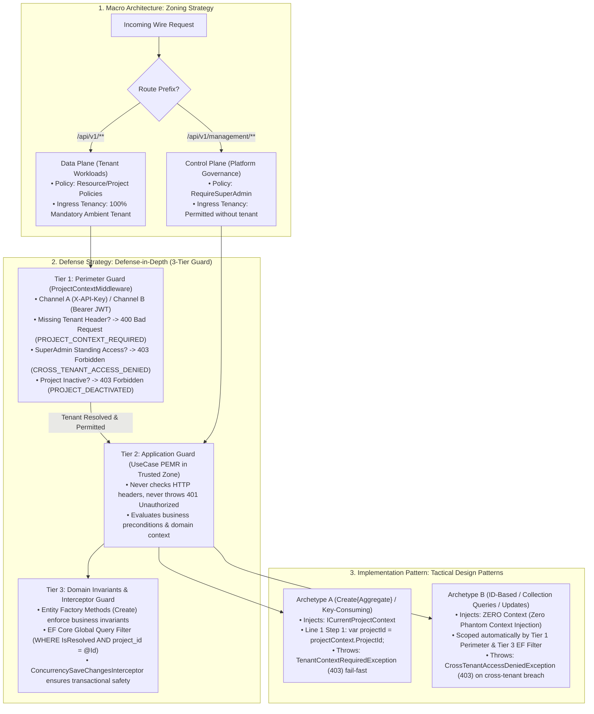
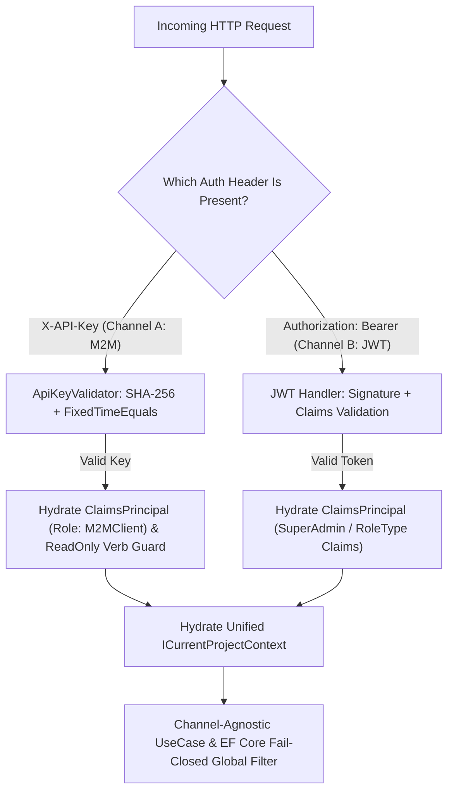

# [MECH-001]: multi_tenant_security_pipeline.md — Multi-Tenant Security & Dual-Auth Pipeline SSoT

<context>
Category: 03_specialized_mechanics
Domain: Multi-Tenant Security Pipeline, Dual-Auth Routing & 3-Tier Guard Governance
SoleResponsibilities:
  - Macro Zoning (Control Plane vs Data Plane) and Zero Standing Access (ZSA)
  - The 3-Tier Guard Model (Tier 1 Perimeter -> Tier 2 Application -> Tier 3 Domain & Interceptor)
  - Dual-channel authentication pipeline (Channel A M2M SHA-256 vs Channel B Web JWT)
  - Ambient context hydration and Smart Context (`ICurrentProjectContext.ProjectId`) contract
  - Project sub-key quota enforcement (max 2 keys per tenant) and ownership transfer
Target: `backend-v2/` (`SmkDoc.Api/Middleware/`, `SmkDoc.Infrastructure/Security/`, `SmkDoc.Application/Common/Interfaces/`)
Signal: [ARCH_EVOLUTION_TENANCY]
</context>

---

## 1. Level 1: Master Architecture & Invariants Matrix

### 1.1 The Master Governance Pipeline Flow
The system's multi-tenant security architecture enforces a single, unbroken, top-down deductive pipeline operating from HTTP ingress to database row-level partitions:



### 1.2 Dimension 1: Macro Zoning Strategy (Control Plane vs Data Plane Partitioning)
| Architectural Plane | Route Scope | Authorized Principals | Tenancy Resolution Rule | Standing Access Policy |
|---|---|---|---|---|
| **Control Plane** | `/api/v1/management/**` | Platform `SuperAdmin` exclusively | Un-tenanted access permitted; operates across tenant containers via explicit route targets. | Full platform administrative oversight (ZSA exemption on management routes). |
| **Data Plane** | `/api/v1/**` (excluding `/management/` and `/auth/`) | Tenant Users (`Admin`, `Developer`, `Viewer`) & M2M Keys (`ReadOnly`, `ReadWrite`) | **100% Mandatory Ambient Tenant**. Tier 1 rejects un-tenanted calls fail-fast with HTTP 400 (`PROJECT_CONTEXT_REQUIRED`). | **Zero Standing Access (ZSA)**: SuperAdmin rejected with HTTP 403 (`CROSS_TENANT_ACCESS_DENIED`) unless mapped in `UserProjectRole`. |

### 1.3 Dimension 2: Defense-in-Depth Strategy (The 3-Tier Guard Model)
| Defense Tier | Gatekeeper Component | Operating Environment | Primary Verification Concerns | Rejection Exception & HTTP Status |
|---|---|---|---|---|
| **Tier 1: Perimeter Guard** | `ProjectContextMiddleware` | HTTP Wire Boundary | Identity, route plane, tenant header extraction, project existence, project active status, ZSA boundary. | `400 Bad Request` (`PROJECT_CONTEXT_REQUIRED`), `401 Unauthorized`, `403 Forbidden` (`PROJECT_DEACTIVATED`, `CROSS_TENANT_ACCESS_DENIED`). |
| **Tier 2: Application Guard** | UseCase PEMR (Step 1 & 2) | Trusted Application Zone | Ambient context binding, business uniqueness, aggregate existence, optimistic concurrency, payload schema. | `TenantContextRequiredException` (`403`), `CrossTenantAccessDeniedException` (`403`), `NotFoundException` (`404`), `ConflictException` (`409`), `PreconditionFailedException` (`412`). |
| **Tier 3: Domain Invariant Guard** | Entities & EF Core Interceptors | Core Domain & Relational Engine | Aggregate root business invariants, state transition validity, relational row-level tenant filtering (`WHERE project_id = @Id`). | `DomainValidationException` (`400`), `BusinessRuleViolationException` (`400`), `DbUpdateConcurrencyException` (`409`). |

### 1.4 Dimension 3: Tactical Implementation Taxonomy (Archetype A vs Archetype B)
| Tactical Archetype | Typical UseCase Slices | `ICurrentProjectContext` Dependency | PEMR Step 1 Tenancy Cadence | Isolation Guarantee Mechanism |
|---|---|---|---|---|
| **Archetype A** (Entity-Creating / Key-Consuming) | `CreateTemplate`, `CreateDataConnection`, `CreateDataset`, `CreateApiKey`, `UploadFont` | **MANDATORY INJECTION** | Line 1 Fail-Fast: `var projectId = projectContext.ProjectId;` (throws `TenantContextRequiredException` if unresolved). | Smart Context fail-fast property binds strongly-typed `ProjectId` directly to new aggregate factory or storage bucket. |
| **Archetype B** (ID-Based / Collection Queries / Updates) | `GetById`, `UpdateDetails`, `Delete`, `ListPaged`, `PreviewDocument` | **STRICTLY PROHIBITED (Zero Phantom Context)** | Input validation & parameter clamping only; zero context property access. | Relies on Tier 1 Perimeter Guard for authenticated ingress and Tier 3 EF Core Global Query Filter for SQL data isolation. |

### 1.5 Affirmative Tenancy & Security Invariants Matrix
| Architectural Concern | Affirmative Security Invariant (Positive SSoT Law) | Boundary Vector |
|---|---|---|
| **Cryptographic Storage** | API keys are stored exclusively as SHA-256 hashes (`KeyHash`) with non-sensitive `KeyPrefix` and authentic `KeySuffix`. Plaintext keys are emitted exactly once. | Credential Storage |
| **Browser Token Security** | Session JWTs reside in httpOnly, Secure, SameSite cookies via Next.js Proxy (`/api/proxy/[...path]`). Browser localStorage storage is prohibited. | Client Session |
| **Unified Ambient Context** | Tenancy and caller identity converge exclusively into `ICurrentProjectContext`. `IExecutionContext` is retired. Dual ambient contexts are prohibited. | Orchestration Core |
| **Fail-Closed Tenancy SQL** | EF Core Global Query Filter enforces `IsResolved && e.ProjectId == CurrentTenantId` across all `IMustHaveProject` entities. `.IgnoreQueryFilters()` in tenant routes is prohibited. | Relational Boundary |
| **Timing Side-Channel Immunity**| API key comparisons execute via `CryptographicOperations.FixedTimeEquals` across byte representations. Variable-time string equality is prohibited. | Cryptographic Engine |
| **First-Class M2M Identity** | Channel A hydrates `ClaimsPrincipal` (`AuthenticationScheme: ApiKeyScheme`, `Role: M2MClient`, `ProjectId`, `Scope`, `ApiKeyId`) onto `HttpContext.User`. | Security Context |
| **Anti-Spoofing Parameter Policy**| Tenant UseCases resolve tenancy strictly from ambient `ICurrentProjectContext`. Declaring caller `ProjectId` overrides on tenant Command/Query records, query strings, or JSON bodies is prohibited. | Ingress Parameter |
| **Global Identity Scoping** | `User` is a Global Identity (zero `ProjectId` column, zero `IMustHaveProject`). Multi-project tenancy is mapped exclusively through `UserProjectRole`. | Identity Model |
| **Delegated Sub-Key Quota** | Project Admins manage operational sub-keys on `/api/v1/api-keys` under a strict budget of maximum 2 active keys per tenant (1 `ReadOnly` + 1 `ReadWrite`), returning `409 Conflict` on duplicate scope. | Key Governance |
| **Key Masking Wire Egress** | Key list/get endpoints return masked keys derived from authentic components (`$"{KeyPrefix}****{KeySuffix}"`). Synthesizing pseudo-suffixes from the hash is prohibited. | Contract Privacy |
| **Deterministic Route Precedence**| Tenant resolution resolves following strict hierarchy: Route (`{projectId}`) => Header (`X-Project-Id`) => JWT Claim (`ProjectId`), rejecting Route vs Header conflicts with RFC 9457 `400 Bad Request`. | Tenant Extraction |
| **Perimeter Scope Enforcement** | Channel A keys with `ApiKeyScope.ReadOnly` are blocked at `ProjectContextMiddleware` from executing mutating HTTP verbs (`POST`/`PUT`/`PATCH`/`DELETE`) returning `403 Forbidden`, permitting only stateless `/preview` and `/validate`. | Perimeter Firewall |
| **Authenticated Preview Protection**| Preview endpoints require authenticated tenant context to resolve templates and protect Gotenberg Chromium pods. Anonymous public access to `/preview` is prohibited. | Render Perimeter |
| **Tenant Idempotency Partition**| Distributed idempotency keys are partitioned strictly by resolved project: `idempotency:{ProjectId:N}:{IdempotencyKey}`. Shared caller keying is prohibited. | Cache Partitioning |

---

## 2. Level 2: Dual-Channel Ingress, Identity Hydration & Causal Engine

### 2.1 Dual-Channel Ingress Architecture
The gateway strictly segregates external automated traffic (Channel A) from internal human operator traffic (Channel B):



* **Why Internal Backoffice Console vs External Auth Hub**: External enterprise software (ERP, CRM) manages user identities natively; their servers consume document generation via Channel A (M2M API Keys). The web portal exists purely as an internal operator console for SuperAdmin governance and Template Designer authoring.
* **Why Constant-Time Hash Comparison (`FixedTimeEquals`)**: Standard string equality short-circuits on mismatch, leaking character-by-character timing signals to network attackers.
* **Why `ClaimsPrincipal` Hydration for M2M**: ASP.NET Core `[Authorize]` attributes evaluate `HttpContext.User.Identity.IsAuthenticated`. Leaving `context.User` unhydrated causes M2M clients to fail authorization even with a valid API key.

### 2.2 Unified Ambient Context Contract
```csharp
public interface ICurrentProjectContext
{
    /// <summary>
    /// Self-Guarding Smart Property. Returns strongly-typed ProjectId if resolved;
    /// otherwise, throws TenantContextRequiredException (403 Forbidden) fail-fast.
    /// </summary>
    ProjectId ProjectId { get; }

    /// <summary>
    /// Safe accessor for Control Plane, Auth, Background Workers, or AppDbContext.
    /// Returns null if unresolved (Never returns ProjectId.Empty).
    /// </summary>
    ProjectId? OptionalProjectId { get; }

    bool IsResolved { get; }
    string? CallerIdentity { get; }
    UserId? UserId { get; }
    SystemRole? SystemRole { get; }
    ApiKeyId? ApiKeyId { get; }
}

public interface ICurrentProjectContextSetter
{
    void SetProject(ProjectId projectId, string? callerIdentity = null);

    void SetActor(
        UserId? userId = null,
        SystemRole? systemRole = null,
        ApiKeyId? apiKeyId = null,
        string? callerIdentity = null);
}
```

### 2.3 Harmonized 2-Tier Role & Scope Taxonomy
Identity is partitioned into Platform-level `SystemRole`, Tenant-level `RoleType`, and M2M `ApiKeyScope`. Spurious aliases (`Editor`, `Author`) are strictly prohibited:

| Identity Channel | Security Principal Tier | Canonical Role / Scope | Primary Operational Scope & Responsibilities |
|---|---|---|---|
| **Channel B (Portal)** | **Tier 1: Platform Level** (`SystemRole`) | `SuperAdmin` | Platform-wide governance, cross-tenant management, system diagnostics, master API keys. |
| **Channel B (Portal)** | **Tier 1: Platform Level** (`SystemRole`) | `Member` | Standard authenticated operator assigned to specific project workspaces. |
| **Channel B (Portal)** | **Tier 2: Tenant Workspace** (`RoleType`) | `Admin` | Project Administrator: manages project API keys, user memberships, and data connections. |
| **Channel B (Portal)** | **Tier 2: Tenant Workspace** (`RoleType`) | `Developer` | Template Designer: authors templates, Monaco HTML/Handlebars, bindings, datasets, live preview. |
| **Channel B (Portal)** | **Tier 2: Tenant Workspace** (`RoleType`) | `Viewer` | Read-only inspection: views template catalog and previews generated outputs. |
| **Channel A (M2M)** | **Tier 3: External Integration** (`ApiKeyScope`)| `ReadOnly` (`M2MClient`) | External ERP/CRM: stateless preview and schema validation only (`403` on mutating verbs). |
| **Channel A (M2M)** | **Tier 3: External Integration** (`ApiKeyScope`)| `ReadWrite` (`M2MClient`) | External ERP/CRM: document generation, async queueing, asset download, and template CRUD. |

### 2.4 RFC 9457 Uniform ProblemDetails & Status Code Translation Matrix
| Exception Class | Origin Tier | HTTP Status | RFC 9457 ErrorCode | ProblemDetails Title |
|---|---|---|---|---|
| Client Missing Tenant Header | Tier 1: Perimeter | `400 Bad Request` | `PROJECT_CONTEXT_REQUIRED` | Project Context Required |
| Invalid API Key / Expired JWT | Tier 1: Perimeter | `401 Unauthorized` | `UNAUTHORIZED` | Unauthorized |
| Project Deactivated | Tier 1: Perimeter | `403 Forbidden` | `PROJECT_DEACTIVATED` | Project Deactivated |
| SuperAdmin Data Plane Access Breach | Tier 1: Perimeter | `403 Forbidden` | `CROSS_TENANT_ACCESS_DENIED` | Cross-Tenant Access Denied |
| ReadOnly Key Mutation Attempt | Tier 1: Perimeter | `403 Forbidden` | `INSUFFICIENT_KEY_SCOPE` | Insufficient Key Scope |
| `TenantContextRequiredException` | Tier 2: Application | `403 Forbidden` | `TENANT_CONTEXT_REQUIRED` | Tenant Context Required |
| `CrossTenantAccessDeniedException` | Tier 2: Application | `403 Forbidden` | `CROSS_TENANT_ACCESS_DENIED` | Cross-Tenant Access Denied |
| `ForbiddenException` | Tier 2: Application | `403 Forbidden` | `FORBIDDEN` | Forbidden |
| `NotFoundException` | Tier 2: Application | `404 Not Found` | `{ENTITY}_NOT_FOUND` | Resource Not Found |
| `ConflictException` (Quota / Duplicate Key) | Tier 2: Application | `409 Conflict` | `{ENTITY}_CONFLICT` | Conflict |
| `PreconditionFailedException` (ETag Mismatch)| Tier 2: Application | `412 Precondition Failed`| `PRECONDITION_FAILED` | Precondition Failed |
| `DomainValidationException` | Tier 3: Domain | `400 Bad Request` | `DOMAIN_VALIDATION_ERROR` | Domain Validation Error |
| `BusinessRuleViolationException` | Tier 3: Domain | `400 Bad Request` | `{DomainErrorCode}` | Business Rule Violation |

### 2.5 Proactive Tenancy Firewalls
```yaml
TenancyQueryFilterFirewall:
  Invariant: "Tenant queries must never call .IgnoreQueryFilters() in tenant routes."
  ActionOnViolation: "Remove .IgnoreQueryFilters() to enforce ambient fail-closed isolation."

CryptographicEqualityFirewall:
  Invariant: "API key hash checks must use CryptographicOperations.FixedTimeEquals."
  ActionOnViolation: "Convert string comparison to FixedTimeEquals over byte arrays."

M2MClaimsPrincipalFirewall:
  Invariant: "Channel A authentication must hydrate ClaimsPrincipal on HttpContext.User."
  ActionOnViolation: "Assign context.User = new ClaimsPrincipal(new ClaimsIdentity(...))."

ZeroPhantomContextFirewall:
  Invariant: "Inject ICurrentProjectContext strictly into Archetype A UseCases."
  ActionOnViolation: "Remove context from Archetype B UseCases (GetById, Update, Delete, List)."

SmartContextFirewall:
  Invariant: "Consume self-guarding property projectContext.ProjectId at PEMR Step 1 line 1."
  ActionOnViolation: "Replace manual if (!projectContext.IsResolved) with var projectId = projectContext.ProjectId;."

ReadOnlyScopeFirewall:
  Invariant: "ApiKeyScope.ReadOnly must not execute state-mutating HTTP verbs."
  ActionOnViolation: "Return 403 Forbidden at perimeter for mutating methods on ReadOnly keys."
```

---

## 3. Level 3: Canonical Working Archetypes (Surgical AST Recipes)

### 3.1 Tier 1 Perimeter Guard Archetype (`ApiKeyValidator` & `ProjectContextMiddleware`)
>> MANDATORY CANONICAL BLUEPRINT [RULE-SEC-001]:
```csharp
public static class ApiKeyValidator
{
    public const string KeyPrefixTemplate = "smk_";

    public static (string RawKey, string KeyPrefix, string KeySuffix, string KeyHash) GenerateKey(string callerApp)
    {
        // Step 1: Generate Cryptographically Secure Secret <Why: eliminate PRNG predictability>
        var randomBytes = RandomNumberGenerator.GetBytes(24);
        var secret = Convert.ToHexString(randomBytes).ToLowerInvariant();

        // Step 2: Format Structured Key <Why: human-readable prefix and authentic trailing suffix>
        var prefix = $"{KeyPrefixTemplate}{callerApp.ToLowerInvariant()}_";
        var rawKey = $"{prefix}{secret}";
        var suffix = rawKey[^4..];

        // Step 3: Compute SHA-256 Digest <Why: one-way cryptographic storage>
        var hash = HashApiKey(rawKey);
        return (rawKey, prefix, suffix, hash);
    }

    public static string HashApiKey(string rawApiKey)
    {
        var bytes = Encoding.UTF8.GetBytes(rawApiKey);
        var hash = SHA256.HashData(bytes);
        return Convert.ToHexString(hash).ToLowerInvariant();
    }

    public static async Task<ApiKey?> AuthenticateAsync(
        string rawApiKey,
        AppDbContext dbContext,
        TimeProvider timeProvider,
        CancellationToken ct)
    {
        var keyHash = HashApiKey(rawApiKey);
        var expectedBytes = Encoding.UTF8.GetBytes(keyHash);

        var apiKey = await dbContext.ApiKeys
            .AsNoTracking()
            .FirstOrDefaultAsync(k => k.KeyHash == keyHash && k.IsActive, ct);

        if (apiKey == null) return null;

        // Step 3: Constant-Time Verification <Why: eliminate timing side-channel attacks>
        var actualBytes = Encoding.UTF8.GetBytes(apiKey.KeyHash);
        if (!CryptographicOperations.FixedTimeEquals(expectedBytes, actualBytes))
            return null;

        // Step 4: Verify Expiration via TimeProvider <Why: deterministic temporal testing>
        var now = timeProvider.GetUtcNow();
        if (apiKey.ExpiresAt.HasValue && apiKey.ExpiresAt.Value < now)
            return null;

        return apiKey;
    }
}

public sealed class ProjectContextMiddleware(RequestDelegate next)
{
    public async Task InvokeAsync(
        HttpContext context,
        ICurrentProjectContextSetter projectContextSetter,
        AppDbContext dbContext,
        TimeProvider timeProvider)
    {
        // Step 1: Channel A (M2M X-API-Key) Authentication <Why: evaluate integration keys first>
        if (context.Request.Headers.TryGetValue("X-API-Key", out var apiKeyValues) && !string.IsNullOrWhiteSpace(apiKeyValues))
        {
            var rawApiKey = apiKeyValues.ToString().Trim();
            var apiKey = await ApiKeyValidator.AuthenticateAsync(rawApiKey, dbContext, timeProvider, context.RequestAborted);
            if (apiKey == null)
            {
                await WriteProblemAsync(context, StatusCodes.Status401Unauthorized, "Invalid API Key", "The API key is invalid or expired.");
                return;
            }

            // Step 2: Enforce ReadOnly scope <Why: block mutating HTTP verbs at perimeter>
            if (apiKey.Scope == ApiKeyScope.ReadOnly && IsMutatingNonStatelessRequest(context.Request))
            {
                await WriteProblemAsync(context, StatusCodes.Status403Forbidden, "Insufficient Key Scope", "ReadOnly keys cannot execute mutations.");
                return;
            }

            var projectId = new ProjectId(apiKey.ProjectId);
            projectContextSetter.SetProject(projectId, apiKey.CallerApp);
            projectContextSetter.SetActor(apiKeyId: new ApiKeyId(apiKey.Id), callerIdentity: apiKey.CallerApp);

            // Step 3: Hydrate ClaimsPrincipal onto HttpContext.User <Why: ASP.NET Core authorization pipeline>
            var claims = new[]
            {
                new Claim(ClaimTypes.NameIdentifier, apiKey.Id.ToString()),
                new Claim(ClaimTypes.Role, "M2MClient"),
                new Claim("Scope", apiKey.Scope.ToString()),
                new Claim("ProjectId", apiKey.ProjectId.ToString())
            };
            context.User = new ClaimsPrincipal(new ClaimsIdentity(claims, "ApiKeyScheme"));
            await next(context);
            return;
        }

        // Step 4: Channel B (JWT User Session) & Tenant Scoping <Why: interactive user session governance>
        if (context.User.Identity?.IsAuthenticated == true)
        {
            var routeProjectId = ExtractRouteProjectId(context);
            var headerProjectId = ExtractHeaderProjectId(context);

            if (routeProjectId.HasValue && headerProjectId.HasValue && routeProjectId.Value != headerProjectId.Value)
            {
                await WriteProblemAsync(context, StatusCodes.Status400BadRequest, "Tenant Identification Conflict", "Route and header ProjectId conflict.");
                return;
            }

            var userId = ExtractUserId(context.User);
            var isSuperAdmin = context.User.HasClaim("SystemRole", RoleConstants.SuperAdmin);
            var systemRole = isSuperAdmin ? SystemRole.SuperAdmin : SystemRole.Member;
            projectContextSetter.SetActor(userId: userId, systemRole: systemRole, callerIdentity: userId is { } uid ? $"User:{uid.Value:N}" : "portal");

            var isManagementRoute = context.Request.Path.Value?.StartsWith("/api/v1/management/", StringComparison.OrdinalIgnoreCase) == true;
            var effectiveProjectId = routeProjectId ?? headerProjectId ?? ExtractClaimProjectId(context);

            if (effectiveProjectId.HasValue)
            {
                var targetProjectId = new ProjectId(effectiveProjectId.Value);
                if (isManagementRoute && isSuperAdmin)
                {
                    // Control Plane: SuperAdmin manages project container without tenant membership
                    projectContextSetter.SetProject(targetProjectId);
                }
                else
                {
                    // Data Plane: Strict tenant membership verification required (Zero Standing Access)
                    var mapping = await dbContext.UserProjectRoles.AsNoTracking()
                        .FirstOrDefaultAsync(u => u.ProjectId == targetProjectId && u.UserId == userId!.Value, context.RequestAborted);
                    if (mapping == null)
                    {
                        await WriteProblemAsync(context, StatusCodes.Status403Forbidden, "Forbidden", "Caller lacks membership in target tenant.");
                        return;
                    }
                    projectContextSetter.SetProject(targetProjectId);
                }
            }
            else if (!isManagementRoute && !context.Request.Path.Value!.StartsWith("/api/v1/auth/"))
            {
                // Data Plane without tenant identifier: reject fail-fast
                await WriteProblemAsync(context, StatusCodes.Status400BadRequest, "Project Context Required", "Missing X-Project-Id header.");
                return;
            }

            await next(context);
            return;
        }

        await next(context);
    }
}
```

### 3.2 Tier 2 Application Guard Archetype (Archetype A vs Archetype B)
>> MANDATORY CANONICAL BLUEPRINT [RULE-SEC-002]:
```csharp
// --- Archetype A: Entity-Creating / Key-Consuming Slice (MANDATORY Context Injection) ---
public sealed class Create{Aggregate}UseCase(
    I{Aggregate}Repository repository,
    IUnitOfWork unitOfWork,
    ICurrentProjectContext projectContext,
    TimeProvider timeProvider) : IUseCase<Create{Aggregate}Command, {Aggregate}ResultDto>
{
    public async Task<{Aggregate}ResultDto> ExecuteAsync(Create{Aggregate}Command command, CancellationToken ct = default)
    {
        // Step 1: Parse & Guard (Line 1 Fail-Fast via Smart Context Property; throws TenantContextRequiredException)
        var projectId = projectContext.ProjectId;

        // Step 2: Ensure Preconditions <Why: fail-fast on duplicate business key before mutation>
        if (await repository.ExistsBySlugAsync(projectId, command.Slug, ct))
            throw ConflictException.DuplicateSlug(command.Slug);

        // Step 3: Mutate Domain State <Why: aggregate root encapsulates business invariants>
        var now = timeProvider.GetUtcNow();
        var entity = {Aggregate}.Create(projectId, new {Aggregate}Name(command.Name), new {Aggregate}Slug(command.Slug), now);
        await repository.AddAsync(entity, ct);

        // Step 4: Commit & Egress <Why: atomic persistence & ResultDto mapping>
        await unitOfWork.CommitAsync(ct);
        return new {Aggregate}ResultDto(entity.Id.Value, entity.ProjectId.Value, entity.Name.Value, entity.Slug.Value);
    }
}

// --- Archetype B: ID-Based Mutating Slice (ZERO Phantom Context Injection) ---
public sealed class Update{Aggregate}UseCase(
    I{Aggregate}Repository repository,
    IUnitOfWork unitOfWork,
    IConcurrencyContext concurrencyContext,
    TimeProvider timeProvider) : IUseCase<Update{Aggregate}Command, {Aggregate}ResultDto>
{
    public async Task<{Aggregate}ResultDto> ExecuteAsync(Update{Aggregate}Command command, CancellationToken ct = default)
    {
        // Step 1: Parse & Guard <Why: input validation only; ambient tenancy secured by Tier 1 & EF filter>

        // Step 2: Ensure Preconditions <Why: fail-fast on stale ETag before mutation or external I/O>
        var entity = await repository.GetByIdAsync(new {Aggregate}Id(command.Id), ct)
            ?? throw new NotFoundException($"Target {nameof({Aggregate})} '{command.Id}' not found.");

        concurrencyContext.EnsureMatches(entity); // <Why: throws PreconditionFailedException (412) on mismatch>

        // Step 3: Mutate Domain State <Why: advance state and updated timestamp>
        var now = timeProvider.GetUtcNow();
        entity.UpdateDetails(new {Aggregate}Name(command.Name), now);
        repository.Update(entity);

        // Step 4: Commit & Egress <Why: atomic persistence>
        await unitOfWork.CommitAsync(ct);
        return new {Aggregate}ResultDto(entity.Id.Value, entity.ProjectId.Value, entity.Name.Value, entity.Slug.Value);
    }
}
```

### 3.3 Tier 3 Domain Invariant & Interceptor Guard Archetype
>> MANDATORY CANONICAL BLUEPRINT [RULE-SEC-003]:
```csharp
// --- Tier 3: Aggregate Root Self-Guarding Factory ---
public sealed class {Aggregate} : AggregateRoot<{Aggregate}Id>, IMustHaveProject
{
    public ProjectId ProjectId { get; private set; }
    public {Aggregate}Name Name { get; private set; }

    public static {Aggregate} Create(ProjectId projectId, {Aggregate}Name name, DateTimeOffset now)
    {
        // Step 1: Invariant Guard <Why: enforce valid tenant assignment and non-empty identity>
        if (projectId == ProjectId.Empty)
            throw new DomainValidationException("Aggregate must be assigned to an authentic tenant.");

        return new {Aggregate}
        {
            Id = {Aggregate}Id.New(),
            ProjectId = projectId,
            Name = name,
            CreatedAt = now
        };
    }
}

// --- Tier 3: EF Core Compile-Time Global Tenancy Filter in AppDbContext ---
protected override void OnModelCreating(ModelBuilder modelBuilder)
{
    base.OnModelCreating(modelBuilder);

    foreach (var entityType in modelBuilder.Model.GetEntityTypes())
    {
        if (typeof(IMustHaveProject).IsAssignableFrom(entityType.ClrType))
        {
            var parameter = Expression.Parameter(entityType.ClrType, "e");
            var property = Expression.Property(parameter, nameof(IMustHaveProject.ProjectId));
            var currentTenant = Expression.Property(Expression.Constant(this), nameof(CurrentTenantId));
            var isResolved = Expression.Property(Expression.Constant(this), nameof(IsTenantResolved));

            var filter = Expression.Lambda(
                Expression.AndAlso(isResolved, Expression.Equal(property, currentTenant)),
                parameter);

            modelBuilder.Entity(entityType.ClrType).HasQueryFilter(filter);
        }
    }
}
```

---

## 4. Level 4: Fatal Anti-Patterns & Unified Micro-Diffs

### [TRAP-SEC-001]: Plaintext API Key Database Lookup
```diff
- var key = await dbContext.ApiKeys.FirstOrDefaultAsync(k => k.RawKey == rawKey);
+ var keyHash = ApiKeyValidator.HashApiKey(rawKey);
+ var key = await dbContext.ApiKeys.FirstOrDefaultAsync(k => k.KeyHash == keyHash);
```
*Rationale: Querying or storing raw keys in database records leaves credentials vulnerable to leaks via SQL injection, audit logs, and DB backups.*

### [TRAP-SEC-002]: Multi-Tenant Filter Bypass
```diff
- var docs = await dbContext.Documents.IgnoreQueryFilters().ToListAsync(ct);
+ var docs = await dbContext.Documents.ToListAsync(ct);
```
*Rationale: Disabling global query filters creates catastrophic IDOR cross-tenant data leaks in production endpoints.*

### [TRAP-SEC-003]: Variable-Time Hash Comparison
```diff
- if (keyHash == apiKey.KeyHash) return apiKey;
+ if (!CryptographicOperations.FixedTimeEquals(expectedBytes, actualBytes)) return null;
```
*Rationale: Standard string equality short-circuits on mismatch, leaking character-by-character timing signals to network attackers.*

### [TRAP-SEC-004]: Dual Ambient Context & Caller ProjectId Override
```diff
- public async Task<IActionResult> ListTemplates([FromQuery] Guid? projectId, ...) {
-     var targetProject = projectId ?? legacyContext.ProjectId!.Value;
+ [HttpGet] public async Task<IActionResult> ListTemplates([FromQuery] string? search, ...) {
+     var query = new ListTemplatesQuery(search);
+     var result = await listTemplatesUseCase.ExecuteAsync(query, ct);
```
*Rationale: Maintaining parallel execution contexts, injecting `ICurrentProjectContext` into controllers, or accepting caller-supplied `ProjectId` overrides creates split-brain cross-tenant queries and controller dependency bloat. Multi-tenant context resolves exclusively via middleware into ambient `ICurrentProjectContext`, and UseCases consuming ProjectId bind tenancy via Tier 2 Smart Context `var activeProjectId = projectContext.ProjectId;` at line 1 of Step 1 PEMR. UseCases operating by ID or querying collections filtered by EF Core omit context injection entirely.*

### [TRAP-SEC-005]: M2M Missing ClaimsPrincipal (Dropping to 401 Unauthorized under `[Authorize]`)
```diff
- projectContextSetter.SetProject(new ProjectId(apiKey.ProjectId));
- // HttpContext.User left unauthenticated
+ projectContextSetter.SetProject(new ProjectId(apiKey.ProjectId), apiKey.CallerApp);
+ var identity = new ClaimsIdentity(
+     new[] { new Claim(ClaimTypes.Role, "M2MClient"), new Claim("ProjectId", apiKey.ProjectId.ToString()) },
+     "ApiKeyScheme");
+ context.User = new ClaimsPrincipal(identity);
```
*Rationale: ASP.NET Core `[Authorize]` attributes evaluate `HttpContext.User.Identity.IsAuthenticated`. Leaving `context.User` unhydrated causes M2M clients to fail authorization even with a valid API key.*

### [TRAP-SEC-006]: Masking API Key from SHA-256 Hash Suffix
```diff
- var suffix = apiKey.KeyHash.Value[^4..]; // REJECTED: Hash suffix never matches the operator's actual key!
- var masked = $"smk_{apiKey.CallerApp}_****{suffix}";
+ // Authentic key suffix persisted at generation time
+ var masked = $"{apiKey.KeyPrefix}****{apiKey.KeySuffix}";
```
*Rationale: Generating masked keys from the trailing characters of the SHA-256 hash causes total confusion because the masked string displayed in the console differs from the physical credentials held by the operator or enterprise ERP. Storing `KeyPrefix` and authentic `KeySuffix` alongside `KeyHash` guarantees accurate, non-sensitive key identification.*

### [TRAP-SEC-007]: SuperAdmin Standing Access Breach (Data Plane Bypass)
```diff
- // ANTI-PATTERN: Auto-hydrating Admin onto SuperAdmin and bypassing tenant membership check
- if (isSuperAdmin) { EnsureRoleClaim(superIdentity, RoleConstants.Admin); }
- if (!isSuperAdmin) { var mapping = await userProjectRoleRepo.GetAsync(targetProjectId, userId); ... }
+ // CANONICAL: Zero Standing Access - Partition Control Plane vs Data Plane
+ if (isSuperAdmin) { EnsureRoleClaim(superIdentity, RoleConstants.SuperAdmin); } // ONLY SuperAdmin
+ if (isManagementRoute && isSuperAdmin) {
+     projectContextSetter.SetProject(targetProjectId, actorIdentity);
+ } else {
+     var mapping = await userProjectRoleRepo.GetAsync(targetProjectId, userId);
+     if (mapping == null) return 403 Forbidden;
+     EnsureRoleClaim(projectIdentity, mapping.Role.Name);
+     projectContextSetter.SetProject(targetProjectId, actorIdentity);
+ }
```
*Rationale: Giving platform SuperAdmin permanent standing read/write access to customer templates, datasets, and rendered documents violates SOC 2 Type II, ISO 27001, and Separation of Duties (SoD). SuperAdmin operates strictly within the Control Plane (`/api/v1/management/**`). On Data Plane routes, every interactive caller without an explicit `UserProjectRole` row is rejected with `403 Forbidden`.*
