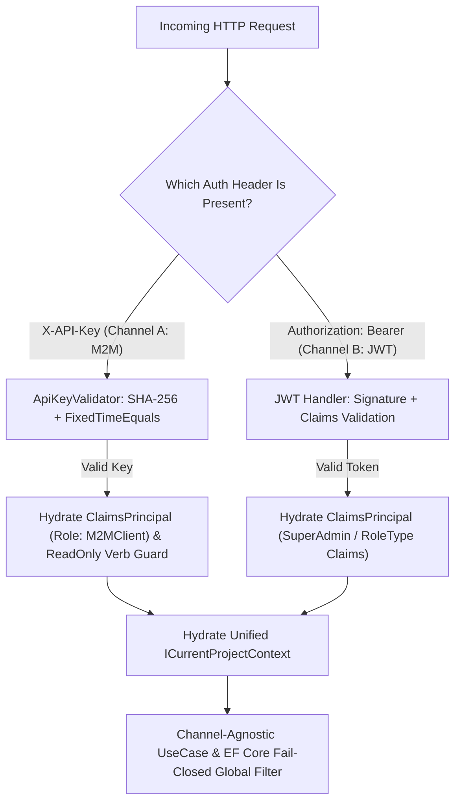

# [MECH-001]: multi_tenant_security_pipeline.md — Multi-Tenant Security & Dual-Auth Pipeline SSoT

<context>
Scope: Concrete Multi-Tenant Isolation Mechanics, Dual-Channel Authentication Pipeline (M2M API-Key & Web JWT), ProjectContextMiddleware, and EF Core Global Query Filter Resolution.
SSoT_For: Dual-Authentication Pipeline Execution, M2M ClaimsPrincipal Hydration, ProjectContextMiddleware, Ambient Tenancy Resolution, and API Key Verification.
Out_Of_Scope: Cross-cutting security limits and performance thresholds (see: ../00_architecture_core/03_security_and_performance.md), Presentation layer routing and RFC 9457 exceptions (see: ../01_clean_arch_patterns/04_api_presentation_layer.md).
Target: `backend-v2/` (`SmkDoc.Api/Middleware/`, `SmkDoc.Infrastructure/Security/`, `SmkDoc.Application/Common/Interfaces/`).
ArchitecturalSignals: [ARCH_EVOLUTION_TENANCY]
</context>

---

## 1. Level 1: Multi-Tenant & Dual-Auth Invariants Matrix

### 1.1 Architectural Wiring & Security Contracts
| Direction | Upstream Origin | Current Role (Tenancy & Security Engine) | Downstream Destination |
|---|---|---|---|
| **Incoming HTTP** | M2M Client or Web Studio | Inspects auth headers (`X-API-Key` vs `Authorization: Bearer`) | Authentication Handler Dispatch |
| **Channel A (M2M)** | External Integration Client | SHA-256 hash lookup, verifies `FixedTimeEquals`, extracts `project_id`, enforces `ApiKeyScope` | Hydrates `ClaimsPrincipal` (`Role: M2MClient`) & `ICurrentProjectContext` |
| **Channel B (JWT)** | Web Studio User Session | Verifies JWT signature, user membership, role claims & reads `X-Project-Id` / `{projectId}` | Hydrates `ClaimsPrincipal` (`Role: SuperAdmin/RoleType`) & `ICurrentProjectContext` |
| **Ambient Context** | Authenticated Channel | Exposes channel-agnostic `ICurrentProjectContext` (zero `IExecutionContext`) | EF Core `AppDbContext` & Inner Business Logic |
| **Persistence Query**| UseCase / Repository Query | Enforces fail-closed global tenancy SQL partition | PostgreSQL Engine (`WHERE @IsResolved AND project_id = @Id`) |

### 1.2 Affirmative Tenancy & Dual-Auth Invariants
| Security & Tenancy Concern | Affirmative Security Invariant (Positive SSoT Law) | Boundary Vector |
|---|---|---|
| **Cryptographic Key Storage** | API keys are stored exclusively as SHA-256 one-way hashes (`KeyHash`). Raw keys are emitted exactly once upon creation. Plaintext key persistence is prohibited. | Credential Storage |
| **Browser Token Security** | Web session JWTs are stored in httpOnly, Secure, SameSite cookies managed via Next.js Proxy (`/api/proxy/[...path]`). Browser localStorage token persistence is prohibited. | Client Session |
| **Unified Ambient Context** | Tenancy and caller identity converge exclusively into `ICurrentProjectContext`. `IExecutionContext` is retired. Dual ambient contexts are prohibited. | Orchestration Core |
| **Fail-Closed Tenancy SQL** | EF Core Global Query Filter enforces `IsResolved && e.ProjectId == CurrentTenantId` across all `IMustHaveProject` entities. Manual `WHERE project_id = @id` clauses and `.IgnoreQueryFilters()` in tenant routes are prohibited. | Relational Boundary |
| **Timing Side-Channel Immunity**| All API key and secret comparisons execute via `CryptographicOperations.FixedTimeEquals` across byte representations. Variable-time string equality is prohibited. | Cryptographic Engine |
| **First-Class M2M Identity** | Channel A hydrates `ClaimsPrincipal` (`AuthenticationScheme: ApiKeyScheme`, `Role: M2MClient`, `ProjectId`, `Scope`, `ApiKeyId`) onto `HttpContext.User`. Prohibit setting ambient context without updating `HttpContext.User`. | Security Context |
| **Anti-Spoofing Parameter Policy**| Tenant UseCases resolve tenancy strictly from ambient `ICurrentProjectContext`. Declaring caller `ProjectId` overrides on tenant Command/Query records or payloads is prohibited. | Ingress Parameter |
| **Global Identity Scoping** | `User` is a Global Identity (zero `ProjectId` column, zero `IMustHaveProject`). Multi-project tenancy is mapped exclusively through `UserProjectRole`. | Identity Model |
| **Delegated Sub-Key Quota** | Project Admins manage operational sub-keys on `/api/v1/api-keys` under a strict budget of maximum 2 active keys per tenant (1 `ReadOnly` + 1 `ReadWrite`), returning `409 Conflict` on duplicate scope. | Key Governance |
| **Key Masking Wire Egress** | Key list and get endpoints return masked keys (`smk_crm_****abcd`). Returning raw keys or hashes in read responses is prohibited. | Contract Privacy |
| **Canonical REST Routes** | User and project access endpoints reside on flat RESTful routes (`/api/v1/users`, `/api/v1/users/{userId}/role`). Duplicate nested controller routes are prohibited. | Route Taxonomy |
| **Deterministic Route Precedence**| Tenant resolution resolves following strict hierarchy: Route (`{projectId}`) => Header (`X-Project-Id`) => JWT Claim (`ProjectId`), rejecting Route vs Header conflicts with RFC 9457 `400 Bad Request`. | Tenant Extraction |
| **Unconditional Admin Hydration** | `SystemRole.SuperAdmin` users receive `SuperAdmin` and `Admin` role claims unconditionally prior to tenant resolution to permit global platform operations. | Privilege Elevation |
| **Perimeter Scope Enforcement** | Channel A keys with `ApiKeyScope.ReadOnly` are blocked at `ProjectContextMiddleware` from executing mutating HTTP verbs (`POST`/`PUT`/`PATCH`/`DELETE`) returning `403 Forbidden`, permitting only stateless `/preview` and `/validate`. | Perimeter Firewall |
| **Authenticated Preview Protection**| Preview endpoints require authenticated tenant context to resolve templates and protect Gotenberg Chromium pods. Anonymous public access to `/preview` is prohibited. | Render Perimeter |
| **Tenant Idempotency Partition**| Distributed idempotency keys are partitioned strictly by resolved project: `idempotency:{ProjectId:N}:{IdempotencyKey}`. Shared caller keying is prohibited. | Cache Partitioning |

---

## 2. Level 2: Dual-Channel Topology & Cognitive Tenancy Engine

### 2.1 Engineering Rationale & Causal Decisions
* **Why Constant-Time Hash Comparison (`FixedTimeEquals`):** Standard string equality (`==`) terminates on the first mismatched character, creating timing side-channel vulnerabilities that allow attackers to deduce hashes through network latency jitter.
* **Why `ClaimsPrincipal` Hydration for M2M:** ASP.NET Core `[Authorize]` attributes evaluate `HttpContext.User.Identity.IsAuthenticated`. Validating an API key into ambient context without updating `HttpContext.User` causes downstream middleware to treat M2M requests as unauthenticated (`401 Unauthorized`).
* **Why Unified `ICurrentProjectContext` (Retiring `IExecutionContext`):** Maintaining both `ICurrentProjectContext` and `IExecutionContext` causes split-brain bugs and leaks transport authentication mechanics into UseCases. Both `X-API-Key` (M2M) and `Authorization: Bearer` (JWT) converge at the perimeter into `ICurrentProjectContext` so inner business logic executes completely agnostically of transport origin.
* **Why Global `User` vs `UserProjectRole`:** Modeling `User` with a `ProjectId` column forces duplicate user accounts across projects, breaks single-sign-on (SSO), and makes enterprise user management impossible. `User` is a Global Identity; multi-tenancy is scoped strictly via the `UserProjectRole` join entity.
* **Why Omitting `ProjectId` from Tenant Payloads:** Eliminating `Guid ProjectId` from tenant-scoped Commands and Queries removes confused-deputy attack vectors by construction rather than relying on repetitive per-handler checks.
* **Why Route Precedence with Conflict Rejection:** Administrative endpoints define resource hierarchy in the URI (`/api/v1/projects/{projectId}/...`). Parsing `{projectId}` from route values and rejecting mismatches against `X-Project-Id` prevents cross-project header bleed attacks.
* **Why Unconditional SuperAdmin Claim Hydration:** Global endpoints such as `POST /api/v1/management/projects` execute before a target project exists. Hydrating `SuperAdmin` and `Admin` role claims prior to tenant resolution allows `[Authorize(Roles = RoleConstants.AdminOrSuperAdmin)]` to succeed without weakening tenant checks on project-scoped routes.
* **Why Perimeter Enforcement of `ApiKeyScope.ReadOnly`:** Blocking state-mutating HTTP methods at `ProjectContextMiddleware` prevents read-only integration keys from creating templates, uploading fonts, or mutating documents while still permitting stateless POST `preview` and `validate` calls.
* **Why Master Key / Delegated Ownership Pattern under Guardrails:** Eliminates operational bottlenecks by empowering Project Admins to self-service sub-key creation and rotation (`/api/v1/api-keys`) for daily integration needs (ERP, CRM) without waiting on platform operators. Preserves the Chain of Trust by restricting Master Credential changes and project ownership transfers strictly to SuperAdmin verification (`/api/v1/management/projects/{projectId}/transfer-owner`), while runtime guardrails enforce a hard budget of maximum 2 active keys per project (1 ReadOnly + 1 ReadWrite) returning `409 Conflict` on quota violation.

### 2.2 Proactive Tenancy Guards
```yaml
TenancyQueryFilterGuard:
  Invariant: "Tenant repositories and queries must not call .IgnoreQueryFilters()."
  ActionOnViolation: "Remove .IgnoreQueryFilters() to enforce ambient fail-closed isolation."

CryptographicEqualityGuard:
  Invariant: "API key hash checks must use CryptographicOperations.FixedTimeEquals."
  ActionOnViolation: "Convert string comparison to FixedTimeEquals over byte arrays."

M2MClaimsPrincipalGuard:
  Invariant: "Channel A authentication must hydrate ClaimsPrincipal on HttpContext.User."
  ActionOnViolation: "Assign context.User = new ClaimsPrincipal(new ClaimsIdentity(...))."

CallerProjectIdProhibitionGuard:
  Invariant: "Tenant Command and Query records must omit caller ProjectId parameters."
  ActionOnViolation: "Remove ProjectId parameter; resolve ambient ICurrentProjectContext."

ReadOnlyScopeGuard:
  Invariant: "ApiKeyScope.ReadOnly must not execute state-mutating HTTP verbs."
  ActionOnViolation: "Return 403 Forbidden at perimeter for mutating methods on ReadOnly keys."
```

### 2.3 Dual-Channel Authentication Topology


### 2.4 Unified Ambient Context Interfaces
```csharp
public interface ICurrentProjectContext
{
    ProjectId ProjectId { get; }
    bool IsResolved { get; }
    string? CallerIdentity { get; }
    UserId? UserId { get; }
    SystemRole? SystemRole { get; }
    ApiKeyId? ApiKeyId { get; }
}

public interface ICurrentProjectContextSetter
{
    void SetProject(ProjectId projectId, string? callerIdentity = null);

    void SetActor(
        UserId? userId = null,
        SystemRole? systemRole = null,
        ApiKeyId? apiKeyId = null,
        string? callerIdentity = null);
}
```

---

## 3. Level 3: Canonical Security Archetypes (Surgical AST Recipes)

### 3.1 Channel A: M2M API Key Validator (`ApiKeyValidator`)
>> MANDATORY CANONICAL BLUEPRINT [RULE-SEC-001]:
* Hashes all incoming M2M API keys using SHA-256 before database lookup.
* Compares hash bytes using `CryptographicOperations.FixedTimeEquals` to prevent timing attacks.
* Compares expiration against `timeProvider.GetUtcNow()`.

```csharp
public static class ApiKeyValidator
{
    public static string HashApiKey(string rawApiKey)
    {
        // Step 1: Compute SHA-256 Hash <Why: one-way cryptographic digest for storage and lookup>
        var bytes = Encoding.UTF8.GetBytes(rawApiKey);
        var hash = SHA256.HashData(bytes);
        return Convert.ToHexString(hash).ToLowerInvariant();
    }

    public static async Task<ApiKey?> AuthenticateAsync(
        string rawApiKey,
        AppDbContext dbContext,
        TimeProvider timeProvider,
        CancellationToken ct)
    {
        // Step 2: Digest Lookup <Why: indexed search without exposing plaintext keys>
        var keyHash = HashApiKey(rawApiKey);
        var expectedBytes = Encoding.UTF8.GetBytes(keyHash);

        var apiKey = await dbContext.ApiKeys
            .AsNoTracking()
            .FirstOrDefaultAsync(k => k.KeyHash == keyHash && k.IsActive, ct);

        if (apiKey == null) return null;

        // Step 3: Constant-Time Verification <Why: eliminate timing side-channel attacks>
        var actualBytes = Encoding.UTF8.GetBytes(apiKey.KeyHash);
        if (!CryptographicOperations.FixedTimeEquals(expectedBytes, actualBytes))
        {
            return null;
        }

        // Step 4: Verify Expiration via TimeProvider <Why: deterministic clock assertions in tests>
        var now = timeProvider.GetUtcNow();
        if (apiKey.ExpiresAt.HasValue && apiKey.ExpiresAt.Value < now)
        {
            return null;
        }

        return apiKey;
    }
}
```

### 3.2 Ambient Project Context Middleware Archetype (`ProjectContextMiddleware`)
>> MANDATORY CANONICAL BLUEPRINT [RULE-SEC-002]:
* Hydrates `ClaimsPrincipal` onto `HttpContext.User` on Channel A (`Role: M2MClient`, `ProjectId`, `Scope`, `ApiKeyId`, `CallerApp`) so `[Authorize]` succeeds.
* Enforces `ApiKeyScope.ReadOnly` on Channel A at perimeter: rejects `POST`/`PUT`/`PATCH`/`DELETE` with RFC 9457 `403 Forbidden` except stateless `/preview` and `/validate`.
* Extracts Channel B tenant identifier following precedence: Route `{projectId}` => Header `X-Project-Id` => JWT Claim `ProjectId`, rejecting Route vs Header conflicts with RFC 9457 `400 Bad Request`.
* Hydrates `SuperAdmin` and `Admin` role claims unconditionally for authenticated `SystemRole.SuperAdmin` users before project checks.

```csharp
public sealed class ProjectContextMiddleware(RequestDelegate next)
{
    public async Task InvokeAsync(
        HttpContext context,
        ICurrentProjectContextSetter projectContextSetter,
        AppDbContext dbContext,
        TimeProvider timeProvider)
    {
        // Step 1: Channel A (M2M X-API-Key) Authentication & Claims Hydration <Why: first-class citizen in [Authorize]>
        if (context.Request.Headers.TryGetValue("X-API-Key", out var apiKeyValues) &&
            !string.IsNullOrWhiteSpace(apiKeyValues))
        {
            var rawApiKey = apiKeyValues.ToString().Trim();
            var apiKey = await ApiKeyValidator.AuthenticateAsync(rawApiKey, dbContext, timeProvider, context.RequestAborted);

            if (apiKey == null)
            {
                await WriteProblemAsync(context, StatusCodes.Status401Unauthorized, "Invalid API Key",
                    "The provided API key is invalid, inactive, or expired.");
                return;
            }

            // Step 2: Enforce ReadOnly scope <Why: block mutating HTTP verbs at perimeter>
            if (apiKey.Scope == ApiKeyScope.ReadOnly && IsMutatingNonStatelessRequest(context.Request))
            {
                await WriteProblemAsync(context, StatusCodes.Status403Forbidden, "Insufficient Key Scope",
                    "API key with ReadOnly scope is not permitted to execute state-mutating operations.");
                return;
            }

            // Step 3: Hydrate ambient project context <Why: channel-agnostic ambient context>
            var projectId = new ProjectId(apiKey.ProjectId);
            var apiKeyId = new ApiKeyId(apiKey.Id);
            projectContextSetter.SetProject(projectId, apiKey.CallerApp);
            projectContextSetter.SetActor(apiKeyId: apiKeyId, callerIdentity: apiKey.CallerApp);

            // Step 4: Hydrate ClaimsPrincipal onto HttpContext.User <Why: ASP.NET Core authorization pipeline>
            var claims = new[]
            {
                new Claim(ClaimTypes.NameIdentifier, apiKey.Id.ToString()),
                new Claim(ClaimTypes.Role, "M2MClient"),
                new Claim("Scope", apiKey.Scope.ToString()),
                new Claim("ProjectId", apiKey.ProjectId.ToString()),
                new Claim("CallerApp", apiKey.CallerApp)
            };
            var identity = new ClaimsIdentity(claims, "ApiKeyScheme");
            context.User = new ClaimsPrincipal(identity);

            await next(context);
            return;
        }

        // Step 5: Channel B (JWT User Session) & Tenant Scoping <Why: web studio user session management>
        if (context.User.Identity?.IsAuthenticated == true)
        {
            var routeProjectId = ExtractRouteProjectId(context);
            var headerProjectId = ExtractHeaderProjectId(context);

            if (routeProjectId.HasValue && headerProjectId.HasValue && routeProjectId.Value != headerProjectId.Value)
            {
                await WriteProblemAsync(context, StatusCodes.Status400BadRequest, "Tenant Identification Conflict",
                    $"Route ProjectId '{routeProjectId}' conflicts with Header X-Project-Id '{headerProjectId}'.");
                return;
            }

            var userId = ExtractUserId(context.User);
            var isSuperAdmin = IsSuperAdminPrincipal(context.User);
            var systemRole = isSuperAdmin ? SystemRole.SuperAdmin : SystemRole.Member;

            projectContextSetter.SetActor(
                userId: userId,
                systemRole: systemRole,
                callerIdentity: userId is { } uid ? $"User:{uid.Value:N}" : "portal");

            // Unconditional Admin Claims Hydration <Why: SuperAdmin access to unpartitioned platform routes>
            if (isSuperAdmin && context.User.Identity is ClaimsIdentity superIdentity)
            {
                EnsureRoleClaim(superIdentity, RoleConstants.SuperAdmin);
                EnsureRoleClaim(superIdentity, RoleConstants.Admin);
            }

            var effectiveProjectId = routeProjectId ?? headerProjectId ?? ExtractClaimProjectId(context);
            if (effectiveProjectId.HasValue)
            {
                projectContextSetter.SetProject(new ProjectId(effectiveProjectId.Value));
            }

            await next(context);
            return;
        }

        // Step 6: Unauthenticated / Public Paths <Why: continue pipeline for anonymous routes>
        await next(context);
    }

    private static bool IsMutatingNonStatelessRequest(HttpRequest request)
    {
        if (HttpMethods.IsGet(request.Method) || HttpMethods.IsHead(request.Method) || HttpMethods.IsOptions(request.Method))
            return false;

        var path = request.Path.Value ?? string.Empty;
        return !path.Contains("/preview", StringComparison.OrdinalIgnoreCase)
            && !path.Contains("/validate", StringComparison.OrdinalIgnoreCase);
    }

    private static UserId? ExtractUserId(ClaimsPrincipal principal)
    {
        var raw = principal.FindFirst(ClaimTypes.NameIdentifier)?.Value ?? principal.FindFirst("sub")?.Value;
        return Guid.TryParse(raw, out var guid) && guid != Guid.Empty ? new UserId(guid) : null;
    }

    private static bool IsSuperAdminPrincipal(ClaimsPrincipal principal) =>
        string.Equals(principal.FindFirst("SystemRole")?.Value, RoleConstants.SuperAdmin, StringComparison.OrdinalIgnoreCase);

    private static void EnsureRoleClaim(ClaimsIdentity identity, string role)
    {
        if (!identity.HasClaim(ClaimTypes.Role, role))
            identity.AddClaim(new Claim(ClaimTypes.Role, role));
    }

    private static Guid? ExtractRouteProjectId(HttpContext context) =>
        Guid.TryParse(context.Request.RouteValues["projectId"]?.ToString(), out var id) && id != Guid.Empty ? id : null;

    private static Guid? ExtractHeaderProjectId(HttpContext context) =>
        Guid.TryParse(context.Request.Headers[HttpHeaderConstants.ProjectIdHeader], out var id) && id != Guid.Empty ? id : null;

    private static Guid? ExtractClaimProjectId(HttpContext context) =>
        Guid.TryParse(context.User.FindFirst("ProjectId")?.Value, out var id) && id != Guid.Empty ? id : null;

    private static Task WriteProblemAsync(HttpContext context, int status, string title, string detail)
    {
        context.Response.StatusCode = status;
        context.Response.ContentType = "application/problem+json";
        var problem = new ProblemDetails
        {
            Status = status,
            Title = title,
            Detail = detail,
            Instance = context.Request.Path
        };
        return context.Response.WriteAsJsonAsync(problem);
    }
}
```

### 3.3 Mandatory Ambient Tenant Resolution & Anti-Spoofing Guard
>> MANDATORY CANONICAL BLUEPRINT [RULE-SEC-003]:
* Consumes `ICurrentProjectContext` as the single mandatory ambient context in all tenant-scoped UseCases.
* Omits `Guid ProjectId` on tenant-scoped Command or Query records.
* Partitions `IdempotencyFilter` cache keys by `projectContext.ProjectId.Value` (`idempotency:{ProjectId:N}:{IdempotencyKey}`).
* Throws `ForbiddenException` (RFC 9457 `403 Forbidden`) if ambient context is unresolved for tenant operations.

```csharp
// Inside tenant-scoped UseCase ExecuteAsync:
// Step 1: Ambient Context Guard <Why: fail-closed rejection of unauthenticated tenant operations>
if (!projectContext.IsResolved)
{
    throw new ForbiddenException("Active project context is required for this tenant operation.");
}

// Step 2: Extract Bound Project ID <Why: use verified ambient tenant id, preventing spoofing>
var activeProjectId = projectContext.ProjectId;
```

### 3.4 Compile-Time EF Core Global Tenancy Filter Archetype
>> MANDATORY CANONICAL BLUEPRINT [RULE-SEC-004]:
* Configures `HasQueryFilter` in `AppDbContext.OnModelCreating` checking `IsResolved` and matching `ProjectId`.
* Ensures all entities implementing `IMustHaveProject` are automatically scoped to the active tenant in SQL.

```csharp
public partial class AppDbContext
{
    protected override void OnModelCreating(ModelBuilder modelBuilder)
    {
        base.OnModelCreating(modelBuilder);

        // Step 1: Iterate Tenant Entities <Why: dynamically bind compile-time query filters>
        foreach (var entityType in modelBuilder.Model.GetEntityTypes())
        {
            if (typeof(IMustHaveProject).IsAssignableFrom(entityType.ClrType))
            {
                var parameter = Expression.Parameter(entityType.ClrType, "e");
                var projectProperty = Expression.Property(parameter, nameof(IMustHaveProject.ProjectId));
                var currentTenantProperty = Expression.Property(Expression.Constant(_projectContext), nameof(ICurrentProjectContext.ProjectId));
                var isResolvedProperty = Expression.Property(Expression.Constant(_projectContext), nameof(ICurrentProjectContext.IsResolved));

                // Step 2: Combine Fail-Closed Conditions <Why: emit WHERE IsResolved AND ProjectId == TenantId>
                var equalExpression = Expression.Equal(projectProperty, currentTenantProperty);
                var combinedFilter = Expression.AndAlso(isResolvedProperty, equalExpression);

                var lambda = Expression.Lambda(combinedFilter, parameter);
                modelBuilder.Entity(entityType.ClrType).HasQueryFilter(lambda);
            }
        }
    }
}
```

---

## 4. Level 4: High-Salience Fatal Traps & Unified Micro-Diffs

### [TRAP-SEC-001]: Plaintext API Key Database Lookup
```diff
- var key = await dbContext.ApiKeys.FirstOrDefaultAsync(k => k.RawKey == rawKey);
+ var keyHash = ApiKeyValidator.HashApiKey(rawKey);
+ var key = await dbContext.ApiKeys.FirstOrDefaultAsync(k => k.KeyHash == keyHash);
```
*Rationale: Querying or storing raw keys in database records leaves credentials vulnerable to leaks via SQL injection, audit logs, and DB backups.*

### [TRAP-SEC-002]: Multi-Tenant Filter Bypass
```diff
- var docs = await dbContext.Documents.IgnoreQueryFilters().ToListAsync(ct);
+ var docs = await dbContext.Documents.ToListAsync(ct);
```
*Rationale: Disabling global query filters creates catastrophic IDOR cross-tenant data leaks in production endpoints.*

### [TRAP-SEC-003]: Variable-Time Hash Comparison
```diff
- if (keyHash == apiKey.KeyHash) return apiKey;
+ if (!CryptographicOperations.FixedTimeEquals(expectedBytes, actualBytes)) return null;
```
*Rationale: Standard string equality short-circuits on mismatch, leaking character-by-character timing signals to network attackers.*

### [TRAP-SEC-004]: Dual Ambient Context & Caller ProjectId Override
```diff
- var targetProject = command.ProjectId != Guid.Empty ? command.ProjectId : legacyContext.ProjectId!.Value;
+ if (!projectContext.IsResolved) throw new ForbiddenException("Tenant context required.");
+ var targetProject = projectContext.ProjectId;
```
*Rationale: Maintaining a parallel execution context or accepting caller-supplied `ProjectId` overrides creates split-brain cross-tenant writes bypassing EF Core query filters.*

### [TRAP-SEC-005]: M2M Missing ClaimsPrincipal (Dropping to 401 Unauthorized under `[Authorize]`)
```diff
- projectContextSetter.SetProject(new ProjectId(apiKey.ProjectId));
- // HttpContext.User left unauthenticated
+ projectContextSetter.SetProject(new ProjectId(apiKey.ProjectId), apiKey.CallerApp);
+ var identity = new ClaimsIdentity(
+     new[] { new Claim(ClaimTypes.Role, "M2MClient"), new Claim("ProjectId", apiKey.ProjectId.ToString()) },
+     "ApiKeyScheme");
+ context.User = new ClaimsPrincipal(identity);
```
*Rationale: ASP.NET Core `[Authorize]` attributes evaluate `HttpContext.User.Identity.IsAuthenticated`. Leaving `context.User` unhydrated causes M2M clients to fail authorization even with a valid API key.*
