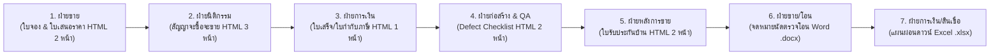

# SAMMAKORN — Real Estate Multi-Department Test Suite

**เอกสาร:** ชุดเทมเพลตและข้อมูลสำหรับทดสอบระบบสร้างเอกสารจริงในธุรกิจพัฒนาอสังหาริมทรัพย์  
**องค์กร:** บริษัท สัมมากร จำกัด (มหาชน) (SAMMAKORN PLC.)  
**เทคโนโลยี:** HTML + Handlebars · Gotenberg Chromium (Pixel-Perfect PDF) · ฟอนต์สารบรรณ (Sarabun)  
**ตำแหน่งไฟล์ทดสอบ:** [`docs/tests/real-estate/`](./real-estate/)  
**วันที่จัดทำ:** 2026-09-18  

---

## 🏢 1. วัตถุประสงค์และภาพรวมธุรกิจ (Business Context)

ชุดเอกสารนี้ถูกออกแบบขึ้นเพื่อทดสอบขีดความสามารถของ **smk-doc-server (V2)** ในการรองรับกระบวนการทำงานจริงของธุรกิจอสังหาริมทรัพย์อย่างครบวงจร (Customer Journey Lifecycle) ครอบคลุมตั้งแต่การจองโครงการ ไปจนถึงการโอนกรรมสิทธิ์และการรับประกันหลังการขาย โดยทดสอบทั้งเอกสารแบบหน้าเดียว (Single-Page) และหลายหน้า (Multi-Page):



---

## 📦 2. รายละเอียดชุดเอกสารทดสอบทั้ง 7 ฉบับ (HTML, Word, Excel)

### 2.1 ฝ่ายขายและการตลาด (Sales & Marketing)
* **ชื่อเอกสาร:** ใบเสนอราคาและยืนยันการจองแปลงที่ดินพร้อมบ้านเดี่ยว (Quotation & Property Booking Confirmation)
* **ไฟล์เทมเพลต:** [`01-sales-booking-quotation.html`](./real-estate/01-sales-booking-quotation.html)
* **ไฟล์ข้อมูล:** [`01-sales-booking-quotation.json`](./real-estate/01-sales-booking-quotation.json)
* **รูปแบบการแสดงผล:** **2 หน้า A4**
* **ฟีเจอร์ระบบที่ทดสอบ:**
  1. **หน้า 1:** ข้อมูลแปลงที่ดินและบ้านเดี่ยว, ตารางคำนวณราคาตั้งต้น, ส่วนลดแปลง, ส่วนลดแคมเปญ, ราคาขายสุทธิ, การแปลงตัวเลขเป็นบาทไทยตัวหนังสือ (`{{netPrice:thai_baht_text}}`), และบาร์โค้ดเลขที่ใบจอง (`{{barcode:bookingNo}}`)
  2. **หน้า 2:** ตารางงวดชำระ (เงินจอง, เงินทำสัญญา, ผ่อนดาวน์ 6 งวด, ยอดโอนกรรมสิทธิ์), ตารางแสดงของแถมผ่าน Handlebars Loop (`{{#each freeItems}}`), ประมาณการยอดผ่อนธนาคาร 30 ปี, QR Code พิกัดแปลงบน Google Maps (`{{qr:mapUrl}}`), และช่องลงนาม 2 ฝ่าย

---

### 2.2 ฝ่ายนิติกรรมและโอนกรรมสิทธิ์ (Legal & Land Registry)
* **ชื่อเอกสาร:** สัญญาจะซื้อจะขายที่ดินพร้อมสิ่งปลูกสร้าง (House and Land Purchase & Sale Agreement - SPA)
* **ไฟล์เทมเพลต:** [`02-legal-spa-contract.html`](./real-estate/02-legal-spa-contract.html)
* **ไฟล์ข้อมูล:** [`02-legal-spa-contract.json`](./real-estate/02-legal-spa-contract.json)
* **รูปแบบการแสดงผล:** **3 หน้า A4** (มาตรฐานสัญญาจัดสรรตาม พ.ร.บ. จัดสรรที่ดิน พ.ศ. 2543)
* **ฟีเจอร์ระบบที่ทดสอบ:**
  1. **การควบคุมการขึ้นหน้าใหม่อย่างแม่นยำ (Strict Page Breaking):** ใช้ `.page-break` และ `break-before: page;` แบ่งเป็น 3 หน้าสมบูรณ์
  2. **ความถูกต้องของตัวบทกฎหมายและตัวเลข:** วันที่ภาษาไทยแบบ พ.ศ. (`{{contractDate:thai_date}}`), แปลงตัวเลขราคาซื้อขายเป็นตัวหนังสือภาษาไทย (`{{totalPrice:thai_baht_text}}`), ข้อมูลโฉนดที่ดิน, หน้าสำรวจ, ระวาง, และเนื้อที่ (ไร่-งาน-ตร.ว.)
  3. **ข้อกำหนดสัญญา:** เงื่อนไขการโอนกรรมสิทธิ์, ภาษีธุรกิจเฉพาะ, ค่าธรรมเนียมการโอนคนละครึ่ง, เบี้ยปรับผิดนัดชำระร้อยละ 15 ต่อปี, ค่าบริการส่วนกลางล่วงหน้า 2 ปี
  4. **ช่องลงนาม 4 ฝ่าย:** ผู้จะขาย, ผู้จะซื้อ, พยาน 1, พยาน 2 พร้อมบาร์โค้ดสัญญา (`{{barcode:contractNo}}`)

---

### 2.3 ฝ่ายการเงินและบัญชี (Finance & Accounting)
* **ชื่อเอกสาร:** ใบเสร็จรับเงิน / ใบกำกับภาษี (Tax Invoice / Official Receipt)
* **ไฟล์เทมเพลต:** [`03-finance-tax-invoice-receipt.html`](./real-estate/03-finance-tax-invoice-receipt.html)
* **ไฟล์ข้อมูล:** [`03-finance-tax-invoice-receipt.json`](./real-estate/03-finance-tax-invoice-receipt.json)
* **รูปแบบการแสดงผล:** **1 หน้า A4** (ตามมาตรฐานกรมสรรพากร)
* **ฟีเจอร์ระบบที่ทดสอบ:**
  1. **การคำนวณทางบัญชี:** มูลค่าก่อนภาษี (Subtotal), ภาษีมูลค่าเพิ่ม (VAT 7%), ยอดรวมสุทธิ (Grand Total), ภาษีหัก ณ ที่จ่าย
  2. **ตัวหนังสือเงินบาทไทย:** `{{grandTotal:thai_baht_text}}`
  3. **PromptPay EMV QR Code:** สร้าง QR Code มาตรฐานพร้อมเพย์ผ่านระบบ (`{{qr:promptPayPayload}}`) สามารถใช้แอปธนาคารสแกนได้จริง
  4. **Barcode อ้างอิง:** `{{barcode:receiptNo}}` รหัส Code 128 สำหรับเครื่องสแกนบาร์โค้ด
  5. **การระบุช่องทางชำระเงิน:** การโอนเงินผ่านระบบธนาคาร, เลขที่อ้างอิงธุรกรรม (Transaction Ref)

---

### 2.4 ฝ่ายก่อสร้างและส่งมอบบ้าน (Quality Assurance & Handover)
* **ชื่อเอกสาร:** เอกสารตรวจรับมอบบ้านและรายการข้อบกพร่อง (Home Inspection & Defect Handover Inspection Sheet)
* **ไฟล์เทมเพลต:** [`04-qa-handover-defect-checklist.html`](./real-estate/04-qa-handover-defect-checklist.html)
* **ไฟล์ข้อมูล:** [`04-qa-handover-defect-checklist.json`](./real-estate/04-qa-handover-defect-checklist.json)
* **รูปแบบการแสดงผล:** **2 หน้า A4**
* **ฟีเจอร์ระบบที่ทดสอบ:**
  1. **หน้า 1 (งานสถาปัตย์):** ตารางตรวจพื้นผิว, สีผนัง, ประตูหน้าต่าง, ฝ้าเพดาน, รอยแตกลายงา
  2. **หน้า 2 (งานระบบ MEP):** ตารางตรวจระบบไฟฟ้า, แรงดันน้ำประปา, เบรกเกอร์ Schneider, สายดิน, การระบายน้ำ Floor Drain
  3. **Dynamic Status Styling:** แสดงป้ายสถานะ `ผ่าน (PASS)` สีเขียว หรือ `แก้ไข (DEFECT)` สีแดง ตามข้อมูลใน JSON
  4. **สรุปสถิติข้อบกพร่อง:** แสดงจำนวนรายการที่ผ่าน, จำนวน Defect ที่ต้องแก้ไข, กำหนดวันส่งมอบงานแก้, วันนัดตรวจซ้ำ
  5. **ลงนาม 3 ฝ่าย:** ลูกค้าผู้รับมอบ, วิศวกรโครงการ (QA), ผู้จัดการสายงานก่อสร้าง

---

### 2.5 ฝ่ายบริการหลังการขายและนิติบุคคล (After-Sales & Warranty)
* **ชื่อเอกสาร:** หนังสือรับรองการรับประกันสิ่งปลูกสร้างและการส่งมอบบ้าน (Home Warranty Certificate & Service Pass)
* **ไฟล์เทมเพลต:** [`05-aftersales-home-warranty.html`](./real-estate/05-aftersales-home-warranty.html)
* **ไฟล์ข้อมูล:** [`05-aftersales-home-warranty.json`](./real-estate/05-aftersales-home-warranty.json)
* **รูปแบบการแสดงผล:** **2 หน้า A4**
* **ฟีเจอร์ระบบที่ทดสอบ:**
  1. **หน้า 1 (ใบรับประกัน):** ขอบเขตประกันโครงสร้าง 5 ปี, สถาปัตย์ 1 ปี, งานระบบ 1 ปี, ระบบกำจัดปลวก 3 ปี พร้อมคำนวณวันสิ้นสุดประกัน
  2. **การส่งมอบอุปกรณ์:** หมายเลขมิเตอร์ไฟฟ้า, หมายเลขมิเตอร์น้ำ, จำนวนกุญแจ, รีโมทประตูรั้ว, คีย์การ์ดเข้าโครงการ
  3. **หน้า 2 (คู่มือบริการ & ข้อยกเว้น):** ช่องทางติดต่อ Sammakorn Care 1427, กรณีฉุกเฉิน 24 ชม., เงื่อนไขข้อยกเว้นกรณีต่อเติมโครงสร้างเอง
  4. **Line Official QR Code:** สร้าง QR Code เชื่อมต่อไปยัง Line OA `@sammakorncare` เพื่อแจ้งซ่อมออนไลน์
  5. **Barcode เอกสารรับประกัน:** `{{barcode:warrantyId}}`

---

### 2.6 ฝ่ายขายและการตลาด — หนังสือแจ้งนัดตรวจบ้านและโอนกรรมสิทธิ์ (Word .docx)
* **ชื่อเอกสาร:** จดหมายทางการแจ้งนัดตรวจรับมอบและโอนกรรมสิทธิ์ห้องชุด/บ้านเดี่ยว (Official Handover & Title Transfer Invitation)
* **ไฟล์เทมเพลต:** [`06-sales-handover-letter.docx`](./real-estate/06-sales-handover-letter.docx)
* **ไฟล์ข้อมูล:** [`06-sales-handover-letter.json`](./real-estate/06-sales-handover-letter.json)
* **ผลลัพธ์การเรนเดอร์:**
  - Word Output: [`output-06-sales-handover-letter.docx`](./real-estate/output-06-sales-handover-letter.docx) (3,123 bytes)
  - PDF Output: [`output-06-sales-handover-letter.pdf`](./real-estate/output-06-sales-handover-letter.pdf) (41,646 bytes via Gotenberg LibreOffice)
* **เอนจินประมวลผล:** `DocxTemplateEngine` (OpenXML + `WordTableExpander` + `WordTextReplacer` + `WordMediaInjector`)
* **ฟีเจอร์ระบบที่ทดสอบ:**
  1. **Dynamic Table Expansion:** ตารางแจกแจงค่าใช้จ่ายวันโอน (ค่าธรรมเนียมโอน, ค่าส่วนกลางล่วงหน้า 2 ปี, ค่าประกันมิเตอร์ไฟ-น้ำ) ขยายแถวอัตโนมัติตาม Array ใน JSON (`{{items.id}}`, `{{items.name}}`, `{{items.amount}}`)
  2. **Text Replacements:** ชื่อลูกค้า, ที่อยู่, โครงการ, เลขแปลง, แบบบ้าน, เลขโฉนด, สำนักงานที่ดิน
  3. **Thai Data Transforms:** วันที่ภาษาไทย `{{issueDate:thai_date}}`, `{{transferDate:thai_date}}`, ยอดรวมเป็นตัวหนังสือไทย `{{totalPayableAmount:thai_baht_text}}`
  4. **DrawingML Barcode Injection:** บาร์โค้ด Code 128 `{{barcode:noticeNo}}` ถูกฉีดเป็นภาพลงในย่อหน้าโดยมี DrawingML `Id > 0` ถูกต้องตามมาตรฐาน OpenXML

---

### 2.7 ฝ่ายการเงินและสินเชื่อ — ตารางคำนวณเงินดาวน์และสินเชื่อ (Excel .xlsx)
* **ชื่อเอกสาร:** ตารางคำนวณราคาแปลงที่ดินและแผนการผ่อนชำระเงินดาวน์ (Financial Model & Down Payment Schedule)
* **ไฟล์เทมเพลต:** [`07-finance-downpayment-plan.xlsx`](./real-estate/07-finance-downpayment-plan.xlsx)
* **ไฟล์ข้อมูล:** [`07-finance-downpayment-plan.json`](./real-estate/07-finance-downpayment-plan.json)
* **ผลลัพธ์การเรนเดอร์:**
  - Excel Output: [`output-07-finance-downpayment-plan.xlsx`](./real-estate/output-07-finance-downpayment-plan.xlsx) (7,621 bytes)
  - PDF Output: [`output-07-finance-downpayment-plan.pdf`](./real-estate/output-07-finance-downpayment-plan.pdf) (32,745 bytes via Gotenberg LibreOffice)
* **เอนจินประมวลผล:** `ExcelTemplateEngine` (ClosedXML + `ExcelTableExpander`)
* **ฟีเจอร์ระบบที่ทดสอบ:**
  1. **Formula Auto-Shifting (การเลื่อนสูตรอัตโนมัติ):** เมื่อ `ExcelTableExpander` ขยายแถวงวดเงินดาวน์ตามข้อมูล JSON สูตรคำนวณผลรวม `=SUM(D10:D15)` จะถูกเลื่อนบรรทัดและอัปเดตช่วงเซลล์ตามจำนวนแถวจริงโดยอัตโนมัติ
  2. **Cell Formats & Thai Currency:** จัดการรูปแบบเซลล์ตัวเลข บัญชี วันที่ และสีธีมของสัมมากร
  3. **A4 Page Setup & Printing:** กำหนดขนาดกระดาษ `ws.PageSetup.PaperSize = XLPaperSize.A4Paper`, วางแนวแนวตั้ง (Portrait), และ Fit-to-Page 1 แผ่น พอดีสำหรับการแปลงเป็น PDF

---

## 🏛️ 3. สถาปัตยกรรมเชิงลึก: การแยก Header / Footer และ Engine Internals

### 3.1 การแยก Header & Footer ใน HTML Engine (`HtmlTemplateEngine`)
ในระบบ HTML-to-PDF ผ่าน Chromium นั้น Gotenberg รองรับการแยก Header และ Footer ออกจาก Body อย่างแท้จริงผ่านไฟล์ `header.html` และ `footer.html` โดยระบบ `smk-doc-server` ออกแบบให้ผู้ใช้เขียนรวมไว้ในไฟล์เดียว แล้วทำการ Parse แยกให้อัตโนมัติ:

```html
<!-- ตัวอย่างการเขียนในเทมเพลต HTML (เช่น 02-legal-spa-contract.html) -->
<template id="header">
  <div style="font-family: 'Sarabun', sans-serif; font-size: 8pt; color: #94a3b8; width: 100%; border-bottom: 1px solid #cbd5e1; padding-bottom: 4px; display: flex; justify-content: space-between;">
    <span>บริษัท สัมมากร จำกัด (มหาชน) — สัญญาจะซื้อจะขายที่ดินพร้อมสิ่งปลูกสร้าง</span>
    <span>เลขที่สัญญา: {{contractNo}}</span>
  </div>
</template>

<template id="footer">
  <div style="font-family: 'Sarabun', sans-serif; font-size: 8pt; color: #94a3b8; width: 100%; border-top: 1px solid #cbd5e1; padding-top: 4px; display: flex; justify-content: space-between;">
    <span>เอกสารสำคัญของทางราชการและบริษัท — ห้ามแก้ไขหรือทำลาย</span>
    <span>หน้าที่ <span class="pageNumber"></span> / <span class="totalPages"></span></span>
  </div>
</template>

<!-- เนื้อหา Body ของเอกสาร -->
<div class="contract-page">...เนื้อหาหน้าที่ 1...</div>
<div class="page-break"></div>
<div class="contract-page">...เนื้อหาหน้าที่ 2...</div>
```

#### กลไกการทำงานเบื้องหลัง (Engine Pipeline):
1. **Regex Extraction:** `HtmlTemplateEngine.cs` จะดึงเนื้อหาภายใน `<template id="header">` และ `<template id="footer">` ออกมาจัดเก็บเป็นเนื้อหาสำหรับ `header.html` และ `footer.html`
2. **Tag Removal:** ลบแท็ก `<template id="header">` และ `<template id="footer">` ออกจากโค้ด HTML หลัก (`index.html`) เพื่อป้องกันไม่ให้ข้อความไปโผล่ซ้ำในเนื้อหา
3. **Multi-Part Gotenberg Payload:** ส่งทั้ง 3 ไฟล์ (`index.html`, `header.html`, `footer.html`) เข้า Gotenberg API (`/forms/chromium/convert/html`) พร้อมกัน
4. **Chromium Native Page Numbering:** Chromium จะแทนที่คลาสต่อไปนี้ใน `header.html`/`footer.html` โดยอัตโนมัติในทุกหน้า:
   - `<span class="pageNumber"></span>` → เลขหน้าปัจจุบัน (เช่น 1, 2, 3)
   - `<span class="totalPages"></span>` → จำนวนหน้าทั้งหมด (เช่น 3)
   - `<span class="date"></span>` → วันที่พิมพ์
5. **Critical CSS Margin Rule:** ใน CSS ของเอกสารหลัก ต้องกำหนดขอบกระดาษ `@page` เผื่อพื้นที่ให้ Header และ Footer เสมอ:
   ```css
   @page {
     size: A4;
     margin-top: 25mm;    /* เว้นพื้นที่ให้ Header ด้านบน */
     margin-bottom: 22mm; /* เว้นพื้นที่ให้ Footer ด้านล่าง */
     margin-left: 18mm;
     margin-right: 18mm;
   }
   ```
   และใน Header/Footer ต้องใส่สไตล์ Inline เช่น `font-size: 8pt; width: 100%;` และ `-webkit-print-color-adjust: exact;`

---

### 3.2 การจัดการ Header & Footer และ Table ใน Word Engine (`DocxTemplateEngine`)
Word (.docx) ใช้โครงสร้าง OpenXML (ZIP package) ที่แยกชิ้นส่วนเอกสาร:
* **Header & Footer Parts:** อยู่ใน `word/header1.xml` และ `word/footer1.xml` เชื่อมโยงผ่าน `w:headerReference` และ `w:footerReference` ใน `w:sectPr` ของ Body
* **Repeating Table Header:** ตารางที่ยาวข้ามหน้า กำหนด `<w:tblHeader/>` ที่แถวแรก เพื่อให้หัวตารางทำซ้ำอัตโนมัติในทุกหน้าที่ตารางไหลไป
* **WordTableExpander:** ค้นหาแถวที่มี Placeholder แบบอาร์เรย์ (`{{items.field}}`), โคลนแถวตามจำนวนสมาชิกใน JSON, แทนค่าแต่ละเซลล์, และแทรกกลับเข้า Table Node
* **WordMediaInjector:** แทนที่แท็ก `{{barcode:...}}` และ `{{qrcode:...}}` ด้วย DrawingML Node โดยบังคับให้ `pic:cNvPr Id > 0` เพื่อป้องกันไม่ให้ Microsoft Word แจ้งเตือนไฟล์เสียหาย

---

### 3.3 การจัดการ Header & Footer และ Formulas ใน Excel Engine (`ExcelTemplateEngine`)
Excel (.xlsx) ใช้ ClosedXML ในการจัดการ Spreadsheet:
* **Header & Footer:** ใช้ `ws.HeaderFooter.OddHeader` และ `ws.HeaderFooter.OddFooter` หรือการตั้งค่า `ws.PageSetup.SetRowsToRepeatAtTop(1, 3)` เพื่อให้แถวหัวตารางพิมพ์ซ้ำทุกหน้า
* **ExcelTableExpander & Formula Shifting:** เมื่อแทรกแถวข้อมูลใหม่ ClosedXML จะปรับเลื่อน Range ใน Formula อัตโนมัติ (เช่น `=SUM(D10:D15)` จะขยายเป็น `=SUM(D10:D25)`)
* **Page Setup for Printing:** ตั้งค่า `ws.PageSetup.PaperSize = XLPaperSize.A4Paper` และปรับ Fit-to-Page เพื่อให้พร้อมส่งต่อ LibreOffice แปลงเป็น PDF คุณภาพสูงได้ทันที

---

## 📊 4. ผลการทดสอบเรนเดอร์จริงบนระบบ (Live Render Results)

ผลการทดสอบยิงผ่าน Endpoint `POST /api/documents/render/stateless` และ Unit/Integration Tests ของ smk-doc-server ครบทั้ง 7 เทมเพลต:

| # | ฝ่าย / แผนก | รูปแบบไฟล์ | ชื่อเอกสาร | ขนาดไฟล์ Output | แปลง PDF | ผลการทดสอบ |
|:---:|---|:---:|---|:---:|:---:|:---:|
| **1** | ฝ่ายขายและการตลาด | **HTML** | ใบเสนอราคาและยืนยันการจอง (2 หน้า) | 171,829 bytes | Chromium | ✅ **PASS** |
| **2** | ฝ่ายนิติกรรมและสัญญา | **HTML** | สัญญาจะซื้อจะขายที่ดินพร้อมสิ่งปลูกสร้าง (3 หน้า + Header/Footer) | 88,167 bytes | Chromium | ✅ **PASS** |
| **3** | ฝ่ายการเงินและบัญชี | **HTML** | ใบเสร็จรับเงิน / ใบกำกับภาษี (1 หน้า + QR PromptPay) | 60,494 bytes | Chromium | ✅ **PASS** |
| **4** | ฝ่ายก่อสร้างและ QA | **HTML** | รายการตรวจรับมอบบ้าน (Defect Checklist 2 หน้า) | 70,123 bytes | Chromium | ✅ **PASS** |
| **5** | ฝ่ายบริการหลังการขาย | **HTML** | หนังสือรับรองการรับประกันบ้านและส่งมอบ (2 หน้า + Line QR) | 79,890 bytes | Chromium | ✅ **PASS** |
| **6** | ฝ่ายขายและการตลาด | **Word (.docx)** | หนังสือเชิญตรวจรับมอบและโอนกรรมสิทธิ์ | 3,123 bytes | 41,646 bytes (LibreOffice) | ✅ **PASS** |
| **7** | ฝ่ายการเงินและสินเชื่อ | **Excel (.xlsx)** | ตารางคำนวณราคาแปลงและเงินดาวน์ (Formulas) | 7,621 bytes | 32,745 bytes (LibreOffice) | ✅ **PASS** |

> **หมายเหตุ:** ไฟล์ Output ทั้งหมด (PDF, DOCX, XLSX) จากการทดสอบจริงถูกบันทึกไว้ใน [`docs/tests/real-estate/`](./real-estate/) สามารถเปิดตรวจสอบได้ทันที

---

## 🛠️ 5. คำสั่งสำหรับรันการทดสอบด้วยตนเอง (How to Test)

### 5.1 ทดสอบเรนเดอร์ผ่าน cURL (Stateless API Rendering)
รันคำสั่งใน Terminal เพื่อทดสอบเรนเดอร์ไฟล์เป็น PDF ผ่านระบบ:

```powershell
# 1. ทดสอบ HTML (สัญญาจะซื้อจะขาย 3 หน้า พร้อม Header/Footer)
curl.exe -s -X POST "http://localhost:8080/api/documents/render/stateless" `
  -H "X-API-Key: secret-smk-key-2026" `
  -F "file=@docs/tests/real-estate/02-legal-spa-contract.html;filename=spa.html" `
  -F "jsonData=@docs/tests/real-estate/02-legal-spa-contract.json" `
  -o "docs/tests/real-estate/output-02-legal-spa.pdf"

# 2. ทดสอบ Word (.docx -> PDF ผ่าน LibreOffice)
curl.exe -s -X POST "http://localhost:8080/api/documents/render/stateless" `
  -H "X-API-Key: secret-smk-key-2026" `
  -F "file=@docs/tests/real-estate/06-sales-handover-letter.docx;filename=letter.docx" `
  -F "jsonData=@docs/tests/real-estate/06-sales-handover-letter.json" `
  -o "docs/tests/real-estate/output-06-sales-handover-letter.pdf"

# 3. ทดสอบ Excel (.xlsx -> PDF ผ่าน LibreOffice พร้อมสูตรคำนวณ)
curl.exe -s -X POST "http://localhost:8080/api/documents/render/stateless" `
  -H "X-API-Key: secret-smk-key-2026" `
  -F "file=@docs/tests/real-estate/07-finance-downpayment-plan.xlsx;filename=plan.xlsx" `
  -F "jsonData=@docs/tests/real-estate/07-finance-downpayment-plan.json" `
  -o "docs/tests/real-estate/output-07-finance-downpayment-plan.pdf"
```

### 5.2 รัน Automated Generator & Regression Tests ผ่าน .NET CLI
```powershell
dotnet test backend-v2/tests/SmkDoc.Tests/SmkDoc.Tests.csproj --filter "FullyQualifiedName~RealEstateDocumentsGeneratorTests"
```

### 5.3 ทดสอบผ่าน Web Portal UI (`http://localhost:3500/`)
1. เข้าไปที่ **`http://localhost:3500/`**
2. เลือกเมนู **"อัปโหลด Template"** หรือ **"Template Editor (Studio)"**
3. คัดลอกโค้ด HTML จากโฟลเดอร์ `docs/tests/real-estate/` วางลงใน Monaco Editor
4. สลับไปที่หน้า **"สร้างเอกสาร" (Generator)** และนำข้อมูลจากไฟล์ `.json` ไปวางในช่อง JSON Payload
5. กดปุ่ม **"สร้างเอกสาร"** หรือ **"Live Preview"** เพื่อดูผลลัพธ์ผ่านหน้าจอได้ทันที
